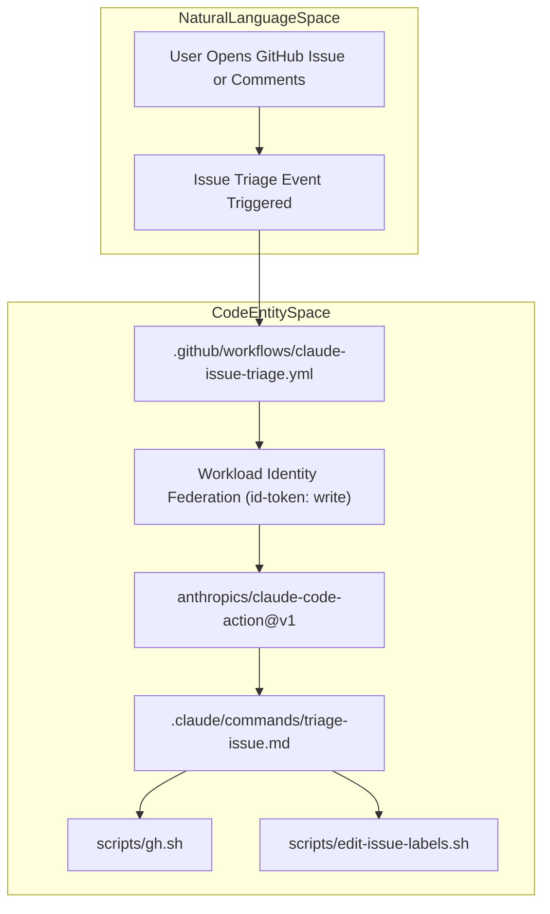
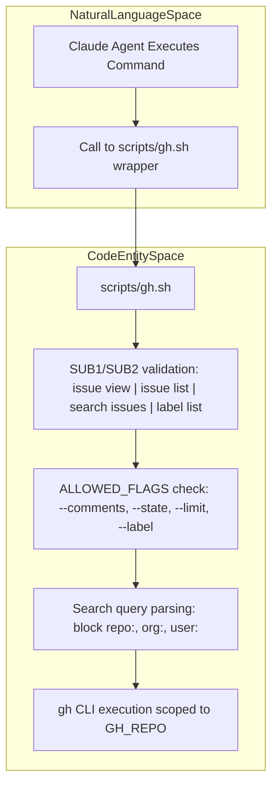

<!-- source: DeepWiki mcp.deepwiki.com · repo anthropics/claude-code · page 6.1 AI-Powered Issue Triage · fetched 2026-10-26 -->

# AI-Powered Issue Triage

Relevant source files

The following files were used as context for generating this wiki page:

- [.claude/commands/commit-push-pr.md](.claude/commands/commit-push-pr.md)
- [.claude/commands/dedupe.md](.claude/commands/dedupe.md)
- [.claude/commands/triage-issue.md](.claude/commands/triage-issue.md)
- [.github/workflows/claude-dedupe-issues.yml](.github/workflows/claude-dedupe-issues.yml)
- [.github/workflows/claude-issue-triage.yml](.github/workflows/claude-issue-triage.yml)
- [.github/workflows/claude.yml](.github/workflows/claude.yml)
- [scripts/comment-on-duplicates.sh](scripts/comment-on-duplicates.sh)
- [scripts/edit-issue-labels.sh](scripts/edit-issue-labels.sh)
- [scripts/gh.sh](scripts/gh.sh)

The AI-powered issue triage system automatically analyzes GitHub issues and applies appropriate labels using Claude Opus as a classification engine (`claude-opus-4-6`). When an issue is opened or receives a new comment, the system reads the issue content, evaluates it against available repository labels, and applies relevant category and lifecycle labels. This triage functionality runs autonomously without posting comments, ensuring minimal disruption on issues.

This triage system is distinct but complementary to the deduplication workflow (`.github/workflows/claude-dedupe-issues.yml`) and lifecycle management workflows.

---

## Purpose and Scope

This document provides a detailed technical overview of the AI-powered issue triage implementation, including:

- GitHub Actions workflow triggering, concurrency controls, and OIDC Workload Identity Federation in `.github/workflows/claude-issue-triage.yml:1-55`().
- Security wrapper script `scripts/gh.sh` that restricts GitHub CLI operations accessible to triage commands in `scripts/gh.sh:1-96`().
- Claude-powered triage command specification and label classification logic at `.claude/commands/triage-issue.md:1-75`().
- Lifecycle label determination (`needs-info`, `needs-repro`) for bug report management in `.claude/commands/triage-issue.md:43-51`().
- Applying validated label changes atomically via `scripts/edit-issue-labels.sh:1-85`().

Sources: [.github/workflows/claude-issue-triage.yml:1-54](), [.claude/commands/triage-issue.md:1-74](), [scripts/gh.sh:1-96](), [scripts/edit-issue-labels.sh:1-84]()

---

## Workflow Orchestration & OIDC Federation

The triage process is initiated by the GitHub Actions workflow defined in `.github/workflows/claude-issue-triage.yml:1-55`(). It runs on a specialized firewall-restricted runner and relies on Workload Identity Federation for secure, keyless authentication to the Anthropic API.

### Workflow Trigger and Environment Configuration

- **Triggers**: Configured for `issues` (`opened`) and `issue_comment` (`created`) events [.github/workflows/claude-issue-triage.yml:2-7]().
- **Runner**: Executes on `ubuntu-24.04-firewall` with network egress filtering [.github/workflows/claude-issue-triage.yml:12]().
- **Concurrency**: Scoped per issue number (`issue-triage-${{ github.event.issue.number }}`) with `cancel-in-progress: true` to prevent race conditions [.github/workflows/claude-issue-triage.yml:17-19]().
- **Permissions**: Requires `contents: read`, `issues: write`, and `id-token: write` [.github/workflows/claude-issue-triage.yml:20-24]().

### OIDC Authentication

The `id-token: write` permission mints a short-lived GitHub OIDC token. This token is exchanged via `anthropics/claude-code-action@v1` using repository variables (`ANTHROPIC_FEDERATION_RULE_ID`, `ANTHROPIC_ORGANIZATION_ID`, `ANTHROPIC_SERVICE_ACCOUNT_ID`, `ANTHROPIC_WORKSPACE_ID`) to obtain an Anthropic API access token without storing static secrets [.github/workflows/claude-issue-triage.yml:23-47]().

### Diagram: Natural Language Space to Code Entity Space - Triage Execution Pipeline

Sources: [.github/workflows/claude-issue-triage.yml:1-54](), [.claude/commands/triage-issue.md:1-74](), [scripts/gh.sh:1-96](), [scripts/edit-issue-labels.sh:1-84]()

---

## Triage Command Specification (`/triage-issue`)

The core prompt and tool-use restrictions for triage are declared in `.claude/commands/triage-issue.md:1-75`(). The model is invoked with strict tool boundaries (`--disallowedTools "WebFetch,WebSearch,Write,Edit,MultiEdit,NotebookEdit"` and `--permission-mode auto`) [.github/workflows/claude-issue-triage.yml:51-54]().

### Allowed Tools

The command permits only two executable scripts:
1. `Bash(./scripts/gh.sh:*)` [.claude/commands/triage-issue.md:2]()
2. `Bash(./scripts/edit-issue-labels.sh:*)` [.claude/commands/triage-issue.md:2]()

### Execution Flow for New Issues (`EVENT == "issues"`)

1. **Label Discovery**: Executes `./scripts/gh.sh label list` to fetch valid repository labels [.claude/commands/triage-issue.md:27]().
2. **Issue Inspection**: Calls `./scripts/gh.sh issue view ISSUE_NUMBER` and `./scripts/gh.sh issue view ISSUE_NUMBER --comments` [.claude/commands/triage-issue.md:28-29]().
3. **Product Signal Validation**: Checks body text for Claude Code signals (CLI versions, `.claude/` files, MCP servers, etc.). If non-Claude Anthropic products are the subject, applies the `invalid` label [.claude/commands/triage-issue.md:34-36]().
4. **Category & Duplicate Analysis**: Classifies issue type (`bug`, `enhancement`, `question`) and searches for duplicate open issues using `./scripts/gh.sh search issues` [.claude/commands/triage-issue.md:38-41]().
5. **Lifecycle Label Evaluation**:
   - `needs-repro`: Applied to bug reports missing clear reproduction steps after 7 days [.claude/commands/triage-issue.md:43-46]().
   - `needs-info`: Applied to bug reports missing environment or error details [.claude/commands/triage-issue.md:47-49]().
6. **Atomic Application**: Invokes `./scripts/edit-issue-labels.sh` to apply finalized labels [.claude/commands/triage-issue.md:53-54]().

### Execution Flow for Comments (`EVENT == "issue_comment"`)

When triggered by a comment, the agent evaluates conversation progress:
- Removes `stale`, `autoclose`, `needs-repro`, or `needs-info` if substantive human activity or requested information is provided [.claude/commands/triage-issue.md:58-62]().
- Does not modify category labels on comment events [.claude/commands/triage-issue.md:65]().

Sources: [.claude/commands/triage-issue.md:1-74]()

---

## Security & Command Validation Layer (`scripts/gh.sh`)

To prevent arbitrary or malicious `gh` CLI commands from executing during triage, `scripts/gh.sh` acts as a security wrapper [scripts/gh.sh:1-96]().

### Enforcement Mechanisms

- **Command Whitelist**: Restricts allowed subcommands to `issue view`, `issue list`, `search issues`, and `label list` [scripts/gh.sh:29-36]().
- **Flag Whitelist**: Permits only `--comments`, `--state`, `--limit`, and `--label` [scripts/gh.sh:23]().
- **Query Sanitization**: Rejects search queries containing `repo:`, `org:`, or `user:` qualifiers to prevent cross-repository data extraction [scripts/gh.sh:76-82]().
- **Repository Scoping**: Automatically binds execution to `GH_REPO` or `GITHUB_REPOSITORY` [scripts/gh.sh:16-21]().

### Diagram: Natural Language Space to Code Entity Space - Security Wrapper Architecture

Sources: [scripts/gh.sh:1-96]()

---

## Label Application & Atomicity (`scripts/edit-issue-labels.sh`)

Label changes decided by the triage model are committed via `scripts/edit-issue-labels.sh` [scripts/edit-issue-labels.sh:1-84]().

### Key Implementation Details

- **Event Binding**: Extracts the target issue number from `${GITHUB_EVENT_PATH}` (`.issue.number`) with a fallback to `workflow_dispatch` inputs [scripts/edit-issue-labels.sh:11-17]().
- **Repository Validation**: Fetches valid labels from the repository (`gh label list`) and filters requested additions/removals against actual repository metadata to prevent invalid label creation [scripts/edit-issue-labels.sh:44-60]().
- **Atomic Batching**: Combines all valid `--add-label` and `--remove-label` flags into a single `gh issue edit` execution [scripts/edit-issue-labels.sh:66-77]().

Sources: [scripts/edit-issue-labels.sh:1-84]()

---

## Summary Table of Triage Components

| Component | File Path | Role / Purpose |
|---|---|---|
| Triage Workflow | `.github/workflows/claude-issue-triage.yml` [__meta__:1-55]() | Orchestrates event triggers, concurrency, OIDC federation, and runner configuration. |
| Triage Command | `.claude/commands/triage-issue.md` [__meta__:1-75]() | Defines Claude prompt instructions, label rules, and restricted tool permissions. |
| GH Wrapper | `scripts/gh.sh` [__meta__:1-96]() | Security wrapper restricting `gh` CLI subcommands, flags, and query qualifiers. |
| Label Script | `scripts/edit-issue-labels.sh` [__meta__:1-85]() | Validates and applies add/remove label batches atomically to target issues. |

Sources: [.github/workflows/claude-issue-triage.yml:1-54](), [.claude/commands/triage-issue.md:1-74](), [scripts/gh.sh:1-96](), [scripts/edit-issue-labels.sh:1-84]()

---

