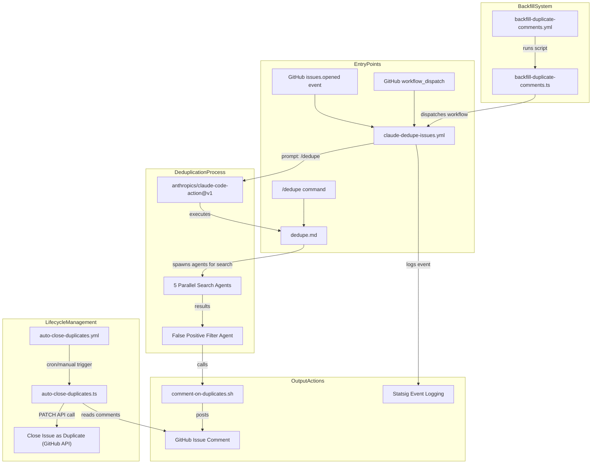
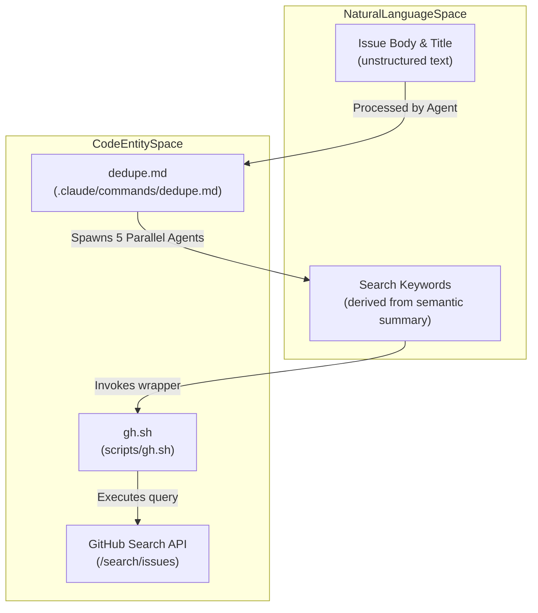
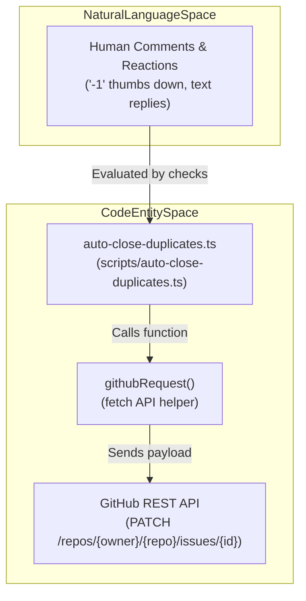

<!-- source: DeepWiki mcp.deepwiki.com · repo anthropics/claude-code · page 6.2 Issue Deduplication System · fetched 2026-10-26 -->

# Issue Deduplication System

Relevant source files

The following files were used as context for generating this wiki page:

- [.claude/commands/commit-push-pr.md](.claude/commands/commit-push-pr.md)
- [.claude/commands/dedupe.md](.claude/commands/dedupe.md)
- [.claude/commands/triage-issue.md](.claude/commands/triage-issue.md)
- [.github/workflows/auto-close-duplicates.yml](.github/workflows/auto-close-duplicates.yml)
- [.github/workflows/backfill-duplicate-comments.yml](.github/workflows/backfill-duplicate-comments.yml)
- [.github/workflows/claude-dedupe-issues.yml](.github/workflows/claude-dedupe-issues.yml)
- [.github/workflows/claude-issue-triage.yml](.github/workflows/claude-issue-triage.yml)
- [.github/workflows/claude.yml](.github/workflows/claude.yml)
- [.github/workflows/issue-lifecycle-comment.yml](.github/workflows/issue-lifecycle-comment.yml)
- [.github/workflows/log-issue-events.yml](.github/workflows/log-issue-events.yml)
- [.github/workflows/sweep.yml](.github/workflows/sweep.yml)
- [scripts/auto-close-duplicates.ts](scripts/auto-close-duplicates.ts)
- [scripts/backfill-duplicate-comments.ts](scripts/backfill-duplicate-comments.ts)
- [scripts/comment-on-duplicates.sh](scripts/comment-on-duplicates.sh)
- [scripts/edit-issue-labels.sh](scripts/edit-issue-labels.sh)
- [scripts/gh.sh](scripts/gh.sh)
- [scripts/issue-lifecycle.ts](scripts/issue-lifecycle.ts)
- [scripts/lifecycle-comment.ts](scripts/lifecycle-comment.ts)
- [scripts/sweep.ts](scripts/sweep.ts)

## Purpose and Scope

The Issue Deduplication System automates the identification, notification, and lifecycle management of duplicate issues within the `anthropics/claude-code` GitHub repository [.github/workflows/claude-dedupe-issues.yml:1-5](). It leverages Claude Code’s AI-driven multi-agent workflows to semantically analyze issue content and perform parallel searches for potential duplicates, exceeding traditional keyword matching capabilities [.claude/commands/dedupe.md:6-18]().

Key components and workflows include:
- The `/dedupe` command defined in `.claude/commands/dedupe.md`, which executes a multi-agent search orchestration with automated filtering and commenting [.claude/commands/dedupe.md:1-27]().
- The `claude-dedupe-issues` GitHub Actions workflow triggered on new issues or via workflow dispatch [.github/workflows/claude-dedupe-issues.yml:3-12]().
- An automated safety-conscious auto-close mechanism managed by `scripts/auto-close-duplicates.ts` with a 3-day human feedback window [.github/workflows/auto-close-duplicates.yml:1-31](), [scripts/auto-close-duplicates.ts:99-194]().
- A backfill workflow orchestrated by `scripts/backfill-duplicate-comments.ts` to process historical issues lacking duplicate detection [.github/workflows/backfill-duplicate-comments.yml:1-20](), [scripts/backfill-duplicate-comments.ts:72-100]().

For the issue classification step before deduplication, see [AI-Powered Issue Triage (6.1)](6.1). For managing issue lifecycle beyond deduplication, see [Issue Lifecycle Management (6.3)](6.3).

Sources:
- [.github/workflows/claude-dedupe-issues.yml:1-12]()
- [.claude/commands/dedupe.md:1-27]()
- [.github/workflows/auto-close-duplicates.yml:1-31]()
- [scripts/auto-close-duplicates.ts:99-194]()
- [.github/workflows/backfill-duplicate-comments.yml:1-20]()
- [scripts/backfill-duplicate-comments.ts:72-100]()

## System Architecture

The Issue Deduplication System integrates multiple components orchestrated through GitHub workflows, custom command definitions, and TypeScript automation scripts.

### Architecture Diagram: Issue Deduplication Component Interaction

Sources:
- [.github/workflows/claude-dedupe-issues.yml:3-48]()
- [.claude/commands/dedupe.md:1-18]()
- [.github/workflows/auto-close-duplicates.yml:3-26]()
- [scripts/auto-close-duplicates.ts:73-97]()
- [scripts/backfill-duplicate-comments.ts:47-70]()

## The `/dedupe` Command

The `/dedupe` command provides the core interactive interface for detecting duplicates on-demand [.claude/commands/dedupe.md:1-6](). It encapsulates a controlled multi-agent workflow with restricted tooling [.claude/commands/dedupe.md:2]().

### Command Definition and Access Control
- **Definition**: Defined in `.claude/commands/dedupe.md` [.claude/commands/dedupe.md:1-4]().
- **Tool Constraints**: Restricted via frontmatter allowed-tools to `Bash(./scripts/gh.sh:*)` and `Bash(./scripts/comment-on-duplicates.sh:*)` [.claude/commands/dedupe.md:2]().
- **Security**: Relies on a secure `gh.sh` wrapper script to interact with GitHub without exposing unrestricted shell or file-write capabilities [.claude/commands/dedupe.md:21-26]().

### Execution Steps
1. **Pre-check**: An agent checks if the GitHub issue is closed, is broad product feedback without a specific solution, or already has a duplicate comment [.claude/commands/dedupe.md:10]().
2. **Summarization**: An agent views the GitHub issue via `./scripts/gh.sh issue view` to return a semantic summary [.claude/commands/dedupe.md:11]().
3. **Parallel Search**: The system launches **5 parallel search agents** using diverse keywords and search heuristics derived from the summary [.claude/commands/dedupe.md:12]().
4. **Filtering**: A separate filtering agent evaluates the aggregated search results to eliminate false positives [.claude/commands/dedupe.md:13]().
5. **Posting**: If valid duplicates remain, the agent invokes `./scripts/comment-on-duplicates.sh` with up to three potential duplicate issue numbers [.claude/commands/dedupe.md:14-17]().

Sources:
- [.claude/commands/dedupe.md:1-27]()
- [scripts/gh.sh:1-36]()

## Auto-Close Duplicate Issues

The system automatically closes issues confirmed as duplicates after a 3-day waiting period, ensuring an adequate window for human review and feedback [.github/workflows/auto-close-duplicates.yml:1-6](), [scripts/auto-close-duplicates.ts:112-194]().

### Scheduled Workflow
- **Frequency**: Runs daily via cron schedule `"0 9 * * *"` or manual workflow dispatch [.github/workflows/auto-close-duplicates.yml:4-6]().
- **Execution Engine**: Runs `scripts/auto-close-duplicates.ts` using the Bun runtime [.github/workflows/auto-close-duplicates.yml:25-26]().

### Closure Logic (`auto-close-duplicates.ts`)
The script `autoCloseDuplicates()` evaluates open issues and performs several guardrail validations before closing:
- **Bot Comment Identification**: Scans comments for text containing `"Found"` and `"possible duplicate"` posted by users of type `"Bot"` [scripts/auto-close-duplicates.ts:164-169]().
- **3-Day Waiting Period**: Skips issues where the duplicate comment was posted less than 3 days prior [scripts/auto-close-duplicates.ts:189-194]().
- **Human Activity Check**: Inspects comments created after the duplicate detection comment; skips if any human activity is detected [scripts/auto-close-duplicates.ts:203-215]().
- **Author Disagreement**: Fetches reactions on the duplicate comment via `githubRequest()` to the `/reactions` endpoint [scripts/auto-close-duplicates.ts:220-223](). If the original issue author (`issue.user.id`) reacted with a thumbs-down (`-1`), the issue is skipped [scripts/auto-close-duplicates.ts:228-241]().
- **Closure Action**: If all checks pass, `closeIssueAsDuplicate()` executes a `PATCH` request to `/repos/{owner}/{repo}/issues/{issueNumber}` setting `state: 'closed'`, `state_reason: 'duplicate'`, and applying the `duplicate` label, followed by a closure confirmation comment [scripts/auto-close-duplicates.ts:66-96]().

Sources:
- [.github/workflows/auto-close-duplicates.yml:1-31]()
- [scripts/auto-close-duplicates.ts:28-97]()
- [scripts/auto-close-duplicates.ts:99-241]()

## Backfill and Maintenance

### Backfill Workflow (`backfill-duplicate-comments.ts`)
This script enables maintainers to retroactively evaluate historical issues for duplicates.
- **Range Scanning**: Fetches issues across an iterable range defined by `minIssueNumber` and `maxIssueNumber` (default 4050) [scripts/backfill-duplicate-comments.ts:92-108]().
- **Workflow Dispatch**: For each issue lacking an existing duplicate comment, `triggerDedupeWorkflow()` dispatches the `claude-dedupe-issues.yml` workflow via GitHub Actions API `POST` requests to `/repos/{owner}/{repo}/actions/workflows/claude-dedupe-issues.yml/dispatches` [scripts/backfill-duplicate-comments.ts:47-70]().
- **Safety Mode**: Supports a `DRY_RUN` environment variable (default `true`) to log intended actions without triggering external workflows [scripts/backfill-duplicate-comments.ts:54-57]().

### Event Logging
The `claude-dedupe-issues.yml` workflow logs a `github_duplicate_comment_added` analytics event to Statsig using `curl` upon completion [.github/workflows/claude-dedupe-issues.yml:50-99](). Similarly, general issue lifecycle events are tracked via `log-issue-events.yml` [.github/workflows/log-issue-events.yml:1-40]().

Sources:
- [.github/workflows/backfill-duplicate-comments.yml:1-20]()
- [scripts/backfill-duplicate-comments.ts:26-70]()
- [.github/workflows/claude-dedupe-issues.yml:50-99]()
- [.github/workflows/log-issue-events.yml:1-40]()

## Natural Language Space to Code Entity Space

The following diagrams illustrate how unstructured natural language inputs (issue titles and bodies) are parsed and mapped into concrete code entities and API calls across the system.

### Diagram: Natural Language Parsing to Search Infrastructure

Sources:
- [.claude/commands/dedupe.md:6-12]()
- [scripts/gh.sh:1-36]()

### Diagram: Auto-Close Evaluation to GitHub API Mutations

Sources:
- [scripts/auto-close-duplicates.ts:28-82]()
- [scripts/auto-close-duplicates.ts:189-241]()

## Summary of Key Components

| Component | Role | File Path |
| :--- | :--- | :--- |
| **Dedupe Command** | Multi-agent orchestration rules for finding duplicates | `.claude/commands/dedupe.md` [.claude/commands/dedupe.md:1-4]() |
| **Dedupe Workflow** | GitHub Actions trigger running the deduplication pipeline | `.github/workflows/claude-dedupe-issues.yml` [.github/workflows/claude-dedupe-issues.yml:1-12]() |
| **Auto-Close Script** | Evaluates the 3-day inactivity window and reactions to close duplicates | `scripts/auto-close-duplicates.ts` [scripts/auto-close-duplicates.ts:1-10]() |
| **Backfill Script** | Retroactively triggers dedupe workflows for historical issues | `scripts/backfill-duplicate-comments.ts` [scripts/backfill-duplicate-comments.ts:1-10]() |
| **Comment Utility** | Standardizes duplicate warning messages posted to issues | `scripts/comment-on-duplicates.sh` |
| **GH Wrapper** | Securely restricts GitHub CLI interactions | `scripts/gh.sh` [scripts/gh.sh:1-10]() |

Sources:
- [.claude/commands/dedupe.md:1-4]()
- [.github/workflows/claude-dedupe-issues.yml:1-12]()
- [scripts/auto-close-duplicates.ts:1-10]()
- [scripts/backfill-duplicate-comments.ts:1-10]()
- [scripts/gh.sh:1-10]()

---

