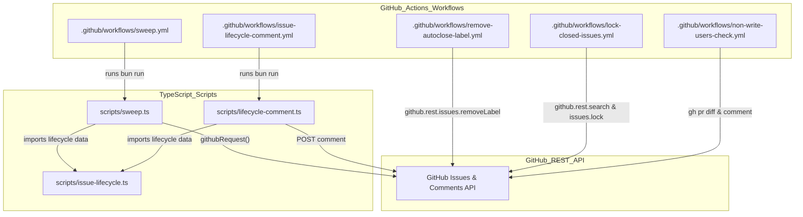
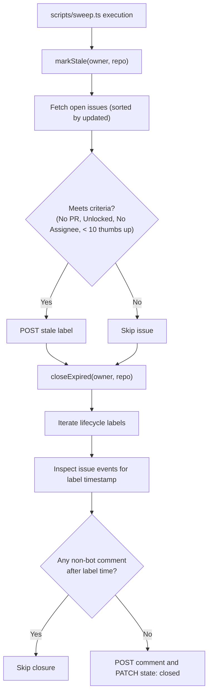

<!-- source: DeepWiki mcp.deepwiki.com · repo anthropics/claude-code · page 6.3 Issue Lifecycle Management · fetched 2026-10-26 -->

# Issue Lifecycle Management

Relevant source files

The following files were used as context for generating this wiki page:

- [.github/workflows/auto-close-duplicates.yml](.github/workflows/auto-close-duplicates.yml)
- [.github/workflows/backfill-duplicate-comments.yml](.github/workflows/backfill-duplicate-comments.yml)
- [.github/workflows/issue-lifecycle-comment.yml](.github/workflows/issue-lifecycle-comment.yml)
- [.github/workflows/lock-closed-issues.yml](.github/workflows/lock-closed-issues.yml)
- [.github/workflows/log-issue-events.yml](.github/workflows/log-issue-events.yml)
- [.github/workflows/non-write-users-check.yml](.github/workflows/non-write-users-check.yml)
- [.github/workflows/remove-autoclose-label.yml](.github/workflows/remove-autoclose-label.yml)
- [.github/workflows/sweep.yml](.github/workflows/sweep.yml)
- [scripts/auto-close-duplicates.ts](scripts/auto-close-duplicates.ts)
- [scripts/backfill-duplicate-comments.ts](scripts/backfill-duplicate-comments.ts)
- [scripts/issue-lifecycle.ts](scripts/issue-lifecycle.ts)
- [scripts/lifecycle-comment.ts](scripts/lifecycle-comment.ts)
- [scripts/sweep.ts](scripts/sweep.ts)

## Purpose and Scope

This document details the automated issue and pull request lifecycle management system implemented within the repository. The system is engineered to maintain a clean, actionable, and secure environment by identifying inactive issues, applying lifecycle labels, executing timeouts to close expired items, locking resolved issues after extended quiet periods, reacting to human activity by removing autoclose guards, posting proactive nudge notifications, and running security validations on workflow modifications.

Sources:
- [.github/workflows/sweep.yml:1-31]()
- [.github/workflows/remove-autoclose-label.yml:1-42]()
- [.github/workflows/lock-closed-issues.yml:1-77]()
- [.github/workflows/non-write-users-check.yml:1-47]()
- [.github/workflows/issue-lifecycle-comment.yml:1-27]()
- [scripts/sweep.ts:1-168]()
- [scripts/lifecycle-comment.ts:1-53]()

---

## System Architecture & Data Flow

The lifecycle management architecture bridges GitHub Actions event triggers and scheduled cron jobs with TypeScript automation executed via the Bun runtime.

Title: "Lifecycle Management Component & Code Entity Mapping"

Sources:
- [.github/workflows/sweep.yml:1-31]()
- [.github/workflows/lock-closed-issues.yml:1-77]()
- [.github/workflows/remove-autoclose-label.yml:1-42]()
- [.github/workflows/issue-lifecycle-comment.yml:1-27]()
- [.github/workflows/non-write-users-check.yml:1-47]()
- [scripts/sweep.ts:1-168]()
- [scripts/lifecycle-comment.ts:1-53]()

---

## Lifecycle Label Configuration (`issue-lifecycle.ts`)

The single source of truth for lifecycle timeouts, closure reasons, and automated nudge templates is declared in `scripts/issue-lifecycle.ts`. 

| Label | Timeout (Days) | Closure Reason | Nudge Message |
| :--- | :--- | :--- | :--- |
| `invalid` | 3 | `"this doesn't appear to be about Claude Code"` | Directs users to general support channels |
| `needs-repro` | 7 | `"we still need reproduction steps to investigate"` | Requests reproduction steps and environment details |
| `needs-info` | 7 | `"we still need a bit more information to move forward"` | Asks for `claude --version`, OS, and logs |
| `stale` | 14 | `"inactive for too long"` | Marks issue as automatically stale due to inactivity |
| `autoclose` | 14 | `"inactive for too long"` | Marks issue for automatic closure |

Additionally, `STALE_UPVOTE_THRESHOLD` is configured to `10`. Issues where thumbs-up reactions (`+1`) equal or exceed this threshold are completely exempt from stale labeling and expiration sweeps [scripts/sweep.ts:73-74](), [scripts/sweep.ts:110-111]().

Sources:
- [scripts/sweep.ts:73-74]()
- [scripts/sweep.ts:110-111]()

---

## Sweep Workflow & Script (`sweep.yml` & `scripts/sweep.ts`)

The `.github/workflows/sweep.yml` workflow executes bi-daily via cron schedule (`0 10,22 * * *`) or via manual workflow dispatch [.github/workflows/sweep.yml:4-6](). It provisions the Bun runtime and invokes `scripts/sweep.ts` [.github/workflows/sweep.yml:21-27]().

Title: "Sweep Execution Pipeline"

`scripts/sweep.ts` executes two sequential procedures:
1. `markStale(owner, repo)`: Scans open issues sorted by oldest update date [scripts/sweep.ts:55-56](). It skips pull requests, locked items, assigned issues, items already bearing `stale` or `autoclose`, and issues meeting the `STALE_UPVOTE_THRESHOLD` [scripts/sweep.ts:61-74](). If inactive past the stale threshold, it applies the `stale` label [scripts/sweep.ts:82]().
2. `closeExpired(owner, repo)`: Queries open issues bearing each configured lifecycle label [scripts/sweep.ts:95-103](). It retrieves issue events (`/events`) to verify when the label was applied [scripts/sweep.ts:115-120]() and queries comments (`/comments`) to check for non-bot human activity since that timestamp [scripts/sweep.ts:127-132](). If no human activity is detected and the timeout has elapsed, it posts a closure comment and patches the issue state to `closed` with `state_reason: "not_planned"` [scripts/sweep.ts:144-145]().

Sources:
- [.github/workflows/sweep.yml:1-31]()
- [scripts/sweep.ts:1-168]()

---

## Human Activity Detection & Autoclose Removal (`remove-autoclose-label.yml`)

To prevent premature closure when users respond to an issue, the system provides a reactive hook `.github/workflows/remove-autoclose-label.yml` [.github/workflows/remove-autoclose-label.yml:1-42]().

When an `issue_comment` is created on an open issue bearing the `autoclose` label by a non-bot user, GitHub Actions triggers `remove-autoclose` [.github/workflows/remove-autoclose-label.yml:4-16](). The script invokes `github.rest.issues.removeLabel` to strip the `autoclose` label immediately [.github/workflows/remove-autoclose-label.yml:27-32]().

Sources:
- [.github/workflows/remove-autoclose-label.yml:1-42]()

---

## Lifecycle Comment Notifications (`issue-lifecycle-comment.yml` & `scripts/lifecycle-comment.ts`)

When an issue receives a lifecycle label, `.github/workflows/issue-lifecycle-comment.yml` triggers on `issues: [labeled]` [.github/workflows/issue-lifecycle-comment.yml:4-5](). It executes `scripts/lifecycle-comment.ts` [.github/workflows/issue-lifecycle-comment.yml:22-23]().

The script validates the environment, retrieves the matching definition from `lifecycle`, and constructs a nudge message containing the timeout window [scripts/lifecycle-comment.ts:19-25](). It posts the comment to the issue via the GitHub REST API [scripts/lifecycle-comment.ts:34-46]().

Sources:
- [.github/workflows/issue-lifecycle-comment.yml:1-27]()
- [scripts/lifecycle-comment.ts:1-53]()
- [scripts/issue-lifecycle.ts:1-38]()

---

## Lock Closed Issues Workflow (`lock-closed-issues.yml`)

The `.github/workflows/lock-closed-issues.yml` workflow runs daily at 14:00 UTC [.github/workflows/lock-closed-issues.yml:4-6](). It searches for closed, unlocked issues that have remained unupdated for 7 days (`is:issue is:closed is:unlocked updated:<YYYY-MM-DD`) [.github/workflows/lock-closed-issues.yml:23-29]().

For each candidate issue (up to `MAX_PER_RUN = 250`), it posts an explanatory comment and locks the thread with `lock_reason: 'resolved'` [scripts/lock-closed-issues.yml:27-68]().

Sources:
- [.github/workflows/lock-closed-issues.yml:1-77]()

---

## Workflow Security Check (`non-write-users-check.yml`)

The `.github/workflows/non-write-users-check.yml` workflow runs on pull requests modifying `.github/**` paths [.github/workflows/non-write-users-check.yml:2-5](). It inspects the pull request diff for the introduction or modification of `allowed_non_write_users` [scripts/non-write-users-check.yml:17-24]().

If detected, it checks if a warning comment containing the marker `<!-- non-write-users-check -->` has already been posted [scripts/non-write-users-check.yml:30-35](). If absent, it posts a security advisory explaining the security risks associated with allowing non-write users to trigger workflow actions with extended privileges [scripts/non-write-users-check.yml:37-44]().

Sources:
- [.github/workflows/non-write-users-check.yml:1-47]()

---

## Safety Mechanisms Summary

| Safeguard Mechanism | Implementation Details | Code Pointer |
| :--- | :--- | :--- |
| **Upvote Immunity** | Skips issues where 👍 reactions `>= 10` | [scripts/sweep.ts:73-74](), [scripts/sweep.ts:110-111]() |
| **Assignee Exclusion** | Bypasses issues that have active assignees assigned | [scripts/sweep.ts:63]() |
| **Sweep Human Activity Check** | Inspects comments since label application to abort closure if non-bot users commented | [scripts/sweep.ts:127-138]() |
| **Reactive Label Removal** | Immediately removes `autoclose` label when a human commenter replies | [.github/workflows/remove-autoclose-label.yml:13-32]() |
| **Dry Run Support** | `--dry-run` flag in scripts prevents live API mutations during testing | [scripts/sweep.ts:8](), [scripts/lifecycle-comment.ts:8]() |

Sources:
- [scripts/sweep.ts:8, 63, 73, 110, 127-138]()
- [.github/workflows/remove-autoclose-label.yml:13-32]()
- [scripts/lifecycle-comment.ts:8]()

---

