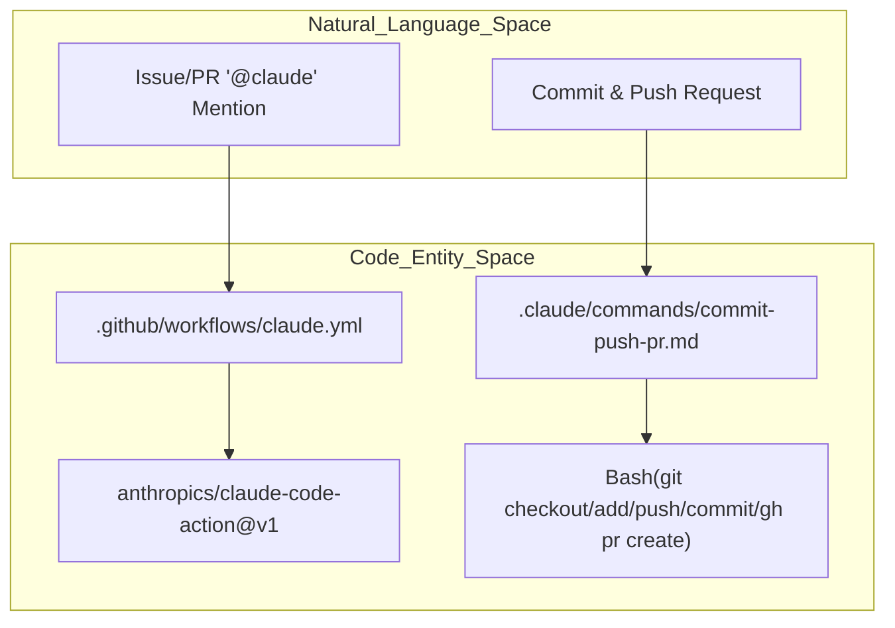

<!-- source: DeepWiki mcp.deepwiki.com · repo anthropics/claude-code · page 6.4 @Claude Mentions Workflow · fetched 2026-10-26 -->

# @Claude Mentions Workflow

<details>
<summary>Relevant source files</summary>

The following files were used as context for generating this wiki page:

- [.claude/commands/commit-push-pr.md](.claude/commands/commit-push-pr.md)
- [.claude/commands/dedupe.md](.claude/commands/dedupe.md)
- [.claude/commands/triage-issue.md](.claude/commands/triage-issue.md)
- [.github/workflows/claude-dedupe-issues.yml](.github/workflows/claude-dedupe-issues.yml)
- [.github/workflows/claude-issue-triage.yml](.github/workflows/claude-issue-triage.yml)
- [.github/workflows/claude.yml](.github/workflows/claude.yml)
- [scripts/comment-on-duplicates.sh](scripts/comment-on-duplicates.sh)
- [scripts/edit-issue-labels.sh](scripts/edit-issue-labels.sh)
- [scripts/gh.sh](scripts/gh.sh)

</details>


## Purpose and Scope

The `@claude` mentions workflow provides a general-purpose mechanism for invoking Claude Code on GitHub issues, pull requests, and comments by mentioning `@claude` in the text. This workflow enables ad-hoc Claude Code assistance without requiring specialized slash commands like `/triage-issue` or `/dedupe`. Additionally, this section covers the companion `.claude/commands/commit-push-pr.md` helper command, which automates committing changes, pushing branches, and creating pull requests.

For automated issue triage, see [AI-Powered Issue Triage](6.1). For duplicate detection, see [Issue Deduplication System](6.2).

Sources: [.github/workflows/claude.yml:1-49](), [.claude/commands/commit-push-pr.md:1-19]()

---

## Workflow Configuration

The workflow is defined in [.github/workflows/claude.yml:1-49]() and differs from specialized workflows by being trigger-based rather than task-specific. It monitors multiple GitHub event types and executes whenever `@claude` appears in user-generated content.

### Trigger Events

The workflow subscribes to four GitHub event types:

| Event Type | Trigger | Example Use Case |
|------------|---------|------------------|
| `issue_comment.created` | New comment on issue | User asks "@claude please explain this error" |
| `pull_request_review_comment.created` | Inline PR comment | User mentions "@claude review this function" |
| `issues.opened` or `issues.assigned` | New/assigned issue | Issue body contains "@claude help with..." |
| `pull_request_review.submitted` | PR review submitted | Review body mentions "@claude" |

Sources: [.github/workflows/claude.yml:3-11]()

---

## Conditional Execution Logic

### Mention Detection Filter

The workflow uses a compound conditional to determine if Claude Code should execute. The job runs only if:

1. The event is `issue_comment` AND the comment body contains `@claude` [[.github/workflows/claude.yml:16]()].
2. OR the event is `pull_request_review_comment` AND the comment body contains `@claude` [[.github/workflows/claude.yml:17]()].
3. OR the event is `pull_request_review` AND the review body contains `@claude` [[.github/workflows/claude.yml:18]()].
4. OR the event is `issues` AND the issue body or title contains `@claude` [[.github/workflows/claude.yml:19]()].

```yaml
if: |
  (github.event_name == 'issue_comment' && contains(github.event.comment.body, '@claude')) ||
  (github.event_name == 'pull_request_review_comment' && contains(github.event.comment.body, '@claude')) ||
  (github.event_name == 'pull_request_review' && contains(github.event.review.body, '@claude')) ||
  (github.event_name == 'issues' && (contains(github.event.issue.body, '@claude') || contains(github.event.issue.title, '@claude')))
```

This ensures the workflow only runs when explicitly invoked, preventing unnecessary API calls.

Sources: [.github/workflows/claude.yml:15-19]()

---

## Execution Flow

### Workflow Architecture & Code Mapping Diagram

This diagram bridges natural language invocation concepts to the concrete code entities defined in [.github/workflows/claude.yml]() and [.claude/commands/commit-push-pr.md]().



Sources: [.github/workflows/claude.yml:1-49](), [.claude/commands/commit-push-pr.md:1-19]()

---

## Permission Model

The workflow uses a minimal read-only permission model for repository interaction:

```yaml
permissions:
  contents: read
  pull-requests: read
  issues: read
  id-token: write
```

| Permission | Scope | Purpose |
|------------|-------|---------|
| `contents` | `read` | Access repository code for context [[.github/workflows/claude.yml:24]()]. |
| `pull-requests` | `read` | Read PR metadata and comments [[.github/workflows/claude.yml:25]()]. |
| `issues` | `read` | Read issue metadata and comments [[.github/workflows/claude.yml:26]()]. |
| `id-token` | `write` | Generate OIDC tokens for secure authentication [[.github/workflows/claude.yml:27]()]. |

This contrasts with specialized workflows like `claude-issue-triage.yml` which requires `issues: write` [[.github/workflows/claude-issue-triage.yml:22]()] to apply labels via `edit-issue-labels.sh` [[.github/workflows/claude-issue-triage.yml:36]()] or `claude-dedupe-issues.yml` which requires `issues: write` [[.github/workflows/claude-dedupe-issues.yml:21]()] for `comment-on-duplicates.sh` [[.github/workflows/claude-dedupe-issues.yml:33]()].

Sources: [.github/workflows/claude.yml:23-27](), [.github/workflows/claude-issue-triage.yml:20-22,36](), [.github/workflows/claude-dedupe-issues.yml:21,33]()

---

## Claude Code Action Configuration

### Authentication via Workload Identity Federation

The workflow uses Workload Identity Federation to authenticate with the Anthropic API. This exchanges the GitHub OIDC token for a short-lived access token, removing the need for static API keys.

```yaml
anthropic_federation_rule_id: ${{ vars.ANTHROPIC_FEDERATION_RULE_ID }}
anthropic_organization_id: ${{ vars.ANTHROPIC_ORGANIZATION_ID }}
anthropic_service_account_id: ${{ vars.ANTHROPIC_SERVICE_ACCOUNT_ID }}
anthropic_workspace_id: ${{ vars.ANTHROPIC_WORKSPACE_ID }}
```

Sources: [.github/workflows/claude.yml:41-44]()

### Action Invocation

The workflow invokes `anthropics/claude-code-action@v1` with the model and permission mode parameters:

```yaml
- name: Run Claude Code
  id: claude
  uses: anthropics/claude-code-action@v1
  with:
    anthropic_federation_rule_id: ${{ vars.ANTHROPIC_FEDERATION_RULE_ID }}
    anthropic_organization_id: ${{ vars.ANTHROPIC_ORGANIZATION_ID }}
    anthropic_service_account_id: ${{ vars.ANTHROPIC_SERVICE_ACCOUNT_ID }}
    anthropic_workspace_id: ${{ vars.ANTHROPIC_WORKSPACE_ID }}
    claude_args: "--model claude-sonnet-4-6 --permission-mode auto"
```

Sources: [.github/workflows/claude.yml:34-48]()

---

## The `/commit-push-pr` Helper Command

In addition to event-driven GitHub Actions workflows, Claude Code provides interactive helper commands stored in `.claude/commands/`. The `commit-push-pr.md` command automates git operations and pull request creation.

### Command Configuration and Allowed Tools

Defined in [.claude/commands/commit-push-pr.md:1-19](), the command restricts execution to specific git and GitHub CLI bash operations via frontmatter `allowed-tools`:

```yaml
---
allowed-tools: Bash(git checkout --branch:*), Bash(git add:*), Bash(git status:*), Bash(git push:*), Bash(git commit:*), Bash(gh pr create:*)
description: Commit, push, and open a PR
---
```

Sources: [.claude/commands/commit-push-pr.md:1-4]()

### Context Injection and Task Execution

The command dynamically injects git status, diffs, and the current branch into the agent prompt context:

```markdown
## Context

- Current git status: !`git status`
- Current git diff (staged and unstaged changes): !`git diff HEAD`
- Current branch: !`git branch --show-current`
```

Based on this context, the agent performs a standardized multi-step workflow in a single response:
1. Creates a new branch if currently on `main` [[.claude/commands/commit-push-pr.md:15]()].
2. Stages changes and creates a single commit with an appropriate message [[.claude/commands/commit-push-pr.md:16]()].
3. Pushes the branch to `origin` [[.claude/commands/commit-push-pr.md:17]()].
4. Creates a pull request using `gh pr create` [[.claude/commands/commit-push-pr.md:18]()].

Sources: [.claude/commands/commit-push-pr.md:6-19]()

---

## Security Considerations

### Read-Only Access in Workflows
The workflow's read-only permissions [[.github/workflows/claude.yml:23-26]()] prevent unauthorized code modifications or state changes directly inside the automated GitHub Actions runner environment.

### Tool Sandboxing for Helper Commands
Local helper commands like `commit-push-pr.md` enforce strict security boundaries through explicit `allowed-tools` declarations [[.claude/commands/commit-push-pr.md:2]()], restricting Claude to authorized git and GitHub CLI actions without granting arbitrary shell execution privileges.

Sources: [.github/workflows/claude.yml:23-26](), [.claude/commands/commit-push-pr.md:1-4]()

---

