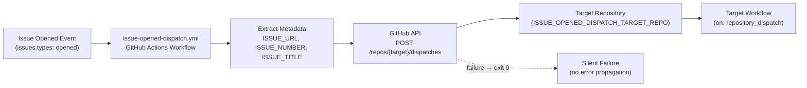
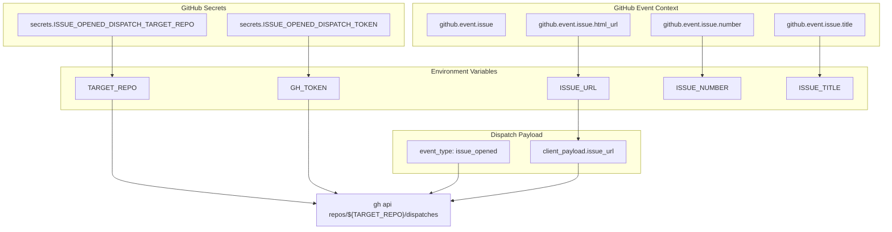
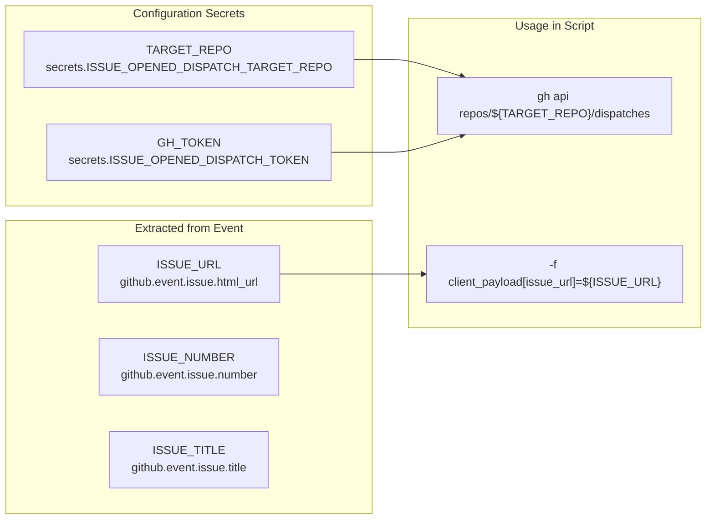
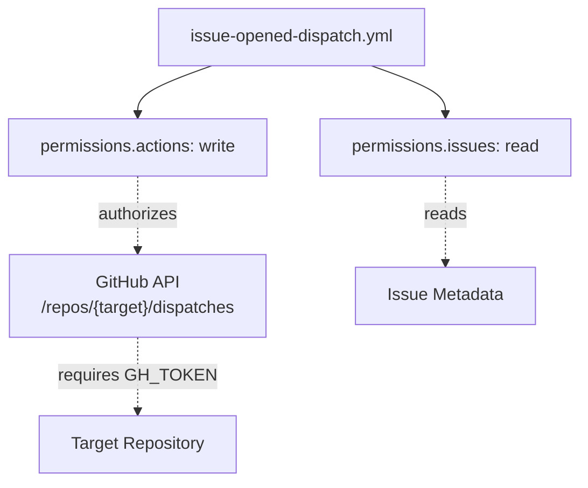
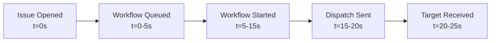

<!-- source: DeepWiki mcp.deepwiki.com · repo anthropics/claude-code · page 6.5 Cross-Repository Event Notifications · fetched 2026-10-26 -->

# Cross-Repository Event Notifications

<details>
<summary>Relevant source files</summary>

The following files were used as context for generating this wiki page:

- [.github/workflows/issue-opened-dispatch.yml](.github/workflows/issue-opened-dispatch.yml)

</details>


## Purpose and Scope

This document describes the `issue-opened-dispatch` workflow, a lightweight GitHub Actions workflow that sends cross-repository notifications when new issues are opened. This mechanism enables external repositories to receive real-time notifications about issue creation events without requiring webhook infrastructure or API polling.

For AI-powered issue processing workflows that run within this repository, see [AI-Powered Issue Triage](6.1) and [Issue Deduplication System](6.2). For analytics and logging, see [Event Logging & Analytics](6.6).

Sources: [.github/workflows/issue-opened-dispatch.yml:1-28]()

---

## Overview

The cross-repository event notification system serves as a bridge between the Claude Code repository and external systems that need to react to issue creation events. When a new issue is opened, the workflow automatically sends a `repository_dispatch` event to a configured target repository, passing along essential issue metadata.

This pattern is commonly used for:
- Triggering workflows in private infrastructure repositories
- Synchronizing issue creation to external tracking systems
- Enabling cross-repository automation pipelines
- Decoupling public repository events from internal processing

**Key Characteristics:**
- **Minimal footprint**: Single workflow file with under 30 lines of code [.github/workflows/issue-opened-dispatch.yml:1-28]()
- **Fire-and-forget**: Silently fails if dispatch is unsuccessful [.github/workflows/issue-opened-dispatch.yml:26-28]()
- **Fast execution**: 1-minute timeout constraint [.github/workflows/issue-opened-dispatch.yml:14-14]()
- **Secure**: Uses secrets for authentication and target repository specification [.github/workflows/issue-opened-dispatch.yml:21-22]()

Sources: [.github/workflows/issue-opened-dispatch.yml:1-28]()

---

## Architecture

### Event Flow

**Diagram: Cross-Repository Event Notification Flow**


The workflow executes in response to issue creation [.github/workflows/issue-opened-dispatch.yml:3-5](), extracts metadata from the GitHub event context [.github/workflows/issue-opened-dispatch.yml:17-20](), and sends a `repository_dispatch` event to the target repository using the GitHub CLI (`gh`) [.github/workflows/issue-opened-dispatch.yml:24-26](). If the dispatch fails, the workflow exits successfully to prevent noise in the Actions logs [.github/workflows/issue-opened-dispatch.yml:26-28]().

Sources: [.github/workflows/issue-opened-dispatch.yml:3-28]()

### Component Mapping

**Diagram: Data Flow from GitHub Event to Repository Dispatch**


This diagram shows how data flows from the GitHub event context through environment variables to the final API call. The workflow extracts three fields from `github.event.issue` [.github/workflows/issue-opened-dispatch.yml:18-20]() but only passes `issue_url` to the target repository in the `client_payload` [.github/workflows/issue-opened-dispatch.yml:26-26]().

Sources: [.github/workflows/issue-opened-dispatch.yml:17-26]()

---

## Workflow Configuration

### Trigger Specification

The workflow uses GitHub Actions event filtering to execute only when issues are opened:

| Configuration Key | Value | Purpose |
|------------------|-------|---------|
| `on.issues.types` | `[opened]` | Trigger only on issue creation [.github/workflows/issue-opened-dispatch.yml:3-5]() |
| `permissions.issues` | `read` | Access to issue metadata [.github/workflows/issue-opened-dispatch.yml:7-8]() |
| `permissions.actions` | `write` | Permission to trigger repository_dispatch [.github/workflows/issue-opened-dispatch.yml:7-9]() |
| `jobs.notify.timeout-minutes` | `1` | Fail-fast if dispatch hangs [.github/workflows/issue-opened-dispatch.yml:11-14]() |
| `jobs.notify.runs-on` | `ubuntu-latest` | Standard GitHub-hosted runner [.github/workflows/issue-opened-dispatch.yml:11-13]() |

Sources: [.github/workflows/issue-opened-dispatch.yml:3-14]()

### Environment Variable Schema

**Diagram: Environment Variable Usage Pattern**


The workflow extracts `ISSUE_NUMBER` and `ISSUE_TITLE` [.github/workflows/issue-opened-dispatch.yml:19-20]() but does not currently include them in the `client_payload` dispatch [.github/workflows/issue-opened-dispatch.yml:26-26]().

Sources: [.github/workflows/issue-opened-dispatch.yml:17-26]()

---

## Dispatch Mechanism

### GitHub CLI Command Structure

The workflow uses the GitHub CLI to send the repository dispatch event [.github/workflows/issue-opened-dispatch.yml:24-26]():

```bash
gh api repos/${TARGET_REPO}/dispatches \
  -f event_type=issue_opened \
  -f client_payload[issue_url]="${ISSUE_URL}" || {
    exit 0
  }
```

**Command Breakdown:**

| Component | Value | Description |
|-----------|-------|-------------|
| `gh api` | GitHub CLI API command | Direct REST API access |
| `repos/${TARGET_REPO}/dispatches` | Endpoint path | Repository dispatch endpoint [.github/workflows/issue-opened-dispatch.yml:24-24]() |
| `-f event_type=issue_opened` | Event type field | Custom event identifier for target workflows [.github/workflows/issue-opened-dispatch.yml:25-25]() |
| `-f client_payload[issue_url]` | Payload field | URL of the newly created issue [.github/workflows/issue-opened-dispatch.yml:26-26]() |
| `|| { exit 0 }` | Error handler | Suppress failures and exit cleanly [.github/workflows/issue-opened-dispatch.yml:26-28]() |

Sources: [.github/workflows/issue-opened-dispatch.yml:24-28]()

### Error Handling Strategy

The workflow implements silent failure behavior using a shell error handler [.github/workflows/issue-opened-dispatch.yml:26-28]():

```bash
gh api ... || {
  exit 0
}
```

This pattern ensures that:
- Failed dispatches do not trigger workflow failure notifications.
- The workflow always reports success to GitHub Actions.
- Missing or misconfigured secrets do not block issue creation.
- Downstream repository availability issues do not impact this repository.

**Trade-offs:**
- **Resilience**: Issue creation never blocked by external systems.
- **Reduced noise**: No failure notifications for non-critical operations.
- **Silent failures**: Dispatch problems may go unnoticed without external monitoring.
- **No retry logic**: Failed dispatches are not retried.

Sources: [.github/workflows/issue-opened-dispatch.yml:24-28]()

---

## Target Repository Integration

### Receiving Repository Dispatch Events

Target repositories must configure a workflow to receive the `repository_dispatch` event with the type `issue_opened` [.github/workflows/issue-opened-dispatch.yml:25-25]():

```yaml
on:
  repository_dispatch:
    types: [issue_opened]
```

### Payload Structure

The dispatch includes minimal payload data [.github/workflows/issue-opened-dispatch.yml:25-26]():

```json
{
  "event_type": "issue_opened",
  "client_payload": {
    "issue_url": "https://github.com/anthropics/claude-code/issues/123"
  }
}
```

Sources: [.github/workflows/issue-opened-dispatch.yml:24-26]()

---

## Security Configuration

### Required Secrets

The workflow requires two repository secrets to be configured [.github/workflows/issue-opened-dispatch.yml:21-22]():

| Secret Name | Purpose | Scope |
|------------|---------|-------|
| `ISSUE_OPENED_DISPATCH_TARGET_REPO` | Target repository identifier (e.g., `org/repo-name`) | Repository |
| `ISSUE_OPENED_DISPATCH_TOKEN` | GitHub personal access token or GitHub App token | Must have `repo` scope for target repository |

Sources: [.github/workflows/issue-opened-dispatch.yml:21-22]()

### Permission Model

**Diagram: Permission Flow**


The workflow uses minimal permissions on the source repository (`issues: read`) and delegates cross-repository access to the `GH_TOKEN` secret [.github/workflows/issue-opened-dispatch.yml:7-22](). This follows the principle of least privilege.

Sources: [.github/workflows/issue-opened-dispatch.yml:7-22]()

---

## Operational Considerations

### Performance Characteristics

**Diagram: Typical Execution Timeline**


End-to-end latency from issue creation to target workflow execution typically ranges from 20-90 seconds, constrained by the 1-minute timeout [.github/workflows/issue-opened-dispatch.yml:14-14]().

Sources: [.github/workflows/issue-opened-dispatch.yml:1-28]()

---

