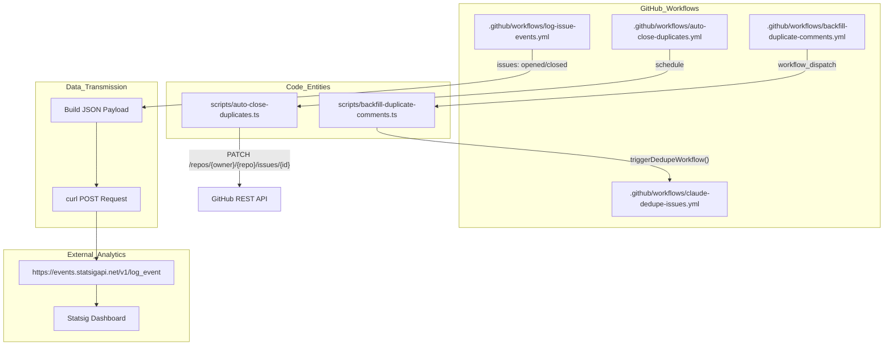
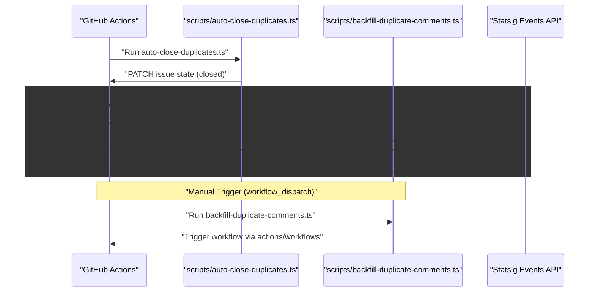

<!-- source: DeepWiki mcp.deepwiki.com · repo anthropics/claude-code · page 6.6 Event Logging & Analytics · fetched 2026-10-26 -->

# Event Logging & Analytics

<details>
<summary>Relevant source files</summary>

The following files were used as context for generating this wiki page:

- [.github/workflows/auto-close-duplicates.yml](.github/workflows/auto-close-duplicates.yml)
- [.github/workflows/backfill-duplicate-comments.yml](.github/workflows/backfill-duplicate-comments.yml)
- [.github/workflows/issue-lifecycle-comment.yml](.github/workflows/issue-lifecycle-comment.yml)
- [.github/workflows/log-issue-events.yml](.github/workflows/log-issue-events.yml)
- [.github/workflows/sweep.yml](.github/workflows/sweep.yml)
- [scripts/auto-close-duplicates.ts](scripts/auto-close-duplicates.ts)
- [scripts/backfill-duplicate-comments.ts](scripts/backfill-duplicate-comments.ts)
- [scripts/issue-lifecycle.ts](scripts/issue-lifecycle.ts)
- [scripts/lifecycle-comment.ts](scripts/lifecycle-comment.ts)
- [scripts/sweep.ts](scripts/sweep.ts)

</details>


## Purpose and Scope

This document describes the event logging and analytics infrastructure that captures GitHub issue lifecycle events and transmits them to Statsig for telemetry analysis. The system tracks issue creation, closure, and duplicate detection events with associated metadata to enable data-driven insights into repository activity patterns and the effectiveness of automated management scripts.

The system specifically monitors transitions defined in the issue lifecycle, including staleness, invalidation, and deduplication results processed by workflow scripts and Claude Code automations.

**Sources:** [.github/workflows/log-issue-events.yml:1-40](), [.github/workflows/auto-close-duplicates.yml:1-31](), [scripts/auto-close-duplicates.ts:1-100]()

---

## Statsig Integration Architecture

The event logging system integrates with Statsig, a third-party analytics platform, to capture and analyze GitHub issue events. Events are sent via HTTP POST requests to the Statsig Events API endpoint `https://events.statsigapi.net/v1/log_event` [[.github/workflows/log-issue-events.yml:25]().

### System Data Flow (Code Entity Space)

The following diagram illustrates how GitHub events are captured by workflows and transmitted to the Statsig API, mapping external triggers directly to code files and execution pathways.



**Sources:** [.github/workflows/log-issue-events.yml:1-40](), [.github/workflows/auto-close-duplicates.yml:1-31](), [scripts/auto-close-duplicates.ts:28-97](), [scripts/backfill-duplicate-comments.ts:47-70]()

---

## Event Types

The system logs specific event types based on the lifecycle stage of a GitHub issue and the actions taken by automated scripts:

| Event Name | Trigger | Source Entity | Description |
|------------|---------|---------------+-------------|
| `github_issue_created` | Issue opened | `.github/workflows/log-issue-events.yml` | Tracks new issue creation with metadata [[.github/workflows/log-issue-events.yml:30]]() |
| `github_issue_closed` | Issue closed | `.github/workflows/log-issue-events.yml` | Tracks issue closure (manual or automated) [[.github/workflows/log-issue-events.yml:5]]() |
| `github_duplicate_comment_added` | Dedupe logic completes | `.github/workflows/claude-dedupe-issues.yml` | Logs when Claude identifies a potential duplicate |

**Sources:** [.github/workflows/log-issue-events.yml:4-5](), [.github/workflows/log-issue-events.yml:30]()

---

## Event Payload Structures

### Issue Creation/Closure Event
Managed via shell scripting in `.github/workflows/log-issue-events.yml` [.github/workflows/log-issue-events.yml:1-40](). This payload captures the primary identity of the issue and its origin.

```json
{
  "events": [{
    "eventName": "github_issue_created",
    "metadata": {
      "issue_number": "123",
      "repository": "anthropics/claude-code",
      "title": "Bug Report",
      "author": "user1",
      "created_at": "2024-01-01T00:00:00Z"
    },
    "time": 1704067200000
  }]
}
```

**Sources:** [.github/workflows/log-issue-events.yml:28-39]()

### Deduplication Event Metadata
Managed via `jq` in `.github/workflows/log-issue-events.yml` to ensure valid JSON construction.

| Metadata Key | Description |
|--------------|-------------|
| `repository` | The GitHub repository path [.github/workflows/log-issue-events.yml:33]() |
| `issue_number` | The number of the issue being checked [.github/workflows/log-issue-events.yml:32]() |
| `title` | The sanitized title of the issue [.github/workflows/log-issue-events.yml:34]() |
| `author` | The login handle of the issue author [.github/workflows/log-issue-events.yml:35]() |
| `created_at` | The ISO timestamp of issue creation [.github/workflows/log-issue-events.yml:36]() |

**Sources:** [.github/workflows/log-issue-events.yml:25-40]()

---

## Workflow Implementation Details

### Core Logging Workflow (`log-issue-events.yml`)

This workflow uses environment variables to pass GitHub context safely into a shell script to prevent injection attacks.

1. **Environment Mapping**: Maps `github.event.issue` properties to variables like `ISSUE_TITLE` and `AUTHOR` [.github/workflows/log-issue-events.yml:14-20]().
2. **Title Sanitization**: Uses `sed` to escape double quotes in the issue title: `sed "s/\"/\\\\\"/g"` [.github/workflows/log-issue-events.yml:34]().
3. **Transmission**: Uses `curl` to send a POST request with the `statsig-api-key` header [.github/workflows/log-issue-events.yml:25-27]().

### Auto-Close and Backfill Integration

- **Auto-Close (`scripts/auto-close-duplicates.ts`)**: Identifies issues with bot-generated "possible duplicate" comments that have no human activity for 3 days [scripts/auto-close-duplicates.ts:112-215](). It closes them with `state_reason: 'duplicate'` and applies the `duplicate` label [scripts/auto-close-duplicates.ts:73-82]().
- **Backfill (`scripts/backfill-duplicate-comments.ts`)**: Allows retroactive deduplication triggering for issues within a specified range [scripts/backfill-duplicate-comments.ts:92-115](). It triggers workflows via `triggerDedupeWorkflow()` using a `workflow_dispatch` call [scripts/backfill-duplicate-comments.ts:47-70]().

**Sources:** [.github/workflows/log-issue-events.yml:14-34](), [scripts/auto-close-duplicates.ts:73-215](), [scripts/backfill-duplicate-comments.ts:47-115]()

---

## Security & API Key Management

### Secret Storage
The `STATSIG_API_KEY` is stored as a GitHub Actions secret and accessed via `${{ secrets.STATSIG_API_KEY }}` in logging-enabled workflows [.github/workflows/log-issue-events.yml:15](), [.github/workflows/auto-close-duplicates.yml:31]().

### Injection Prevention
The system implements a strict policy of using environment variables rather than direct string templating in shell scripts to prevent injection attacks:
- Values are assigned to environment variables [.github/workflows/log-issue-events.yml:14-20]().
- In shell scripts, these variables are referenced safely (e.g., `"$ISSUE_TITLE"`) and sanitized using `sed` [.github/workflows/log-issue-events.yml:34]().

**Sources:** [.github/workflows/log-issue-events.yml:14-34](), [.github/workflows/auto-close-duplicates.yml:31]()

---

## Implementation Sequence

The following sequence diagram shows the interaction between GitHub Actions triggers, internal automation scripts, and the external Statsig API.



**Sources:** [.github/workflows/log-issue-events.yml:25-40](), [scripts/auto-close-duplicates.ts:73-97](), [scripts/backfill-duplicate-comments.ts:47-70]()

---

