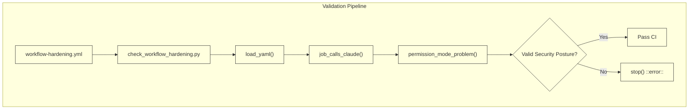
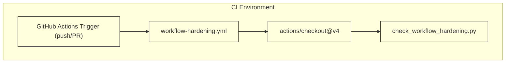

<!-- source: DeepWiki mcp.deepwiki.com · repo anthropics/claude-code · page 6.7 Workflow Hardening & Egress Firewall · fetched 2026-10-26 -->

# Workflow Hardening & Egress Firewall

<details>
<summary>Relevant source files</summary>

The following files were used as context for generating this wiki page:

- [.github/egress-firewall.yaml](.github/egress-firewall.yaml)
- [.github/scripts/check_workflow_hardening.py](.github/scripts/check_workflow_hardening.py)
- [.github/workflows/workflow-hardening.yml](.github/workflows/workflow-hardening.yml)
- [CLAUDE.md](CLAUDE.md)

</details>


This section covers the security hardening infrastructure implemented in Claude Code to secure GitHub Actions workflows that execute Claude or interact with external services. This architecture combines static analysis (`.github/scripts/check_workflow_hardening.py`) [path/.github/scripts/check_workflow_hardening.py:1-340](), CI enforcement via GitHub Actions (`.github/workflows/workflow-hardening.yml`) [path/.github/workflows/workflow-hardening.yml:1-24](), network-level egress restrictions (`.github/egress-firewall.yaml`) [path/.github/egress-firewall.yaml:1-28](), and contributor guidelines (`CLAUDE.md`) [path/CLAUDE.md:1-41]().

---

## 1. Security Hardening Policy & Rules

Repository workflows that interact with Claude operate under strict containment rules defined in `CLAUDE.md` [path/CLAUDE.md:5-24](). These guardrails prevent unauthorized network access and enforce automated safety reviews during CI runs:

1. **Egress-Firewall Runner**: Jobs calling Claude must execute on `ubuntu-24.04-firewall`, a specialized GitHub-hosted runner that filters outbound network traffic [path/CLAUDE.md:10-12]().
2. **Network Allowlist**: Network egress is restricted by `.github/egress-firewall.yaml` using `mode: enforce`, blocking all destinations except those explicitly required for API operations, package resolution, and dependency downloads [path/CLAUDE.md:13-16]().
3. **Auto Permission Mode**: Steps running the Claude Code action (`anthropics/claude-code-action`) or local equivalents must pass `--permission-mode auto` in `claude_args` [path/CLAUDE.md:17-19](). This ensures unapproved tool calls undergo safety checks using model versions supporting autonomous handling (`AUTO_MODE_MIN_VERSION = (4, 6)`) [path/.github/scripts/check_workflow_hardening.py:20-22]().

Sources: [path/CLAUDE.md:1-41]()

---

## 2. Static Analysis Implementation (`check_workflow_hardening.py`)

The validation script `[path/.github/scripts/check_workflow_hardening.py]()` inspects GitHub Actions workflow configurations and firewall definitions to ensure they comply with repository security policies.


*Figure 1: Static analysis pipeline executed by `check_workflow_hardening.py`.*

### Key Functions and Data Flow

- **`load_yaml(path: pathlib.Path)`**: Parses workflow and firewall YAML documents. It attempts to use PyYAML, falling back to the `yq` CLI tool if PyYAML is unavailable [path/.github/scripts/check_workflow_hardening.py:38-60]().
- **`job_calls_claude(job: dict)`**: Determines whether a workflow job invokes Claude by checking for the `ANTHROPIC_FEDERATION_RULE_ID` marker [path/.github/scripts/check_workflow_hardening.py:17](), analyzing step actions against `CLAUDE_ACTIONS` (`anthropics/claude-code-action`, `anthropics/claude-code-base-action`), or inspecting local actions with `claude_args` inputs [path/.github/scripts/check_workflow_hardening.py:97-106]().
- **`permission_mode_problem(step: dict, exempt: bool, inherited_env: dict)`**: Validates that `claude_args` includes `--permission-mode auto`, explicitly rejects dangerous flags like `--dangerously-skip-permissions`, and ensures model configurations satisfy `AUTO_MODE_MIN_VERSION` [path/.github/scripts/check_workflow_hardening.py:109-170]().

Sources: [path/.github/scripts/check_workflow_hardening.py:1-170]()

---

## 3. Workflow Enforcement (`workflow-hardening.yml`)

Automated validation runs on every pull request and on pushes to the `main` branch via `.github/workflows/workflow-hardening.yml` [path/.github/workflows/workflow-hardening.yml:3-9](). 


*Figure 2: Execution context for the `workflow-hardening` job.*

The workflow runs on a standard `ubuntu-latest` runner with minimal permissions (`contents: read`), checking out the repository and executing the hardening script [path/.github/workflows/workflow-hardening.yml:10-24](). If any workflow breaks the policy rules and lacks a registered exemption in `EXEMPT_FROM_AUTO_MODE` or `EXEMPT_FROM_FIREWALL_RUNNER`, the script triggers `stop()` and fails the build [path/.github/scripts/check_workflow_hardening.py:29-35]().

Sources: [path/.github/workflows/workflow-hardening.yml:1-24](), [path/.github/scripts/check_workflow_hardening.py:29-35]()

---

## 4. Egress Firewall Allowlist (`egress-firewall.yaml`)

Network egress for firewall runners is controlled by `.github/egress-firewall.yaml` [path/.github/egress-firewall.yaml:1-4](). The policy enforces a strict default-deny posture (`mode: enforce`) and permits only fully qualified domain names required for operation [path/.github/egress-firewall.yaml:4-5]().

```yaml
mode: enforce
allow:
  - api.anthropic.com
  - api.github.com
  - claude.ai
  - downloads.claude.ai
  - release-assets.githubusercontent.com
  - registry.npmjs.org
  - azure.archive.ubuntu.com
  - archive.ubuntu.com
  - security.ubuntu.com
  - events.statsigapi.net
```

### Approved Categories
- **API Access**: `api.anthropic.com` for model calls and OIDC federation token exchanges [path/.github/egress-firewall.yaml:6-8]().
- **Source Control**: `api.github.com` for GitHub API interactions performed by helper scripts and actions [path/.github/egress-firewall.yaml:9-11]().
- **Binaries & Packages**: `claude.ai`, `downloads.claude.ai`, `release-assets.githubusercontent.com`, and `registry.npmjs.org` for tool installation and dependency management [path/.github/egress-firewall.yaml:12-19]().
- **System Dependencies**: Ubuntu package mirrors (`azure.archive.ubuntu.com`, `archive.ubuntu.com`, `security.ubuntu.com`) for sandboxing tools like bubblewrap and socat [path/.github/egress-firewall.yaml:20-25]().
- **Telemetry**: `events.statsigapi.net` for event logging and metrics [path/.github/egress-firewall.yaml:26-27]().

Sources: [path/.github/egress-firewall.yaml:1-28]()

---

