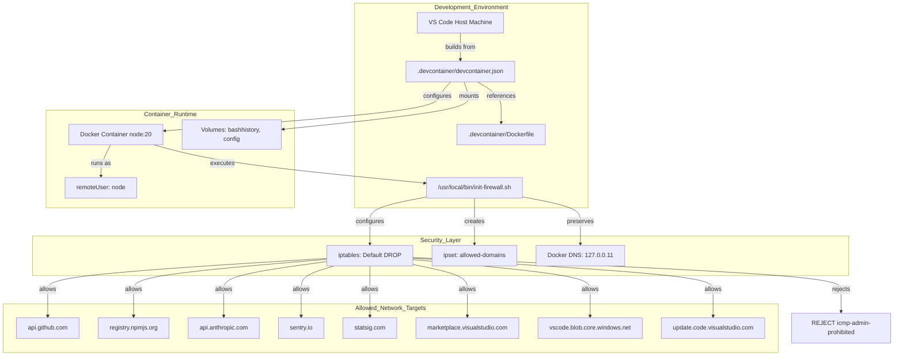
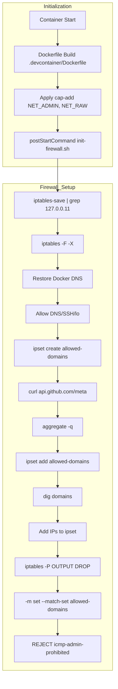

<!-- source: DeepWiki mcp.deepwiki.com · repo anthropics/claude-code · page 7 Development Environment · fetched 2026-10-26 -->

# Development Environment

Relevant source files

The following files were used as context for generating this wiki page:

- [.devcontainer/Dockerfile](.devcontainer/Dockerfile)
- [.devcontainer/devcontainer.json](.devcontainer/devcontainer.json)
- [.devcontainer/init-firewall.sh](.devcontainer/init-firewall.sh)
- [.gitattributes](.gitattributes)
- [.vscode/extensions.json](.vscode/extensions.json)
- [CHANGELOG.md](CHANGELOG.md)
- [LICENSE.md](LICENSE.md)
- [README.md](README.md)
- [SECURITY.md](SECURITY.md)
- [Script/run_devcontainer_claude_code.ps1](Script/run_devcontainer_claude_code.ps1)
- [demo.gif](demo.gif)
- [feed.xml](feed.xml)

## Purpose and Scope

The Claude Code development environment provides a secure, isolated, and reproducible container-based setup for developing and testing Claude Code. The environment enforces network egress restrictions through a firewall, installs required tooling, configures VS Code extensions, and supports orchestration across backends. This page covers the overall architecture and configuration of the devcontainer setup and enterprise deployment mechanisms.

For detailed information about specific aspects of the environment, see:
- [DevContainer Configuration](#7.1) — Container structure, VS Code settings, and capability requirements.
- [Network Security & Firewall](#7.2) — Implementation of the `init-firewall.sh` script and domain whitelisting.
- [Base Image & Tooling](#7.3) — Docker image construction, Node.js 20 base, and developer utilities.
- [Container Orchestration](#7.4) — Scripts for running the environment across different container backends.
- [Enterprise MDM Deployment](#7.5) — Templates for fleet-wide policy enforcement via Jamf, Intune, and Group Policy.

Sources: [.devcontainer/devcontainer.json:1-57](), [.devcontainer/init-firewall.sh:1-136]()

## Architecture Overview

The development environment consists of primary components that work together to create a secure sandbox:

### DevContainer Architecture Diagram

Sources: [.devcontainer/devcontainer.json:1-57](), [.devcontainer/init-firewall.sh:1-136]()

The container is configured with elevated network capabilities (`NET_ADMIN` and `NET_RAW`) [.devcontainer/devcontainer.json:13-14]() to enable firewall configuration at startup. After the container starts, the `postStartCommand` executes `init-firewall.sh` [.devcontainer/devcontainer.json:55]() to enforce a default-deny egress policy with explicit allowlisting.

Sources: [.devcontainer/devcontainer.json:1-57](), [.devcontainer/init-firewall.sh:1-136]()

## Security Model

The development environment implements defense-in-depth security through multiple layers, primarily centered around a hardened network stack.

### Security Flow Diagram

Sources: [.devcontainer/init-firewall.sh:1-136]()

### Firewall Initialization Sequence

The `init-firewall.sh` script implements a strict firewall configuration:

1. **Preserve Docker DNS** [.devcontainer/init-firewall.sh:5-6]() — Before flushing rules, extract Docker's internal DNS configuration for `127.0.0.11`.
2. **Flush All Rules** [.devcontainer/init-firewall.sh:9-15]() — Clear existing `iptables` rules and destroy any previous `allowed-domains` ipset.
3. **Restore Docker DNS** [.devcontainer/init-firewall.sh:17-25]() — Selectively restore the Docker DNS chains.
4. **Allow Essential Services** [.devcontainer/init-firewall.sh:27-38]() — Permit DNS (port 53), SSH (port 22), and localhost traffic.
5. **Build IP Allowlist** [.devcontainer/init-firewall.sh:40-91]() — Create `hash:net` ipset and populate with GitHub ranges [.devcontainer/init-firewall.sh:64]() and resolved domain IPs [.devcontainer/init-firewall.sh:67-75]().
6. **Detect Host Network** [.devcontainer/init-firewall.sh:93-105]() — Extract host IP from default route and allow local subnet traffic.
7. **Enforce Default-Deny** [.devcontainer/init-firewall.sh:107-120]() — Set policies to `DROP` and reject all non-allowlisted outbound traffic with `icmp-admin-prohibited`.
8. **Verify Configuration** [.devcontainer/init-firewall.sh:123-136]() — Test connectivity to verify blocked and allowed endpoints.

For details on the network implementation, see [Network Security & Firewall](#7.2).

Sources: [.devcontainer/init-firewall.sh:1-136]()

## Container Configuration & Orchestration

The devcontainer is configured through `devcontainer.json` [.devcontainer/devcontainer.json:1-57]().

### Capabilities and Permissions
The container requires elevated network capabilities to configure the firewall [.devcontainer/devcontainer.json:12-15](). The `node` user is granted `NOPASSWD` sudo access specifically for the firewall script [.devcontainer/Dockerfile:89-90]().

### Volumes and Persistence
Two named volumes persist data across container rebuilds:

| Volume Name | Target Path | Purpose |
| :--- | :--- | :--- |
| `claude-code-bashhistory` | `/commandhistory` | Persistent bash history [.devcontainer/devcontainer.json:45] |
| `claude-code-config` | `/home/node/.claude` | Claude Code configuration [.devcontainer/devcontainer.json:46] |

### Environment Variables
- `NODE_OPTIONS`: `--max-old-space-size=4096` [.devcontainer/devcontainer.json:49]()
- `CLAUDE_CONFIG_DIR`: `/home/node/.claude` [.devcontainer/devcontainer.json:50]()
- `POWERLEVEL9K_DISABLE_GITSTATUS`: `true` [.devcontainer/devcontainer.json:51]()

For automated orchestration across Docker or Podman on Windows or other host systems, automation scripts such as `Script/run_devcontainer_claude_code.ps1` handle machine initialization, container bring-up, and interactive session attachment [Script/run_devcontainer_claude_code.ps1:1-152]().

For details, see [DevContainer Configuration](#7.1) and [Container Orchestration](#7.4).

Sources: [.devcontainer/devcontainer.json:1-57](), [.devcontainer/Dockerfile:1-91](), [Script/run_devcontainer_claude_code.ps1:1-152]()

## Base Image & Tooling

The environment is built on the `node:20` base image [.devcontainer/Dockerfile:1]().
- **Core Utilities**: `less`, `git`, `procps`, `sudo`, `fzf`, `zsh`, `man-db`, `unzip`, `gnupg2`, `gh`, `iptables`, `ipset`, `iproute2`, `dnsutils`, `aggregate`, `jq`, `nano`, `vim` [.devcontainer/Dockerfile:9-27]().
- **Diff Viewing**: `git-delta` is installed via `.deb` package [.devcontainer/Dockerfile:51-55]().
- **Shell**: Configured with `zsh-in-docker` [.devcontainer/Dockerfile:72-79]().
- **Claude Code**: Pre-installed globally via npm [.devcontainer/Dockerfile:82]().

For details on image construction, see [Base Image & Tooling](#7.3).

Sources: [.devcontainer/Dockerfile:1-91]()

## VS Code Integration

The devcontainer automatically configures the VS Code environment:
- **Extensions**: Installs `anthropic.claude-code`, `dbaeumer.vscode-eslint`, `esbenp.prettier-vscode`, and `eamodio.gitlens` [.devcontainer/devcontainer.json:18-23](). These are also recommended in [.vscode/extensions.json:1-8]().
- **Formatting**: Enables `formatOnSave` with Prettier [.devcontainer/devcontainer.json:25-26]().
- **Terminal**: Sets `zsh` as the default profile [.devcontainer/devcontainer.json:30]().

Sources: [.devcontainer/devcontainer.json:1-57](), [.vscode/extensions.json:1-8]()

## Enterprise MDM Deployment

For enterprise environments requiring fleet-wide control, Claude Code supports managed settings deployment via Mobile Device Management (MDM) platforms such as Jamf, Kandji, Microsoft Intune, and Windows Group Policy. Managed configurations are delivered through macOS `plist` / `mobileconfig` files, Windows ADMX templates, PowerShell scripts, and `managed-settings.json` to enforce security policies and restrict telemetry or tool execution.

For details, see [Enterprise MDM Deployment](#7.5).

Sources: [CHANGELOG.md:1-57]()

---

