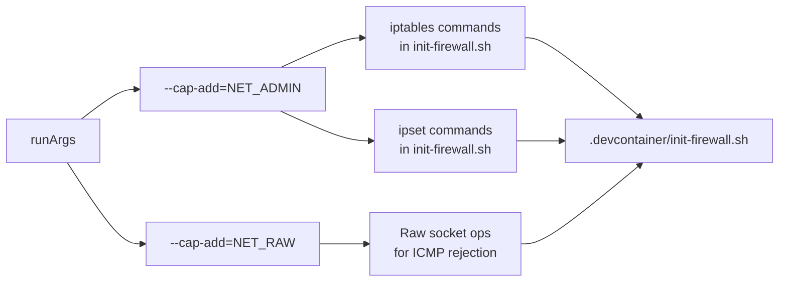
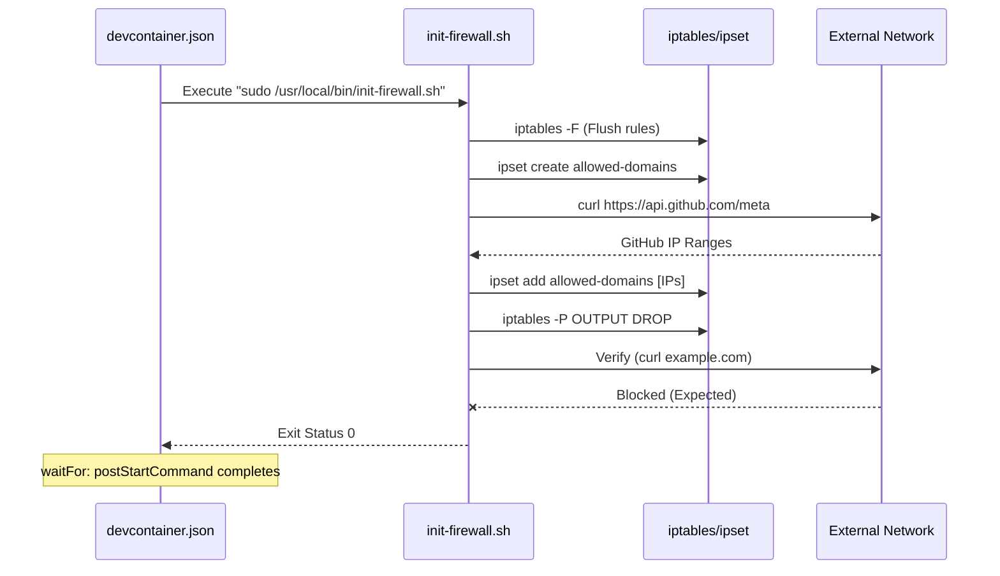

<!-- source: DeepWiki mcp.deepwiki.com · repo anthropics/claude-code · page 7.1 DevContainer Configuration · fetched 2026-10-26 -->

# DevContainer Configuration

Relevant source files

The following files were used as context for generating this wiki page:

- [.devcontainer/Dockerfile](.devcontainer/Dockerfile)
- [.devcontainer/devcontainer.json](.devcontainer/devcontainer.json)
- [.devcontainer/init-firewall.sh](.devcontainer/init-firewall.sh)
- [.gitattributes](.gitattributes)
- [.vscode/extensions.json](.vscode/extensions.json)
- [CHANGELOG.md](CHANGELOG.md)
- [LICENSE.md](LICENSE.md)
- [README.md](README.md)
- [SECURITY.md](SECURITY.md)
- [demo.gif](demo.gif)
- [feed.xml](feed.xml)

## Purpose and Scope

This document details the DevContainer configuration that provides a secure, reproducible development environment for Claude Code. The configuration is defined in [.devcontainer/devcontainer.json:1-57]() and orchestrates container build, runtime capabilities, VS Code integration, and lifecycle hooks.

The primary goal of this configuration is to create a "Sandbox" environment where Claude Code can be developed and tested with restricted network access and consistent tooling.

---

## DevContainer Architecture

The architecture bridges the local development environment with a containerized workspace, ensuring that security policies (like the firewall) are applied before the environment is accessible.

Title: DevContainer Component Mapping

```mermaid
graph TB
    subgraph DevContainerJSON["devcontainer.json"]
        BuildConfig["build<br/>{dockerfile, args}"]
        RunArgs["runArgs<br/>[--cap-add=NET_ADMIN,<br/>--cap-add=NET_RAW]"]
        Customizations["customizations.vscode<br/>{extensions, settings}"]
        Mounts["mounts<br/>[bashhistory, config]"]
        ContainerEnv["containerEnv<br/>{NODE_OPTIONS,<br/>CLAUDE_CONFIG_DIR}"]
        PostStart["postStartCommand<br/>sudo init-firewall.sh"]
    end
    
    subgraph Container["Container Runtime"]
        NodeUser["remoteUser: node"]
        Workspace["/workspace<br/>bind mount"]
        HistoryVol["claude-code-bashhistory<br/>volume"]
        ConfigVol["claude-code-config<br/>volume"]
    end
    
    subgraph VSCode["VS Code Integration"]
        ClaudeExt["anthropic.claude-code"]
        ESLint["dbaeumer.vscode-eslint"]
        Prettier["esbenp.prettier-vscode"]
        GitLens["eamodio.gitlens"]
        EditorSettings["formatOnSave: true<br/>defaultFormatter: prettier"]
        TerminalSettings["defaultProfile: zsh"]
    end
    
    subgraph Lifecycle["Container Lifecycle"]
        Build["1. Build Phase<br/>Dockerfile execution"]
        Start["2. Start Phase<br/>Container creation"]
        PostStartExec["3. Post-Start<br/>init-firewall.sh"]
        WaitFor["4. Wait Phase<br/>waitFor: postStartCommand"]
    end
    
    BuildConfig --> Build
    RunArgs --> Start
    PostStart --> PostStartExec
    PostStartExec --> WaitFor
    
    Customizations --> ClaudeExt
    Customizations --> ESLint
    Customizations --> Prettier
    Customizations --> GitLens
    Customizations --> EditorSettings
    Customizations --> TerminalSettings
    
    Mounts --> HistoryVol
    Mounts --> ConfigVol
    ContainerEnv --> NodeUser
    
    Build --> NodeUser
    Start --> Workspace
```

Sources: [.devcontainer/devcontainer.json:1-57]()

---

## Container Configuration

### Build Configuration

The `build` section specifies the Dockerfile and build arguments used during the image creation phase:

| Property | Value | Purpose |
|----------|-------|---------|
| `dockerfile` | `"Dockerfile"` | Path to Dockerfile in `.devcontainer/` [.devcontainer/devcontainer.json:4]() |
| `args.TZ` | `"${localEnv:TZ:America/Los_Angeles}"` | Timezone from host or default [.devcontainer/devcontainer.json:6]() |
| `args.CLAUDE_CODE_VERSION` | `"latest"` | Version of `@anthropic-ai/claude-code` [.devcontainer/devcontainer.json:7]() |
| `args.GIT_DELTA_VERSION` | `"0.18.2"` | Version of `git-delta` diff tool [.devcontainer/devcontainer.json:8]() |
| `args.ZSH_IN_DOCKER_VERSION` | `"1.2.0"` | Version of zsh-in-docker setup [.devcontainer/devcontainer.json:9]() |

Sources: [.devcontainer/devcontainer.json:3-11]()

### Runtime Arguments and Capabilities

The container requires elevated network capabilities to configure the security firewall via `iptables` and `ipset`.

Title: Capability to System Mapping

- **`NET_ADMIN`**: Required for `iptables -F` [.devcontainer/init-firewall.sh:9](), `ipset create` [.devcontainer/init-firewall.sh:41](), and setting default policies to `DROP` [.devcontainer/init-firewall.sh:108-110]().
- **`NET_RAW`**: Required for the firewall to send ICMP rejection packets when blocking outbound traffic [.devcontainer/init-firewall.sh:119]().

Sources: [.devcontainer/devcontainer.json:12-15](), [.devcontainer/init-firewall.sh:9-119]()

---

## VS Code Integration

### Extensions

The DevContainer automatically installs four VS Code extensions to maintain a consistent developer experience:

| Extension ID | Purpose |
|--------------|---------|
| `anthropic.claude-code` | Claude Code VS Code extension [.devcontainer/devcontainer.json:19]() |
| `dbaeumer.vscode-eslint` | Linting for TypeScript/JavaScript [.devcontainer/devcontainer.json:20]() |
| `esbenp.prettier-vscode` | Code formatting [.devcontainer/devcontainer.json:21]() |
| `eamodio.gitlens` | Advanced Git capabilities [.devcontainer/devcontainer.json:22]() |

These match the recommendations provided in the repository's extension metadata [.vscode/extensions.json:2-7]().

Sources: [.devcontainer/devcontainer.json:18-23](), [.vscode/extensions.json:2-7]()

### Editor and Terminal Settings

The configuration enforces strict formatting and linting rules on save:
- `editor.formatOnSave`: Set to `true` [.devcontainer/devcontainer.json:25]().
- `editor.defaultFormatter`: Set to `esbenp.prettier-vscode` [.devcontainer/devcontainer.json:26]().
- `editor.codeActionsOnSave`: Configured to run `source.fixAll.eslint` [.devcontainer/devcontainer.json:28]().
- `terminal.integrated.defaultProfile.linux`: Set to `zsh` [.devcontainer/devcontainer.json:30]().
- `terminal.integrated.profiles.linux`: Configures both `bash` and `zsh` paths [.devcontainer/devcontainer.json:31-39]().

Sources: [.devcontainer/devcontainer.json:24-40]()

---

## Persistence & Volume Mounts

To ensure a smooth development experience across container restarts, specific directories are persisted using named volumes.

| Mount Source | Target Path | Purpose |
|--------------|-------------|---------|
| `claude-code-bashhistory-${devcontainerId}` | `/commandhistory` | Persists shell history [.devcontainer/devcontainer.json:45]() |
| `claude-code-config-${devcontainerId}` | `/home/node/.claude` | Persists Claude settings and auth [.devcontainer/devcontainer.json:46]() |
| `${localWorkspaceFolder}` | `/workspace` | Bind mount for the source code [.devcontainer/devcontainer.json:53]() |

The `consistency=delegated` flag on the workspace mount [.devcontainer/devcontainer.json:53]() is used to improve performance on non-Linux hosts by allowing the container's file system view to be slightly out of sync with the host.

Sources: [.devcontainer/devcontainer.json:44-54]()

---

## Environment Variables

Key environment variables are injected to control the Node.js runtime and shell behavior:

- **`NODE_OPTIONS`**: Set to `--max-old-space-size=4096` [.devcontainer/devcontainer.json:49]() to provide sufficient memory for the Claude Code agent and subagents.
- **`CLAUDE_CONFIG_DIR`**: Pointed to the persistent volume at `/home/node/.claude` [.devcontainer/devcontainer.json:50]().
- **`POWERLEVEL9K_DISABLE_GITSTATUS`**: Set to `true` [.devcontainer/devcontainer.json:51]() to prevent shell lag in large repositories.

Sources: [.devcontainer/devcontainer.json:48-52]()

---

## Lifecycle Hooks: postStartCommand

The `postStartCommand` is a critical security step that initializes the container's firewall before the user is granted access.

Title: Firewall Initialization Flow

### Firewall Implementation Details
1. **Docker DNS Preservation**: The script extracts existing Docker DNS rules before flushing to maintain internal resolution [.devcontainer/init-firewall.sh:6, 18-25]().
2. **Domain Whitelisting**: It resolves specific domains like `registry.npmjs.org`, `api.anthropic.com`, and `statsig.com` using `dig` and adds them to the `allowed-domains` ipset [.devcontainer/init-firewall.sh:67-91]().
3. **GitHub Integration**: It fetches dynamic GitHub IP ranges via the `/meta` API to ensure `git` and `gh` commands function correctly [.devcontainer/init-firewall.sh:43-64]().
4. **Default Deny**: After allowing whitelisted traffic and established connections, it sets the default `OUTPUT` policy to `DROP` [.devcontainer/init-firewall.sh:110]().
5. **Verification**: The script performs a connectivity test to `example.com` (which should fail) and `api.github.com` (which should succeed) before exiting [.devcontainer/init-firewall.sh:123-136]().

The `waitFor: "postStartCommand"` property in `devcontainer.json` [.devcontainer/devcontainer.json:56]() ensures that VS Code does not open the workspace until this script has successfully finished.

Sources: [.devcontainer/devcontainer.json:55-56](), [.devcontainer/init-firewall.sh:1-136]()

---

