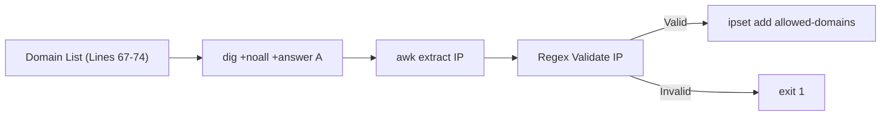
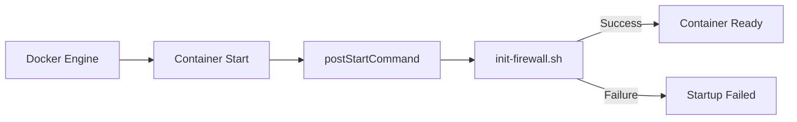
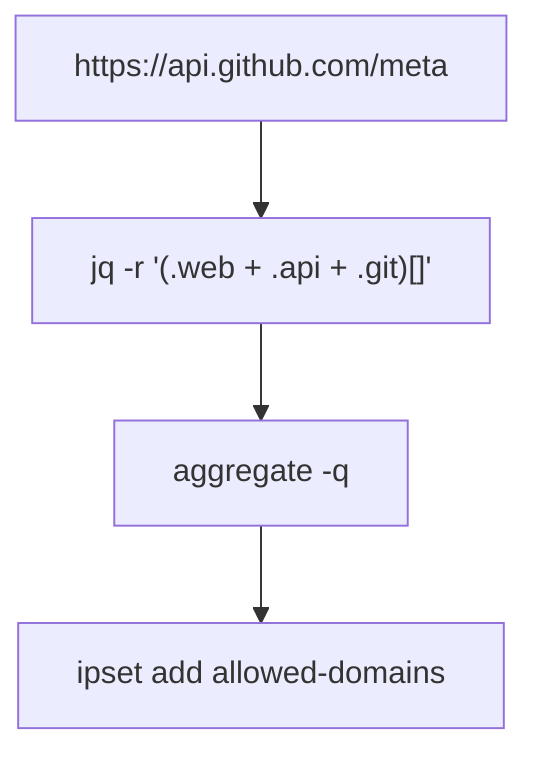
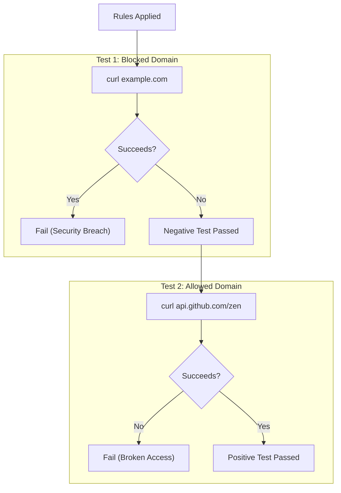

<!-- source: DeepWiki mcp.deepwiki.com · repo anthropics/claude-code · page 7.2 Network Security & Firewall · fetched 2026-10-26 -->

# Network Security & Firewall

Relevant source files

The following files were used as context for generating this wiki page:

- [.devcontainer/Dockerfile](.devcontainer/Dockerfile)
- [.devcontainer/devcontainer.json](.devcontainer/devcontainer.json)
- [.devcontainer/init-firewall.sh](.devcontainer/init-firewall.sh)
- [.gitattributes](.gitattributes)
- [.vscode/extensions.json](.vscode/extensions.json)
- [CHANGELOG.md](CHANGELOG.md)
- [LICENSE.md](LICENSE.md)
- [README.md](README.md)
- [SECURITY.md](SECURITY.md)
- [demo.gif](demo.gif)
- [feed.xml](feed.xml)

## Purpose & Scope

This document describes the network security architecture implemented in Claude Code's DevContainer environment. The firewall system provides defense-in-depth isolation by restricting container network access to only explicitly allowed domains and services, preventing unauthorized outbound connections while maintaining necessary functionality.

The firewall is implemented through the `[.devcontainer/init-firewall.sh:1-136]()` script which configures `iptables` rules and uses `ipset` for efficient IP allowlisting. This system operates at the container level and is distinct from the Bash tool sandbox.

For general DevContainer configuration details, see [DevContainer Configuration](7.1). For container orchestration and startup procedures, see [Container Orchestration](7.4).

---

## Security Model Overview

The DevContainer firewall implements a **default-deny** network policy where all outbound traffic is blocked unless explicitly allowed. The security model consists of three layers:

1.  **Privilege escalation control**: Non-root `node` user with limited `sudo` access only for firewall initialization `[.devcontainer/Dockerfile:88-91]()`.
2.  **Network isolation**: `iptables` rules with default DROP policies `[.devcontainer/init-firewall.sh:107-110]()`.
3.  **Domain allowlisting**: `ipset` hash table containing permitted destination IPs `[.devcontainer/init-firewall.sh:41-41]()`.

### Firewall Initialization Flow

```mermaid
graph TB
    START["Container Startup"]
    SUDO["postStartCommand (sudo init-firewall.sh)"]
    
    subgraph "Phase 1: Setup & Docker DNS"
        LINE6["Extract DOCKER_DNS_RULES"]
        LINE9_15["iptables -F / ipset destroy"]
        LINE18_25["Restore Docker DNS Rules"]
    end
    
    subgraph "Phase 2: Essential Services"
        LINE29["Allow Outbound DNS (UDP 53)"]
        LINE33["Allow Outbound SSH (TCP 22)"]
        LINE37_38["Allow Loopback (lo)"]
    end
    
    subgraph "Phase 3: IPSet Population"
        LINE41["ipset create allowed-domains"]
        LINE44_64["Fetch & Aggregate GitHub IPs"]
        LINE66_91["Resolve & Add Domain IPs"]
    end
    
    subgraph "Phase 4: Policy Enforcement"
        LINE94_101["Detect HOST_NETWORK"]
        LINE104_105["Allow Host Network Traffic"]
        LINE108_110["Set Default Policy DROP"]
        LINE113_114["Allow ESTABLISHED/RELATED"]
        LINE117["Match ipset allowed-domains"]
        LINE120["REJECT remaining with ICMP"]
    end
    
    subgraph "Phase 5: Verification"
        LINE124["Test Blocked: example.com"]
        LINE132["Test Allowed: api.github.com"]
    end
    
    START --> SUDO
    SUDO --> LINE6
    LINE6 --> LINE9_15
    LINE9_15 --> LINE18_25
    LINE18_25 --> LINE29
    LINE29 --> LINE33
    LINE33 --> LINE37_38
    LINE37_38 --> LINE41
    LINE41 --> LINE44_64
    LINE44_64 --> LINE66_91
    LINE66_91 --> LINE94_101
    LINE94_101 --> LINE104_105
    LINE104_105 --> LINE108_110
    LINE108_110 --> LINE113_114
    LINE113_114 --> LINE117
    LINE117 --> LINE120
    LINE120 --> LINE124
    LINE124 --> LINE132
```

Sources: `[.devcontainer/init-firewall.sh:1-136]()`, `[.devcontainer/devcontainer.json:12-15]`, `[.devcontainer/devcontainer.json:55-56]()`

---

## Allowed Domains & Services

The firewall permits outbound connections to specific service categories. These domains are hard-coded in the script and resolved via DNS at container startup.

| Category | Domains | Purpose | Script Lines |
| :--- | :--- | :--- | :--- |
| **GitHub** | Dynamic IP ranges from `api.github.com/meta` | Repository operations, CLI, API access | `[.devcontainer/init-firewall.sh:44-64]()` |
| **npm Registry** | `registry.npmjs.org` | Package installation | `[.devcontainer/init-firewall.sh:68-68]()` |
| **Anthropic API** | `api.anthropic.com` | Claude model inference | `[.devcontainer/init-firewall.sh:69-69]()` |
| **Telemetry** | `sentry.io`, `statsig.com` | Error reporting and analytics | `[.devcontainer/init-firewall.sh:70-71]()` |
| **VS Code** | `marketplace.visualstudio.com`, `vscode.blob.core.windows.net`, `update.code.visualstudio.com` | Extensions and updates | `[.devcontainer/init-firewall.sh:72-74]()` |

### Domain Resolution Method

Sources: `[.devcontainer/init-firewall.sh:67-91]()`

---

## Firewall Initialization Process

### Container Capabilities

The DevContainer requires elevated Linux capabilities to manipulate network rules, specified in `devcontainer.json` `[.devcontainer/devcontainer.json:12-15]()`:

| Capability | Required For |
| :--- | :--- |
| `NET_ADMIN` | `iptables`, `ipset`, and `ip route` configuration. |
| `NET_RAW` | State tracking (`ESTABLISHED`) and ICMP rejection packets. |

### Container Startup Lifecycle

The firewall is initialized via the `postStartCommand` `[.devcontainer/devcontainer.json:55-55]()` in `[.devcontainer/devcontainer.json]`. The `waitFor` directive ensures the environment is not accessible until the firewall is active `[.devcontainer/devcontainer.json:56-56]()`.

Sources: `[.devcontainer/devcontainer.json:55-56]()`

---

## Docker DNS Preservation

Docker injects NAT rules for its internal DNS resolver at `127.0.0.11`. These must be captured before flushing `iptables` and restored afterward to maintain internal name resolution.

1.  **Extraction**: `iptables-save -t nat | grep "127.0.0.11"` `[.devcontainer/init-firewall.sh:6-6]()`.
2.  **Restoration**: Rules are piped back into `iptables -t nat` after the flush `[.devcontainer/init-firewall.sh:18-25]()`.

Sources: `[.devcontainer/init-firewall.sh:5-25]()`

---

## IP Address Resolution & ipset Population

### GitHub IP Range Aggregation

GitHub's meta API provides multiple IP arrays (`web`, `api`, `git`). The script combines these and uses the `aggregate` tool to minimize the number of CIDR entries `[.devcontainer/init-firewall.sh:64-64]()`.

Sources: `[.devcontainer/init-firewall.sh:43-64]()`

---

## iptables Rule Architecture

### Rule Configuration Phases

1.  **Pre-Policy Basic Rules**: Allows DNS (port 53), SSH (port 22), and loopback (`lo`) interface traffic `[.devcontainer/init-firewall.sh:27-38]()`.
2.  **Host Network Detection**: Detects the host gateway via `ip route` and allows traffic to the host network (e.g., for port forwarding) `[.devcontainer/init-firewall.sh:93-105]()`.
3.  **Default DROP Policy**: Sets `INPUT`, `FORWARD`, and `OUTPUT` chains to `DROP` `[.devcontainer/init-firewall.sh:107-110]()`.
4.  **Stateful Tracking**: Allows `ESTABLISHED` and `RELATED` packets to ensure response traffic returns correctly `[.devcontainer/init-firewall.sh:112-113]()`.
5.  **Allowlist Matching**: Matches outbound destination IPs against the `allowed-domains` ipset `[.devcontainer/init-firewall.sh:116-116]()`.
6.  **Explicit Rejection**: Rejects any remaining outbound traffic with `icmp-admin-prohibited` `[.devcontainer/init-firewall.sh:119-119]()`.

Sources: `[.devcontainer/init-firewall.sh:27-120]()`

---

## Verification & Testing

The script performs two functional tests before exiting:

Sources: `[.devcontainer/init-firewall.sh:122-136]()`

---

## Error Handling & Safety

The script uses strict bash settings: `set -euo pipefail` `[.devcontainer/init-firewall.sh:2-2]()`.

### Validation Checkpoints
*   **GitHub API**: Exits if the IP meta response is empty or missing required fields `[.devcontainer/init-firewall.sh:46-54]()`.
*   **DNS Resolution**: Exits if any mandatory domain fails to resolve to a valid IP `[.devcontainer/init-firewall.sh:77-89]()`.
*   **Host Detection**: Exits if the default route cannot be determined `[.devcontainer/init-firewall.sh:94-97]()`.

Sources: `[.devcontainer/init-firewall.sh:2-98]()`

---

