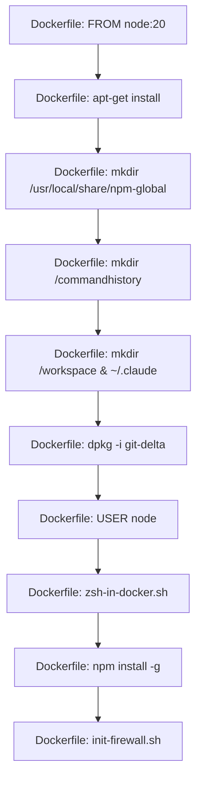
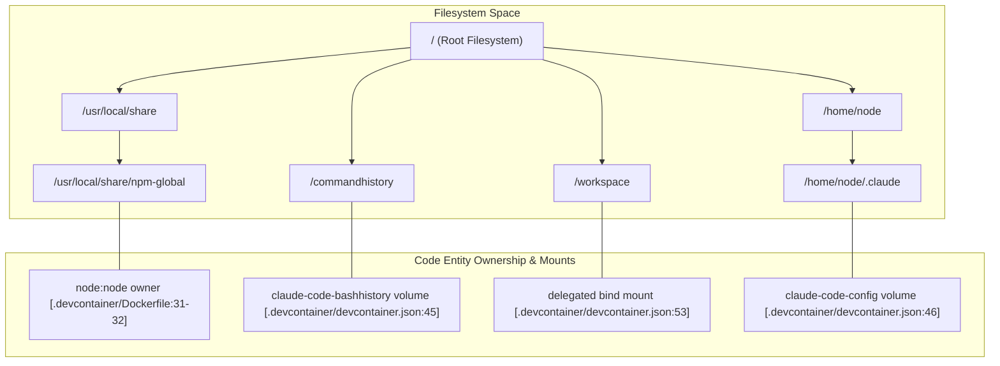

<!-- source: DeepWiki mcp.deepwiki.com · repo anthropics/claude-code · page 7.3 Base Image & Tooling · fetched 2026-10-26 -->

# Base Image & Tooling

<details>
<summary>Relevant source files</summary>

The following files were used as context for generating this wiki page:

- [.devcontainer/Dockerfile](.devcontainer/Dockerfile)
- [.devcontainer/devcontainer.json](.devcontainer/devcontainer.json)
- [.devcontainer/init-firewall.sh](.devcontainer/init-firewall.sh)
- [.gitattributes](.gitattributes)
- [.vscode/extensions.json](.vscode/extensions.json)
- [CHANGELOG.md](CHANGELOG.md)
- [LICENSE.md](LICENSE.md)
- [README.md](README.md)
- [SECURITY.md](SECURITY.md)
- [demo.gif](demo.gif)
- [feed.xml](feed.xml)

</details>


## Purpose and Scope

This document details the construction of the development container base image, including the selection of the Node.js base image, installation of system packages, shell environment configuration, user permissions, and Claude Code application setup. This page covers the complete contents of `.devcontainer/Dockerfile` and associated configuration files. For information about network security rules applied during container initialization, see [Network Security & Firewall](7.2). For overall DevContainer orchestration, see [DevContainer Configuration](7.1).

Sources: [.devcontainer/Dockerfile:1-91]()

---

## Base Image and Build Arguments

The development container is built from the official `node:20` base image, providing the required JavaScript runtime for Claude Code execution `[.devcontainer/Dockerfile:1-1]()`. The build process accepts several build arguments defined in `[.devcontainer/devcontainer.json:5-10]()` and `[.devcontainer/Dockerfile:3-8]()`:

| Build Argument | Default | Purpose |
|----------------|---------|---------|
| `CLAUDE_CODE_VERSION` | `latest` | Specifies which version of `@anthropic-ai/claude-code` to install `[.devcontainer/Dockerfile:6-6]()` |
| `TZ` | `America/Los_Angeles` | Sets the container timezone via `[.devcontainer/devcontainer.json:6-6]()` and `[.devcontainer/Dockerfile:3-4]()` |
| `GIT_DELTA_VERSION` | `0.18.2` | Version of `git-delta` syntax highlighter to install `[.devcontainer/Dockerfile:51-51]()` |
| `ZSH_IN_DOCKER_VERSION` | `1.2.0` | Version of the `zsh-in-docker` installation script `[.devcontainer/Dockerfile:72-72]()` |
| `USERNAME` | `node` | Non-root system user for development `[.devcontainer/Dockerfile:34-34]()` |

Sources: [.devcontainer/Dockerfile:1-8](), [.devcontainer/devcontainer.json:3-11]()

---

## Container Build Stages



**Diagram: Dockerfile Build Sequence and Code Entity Mapping**

The Dockerfile constructs the container environment through sequential build steps, mapping each container layer directly to instructions executed in `[.devcontainer/Dockerfile:1-91]()`.

Sources: [.devcontainer/Dockerfile:1-91]()

---

## System Package Inventory

The container installs a comprehensive set of system packages via `apt-get` inside `[.devcontainer/Dockerfile:9-28]()`:

| Category | Packages | Purpose |
|----------|----------|---------|
| **Core Utilities** | `less`, `procps`, `sudo`, `man-db`, `unzip` | Basic runtime utilities, process viewing, and archive extraction |
| **Version Control** | `git`, `gh` | Source code management and official GitHub CLI |
| **Shell Enhancements** | `zsh`, `fzf` | Z shell environment and fuzzy file finder |
| **Text Editors** | `nano`, `vim` | Command-line text editors |
| **Network & Firewall** | `iptables`, `ipset`, `iproute2`, `dnsutils`, `aggregate` | Packet filtering, IP sets, routing inspection, DNS lookup, and CIDR aggregation |
| **Data Processing** | `jq` | Lightweight command-line JSON processor |
| **Security** | `gnupg2` | OpenPGP encryption and signing tool |

The `--no-install-recommends` flag minimizes image size, and package lists are cleaned immediately after installation `[.devcontainer/Dockerfile:9-28]()`.

Sources: [.devcontainer/Dockerfile:9-28]()

---

## Directory Structure and Permissions



**Diagram: Container Directory Structure and Mount Mappings**

Key directories are provisioned with specific ownership rules and mapped Docker volumes as configured across `[.devcontainer/Dockerfile:31-47]()` and `[.devcontainer/devcontainer.json:44-54]()`.

Sources: [.devcontainer/Dockerfile:31-47](), [.devcontainer/devcontainer.json:44-54]()

---

## User and Permission Configuration

The container follows security best practices by executing long-running processes as the non-root `node` user `[.devcontainer/Dockerfile:58-58]()`. 

1. **Global npm Prefix**: Configured via `NPM_CONFIG_PREFIX=/usr/local/share/npm-global` to permit package installation without root permissions `[.devcontainer/Dockerfile:61-61]()`.
2. **PATH Extension**: Global binaries are appended to the system `PATH` via `[.devcontainer/Dockerfile:62-62]()`.
3. **Passwordless Sudo**: The `node` user is granted explicit, restricted permissions to execute the firewall script without a password via `/etc/sudoers.d/node-firewall` `[.devcontainer/Dockerfile:87-90]()`.

Sources: [.devcontainer/Dockerfile:58-62](), [.devcontainer/Dockerfile:87-90]()

---

## Shell Environment Setup

The environment variables and shell options are configured for optimal developer ergonomics:

| Environment Variable / Setting | Value | Purpose |
|--------------------------------|-------|---------|
| `SHELL` | `/bin/zsh` | Sets default interactive shell `[.devcontainer/Dockerfile:65-65]()` |
| `EDITOR` / `VISUAL` | `nano` | Default text editor `[.devcontainer/Dockerfile:68-69]()` |
| `DEVCONTAINER` | `true` | Orientation flag indicating container runtime `[.devcontainer/Dockerfile:43-43]()` |
| `NODE_OPTIONS` | `--max-old-space-size=4096` | Increases Node.js heap limit inside `[.devcontainer/devcontainer.json:49-49]()` |
| `CLAUDE_CONFIG_DIR` | `/home/node/.claude` | Directs configuration storage `[.devcontainer/devcontainer.json:50-50]()` |

The `zsh-in-docker` utility (version `1.2.0`) provisions `zsh` with the `git` and `fzf` plugins, keybindings, completion hooks, and persistent history logging into `/commandhistory/.bash_history` `[.devcontainer/Dockerfile:72-79]()`.

Sources: [.devcontainer/Dockerfile:43-79](), [.devcontainer/devcontainer.json:48-52]()

---

## git-delta Installation

`git-delta` version `0.18.2` is installed to enhance git diff output `[.devcontainer/Dockerfile:51-55]()`. The installation dynamically inspects architecture via `dpkg --print-architecture`, downloads the corresponding `.deb` package release from GitHub, installs it via `dpkg -i`, and cleans up package artifacts `[.devcontainer/Dockerfile:52-55]()`.

Sources: [.devcontainer/Dockerfile:51-55]()

---

## Claude Code Installation

Claude Code is installed globally as the final step of the user configuration block `[.devcontainer/Dockerfile:82-82]()`:

```bash
npm install -g @anthropic-ai/claude-code@${CLAUDE_CODE_VERSION}
```

This makes the `claude` CLI binary globally available under the `NPM_CONFIG_PREFIX` bin directory `[.devcontainer/Dockerfile:61-62]()`.

Sources: [.devcontainer/Dockerfile:61-62](), [.devcontainer/Dockerfile:82-82]()

---

## Firewall Script Integration

The container copies `init-firewall.sh` into `/usr/local/bin/` and configures root-level execution rights via sudoers `[.devcontainer/Dockerfile:86-90]()`. Upon container start, the `postStartCommand` executes `sudo /usr/local/bin/init-firewall.sh` to enforce network egress restrictions `[.devcontainer/devcontainer.json:55-55]()`.

Sources: [.devcontainer/Dockerfile:86-90](), [.devcontainer/devcontainer.json:55-55](), [.devcontainer/init-firewall.sh:1-136]()

---

