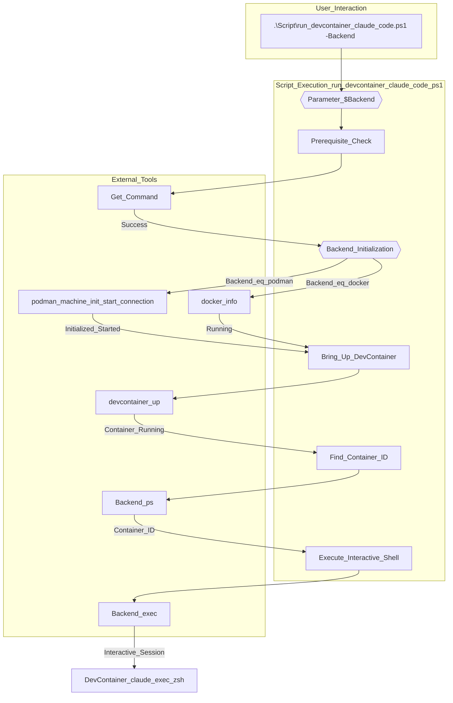
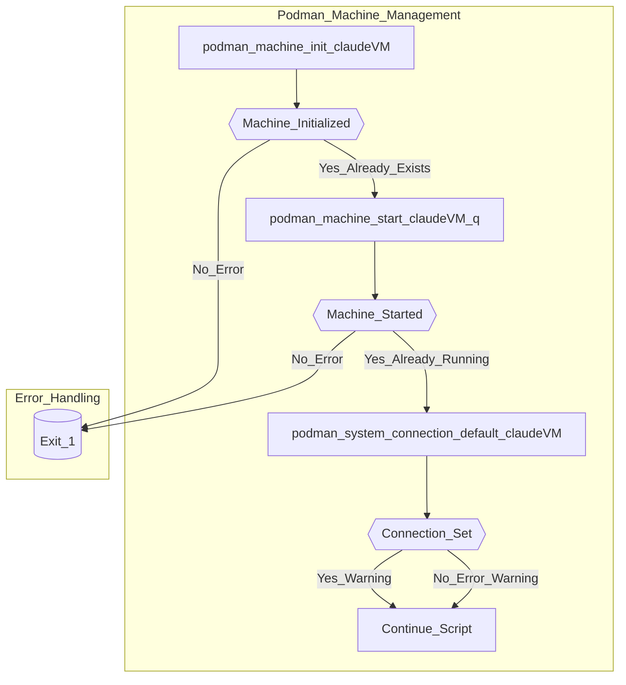
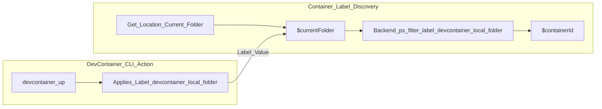
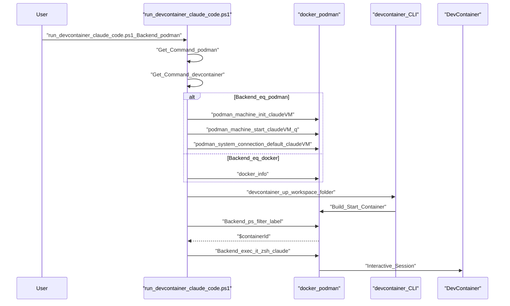

<!-- source: DeepWiki mcp.deepwiki.com · repo anthropics/claude-code · page 7.4 Container Orchestration · fetched 2026-10-26 -->

# Container Orchestration

<details>
<summary>Relevant source files</summary>

The following files were used as context for generating this wiki page:

- [Script/run_devcontainer_claude_code.ps1](Script/run_devcontainer_claude_code.ps1)

</details>


The `run_devcontainer_claude_code.ps1` script automates the complete DevContainer lifecycle across Docker and Podman container runtimes on Windows [Script/run_devcontainer_claude_code.ps1:1-152](). Located at `Script/run_devcontainer_claude_code.ps1`, it provides a single entry point for backend initialization, container creation, and interactive session establishment [Script/run_devcontainer_claude_code.ps1:5-8]().

**Orchestration Capabilities:**
- **Backend Abstraction**: Unified PowerShell interface over `docker` and `podman` CLI commands via the `[Parameter(Mandatory=$true)] [ValidateSet('docker','podman')] [string]$Backend` parameter [Script/run_devcontainer_claude_code.ps1:30-34]().
- **Podman Machine Management**: Automated `claudeVM` initialization, startup, and connection configuration [Script/run_devcontainer_claude_code.ps1:60-91]().
- **Label-Based Discovery**: Container identification via `devcontainer.local_folder` label filtering [Script/run_devcontainer_claude_code.ps1:121-138]().
- **Interactive Session**: Automatic `claude` CLI launch followed by a persistent `zsh` shell via `$Backend exec` [Script/run_devcontainer_claude_code.ps1:140-149]().

Sources: [Script/run_devcontainer_claude_code.ps1:1-27]()

## Orchestration Architecture

The `run_devcontainer_claude_code.ps1` script orchestrates the complete container lifecycle, abstracting backend-specific initialization and providing a unified entry point for both Docker and Podman runtimes [Script/run_devcontainer_claude_code.ps1:1-152]().

**Orchestration Layers:**

| Layer | Components | Backend Dependencies |
|-------|------------|---------------------|
| **Command Validation** | `Get-Command` checks for `docker`/`podman` and `devcontainer` | PowerShell cmdlets [Script/run_devcontainer_claude_code.ps1:40-56]() |
| **Runtime Initialization** | Docker daemon health check OR Podman machine lifecycle | `docker info` [Script/run_devcontainer_claude_code.ps1:98]() OR `podman machine` [Script/run_devcontainer_claude_code.ps1:66-76]() |
| **Container Lifecycle** | `devcontainer up` invocation with backend-specific flags | `devcontainer` CLI [Script/run_devcontainer_claude_code.ps1:107-119]() |
| **Container Discovery** | Label-based filtering using `devcontainer.local_folder` | `$Backend ps` with label filters [Script/run_devcontainer_claude_code.ps1:126]() |
| **Session Establishment** | Interactive `zsh` with `claude` autostart | `$Backend exec` with `-it` flags [Script/run_devcontainer_claude_code.ps1:143]() |

### System Orchestration Flow



**Diagram: Orchestration Flow with PowerShell Variables and Commands**

The script implements a five-stage pipeline with backend-specific branching. All nodes reference actual PowerShell variables (`$Backend`, `$arguments`, `$currentFolder`, `$containerId`) and external commands (`docker`/`podman`, `devcontainer`) invoked via the script [Script/run_devcontainer_claude_code.ps1:30-152]().

Sources: [Script/run_devcontainer_claude_code.ps1:30-152]()

## Prerequisites Validation

The script validates required external commands before executing any container operations [Script/run_devcontainer_claude_code.ps1:40-56]():

| Command | Purpose | Check Method | Failure Behavior |
|---------|---------|--------------|------------------|
| `docker` or `podman` | Container runtime (value of `$Backend` parameter) [Script/run_devcontainer_claude_code.ps1:30-34]() | `Get-Command $Backend -ErrorAction SilentlyContinue` [Script/run_devcontainer_claude_code.ps1:43]() | `Write-Error`, `exit 1` [Script/run_devcontainer_claude_code.ps1:53-55]() |
| `devcontainer` | DevContainer CLI (@devcontainers/cli package) | `Get-Command devcontainer -ErrorAction SilentlyContinue` [Script/run_devcontainer_claude_code.ps1:47]() | `Write-Error`, `exit 1` [Script/run_devcontainer_claude_code.ps1:53-55]() |

**Validation Logic:**

```powershell
if (-not (Get-Command $Backend -ErrorAction SilentlyContinue)) {
    throw "Required command '$($Backend)' not found."
}
if (-not (Get-Command devcontainer -ErrorAction SilentlyContinue)) {
    throw "Required command 'devcontainer' not found."
}
```

The `Get-Command` cmdlet with `-ErrorAction SilentlyContinue` returns `$null` if the command is not found in the PATH. The script catches exceptions via a surrounding `try-catch` block [Script/run_devcontainer_claude_code.ps1:42-56]() and terminates with `exit 1` [Script/run_devcontainer_claude_code.ps1:55]().

Sources: [Script/run_devcontainer_claude_code.ps1:40-56]()

## Backend-Specific Initialization

### Docker Backend: Daemon Health Check

For Docker, the script executes a single validation command [Script/run_devcontainer_claude_code.ps1:98]():

```powershell
docker info | Out-Null
```

The `docker info` command queries the Docker daemon for system information [Script/run_devcontainer_claude_code.ps1:98](). Success indicates that Docker Desktop is running and the CLI can communicate with the daemon.

**Failure Handling:**
If `docker info` fails, the script catches the error and terminates [Script/run_devcontainer_claude_code.ps1:100-104]().

Sources: [Script/run_devcontainer_claude_code.ps1:92-105]()

### Podman Backend: claudeVM Machine Lifecycle

Podman on Windows requires a Linux VM to run containers. The script manages a named machine `claudeVM` [Script/run_devcontainer_claude_code.ps1:64]():



**Diagram: claudeVM Machine Lifecycle Management**

| Step | Command | Purpose | Error Handling |
|------|---------|---------|----------------|
| 1a | `podman machine init claudeVM` [Script/run_devcontainer_claude_code.ps1:66]() | Create Podman VM if not exists | Exit on failure (code 1) [Script/run_devcontainer_claude_code.ps1:68-71]() |
| 1b | `podman machine start claudeVM -q` [Script/run_devcontainer_claude_code.ps1:76]() | Start the VM (quiet mode) | Exit on failure (code 1) [Script/run_devcontainer_claude_code.ps1:78-81]() |
| 2 | `podman system connection default claudeVM` [Script/run_devcontainer_claude_code.ps1:86]() | Set as default connection | Warning only (non-fatal) [Script/run_devcontainer_claude_code.ps1:88-90]() |

Sources: [Script/run_devcontainer_claude_code.ps1:60-91]()

## DevContainer Startup Process

After backend initialization, the script invokes the `devcontainer` CLI [Script/run_devcontainer_claude_code.ps1:107-119]():

```powershell
$arguments = @('up', '--workspace-folder', '.')
if ($Backend -eq 'podman') {
    $arguments += '--docker-path', 'podman'
}
& devcontainer @arguments
```

**Argument Construction:**
The script builds the `$arguments` array [Script/run_devcontainer_claude_code.ps1:110-114](). The `--docker-path podman` flag [Script/run_devcontainer_claude_code.ps1:112]() instructs the `devcontainer` CLI to substitute `podman` for internal `docker` calls.

Sources: [Script/run_devcontainer_claude_code.ps1:107-119]()

## Container Discovery and Connection

### Container Discovery via Labels

The script retrieves the current directory path and uses it as a label filter to find the running container ID [Script/run_devcontainer_claude_code.ps1:123-126]():

```powershell
$currentFolder = (Get-Location).Path
$containerId = (& $Backend ps --filter "label=devcontainer.local_folder=$currentFolder" --format '{{.ID}}').Trim()
```

### Discovery Logic



**Diagram: Label-Based Container Identification**

Sources: [Script/run_devcontainer_claude_code.ps1:121-138]()

### Interactive Shell Connection

The script establishes an interactive session by executing a compound command inside the container [Script/run_devcontainer_claude_code.ps1:143]():

```powershell
& $Backend exec -it $containerId zsh -c 'claude; exec zsh'
```

1. **`claude`**: Launches the Claude Code REPL [Script/run_devcontainer_claude_code.ps1:143]().
2. **`exec zsh`**: Replaces the shell process with a fresh `zsh` instance upon exit of the `claude` command [Script/run_devcontainer_claude_code.ps1:143]().

Sources: [Script/run_devcontainer_claude_code.ps1:140-149]()

## Error Handling Strategy

The script wraps all external command invocations in `try-catch` blocks for consistent error handling [Script/run_devcontainer_claude_code.ps1:42-56](), [Script/run_devcontainer_claude_code.ps1:109-119](), [Script/run_devcontainer_claude_code.ps1:142-149]().

| Pattern Element | Implementation |
|-----------------|----------------|
| **Exception Capture** | `try { ... } catch { ... }` blocks |
| **Contextual Messages** | `Write-Error "Failed to <operation>: $($_.Exception.Message)"` |
| **Fatal Exit** | `exit 1` terminates script immediately |
| **Non-Fatal Warning** | `Write-Warning` continues execution (used for Podman connection) [Script/run_devcontainer_claude_code.ps1:89]() |

Sources: [Script/run_devcontainer_claude_code.ps1:42-149]()

## End-to-End Orchestration Sequence



**Diagram: Complete Orchestration Sequence**

Sources: [Script/run_devcontainer_claude_code.ps1:1-152]()

## Project Structure Requirements

The script must be executed from the project root directory [Script/run_devcontainer_claude_code.ps1:7-8](). It expects this structure [Script/run_devcontainer_claude_code.ps1:22-27]():

```
Project/
├── .devcontainer/
└── Script/
    └── run_devcontainer_claude_code.ps1
```

Sources: [Script/run_devcontainer_claude_code.ps1:22-27]()

---

