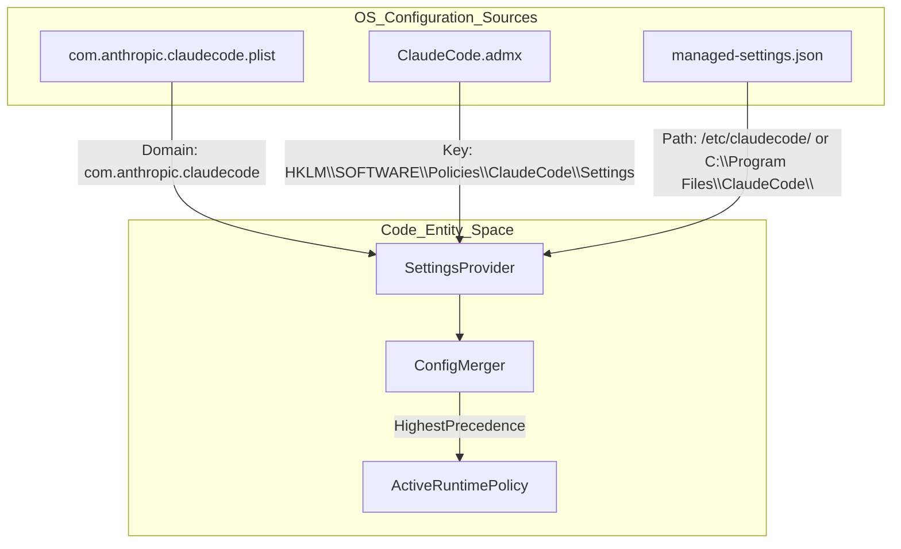
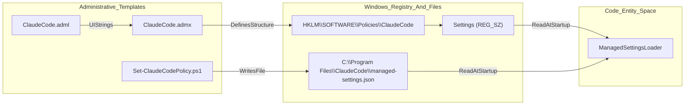

<!-- source: DeepWiki mcp.deepwiki.com · repo anthropics/claude-code · page 7.5 Enterprise MDM Deployment · fetched 2026-10-26 -->

# Enterprise MDM Deployment

<details>
<summary>Relevant source files</summary>

The following files were used as context for generating this wiki page:

- [examples/mdm/README.md](examples/mdm/README.md)
- [examples/mdm/macos/com.anthropic.claudecode.mobileconfig](examples/mdm/macos/com.anthropic.claudecode.mobileconfig)
- [examples/mdm/macos/com.anthropic.claudecode.plist](examples/mdm/macos/com.anthropic.claudecode.plist)
- [examples/mdm/managed-settings.json](examples/mdm/managed-settings.json)
- [examples/mdm/windows/ClaudeCode.admx](examples/mdm/windows/ClaudeCode.admx)
- [examples/mdm/windows/Set-ClaudeCodePolicy.ps1](examples/mdm/windows/Set-ClaudeCodePolicy.ps1)
- [examples/mdm/windows/en-US/ClaudeCode.adml](examples/mdm/windows/en-US/ClaudeCode.adml)
- [examples/settings/README-hipaa.md](examples/settings/README-hipaa.md)
- [examples/settings/README.md](examples/settings/README.md)
- [examples/settings/managed-mcp-hipaa.json](examples/settings/managed-mcp-hipaa.json)
- [examples/settings/settings-bash-sandbox.json](examples/settings/settings-bash-sandbox.json)
- [examples/settings/settings-hipaa.json](examples/settings/settings-hipaa.json)
- [examples/settings/settings-lax.json](examples/settings/settings-lax.json)
- [examples/settings/settings-strict.json](examples/settings/settings-strict.json)

</details>


This page provides technical documentation for deploying Claude Code across an enterprise fleet using Mobile Device Management (MDM) solutions. It covers the configuration of managed settings for macOS (Jamf, Kandji/Iru) and Windows (Intune, Group Policy) to enforce security policies, organizational standards, and restricted environments such as HIPAA-ready deployments.

Sources: [examples/mdm/README.md:1-7](), [examples/settings/README.md:1-6]()

---

## Overview and Policy Precedence

Claude Code supports a hierarchical configuration model where enterprise-managed settings occupy the highest level of precedence. Settings defined via MDM cannot be overridden by users in their local `settings.json` or project-level `settings.local.json` files [examples/mdm/README.md:23-24]().

### Data Flow for Managed Settings

The following diagram illustrates how configuration is ingested from various OS-specific sources into the Claude Code runtime and maps them to internal code entities.

**Managed Configuration Ingestion**

Sources: [examples/mdm/README.md:13-24](), [examples/mdm/windows/ClaudeCode.admx:15-20]()

---

## macOS Deployment (Jamf, Kandji, Iru)

On macOS, Claude Code reads managed settings from the `com.anthropic.claudecode` preference domain. This is typically achieved by deploying a `.plist` or a `.mobileconfig` profile.

### Custom Settings (PLIST)
For MDMs like Jamf Pro or Kandji (Iru) that support "Custom Settings" payloads, use a Property List (`.plist`) file.

*   **Preference Domain**: `com.anthropic.claudecode` [examples/mdm/README.md:16-16]()
*   **Key File**: `examples/mdm/macos/com.anthropic.claudecode.plist` [examples/mdm/macos/com.anthropic.claudecode.plist:1-11]()

### Configuration Profiles (mobileconfig)
For local testing or MDMs requiring a full profile, the `mobileconfig` format wraps the preference dictionary in a system-scoped payload [examples/mdm/macos/com.anthropic.claudecode.mobileconfig:1-18]().

| Key | Value | Description |
| :--- | :--- | :--- |
| `PayloadType` | `com.apple.ManagedClient.preferences` | Identifies this as a managed preference payload [examples/mdm/macos/com.anthropic.claudecode.mobileconfig:28-29]() |
| `PayloadScope` | `System` | Ensures the policy applies to all users on the device [examples/mdm/macos/com.anthropic.claudecode.mobileconfig:13-14]() |
| `mcx_preference_settings` | Dictionary | Contains the actual JSON-structured settings [examples/mdm/macos/com.anthropic.claudecode.mobileconfig:41-48]() |

Sources: [examples/mdm/README.md:16-17](), [examples/mdm/macos/com.anthropic.claudecode.plist:1-11](), [examples/mdm/macos/com.anthropic.claudecode.mobileconfig:1-56]()

---

## Windows Deployment (Intune, Group Policy)

Windows deployments support two primary methods: direct file deployment via PowerShell or registry-based policy via ADMX templates.

### Method 1: ADMX Templates (GPO / Intune Import)
The ADMX template allows administrators to manage Claude Code via the Group Policy Management Editor or Intune "Import ADMX" feature.

*   **Registry Key**: `HKLM\SOFTWARE\Policies\ClaudeCode` [examples/mdm/windows/ClaudeCode.admx:20-20]()
*   **Registry Value**: `Settings` (REG_SZ) [examples/mdm/windows/ClaudeCode.admx:24-24]()
*   **Data Format**: A single-line JSON string containing the configuration [examples/mdm/windows/en-US/ClaudeCode.adml:12-17]()

### Method 2: PowerShell Script (Intune Platform Scripts)
Administrators can deploy the `Set-ClaudeCodePolicy.ps1` script to write a `managed-settings.json` file directly to the protected program directory.

*   **Target Path**: `C:\Program Files\ClaudeCode\managed-settings.json` [examples/mdm/windows/Set-ClaudeCodePolicy.ps1:15-26]()
*   **Execution Requirement**: Must run as `SYSTEM` (Logged on credentials: No) in a 64-bit PowerShell host [examples/mdm/windows/Set-ClaudeCodePolicy.ps1:4-6]()

**Windows Policy Entity Mapping**

Sources: [examples/mdm/windows/ClaudeCode.admx:1-28](), [examples/mdm/windows/en-US/ClaudeCode.adml:1-31](), [examples/mdm/windows/Set-ClaudeCodePolicy.ps1:1-28]()

---

## Managed Settings Profiles & Advanced Security

Organization-wide deployments can utilize predefined configuration profiles located in `examples/settings/` to enforce specific security postures [examples/settings/README.md:1-5]().

### Security Profiles Comparison

| Setting File | Purpose & Enforcement Highlights |
| :--- | :--- |
| [`settings-lax.json`](../../examples/settings/settings-lax.json) | Disables bypass permissions mode and restricts plugin marketplaces [examples/settings/README.md:13-16]() |
| [`settings-strict.json`](../../examples/settings/settings-strict.json) | Enforces strict controls: disables bypass permissions, forces `ask` for Bash, blocks web search/fetch tools, restricts plugins and hooks to managed sources only [examples/settings/README.md:13-20](), [examples/settings/settings-strict.json:1-28]() |
| [`settings-bash-sandbox.json`](../../examples/settings/settings-bash-sandbox.json) | Forces the Bash tool to run inside an isolated sandbox environment with strict network boundaries [examples/settings/README.md:13-21](), [examples/settings/settings-bash-sandbox.json:1-18]() |
| [`settings-hipaa.json`](../../examples/settings/settings-hipaa.json) | Enforces strict HIPAA-ready constraints: forces specific org UUIDs, disables remote control, denies access to sensitive local credential paths and environment variables, sets data retention limits [examples/settings/README-hipaa.md:1-74](), [examples/settings/settings-hipaa.json:1-152]() |

### Example: Strict Policy JSON
```json
{
  "permissions": {
    "disableBypassPermissionsMode": "disable",
    "ask": [
      "Bash"
    ],
    "deny": [
      "WebSearch",
      "WebFetch"
    ]
  },
  "allowManagedPermissionRulesOnly": true,
  "allowManagedHooksOnly": true,
  "strictKnownMarketplaces": []
}
```
Sources: [examples/settings/README.md:1-39](), [examples/settings/settings-strict.json:1-28]()

---

## Implementation Checklist

1.  **Select Target**: Determine if you are deploying via file (`managed-settings.json`) or OS native policy (Registry/Plist) [examples/mdm/README.md:13-19]().
2.  **Choose Security Profile**: Review baseline, strict, sandboxed, or HIPAA-ready templates under `examples/settings/` [examples/settings/README.md:13-35]().
3.  **Generate UUIDs**: If using `.mobileconfig`, generate unique `PayloadUUID` values using `uuidgen` [examples/mdm/README.md:22-22]().
4.  **Validate JSON**: Ensure the configuration string is valid JSON; Windows ADMX requires a single-line string [examples/mdm/windows/en-US/ClaudeCode.adml:14-17]().
5.  **Verification**: Run `claude /status` on a managed machine. The output should list the source under **Setting sources** — e.g., `Enterprise managed settings (plist)` on macOS or `Enterprise managed settings (HKLM)` on Windows [examples/mdm/README.md:23-23]().

Sources: [examples/mdm/README.md:1-28](), [examples/settings/README.md:1-39]()

---

