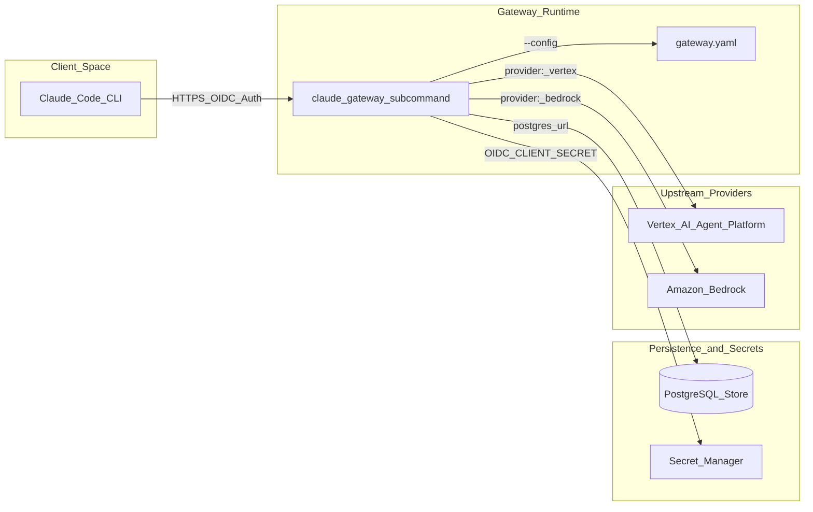
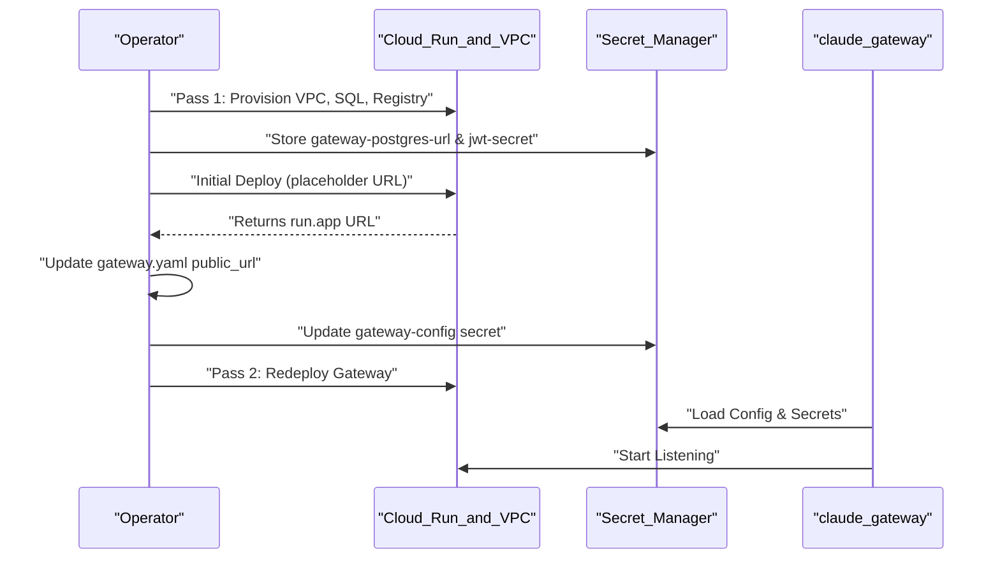

<!-- source: DeepWiki mcp.deepwiki.com · repo anthropics/claude-code · page 8 Claude Gateway · fetched 2026-10-26 -->

# Claude Gateway

Relevant source files

The following files were used as context for generating this wiki page:

- [examples/gateway/aws/.dockerignore](examples/gateway/aws/.dockerignore)
- [examples/gateway/aws/.gitignore](examples/gateway/aws/.gitignore)
- [examples/gateway/aws/Dockerfile](examples/gateway/aws/Dockerfile)
- [examples/gateway/aws/README.md](examples/gateway/aws/README.md)
- [examples/gateway/aws/gateway.yaml.example](examples/gateway/aws/gateway.yaml.example)
- [examples/gateway/aws/setup.sh](examples/gateway/aws/setup.sh)
- [examples/gateway/aws/terraform/.gitignore](examples/gateway/aws/terraform/.gitignore)
- [examples/gateway/aws/terraform/README.md](examples/gateway/aws/terraform/README.md)
- [examples/gateway/aws/terraform/main.tf](examples/gateway/aws/terraform/main.tf)
- [examples/gateway/aws/terraform/outputs.tf](examples/gateway/aws/terraform/outputs.tf)
- [examples/gateway/aws/terraform/terraform.tfvars.example](examples/gateway/aws/terraform/terraform.tfvars.example)
- [examples/gateway/gcp/.dockerignore](examples/gateway/gcp/.dockerignore)
- [examples/gateway/gcp/.gitignore](examples/gateway/gcp/.gitignore)
- [examples/gateway/gcp/Dockerfile](examples/gateway/gcp/Dockerfile)
- [examples/gateway/gcp/README.md](examples/gateway/gcp/README.md)
- [examples/gateway/gcp/gateway.yaml.example](examples/gateway/gcp/gateway.yaml.example)
- [examples/gateway/gcp/setup.sh](examples/gateway/gcp/setup.sh)
- [examples/gateway/gcp/terraform/.gitignore](examples/gateway/gcp/terraform/.gitignore)
- [examples/gateway/gcp/terraform/README.md](examples/gateway/gcp/terraform/README.md)
- [examples/gateway/gcp/terraform/main.tf](examples/gateway/gcp/terraform/main.tf)
- [examples/gateway/gcp/terraform/outputs.tf](examples/gateway/gcp/terraform/outputs.tf)
- [examples/gateway/gcp/terraform/terraform.tfvars.example](examples/gateway/gcp/terraform/terraform.tfvars.example)
- [examples/gateway/gcp/terraform/variables.tf](examples/gateway/gcp/terraform/variables.tf)

### Purpose and Scope
This page serves as the reference architecture overview for the `claude gateway` subcommand, which acts as an enterprise-grade proxy between Claude Code clients and upstream LLM providers such as Google Cloud's Vertex AI (Agent Platform) and Amazon Bedrock [examples/gateway/aws/Dockerfile:67-67](), [examples/gateway/aws/README.md:3-5](). As a parent page, it provides a high-level architectural summary of session management, OIDC authentication, role-based access control (RBAC), and deployment patterns. For deep technical implementation details, refer to the child pages covering GCP and AWS deployment guides and Terraform provisioning.

---

### High-Level Architecture

The gateway is packaged directly inside the standard Claude Code binary [examples/gateway/aws/Dockerfile:67-67]() and is driven by a declarative configuration file (`gateway.yaml`) alongside environment-injected secrets such as JWT signing keys, OIDC client secrets, and database connection strings [examples/gateway/gcp/gateway.yaml.example:17-26](). 

**Diagram: Claude Gateway Code Entity Map**

Sources: [examples/gateway/gcp/gateway.yaml.example:28-101](), [examples/gateway/aws/Dockerfile:67-67](), [examples/gateway/aws/README.md:1-18]()

---

### GCP Deployment & Provisioning

Deploying the gateway on Google Cloud Platform involves utilizing Cloud Run (or GKE), Cloud SQL for PostgreSQL with private IP only, Secret Manager, and service-account authentication to Vertex AI [examples/gateway/gcp/README.md:1-5](). Because the gateway's public URL is assigned upon initial deployment, provisioning follows a two-pass workflow or is automated via `setup.sh` and Terraform modules [examples/gateway/gcp/gateway.yaml.example:35-41](), [examples/gateway/gcp/terraform/main.tf:1-4]().

**Diagram: GCP Two-Pass Deployment Flow**

Sources: [examples/gateway/gcp/setup.sh:3-23](), [examples/gateway/gcp/gateway.yaml.example:12-41](), [examples/gateway/gcp/terraform/main.tf:1-22]()

#### 8.1. GCP Deployment Guide
The setup script (`setup.sh`) and container packaging guide for deploying the gateway on GCP using Cloud Run, Cloud SQL, and Secret Manager. For details, see [GCP Deployment Guide](#8.1) [examples/gateway/gcp/README.md:1-15]().

#### 8.2. GCP Terraform Provisioning
Declarative Infrastructure-as-Code modules for GCP, covering `variables.tf`, `outputs.tf`, `versions.tf`, and tfvars templates to provision the VPC, Private Services Access, Cloud SQL, and Cloud Run service [examples/gateway/gcp/terraform/variables.tf:1-174](), [examples/gateway/gcp/terraform/main.tf:1-123](). For details, see [GCP Terraform Provisioning](#8.2).

---

### AWS Deployment & Provisioning

For AWS environments, the gateway is deployed onto ECS Fargate (or EKS) behind an internal Application Load Balancer (ALB), using Amazon RDS for PostgreSQL and AWS Secrets Manager [examples/gateway/aws/README.md:1-9](). Unlike the GCP Cloud Run deployment where configuration is mounted dynamically from Secret Manager, the AWS deployment bakes `gateway.yaml` directly into the container image while injecting secrets securely via ECS task definitions [examples/gateway/aws/Dockerfile:9-15]().

#### 8.3. AWS Deployment Guide
Step-by-step instructions for deploying the gateway on AWS with ECS Fargate, Amazon RDS, Okta OIDC integration, and an internal ALB. For details, see [AWS Deployment Guide](#8.3) [examples/gateway/aws/README.md:1-18]().

#### 8.4. AWS Terraform Provisioning
Terraform IaC modules for AWS managing the ECS service, internal ALB, RDS database, least-privilege IAM roles for Bedrock invocation, ECR repositories, and remote state handling [examples/gateway/aws/terraform/README.md:1-39](). For details, see [AWS Terraform Provisioning](#8.4).

---

