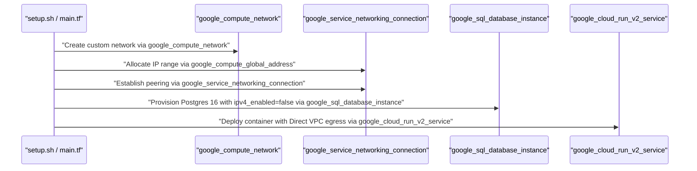

<!-- source: DeepWiki mcp.deepwiki.com · repo anthropics/claude-code · page 8.1 GCP Deployment Guide · fetched 2026-10-26 -->

# GCP Deployment Guide

<details>
<summary>Relevant source files</summary>

The following files were used as context for generating this wiki page:

- [examples/gateway/gcp/.dockerignore](examples/gateway/gcp/.dockerignore)
- [examples/gateway/gcp/.gitignore](examples/gateway/gcp/.gitignore)
- [examples/gateway/gcp/Dockerfile](examples/gateway/gcp/Dockerfile)
- [examples/gateway/gcp/README.md](examples/gateway/gcp/README.md)
- [examples/gateway/gcp/gateway.yaml.example](examples/gateway/gcp/gateway.yaml.example)
- [examples/gateway/gcp/setup.sh](examples/gateway/gcp/setup.sh)
- [examples/gateway/gcp/terraform/.gitignore](examples/gateway/gcp/terraform/.gitignore)
- [examples/gateway/gcp/terraform/README.md](examples/gateway/gcp/terraform/README.md)
- [examples/gateway/gcp/terraform/main.tf](examples/gateway/gcp/terraform/main.tf)
- [examples/gateway/gcp/terraform/outputs.tf](examples/gateway/gcp/terraform/outputs.tf)
- [examples/gateway/gcp/terraform/terraform.tfvars.example](examples/gateway/gcp/terraform/terraform.tfvars.example)
- [examples/gateway/gcp/terraform/variables.tf](examples/gateway/gcp/terraform/variables.tf)

</details>


The Claude Gateway serves as an authenticated proxy between Claude Code CLI users and upstream LLM providers, specifically Google Cloud's **Vertex AI (Agent Platform)**. This guide details the reference architecture for deploying the gateway on Google Cloud Platform (GCP) using Cloud Run, Cloud SQL (PostgreSQL), Secret Manager, and Google Workspace OIDC via automated provisioning scripts (`setup.sh`) or infrastructure-as-code (`terraform/`) [examples/gateway/gcp/README.md:3-5](), [examples/gateway/gcp/setup.sh:3-9](), [examples/gateway/gcp/terraform/main.tf:1-4]().

## Reference Architecture

The deployment leverages managed GCP services to provide a secure, scalable environment for the gateway. The system uses a "two-pass" deployment pattern because the Cloud Run service URL (required for OIDC redirects) is only known after the initial deployment [examples/gateway/gcp/gateway.yaml.example:32-41]().

### System Components & Data Flow

The following diagram bridges natural language configuration domains to concrete code entities (`gateway.yaml.example`, `setup.sh`, `Dockerfile`, and `terraform/main.tf`), mapping infrastructure dependencies to their code representations.

**Claude Gateway GCP Infrastructure Mapping**
```mermaid
graph TD
    subgraph "CodeEntitySpace"
        ConfigTemplate["gateway.yaml.example"]
        RunScript["setup.sh"]
        TerraformMain["terraform/main.tf"]
        ContainerDockerfile["Dockerfile"]
    end

    subgraph "NaturalLanguageSpace"
        subgraph "CloudRunService [claude-gateway]"
            direction TB
            Binary["/usr/local/bin/claude gateway"]
            Config["/etc/claude/gateway.yaml"]
        end

        subgraph "Storage_Secrets"
            DB[("Cloud SQL PostgreSQL 16")]
            SM["Secret Manager"]
        end

        subgraph "Identity_Upstream"
            OIDC["Google Workspace IdP"]
            Vertex["Vertex AI Agent Platform"]
        end
    end

    ConfigTemplate -.->| "Informs" | Config
    RunScript -.->| "Deploys" | CloudRunService
    TerraformMain -.->| "Provisions" | DB
    TerraformMain -.->| "Provisions" | SM
    ContainerDockerfile -.->| "Builds" | Binary

    User["Claude Code CLI User"] -->|"/login"| CloudRunService
    CloudRunService -->| "OIDC Auth" | OIDC
    CloudRunService -->| "Fetch Secrets" | SM
    CloudRunService -->| "Session State" | DB
    CloudRunService -->| "Inference Requests" | Vertex
```
Sources: [examples/gateway/gcp/gateway.yaml.example:1-121](), [examples/gateway/gcp/setup.sh:3-23](), [examples/gateway/gcp/Dockerfile:21-35](), [examples/gateway/gcp/terraform/main.tf:1-167]()

## Deployment Infrastructure

The deployment can be performed using the provided `setup.sh` script or via declarative Terraform modules located in `terraform/` [examples/gateway/gcp/README.md:12-17]().

### Core Resources
1.  **Cloud Run**: Runs the `claude gateway` binary inside a distroless container [examples/gateway/gcp/Dockerfile:25-35]() defined by `google_cloud_run_v2_service` resources [examples/gateway/gcp/terraform/main.tf:1-399]().
2.  **Cloud SQL (PostgreSQL 16)**: Recommended database (`google_sql_database_instance`) for session persistence with private IP only [examples/gateway/gcp/setup.sh:54-58](), [examples/gateway/gcp/terraform/main.tf:107-123]().
3.  **Secret Manager**: Stores sensitive configuration including the JWT signing key (`gateway-jwt-secret`), OIDC client secret (`gateway-oidc-client-secret`), and the PostgreSQL connection string (`gateway-postgres-url`) [examples/gateway/gcp/setup.sh:60-65](), [examples/gateway/gcp/terraform/variables.tf:102-124]().
4.  **Direct VPC Egress**: Connects Cloud Run to the Cloud SQL instance over a private IP via `google_compute_network` and Private Services Access (PSA), satisfying `constraints/sql.restrictPublicIp` [examples/gateway/gcp/setup.sh:8-14](), [examples/gateway/gcp/terraform/main.tf:68-104]().

Sources: [examples/gateway/gcp/README.md:12-17](), [examples/gateway/gcp/setup.sh:8-14](), [examples/gateway/gcp/terraform/main.tf:68-123](), [examples/gateway/gcp/terraform/variables.tf:102-124]()

### The Two-Pass Deployment Pattern
Because the `public_url` in `gateway.yaml` is used to derive the OIDC `redirect_uri` and the `gateway-token` issuer, it must match the final Cloud Run URL [examples/gateway/gcp/gateway.yaml.example:32-41]().

1.  **Pass 1**: Deploy with a placeholder `public_url` (e.g., `https://set-after-first-deploy.invalid`) [examples/gateway/gcp/gateway.yaml.example:41](). This creates the Cloud Run service and generates the `run.app` URL.
2.  **Pass 2**: Update `gateway.yaml` with the actual URL and re-run the deployment. This republishes the config secret (`gateway-config`) and redeploys the service [examples/gateway/gcp/gateway.yaml.example:35-40](), [examples/gateway/gcp/terraform/variables.tf:120-124]().

Sources: [examples/gateway/gcp/setup.sh:84-116](), [examples/gateway/gcp/gateway.yaml.example:32-41]()

## Configuration (`gateway.yaml`)

The `gateway.yaml` file is the central configuration template (`gateway.yaml.example`) [examples/gateway/gcp/gateway.yaml.example:1-10](). It supports environment variable expansion (`${ENV_VAR}`) and mounted file reading (`${file:/path}`) to inject Secret Manager values at runtime [examples/gateway/gcp/gateway.yaml.example:17-20]().

### Identity Provider (OIDC) & Listener
The gateway integrates with Google Workspace using the standard OIDC flow [examples/gateway/gcp/gateway.yaml.example:60-79]().
*   **`listen.public_url`**: Fixes the IdP redirect URI (`/oauth/callback`), OIDC discovery document, and JWT issuer [examples/gateway/gcp/gateway.yaml.example:32-41]().
*   **`oidc.issuer`**: Set to `https://accounts.google.com` [examples/gateway/gcp/gateway.yaml.example:62]().
*   **`oidc.allowed_email_domains`**: Restricts access to specific organization domains [examples/gateway/gcp/gateway.yaml.example:65]().
*   **`oidc.extra_auth_params`**: Uses `access_type: offline` and `prompt: consent` to obtain refresh tokens for silent session renewal [examples/gateway/gcp/gateway.yaml.example:69]().

Sources: [examples/gateway/gcp/gateway.yaml.example:28-79]()

## Implementation Details

### Container Entrypoint
The gateway is packaged using a `gcr.io/distroless/cc-debian12:nonroot` base image to minimize the attack surface while supplying `glibc` and `libstdc++` required by the native compiled binary [examples/gateway/gcp/Dockerfile:23-35](). It executes the `claude gateway` subcommand with the configuration mount [examples/gateway/gcp/Dockerfile:35]().

```dockerfile
ENTRYPOINT ["/usr/local/bin/claude", "gateway", "--config", "/etc/claude/gateway.yaml"]
```
Sources: [examples/gateway/gcp/Dockerfile:21-35]()

### Networking and Egress Sequence
To ensure private connectivity to the database, the deployment establishes a custom VPC network and Private Services Access (PSA) peering connection before provisioning Cloud SQL and attaching Cloud Run with Direct VPC egress [examples/gateway/gcp/setup.sh:8-14](), [examples/gateway/gcp/terraform/main.tf:68-123]().

**Gateway Networking Sequence & Code Mapping**

Sources: [examples/gateway/gcp/setup.sh:47-59](), [examples/gateway/gcp/terraform/main.tf:68-123](), [examples/gateway/gcp/terraform/variables.tf:45-68]()

### Security Configuration & IAM
*   **JWT Secrets**: The `gateway-jwt-secret` signs session tokens and must be at least 32 bytes [examples/gateway/gcp/gateway.yaml.example:82]().
*   **IAM Roles**: The runtime service account (`google_service_account.gateway`) requires `roles/aiplatform.user` for Vertex AI inference [examples/gateway/gcp/terraform/main.tf:35-55]() and Secret Manager accessor bindings to read runtime secrets.
*   **Ingress Constraints**: Claude Code's `/login` client-side validation requires gateway hostnames to resolve to private addresses; hence `INGRESS` must be set to `internal` or `internal-and-cloud-load-balancing` [examples/gateway/gcp/setup.sh:112-116](), [examples/gateway/gcp/terraform/variables.tf:158-166]().

Sources: [examples/gateway/gcp/gateway.yaml.example:81-86](), [examples/gateway/gcp/setup.sh:34-35](), [examples/gateway/gcp/terraform/variables.tf:158-166]()

---

