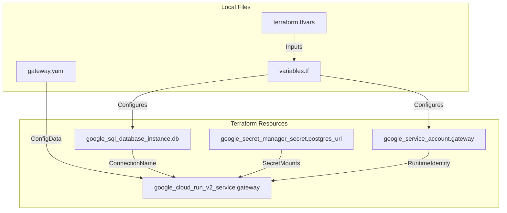
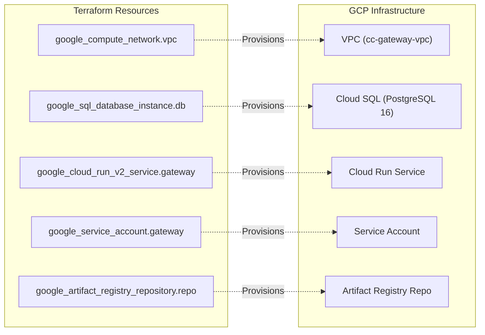

<!-- source: DeepWiki mcp.deepwiki.com · repo anthropics/claude-code · page 8.2 GCP Terraform Provisioning · fetched 2026-10-26 -->

# GCP Terraform Provisioning

Relevant source files

The following files were used as context for generating this wiki page:

- [examples/gateway/gcp/.dockerignore](examples/gateway/gcp/.dockerignore)
- [examples/gateway/gcp/.gitignore](examples/gateway/gcp/.gitignore)
- [examples/gateway/gcp/Dockerfile](examples/gateway/gcp/Dockerfile)
- [examples/gateway/gcp/README.md](examples/gateway/gcp/README.md)
- [examples/gateway/gcp/gateway.yaml.example](examples/gateway/gcp/gateway.yaml.example)
- [examples/gateway/gcp/setup.sh](examples/gateway/gcp/setup.sh)
- [examples/gateway/gcp/terraform/.gitignore](examples/gateway/gcp/terraform/.gitignore)
- [examples/gateway/gcp/terraform/README.md](examples/gateway/gcp/terraform/README.md)
- [examples/gateway/gcp/terraform/main.tf](examples/gateway/gcp/terraform/main.tf)
- [examples/gateway/gcp/terraform/outputs.tf](examples/gateway/gcp/terraform/outputs.tf)
- [examples/gateway/gcp/terraform/terraform.tfvars.example](examples/gateway/gcp/terraform/terraform.tfvars.example)
- [examples/gateway/gcp/terraform/variables.tf](examples/gateway/gcp/terraform/variables.tf)

This leaf page details the Terraform Infrastructure as Code (IaC) configuration located in `examples/gateway/gcp/terraform/` [examples/gateway/gcp/README.md:17]() for deploying the Claude Gateway on Google Cloud Platform (GCP). The scope covers the two-pass apply pattern, input variables (`variables.tf`) [examples/gateway/gcp/terraform/variables.tf:1-184](), outputs (`outputs.tf`) [examples/gateway/gcp/terraform/outputs.tf:1-34](), provider pins (`versions.tf`) [examples/gateway/gcp/terraform/README.md:12](), and template configuration files (`terraform.tfvars.example`) [examples/gateway/gcp/terraform/terraform.tfvars.example:1-26]().

## Purpose and Scope

The Terraform configuration automates the declarative provisioning of the complete Claude Gateway stack on GCP [examples/gateway/gcp/terraform/README.md:1-6](). It provides a robust, production-ready IaC blueprint corresponding to the manual deployment steps found in `setup.sh` [examples/gateway/gcp/README.md:14]().

Sources: [examples/gateway/gcp/README.md:1-17](), [examples/gateway/gcp/terraform/README.md:1-6]()

## Infrastructure Overview

The infrastructure module encompasses several key subsystems defined in `examples/gateway/gcp/terraform/main.tf` [examples/gateway/gcp/terraform/README.md:14]():
*   **Project APIs**: `google_project_service.apis` enables required services such as `aiplatform.googleapis.com`, `artifactregistry.googleapis.com`, `sqladmin.googleapis.com`, and `run.googleapis.com` [examples/gateway/gcp/terraform/main.tf:10-32]().
*   **IAM Identity**: `google_service_account.gateway` configures the least-privilege runtime service account with `roles/aiplatform.user` [examples/gateway/gcp/terraform/main.tf:35-55]().
*   **Networking**: Establishes `google_compute_network.vpc`, `google_compute_subnetwork.subnet`, and Private Services Access (`google_service_networking_connection.psa`) for isolated database communication [examples/gateway/gcp/terraform/main.tf:68-104]().
*   **Database Backend**: Provisions `google_sql_database_instance.db` (PostgreSQL 16) with private-IP-only configuration and encrypted connections [examples/gateway/gcp/terraform/main.tf:107-123]().
*   **Secrets & Compute**: Manages sensitive connection strings and session keys via Secret Manager, culminating in `google_cloud_run_v2_service.gateway` [examples/gateway/gcp/terraform/README.md:4-6]().

Title: "Terraform Configuration Data Flow"

Sources: [examples/gateway/gcp/terraform/outputs.tf:1-24](), [examples/gateway/gcp/terraform/README.md:8-16](), [examples/gateway/gcp/terraform/terraform.tfvars.example:1-26]()

## Two-Pass Apply Pattern

Because Cloud Run (`google_cloud_run_v2_service.gateway`) requires an image to exist within the Artifact Registry repository (`google_artifact_registry_repository.repo`) prior to service creation, but the repository itself is managed by Terraform, deployments follow a mandatory two-pass pattern [examples/gateway/gcp/terraform/README.md:30-32]().

| Pass | Action | Command |
| :--- | :--- | :--- |
| **1** | **Targeted Apply** | `terraform apply -target=google_artifact_registry_repository.repo` [examples/gateway/gcp/terraform/README.md:39]() |
| **-** | **Image Build/Push** | `docker build ... && docker push ...` [examples/gateway/gcp/terraform/README.md:53-55]() |
| **2** | **Full Apply** | `terraform apply` [examples/gateway/gcp/terraform/README.md:58]() |

During the interim step, the public Claude Code linux-x64 release binary is downloaded, verified via sha256 checksum against the remote manifest, and pushed to Artifact Registry [examples/gateway/gcp/terraform/README.md:41-55]().

Sources: [examples/gateway/gcp/terraform/README.md:34-59]()

## Configuration, Variables (`variables.tf`), and Outputs (`outputs.tf`)

Customization is driven via `terraform.tfvars` (copied from `terraform.tfvars.example`) [examples/gateway/gcp/terraform/terraform.tfvars.example:1-2]().

### Key Input Variables
*   `project_id`: Target GCP project identifier [examples/gateway/gcp/terraform/variables.tf:3-6]().
*   `region`: Infrastructure region for Artifact Registry, Cloud SQL, and Cloud Run [examples/gateway/gcp/terraform/variables.tf:8-12]().
*   `image_tag`: OCI-compliant image tag matching the deployed Claude Code release version [examples/gateway/gcp/terraform/variables.tf:36-43]().
*   `oidc_client_secret`: Google OAuth client secret value managed in Secret Manager [examples/gateway/gcp/terraform/variables.tf:126-131]().
*   `invoker_iam_disabled`: Disables Cloud Run IAM invoker check when set to `true` (preferred for Domain Restricted Sharing) [examples/gateway/gcp/terraform/variables.tf:168-172]().
*   `allow_unauthenticated`: Fallback boolean granting `allUsers` the `run.invoker` role [examples/gateway/gcp/terraform/variables.tf:174]().

### Key Outputs
*   `service_url`: Resolves `google_cloud_run_v2_service.gateway.uri` [examples/gateway/gcp/terraform/outputs.tf:1-4]().
*   `oauth_redirect_uri`: Evaluates to `${google_cloud_run_v2_service.gateway.uri}/oauth/callback` for OAuth client registration [examples/gateway/gcp/terraform/outputs.tf:6-9]().
*   `db_connection_name`: Exposes `google_sql_database_instance.db.connection_name` [examples/gateway/gcp/terraform/outputs.tf:21-24]().

Sources: [examples/gateway/gcp/terraform/outputs.tf:1-34](), [examples/gateway/gcp/terraform/variables.tf:1-184](), [examples/gateway/gcp/terraform/terraform.tfvars.example:1-26]()

## Networking, Security and Guard Rails

The gateway defaults to internal-only ingress (`ingress = "INGRESS_TRAFFIC_INTERNAL_ONLY"`) [examples/gateway/gcp/terraform/variables.tf:161]() and private-IP Cloud SQL (`ipv4_enabled = false`) [examples/gateway/gcp/terraform/main.tf:118](). 

Title: "Resource Mapping: Code Entity Space to GCP Infrastructure"

Sources: [examples/gateway/gcp/terraform/outputs.tf:1-29](), [examples/gateway/gcp/terraform/main.tf:69-74](), [examples/gateway/gcp/terraform/main.tf:107-123](), [examples/gateway/gcp/terraform/main.tf:35-40](), [examples/gateway/gcp/terraform/main.tf:59-66]()

### Operational Guard Rails
The configuration implements defensive guard rails:
*   **Deletion Protection**: `deletion_protection = true` blocks accidental resource destruction on Cloud SQL and Cloud Run [examples/gateway/gcp/terraform/README.md:100-101]().
*   **API Preservation**: `disable_on_destroy = false` on `google_project_service.apis` prevents wiping out project-level API enablement during teardown [examples/gateway/gcp/terraform/main.tf:29-30]().
*   **PSA Peering Abandonment**: `deletion_policy = ABANDON` on `google_service_networking_connection.psa` prevents terraform destroy from locking or failing due to shared VPC service-networking connections [examples/gateway/gcp/terraform/main.tf:97-99]().
*   **Non-Authoritative IAM**: Uses `google_project_iam_member` (_member) bindings to ensure other project resource grants remain intact [examples/gateway/gcp/terraform/main.tf:51-55]().

Sources: [examples/gateway/gcp/terraform/README.md:96-110](), [examples/gateway/gcp/terraform/main.tf:25-165]()

---

