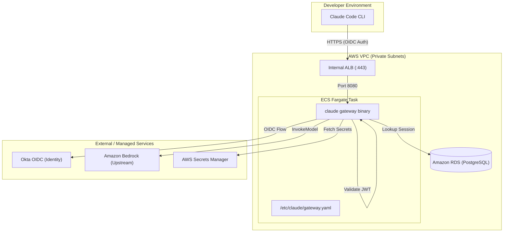
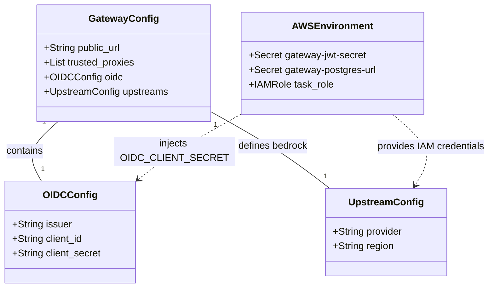

<!-- source: DeepWiki mcp.deepwiki.com · repo anthropics/claude-code · page 8.3 AWS Deployment Guide · fetched 2026-10-26 -->

# AWS Deployment Guide

<details>
<summary>Relevant source files</summary>

The following files were used as context for generating this wiki page:

- [examples/gateway/aws/.dockerignore](examples/gateway/aws/.dockerignore)
- [examples/gateway/aws/.gitignore](examples/gateway/aws/.gitignore)
- [examples/gateway/aws/Dockerfile](examples/gateway/aws/Dockerfile)
- [examples/gateway/aws/README.md](examples/gateway/aws/README.md)
- [examples/gateway/aws/gateway.yaml.example](examples/gateway/aws/gateway.yaml.example)
- [examples/gateway/aws/setup.sh](examples/gateway/aws/setup.sh)
- [examples/gateway/aws/terraform/.gitignore](examples/gateway/aws/terraform/.gitignore)
- [examples/gateway/aws/terraform/README.md](examples/gateway/aws/terraform/README.md)
- [examples/gateway/aws/terraform/main.tf](examples/gateway/aws/terraform/main.tf)
- [examples/gateway/aws/terraform/outputs.tf](examples/gateway/aws/terraform/outputs.tf)
- [examples/gateway/aws/terraform/terraform.tfvars.example](examples/gateway/aws/terraform/terraform.tfvars.example)

</details>


The `claude gateway` acts as an authenticated proxy between Claude Code CLI users and upstream LLM providers. This guide provides a step-by-step walkthrough for deploying the gateway on Amazon Web Services (AWS) using a reference architecture centered on security, private networking, and managed services.

## Architecture Overview

The AWS deployment leverages **Amazon ECS on Fargate** for serverless container orchestration, **Amazon RDS for PostgreSQL** for session and state persistence, and **Amazon Bedrock** as the primary upstream LLM provider.

### Data Flow and Component Interaction

The following diagram illustrates the request lifecycle from a developer's CLI to Amazon Bedrock.

**Diagram: Request Flow and Code Entities**

Sources: [examples/gateway/aws/gateway.yaml.example:31-60](), [examples/gateway/aws/README.md:3-5]()

## Prerequisites & Infrastructure Setup

The deployment assumes an existing VPC with at least two private subnets and a corporate network connection (Direct Connect or VPN) for accessing the internal Load Balancer.

### 1. Networking and Security Groups
The `setup.sh` script and Terraform configuration provision three distinct security groups to enforce least-privilege communication:
*   **ALB Security Group (`claude-gateway-alb`)**: Accepts HTTPS (:443) from the `CORP_CIDR` [examples/gateway/aws/terraform/main.tf:32-57]().
*   **Service Security Group (`claude-gateway-svc`)**: Accepts traffic from the ALB on port 8080 [examples/gateway/aws/terraform/main.tf:38-66]().
*   **Database Security Group (`claude-gateway-db`)**: Accepts PostgreSQL traffic (:5432) only from the Service Security Group [examples/gateway/aws/terraform/main.tf:44-75]().

Sources: [examples/gateway/aws/setup.sh:49-52](), [examples/gateway/aws/terraform/main.tf:32-75]()

### 2. IAM Roles
Two IAM roles are required for the ECS task:
*   **Task Role (`claude-gateway-task`)**: The gateway's runtime identity. It requires `bedrock:InvokeModel` and `bedrock:InvokeModelWithResponseStream` permissions to communicate with upstreams [examples/gateway/aws/terraform/main.tf:123-124]().
*   **Execution Role (`claude-gateway-execution`)**: Used by the ECS agent to pull images from ECR and inject secrets from AWS Secrets Manager into environment variables [examples/gateway/aws/terraform/main.tf:152-161]().

Sources: [examples/gateway/aws/setup.sh:54-57](), [examples/gateway/aws/gateway.yaml.example:109-110](), [examples/gateway/aws/terraform/main.tf:96-161]()

## Configuration and Image Build

Unlike the GCP deployment which mounts configuration at runtime, the AWS reference architecture **bakes the configuration into the Docker image** [examples/gateway/aws/Dockerfile:9-15]().

### gateway.yaml (Bedrock & Okta)
The `gateway.yaml` file defines the listener, identity provider, and upstreams. For AWS, the `bedrock` provider is used.

| Section | Key Config Entities | Description |
| :--- | :--- | :--- |
| `listen` | `public_url`, `trusted_proxies` | Defines the internal Route 53 hostname and ALB subnet CIDRs. |
| `oidc` | `issuer`, `client_id`, `client_secret` | Configures Okta OIDC. Secret is expanded from `${OIDC_CLIENT_SECRET}`. |
| `store` | `postgres_url` | Connection string for RDS, using `${GATEWAY_POSTGRES_URL}`. |
| `upstreams` | `provider: bedrock`, `region` | Routes requests to Amazon Bedrock in the specified region. |

Sources: [examples/gateway/aws/gateway.yaml.example:31-113](), [examples/gateway/aws/Dockerfile:9-15]()

### Dockerfile Implementation
The Dockerfile uses `gcr.io/distroless/cc-debian12:nonroot` as a base to minimize attack surface [examples/gateway/aws/Dockerfile:40-46](). It bakes in:
1.  The `claude` binary (placed at `/usr/local/bin/claude`) [examples/gateway/aws/Dockerfile:51]().
2.  The `gateway.yaml` (placed at `/etc/claude/gateway.yaml`) [examples/gateway/aws/Dockerfile:56]().
3.  The RDS CA bundle (`rds-global-bundle.pem`) to support `sslmode=verify-full` [examples/gateway/aws/Dockerfile:57]().

```dockerfile
# From examples/gateway/aws/Dockerfile
COPY --chmod=0755 ${CLAUDE_BINARY} /usr/local/bin/claude
COPY --chmod=0644 ${GATEWAY_CONFIG} /etc/claude/gateway.yaml
COPY --chmod=0644 ${RDS_CA_BUNDLE} /etc/claude/rds-global-bundle.pem
ENV NODE_EXTRA_CA_CERTS=/etc/claude/rds-global-bundle.pem
ENTRYPOINT ["/usr/local/bin/claude", "gateway", "--config", "/etc/claude/gateway.yaml"]
```
Sources: [examples/gateway/aws/Dockerfile:46-67]()

## Deployment Pattern: The Two-Pass Deploy

The deployment follows a "two-pass" pattern to handle circular dependencies between the container image (which needs the gateway config) and the infrastructure (which needs the image URI) [examples/gateway/aws/terraform/README.md:41-43]().

1.  **Pass 1 (Bootstrap)**: Create the ECR repository and AWS Secrets Manager entries [examples/gateway/aws/terraform/README.md:59-60]().
2.  **Image Build**: Fill in `gateway.yaml` with the generated secret ARNs and public URL, then build and push the Docker image [examples/gateway/aws/terraform/README.md:61-74](). The `setup.sh` script verifies that no `REPLACE_ME` placeholders remain before building [examples/gateway/aws/setup.sh:73-74]().
3.  **Pass 2 (Finalize)**: Deploy the RDS instance, ECS Task Definition, and Service [examples/gateway/aws/terraform/README.md:76-77]().

### RDS Connectivity
The gateway connects to RDS using **Direct VPC egress**. The `postgres_url` in `gateway.yaml` is configured with `?sslmode=verify-full` [examples/gateway/aws/gateway.yaml.example:94-96](). The gateway validates the RDS server certificate against the baked-in `rds-global-bundle.pem` via the `NODE_EXTRA_CA_CERTS` environment variable [examples/gateway/aws/Dockerfile:61-62]().

Sources: [examples/gateway/aws/setup.sh:20-27](), [examples/gateway/aws/Dockerfile:17-23](), [examples/gateway/aws/gateway.yaml.example:94-96](), [examples/gateway/aws/gateway.yaml.example:23-25]()

## Internal ALB and DNS

The gateway is deployed behind an **Internal Application Load Balancer** [examples/gateway/aws/setup.sh:9](). 
*   **Route 53**: A Private Hosted Zone must be created to map the `public_url` (e.g., `claude.internal.company.com`) to the ALB's DNS name [examples/gateway/aws/terraform/outputs.tf:1-9]().
*   **TLS**: The ALB terminates TLS using a certificate from AWS Certificate Manager (ACM) [examples/gateway/aws/terraform/terraform.tfvars.example:15-17]().
*   **Trusted Proxies**: The `gateway.yaml` must list the ALB subnet CIDRs in `trusted_proxies` so that the gateway can correctly extract the client's IP from the `X-Forwarded-For` header for audit logging [examples/gateway/aws/gateway.yaml.example:47-60]().

**Diagram: Identity and Connectivity Logic**

Sources: [examples/gateway/aws/gateway.yaml.example:31-113](), [examples/gateway/aws/setup.sh:111-115]()

## Deployment Script (`setup.sh`)

The `setup.sh` script automates the creation of these resources using the AWS CLI. It is idempotent and detects existing resources by name [examples/gateway/aws/setup.sh:30-35]().

**Key Functions in `setup.sh`:**
*   **Security Groups**: Creates `claude-gateway-alb`, `claude-gateway-svc`, and `claude-gateway-db` [examples/gateway/aws/setup.sh:49-52]().
*   **Secrets**: Generates a 32-byte `gateway-jwt-secret` and constructs the `gateway-postgres-url` after the RDS instance is provisioned [examples/gateway/aws/setup.sh:98-99]().
*   **ECS Service**: Creates a Fargate service with private subnet assignment to ensure it remains isolated [examples/gateway/aws/setup.sh:9]().
*   **Binary Verification**: If the `claude` binary is missing, it downloads it from `DIST_URL` and verifies its integrity using `DIST_SHA256` [examples/gateway/aws/setup.sh:63-72]().

Sources: [examples/gateway/aws/setup.sh:38-115](), [examples/gateway/aws/setup.sh:63-72]()

---

