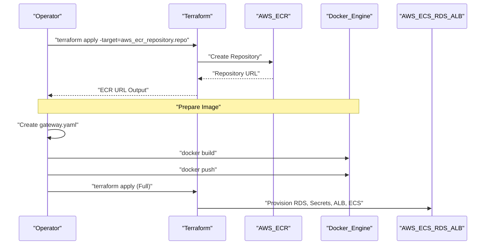

<!-- source: DeepWiki mcp.deepwiki.com · repo anthropics/claude-code · page 8.4 AWS Terraform Provisioning · fetched 2026-10-26 -->

# AWS Terraform Provisioning

<details>
<summary>Relevant source files</summary>

The following files were used as context for generating this wiki page:

- [examples/gateway/aws/.dockerignore](examples/gateway/aws/.dockerignore)
- [examples/gateway/aws/.gitignore](examples/gateway/aws/.gitignore)
- [examples/gateway/aws/Dockerfile](examples/gateway/aws/Dockerfile)
- [examples/gateway/aws/README.md](examples/gateway/aws/README.md)
- [examples/gateway/aws/gateway.yaml.example](examples/gateway/aws/gateway.yaml.example)
- [examples/gateway/aws/setup.sh](examples/gateway/aws/setup.sh)
- [examples/gateway/aws/terraform/.gitignore](examples/gateway/aws/terraform/.gitignore)
- [examples/gateway/aws/terraform/README.md](examples/gateway/aws/terraform/README.md)
- [examples/gateway/aws/terraform/main.tf](examples/gateway/aws/terraform/main.tf)
- [examples/gateway/aws/terraform/outputs.tf](examples/gateway/aws/terraform/outputs.tf)
- [examples/gateway/aws/terraform/terraform.tfvars.example](examples/gateway/aws/terraform/terraform.tfvars.example)

</details>


The AWS Terraform provisioning module provides a declarative infrastructure-as-code implementation for deploying the Claude Gateway on Amazon Web Services. It serves as a production-grade alternative to the `setup.sh` script, automating the creation of an ECS Fargate service, internal Application Load Balancer (ALB), and private RDS PostgreSQL instance [examples/gateway/aws/terraform/README.md:1-9]().

Sources: [examples/gateway/aws/terraform/README.md:1-9]()

## Infrastructure Architecture

The deployment follows a secure, private-network architecture. Unlike the GCP implementation, this module assumes a pre-existing VPC and private subnets with NAT egress [examples/gateway/aws/terraform/main.tf:5-6](). It uses data sources to validate the VPC and subnet IDs at plan-time to prevent partial application failures [examples/gateway/aws/terraform/main.tf:11-20]().

### Network Flow and Security Groups
Traffic is strictly controlled through three chained security groups [examples/gateway/aws/terraform/main.tf:28-30]():
1.  **ALB Security Group** (`aws_security_group.alb`): Accepts HTTPS (port 443) only from a defined `corporate_cidr` [examples/gateway/aws/terraform/main.tf:32-36](), [examples/gateway/aws/terraform/main.tf:50-57]().
2.  **Gateway Service Security Group** (`aws_security_group.gateway`): Accepts traffic on port 8080 only from the ALB security group [examples/gateway/aws/terraform/main.tf:38-42](), [examples/gateway/aws/terraform/main.tf:59-66]().
3.  **Database Security Group** (`aws_security_group.db`): Accepts Postgres traffic (port 5432) only from the Gateway service security group [examples/gateway/aws/terraform/main.tf:44-48](), [examples/gateway/aws/terraform/main.tf:68-75]().

### Code Entity to Infrastructure Mapping

| System Component | Terraform Resource | Code Symbol / Identifier |
| :--- | :--- | :--- |
| **Compute Service** | `aws_ecs_service.gateway` | `var.service_name` [examples/gateway/aws/setup.sh:107]() |
| **Container Registry** | `aws_ecr_repository.repo` | `var.ecr_repo` [examples/gateway/aws/setup.sh:60]() |
| **Relational Database** | `aws_db_instance.db` | `var.db_instance` [examples/gateway/aws/setup.sh:88]() |
| **Load Balancer** | `aws_lb.gateway` | `internal` ALB [examples/gateway/aws/terraform/README.md:138-140]() |
| **Config Secrets** | `aws_secretsmanager_secret` | `gateway-postgres-url`, `gateway-jwt-secret`, `gateway-oidc-client-secret` [examples/gateway/aws/setup.sh:98-100]() |

Sources: [examples/gateway/aws/terraform/main.tf:28-75](), [examples/gateway/aws/terraform/README.md:1-40](), [examples/gateway/aws/setup.sh:60](), [examples/gateway/aws/setup.sh:88](), [examples/gateway/aws/setup.sh:98-100](), [examples/gateway/aws/setup.sh:107]()

## IAM and Least-Privilege Access

The module implements two distinct IAM roles to ensure the principle of least privilege.

### Task Role (`aws_iam_role.task`)
This is the gateway's runtime identity. It is restricted to invoking Claude models on Amazon Bedrock [examples/gateway/aws/terraform/main.tf:97-100]().
*   **Actions**: `bedrock:InvokeModel`, `bedrock:InvokeModelWithResponseStream` [examples/gateway/aws/terraform/main.tf:124-124]().
*   **Resources**: Scoped to `us.anthropic.*` inference profiles and `anthropic.*` foundation models [examples/gateway/aws/terraform/main.tf:126-127]().
*   **Validation**: A plan-time precondition ensures the deployment region is a commercial US region unless `allow_non_us_region` is explicitly enabled [examples/gateway/aws/terraform/main.tf:144-150]().

### Execution Role (`aws_iam_role.execution`)
This role is used by the ECS agent (not the application itself) to manage the container lifecycle [examples/gateway/aws/terraform/main.tf:152-157]().
*   **Permissions**: Inherits `AmazonECSTaskExecutionRolePolicy` for ECR pulls and CloudWatch logging [examples/gateway/aws/terraform/main.tf:163-166]().
*   **Secrets Access**: Granted `secretsmanager:GetSecretValue` on the specific ARNs of the three secrets created by the module [examples/gateway/aws/terraform/main.tf:155-157]().

Sources: [examples/gateway/aws/terraform/main.tf:96-170]()

## Provisioning Workflow

Deployment requires a **two-pass apply pattern** because the gateway configuration is baked into the Docker image, but the image repository must exist before the build [examples/gateway/aws/terraform/README.md:43-45]().

### Deployment Sequence Diagram



Sources: [examples/gateway/aws/terraform/README.md:41-78](), [examples/gateway/aws/terraform/main.tf:22-26]()

## Guardrails and Deletion Protection

To prevent accidental data loss in production environments, the module includes several safety mechanisms:

*   **Deletion Protection**: Enabled by default (`deletion_protection = true`) on the RDS instance and the ALB [examples/gateway/aws/terraform/README.md:119-122]().
*   **Final Snapshots**: RDS is configured to create a final snapshot unless `deletion_protection` is manually set to `false` [examples/gateway/aws/terraform/README.md:121-122]().
*   **Secret Recovery**: Secrets Manager secrets use a recovery window. If `deletion_protection` is disabled, the module uses `recovery_window_in_days = 0` to allow immediate re-provisioning of the same secret names [examples/gateway/aws/terraform/README.md:100-104]().
*   **Immutable Tags**: ECR is configured with `image_tag_mutability = "IMMUTABLE"`. This ensures that a deployed tag cannot be overwritten, requiring a new tag for every configuration change [examples/gateway/aws/terraform/README.md:123-126]().

### Configuration to Code Entity Mapping

```mermaid
graph TD
    subgraph "Terraform Variables"
        V_TAG["image_tag"]
        V_CERT["acm_certificate_arn"]
        V_OIDC["oidc_client_secret"]
    end

    subgraph "AWS Resources"
        R_ECR["aws_ecr_repository.repo"]
        R_ALB["aws_lb.gateway"]
        R_LST["aws_lb_listener.https"]
        R_SEC["aws_secretsmanager_secret_version.oidc"]
        R_ECS["aws_ecs_task_definition.gateway"]
    end

    V_TAG -->| "References" | R_ECS
    V_CERT -->| "Configures" | R_LST
    V_OIDC -->| "Populates" | R_SEC
    R_ALB --- R_LST
```

Sources: [examples/gateway/aws/terraform/main.tf:25-26](), [examples/gateway/aws/terraform/README.md:115-136](), [examples/gateway/aws/terraform/terraform.tfvars.example:19-27]()

## Remote State Management
State files contain sensitive information, including the generated `gateway-jwt-secret` and database credentials. It is mandatory to use a remote backend (e.g., S3 with DynamoDB locking) and never commit the `terraform.tfstate` file to version control [examples/gateway/aws/terraform/README.md:39-40]().

Sources: [examples/gateway/aws/terraform/README.md:39-40](), [examples/gateway/aws/terraform/.gitignore:1-7]()

---

