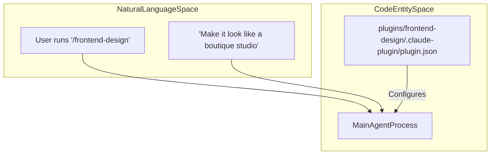
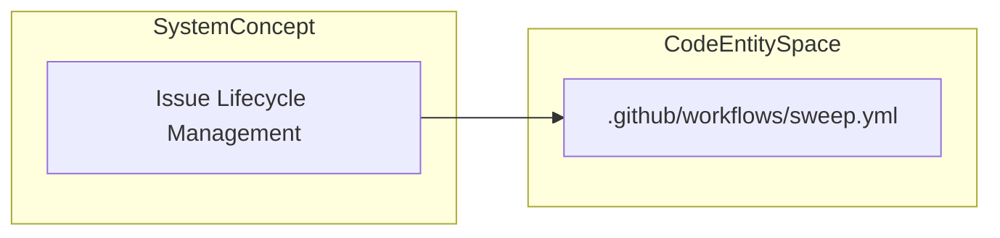

<!-- source: DeepWiki mcp.deepwiki.com · repo anthropics/claude-code · page 9 Glossary · fetched 2026-10-26 -->

# Glossary

Relevant source files

The following files were used as context for generating this wiki page:

- [.github/workflows/auto-close-duplicates.yml](.github/workflows/auto-close-duplicates.yml)
- [.github/workflows/backfill-duplicate-comments.yml](.github/workflows/backfill-duplicate-comments.yml)
- [.github/workflows/issue-lifecycle-comment.yml](.github/workflows/issue-lifecycle-comment.yml)
- [.github/workflows/log-issue-events.yml](.github/workflows/log-issue-events.yml)
- [.github/workflows/sweep.yml](.github/workflows/sweep.yml)
- [mods/README.md](mods/README.md)
- [mods/diff/README.md](mods/diff/README.md)
- [mods/diff/hooks/host/host.ts](mods/diff/hooks/host/host.ts)
- [mods/diff/hooks/register.ts](mods/diff/hooks/register.ts)
- [mods/diff/tests/fixtures/beneath/beneath.ts](mods/diff/tests/fixtures/beneath/beneath.ts)
- [mods/diff/tests/fixtures/in-repository.ts](mods/diff/tests/fixtures/in-repository.ts)
- [mods/diff/tests/fixtures/index.ts](mods/diff/tests/fixtures/index.ts)
- [mods/diff/tests/fixtures/wheel-over-list.ts](mods/diff/tests/fixtures/wheel-over-list.ts)
- [mods/diff/tests/git.test.ts](mods/diff/tests/git.test.ts)
- [mods/diff/tests/register.test.ts](mods/diff/tests/register.test.ts)
- [mods/sec-default/README.md](mods/sec-default/README.md)
- [mods/sec-default/hooks/held-verdict/held-kind.ts](mods/sec-default/hooks/held-verdict/held-kind.ts)
- [mods/sec-default/hooks/held-verdict/index.ts](mods/sec-default/hooks/held-verdict/index.ts)
- [mods/sec-default/hooks/held-verdict/verdicts/holds-over.ts](mods/sec-default/hooks/held-verdict/verdicts/holds-over.ts)
- [mods/sec-default/hooks/held-verdict/verdicts/is-person-tightening.ts](mods/sec-default/hooks/held-verdict/verdicts/is-person-tightening.ts)
- [mods/sec-default/hooks/held-verdict/verdicts/is-same-verdict.ts](mods/sec-default/hooks/held-verdict/verdicts/is-same-verdict.ts)
- [mods/sec-default/hooks/hooks.json](mods/sec-default/hooks/hooks.json)
- [mods/sec-default/hooks/policy/index.ts](mods/sec-default/hooks/policy/index.ts)
- [mods/sec-default/hooks/policy/pinned-names.ts](mods/sec-default/hooks/policy/pinned-names.ts)
- [mods/sec-default/tests/fixtures/index.ts](mods/sec-default/tests/fixtures/index.ts)
- [mods/sec-default/tests/fixtures/tool-check/index.ts](mods/sec-default/tests/fixtures/tool-check/index.ts)
- [mods/sec-default/tests/held-verdict.test.ts](mods/sec-default/tests/held-verdict.test.ts)
- [mods/sec-default/tests/register.test.ts](mods/sec-default/tests/register.test.ts)
- [mods/types/claude-code.d.ts](mods/types/claude-code.d.ts)
- [scripts/auto-close-duplicates.ts](scripts/auto-close-duplicates.ts)
- [scripts/backfill-duplicate-comments.ts](scripts/backfill-duplicate-comments.ts)
- [scripts/issue-lifecycle.ts](scripts/issue-lifecycle.ts)
- [scripts/lifecycle-comment.ts](scripts/lifecycle-comment.ts)
- [scripts/sweep.ts](scripts/sweep.ts)

This page provides definitions for codebase-specific terms, jargon, and architectural concepts used within the Claude Code project. It is intended to help onboarding engineers navigate the system and understand the relationships between high-level concepts and their implementations.

---

## Core Concepts

### Agent
An autonomous execution unit powered by a Large Language Model (LLM) that can use tools to accomplish tasks. Claude Code utilizes a hierarchical agent model where a main agent can spawn subagents for specialized tasks.
*   **Implementation**: Agents are defined via markdown files in plugins or triggered via specialized workflows like `feature-dev` [.claude-plugin/marketplace.json:62-71]().
*   **Code Pointers**:
    *   Subagent workflows: The `feature-dev` plugin uses specialized agents like `code-explorer`, `code-architect`, and `code-reviewer` [.claude-plugin/marketplace.json:62-71]().
*   **Sources**: [.claude-plugin/marketplace.json:62-71]()

### Tool
A function or capability exposed to an Agent. Tools allow Claude to interact with the outside world (e.g., running bash commands, reading files, or interacting with GitHub).
*   **Implementation**: Tools are registered, validated, and sandboxed during execution.
*   **Code Pointers**:
    *   Tool calls are validated for type correctness across various modules.
*   **Sources**: [mods/README.md:1-14]()

### Hook
An event listener that triggers logic at specific points in the agent's or engine's lifecycle.
*   **Key Events**:
    *   `SessionStart`: Injects context or modifies behavior at the start of a session (used by output style plugins) [.claude-plugin/marketplace.json:51-60]().
    *   `PreToolUse`: Monitors or validates tool calls before execution (e.g., `security-guidance` plugin) [.claude-plugin/marketplace.json:139-148]().
*   **Sources**: [.claude-plugin/marketplace.json:51-148](), [mods/README.md:1-14]()

### Skill
A set of specialized instructions or domain-specific knowledge bundled within a plugin to guide agent behavior.
*   **Implementation**: Defined in `SKILL.md` files within plugin directories.
*   **Code Pointers**:
    *   `frontend-design` skill: Provides guidance for distinctive visual design [plugins/frontend-design/README.md:1-10]().
    *   `plugin-dev` skills: Includes expert skills for AI-assisted plugin creation [.claude-plugin/marketplace.json:106-115]().
*   **Sources**: [plugins/frontend-design/README.md:1-10](), [.claude-plugin/marketplace.json:106-115]()

---

## System Mapping: Natural Language to Code Entities

### Agent Orchestration Flow
This diagram shows how a user interaction triggers the Agent System to coordinate multiple specialized code entities, specifically focusing on the lifecycle from command to execution.

**Sources**: [plugins/frontend-design/.claude-plugin/plugin.json:1-9]()

### Issue Lifecycle Automation Mapping
This diagram bridges the conceptual management to the scripts and GitHub Actions that implement it.

**Sources**: [.github/workflows/sweep.yml:1-10]()

---

## Technical Terms & Abbreviations

### MCP
The Model Context Protocol (MCP) is a standard for connecting AI models to tools and external services.
*   **Implementation**: Claude Code integrates with MCP servers for tool registration and discovery.
*   **Sources**: [.claude-plugin/marketplace.json:1-150]()

### Hook & Registrar (`On`)
An event listener mechanism paired with `On`, the registrar function passed to a mod's `register` function, used to bind event handlers [mods/diff/hooks/register.ts:42-45]().
*   **Sources**: [mods/diff/hooks/register.ts:42-45]()

### EngineInterface
The core interface of the Claude Code engine, exposed as `$` to hooks. It provides access to various engine capabilities like `$.ui`, `$.command`, `$.fs`, `$.process`, `$.store`, `$.telemetry`, etc [mods/types/claude-code.d.ts:87-90]().
*   **Sources**: [mods/types/claude-code.d.ts:87-90]()

### StarNext
A pattern for narrowing the type of the `next` function in a hook, allowing for more specific return types based on the event.
*   **Sources**: [mods/README.md:3-6]()

### Mod
A Claude Code plugin whose behavior is defined in a hooks module, typically with a `register(on, options)` entry point [mods/README.md:3-6](). Mods are often built into the Claude Code binary.
*   **Implementation**: Located in the `mods/` directory, each mod is a complete plugin with its own `plugin.json` and TypeScript hooks [mods/README.md:15-18]().
*   **Examples**: `sec-default`, `diff`, `telemetry`, `agents-md` [mods/README.md:10-13]().
*   **Sources**: [mods/README.md:3-18]()

### Noun Contract
A mechanism for defining and extending the `EngineInterface` (`$`) with new capabilities (nouns) provided by plugins or mods [mods/README.md:84-89]().
*   **Implementation**: A plugin defines its noun's types in a `.d.ts` file (e.g., `types/index.d.ts`) and declares the noun on `EngineInterface` [mods/README.md:84-89]().
*   **Sources**: [mods/README.md:84-89]()

### Register
The primary function in a mod's hooks module that the Claude Code engine calls to set up event listeners and extend the engine's capabilities [mods/diff/hooks/register.ts:42-45]().
*   **Signature**: `export function register(on: On)` [mods/diff/hooks/register.ts:42-45]().
*   **Sources**: [mods/diff/hooks/register.ts:42-45]()

### PaneModel
The state object that represents the current view and data of the `/diff` pane [mods/diff/hooks/register.ts:68-68]().
*   **Purpose**: Holds information about the diff data, selected files, scroll position, and display mode.
*   **Sources**: [mods/diff/hooks/register.ts:68-68]()

### Pinned Git
Refers to the state where the `diff` mod has successfully identified and "pinned" the current working directory as a Git repository [mods/diff/README.md:56-68]().
*   **Lifecycle**: Occurs when `/diff` is first run or the first edit with room for a pane happens [mods/diff/README.md:56-68]().
*   **Sources**: [mods/diff/README.md:56-68]()

### Baseline
In the context of the `diff` mod, the baseline refers to the Git reference point against which changes are compared [mods/diff/README.md:47-52]().
*   **Options**: Can be `HEAD`, the session's start, or the merge-base with the default branch [mods/diff/README.md:47-52]().
*   **Sources**: [mods/diff/README.md:47-52]()

### Armed Ask
A feature of the `diff` mod where a specific file's hunks are "armed" to be injected into the next prompt as context [mods/diff/README.md:44-46]().
*   **Sources**: [mods/diff/README.md:44-46]()

### Noise
In the `diff` mod, "noise" refers to files that are typically ignored in diffs, such as lockfiles, generated files, and test files [mods/diff/README.md:54-57]().
*   **Sources**: [mods/diff/README.md:54-57]()

### Tier
A concept used in testing to categorize and run specific sets of tests [mods/README.md:24-37]().
*   **Usage**: `tier('builtin')` is used in mod tests to indicate they are for built-in functionality [mods/diff/tests/register.test.ts:11-11]().
*   **Sources**: [mods/README.md:24-37](), [mods/diff/tests/register.test.ts:11-11]()

### Plugin
An extension that adds custom commands, agents, or hooks to Claude Code [.claude-plugin/marketplace.json:1-150]().
*   **Sources**: [.claude-plugin/marketplace.json:1-150]()

### Compaction
The process of summarizing conversation history or context to fit within the LLM's token limits.
*   **Sources**: [mods/README.md:1-14]()

### Worktree
A Git worktree allows multiple working directories to be associated with a single repository [mods/diff/tests/register.test.ts:14-30]().
*   **Sources**: [mods/diff/tests/register.test.ts:14-30]()

### Managed Settings
Configuration settings that are centrally managed, typically by an organization, to enforce policies or provide default behaviors [mods/README.md:8-10]().
*   **Sources**: [mods/README.md:8-10]()

### Sandbox
A restricted execution environment designed to isolate processes and limit their access to system resources.
*   **Sources**: [mods/README.md:1-14]()

### Gateway
A proxy service (`claude gateway`) that sits between Claude Code clients and upstream LLM providers [.github/workflows/auto-close-duplicates.yml:1-31]().
*   **Sources**: [.github/workflows/auto-close-duplicates.yml:1-31]()

### OIDC Federation
OpenID Connect (OIDC) federation is a method for authenticating users across different identity providers and service providers.
*   **Sources**: [.claude-plugin/marketplace.json:1-150]()

### Statsig
A feature flagging and experimentation platform used for A/B testing, feature rollouts, and collecting analytics [.github/workflows/auto-close-duplicates.yml:25-31]().
*   **Sources**: [.github/workflows/auto-close-duplicates.yml:25-31]()

### Lifecycle Labels
Labels applied to issues or items to track their status and manage their lifecycle [.github/workflows/sweep.yml:1-10]().
*   **Sources**: [.github/workflows/sweep.yml:1-10]()

### Confidence Scoring
A mechanism used in evaluation or plugins (such as `code-review`) to evaluate the reliability or accuracy of automated suggestions [.claude-plugin/marketplace.json:29-38]().
*   **Sources**: [.claude-plugin/marketplace.json:29-38]()

---

## Infrastructure & Automation

### Claude Gateway
The Gateway acts as an authenticated proxy between CLI users and upstream providers like Google Vertex AI or Amazon Bedrock [.github/workflows/auto-close-duplicates.yml:1-31]().
*   **Sources**: [.github/workflows/auto-close-duplicates.yml:1-31]()

### Sandbox Environment
A secure execution layer for untrusted code or commands, managing network egress and resource isolation.
*   **Sources**: [mods/README.md:1-14]()