# Page: Claude Code Overview

# Claude Code Overview

<details>
<summary>Relevant source files</summary>

The following files were used as context for generating this wiki page:

- [.devcontainer/Dockerfile](.devcontainer/Dockerfile)
- [.devcontainer/devcontainer.json](.devcontainer/devcontainer.json)
- [.devcontainer/init-firewall.sh](.devcontainer/init-firewall.sh)
- [.gitattributes](.gitattributes)
- [.vscode/extensions.json](.vscode/extensions.json)
- [CHANGELOG.md](CHANGELOG.md)
- [LICENSE.md](LICENSE.md)
- [README.md](README.md)
- [SECURITY.md](SECURITY.md)
- [demo.gif](demo.gif)
- [feed.xml](feed.xml)
- [mods/README.md](mods/README.md)
- [mods/types/claude-code.d.ts](mods/types/claude-code.d.ts)

</details>


Claude Code is an agentic coding tool that lives in your terminal, understands your codebase, and assists with software development tasks through natural language commands [README.md:1-8](). It combines Large Language Model (LLM) reasoning with direct system access via a tool-based architecture, enabling it to execute routine tasks, explain complex code, and handle git workflows [README.md:1-8]().

This document provides a high-level introduction to the system. For detailed technical information about specific subsystems, see the child pages:
- [System Architecture](#1.1) — Detailed explanation of internal orchestration, session management, tool systems, hook/engine event model (`Register`, `On`, `EngineInterface`), and plugin integration points [mods/types/claude-code.d.ts:1-93]().
- [Feature Evolution & Release History](#1.2) — Comprehensive changelog and version history documenting architectural changes across versions [CHANGELOG.md:1-46](), syndicating via `feed.xml` [feed.xml:1-15]().
- [License & Security Policy](#1.3) — Legal terms (Anthropic Commercial Terms) [LICENSE.md:1]() and security vulnerability reporting procedures via HackerOne [SECURITY.md:1-12]().

Sources: [README.md:1-8](), [CHANGELOG.md:1-46](), [feed.xml:1-15](), [LICENSE.md:1](), [SECURITY.md:1-12](), [mods/types/claude-code.d.ts:1-93]()

## Repository Layout

The codebase is organized into modular directories supporting core runtime engines, first-party plugins, mods, examples, and automation:

- `mods/`: First-party plugins built into the Claude Code binary (such as `diff`, `telemetry`, `agents-md`, `sec-default`) implemented as hook modules with a `register(on, options)` entrypoint [mods/README.md:1-14]().
- `plugins/`: Bundled community and official plugins available in the marketplace (code review, feature development, output styles, frontend design, and the plugin development kit) [README.md:48-50]().
- `examples/`: Configuration templates and settings examples (e.g., `examples/settings/`) [README.md:48-50]().
- `.github/`: GitHub Actions workflows automating issue triage, deduplication, lifecycle management, and `@claude` mentions.
- `.devcontainer/`: Containerized development environment with firewall isolation (`init-firewall.sh`, `Dockerfile`, `devcontainer.json`) [.devcontainer/devcontainer.json:1-57]().

Sources: [README.md:48-50](), [mods/README.md:1-14](), [.devcontainer/devcontainer.json:1-57]()

## Installation and Access

Claude Code is cross-platform and supports multiple installation methods [README.md:13-44](). Platform-specific installers are recommended over the deprecated `npm` method [README.md:13-15]().

| Platform | Recommended Method | Command |
|----------|-------------------|---------|
| **macOS/Linux** | curl script | `curl -fsSL https://claude.ai/install.sh \| bash` [README.md:21-24]() |
| **macOS/Linux** | Homebrew | `brew install --cask claude-code` [README.md:26-29]() |
| **Windows** | PowerShell script | `irm https://claude.ai/install.ps1 \| iex` [README.md:31-34]() |
| **Windows** | WinGet | `winget install Anthropic.ClaudeCode` [README.md:36-39]() |

Sources: [README.md:13-44]()

## System Architecture Overview

For deep architectural details on session management, agent orchestration, and event models, see [System Architecture](#1.1).

### High-Level Component Interaction

Title: High-Level Component Interaction Architecture
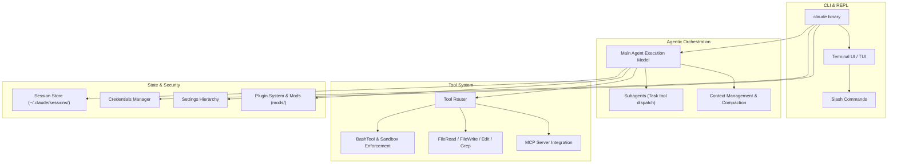

Sources: [README.md:1-8](), [.devcontainer/devcontainer.json:1-57]()

### Natural Language Space to Code Entity Space: Execution Flow

Title: Natural Language to Code Entity Space Execution
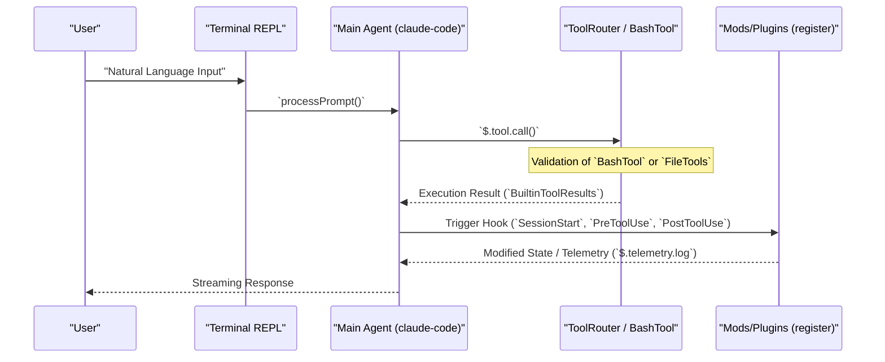

Sources: [CHANGELOG.md:1-46](), [mods/types/claude-code.d.ts:1-110]()

### Natural Language Space to Code Entity Space: Mod & Event Hook Contract

Title: Natural Language to Code Entity Space Hook Registration
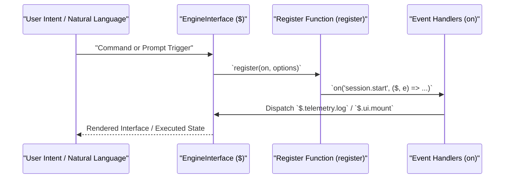

Sources: [mods/README.md:1-14](), [mods/types/claude-code.d.ts:1-93]()

## Key Capabilities

- **Agentic Orchestration and Execution**: Support for subagent spawning via the Task tool (`$.agent.spawn`), worktree isolation, and agent teams [mods/types/claude-code.d.ts:102-148]().
- **Context Management**: Automatic compaction triggers and payload stripping to maintain efficiency within token limits [CHANGELOG.md:16-16]().
- **Tool and Protocol Integration**: Model Context Protocol (MCP) integration with OAuth, server discovery, tool registration (`$.mcp.call`), and sandboxed execution via firewall rules and network restrictions [.devcontainer/init-firewall.sh:1-136]().
- **First-Party Mods & Plugins**: Modular architecture leveraging `mods/` (`diff`, `telemetry`, `agents-md`, `sec-default`) with `register(on, options)` signatures and noun contracts [mods/README.md:1-14]().

Sources: [CHANGELOG.md:16-16](), [mods/README.md:1-14](), [mods/types/claude-code.d.ts:102-148](), [.devcontainer/init-firewall.sh:1-136]()

---

# Page: System Architecture

# System Architecture

<details>
<summary>Relevant source files</summary>

The following files were used as context for generating this wiki page:

- [.devcontainer/Dockerfile](.devcontainer/Dockerfile)
- [.devcontainer/devcontainer.json](.devcontainer/devcontainer.json)
- [.devcontainer/init-firewall.sh](.devcontainer/init-firewall.sh)
- [.gitattributes](.gitattributes)
- [.vscode/extensions.json](.vscode/extensions.json)
- [CHANGELOG.md](CHANGELOG.md)
- [LICENSE.md](LICENSE.md)
- [README.md](README.md)
- [SECURITY.md](SECURITY.md)
- [demo.gif](demo.gif)
- [feed.xml](feed.xml)
- [mods/README.md](mods/README.md)
- [mods/types/claude-code.d.ts](mods/types/claude-code.d.ts)

</details>


## Purpose and Scope

This document details the internal architecture of Claude Code, focusing on session management, agent orchestration, the tool execution system, the hook and engine event model, and the integration points for plugins and first-party mods. It maps high-level engine capabilities to their underlying code entities and type definitions.

Sources: [mods/README.md:1-14](), [mods/types/claude-code.d.ts:1-32]()

## Overview & Core Components

Claude Code runs within a Node.js execution environment [mods/types/claude-code.d.ts:1-17](), exposing a command-line interface (`claude`) [mods/README.md:20-20]() that initializes session contexts, loads configuration hierarchies, mounts built-in and external plugins, and dispatches tool execution requests. 

The following diagram bridges natural language functional concepts to the specific code entities and files that implement them:

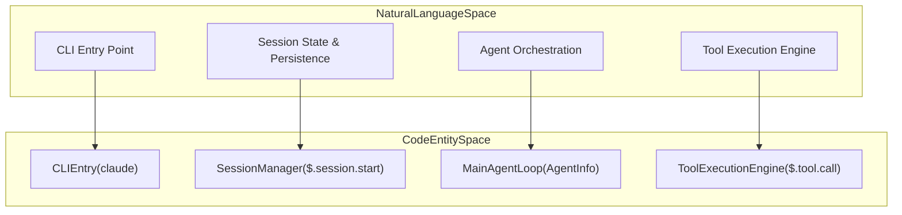
Sources: [mods/README.md:1-58](), [mods/types/claude-code.d.ts:93-150]()

## Session Management & Lifecycle

Sessions manage conversation persistence, history, and runtime state. Each interactive or headless session is persisted to disk under session transcripts (`transcript.jsonl`).

- **Initialization & Resumption**: Sessions are initialized via `$.session.start` [mods/README.md:48-58]() or resumed using command flags. Headless runs preserve usage totals and cost accounting upon exit.
- **State Records**: Subagents and active loops are tracked as `AgentInfo` structures containing unique identifiers, status flags (`running`, `completed`, `failed`, `killed`), and origin axes (`spawnedBy`) [mods/types/claude-code.d.ts:117-150]().

Sources: [mods/README.md:48-58](), [mods/types/claude-code.d.ts:117-150]()

## Agent Orchestration & Subagents

Claude Code utilizes a hierarchical agent model where a main execution loop coordinates complex tasks by spawning specialized subagents via the `Task` tool or programmatic APIs.

The mapping between high-level agent delegations and their low-level code representation is structured as follows:

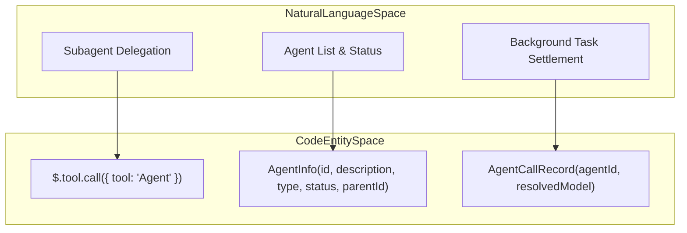
Sources: [mods/README.md:28-32](), [mods/types/claude-code.d.ts:93-150]()

- **Delegation & Background Execution**: Subagent calls (`$.tool.call({ tool: "Agent", ... })`) settle asynchronously, returning an `AgentCallRecord` containing the spawned `agentId` and `resolvedModel` [mods/types/claude-code.d.ts:95-111]().
- **Prompt Prefix Staggering**: Sibling agent dispatches employ prefix staggering to maximize LLM prompt cache efficiency across concurrent loops.

Sources: [mods/types/claude-code.d.ts:93-111](), [mods/types/claude-code.d.ts:117-150]()

## Tool System & Permissions

The tool execution engine evaluates model-requested tool calls against strict permission rules, security policies, and sandbox configurations.

- **Tool Architecture**: Core built-in tools include `Bash`, `FileRead`, `FileWrite`, `FileEdit`, and `Task` [mods/types/claude-code.d.ts:95-111]().
- **Permission Enforcement**: Permission rules check actions against user-defined configurations (`settings.json`) and enterprise guardrails (`managed-settings.json`), prompting interactively (`ask`/`allow`/`deny`) when necessary, or resolving via mod deciders (`decider: "person"`) [CHANGELOG.md:6-6]().

Sources: [CHANGELOG.md:6-6](), [mods/README.md:8-14](), [mods/types/claude-code.d.ts:95-111]()

## Hook & Engine Event Model

The hook system enables synchronous and asynchronous interception of engine events through a function-hook architecture. Plugins and built-in mods register callbacks against lifecycle events using the `register(on, options)` signature [mods/README.md:3-6]().

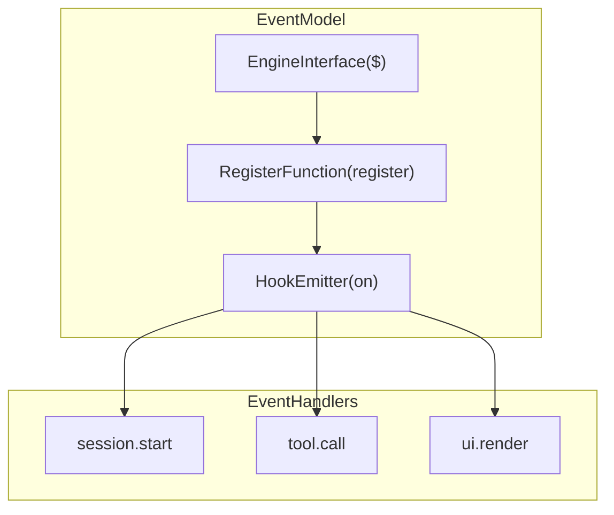
Sources: [mods/README.md:1-50](), [mods/types/claude-code.d.ts:1-92]()

- **Event Signatures**: Hooks receive `($, e, next)` arguments, where `$` is the `EngineInterface`, `e` is the typed event payload (such as `e.isReadOnly` for tool checks), and `next` propagates the event down the middleware chain [CHANGELOG.md:7-7](), [mods/README.md:3-6]().
- **Testing Kit**: The testing framework (`claude-code/testing`) runs test suites in an isolated harness using `test`, `describe`, and mock providers (`mock.clock`, `mock.env`, `mock.store`) [mods/README.md:24-79]().

Sources: [CHANGELOG.md:7-7](), [mods/README.md:1-79](), [mods/types/claude-code.d.ts:1-92]()

## Plugin & Mod Integration Points

Mods are first-party plugins bundled directly into the Claude Code binary [mods/README.md:1-6](), implemented as modular hook collections (`sec-default`, `diff`, `telemetry`, `agents-md`) [mods/README.md:8-14]().

- **Noun Contracts**: Mods extend the engine interface (`EngineInterface`) by declaring custom nouns (e.g., `$.telemetry`) via TypeScript declaration files (`types/index.d.ts`), enforcing compile-time type safety across plugin boundaries [mods/README.md:84-108]().
- **Validation**: Plugins undergo static analysis via `claude plugin validate <dir>` prior to loading, checking manifests and hook signatures against `claude-code.d.ts` definitions [mods/types/claude-code.d.ts:1-10]().

Sources: [mods/README.md:1-117](), [mods/types/claude-code.d.ts:1-92]()

---

# Page: Feature Evolution & Release History

# Feature Evolution & Release History

<details>
<summary>Relevant source files</summary>

The following files were used as context for generating this wiki page:

- [.devcontainer/Dockerfile](.devcontainer/Dockerfile)
- [.devcontainer/devcontainer.json](.devcontainer/devcontainer.json)
- [.devcontainer/init-firewall.sh](.devcontainer/init-firewall.sh)
- [.gitattributes](.gitattributes)
- [.vscode/extensions.json](.vscode/extensions.json)
- [CHANGELOG.md](CHANGELOG.md)
- [LICENSE.md](LICENSE.md)
- [README.md](README.md)
- [SECURITY.md](SECURITY.md)
- [demo.gif](demo.gif)
- [feed.xml](feed.xml)

</details>


## Purpose and Scope

This document chronicles the development history of Claude Code, documenting major features, enhancements, and architectural changes across releases up to version `2.1.304`. It provides a chronological view of how the system evolved from its initial release to its current state, organized by functional area and version milestone, alongside feed syndication details via `feed.xml`.

For details on the current system architecture, see [System Architecture (1.1)](). For licensing terms, see [License & Security Policy (1.3)](). For GitHub automation workflow history, see [5. GitHub Automation]().

Sources: [CHANGELOG.md:1-57](), [feed.xml:1-54]()

## Version Numbering Scheme & Syndication

Claude Code follows a three-part version numbering scheme: `MAJOR.MINOR.PATCH` (e.g., `2.1.304`). The current release series is `2.1.x`, with patch versions incrementing for bug fixes, features, and improvements [CHANGELOG.md:3-57](). Release channels include:

- **Stable channel**: Production-ready releases recommended for general use.
- **Latest channel**: Bleeding-edge releases with newest features.

Syndication of releases is handled via Atom feed generation (`feed.xml`), which indexes release tags, release notes, and structured HTML entries directly corresponding to `CHANGELOG.md` [feed.xml:1-14](). Recent updates have introduced guided auto-mode configuration via `/auto-mode-setup`, strict mod permission deciders (`decider: "person"`), read-only checks (`e.isReadOnly`), and security evaluation tools (`/claude-api managed-agents-secure`) [CHANGELOG.md:3-10]().

Sources: [CHANGELOG.md:3-10](), [feed.xml:1-14]()

## Major Version Milestones

The following table summarizes significant releases that introduced major capabilities or architectural changes:

| Version | Release | Key Features |
|---------|---------|--------------|
| **2.1.304** | Current | **Auto-Mode Setup & Mod Security**: Added `/auto-mode-setup`, `decider: "person"` for mod permission checks, `e.isReadOnly` event flags, `/claude-api managed-agents-secure`, and enhanced compaction summaries with prior tool names [CHANGELOG.md:3-10](). |
| **2.1.284** | Milestone | **Sonnet 5.5 & Gateway Enhancements**: Added `claude-sonnet-5-5` (1M context), auto-mode "Yes, but ask again next time" permissions, gateway spend limit dollar amounts in `/usage`, and `private_key_jwt` cert authentication. |
| **2.1.277** | Milestone | **AGENTS.md & Gateway**: Added `AGENTS.md` project instruction fallback, gateway proxy egress boundary flags, and static header maps for gateway upstreams. |
| **2.1.229** | Milestone | **Remote & Reliability**: Resumable Remote Control, SSE keepalives, and fixed streaming response duplication. |
| **2.1.197** | Previous | **Claude Sonnet 5**: New default model with native 1M-token context window. |

Sources: [CHANGELOG.md:3-10](), [feed.xml:10-20]()

## Feature Evolution Timeline

The following diagram visualizes the transition from natural language intent to specific code entities across recent system updates:

title "Claude Code: Intent to Code Entity Evolution (Natural Language to Code)"
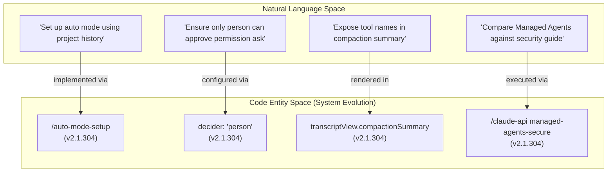

Sources: [CHANGELOG.md:3-10](), [feed.xml:15-20]()

## Agent System & Subagent Evolution

### Subagent & Team Coordination
The agent system has evolved to support robust error recovery, head-less run safety, and timeout management for distributed tools:
- **Headless Run Guardrails**: Fixed plugins keeping headless runs going past `--max-turns`, `Stop`, or ended input by spawning subagents or re-running finished agents [CHANGELOG.md:16]().
- **Subagent State Persistence**: Fixed subagents occasionally forgetting their most recent work when messaged or resumed immediately after finishing [CHANGELOG.md:32]().
- **Agent Team Shutdowns**: Fixed agent teams exiting the entire CLI when approving a shutdown request from the main session [CHANGELOG.md:42]().

### Session & Context Management
- **Auto-Compactor Units**: Fixed `CLAUDE_CODE_AUTO_COMPACT_WINDOW=200k` silently defaulting to 100K by adding support for `k` and `M` suffixes with validation and range warnings [CHANGELOG.md:45]().
- **Resumed Session Optimization**: Resumed and cloud sessions no longer re-transmit the entire skill list on every plugin reload startup [CHANGELOG.md:35]().
- **Usage Warning Limits**: Added usage limit warnings on Pro and Max plans when resuming inactive conversations that consume notable percentages of the 5-hour limit [CHANGELOG.md:11]().

title "Agent State Transitions and Resiliency Flow"
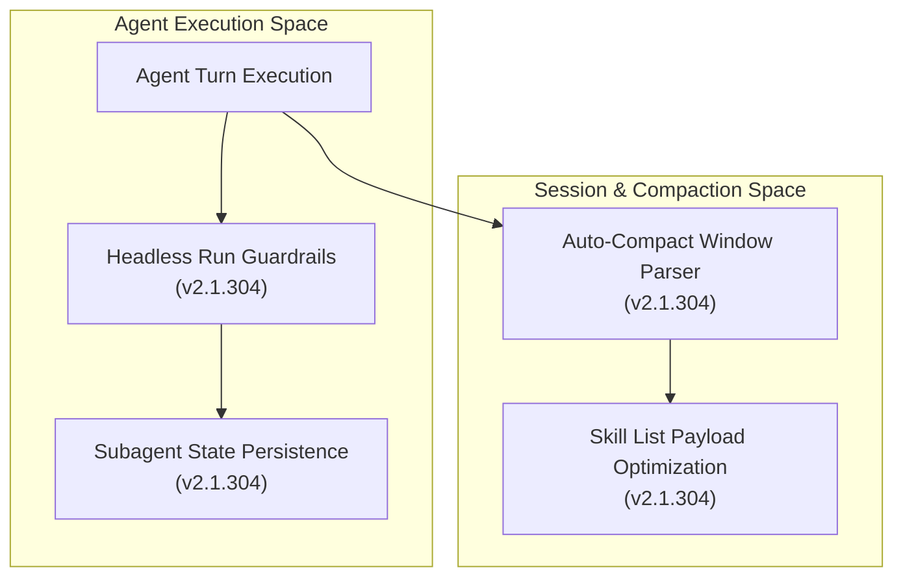

Sources: [CHANGELOG.md:11-45](), [feed.xml:21-50]()

## Tool System & Permissions

### Security & Sandbox Evolution
- **Mod Permission Deciders**: Added `decider: "person"` to mod `tool.check` answers, ensuring that only interactive permission dialogs or host callbacks can approve an ask, refusing automatically where nobody can be queried [CHANGELOG.md:6]().
- **Read-Only Event Flags**: Added `e.isReadOnly` to mod `tool.check` events, identifying read-only tool calls for granular policy enforcement [CHANGELOG.md:7]().
- **Filesystem Deny-Read Glob Fixes**: Fixed sandboxed commands failing on Linux when `sandbox.filesystem.denyRead` globs contain non-character-class brackets, such as route folders like `[user-id]` [CHANGELOG.md:13]().

### Platform-Specific Path Normalization & Safety Prompts
- **Drive Top-Level Safety Prompts**: Fixed `rm -r` commands on mounted drives or top-level folders (`/Volumes`, `/media`, WSL's `/mnt/c`) missing the standard safety prompt applied to critical paths like `/Applications` [CHANGELOG.md:14]().
- **Environment Variable Scope**: Fixed unsandboxed Bash commands in Claude Desktop Code tab sessions on macOS and Linux missing environment variables exported in shell startup files like `~/.zshrc` [CHANGELOG.md:28]().

title "Tool Safety and Validation Flow"
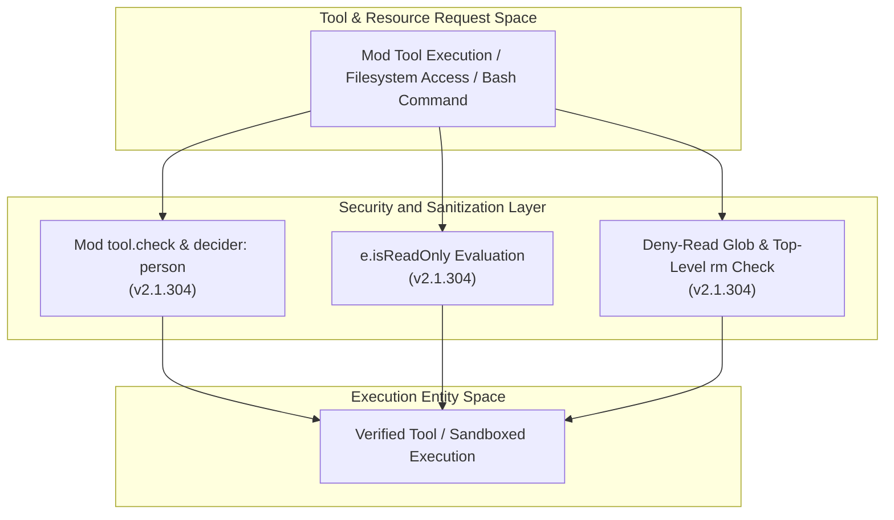

Sources: [CHANGELOG.md:6-14](), [CHANGELOG.md:28](), [feed.xml:16-25]()

## UI/UX, Gateway & Plugin Marketplace Enhancements

### Gateway & Telemetry Syndication
- **Managed Agents Security Audit**: Introduced `/claude-api managed-agents-secure` to audit Managed Agents settings against published security guidelines without modifying state [CHANGELOG.md:9]().
- **Auto-Mode Setup Guide**: Added `/auto-mode-setup`, a guided workflow analyzing project and session context to tune auto mode across Bedrock, Vertex, Foundry, Claude apps gateway, and telemetry-disabled environments [CHANGELOG.md:8]().

### UI & Configuration Improvements
- **Transcript View Enhancements**: Added prior tool names to compaction summaries in transcript views (`Ctrl+O`) and fixed transcript GC trimming reliability under low-disk conditions [CHANGELOG.md:10](), [CHANGELOG.md:15]().
- **Mod UI State Preservation**: Fixed click loss on mod buttons when identical buttons without unique keys were redrawn unchanged, and improved reload failure messaging [CHANGELOG.md:17](), [CHANGELOG.md:18]().

Sources: [CHANGELOG.md:8-18](), [CHANGELOG.md:52](), [feed.xml:18-28]()

---

# Page: License & Security Policy

# License & Security Policy

<details>
<summary>Relevant source files</summary>

The following files were used as context for generating this wiki page:

- [.devcontainer/Dockerfile](.devcontainer/Dockerfile)
- [.devcontainer/devcontainer.json](.devcontainer/devcontainer.json)
- [.devcontainer/init-firewall.sh](.devcontainer/init-firewall.sh)
- [.gitattributes](.gitattributes)
- [.vscode/extensions.json](.vscode/extensions.json)
- [CHANGELOG.md](CHANGELOG.md)
- [LICENSE.md](LICENSE.md)
- [README.md](README.md)
- [SECURITY.md](SECURITY.md)
- [demo.gif](demo.gif)
- [feed.xml](feed.xml)

</details>


This page documents the legal licensing terms, security vulnerability reporting procedures, and the technical implementation of security boundaries within Claude Code. It serves as the authoritative reference for how Anthropic protects user data and maintains the integrity of the tool's execution environment.

---

## License

Claude Code is proprietary software owned by Anthropic PBC. All rights are reserved, and usage is subject to Anthropic's commercial terms. [LICENSE.md:1]()

**License Statement:**

```
© Anthropic PBC. All rights reserved.
Use is subject to Anthropic's Commercial Terms of Service.
```

The complete legal terms are available at:
- [Commercial Terms of Service](https://www.anthropic.com/legal/commercial-terms)
- [Privacy Policy](https://www.anthropic.com/legal/privacy)

Sources: [LICENSE.md:1](), [README.md:71-72]()

---

## Security Vulnerability Reporting

Anthropic maintains a formal vulnerability disclosure program (VDP) managed via HackerOne. This program provides a structured channel for security researchers to report potential vulnerabilities in good faith. [SECURITY.md:1-12]()

### Reporting Process

The reporting workflow is centralized through HackerOne to ensure that every submission is triaged by the Anthropic security team. [SECURITY.md:8-12]()

**Vulnerability Submission Flow**
```mermaid
graph TD
    subgraph "External_Researcher"
        "IdentifyPotentialVulnerability" --> "ValidateReproductionSteps"
    end

    subgraph "HackerOne_Platform"
        "ValidateReproductionSteps" --> "hackerone.com/anthropic"
        "hackerone.com/anthropic" --> "SubmitVulnerabilityReportViaForm"
    end

    subgraph "Anthropic_Security_Response"
        "SubmitVulnerabilityReportViaForm" --> "TriageAndValidation"
        "TriageAndValidation" --> "RemediationAndFix"
        "RemediationAndFix" --> "DisclosureIfApplicable"
    end
```

Sources: [SECURITY.md:1-12]()

### HackerOne Integration Details

| Component | Specification |
|-----------|---------------|
| **Platform** | HackerOne |
| **Program Scope** | Claude Code CLI, associated APIs, and core dependencies |
| **Submission Form** | [Report a Vulnerability](https://hackerone.com/4f1f16ba-10d3-4d09-9ecc-c721aad90f24/embedded_submissions/new) |
| **Guidelines** | Defined at [hackerone.com/anthropic](https://hackerone.com/anthropic) |

Sources: [SECURITY.md:8-12]()

---

## Security Architecture & Data Flow

Claude Code implements a defense-in-depth strategy, combining application-level permission checks with OS-level isolation in specialized environments like DevContainers.

### Technical Security Controls

The system relies on several key components to maintain a secure execution environment:

1. **Permission System**: Controls which tools the agent can execute (e.g., `BashTool`, `FileWriteTool`).
2. **Sandbox Environment**: Provides an isolated shell environment to prevent unauthorized access to the host system.
3. **Network Firewall**: Restricts egress traffic to a set of pre-approved domains via `iptables` and `ipset` [.devcontainer/init-firewall.sh:41-116](), [.devcontainer/Dockerfile:20-22]().

**Data Flow and Security Boundaries**
```mermaid
graph LR
    subgraph "User_Workspace"
        "FileSystem"
        "EnvironmentVariables"
    end

    subgraph "Claude_Code_Process"
        "AgentLoop"
        "ToolRegistry"
        "ManagedSettings"
    end

    subgraph "Isolation_Layer"
        "Firewall: usr_local_bin_init_firewall_sh [init-firewall.sh]"
        "BashSandbox"
    end

    subgraph "External_Services"
        "AnthropicAPI"
        "WhitelistedDomains"
    end

    "AgentLoop" -->|1. Request Tool| "ToolRegistry"
    "ToolRegistry" -->|2. Check Config| "ManagedSettings"
    "ManagedSettings" -->|3. Permission Result| "ToolRegistry"
    "ToolRegistry" -->|4. Execute| "BashSandbox"
    "BashSandbox" -->|5. Network Request| "Firewall: usr_local_bin_init_firewall_sh [init-firewall.sh]"
    "Firewall: usr_local_bin_init_firewall_sh [init-firewall.sh]" -->|6. Allow/Deny via iptables| "WhitelistedDomains"
    "AgentLoop" -->|7. Send Context| "AnthropicAPI"

    "FileSystem" -.->|Read/Write| "ToolRegistry"
```

Sources: [.devcontainer/Dockerfile:85-91](), [.devcontainer/init-firewall.sh:41-116]()

### Container-Level Security

For developers using the provided DevContainer environment, security is enforced at the network layer using `iptables` and `ipset`. [.devcontainer/Dockerfile:20-21]()

| File/Entity | Role | Implementation Detail |
|-------------|------|-----------------------|
| `init-firewall.sh` | Network Enforcement | Configures `iptables` rules to block all egress by default except for specific UID/GIDs and whitelisted IPs. [.devcontainer/init-firewall.sh:106-119]() |
| `ipset` | Domain Whitelisting | Used by `init-firewall.sh` to efficiently manage sets of allowed IP addresses for GitHub, npm, and Anthropic. [.devcontainer/init-firewall.sh:41-90]() |
| `sudoers.d/node-firewall` | Privilege Escalation | Allows the `node` user to run the firewall initialization script without a password. [.devcontainer/Dockerfile:89-90]() |

Sources: [.devcontainer/Dockerfile:20-21](), [.devcontainer/Dockerfile:85-91](), [.devcontainer/init-firewall.sh:41-119]()

---

## Development Environment Hardening

The `Dockerfile` used for Claude Code development includes several security-focused configurations to ensure a reproducible and restricted environment.

### Dockerfile Security Features

* **Non-Root Execution**: The environment defaults to the `node` user (UID 1000) rather than `root` to limit the impact of potential shell escapes. [.devcontainer/Dockerfile:57-58]()
* **Controlled Pathing**: Global npm packages are restricted to `/usr/local/share/npm-global` with specific ownership to prevent unauthorized global binary modification. [.devcontainer/Dockerfile:31-32](), [.devcontainer/Dockerfile:61-62]()
* **Environment Transparency**: The `DEVCONTAINER=true` variable is set to allow the application to detect it is running in a restricted environment and adjust security defaults accordingly. [.devcontainer/Dockerfile:42-43]()
* **Audit Logging**: Bash history is persisted to `/commandhistory/.bash_history` using `PROMPT_COMMAND='history -a'` to maintain an immutable audit trail of commands executed within the container. [.devcontainer/Dockerfile:37-40]()

**Container Build & Tooling**
```mermaid
graph TD
    "NodeBaseImage: node:20" --> "AptInstall: RUN apt-get install iptables ipset gh git dnsutils aggregate"
    "AptInstall: RUN apt-get install iptables ipset gh git dnsutils aggregate" --> "HistorySetup: RUN mkdir commandhistory touch bash_history"
    "HistorySetup: RUN mkdir commandhistory touch bash_history" --> "Permissions: RUN mkdir workspace .claude chown node"
    "Permissions: RUN mkdir workspace .claude chown node" --> "FirewallCopy: COPY init-firewall.sh usr_local_bin_init_firewall_sh"
    "FirewallCopy: COPY init-firewall.sh usr_local_bin_init_firewall_sh" --> "SudoConfig: RUN echo node ALL NOPASSWD init-firewall.sh"
    "SudoConfig: RUN echo node ALL NOPASSWD init-firewall.sh" --> "UserSwitch: USER node"
    
    subgraph "Security_Hardening"
        "AptInstall: RUN apt-get install iptables ipset gh git dnsutils aggregate"
        "HistorySetup: RUN mkdir commandhistory touch bash_history"
        "FirewallCopy: COPY init-firewall.sh usr_local_bin_init_firewall_sh"
        "SudoConfig: RUN echo node ALL NOPASSWD init-firewall.sh"
        "UserSwitch: USER node"
    end
```

Sources: [.devcontainer/Dockerfile:1-91]()

---

## Summary of Security Policies

| Policy Area | Technical Enforcement | Reference |
|-------------|-----------------------|-----------|
| **Vulnerability Disclosure** | HackerOne VDP | [SECURITY.md:1-12]() |
| **Network Egress** | `iptables` + `ipset` in DevContainer | [.devcontainer/init-firewall.sh:1-136](), [.devcontainer/Dockerfile:20-22]() |
| **System Access** | Non-root `node` user in Docker | [.devcontainer/Dockerfile:58]() |
| **Privilege Management** | `sudoers` restricted to `init-firewall.sh` | [.devcontainer/Dockerfile:89-90]() |
| **File Integrity** | `.gitattributes` enforcing `eol=lf` | [.gitattributes:1-2]() |
| **Auditability** | Persistent Bash history in `/commandhistory/` | [.devcontainer/Dockerfile:37-40]() |

Sources: [.devcontainer/Dockerfile:1-91](), [.devcontainer/init-firewall.sh:1-136](), [SECURITY.md:1-12](), [.gitattributes:1-2]()

---

# Page: User Guide

# User Guide

<details>
<summary>Relevant source files</summary>

The following files were used as context for generating this wiki page:

- [.devcontainer/Dockerfile](.devcontainer/Dockerfile)
- [.devcontainer/devcontainer.json](.devcontainer/devcontainer.json)
- [.devcontainer/init-firewall.sh](.devcontainer/init-firewall.sh)
- [.gitattributes](.gitattributes)
- [.vscode/extensions.json](.vscode/extensions.json)
- [CHANGELOG.md](CHANGELOG.md)
- [LICENSE.md](LICENSE.md)
- [README.md](README.md)
- [SECURITY.md](SECURITY.md)
- [demo.gif](demo.gif)
- [examples/mdm/README.md](examples/mdm/README.md)
- [examples/settings/README-hipaa.md](examples/settings/README-hipaa.md)
- [examples/settings/README.md](examples/settings/README.md)
- [examples/settings/managed-mcp-hipaa.json](examples/settings/managed-mcp-hipaa.json)
- [examples/settings/settings-bash-sandbox.json](examples/settings/settings-bash-sandbox.json)
- [examples/settings/settings-hipaa.json](examples/settings/settings-hipaa.json)
- [examples/settings/settings-lax.json](examples/settings/settings-lax.json)
- [examples/settings/settings-strict.json](examples/settings/settings-strict.json)
- [feed.xml](feed.xml)

</details>


This document provides a practical guide for end users of Claude Code, covering the essential concepts and workflows needed for daily usage [README.md:7-9](). It explains how to interact with Claude Code, manage sessions, configure permissions, and leverage its agentic capabilities to enhance your coding workflow [README.md:7-9]().

As a parent page, this guide offers a high-level overview of user-facing components. For detailed instructions, please refer to the child pages:
- For installation methods across operating systems, see [Installation & Setup](#2.1).
- For settings files and enterprise configuration, see [Configuration Management](#2.2).
- For slash commands and interaction modes, see [CLI Commands & Interaction Modes](#2.3).
- For session lifecycle and transcripts, see [Session Management](#2.4).
- For bug reporting and feedback channels, see [Providing Feedback & Reporting Issues](#2.5).

Sources: [README.md:7-9]()

## Core Concepts

### What is Claude Code?

Claude Code is an agentic coding tool that lives in your terminal, understands your codebase, and helps you code faster by executing routine tasks, explaining complex code, and handling git workflows through natural language commands [README.md:7-9](). It functions as a stateful agent capable of using tools to interact with your local environment.

### Sessions & Authentication

A **session** represents a continuous conversation with Claude Code. Each session maintains full conversation history, working directory context, active configuration settings, and permission rules [README.md:7-9](). Sessions are persisted to disk and can be resumed using the `/resume` command or corresponding flags [CHANGELOG.md:44](). 

Claude Code supports multiple authentication methods including Claude.ai OAuth, Anthropic Console API keys (`ANTHROPIC_API_KEY`), and custom gateways like AWS Bedrock or Google Vertex AI [CHANGELOG.md:7]().

Sources: [README.md:7-9](), [CHANGELOG.md:7](), [CHANGELOG.md:44]()

## User Interaction & Configuration Flows

The following diagrams illustrate how user inputs and configuration parameters bridge natural language and settings spaces to underlying code entities and subsystems.

**Natural Language to Code Entity Space**
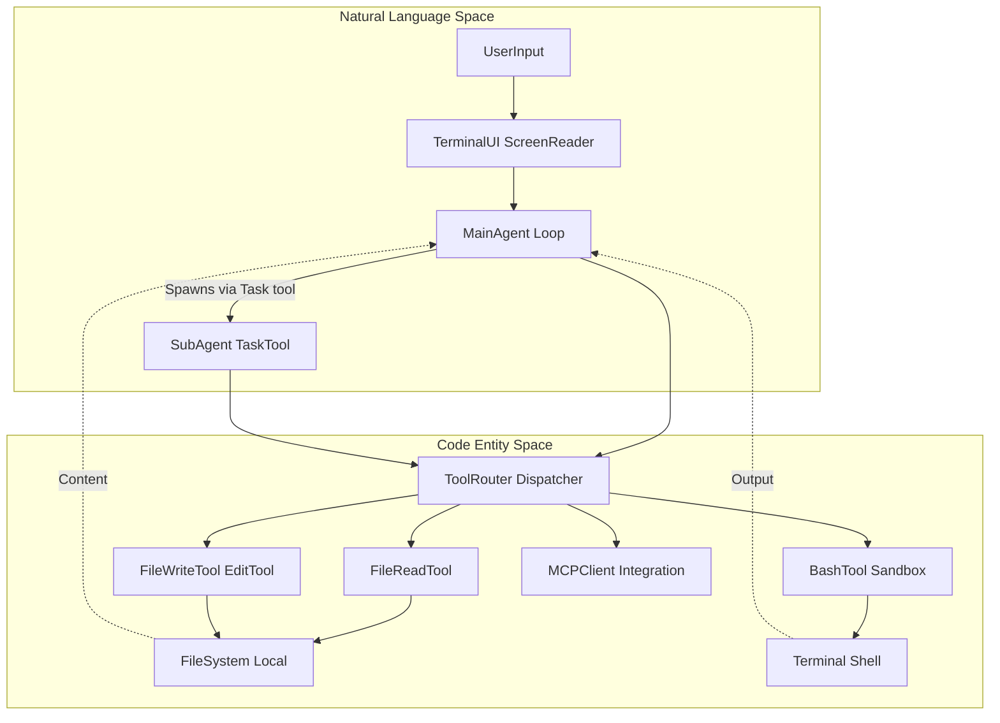
Sources: [README.md:7-9](), [CHANGELOG.md:56]()

**Configuration Hierarchy to Enterprise Settings Space**
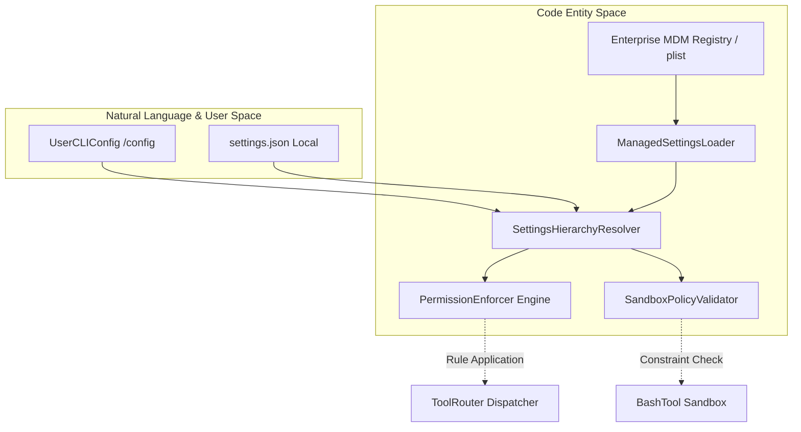
Sources: [examples/settings/README.md:5-26](), [examples/mdm/README.md:21-25]()

## Child Pages & Detailed Guides

### 2.1 Installation & Setup
Claude Code can be installed on macOS, Linux, and Windows using various distribution channels [README.md:19-44](). The recommended installation methods use automated shell or PowerShell scripts, while Homebrew, WinGet, and legacy npm installations are also available [README.md:21-44](). For step-by-step instructions and troubleshooting, see [Installation & Setup](#2.1).

Sources: [README.md:19-44]()

### 2.2 Configuration Management
Claude Code uses a layered settings hierarchy spanning `managed-settings.json`, user `settings.json`, and project-local `settings.local.json` files [examples/settings/README.md:5-26](). Organizations can enforce strict policies, sandbox restrictions, and tool permissions using templates provided in `examples/settings/` [examples/settings/README.md:3-21](). For configuration schemas and deployment examples, see [Configuration Management](#2.2).

Sources: [examples/settings/README.md:3-26]()

### 2.3 CLI Commands & Interaction Modes
Interactions are driven by natural language and augmented with slash commands such as `/model`, `/resume`, `/compact`, `/diff`, and `/memory` [CHANGELOG.md:29](). These commands allow users to control session parameters, manage context windows, and inspect code diffs. For a full command reference, see [CLI Commands & Interaction Modes](#2.3).

Sources: [CHANGELOG.md:29]()

### 2.4 Session Management
Session state and transcripts are automatically persisted in local configuration directories [CHANGELOG.md:44](). Users can resume interrupted or past workflows using `/resume` or headless flags [CHANGELOG.md:49](). For details on transcript storage and lifecycle management, see [Session Management](#2.4).

Sources: [CHANGELOG.md:44](), [CHANGELOG.md:49]()

### 2.5 Providing Feedback & Reporting Issues
To report bugs, submit feedback, or share telemetry data with the development team, users can invoke the interactive `/bug` command or submit issues through official GitHub issue templates [README.md:54](). For more information on reporting guidelines, see [Providing Feedback & Reporting Issues](#2.5).

Sources: [README.md:54]()

---

# Page: Installation & Setup

# Installation & Setup

<details>
<summary>Relevant source files</summary>

The following files were used as context for generating this wiki page:

- [.devcontainer/Dockerfile](.devcontainer/Dockerfile)
- [.devcontainer/devcontainer.json](.devcontainer/devcontainer.json)
- [.devcontainer/init-firewall.sh](.devcontainer/init-firewall.sh)
- [.gitattributes](.gitattributes)
- [.vscode/extensions.json](.vscode/extensions.json)
- [CHANGELOG.md](CHANGELOG.md)
- [LICENSE.md](LICENSE.md)
- [README.md](README.md)
- [SECURITY.md](SECURITY.md)
- [demo.gif](demo.gif)
- [feed.xml](feed.xml)

</details>


This page details the installation procedures, runtime requirements, containerized execution environments, and initial setup workflows for Claude Code across macOS, Linux, and Windows. It covers script-based installers, package managers (Homebrew and WinGet), deprecated npm channels, containerized devcontainers with strict firewall policies, authentication initialization, and configuration directory bindings.

---

## Purpose and Scope

Claude Code is an agentic coding tool designed to operate within terminal environments, integrating directly with project repositories and git workflows [README.md:7-7](). This document provides technical instructions for provisioning the environment, verifying dependencies, executing native installers, configuring container sandboxes, and establishing authenticated user sessions.

Sources: `[README.md:7-7]()`, `[.devcontainer/devcontainer.json:1-57]()`

---

## Prerequisites and System Requirements

Claude Code execution depends on a standard JavaScript runtime environment and platform-specific shell utilities.

| Requirement | Minimum Version | Technical Notes |
|------------|----------------|-----------------|
| Node.js | 18+ | Required runtime for all installation vectors [README.md:3-3]() |
| Operating System | macOS, Linux, Windows | Supported via native distribution scripts and package managers [README.md:21-39]() |
| Shell Environment | `zsh`, `bash`, PowerShell | Execution contexts for interactive and headless CLI operations [README.md:21-34]() |

Sources: `[README.md:3-3]`, `[README.md:21-39]`

---

## Installation Methods by Platform

Claude Code provides platform-specific installation scripts and package manager integrations. Direct npm installation is deprecated in favor of native binary installers [README.md:14-17]().

### Installation Path Selection

Title: Installation Path Selection
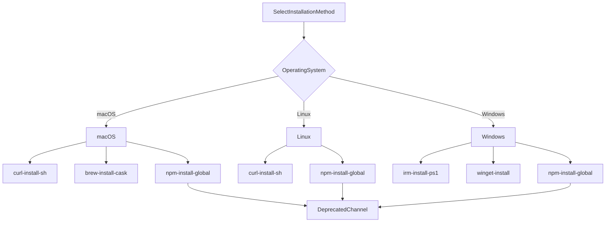
Sources: `[README.md:19-44]`

### macOS and Linux Provisioning

For Unix-like environments, shell script execution or Homebrew casks are the primary distribution channels [README.md:21-29]():

- **Shell Script Installer:**
  ```bash
  curl -fsSL https://claude.ai/install.sh | bash
  ```
- **Homebrew Cask:**
  ```bash
  brew install --cask claude-code
  ```
- **Deprecated npm Channel:**
  ```bash
  npm install -g @anthropic-ai/claude-code
  ```

Sources: `[README.md:21-44]`

### Windows Provisioning

For Windows hosts, PowerShell execution or WinGet package manager deployments are recommended [README.md:31-39]():

- **PowerShell Installer:**
  ```powershell
  irm https://claude.ai/install.ps1 | iex
  ```
- **WinGet Package Manager:**
  ```powershell
  winget install Anthropic.ClaudeCode
  ```

Sources: `[README.md:31-39]`

---

## Containerized & Sandbox Setup (DevContainer)

For isolated and reproducible development environments, Claude Code provides a complete DevContainer configuration built on a Node.js 20 base image [.devcontainer/Dockerfile:1-1]() with strict network egress controls [.devcontainer/init-firewall.sh:106-119]().

- **Dockerfile Configuration:** Sets up system dependencies (`iptables`, `ipset`, `gh`, `fzf`), creates the non-root `node` user [.devcontainer/Dockerfile:34-34](), configures global npm prefix paths [.devcontainer/Dockerfile:61-62](), installs git-delta [.devcontainer/Dockerfile:51-55](), and installs the `@anthropic-ai/claude-code` package globally [.devcontainer/Dockerfile:82-82]().
- **Network Firewall Initialization:** The `init-firewall.sh` script flushes existing rules [.devcontainer/init-firewall.sh:9-14](), establishes default drop policies for input, forward, and output traffic [.devcontainer/init-firewall.sh:107-109](), and whitelists approved domains (`registry.npmjs.org`, `api.anthropic.com`, GitHub meta IP ranges) via `ipset` hash tables [.devcontainer/init-firewall.sh:41-90]().
- **Container Orchestration & Mounts:** `devcontainer.json` mounts persistent named volumes for command history and configuration storage (`/home/node/.claude`) [.devcontainer/devcontainer.json:44-47]() and executes `init-firewall.sh` upon startup [.devcontainer/devcontainer.json:55-55]().

Sources: `[.devcontainer/Dockerfile:1-91]()`, `[.devcontainer/devcontainer.json:1-57]()`, `[.devcontainer/init-firewall.sh:1-136]()`

---

## Post-Installation Setup & Authentication

Upon initial execution, the CLI establishes configuration contexts and prompts for authentication credentials, reading and writing state to `~/.claude` and configuration stores [.devcontainer/Dockerfile:46-47]().

### CLI Initialization and Authentication Flow

Title: CLI Initialization and Authentication Flow
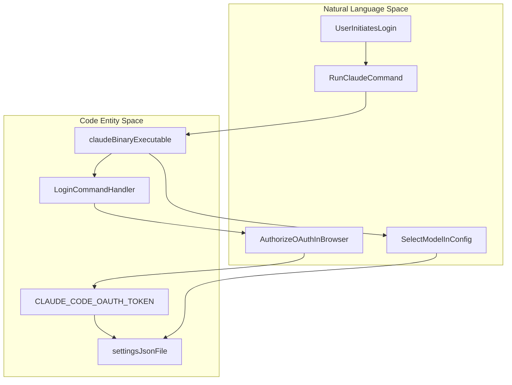
Sources: `[README.md:46-46]()`, `[.devcontainer/Dockerfile:46-47]()`

### Session Startup & Settings Resolution Flow

Title: Session Startup and Settings Resolution Flow
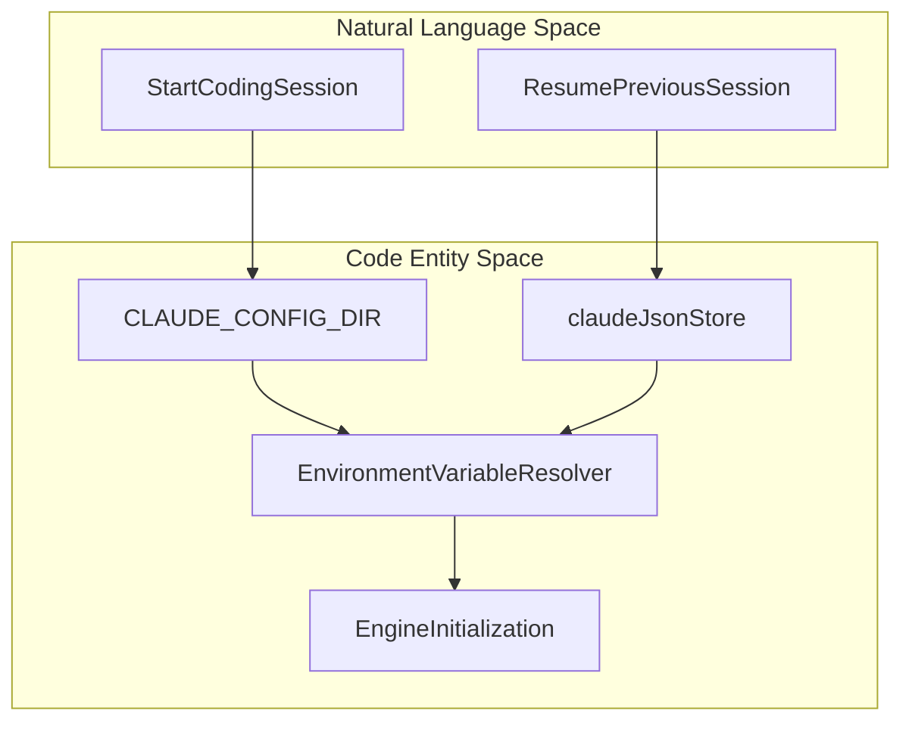
Sources: `[README.md:46-46]()`, `[.devcontainer/devcontainer.json:48-52]()`

### Environment Overrides & Configuration

Users may define specific runtime behavior using environment variables:
- `CLAUDE_CODE_OAUTH_TOKEN`: Overrides the default stored OAuth credential.
- `CLAUDE_CONFIG_DIR`: Specifies a non-default path for storing application configuration and history (`~/.claude` by default) [.devcontainer/devcontainer.json:48-52]().
- `ANTHROPIC_BASE_URL`: Directs API requests to custom gateway endpoints.
- `NODE_OPTIONS`: Controls Node.js memory allocations (e.g., `--max-old-space-size=4096` in devcontainers) [.devcontainer/devcontainer.json:49-49]().

Sources: `[.devcontainer/devcontainer.json:48-52]()`

---

## Launching and Verifying Sessions

Navigate to a target workspace directory and invoke the binary to start an interactive session [README.md:46-46]().

### Verification and Diagnostic Commands

- `/model`: Interactively select or inspect the active model.
- `/doctor`: Evaluates local configuration integrity and network domain lists.
- `/bug`: Triggers the embedded telemetry and feedback interface [README.md:52-54]().

Sources: `[README.md:52-54]()`

---

# Page: Configuration Management

# Configuration Management

<details>
<summary>Relevant source files</summary>

The following files were used as context for generating this wiki page:

- [examples/mdm/README.md](examples/mdm/README.md)
- [examples/settings/README-hipaa.md](examples/settings/README-hipaa.md)
- [examples/settings/README.md](examples/settings/README.md)
- [examples/settings/managed-mcp-hipaa.json](examples/settings/managed-mcp-hipaa.json)
- [examples/settings/settings-bash-sandbox.json](examples/settings/settings-bash-sandbox.json)
- [examples/settings/settings-hipaa.json](examples/settings/settings-hipaa.json)
- [examples/settings/settings-lax.json](examples/settings/settings-lax.json)
- [examples/settings/settings-strict.json](examples/settings/settings-strict.json)

</details>


## Purpose and Scope

This page documents the configuration management architecture of Claude Code, detailing the settings hierarchy (`managed-settings.json`, `settings.json`, `settings.local.json`), enterprise policy enforcement mechanisms, permission configurations, and sandboxing rules. It serves as a reference for configuring developer environments and deploying enterprise-wide security profiles using the configurations provided in `examples/settings/`.

Sources: [examples/settings/README.md:1-5]()

## Settings Hierarchy & Data Flow

The configuration system processes settings through a multi-tier cascade, merging options from organization-wide enterprise controls down to local developer overrides [examples/settings/README.md:5-6](). 

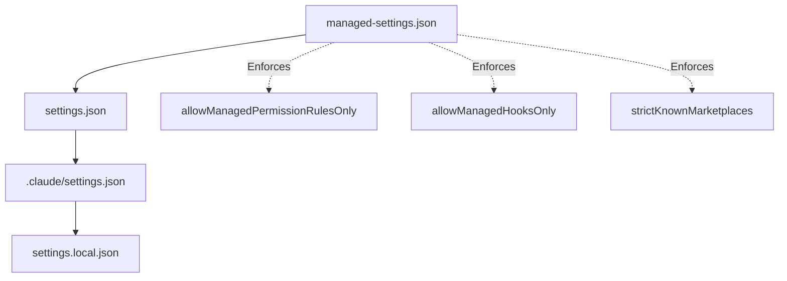
Sources: [examples/settings/README.md:5-6](), [examples/settings/settings-strict.json:12-14]()

### File Locations

| Level | Unix/Linux/macOS | Windows | Scope |
|-------|------------------|---------|-------|
| **Enterprise (Managed)** | `~/.config/claude/managed-settings.json` | `%APPDATA%\ClaudeCode\managed-settings.json` | Organization-wide constraints [examples/settings/README.md:3-5]() |
| **User** | `~/.config/claude/settings.json` | `%APPDATA%\ClaudeCode\settings.json` | Per-user preferences [examples/settings/README.md:5-6]() |
| **Project** | `.claude/settings.json` | `.claude\settings.json` | Repository-specific [examples/settings/README.md:5-6]() |
| **Local** | `settings.local.json` | `settings.local.json` | Testing/development overrides [examples/settings/README.md:26-26]() |

Sources: [examples/settings/README.md:3-6](), [examples/settings/README.md:26-26]()

### Policy Enforcement Mechanisms

Enterprise configuration files apply strict overrides to lock down developer environments:

- **`allowManagedPermissionRulesOnly`**: When set to `true` in `[examples/settings/settings-strict.json:12]`, any `allow`, `ask`, or `deny` rules defined in user or project settings are ignored [examples/settings/settings-strict.json:12]().
- **`allowManagedHooksOnly`**: When set to `true` in `[examples/settings/settings-strict.json:13]`, only hooks defined in the managed configuration execute; user and project hooks are blocked [examples/settings/settings-strict.json:13]().
- **`strictKnownMarketplaces`**: Restricts the CLI to only install plugins from an approved list of marketplace URLs (`[examples/settings/settings-strict.json:14]()`, `[examples/settings/settings-lax.json:5]()`).
- **`disableBypassPermissionsMode`**: When set to `"disable"`, prevents users from using flags like `--dangerously-skip-permissions` (`[examples/settings/settings-lax.json:3-4]()`).

Sources: [examples/settings/settings-strict.json:12-14](), [examples/settings/settings-lax.json:3-5]()

## Permission Configuration

Permissions determine the autonomy level granted to the agent during execution [examples/settings/README.md:17-20](). Each tool call evaluates against the merged permission rules.

### Permission Modes

1. **`allow`**: The tool executes automatically without prompting the user (`[examples/settings/README.md:17-17]()`).
2. **`ask`**: The user interface prompts the user to approve or deny the action (`[examples/settings/README.md:17-20]()`).
3. **`deny`**: The tool call is immediately rejected, returning a failure context to the agent (`[examples/settings/README.md:17-19]()`, `[examples/settings/settings-strict.json:7-10]()`).

Sources: [examples/settings/settings-strict.json:2-11](), [examples/settings/README.md:17-20]()

## Sandbox Configuration

The `sandbox` block targets the `Bash` tool exclusively and does not apply to other tools (such as file operations, web tools, or MCP servers) or hooks (`[examples/settings/README.md:27-27]()`, `[examples/settings/settings-bash-sandbox.json:3-17]()`).

### Sandbox Architecture & Code Entities

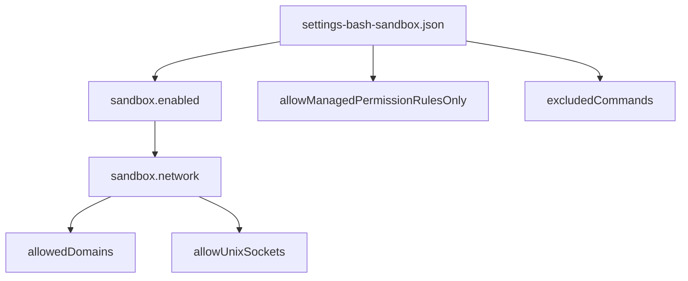
Sources: [examples/settings/settings-bash-sandbox.json:1-18](), [examples/settings/settings-strict.json:15-27]()

### Configuration Options

- **`autoAllowBashIfSandboxed`**: When `true`, bash commands running inside the sandbox inherit `allow` status (`[examples/settings/settings-bash-sandbox.json:5]`, `[examples/settings/settings-strict.json:16]`).
- **`allowUnsandboxedCommands`**: When `false`, blocks execution of any command that cannot be successfully wrapped inside the sandbox (`[examples/settings/settings-bash-sandbox.json:6]()`).
- **`network.allowedDomains`**: Defines an explicit domain allowlist for sandboxed processes (`[examples/settings/settings-strict.json:22]()`, `[examples/settings/settings-bash-sandbox.json:12]()`).
- **`excludedCommands`**: Lists commands explicitly exempted from sandbox wrapper enforcement (`[examples/settings/settings-strict.json:17]()`, `[examples/settings/settings-bash-sandbox.json:7]()`).

Sources: [examples/settings/settings-bash-sandbox.json:3-17](), [examples/settings/settings-strict.json:15-27]()

## Example Settings Files

The `examples/settings/` directory provides baseline configurations [examples/settings/README.md:1-5]() for various security models.

### Strict Configuration (`settings-strict.json`)
Designed for high-security environments enforcing strict organization-wide control (`[examples/settings/README.md:18-20]()`):
- **Tools**: Denies web fetch and search capabilities (`[examples/settings/settings-strict.json:7-10]()`) and requires approval for the `Bash` tool (`[examples/settings/settings-strict.json:4-6]()`).
- **Lockdown**: Enforces `allowManagedPermissionRulesOnly` and `allowManagedHooksOnly` (`[examples/settings/settings-strict.json:12-13]()`).

Sources: [examples/settings/README.md:18-20](), [examples/settings/settings-strict.json:1-28]()

### Lax Configuration (`settings-lax.json`)
A baseline configuration preventing standard security bypasses while maintaining developer flexibility (`[examples/settings/README.md:15-16]()`):
- **Security**: Disables `--dangerously-skip-permissions` (`[examples/settings/settings-lax.json:3-4]()`).
- **Marketplace**: Restricts known marketplaces (`[examples/settings/settings-lax.json:5]()`).

Sources: [examples/settings/README.md:15-16](), [examples/settings/settings-lax.json:1-6]()

### Bash Sandbox Configuration (`settings-bash-sandbox.json`)
Enforces strict environment isolation for command-line shell execution (`[examples/settings/README.md:21-21]()`):
- **Enforcement**: Enables the sandbox (`[examples/settings/settings-bash-sandbox.json:4]()`) and rejects unsandboxed commands (`[examples/settings/settings-bash-sandbox.json:6]()`).
- **Control**: Restricts permission rules to enterprise-managed definitions (`[examples/settings/settings-bash-sandbox.json:2]()`).

Sources: [examples/settings/README.md:21-21](), [examples/settings/settings-bash-sandbox.json:1-18]()

---

# Page: CLI Commands & Interaction Modes

# CLI Commands & Interaction Modes

<details>
<summary>Relevant source files</summary>

The following files were used as context for generating this wiki page:

- [.devcontainer/Dockerfile](.devcontainer/Dockerfile)
- [.devcontainer/devcontainer.json](.devcontainer/devcontainer.json)
- [.devcontainer/init-firewall.sh](.devcontainer/init-firewall.sh)
- [.gitattributes](.gitattributes)
- [.vscode/extensions.json](.vscode/extensions.json)
- [CHANGELOG.md](CHANGELOG.md)
- [LICENSE.md](LICENSE.md)
- [README.md](README.md)
- [SECURITY.md](SECURITY.md)
- [demo.gif](demo.gif)
- [feed.xml](feed.xml)

</details>


## Purpose & Scope

This document provides a technical reference for the command-line interface (CLI) of Claude Code, detailing interaction patterns, slash commands, execution modes, and underlying system routines. It covers the mechanisms by which users provide instructions—ranging from natural language prompts to structured slash commands—and how the system resolves these into tool calls, configuration changes, or session state transitions.

Sources: [CHANGELOG.md:3-9](), [README.md:7-46]()

---

## Command Invocation Mechanisms

Claude Code operates through primary input vectors: Slash Commands, CLI Startup Flags, Keyboard Shortcuts, and Remote Control integrations.

### Slash Commands

Slash commands are internal CLI directives processed by the terminal input handler before being dispatched to the language model or execution engine. They allow users to control the agent's environment, manage sessions, and interact with plugins.

- **Built-in commands**: Hardcoded core CLI directives (e.g., `/model`, `/compact`, `/config`, `/diff`, `/rate-limit-options`) [CHANGELOG.md:3-9]().
- **Specialized Workflows**: Advanced configuration scripts like `/auto-mode-setup`, `/claude-api managed-agents-secure`, and `/effort` level controls [CHANGELOG.md:8-9](), [CHANGELOG.md:37-37]().
- **Plugin commands**: Dynamically registered by installed plugins or mods via registration hooks [CHANGELOG.md:39-40]().
- **Issue Reporting**: Commands like `/bug` for direct telemetry and issue reporting within the terminal [README.md:52-54]().

### CLI Flags (Startup)

Startup flags modify the behavior and constraints of the `claude` process at launch.

| Flag | Description | Technical Detail |
|------|-------------|------------------|
| `--resume` | Resume session | Restores previous conversation state and handles interrupted or malformed tool calls [CHANGELOG.md:11-19]() |
| `--continue` | Resume recent | Resumes the most recent remote control or terminal session [CHANGELOG.md:5-8]() |
| `--tools` | Tool whitelist/blacklist | Controls available runtime tools at startup [CHANGELOG.md:33-33]() |
| `--debug` | Debug mode | Enables verbose internal logging for diagnostic evaluation [CHANGELOG.md:33-33]() |
| `--disable-slash-commands` | Security lockdown | Disables dynamic command parsing and execution vectors [CHANGELOG.md:33-33]() |

Sources: [CHANGELOG.md:3-33](), [README.md:52-54]()

---

## Core Built-In & Plugin Commands

### Session & Environment Management

| Command | Description | Implementation Details |
|---------|-------------|------------------------|
| `/resume` | Resume session | Restores session state; fixed to prevent history leaks between connected sessions [CHANGELOG.md:11-19]() |
| `/compact` | Manage context | Triggers context compaction to strip excessive payload. Includes secondary compaction fallback if the first pass exceeds token thresholds [CHANGELOG.md:16-16]() |
| `/mcp` | MCP server management | Supports subcommands like `/mcp reconnect all` to retry failed or unauthenticated MCP server connections simultaneously [CHANGELOG.md:10-21]() |
| `/diff` | Uncommitted changes | Opens the session diff pane, rendering file hunks and tracking uncommitted workspace modifications [README.md:7-8]() |
| `/auto-mode-setup` | Guided setup | Reads project files and recent sessions to configure auto-mode parameters for your specific environment [CHANGELOG.md:8-8]() |
| `/effort` | Effort level | Adjusts reasoning depth dynamically (e.g., `/effort status`, `/effort ultracode`) [CHANGELOG.md:37-37]() |
| `/loop` | Automated polling | Schedules recurring task wakeups with built-in prompt caching safeguards [CHANGELOG.md:41-41]() |

Sources: [CHANGELOG.md:8-41](), [README.md:7-8]()

---

## Command Architecture & Data Flow

This diagram bridges the Natural Language/Terminal Input Space to the Code Entity Space, showing how input streams route through terminal handlers and command registries to specific core execution modules.

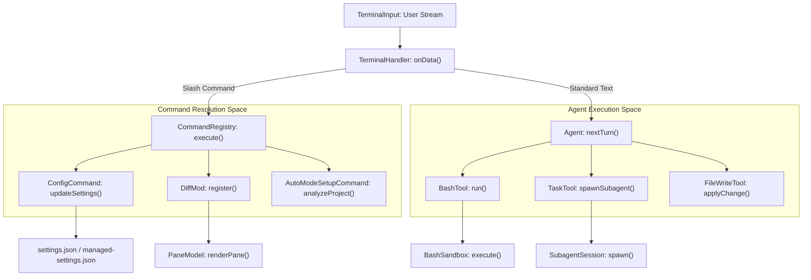
Sources: [CHANGELOG.md:3-46](), [README.md:7-46]()

---

## Interaction Modes

### 1. Interactive TUI Mode
The primary terminal interface featuring a status line, busy spinners, and real-time streaming output.
- **Visual Feedback**: Real-time status indicators display token spend limits and rate-limit details (e.g., `"$271.40 / $500.00 spent this month"`) [CHANGELOG.md:7-7]().
- **Selection Menus**: Enhanced picker dialogs with responsive tab bars and navigation logic [CHANGELOG.md:30-31]().

### 2. Auto Mode
Claude executes permitted commands automatically based on user configuration and tool policies.
- **Prompt Safeguards**: Includes interactive permission checks (such as `"Yes, but ask again next time"` prompts for reads outside working directories) [CHANGELOG.md:6-6]().
- **Policy Enforcement**: Pre-approves tools only from verified Anthropic sources or explicitly managed settings [CHANGELOG.md:39-39]().

### 3. Remote Control & Integration Runners
Allows Claude Code to be driven from remote environments, IDE extensions, or automated CI/CD pipelines.
- **Input Streams**: Processes structured JSON streams and remote control event hooks [CHANGELOG.md:23-25]().

Sources: [CHANGELOG.md:6-46](), [README.md:7-8]()

---

## Interaction State Machine

This diagram maps operational session states to their underlying code execution components, tracing lifecycle transitions from idle input to model response and tool adjudication.

```mermaid
stateDiagram-v2
    [*] --> IDLE
    
    IDLE --> API_REQUEST : "UserInput / Slash Command"
    API_REQUEST --> STREAMING : "Agent: nextTurn() starts"
    
    STREAMING --> TOOL_VALIDATION : "ToolSystem: checkPermission()"
    TOOL_VALIDATION --> AUTO_CLASSIFIER : "AutoModeClassifier: evaluate()"
    AUTO_CLASSIFIER --> TOOL_EXECUTION : "Approved (Sandbox/Safe)"
    AUTO_CLASSIFIER --> PERMISSION_PROMPT : "Requires manual approval"
    
    PERMISSION_PROMPT --> TOOL_EXECUTION : "User allows"
    PERMISSION_PROMPT --> IDLE : "User denies"
    
    TOOL_EXECUTION --> API_REQUEST : "Result sent to model"
    STREAMING --> IDLE : "Response complete"
    
    IDLE --> REMOTE_SESSION : "remote-control --continue"
    REMOTE_SESSION --> IDLE : "Disconnect / Offline"
```
Sources: [CHANGELOG.md:6-46](), [README.md:7-46]()

---

## Advanced Interaction Patterns

### Context Compaction & Recovery
When conversations exceed token request limits, Claude triggers automated context compaction.
- **Secondary Compaction**: If a compacted request remains too long, Claude Code initiates a secondary compaction pass, aggressively reducing recent conversation history to fit context limits [CHANGELOG.md:16-16]().
- **Error Resilience**: Damaged response streams or parsing errors trigger automatic retries rather than writing raw syntax errors into the session transcript [CHANGELOG.md:14-15]().

Sources: [CHANGELOG.md:14-16](), [README.md:7-8]()

---

# Page: Session Management

# Session Management

<details>
<summary>Relevant source files</summary>

The following files were used as context for generating this wiki page:

- [.devcontainer/Dockerfile](.devcontainer/Dockerfile)
- [.devcontainer/devcontainer.json](.devcontainer/devcontainer.json)
- [.devcontainer/init-firewall.sh](.devcontainer/init-firewall.sh)
- [.gitattributes](.gitattributes)
- [.vscode/extensions.json](.vscode/extensions.json)
- [CHANGELOG.md](CHANGELOG.md)
- [LICENSE.md](LICENSE.md)
- [README.md](README.md)
- [SECURITY.md](SECURITY.md)
- [demo.gif](demo.gif)
- [feed.xml](feed.xml)
- [mods/diff/tests/fixtures/edited-transcript.ts](mods/diff/tests/fixtures/edited-transcript.ts)
- [mods/diff/tests/fixtures/resume.ts](mods/diff/tests/fixtures/resume.ts)
- [mods/diff/tests/fixtures/usage-at.ts](mods/diff/tests/fixtures/usage-at.ts)

</details>


## Purpose and Scope
This page documents the session management subsystem in Claude Code, which controls conversation lifecycles, state persistence, transcript storage, and resumption mechanisms (`/resume`, `--continue`). It covers how conversation history and runtime environment contexts are preserved across terminal restarts, crashes, and asynchronous updates.

Sources: [CHANGELOG.md:21-25]()

---

## 1. Overview & Architecture

Session management ensures continuity between agentic coding interactions by maintaining structured logs of user prompts, assistant turns, tool executions, and metadata. Sessions operate locally within user configuration directories or via remote connectors.

Key architectural responsibilities include:
- **Lifecycle Management**: Tracking session initialization, active loops, backgrounding, and graceful teardown [CHANGELOG.md:21-21]().
- **Transcript Storage**: Appending conversation turns incrementally to prevent data loss during network interruptions or unexpected terminations [CHANGELOG.md:21-21]().
- **State Resumption**: Restoring model parameters, working directories, and git states via CLI flags (`--resume`, `--continue`) or the interactive TUI (`/resume`) [CHANGELOG.md:5-5]().

**Diagram: Session Architecture and Code Entity Mapping**
```mermaid
graph TD
    UserInvocation["UserInvocation"] --> CLIArgParser["CLIArgParser"]
    CLIArgParser --> SessionManager["SessionManager"]
    SessionManager --> TranscriptWriter["TranscriptWriter"]
    SessionManager --> SessionStartHook["SessionStartHook"]
    TranscriptWriter --> DiskStorage["DiskStorage"]
```
Sources: [CHANGELOG.md:5-5](), [CHANGELOG.md:21-21](), [.devcontainer/devcontainer.json:46-50]()

---

## 2. Session Lifecycle & State Transitions

Sessions transition through discrete execution phases, from CLI argument parsing and environment initialization to active user interaction and final metadata persistence.

### Lifecycle Flow

**Diagram: Session Lifecycle State Machine**
```mermaid
graph TD
    UserStart["UserInvocation"] --> ParseArgs["CLIArgParser"]
    ParseArgs --> CheckResume{"ResumeFlag"}
    CheckResume -- "False" --> CreateSession["InitializeNewSessionID"]
    CheckResume -- "True" --> LoadMeta["LoadSessionMetadata"]
    CreateSession --> InitState["InitializeAppState"]
    LoadMeta --> RestoreState["RestoreAppState"]
    InitState --> FireHook["SessionStartHook"]
    RestoreState --> FireHook
    FireHook --> ActiveLoop["UserInteractionLoop"]
    ActiveLoop --> ExecTool["ExecuteToolHandler"]
    ExecTool --> WriteLog["TranscriptWriterAppend"]
    ActiveLoop -- "/exit" --> Finalize["FinalMetadataUpdate"]
    Finalize --> Cleanup["CleanupLivenessFiles"]
    Cleanup --> Terminate["ProcessExit"]
```
Sources: [CHANGELOG.md:5-5](), [CHANGELOG.md:20-21]()

### Lifecycle Safeguards & Handling
- **Crash Recovery**: Startup routines handle exceptions caused by rendering errors in narrow terminal windows, allowing `--resume` to successfully recover corrupted or interrupted sessions [CHANGELOG.md:22-22]().
- **Liveness Tracking**: Short-lived commands utilize liveness tracking files to prevent stale background locks [CHANGELOG.md:20-20]().
- **Remote & Cloud State**: Disconnected remote control sessions are marked as offline, while active cloud sessions are tracked in agent dispatch views [CHANGELOG.md:9-9]().

Sources: [CHANGELOG.md:9-9](), [CHANGELOG.md:20-22]()

---

## 3. Transcript Storage and Persistence

Claude Code records conversation histories using file-based persistence inside designated configuration directories (e.g., `~/.claude`) [.devcontainer/devcontainer.json:46-50]().

### Storage Architecture

**Diagram: Transcript Storage Data Structures**
```mermaid
classDiagram
    class SessionDirectory {
        +string transcriptPath
        +string metadataPath
        +string settingsPath
    }
    class TranscriptLine {
        +string timestamp
        +string type
        +ContentBlock[] content
    }
    class ContentBlock {
        +string type
        +string text
    }
    class MetadataFile {
        +string sessionId
        +string lastActive
        +string model
        +string projectPath
    }

    SessionDirectory *-- TranscriptLine : "contains"
    TranscriptLine *-- ContentBlock : "comprises"
    SessionDirectory *-- MetadataFile : "describes"
```
Sources: [.devcontainer/devcontainer.json:46-50]()

### Persistence Rules
- **Incremental Appends**: Transcripts use JSON Lines format to support safe, append-only writes after every tool execution or assistant turn [.devcontainer/devcontainer.json:46-50]().
- **Compaction Triggers**: When request payloads approach API limits, the system strips redundant blocks or triggers compaction algorithms to keep context sizes manageable [CHANGELOG.md:24-24]().
- **Error Boundaries**: Malformed historical messages (such as plain string assistant entries or corrupted tool structures) are intercepted and sanitized during load operations to prevent unrecoverable interface crashes [CHANGELOG.md:25-25]().

Sources: [CHANGELOG.md:24-25](), [.devcontainer/devcontainer.json:46-50]()

---

## 4. Resumption Mechanics (`/resume`)

Resuming a session reloads both the conversational context and the environment settings present when the session was last active [CHANGELOG.md:5-5]().

### Resumption Options

| Command / Flag | Target Behavior |
|----------------|-----------------|
| `claude --resume` | Resumes the most recent local session history [CHANGELOG.md:5-5](). |
| `claude --continue` | Resumes the most recent Remote Control session [CHANGELOG.md:5-5](). |
| `/resume` | Opens the interactive terminal UI selector for historical sessions [CHANGELOG.md:5-5](). |
| `/tui` | Re-engages the active terminal interface view [CHANGELOG.md:5-5](). |

### Model and State Consistency
- **Model Persistence**: If the active model was modified via `/model` during a session, resumption preserves that model choice rather than reverting to the default startup configuration [CHANGELOG.md:42-42]().
- **Remote Security**: Resuming remote control sessions includes checks to prevent leaking sensitive session parameters across active connections [CHANGELOG.md:44-44]().

Sources: [CHANGELOG.md:5-5](), [CHANGELOG.md:42-42](), [CHANGELOG.md:44-44]()

---

## 5. Integration with Hooks and External Environments

Session management interfaces directly with the hook execution system and external runners to coordinate startup tasks and environment configurations [CHANGELOG.md:9-9]().

- **SessionStart Hooks**: Executed at the start of every session lifecycle to inject custom project instructions or initialize output-style plugins [README.md:1-72]().
- **Headless & SDK Sessions**: Programmatic invocations (`claude -p`) and SDK sessions properly record usage metrics and persist exit statuses upon completion [CHANGELOG.md:9-9]().

Sources: [CHANGELOG.md:9-9](), [README.md:1-72]()

---

# Page: Providing Feedback & Reporting Issues

# Providing Feedback & Reporting Issues

<details>
<summary>Relevant source files</summary>

The following files were used as context for generating this wiki page:

- [.github/ISSUE_TEMPLATE/bug_report.yml](.github/ISSUE_TEMPLATE/bug_report.yml)
- [.github/ISSUE_TEMPLATE/config.yml](.github/ISSUE_TEMPLATE/config.yml)
- [.github/ISSUE_TEMPLATE/documentation.yml](.github/ISSUE_TEMPLATE/documentation.yml)
- [.github/ISSUE_TEMPLATE/feature_request.yml](.github/ISSUE_TEMPLATE/feature_request.yml)
- [.github/ISSUE_TEMPLATE/github_connection.yml](.github/ISSUE_TEMPLATE/github_connection.yml)
- [.github/ISSUE_TEMPLATE/model_behavior.yml](.github/ISSUE_TEMPLATE/model_behavior.yml)

</details>


## Purpose and Scope

This document details the technical implementation and user workflows for providing feedback, reporting bugs, and requesting features in Claude Code. It covers the `/bug` command mechanics, the structural schema of GitHub issue templates, and the data pipeline bridging user input to internal automation and issue triage systems.

For downstream processing of submitted reports, see **AI-Powered Issue Triage** (6.1) and **Issue Deduplication System** (6.2).

Sources: [.github/ISSUE_TEMPLATE/config.yml:1-14](), [.github/ISSUE_TEMPLATE/bug_report.yml:1-28]()

---

## Feedback Channels Overview

Claude Code maps specific user feedback channels to structured GitHub issue templates and community platforms, configured centrally via the issue settings [.github/ISSUE_TEMPLATE/config.yml:1-14]().

| Channel | Target Mechanism | Code Entity / Reference |
| :--- | :--- | :--- |
| **`/bug` command** | CLI diagnostic collection & URL generation | Built-in CLI Slash Command |
| **Bug Report** | Detailed regression analysis | [.github/ISSUE_TEMPLATE/bug_report.yml:1-188]() |
| **Feature Request** | Workflow enhancements & tooling | [.github/ISSUE_TEMPLATE/feature_request.yml:1-131]() |
| **Model Behavior** | LLM constraint violations & subagent traces | [.github/ISSUE_TEMPLATE/model_behavior.yml:1-208]() |
| **Documentation** | Guide improvements & missing references | [.github/ISSUE_TEMPLATE/documentation.yml:1-116]() |
| **GitHub Connection** | Connector troubleshooting & error capture | [.github/ISSUE_TEMPLATE/github_connection.yml:1-37]() |
| **Discord Community** | Real-time user support | [.github/ISSUE_TEMPLATE/config.yml:3-5]() |

Sources: [.github/ISSUE_TEMPLATE/config.yml:1-14](), [.github/ISSUE_TEMPLATE/bug_report.yml:1-188](), [.github/ISSUE_TEMPLATE/github_connection.yml:1-37]()

---

## Reporting via the `/bug` Command

The `/bug` command is the primary entry point for capturing runtime context during an active session. In integrated environments such as VS Code, it bridges terminal error states with graphical feedback dialogs.

### Implementation Flow

```mermaid
graph TD
    subgraph NaturalLanguageSpace["Natural Language Space"]
        UserEncountersError["UserEncountersError"]
        UserProvidesDescription["UserProvidesDescription"]
    end

    subgraph CodeEntitySpace["Code Entity Space"]
        BugCommandHandler["BugCommandHandler"]
        ContextAggregator["ContextAggregator"]
        URLGenerator["URLGenerator"]
        VersionInfo["VersionInfo"]
        ModelPicker["ModelPicker"]
        PlatformInfo["PlatformInfo"]
        SettingsInfo["SettingsInfo"]
    end

    UserEncountersError -->|"executes"| BugCommandHandler
    BugCommandHandler -->|"prompts for"| UserProvidesDescription
    UserProvidesDescription --> ContextAggregator
    ContextAggregator -->|"reads"| VersionInfo
    ContextAggregator -->|"reads"| ModelPicker
    ContextAggregator -->|"reads"| PlatformInfo
    ContextAggregator -->|"reads"| SettingsInfo
    ContextAggregator --> URLGenerator
    URLGenerator -->|"opens"| Browser["Browser"]
    Browser -->|"populates"| GHTemplate["bug_report.yml"]
```
**Diagram: `/bug` Command Data Flow**

Sources: [.github/ISSUE_TEMPLATE/bug_report.yml:1-188]()

### Captured Context and Data Collection
The command automatically injects runtime telemetry into the generated template fields:
- **Claude Code Version**: Extracted via `claude --version` [.github/ISSUE_TEMPLATE/bug_report.yml:120-127]().
- **Platform**: Identifies the inference backend (Anthropic API, AWS Bedrock, Google Vertex AI) [.github/ISSUE_TEMPLATE/bug_report.yml:128-140]().
- **Environment & Terminal**: Detects host OS and active terminal emulator (iTerm2, Warp, Cursor, Windows Terminal, etc.) [.github/ISSUE_TEMPLATE/bug_report.yml:141-175]().
- **Model State**: Records active model metadata checked via `/model` [.github/ISSUE_TEMPLATE/bug_report.yml:85-97]().

Sources: [.github/ISSUE_TEMPLATE/bug_report.yml:85-175]()

---

## GitHub Issue Templates

Claude Code mandates strict YAML schemas for issue reporting to feed downstream automation pipelines.

### 1. Bug Reports (`bug_report.yml`)
Enforces preflight checks and structured regression inputs:
- **Preflight Checklist**: Validates latest version usage and uniqueness [.github/ISSUE_TEMPLATE/bug_report.yml:17-28]().
- **Reproduction**: Step-by-step minimal reproduction blocks [.github/ISSUE_TEMPLATE/bug_report.yml:64-84]().
- **Regression Metadata**: Identifies whether the issue exists in prior versions (`working_version`) [.github/ISSUE_TEMPLATE/bug_report.yml:98-118]().

### 2. Model Behavior (`model_behavior.yml`)
Captures LLM logic errors, scope escapes, and permission bypasses:
- **Behavior Categorization**: Classifies issues such as unauthorized file modification or instruction ignore events [.github/ISSUE_TEMPLATE/model_behavior.yml:28-45]().
- **Permission Mode Tracking**: Records whether `Accept Edits` was active during execution [.github/ISSUE_TEMPLATE/model_behavior.yml:105-116]().
- **Conversation Logs**: Preserves transcript segments containing assistant explanations [.github/ISSUE_TEMPLATE/model_behavior.yml:157-169]().

### 3. Feature Requests (`feature_request.yml`)
Focuses on workflow impact rather than prescription:
- **Problem Statement**: Details the underlying workflow obstacle [.github/ISSUE_TEMPLATE/feature_request.yml:25-39]().
- **Categorization**: Tags requests to specific subsystems (CLI flags, TUI, MCP integration, Performance) [.github/ISSUE_TEMPLATE/feature_request.yml:86-104]().

### 4. Documentation Issues (`documentation.yml`)
Tracks guide accuracy and missing code samples:
- **Doc Location & Section**: Pinpoints exact URLs or guide headings [.github/ISSUE_TEMPLATE/documentation.yml:30-47]().
- **Impact Assessment**: Classifies severity from low inconvenience to feature blockage [.github/ISSUE_TEMPLATE/documentation.yml:95-106]().

### 5. GitHub Connection (`github_connection.yml`)
Captures connector diagnostics on claude.ai:
- **Screenshots & Goal**: Gathers visual error states and intended workflows [.github/ISSUE_TEMPLATE/github_connection.yml:11-29]().
- **Automated Diagnostics**: Injects platform connection logs [.github/ISSUE_TEMPLATE/github_connection.yml:31-37]().

Sources: [.github/ISSUE_TEMPLATE/bug_report.yml:1-188](), [.github/ISSUE_TEMPLATE/model_behavior.yml:1-208](), [.github/ISSUE_TEMPLATE/feature_request.yml:1-131](), [.github/ISSUE_TEMPLATE/documentation.yml:1-116](), [.github/ISSUE_TEMPLATE/github_connection.yml:1-37]()

---

## Automated Triage and Deduplication

Submitted templates immediately enter automated GitHub Actions pipelines for classification and tracking.

```mermaid
graph LR
    subgraph NaturalLanguageSpace["Natural Language Space"]
        UserIssue["UserIssue"]
        OpusReasoning["OpusReasoning"]
    end

    subgraph CodeEntitySpace["Code Entity Space"]
        TriageWorkflow["TriageWorkflow"]
        DedupeWorkflow["DedupeWorkflow"]
        BugLabel["BugLabel"]
        EnhancementLabel["EnhancementLabel"]
        ModelLabel["ModelLabel"]
        DocLabel["DocLabel"]
        StatsigLog["StatsigLog"]
    end

    UserIssue --> TriageWorkflow
    TriageWorkflow --> OpusReasoning
    OpusReasoning --> BugLabel
    OpusReasoning --> EnhancementLabel
    OpusReasoning --> ModelLabel
    OpusReasoning --> DocLabel
    TriageWorkflow --> DedupeWorkflow
    TriageWorkflow --> StatsigLog
```
**Diagram: Automated Issue Lifecycle**

Sources: [.github/ISSUE_TEMPLATE/bug_report.yml:4-5](), [.github/ISSUE_TEMPLATE/feature_request.yml:4-5](), [.github/ISSUE_TEMPLATE/model_behavior.yml:4-5](), [.github/ISSUE_TEMPLATE/documentation.yml:4-5]()

### Key Automation Components
- **Label Assignment**: Workflows apply taxonomy labels (`bug`, `enhancement`, `model`, `documentation`) based on template provenance.
- **Deduplication Engine**: Background workflows query existing issue databases to link duplicate reports.
- **Analytics & Telemetry**: Event metadata is pushed through Statsig logging integrations to track recurring stability issues.

Sources: [.github/ISSUE_TEMPLATE/bug_report.yml:4-5]()

---

# Page: Core Systems

# Core Systems

<details>
<summary>Relevant source files</summary>

The following files were used as context for generating this wiki page:

- [.devcontainer/Dockerfile](.devcontainer/Dockerfile)
- [.devcontainer/devcontainer.json](.devcontainer/devcontainer.json)
- [.devcontainer/init-firewall.sh](.devcontainer/init-firewall.sh)
- [.gitattributes](.gitattributes)
- [.vscode/extensions.json](.vscode/extensions.json)
- [CHANGELOG.md](CHANGELOG.md)
- [LICENSE.md](LICENSE.md)
- [README.md](README.md)
- [SECURITY.md](SECURITY.md)
- [demo.gif](demo.gif)
- [feed.xml](feed.xml)
- [mods/README.md](mods/README.md)
- [mods/types/claude-code.d.ts](mods/types/claude-code.d.ts)

</details>


This page provides technical documentation of Claude Code's internal architecture and the subsystems that power its functionality. It covers the fundamental building blocks that enable agentic coding, multi-agent orchestration, permission management, and plugin extensibility.

For user-facing documentation on configuration and usage, see [Configuration Management](#2.2) and [CLI Commands & Interaction Modes](#2.3). For details on specific subsystems, refer to the child pages listed in each section below.

## Architecture Overview

Claude Code's architecture is organized around several core subsystems that work together to provide an agentic coding experience. The system follows a layered approach where the CLI interface routes user input through session management to the agent system, which orchestrates tool execution under permission controls while managing context windows and triggering lifecycle hooks.

### System Architecture Diagram
The following diagram bridges the "Natural Language Space" of user intent to the "Code Entity Space" by showing how core components interact.

```mermaid
graph TB
    CLI["CLI Entry Point<br/>'claude' command"]
    SessionMgr["SessionManager<br/>(src/sessions/manager.ts)"]
    AgentCore["Agent System<br/>AgentExecutor (src/agents/executor.ts)"]
    ContextMgr["ContextManager<br/>(src/context/manager.ts)"]
    ToolRegistry["ToolRegistry<br/>(src/tools/registry.ts)"]
    PermSystem["PermissionSystem<br/>(src/permissions/checker.ts)"]
    HookEngine["HookEngine<br/>(src/hooks/engine.ts)"]
    PluginLoader["PluginLoader<br/>(src/plugins/loader.ts)"]
    SkillLoader["SkillLoader<br/>(src/skills/loader.ts)"]
    
    CLI --> SessionMgr
    SessionMgr --> AgentCore
    AgentCore --> ContextMgr
    AgentCore --> ToolRegistry
    ToolRegistry --> PermSystem
    AgentCore --> HookEngine
    PluginLoader --> ToolRegistry
    PluginLoader --> HookEngine
    SkillLoader --> AgentCore
    
    ContextMgr -.->|"trigger /compact"| AgentCore
    HookEngine -.->|"PreToolUse/PostToolUse"| ToolRegistry
    PermSystem -.->|"allow/ask/deny"| ToolRegistry
```

Sources: [CHANGELOG.md:1-57](), [.devcontainer/init-firewall.sh:1-136]()

### Core System Responsibilities

| System | Primary Responsibility | Key Configuration |
|--------|----------------------|-------------------|
| Agent System | Execute user requests, spawn subagents, manage task lifecycle | `settings.json` `agent` field |
| Tool System | Provide capabilities (bash, file ops, MCP) | `settings.json` `disallowedTools` |
| Permission System | Control tool execution with allow/ask/deny rules | `settings.json` permission rules |
| Context Manager | Track token usage, trigger auto-compaction | Context window limits |
| Hook System | Inject custom behavior at lifecycle events | `.claude/hooks/*.py`, plugin hooks |
| Plugin System | Discover and load extensions | `marketplace.json`, `plugin.json` |
| Skill System | Load custom slash commands | `.claude/skills/` |
| MCP Integration | Connect to external tool servers | `.mcp.json` |

Sources: [CHANGELOG.md:1-57]()

## Request Processing Flow

This diagram shows how a user message flows through Claude Code's core systems, from input to execution. It maps natural language concepts to the actual execution path.

```mermaid
flowchart TD
    UserInput["User Input<br/>Terminal REPL"]
    InputParser["InputParser<br/>(src/cli/parser.ts)"]
    SessionContext["SessionContext<br/>Conversation history"]
    AgentExec["AgentExecutor<br/>(src/agents/executor.ts)"]
    ToolDecision["Tool Decision<br/>Model selects tools"]
    PermCheck["PermissionChecker<br/>(src/permissions/checker.ts)"]
    PermPrompt["Permission Prompt<br/>AskUserQuestion"]
    ToolExec["Tool Execution<br/>BashTool/ReadTool/etc"]
    HookPre["PreToolUse Hook"]
    HookPost["PostToolUse Hook"]
    ContextCheck["ContextManager<br/>Token tracking"]
    Compaction["Compaction<br/>(src/context/compactor.ts)"]
    Response["Response<br/>Display to user"]
    
    UserInput --> InputParser
    InputParser -->|"prompt"| SessionContext
    InputParser -->|"/command"| AgentExec
    SessionContext --> AgentExec
    AgentExec --> ToolDecision
    ToolDecision --> PermCheck
    PermCheck -->|"ask"| PermPrompt
    PermCheck -->|"deny"| Response
    PermCheck -->|"allow"| HookPre
    PermPrompt -->|"approved"| HookPre
    PermPrompt -->|"denied"| Response
    HookPre --> ToolExec
    ToolExec --> HookPost
    HookPost --> ContextCheck
    ContextCheck -->|"< limit"| AgentExec
    HookPost -->|"> limit"| Compaction
    Compaction --> AgentExec
    AgentExec --> Response
```

Sources: [CHANGELOG.md:1-57](), [.devcontainer/init-firewall.sh:1-136]()

## System Component Details

### 3.1. Agent System & Subagents
The agent system orchestrates all AI-powered operations, including spawning subagents for parallel work and managing background tasks.

**Key Features:**
- **Subagents:** Managed through the `Task` tool and `$.agent.spawn`. Subagents can be staggered to optimize prompt caching via `CLAUDE_CODE_WORKFLOW_PREFIX_STAGGER_MS` [CHANGELOG.md:1-57]().
- **Remote Control:** Supports `claude remote-control --continue` for resuming sessions and marks disconnected sessions as `offline` in `ListAgents` [CHANGELOG.md:1-57]().
- **Cloud Sessions:** Distinguishes between local and cloud-hosted sessions in agent listings [CHANGELOG.md:1-57]().

For detailed documentation, see [Agent System & Subagents](#3.1).

Sources: [CHANGELOG.md:1-57]()

### 3.2. Tool System & Permissions
Tools provide Claude with capabilities to interact with the environment. The system includes built-in tools and supports external tools via MCP, governed by strict permission rules (`ask`/`allow`/`deny`).

**Built-in Tools:**
- **Bash:** Hardened to handle network domain lists and execution checks.
- **File Operations:** The `Write` tool allows models to overwrite files subject to permission and validation rules.

For detailed documentation, see [Tool System & Permissions](#3.2).

Sources: [CHANGELOG.md:1-57]()

### 3.3. Context Window & Compaction
The context manager tracks token usage and triggers automatic compaction and payload stripping when limits are approached.

**Context Optimization:**
- **Compaction Retries:** Manages conversation length constraints and handles payload trimming gracefully.
- **Progress Tracking:** Provides stall hints and retry counts during compaction cycles.

For detailed documentation, see [Context Window & Compaction](#3.3).

Sources: [CHANGELOG.md:1-57]()

### 3.4. Hook System
Hooks provide lifecycle event interception points (`SessionStart`, `PreToolUse`, `PostToolUse`, etc.) using the `classic.*` namespace and handler implementations.

**Key Features:**
- **Server-Supplied Hooks:** Supports server-supplied hooks in runner sessions [CHANGELOG.md:1-57]().
- **Execution Lifecycle:** Used by extensions and reference validators to modify agent behavior based on session events.

For detailed documentation, see [Hook System](#3.4).

Sources: [CHANGELOG.md:1-57]()

### 3.5. MCP Server Integration
Claude Code supports the Model Context Protocol (MCP) to connect to external tool servers, complete with OAuth, server discovery, tool registration, and `$.mcp.call`.

**Features:**
- **OAuth & Discovery:** Handles secure redirect URIs and dynamic tool registration from server endpoints.

For detailed documentation, see [MCP Server Integration](#3.5).

Sources: [CHANGELOG.md:1-57]()

### 3.6. Plugin System
The plugin system enables extensibility through packages containing commands, agents, and hooks across user, project, and marketplace scopes.

**Plugin Lifecycle:**
- **Marketplace Sources:** Supports dynamic loading and secure verification of plugin manifests.

For detailed documentation, see [Plugin System](#3.6).

Sources: [CHANGELOG.md:1-57]()

### 3.7. Skill System
Skills provide custom slash commands and guidance for the agent via `SKILL.md` format files, supporting skill loading from plugins and `allowed-tools` declarations.

**Skill Mechanics:**
- **Security:** Hardened to prevent command shadowing and unauthorized execution.

For detailed documentation, see [Skill System](#3.7).

Sources: [CHANGELOG.md:1-57]()

### 3.8. Sandbox Environment
The sandbox provides isolated execution for bash commands, network restrictions, and rule enforcement for excluded commands.

**Configuration:**
- **Network Isolation:** Uses `iptables` and `ipset` rules via `.devcontainer/init-firewall.sh` to restrict outbound network access to allowed domains [root:.devcontainer/init-firewall.sh:1-137]().

For detailed documentation, see [Sandbox Environment](#3.8).

Sources: [.devcontainer/init-firewall.sh:1-136]()

### 3.9. UI/UX & Terminal Integration
Claude Code provides a rich interactive experience across terminal, desktop, mobile, and VS Code surfaces.

**Features:**
- **Terminal UI & Status Line:** Renders dynamic status lines, file suggestions, and progress indicators.
- **Accessibility & Modes:** Includes screen reader support, Vim modes, and VS Code extension integration.

For detailed documentation, see [UI/UX & Terminal Integration](#3.9).

Sources: [CHANGELOG.md:1-57]()

---

# Page: Agent System & Subagents

# Agent System & Subagents

<details>
<summary>Relevant source files</summary>

The following files were used as context for generating this wiki page:

- [mods/README.md](mods/README.md)
- [mods/agents-md/README.md](mods/agents-md/README.md)
- [mods/agents-md/hooks/hooks.json](mods/agents-md/hooks/hooks.json)
- [mods/agents-md/hooks/index.ts](mods/agents-md/hooks/index.ts)
- [mods/agents-md/hooks/register.ts](mods/agents-md/hooks/register.ts)
- [mods/agents-md/hooks/switches/index.ts](mods/agents-md/hooks/switches/index.ts)
- [mods/agents-md/hooks/switches/is-switched-on.ts](mods/agents-md/hooks/switches/is-switched-on.ts)
- [mods/agents-md/tests/fixtures/started-of.ts](mods/agents-md/tests/fixtures/started-of.ts)
- [mods/agents-md/tests/fixtures/types/started/started.ts](mods/agents-md/tests/fixtures/types/started/started.ts)
- [mods/agents-md/tests/register.test.ts](mods/agents-md/tests/register.test.ts)
- [mods/diff/hooks/git/argv/diff-leading-args.ts](mods/diff/hooks/git/argv/diff-leading-args.ts)
- [mods/diff/tests/git/fetch-diff.test.ts](mods/diff/tests/git/fetch-diff.test.ts)
- [mods/types/claude-code.d.ts](mods/types/claude-code.d.ts)

</details>


This document details Claude Code's hierarchical agent architecture, focusing on the main agent execution model, subagent spawning mechanisms via the `Task` tool and `$.agent.spawn`, worktree isolation, agent teams, and context management.

## Purpose and Scope

The agent system implements hierarchical task decomposition where a main agent or plugin can spawn independent subagent instances to execute subtasks in parallel, either in the shared working directory or within isolated git worktrees. Each subagent maintains its own independent context window and model configuration, preventing token limit exhaustion in the main thread and supporting complex multi-step orchestration.

Key components covered:
- **Main Agent Execution**: Managed via tool dispatch loops and event registration [mods/types/claude-code.d.ts:93-149]().
- **Subagent Spawning**: Instantiation through the built-in `Task` tool or programmatically via `$.agent.spawn` [mods/types/claude-code.d.ts:93-111]().
- **Agent Metadata & Tracking**: Data structures such as `AgentInfo` and `AgentCallRecord` returned by `$.agent.list()` and tool execution [mods/types/claude-code.d.ts:93-149]().
- **Worktree Isolation**: Temporary git worktree isolation for safe parallel edits.
- **Agent Teams**: Multi-agent collaborative workflows and fork propagation [mods/agents-md/hooks/register.ts:169-179]().

Sources: [mods/types/claude-code.d.ts:93-149](), [mods/agents-md/hooks/register.ts:169-179](), [mods/README.md:1-117]()

## Architecture Overview

### Code Entity Architecture

The agent system bridges high-level orchestration concepts with precise code entities within the engine. The `$.agent` namespace provides programmatic control over background subagents, returning structures like `AgentInfo` and `AgentCallRecord`. Hooks can intercept agent lifecycle events such as `agent.spawn` with fork configurations [mods/agents-md/hooks/register.ts:169-179]().

**Diagram: Code Entity Architecture for Agent System**
```mermaid
graph TB
    SessionMgr["SessionManager"]
    AgentNoun["$.agent.spawn"]
    AgentList["$.agent.list"]
    AgentSpawnHook["on(agent.spawn)"]
    TaskTool["TaskTool"]
    Info["AgentInfo"]
    Record["AgentCallRecord"]
    
    subgraph SubagentExecution["Subagent Execution Lifecycle"]
        direction TB
        Spawn["AgentSpawn"]
        Exec["AgentLoop"]
        Complete["TaskOutputTool"]
    end
    
    SessionMgr --> TaskTool
    SessionMgr --> AgentNoun
    AgentNoun --> Spawn
    Spawn --> AgentSpawnHook
    AgentSpawnHook --> Exec
    Exec --> Complete
    AgentList --> Info
    TaskTool --> Record
```
Sources: [mods/types/claude-code.d.ts:93-149](), [mods/agents-md/hooks/register.ts:169-179](), [mods/README.md:1-117]()

### Execution Modes and State

Subagents can operate in foreground blocking mode or background asynchronous mode (`background: true`). When spawned, each subagent receives a unique `agentId` and an optional `parentId` if spawned from another subagent [mods/types/claude-code.d.ts:117-148]().

| Mode | Working Directory | Lifecycle Behavior |
|------|------------------|-------------------|
| Default | Shared working directory | Parallel execution, reports status via `TaskUpdate` |
| `isolation: worktree` | Temporary git worktree (`.git/worktrees/`) | Isolated file system changes, cleaned up post-execution |
| `background: true` | Inherited or worktree | Non-blocking background loop, persists across restarts |

Sources: [mods/types/claude-code.d.ts:93-149](), [mods/README.md:1-117]()

## Subagent Spawning: Task Tool & $.agent.spawn

### Spawning Data Flow

Subagents can be invoked via model tool use (`Task`) or programmatically through plugin hooks using `$.agent.spawn`. When called, the engine provisions a new subagent loop, assigns a unique `agentId`, and records its state in `AgentInfo` [mods/types/claude-code.d.ts:117-136](). Hooks listening to `agent.spawn` (e.g., with `{ fork: true }`) can propagate parent context or track lineage [mods/agents-md/hooks/register.ts:169-179]().

**Diagram: Subagent Spawning and Data Flow**
```mermaid
sequenceDiagram
    participant SM as "SessionManager"
    participant SP as "$.agent.spawn"
    participant TT as "Task"
    participant AS as "on(agent.spawn)"
    participant AI as "AgentInfo"
    
    SM->>SP: "Call $.agent.spawn()"
    SP->>TT: "Invoke Task Tool"
    TT->>AS: "Raise agent.spawn event"
    AS-->>TT: "Return fork state"
    TT->>AI: "Initialize AgentInfo (id, status: running)"
    AI-->>SM: "Return AgentCallRecord"
```
Sources: [mods/types/claude-code.d.ts:93-149](), [mods/agents-md/hooks/register.ts:169-179]()

### Type Contracts for Agents

The runtime type definitions establish the contract for agent interaction. `AgentCallRecord` captures the result of an asynchronous plugin agent invocation, while `AgentInfo` tracks ongoing and completed agent loops [mods/types/claude-code.d.ts:93-149]().

- **`AgentCallRecord`**: Contains `agentId` (matching `$.agent.list()`) and `resolvedModel` [mods/types/claude-code.d.ts:102-111]().
- **`AgentInfo`**: Contains `id`, `description`, `type` (e.g. `general-purpose`, `Explore`, or `teammate`), `status` (`running`, `completed`, `failed`, `killed`), `parentId`, and `spawnedBy` [mods/types/claude-code.d.ts:117-148]().

Sources: [mods/types/claude-code.d.ts:93-149]()

## Worktree Isolation

When subagents execute with git worktree isolation enabled, the engine triggers worktree creation hooks to provision an isolated workspace under `.git/worktrees/`. This ensures file modifications do not conflict with the main repository working directory.

- **Lifecycle Hooks**: `WorktreeCreate` and `WorktreeRemove` govern the provisioning and cleanup of temporary directories.
- **Safety Checks**: Validates repository state before removing worktree directories.
- **Persistence**: Worktree background session metadata is maintained across daemon cycles, with automatic cleanup sweeps for stale worktrees.

Sources: [mods/types/claude-code.d.ts:93-149](), [mods/README.md:1-117]()

## Agent Teams & Multi-Agent Workflows

Agent teams leverage the hierarchical spawning model to coordinate specialized subagent roles across distinct phases of execution (e.g., exploration, architecture design, and code review).

- **Specialized Roles**: Subagents utilize restricted toolsets and specialized system instructions defined in `.claude/agents/*.md` files or plugin manifests.
- **Tracing & Telemetry**: API requests dispatched from subagents inject tracking headers (`x-claude-code-agent-id` and `x-claude-code-parent-agent-id`) to maintain context lineage across distributed calls.
- **Prompt Caching Optimization**: Resumed subagents and teammates preserve their loaded tool definitions without redundant re-rendering, optimizing prompt cache hit rates. Forked loops inherit parent prompt prefixes while maintaining discrete execution states [mods/agents-md/hooks/register.ts:169-179]().

Sources: [mods/types/claude-code.d.ts:93-149](), [mods/agents-md/hooks/register.ts:169-179](), [mods/README.md:1-117]()

---

# Page: Tool System & Permissions

# Tool System & Permissions

<details>
<summary>Relevant source files</summary>

The following files were used as context for generating this wiki page:

- [mods/README.md](mods/README.md)
- [mods/sec-default/README.md](mods/sec-default/README.md)
- [mods/sec-default/hooks/held-verdict/held-kind.ts](mods/sec-default/hooks/held-verdict/held-kind.ts)
- [mods/sec-default/hooks/held-verdict/index.ts](mods/sec-default/hooks/held-verdict/index.ts)
- [mods/sec-default/hooks/held-verdict/verdicts/holds-over.ts](mods/sec-default/hooks/held-verdict/verdicts/holds-over.ts)
- [mods/sec-default/hooks/held-verdict/verdicts/is-person-tightening.ts](mods/sec-default/hooks/held-verdict/verdicts/is-person-tightening.ts)
- [mods/sec-default/hooks/held-verdict/verdicts/is-same-verdict.ts](mods/sec-default/hooks/held-verdict/verdicts/is-same-verdict.ts)
- [mods/sec-default/hooks/hooks.json](mods/sec-default/hooks/hooks.json)
- [mods/sec-default/hooks/policy/index.ts](mods/sec-default/hooks/policy/index.ts)
- [mods/sec-default/hooks/policy/pinned-names.ts](mods/sec-default/hooks/policy/pinned-names.ts)
- [mods/sec-default/tests/fixtures/index.ts](mods/sec-default/tests/fixtures/index.ts)
- [mods/sec-default/tests/fixtures/tool-check/index.ts](mods/sec-default/tests/fixtures/tool-check/index.ts)
- [mods/sec-default/tests/held-verdict.test.ts](mods/sec-default/tests/held-verdict.test.ts)
- [mods/sec-default/tests/register.test.ts](mods/sec-default/tests/register.test.ts)
- [mods/types/claude-code.d.ts](mods/types/claude-code.d.ts)

</details>


## Purpose and Scope

This document covers Claude Code's tool execution architecture and permission control system. Tools are the primary mechanism through which the AI agent interacts with the system—reading files, executing bash commands, fetching web content, and spawning subagents. The permission system provides fine-grained control over which tools can execute and under what conditions, supporting both interactive approval workflows, rule-based classification, and multi-tier organizational policy enforcement via hooks.

For information about the hook system that intercepts tool execution, see [Hook System](3.4). For MCP-based external tools, see [MCP Server Integration](3.5). For sandbox network isolation, see [Sandbox Environment](3.8).

Sources: [CHANGELOG.md:17-17](), [CHANGELOG.md:27-27](), [mods/sec-default/README.md:1-12]()

---

## Tool Architecture Overview

Claude Code implements a typed tool system where each tool represents a specific capability exposed to the AI agent. Tools execute through a permission layer and plugin tier system that validates and potentially prompts for user approval before execution.

### Tool Interaction Flow
The following diagram illustrates the flow from a Natural Language request to the execution of specific code entities like `BashTool` or `FileReadTool`.

```mermaid
graph TB
    subgraph "Natural_Language_Space"
        UserIntent[""Run tests and fix the bug""]
        Agent["AgentOrchestrator"]
    end

    subgraph "Code_Entity_Space_Tool_System"
        ToolRegistry["ToolRegistry"]
        
        subgraph "Core_Tool_Classes"
            BashTool["BashTool"]
            FileReadTool["FileReadTool"]
            FileWriteTool["FileWriteTool"]
            FileEditTool["FileEditTool"]
            WebFetchTool["WebFetchTool"]
            TaskTool["TaskTool"]
            PowerShellTool["PowerShellTool"]
            AdvisorTool["AdvisorTool"]
            AskUserQuestion["AskUserQuestion"]
            EnterWorktree["EnterWorktree"]
        end
        
        subgraph "Permission_Logic"
            PermissionChecker["PermissionChecker"]
            RuleClassifier["RuleClassifier"]
            InteractivePrompt["InteractivePrompt"]
            HoldsOver["holdsOver"]
        end
    end

    UserIntent --> Agent
    Agent --> ToolRegistry
    ToolRegistry --> BashTool
    ToolRegistry --> FileReadTool
    ToolRegistry --> FileWriteTool
    ToolRegistry --> PowerShellTool
    ToolRegistry --> AskUserQuestion
    ToolRegistry --> EnterWorktree
    
    BashTool --> PermissionChecker
    FileReadTool --> PermissionChecker
    FileWriteTool --> PermissionChecker
    PowerShellTool --> PermissionChecker
    
    PermissionChecker --> RuleClassifier
    RuleClassifier -->|"No Match"| InteractivePrompt
    PermissionChecker -->|"Approved"| Exec["System Execution"]
    HoldsOver --> PermissionChecker
```
Sources: [CHANGELOG.md:17-17](), [CHANGELOG.md:27-27](), [CHANGELOG.md:28-28](), [CHANGELOG.md:30-30](), [mods/sec-default/hooks/held-verdict/verdicts/holds-over.ts:21-33]()

---

## Core Tool Types

### File Operation Tools

| Tool | Purpose | Permission Check | Key Features |
|------|---------|------------------|--------------|
| `FileReadTool` | Read file contents | Path safety validation | Returns errors for extremely long single lines [CHANGELOG.md:29-29](). |
| `FileWriteTool` | Create or overwrite files | Path safety + symlink checks | Reports a clear error when the target path is an existing directory [CHANGELOG.md:17-17](). |
| `FileEditTool` | Apply line-based edits | Path safety + symlink checks | Fixed issues with escaped backslashes and large non-ASCII text [CHANGELOG.md:18-19](). |

**File Tool Behavior:**
- **Path Handling:** Fixed issues where a tool call's file path containing `\u0000` written as an escape sequence would end the turn early with "Path contains null bytes"; escaped control characters now stay as literal text [CHANGELOG.md:20-20]().

Sources: [CHANGELOG.md:17-17](), [CHANGELOG.md:18-19](), [CHANGELOG.md:20-20](), [CHANGELOG.md:29-29]()

### Bash & Shell Tools

Claude Code supports cross-platform shell execution with specific tools for different environments.

- **BashTool:** Executes shell commands.
- **PowerShellTool:** Used for Windows environments.
- **Environment Handling:** `$TMPDIR` now expands correctly in Bash commands that run outside the sandbox while sandboxing is enabled [CHANGELOG.md:32-32]().
- **Sandbox Integration:** A `sandbox.excludedCommands` glob now requires every part of a compound Bash command to match for exemption, not just one part [CHANGELOG.md:51-51]().

Sources: [CHANGELOG.md:32-32](), [CHANGELOG.md:51-51]()

### Web and Interactive Tools

| Tool | Behavior | Permission Required |
|------|----------|---------------------|
| `WebFetchTool` | Fetches URL content | Subject to permission rules; often denied in strict mode. |
| `WebSearchTool` | Performs web searches | Denied by default in high-security configurations. |
| `AskUserQuestion` | Prompts user for info | Used when the agent requires clarification or explicit input. |

Sources: [CHANGELOG.md:33-33]()

---

## Permission System Architecture & Policy Enforcement

The permission system evaluates every tool execution request against a hierarchy of rules defined in settings files and plugin tiers (prepend, user, append, builtin) [mods/sec-default/README.md:3-10]().

### Permission Logic Hierarchy
This diagram maps the logical permission states to the internal check flow, incorporating plugin tier evaluations and verdict precedence (`holdsOver`).

```mermaid
graph TD
    Request["Tool Request"] --> Managed["Check managed-settings.json / prepend tier"]
    Managed -->|"Deny / Refuse"| Blocked["Execution Blocked"]
    Managed -->|"Allow"| Execute["Execute Tool"]
    Managed -->|"Pass / No Rule"| User["Check user tier settings.json"]
    
    User -->|"allowManagedPermissionRulesOnly: true"| Ask["Interactive Prompt"]
    User -->|"Match Rule"| CheckVerdict["Evaluate holdsOver"]
    
    subgraph "Interactive_Approval"
        Ask --> Once["Allow Once"]
        Ask --> Always["Always Allow"]
        Ask --> Deny["Deny"]
    end
    
    CheckVerdict -->|"Prepend/Org Rule Holds"| Blocked
    CheckVerdict -->|"User Overridden"| Execute
    Always --> Persist["Write to settings.json"]
    Persist --> Execute
```
Sources: [examples/settings/settings-strict.json:3-10](), [examples/settings/settings-strict.json:12-12](), [mods/sec-default/hooks/held-verdict/verdicts/holds-over.ts:21-33]()

### Permission Rule Types

Claude Code supports primary rule types in the `permissions` object:

| Rule Type | Behavior | Example |
|-----------|----------|---------|
| `deny` | Block tool execution unconditionally | Blocking `WebSearch` and `WebFetch` [examples/settings/settings-strict.json:8-9](). |
| `ask` | Always prompt for approval | Default for high-risk tools like `Bash` [examples/settings/settings-strict.json:5-7](). |
| `allow` | Auto-approve matching patterns | Can be enabled for specific commands or stacks. |

Sources: [examples/settings/settings-strict.json:5-9]()

### Security Safeguards & Prepend Tiers
- **Bypass Prevention:** `disableBypassPermissionsMode` can be set to `"disable"` to prevent users from using `--dangerously-skip-permissions` [examples/settings/settings-strict.json:3-4]().
- **Managed Rules Enforcement:** The `allowManagedPermissionRulesOnly` setting, when `true`, blocks user and project-defined `allow` / `ask` / `deny` rules [examples/settings/settings-strict.json:12-12](), [examples/settings/README.md:17-17]().
- **Sec-Default Mod Integration:** Plugins installed by a user sit in the `user` tier, beneath the organization's `prepend` tier and above its `append` tier [mods/sec-default/README.md:3-6](). The `sec-default` mod ensures organization-level classic hooks, managed settings, tool policies, and MCP allowlists cannot be overridden by user-installed plugins unless explicitly permitted [mods/sec-default/README.md:7-11]().
- **Verdict Precedence (`holdsOver`):** Higher-tier policy decisions (such as deny rules, hook asks, or setting constraints) hold over looser user-tier answers through `holdsOver` validation checks [mods/sec-default/hooks/held-verdict/verdicts/holds-over.ts:21-33]().

Sources: [CHANGELOG.md:45-45](), [examples/settings/settings-strict.json:3-12](), [examples/settings/README.md:17-17](), [mods/sec-default/README.md:3-11](), [mods/sec-default/hooks/held-verdict/verdicts/holds-over.ts:21-33]()

---

## Sandbox System for Bash

The sandbox provides a secure execution layer for the `BashTool`, primarily managed through the `sandbox` configuration object.

### Configuration and Enforcement
- **Enabled State:** The `sandbox.enabled` setting controls whether the sandbox is active [examples/settings/settings-bash-sandbox.json:4-4]().
- **Auto-Allow:** `autoAllowBashIfSandboxed` can be set to `false` to require approval even if the environment is isolated [examples/settings/settings-bash-sandbox.json:5-5](), [examples/settings/settings-strict.json:15-15]().
- **Unsandboxed Commands:** `allowUnsandboxedCommands` can be set to `false` to ensure all Bash commands run inside the sandbox [examples/settings/settings-bash-sandbox.json:6-6]().
- **Command Exclusion:** `excludedCommands` allows blacklisting specific binaries within the sandbox [examples/settings/settings-bash-sandbox.json:7-7](), [examples/settings/settings-strict.json:16-16]().
- **Network Isolation:** The `sandbox.network` object allows granular control over network access, including `allowUnixSockets`, `allowAllUnixSockets`, `allowLocalBinding`, and `allowedDomains` [examples/settings/settings-bash-sandbox.json:8-12](), [examples/settings/settings-strict.json:17-22]().
- **Weaker Nested Sandbox:** `enableWeakerNestedSandbox` can be used for specific scenarios [examples/settings/settings-bash-sandbox.json:17-17](), [examples/settings/settings-strict.json:23-23]().
- **Firewall Integration:** The `.devcontainer/init-firewall.sh` script sets up `iptables` and `ipset` rules to enforce network restrictions within the devcontainer, allowing only specific domains like GitHub, npmjs, Anthropic API, Sentry, and Statsig, while rejecting all other outbound traffic [init-firewall.sh:27-119](). This script is executed as a `postStartCommand` in the devcontainer [devcontainer.json:56-56]().

Sources: [CHANGELOG.md:51-51](), [examples/settings/settings-bash-sandbox.json:4-18](), [examples/settings/settings-strict.json:14-24](), [examples/settings/README.md:21-21](), [init-firewall.sh:27-119](), [devcontainer.json:56-56]()

---

## Interactive Tool Approval

When no automated rule matches or an `ask` rule triggers, Claude Code enters an interactive state requiring user or host intervention.

### Interactive Prompt Features
- **WebFetch/WebSearch Refusal:** `WebFetch` and `WebSearch` in Cowork cloud sessions now tell Claude why a request was refused (e.g., used-up fetch budget or admin policy) [CHANGELOG.md:33-33]().
- **Decider Tracking:** Interactive prompts track whether a decision was resolved by the `host`, `person`, or automated policy tiers, ensuring proper audit trails for tool execution approval [mods/sec-default/hooks/held-verdict/verdicts/is-person-tightening.ts:13-28]().

Sources: [CHANGELOG.md:33-33](), [mods/sec-default/hooks/held-verdict/verdicts/is-person-tightening.ts:13-28]()

---

# Page: Context Window & Compaction

# Context Window & Compaction

<details>
<summary>Relevant source files</summary>

The following files were used as context for generating this wiki page:

- [.devcontainer/Dockerfile](.devcontainer/Dockerfile)
- [.devcontainer/devcontainer.json](.devcontainer/devcontainer.json)
- [.devcontainer/init-firewall.sh](.devcontainer/init-firewall.sh)
- [.gitattributes](.gitattributes)
- [.vscode/extensions.json](.vscode/extensions.json)
- [CHANGELOG.md](CHANGELOG.md)
- [LICENSE.md](LICENSE.md)
- [README.md](README.md)
- [SECURITY.md](SECURITY.md)
- [demo.gif](demo.gif)
- [feed.xml](feed.xml)
- [mods/README.md](mods/README.md)
- [mods/types/claude-code.d.ts](mods/types/claude-code.d.ts)

</details>


This page documents Claude Code's context window management system, including token tracking, automatic and manual compaction strategies, multi-stage compaction fallbacks, payload stripping, and state preservation across conversation boundaries [CHANGELOG.md:1-57]().

Sources: [CHANGELOG.md:1-57]()

## Context Window Architecture

Context window management maintains long-running sessions under token constraints. The system monitors consumption in real-time, automatically compacts conversations when approaching model limits, and provides manual controls via CLI commands [CHANGELOG.md:5-5](). Context compaction synthesizes conversation history while retaining crucial session identifiers and execution states.

**Diagram: Context Window Management Architecture**

```mermaid
graph TB
    subgraph NaturalLanguageSpace["Natural Language Space"]
        USER_PROMPT["UserPromptAndAttachments"]
        COMMAND_COMPACT["SlashCommandCompact"]
        STATUS_LINE["StatusLineDisplay"]
    end

    subgraph CodeEntitySpace["Code Entity Space"]
        ENGINE_SESSION["EngineSessionStart"]
        COMMAND_RUN["CommandRunHandler"]
        TOKEN_COUNTER["TokenCounterAndAnalytics"]
        COMPACT_API["CompactionAPIHandler"]
    end

    USER_PROMPT --> TOKEN_COUNTER
    COMMAND_COMPACT --> COMMAND_RUN
    COMMAND_RUN --> COMPACT_API
    TOKEN_COUNTER --> STATUS_LINE
    TOKEN_COUNTER --> COMPACT_API
```

Sources: [CHANGELOG.md:5-5](), [mods/README.md:1-117]()

## Token Counting and Tracking

### Real-Time Token Usage

The system continuously monitors token consumption and exposes usage percentages and metrics. 

| Context Component | Token Impact | Notes |
|------------------|--------------|-------|
| System Prompt | Fixed overhead | Date parameters are extracted to optimize cache hit rates |
| User Messages | Variable | Includes text, attachments, and image blocks |
| Assistant Messages | Variable | Includes reasoning blocks (`thinking`) and text |
| Tool Results | Variable | Large output streams from file reads or bash executions are managed |
| Images & PDFs | High | Subject to dimension limits and stripped prior to compaction |
| MCP Tool Descriptions | Variable | Contributed by connected Model Context Protocol servers |

Sources: [CHANGELOG.md:5-5](), [CHANGELOG.md:26-26]()

### Prompt Caching and Limits

Prompt caching reduces token costs by reusing previously sent context prefixes. When requests approach model ceilings or exceed transfer thresholds, the system initiates payload reduction or fails gracefully [CHANGELOG.md:26-26]().

Sources: [CHANGELOG.md:26-26](), [CHANGELOG.md:45-45]()

## Automatic Compaction

### Trigger Conditions & Multi-Stage Fallback

Auto-compaction triggers when token usage nears the effective context limit. If a "Prompt is too long" error persists even after initial compaction, Claude Code executes a secondary compaction step, pruning deeper into conversation history to preserve recent context [CHANGELOG.md:26-26]().

**Diagram: Multi-Stage Auto-Compaction Flow**

```mermaid
graph LR
    subgraph NaturalLanguageSpace["Natural Language Space"]
        REQ["IncomingRequest"]
        ERR["PromptIsTooLongError"]
    end

    subgraph CodeEntitySpace["Code Entity Space"]
        CHECK_LIMIT["TokenCounterCheckLimit"]
        COMPACT_PRIMARY["CompactionAPICompact"]
        COMPACT_SECONDARY["CompactionAPIAggressive"]
    end

    REQ --> CHECK_LIMIT
    CHECK_LIMIT -->|ExceedsLimit| COMPACT_PRIMARY
    COMPACT_PRIMARY --> ERR
    ERR -->|Persists| COMPACT_SECONDARY
```

Sources: [CHANGELOG.md:26-26](), [CHANGELOG.md:31-31]()

### Content Preparation & Payload Stripping

Before dispatching payloads to compaction endpoints:
1. **Image and Document Stripping**: All image and PDF binary blocks are removed.
2. **Parameter Validation**: Tool calls are verified to ensure string parameters (e.g., `file_path`, `glob`, `command`) are fully populated, avoiding resume crashes [CHANGELOG.md:20-20]().

Sources: [CHANGELOG.md:20-20]()

## Manual Compaction

Users can explicitly trigger compaction via the `/compact` slash command or review usage via related commands [CHANGELOG.md:5-5]().

Sources: [CHANGELOG.md:5-5]()

## State Preservation Across Compaction

Critical session metadata is retained across compaction boundaries:
* **Session Lineage**: Session identifiers and forks [CHANGELOG.md:29-29]()
* **Execution Flags**: Plan mode states and active tool permissions
* **Subagent Context**: Bounded task histories and background agent registrations [CHANGELOG.md:29-29]()

Sources: [CHANGELOG.md:29-29]()

## Tool Output Management

To prevent context exhaustion:
* **Argument Sanitization**: Null bytes and malformed inputs are caught before serialization [CHANGELOG.md:20-20]().
* **Output Truncation**: Excessive shell or file outputs are bounded to protect the active context window.

Sources: [CHANGELOG.md:20-20]()

---

# Page: Hook System

# Hook System

<details>
<summary>Relevant source files</summary>

The following files were used as context for generating this wiki page:

- [examples/hooks/bash_command_validator_example.py](examples/hooks/bash_command_validator_example.py)
- [mods/README.md](mods/README.md)
- [mods/types/claude-code.d.ts](mods/types/claude-code.d.ts)

</details>


The hook system provides extensibility points throughout Claude Code's execution lifecycle, allowing plugins, mods, and users to inject custom behavior at specific lifecycle events such as session startup, before and after tool execution, and during multi-agent workflows. Hooks can be configured declaratively via JSON configuration files or implemented programmatically via the mod/plugin API.

Sources: [mods/README.md:1-7](), [examples/hooks/bash_command_validator_example.py:1-10]()

## Hook Types and Lifecycle Events

Claude Code supports several distinct hook types that fire at different points in the execution lifecycle. These hooks support both synchronous validation/interception and asynchronous execution or logging.

| Hook Type | When It Fires | Common Use Cases |
|-----------|--------------|------------------|
| `SessionStart` | At the beginning of every session, before any user interaction | Injecting instructions, setting environment variables. |
| `UserPromptSubmit` | When a user submits a prompt to the agent | Validating prompt safety, adding context, or blocking prompts. |
| `PreToolUse` | Before each tool execution (`Bash`, `Read`, `Write`, etc.) | Validation, security checks, command rewriting. [examples/hooks/bash_command_validator_example.py:5-7]() |
| `PostToolUse` | After each tool execution completes | Reacting to results, logging, providing feedback. |
| `Stop` | When the main agent considers stopping | Verifying task completion, running tests before exit. |
| `SubagentStop` | When a subagent considers stopping | Ensuring subagent tasks are complete. |
| `PreCompact` | Before context compaction | Adding critical info to be preserved in the summary. |
| `SessionEnd` | When the session ends | Cleanup, state preservation, logging. |
| `Notification` | When Claude sends a notification | Reacting to user-facing notifications. |
| `WorktreeCreate` | When a new worktree is created for a subagent | Environment setup, specialized initialization. |
| `DirectoryAdded` | After a new working directory is registered mid-session | Context updates for multi-repo sessions. |
| `TeammateIdle` | When a teammate in an Agent Team is idle | Orchestration and task handoff logic. |
| `EnterWorktree` | When switching between Claude-managed worktrees mid-session | Context switching and environment updates. |

Sources: [examples/hooks/bash_command_validator_example.py:5-7]()

## Handler Implementation & The `classic.*` Namespace

Mods and plugins implement hooks programmatically through a `register(on, options)` entry point, where event handlers take the signature `($, e, next)` [mods/README.md:3-5](). The engine uses the `classic.*` namespace to interoperate with traditional command-based and file-backed hook configurations while maintaining a unified event stream for runtime modules.

```ts
export const register: Register = (on, options) => {
  on('session.start', ($, e) => ({ cwd: e.cwd }))
  on('ui.open', ($, e, next) => {
    return next(e)
  })
}
```

Sources: [mods/README.md:3-5](), [mods/types/claude-code.d.ts:58-61]()

## Hook Execution Flow

The hook system integrates directly into the execution loop. Command-based hooks execute as child processes, and programmatic mod hooks evaluate within the engine's event subscription chain.

**Hook System Integration Flow**
```mermaid
graph TD
    subgraph "NaturalLanguageSpace"
        USER_PROMPT["UserPrompt"]
        MODEL_THOUGHT["ModelReasoning"]
        MODEL_RESPONSE["FinalResponse"]
    end

    subgraph "CodeEntitySpace"
        S_START["SessionStartHook<br/>(session-start.sh)"]
        PRE_TOOL["PreToolUseHook<br/>(bash_command_validator_example.py)"]
        TOOL_EXEC["ToolSystem<br/>(BashTool/FileWriteTool)"]
        POST_TOOL["PostToolUseHook<br/>(Validation/Logging)"]
        STOP_HOOK["StopHook<br/>(TaskVerification)"]
    end

    S_START -->|"Injects additionalContext"| USER_PROMPT
    USER_PROMPT --> MODEL_THOUGHT
    MODEL_THOUGHT -->|"ToolCallRequest"| PRE_TOOL

    PRE_TOOL -->|"Exit 0: Allow"| TOOL_EXEC
    PRE_TOOL -->|"Exit 2: Block"| MODEL_THOUGHT

    TOOL_EXEC --> POST_TOOL
    POST_TOOL --> MODEL_THOUGHT
    MODEL_THOUGHT --> MODEL_RESPONSE
    MODEL_RESPONSE --> STOP_HOOK
```
Sources: [examples/hooks/bash_command_validator_example.py:78-79]()

## Hook Implementation Protocol

Claude Code supports two primary implementation styles: **Prompt-based** (recommended for LLM reasoning) and **Command-based** (for deterministic scripts).

### 1. Prompt-Based Hooks
These hooks use LLM-driven decision making for context-aware validation. They can inject instructions or modify behavior by returning structured JSON. For example, `SessionStart` hooks can provide `additionalContext` to guide the model's output style.

**Example Hook Specific Output (SessionStart):**
```json
{
  "hookSpecificOutput": {
    "hookEventName": "SessionStart",
    "additionalContext": "You are in 'explanatory' output style mode..."
  }
}
```
Sources: [mods/types/claude-code.d.ts:1-20]()

### 2. Command Hooks
These execute bash commands or scripts via standard I/O and exit codes. The system captures `stdout` for potential context injection and `stderr` for error reporting.

*   **Input**: Hooks receive input via `stdin` as a JSON object containing `tool_name` and `tool_input` [examples/hooks/bash_command_validator_example.py:58-69]().
*   **Exit Code 0**: Success. The operation continues normally [examples/hooks/bash_command_validator_example.py:66-66]().
*   **Exit Code 1**: Error. Stderr is shown to the user but not to Claude [examples/hooks/bash_command_validator_example.py:61-62]().
*   **Exit Code 2**: Block/Deny. The operation is cancelled. For `PreToolUse`, the tool is not run, and `stderr` is fed back to Claude as the tool result [examples/hooks/bash_command_validator_example.py:78-79]().

Sources: [examples/hooks/bash_command_validator_example.py:56-83]()

## Reference Implementation: Bash Command Validator

The `bash_command_validator_example.py` script demonstrates a `PreToolUse` hook that intercepts `Bash` tool calls to enforce best practices (e.g., suggesting `rg` over `grep`).

**Command Validation Logic**
```mermaid
graph TD
    subgraph "NaturalLanguageSpace"
        MODEL_PROMPT["ModelToolCallRequest<br/>(BashCommand)"]
    end

    subgraph "CodeEntitySpace"
        INPUT["json.load(sys.stdin)<br/>(examples/hooks/bash_command_validator_example.py)"]
        CHECK_TOOL{"tool_name == 'Bash'?"}
        REGEX["_validate_command()<br/>re.search(_VALIDATION_RULES)"]
        EXIT_0["sys.exit(0)<br/>(AllowExecution)"]
        EXIT_2["sys.exit(2)<br/>(BlockAndStderrFeedback)"]
    end

    MODEL_PROMPT --> INPUT
    INPUT --> CHECK_TOOL
    CHECK_TOOL -- "No" --> EXIT_0
    CHECK_TOOL -- "Yes" --> REGEX
    REGEX -- "No Match" --> EXIT_0
    REGEX -- "Match (e.g. grep)" --> EXIT_2
```
Sources: [examples/hooks/bash_command_validator_example.py:31-83]()

### Configuration Formats
Hooks can be configured in the global `settings.json` or within a plugin's manifest. The configuration defines which event triggers the hook and what command to execute.

```json
{
  "hooks": {
    "PreToolUse": [
      {
        "matcher": "Bash",
        "hooks": [
          {
            "type": "command",
            "command": "python3 /path/to/claude-code/examples/hooks/bash_command_validator_example.py"
          }
        ]
      }
    ]
  }
}
```
Sources: [examples/hooks/bash_command_validator_example.py:13-27]()

---

# Page: MCP Server Integration

# MCP Server Integration

<details>
<summary>Relevant source files</summary>

The following files were used as context for generating this wiki page:

- [examples/mdm/README.md](examples/mdm/README.md)
- [examples/settings/README-hipaa.md](examples/settings/README-hipaa.md)
- [examples/settings/README.md](examples/settings/README.md)
- [examples/settings/managed-mcp-hipaa.json](examples/settings/managed-mcp-hipaa.json)
- [examples/settings/settings-bash-sandbox.json](examples/settings/settings-bash-sandbox.json)
- [examples/settings/settings-hipaa.json](examples/settings/settings-hipaa.json)
- [examples/settings/settings-lax.json](examples/settings/settings-lax.json)
- [examples/settings/settings-strict.json](examples/settings/settings-strict.json)
- [mods/README.md](mods/README.md)
- [mods/types/claude-code.d.ts](mods/types/claude-code.d.ts)

</details>


This page documents the Model Context Protocol (MCP) integration within Claude Code, detailing how external tools, prompts, and resources are discovered, authenticated, registered, and invoked via `$.mcp.call`.

For information on the general tool execution pipeline and permissions, see [Tool System & Permissions](3.2). For details on plugin-bundled MCP servers, see [Plugin System](3.6).

## MCP Architecture in Claude Code

The Model Context Protocol establishes a standardized communication layer between Claude Code and external services. This allows the agent system to leverage external tool definitions and resources without requiring hardcoded integrations.

### Data Flow and Entity Mapping

The following diagram maps natural language intents to the underlying code entities responsible for MCP connection handling and tool dispatch.

**Diagram: MCP Request Lifecycle and Entity Mapping**

```mermaid
graph TB
    subgraph "NaturalLanguageSpace"
        UserRequest["UserRequest: 'Use the GitHub MCP to list PRs'"]
    end

    subgraph "CodeEntitySpace"
        AgentLoop["AgentLoop"]
        ToolExecutor["ToolExecutor"]
        ConnectionManager["ConnectionManager"]
        McpCall["$.mcp.call"]
        TransportRPC["TransportRPC"]
    end

    UserRequest --> AgentLoop
    AgentLoop --> ToolExecutor
    ToolExecutor --> McpCall
    McpCall --> ConnectionManager
    ConnectionManager -->|"Wait up to 10s if connecting"| TransportRPC
```

Sources: [mods/types/claude-code.d.ts:93-101](), [examples/settings/README-hipaa.md:20-20]()

**Configuration Layers**
*   **User-level Configuration**: Stored in `~/.claude/mcp-servers.json`.
*   **Project-level Configuration**: Stored in `.claude/mcp-servers.json`.
*   **Managed Enterprise Configuration**: Enforced via `managed-mcp.json` or organization-wide settings, controlling allowed and denied servers [examples/settings/README-hipaa.md:20-20]().

Sources: [mods/README.md:10-10](), [examples/settings/README-hipaa.md:20-20]()

## Transport Types and Connection Lifecycle

Claude Code supports multiple transport mechanisms for MCP communication:
*   **stdio**: Local process spawned and managed alongside the Claude Code session lifespan.
*   **SSE**: Server-Sent Events for remote cloud services, integrating automated OAuth flows.
*   **HTTP**: REST endpoints for stateless service calls.
*   **WebSocket**: Full-duplex real-time connections (`wss://`).

**Connection Resilience**
When executing tool calls in resumed sessions where an MCP server is still initializing, the engine prevents race conditions by waiting up to 10 seconds for the underlying `ConnectionManager` transport to settle before failing a call.

Sources: [mods/types/claude-code.d.ts:93-101]()

## Tool Discovery, Registration, and `$.mcp.call`

Discovered MCP tools are dynamically registered into the tool registry using a deterministic namespacing convention to prevent collisions.

**Naming Format**: `mcp__plugin_<plugin-name>_<server-name>__<tool-name>`

### Execution Flow
1.  **Server Discovery**: Configuration files (`mcp-servers.json`, `managed-mcp.json`, and plugin manifests) are scanned during session initialization.
2.  **Process Spawning & Handshake**: `ConnectionManager` initializes transport layers for each configured server.
3.  **Tool Registration**: Available tools are parsed and exposed to the agent loop.
4.  **Invocation**: When the model invokes an MCP tool, the execution passes through `$.mcp.call`, verifying connection readiness and dispatching the payload over the active transport channel.

Sources: [mods/types/claude-code.d.ts:93-101](), [examples/settings/README-hipaa.md:20-20]()

## Authentication, OAuth, and Enterprise Security Controls

Claude Code handles authentication flows for secure access to remote MCP services and enforces strict organizational compliance policies.

### Managed Security and Policy Mapping

The following diagram illustrates how natural language configuration commands and policy evaluations interface with the enterprise control layer for MCP servers.

**Diagram: Managed MCP Policy and Authentication Enforcement**

```mermaid
graph TB
    subgraph "NaturalLanguageSpace"
        AddCommand["UserCommand: 'claude mcp add'"]
    end

    subgraph "CodeEntitySpace"
        ConfigValidator["ConfigValidator"]
        ManagedMcpPolicy["ManagedMcpPolicy"]
        OAuthHandler["OAuthHandler"]
        ConnectionManager["ConnectionManager"]
    end

    AddCommand --> ConfigValidator
    ConfigValidator --> ManagedMcpPolicy
    ManagedMcpPolicy -->|"Check allowManagedMcpServersOnly"| OAuthHandler
    OAuthHandler -->|"Redirect URI 127.0.0.1"| ConnectionManager
```

Sources: [examples/settings/settings-hipaa.json:7-13](), [examples/settings/README-hipaa.md:43-46]()

*   **OAuth Management**: Automated OAuth redirection utilizes `127.0.0.1` loopback bindings to satisfy authorization server requirements.
*   **Managed Restrictions**: Enterprise environments can restrict server execution using keys such as `allowManagedMcpServersOnly`, `allowedMcpServers`, and `deniedMcpServers` [examples/settings/settings-hipaa.json:7-13](). For instance, HIPAA-ready deployments explicitly restrict or deny unverified MCP connectors [examples/settings/settings-hipaa.json:9-13]().

Sources: [examples/settings/settings-hipaa.json:7-13](), [examples/settings/README-hipaa.md:43-46]()

---

# Page: Plugin System

# Plugin System

<details>
<summary>Relevant source files</summary>

The following files were used as context for generating this wiki page:

- [.claude-plugin/marketplace.json](.claude-plugin/marketplace.json)
- [mods/README.md](mods/README.md)
- [mods/types/claude-code.d.ts](mods/types/claude-code.d.ts)
- [plugins/frontend-design/.claude-plugin/plugin.json](plugins/frontend-design/.claude-plugin/plugin.json)
- [plugins/frontend-design/README.md](plugins/frontend-design/README.md)
- [plugins/frontend-design/skills/frontend-design/SKILL.md](plugins/frontend-design/skills/frontend-design/SKILL.md)

</details>


## Purpose and Scope

The plugin system provides a structured mechanism for extending Claude Code's functionality without modifying core code. Plugins can contribute slash commands, custom agents, lifecycle hooks, Model Context Protocol (MCP) server configurations, and skills (guideline files). This document covers plugin discovery, manifest format, trust dialogs, component types, installation sources, and loading mechanisms.

For information about the Skill system (SKILL.md files), see [Skill System (3.7)](). For MCP server integration, see [3.5 MCP Server Integration](). For hook system details, see [3.4 Hook System]().

Sources: [mods/README.md:1-7](), [mods/types/claude-code.d.ts:1-12]()

## Plugin Discovery and Loading

Plugins are discovered from four hierarchical scopes, loaded in order of precedence:

| Scope | Location | Precedence | Purpose |
|-------|----------|------------|---------|
| **Managed** | `.claude-plugin/marketplace.json` | Highest | Bundled plugins distributed with Claude Code [mods/README.md:6-6](), [/.claude-plugin/marketplace.json:1-5]() |
| **Project** | `.claude/plugins/` | Medium | Project-specific plugins, committed to version control. |
| **User** | `~/.claude/plugins/` | Low | Personal plugins across all projects. |
| **Auto-load**| `.claude/skills/` | Lowest | Automatic loading of local skills without marketplace registration [plugins/frontend-design/skills/frontend-design/SKILL.md:1-5]() |

### Discovery Process

The discovery process scans defined scopes and resolves plugin sources. The marketplace manifest tracks official plugins and their source paths, which can be relative directories within the repository [/.claude-plugin/marketplace.json:10-149]().

Recent updates introduce `command` sources for the marketplace, allowing local commands to print a plugin directory re-resolved each session. Development checkouts using link modes are preserved during background cache cleanups.

**Plugin Discovery and Registration Flow**
```mermaid
graph TB
    Start["SessionStart"]
    LoadManaged["LoadMarketplaceManifest<br/>(.claude-plugin/marketplace.json)"]
    ResolveSource{"ResolveSourceType"}
    SourceDir["LocalDirectoryOrSubdir"]
    SourceCmd["ExternalCommand"]
    LoadProject["ScanProjectPlugins<br/>(.claude/plugins/)"]
    LoadUser["ScanUserPlugins<br/>(~/.claude/plugins/)"]
    Inspect["UIConfigPluginSelection"]
    TrustCheck{"WorkspaceTrustRequired"}
    TrustDialog["ShowTrustDialog"]
    Approved{"UserApproved"}
    LoadComponents["LoadPluginComponents"]
    Register["RegisterWithEngine"]
    Skip["SkipPlugin"]

    Start --> LoadManaged
    LoadManaged --> ResolveSource
    ResolveSource --> SourceDir
    ResolveSource --> SourceCmd
    SourceDir --> LoadProject
    SourceCmd --> LoadProject
    LoadProject --> LoadUser
    LoadUser --> Inspect
    Inspect --> TrustCheck
    TrustCheck -->|Yes| TrustDialog
    TrustCheck -->|No| LoadComponents
    TrustDialog --> Approved
    Approved -->|Yes| LoadComponents
    Approved -->|No| Skip
    LoadComponents --> Register
```
Sources: [/.claude-plugin/marketplace.json:1-150](), [mods/README.md:6-6]()

### Trust Dialog and Security

Plugins require explicit user approval before loading if they contain executable components or hooks.
1. **Trust Requirements**: Hooks from untrusted folders are blocked; they require the agent file's own folder to have accepted workspace trust [mods/types/claude-code.d.ts:8-10]().
2. **Naming Context**: Trust dialogs explicitly name the repository root that the grant covers.
3. **Sanitization**: Skills synced from external sources are hardened; descriptions are sanitized, and bodies are restricted from running `!` commands or expanding `@` files to prevent shadowing local commands.

Sources: [mods/types/claude-code.d.ts:8-10]()

## Plugin Manifest Format

### Marketplace Manifest
The `.claude-plugin/marketplace.json` file serves as the registry for bundled plugins, defining metadata including name, version, author, category, and source path relative to the marketplace file [/.claude-plugin/marketplace.json:1-150]().

### Plugin Manifest (`plugin.json`)
Plugins include a `.claude-plugin/plugin.json` to define identity and metadata [plugins/frontend-design/.claude-plugin/plugin.json:1-9]().

| Field | Description | Requirement |
|-------|-------------|-------------|
| `name` | kebab-case unique identifier | Required [plugins/frontend-design/.claude-plugin/plugin.json:2-2]() |
| `version` | Semantic versioning | Required [plugins/frontend-design/.claude-plugin/plugin.json:3-3]() |
| `description` | Short summary of plugin utility | Required [plugins/frontend-design/.claude-plugin/plugin.json:4-4]() |
| `author` | Name and email of creator | Required [plugins/frontend-design/.claude-plugin/plugin.json:5-8]() |

Sources: [/.claude-plugin/marketplace.json:1-150](), [plugins/frontend-design/.claude-plugin/plugin.json:1-9]()

## Loading Mechanisms and Hooks

Plugins implement their runtime behavior via a hooks module entry point `register(on, options)` which hooks engine events using functions `($, e, next)` [mods/README.md:3-5](). TypeScript definitions are provided via `mods/types/claude-code.d.ts`, and validation runs via `claude plugin validate <dir>` [mods/types/claude-code.d.ts:1-10]().

Plugins can be tested using the testing kit `claude plugin test <dir>`, importing from `claude-code/testing` with `test`, `describe`, `tier`, and `mock` functions [mods/types/claude-code.d.ts:25-32](), [mods/README.md:23-40]().

Sources: [mods/README.md:3-40](), [mods/types/claude-code.d.ts:1-32]()

## Plugin Components

Plugins contribute functionality through specialized components that integrate with core engines.

### Component Architecture

**Component Integration Mapping**
```mermaid
graph TB
    subgraph "Plugin Directory Structure"
        PluginRoot["PluginRoot"]
        SlashCmd["commandsMarkdownFiles"]
        AgentDef["agentsMarkdownFiles"]
        SkillDef["SKILLmd"]
        HookDef["hooksLifecycleEvents"]
        MCPConfig["mcpJsonConfig"]

        PluginRoot --> SlashCmd
        PluginRoot --> AgentDef
        PluginRoot --> SkillDef
        PluginRoot --> HookDef
        PluginRoot --> MCPConfig
    end

    subgraph "Claude Code Core Engines"
        CommandRegistry["CommandRegistry"]
        AgentSystem["AgentOrchestrator"]
        SkillLoader["SkillLoader"]
        HookSystem["HookSystem"]
        MCPIntegration["MCPServerManager"]
    end

    SlashCmd --> CommandRegistry
    AgentDef --> AgentSystem
    SkillDef --> SkillLoader
    HookDef --> HookSystem
    MCPConfig --> MCPIntegration
```
Sources: [/.claude-plugin/marketplace.json:12-148](), [plugins/frontend-design/skills/frontend-design/SKILL.md:1-5]()

### 1. Commands (Slash Commands)
Plugins define custom slash commands using markdown files [/.claude-plugin/marketplace.json:40-49](), [/.claude-plugin/marketplace.json:106-137]().
- **commit-commands**: Provides git workflow commands like `/commit-push-pr` [/.claude-plugin/marketplace.json:40-49]().
- **ralph-wiggum**: Adds `/ralph-loop` and `/cancel-ralph` for iterative development [/.claude-plugin/marketplace.json:128-137]().
- **plugin-dev**: Provides the `/create-plugin` command for scaffolded development [/.claude-plugin/marketplace.json:106-115]().

Sources: [/.claude-plugin/marketplace.json:40-49](), [/.claude-plugin/marketplace.json:106-137]()

### 2. Agents
Agents are specialized sub-orchestrators defined within plugins [/.claude-plugin/marketplace.json:29-38](), [/.claude-plugin/marketplace.json:62-71](), [/.claude-plugin/marketplace.json:117-126]().
- **code-review**: Uses multiple specialized agents with confidence-based scoring to filter false positives [/.claude-plugin/marketplace.json:29-38]().
- **feature-dev**: Orchestrates agents for codebase exploration, architecture design, and quality review [/.claude-plugin/marketplace.json:62-71]().
- **pr-review-toolkit**: Includes specialized review agents for comments, tests, and code quality [/.claude-plugin/marketplace.json:117-126]().

Sources: [/.claude-plugin/marketplace.json:29-38](), [/.claude-plugin/marketplace.json:62-71](), [/.claude-plugin/marketplace.json:117-126]()

### 3. Hooks
Lifecycle hooks register automatically to intercept events [mods/README.md:3-5]().
- **SessionStart**: Used by output style plugins to modify agent behavior [/.claude-plugin/marketplace.json:51-60]().
- **Security Hooks**: The `security-guidance` plugin warns about command injection, XSS, and unsafe code patterns [/.claude-plugin/marketplace.json:139-148]().
- **Mod Hooks**: Built-in mods like `diff` and `telemetry` use a `register(on, options)` entry point [mods/README.md:3-5]().

Sources: [/.claude-plugin/marketplace.json:51-60](), [/.claude-plugin/marketplace.json:139-148](), [mods/README.md:3-5]()

### 4. MCP Servers
Plugins can bundle MCP servers or configurations [/.claude-plugin/marketplace.json:106-115]().
- **plugin-dev**: Includes expert skills for MCP integration during plugin development [/.claude-plugin/marketplace.json:106-115]().

Sources: [/.claude-plugin/marketplace.json:106-115]()

### 5. Skills (SKILL.md)
Skills are markdown-based guidelines that the agent retrieves to perform specific tasks [plugins/frontend-design/skills/frontend-design/SKILL.md:1-5]().
- **frontend-design**: Guides the creation of production-grade interfaces by enforcing design principles and opinionated typography [plugins/frontend-design/skills/frontend-design/SKILL.md:7-27]().
- **claude-opus-4-5-migration**: Provides a migration path from previous versions to Opus 4.5 [/.claude-plugin/marketplace.json:18-27]().

Sources: [plugins/frontend-design/skills/frontend-design/SKILL.md:1-27](), [/.claude-plugin/marketplace.json:18-27]()

## Official Bundled Plugins

The following plugins are registered in the core marketplace [/.claude-plugin/marketplace.json:10-149]():

| Plugin | Category | Key Feature |
|--------|----------|-------------|
| `code-review` | Productivity | Multi-agent PR review with confidence scoring [/.claude-plugin/marketplace.json:29-38]() |
| `frontend-design` | Development | Distinctive typography and production-grade UI guidelines [plugins/frontend-design/README.md:7-13]() |
| `feature-dev` | Development | Comprehensive feature development workflow [/.claude-plugin/marketplace.json:62-71]() |
| `hookify` | Productivity | Custom hook creation via markdown rules [/.claude-plugin/marketplace.json:84-93]() |
| `plugin-dev` | Development | Toolkit for AI-assisted plugin creation and validation [/.claude-plugin/marketplace.json:106-115]() |
| `ralph-wiggum` | Development | Interactive self-referential AI loops [/.claude-plugin/marketplace.json:128-137]() |
| `security-guidance` | Security | Diff-level security review and command injection warnings [/.claude-plugin/marketplace.json:139-148]() |

Sources: [/.claude-plugin/marketplace.json:1-150](), [plugins/frontend-design/README.md:1-13]()

---

# Page: Skill System

# Skill System

<details>
<summary>Relevant source files</summary>

The following files were used as context for generating this wiki page:

- [.claude-plugin/marketplace.json](.claude-plugin/marketplace.json)
- [plugins/claude-opus-4-5-migration/.claude-plugin/plugin.json](plugins/claude-opus-4-5-migration/.claude-plugin/plugin.json)
- [plugins/claude-opus-4-5-migration/README.md](plugins/claude-opus-4-5-migration/README.md)
- [plugins/claude-opus-4-5-migration/skills/claude-opus-4-5-migration/SKILL.md](plugins/claude-opus-4-5-migration/skills/claude-opus-4-5-migration/SKILL.md)
- [plugins/claude-opus-4-5-migration/skills/claude-opus-4-5-migration/references/effort.md](plugins/claude-opus-4-5-migration/skills/claude-opus-4-5-migration/references/effort.md)
- [plugins/claude-opus-4-5-migration/skills/claude-opus-4-5-migration/references/prompt-snippets.md](plugins/claude-opus-4-5-migration/skills/claude-opus-4-5-migration/references/prompt-snippets.md)
- [plugins/frontend-design/.claude-plugin/plugin.json](plugins/frontend-design/.claude-plugin/plugin.json)
- [plugins/frontend-design/README.md](plugins/frontend-design/README.md)
- [plugins/frontend-design/skills/frontend-design/SKILL.md](plugins/frontend-design/skills/frontend-design/SKILL.md)

</details>


## Purpose and Scope

The Skill System allows Claude Code to be extended with modular, specialized packages that inject domain-specific instructions, behavioral rules, and procedural workflows into the agent's context [plugins/frontend-design/skills/frontend-design/SKILL.md:1-9](), [plugins/claude-opus-4-5-migration/skills/claude-opus-4-5-migration/SKILL.md:1-18](). Skills transform Claude from a general-purpose assistant into an expert agent equipped with procedural knowledge that no base model can fully possess.

This system implements a strategy of progressive disclosure to maintain context efficiency while providing the precise instructions needed for complex tasks like frontend design [plugins/frontend-design/skills/frontend-design/SKILL.md:1-58]() or model code migration [plugins/claude-opus-4-5-migration/skills/claude-opus-4-5-migration/SKILL.md:1-105](). It manages loading behaviors from bundled plugins and enforces execution boundaries via `allowed-tools` declarations.

Sources: [.claude-plugin/marketplace.json:1-150](), [plugins/frontend-design/skills/frontend-design/SKILL.md:1-58](), [plugins/claude-opus-4-5-migration/skills/claude-opus-4-5-migration/SKILL.md:1-105]()

---

## Skills vs. Plugins

While often used together, **Skills** and **Plugins** serve distinct roles in the architecture:

*   **Skills**: The atomic unit of specialized knowledge. A skill consists of a required `SKILL.md` file and optional bundled resources (scripts, references, assets). They act as onboarding guides for specific domains [plugins/frontend-design/skills/frontend-design/SKILL.md:1-5]().
*   **Plugins**: The primary distribution and management vehicle. A plugin is a directory that bundles multiple skills along with custom slash commands, specialized agents, and lifecycle hooks, referenced via marketplace manifests [.claude-plugin/marketplace.json:10-149](), [plugins/frontend-design/.claude-plugin/plugin.json:1-9]().

### Architectural Relationship

```mermaid
graph TD
    subgraph "NaturalLanguageSpace"
        S_FE["frontend-design_skill"]
        S_MIG["claude-opus-4-5-migration_skill"]
    end

    subgraph "CodeEntitySpace"
        M_JSON[".claude-plugin/marketplace.json"]
        P_FE_DIR["plugins/frontend-design/"]
        P_MIG_DIR["plugins/claude-opus-4-5-migration/"]
        SKILL_MD["SKILL.md"]
        REFS["references/"]
    end

    M_JSON -->|"sources"| P_FE_DIR
    M_JSON -->|"sources"| P_MIG_DIR
    P_FE_DIR -->|"contains"| SKILL_MD
    P_MIG_DIR -->|"contains"| SKILL_MD
    SKILL_MD -.->|"defines"| S_FE
    SKILL_MD -.->|"defines"| S_MIG
    SKILL_MD -->|"bundles"| REFS
```

Sources: [.claude-plugin/marketplace.json:10-149](), [plugins/frontend-design/.claude-plugin/plugin.json:1-9](), [plugins/frontend-design/skills/frontend-design/SKILL.md:1-5](), [plugins/claude-opus-4-5-migration/skills/claude-opus-4-5-migration/SKILL.md:1-4]()

---

## SKILL.md File Format & Allowed-Tools Declarations

Skills and their associated components are defined using markdown files containing YAML frontmatter for metadata and Markdown for core instructions [plugins/frontend-design/skills/frontend-design/SKILL.md:1-5](), [plugins/claude-opus-4-5-migration/skills/claude-opus-4-5-migration/SKILL.md:1-4](). 

### Frontmatter Specification

| Field | Required | Description |
|-------|----------|-------------|
| `name` | Yes | Unique identifier for the skill (e.g., `frontend-design`, `claude-opus-4-5-migration`). [plugins/frontend-design/skills/frontend-design/SKILL.md:2](), [plugins/claude-opus-4-5-migration/skills/claude-opus-4-5-migration/SKILL.md:2]() |
| `description` | Yes | A concise summary used by Claude to determine when to trigger the skill. [plugins/frontend-design/skills/frontend-design/SKILL.md:3](), [plugins/claude-opus-4-5-migration/skills/claude-opus-4-5-migration/SKILL.md:3]() |
| `allowed-tools` | No | Explicit array of allowed tool identifiers restricting what tools can be invoked during execution. |
| `version` | No | Semantic versioning for the skill content. [plugins/frontend-design/skills/frontend-design/SKILL.md:4]() |
| `license` | No | License information for the skill content. [plugins/frontend-design/skills/frontend-design/SKILL.md:4]() |

### Allowed-Tools Declarations and Security

The `allowed-tools` frontmatter field enforces the principle of least privilege across skills and agents. By declaring an explicit array of permitted tools, authors prevent unintended tool usage during autonomous operations or delegated subagent tasks. An execution pipeline reads this array to configure the active tool filter before parsing the markdown body.

Sources: [.claude-plugin/marketplace.json:1-150](), [plugins/frontend-design/skills/frontend-design/SKILL.md:1-5](), [plugins/claude-opus-4-5-migration/skills/claude-opus-4-5-migration/SKILL.md:1-4]()

---

## Skill Loading from Plugins

Skills are packaged inside plugins and loaded dynamically into the execution engine based on marketplace declarations and workspace structure discovery [.claude-plugin/marketplace.json:10-149]().

### Discovery and Loading Data Flow

```mermaid
sequenceDiagram
    participant User as "User"
    participant Engine as "ClaudeCodeEngine"
    participant Marketplace as "marketplace.json"
    participant FS as "FileSystem"
    
    User->>Engine: "Startup / Plugin Load"
    Engine->>Marketplace: "Read plugin registrations"
    Marketplace-->>Engine: "Plugin source paths"
    Engine->>FS: "Scan plugins/*/skills/*/SKILL.md"
    FS-->>Engine: "Parse frontmatter metadata"
    Engine->>Engine: "Register skill triggers into context index"
    User->>Engine: "Prompt requiring specialized domain"
    Engine->>Engine: "Match description & load SKILL.md body"
    Engine->>FS: "Read references/ on demand"
    FS-->>Engine: "Inject specialized instructions"
```

Sources: [.claude-plugin/marketplace.json:10-150](), [plugins/frontend-design/skills/frontend-design/SKILL.md:1-58](), [plugins/claude-opus-4-5-migration/skills/claude-opus-4-5-migration/SKILL.md:1-105]()

---

## Progressive Disclosure Loading

To prevent context window saturation, the Skill System uses a tiered loading strategy that ensures only relevant information is present in Claude's active memory.

| Level | Content | Context Footprint | Trigger Mechanism |
|-------|---------|-------------------|-------------------|
| **1. Metadata** | `name` + `description` + `allowed-tools` | Small | Included for discovery via matching [plugins/frontend-design/skills/frontend-design/SKILL.md:2-3](). |
| **2. Instructions** | `SKILL.md` body | Moderate | Injected when the agent identifies a task matching the description [plugins/frontend-design/skills/frontend-design/SKILL.md:7-58](). |
| **3. Resources** | `references/` (e.g. prompts, effort configs) | On-demand | Explicitly read by Claude using tools as needed [plugins/claude-opus-4-5-migration/skills/claude-opus-4-5-migration/SKILL.md:15](). |

### Code-to-Engine Binding Diagram

```mermaid
graph TD
    subgraph "CodeEntitySpace"
        SKILL_FILE["SKILL.md"]
        FRONTMATTER["frontmatterYamlParse"]
        TOOL_FILTER["allowedToolsFilter"]
    end

    subgraph "Engine Runtime"
        REGISTRY["SkillRegistryStore"]
        CONTEXT_MGR["ContextManager"]
        EXEC_ENV["AgentExecutionEnvironment"]
    end

    SKILL_FILE -->|"parsed by"| FRONTMATTER
    FRONTMATTER -->|"registers"| REGISTRY
    REGISTRY -->|"matches trigger"| CONTEXT_MGR
    CONTEXT_MGR -->|"injects body"| EXEC_ENV
    FRONTMATTER -->|"extracts allowed-tools"| TOOL_FILTER
    TOOL_FILTER -->|"restricts"| EXEC_ENV
```

Sources: [plugins/frontend-design/skills/frontend-design/SKILL.md:1-58](), [plugins/claude-opus-4-5-migration/skills/claude-opus-4-5-migration/SKILL.md:1-105]()

---

## Implementation Examples: Frontend Design & Migration Skills

The skill system powers specialized plugins bundled in the marketplace [.claude-plugin/marketplace.json:10-149](). Two primary examples illustrate the system's flexibility:

*   **Frontend Design Skill (`frontend-design`)**: Instructs Claude to act as a design lead, making deliberate typographic, color, and layout choices while avoiding generic AI-generated aesthetics [plugins/frontend-design/skills/frontend-design/SKILL.md:9-45](). It enforces a two-pass process: brainstorming a design plan with tokens and wireframes, reviewing it against the brief, and then writing code [plugins/frontend-design/skills/frontend-design/SKILL.md:47-53]().
*   **Opus 4.5 Migration Skill (`claude-opus-4-5-migration`)**: Automates code and prompt updates from older models to Opus 4.5, updating model strings, adjusting beta headers, configuring effort levels via `references/effort.md`, and applying prompt snippets for tool overtriggering or over-engineering prevention [plugins/claude-opus-4-5-migration/skills/claude-opus-4-5-migration/SKILL.md:10-105](), [plugins/claude-opus-4-5-migration/skills/claude-opus-4-5-migration/references/effort.md:1-57](), [plugins/claude-opus-4-5-migration/skills/claude-opus-4-5-migration/references/prompt-snippets.md:1-106]().

Sources: [.claude-plugin/marketplace.json:28-82](), [plugins/frontend-design/skills/frontend-design/SKILL.md:1-58](), [plugins/claude-opus-4-5-migration/skills/claude-opus-4-5-migration/SKILL.md:1-105]()

---

# Page: Sandbox Environment

# Sandbox Environment

<details>
<summary>Relevant source files</summary>

The following files were used as context for generating this wiki page:

- [.devcontainer/Dockerfile](.devcontainer/Dockerfile)
- [.devcontainer/devcontainer.json](.devcontainer/devcontainer.json)
- [.devcontainer/init-firewall.sh](.devcontainer/init-firewall.sh)
- [.gitattributes](.gitattributes)
- [.vscode/extensions.json](.vscode/extensions.json)
- [CHANGELOG.md](CHANGELOG.md)
- [LICENSE.md](LICENSE.md)
- [README.md](README.md)
- [SECURITY.md](SECURITY.md)
- [demo.gif](demo.gif)
- [examples/mdm/README.md](examples/mdm/README.md)
- [examples/settings/README-hipaa.md](examples/settings/README-hipaa.md)
- [examples/settings/README.md](examples/settings/README.md)
- [examples/settings/managed-mcp-hipaa.json](examples/settings/managed-mcp-hipaa.json)
- [examples/settings/settings-bash-sandbox.json](examples/settings/settings-bash-sandbox.json)
- [examples/settings/settings-hipaa.json](examples/settings/settings-hipaa.json)
- [examples/settings/settings-lax.json](examples/settings/settings-lax.json)
- [examples/settings/settings-strict.json](examples/settings/settings-strict.json)
- [feed.xml](feed.xml)

</details>


## Purpose and Scope

The Sandbox Environment provides isolated execution for the `Bash` tool, restricting its access to the filesystem and network [examples/settings/README.md:27-28](). This system prevents malicious or accidental commands from accessing unauthorized resources, reading sensitive files, or making external network connections. The sandbox operates at the tool level, intercepting Bash command execution before it reaches the shell.

The `sandbox` property in configuration applies specifically to the `Bash` tool; it does not apply to other tools like `Read`, `Write`, `WebSearch`, `WebFetch`, MCP servers, hooks, or internal slash commands [examples/settings/README.md:27-28](). Filesystem restrictions also support glob patterns (such as `sandbox.filesystem.denyRead`), with robust handling on Linux for paths containing brackets like `[user-id]` route folders [CHANGELOG.md:13]().

Sources: [examples/settings/README.md:27-28](), [CHANGELOG.md:13]()

---

## Architecture Overview

The sandbox wraps the tool execution layer, creating an isolated environment with configurable restrictions [examples/settings/README.md:27-28](). When enabled, all Bash commands execute within this boundary unless explicitly excluded [examples/settings/settings-bash-sandbox.json:3-7](). At the container or system level, network egress is controlled via firewall scripts such as `[.devcontainer/init-firewall.sh:106-120]()` using `iptables` and `ipset` [sources: [.devcontainer/Dockerfile:20-22]()].

### Sandbox Execution Data Flow

```mermaid
graph TB
    subgraph "NaturalLanguageSpace"
        UserPrompt["UserNaturalLanguageCommand"]
    end

    subgraph "AgentLayer"
        Agent["AgentClass"]
        Task["TaskToolSubagents"]
    end
    
    subgraph "ToolExecutionLayer"
        BashTool["BashTool.ts"]
        PermissionCheck["PermissionManager.check()"]
        SandboxCheck["SandboxValidator"]
    end
    
    subgraph "SandboxEnvironment"
        SandboxEnabled["sandbox.enabled"]
        AutoApprove["autoAllowBashIfSandboxed"]
        IsExcluded["excludedCommands"]
        NetworkRestrict["network.allowedDomains"]
        ExecuteCommand["spawnIsolatedProcess()"]
    end
    
    subgraph "ShellLayer"
        BashShell["/bin/bash"]
        ZshShell["/bin/zsh"]
        PWSH["pwsh (Windows)"]
    end
    
    UserPrompt --> Agent
    Agent --> BashTool
    Task --> BashTool
    BashTool --> PermissionCheck
    PermissionCheck --> SandboxCheck
    SandboxCheck --> SandboxEnabled
    
    SandboxEnabled -->|"Yes"| AutoApprove
    SandboxEnabled -->|"No"| BashShell
    
    AutoApprove -->|"Yes"| IsExcluded
    AutoApprove -->|"No"| PermissionCheck
    
    IsExcluded -->|"No"| NetworkRestrict
    IsExcluded -->|"Yes"| BashShell
    
    NetworkRestrict --> ExecuteCommand
    ExecuteCommand --> BashShell
    ExecuteCommand --> ZshShell
    ExecuteCommand --> PWSH
```

Sources: [examples/settings/settings-bash-sandbox.json:1-18](), [examples/settings/README.md:27-28](), [.devcontainer/init-firewall.sh:106-120]()

---

## Configuration Hierarchy

Sandbox settings follow the standard Claude Code configuration hierarchy [examples/settings/README.md:5-6](). Security-critical flags like `allowManagedPermissionRulesOnly` and `allowManagedHooksOnly` are typically enforced at the enterprise level via `managed-settings.json` [examples/settings/README.md:5-6](). The hierarchy ensures that organizational policies take precedence over local user or project-level configurations [examples/settings/README.md:3-6]().

### Configuration Resolution

```mermaid
graph LR
    subgraph "ConfigurationFiles"
        ManagedSettings["managed-settings.json"]
        UserSettings["settings.json"]
        ProjectSettings[".claude/settings.json"]
        LocalSettings["settings.local.json"]
    end
    
    subgraph "ResolvedCodeEntities"
        EffectiveConfig["ConfigManager.getSettings()"]
        SandboxEnabled["settings.sandbox.enabled"]
        AutoAllow["settings.sandbox.autoAllowBashIfSandboxed"]
        NetworkConfig["settings.sandbox.network"]
        ExcludedCmds["settings.sandbox.excludedCommands"]
    end
    
    ManagedSettings -->|"HighestPriority"| EffectiveConfig
    UserSettings --> EffectiveConfig
    ProjectSettings --> EffectiveConfig
    LocalSettings -->|"LowestPriority"| EffectiveConfig
    
    EffectiveConfig --> SandboxEnabled
    EffectiveConfig --> AutoAllow
    EffectiveConfig --> NetworkConfig
    EffectiveConfig --> ExcludedCmds
```

Sources: [examples/settings/README.md:1-32](), [examples/settings/settings-bash-sandbox.json:1-18](), [examples/settings/settings-strict.json:12-13]()

---

## Core Configuration Options

### `sandbox.enabled`

Activates the sandbox for all `Bash` tool invocations [examples/settings/settings-bash-sandbox.json:4-4](). When `true`, commands execute within the isolated environment unless explicitly excluded [examples/settings/settings-bash-sandbox.json:3-7](). 

**Default:** `false`

### `sandbox.autoAllowBashIfSandboxed`

When `true`, automatically approves Bash commands that will execute in the sandbox, bypassing the interactive prompt [examples/settings/settings-bash-sandbox.json:5-5](). 

**Default:** `false`  

### `sandbox.allowUnsandboxedCommands`

Controls whether commands can execute outside the sandbox when the sandbox is enabled [examples/settings/settings-bash-sandbox.json:6-6](). If set to `false`, any command that cannot be sandboxed (or is not excluded) will be blocked [examples/settings/settings-bash-sandbox.json:6-6]().

**Default:** `true`

### `sandbox.excludedCommands`

An array of command patterns that bypass sandbox restrictions [examples/settings/settings-bash-sandbox.json:7-7](). Commands matching these patterns execute with normal filesystem and network access [examples/settings/README.md:27-28]().

```json
{
  "sandbox": {
    "excludedCommands": ["git", "npm", "docker"]
  }
}
```

**Warning:** Excluded commands run with unrestricted access. Only exclude trusted commands.

### `sandbox.enableWeakerNestedSandbox`

A setting that allows for nested sandboxing environments even if they provide weaker isolation than the primary sandbox [examples/settings/settings-bash-sandbox.json:16-16]().

Sources: [examples/settings/settings-bash-sandbox.json:1-18](), [examples/settings/settings-strict.json:15-27]()

---

## Network Isolation

The sandbox implements fine-grained network restrictions, controlling which domains and protocols commands can access [examples/settings/settings-bash-sandbox.json:8-15](). Network enforcement can be complemented by container firewall configurations [sources: [.devcontainer/init-firewall.sh:40-120]()].

### `sandbox.network.allowedDomains`

A whitelist of domains that sandboxed commands can access [examples/settings/settings-bash-sandbox.json:12-12](). Supports exact matches and wildcards [examples/settings/settings-bash-sandbox.json:12-12]().

**Default:** `[]` (no external domains allowed)

### `sandbox.network.allowUnixSockets` and `allowAllUnixSockets`

Controls access to Unix sockets [examples/settings/settings-bash-sandbox.json:9-10](). `allowUnixSockets` takes an array of specific paths, while `allowAllUnixSockets` is a boolean toggle [examples/settings/settings-bash-sandbox.json:9-10]().

### `sandbox.network.allowLocalBinding`

Determines if sandboxed processes are allowed to bind to local ports (e.g., starting a local dev server) [examples/settings/settings-bash-sandbox.json:11-11]().

### `sandbox.network.httpProxyPort` and `sandbox.network.socksProxyPort`

Configure proxy ports for sandboxed network traffic [examples/settings/settings-bash-sandbox.json:13-14](). This enables traffic inspection or routing through corporate filters [examples/settings/README.md:3-3]().

Sources: [examples/settings/settings-bash-sandbox.json:8-15](), [examples/settings/settings-strict.json:18-25](), [.devcontainer/init-firewall.sh:40-120]()

---

## Permission Flow with Sandbox

The sandbox integrates with the permission system [examples/settings/README.md:2-11](). If `autoAllowBashIfSandboxed` is enabled, the permission manager can bypass the interactive prompt for Bash commands [examples/settings/settings-bash-sandbox.json:5-5](). 

### Tool Permission Logic

```mermaid
sequenceDiagram
    participant Agent
    participant BashTool
    participant PermissionSystem
    participant SandboxRuntime
    participant Shell
    
    Agent->>BashTool: call(command)
    BashTool->>PermissionSystem: checkPermission("Bash", command)
    
    alt Permission Explicitly Allowed
        PermissionSystem->>BashTool: "allow"
    else Permission Denied
        PermissionSystem-->>Agent: "deny" (Error)
    else Permission Requires Ask
        PermissionSystem->>PermissionSystem: check autoAllowBashIfSandboxed
        alt autoAllowBashIfSandboxed=true AND sandbox.enabled=true
            PermissionSystem->>BashTool: "allow" (Auto)
        else
            PermissionSystem->>Agent: Request User Approval
            Agent->>PermissionSystem: User Decision
        end
    end
    
    BashTool->>SandboxRuntime: execute(command)
    SandboxRuntime->>SandboxRuntime: check excludedCommands
    
    alt Command Excluded
        SandboxRuntime->>Shell: exec(command)
    else Command Not Excluded
        SandboxRuntime->>SandboxRuntime: applyNetworkRules()
        SandboxRuntime->>Shell: execInSandbox(command)
    end
    
    Shell-->>SandboxRuntime: Stdout/Stderr
    SandboxRuntime-->>BashTool: Result
    BashTool-->>Agent: tool_result
```

Sources: [examples/settings/settings-bash-sandbox.json:3-7](), [examples/settings/README.md:27-28]()

---

## Example Configurations

### Strict Sandbox (Enterprise)
Maximum isolation with no auto-approval and blocked web tools [examples/settings/settings-strict.json:1-28]().

```json
{
  "permissions": {
    "ask": ["Bash"],
    "deny": ["WebSearch", "WebFetch"]
  },
  "allowManagedPermissionRulesOnly": true,
  "sandbox": {
    "autoAllowBashIfSandboxed": false,
    "network": {
      "allowedDomains": []
    }
  }
}
```

### Development Sandbox
Allows auto-approval for sandboxed commands to increase velocity while maintaining network isolation [examples/settings/settings-bash-sandbox.json:1-18]().

```json
{
  "sandbox": {
    "enabled": true,
    "autoAllowBashIfSandboxed": true,
    "network": {
      "allowedDomains": ["*.github.com", "*.npmjs.org"]
    }
  }
}
```

Sources: [examples/settings/settings-strict.json:1-28](), [examples/settings/settings-bash-sandbox.json:1-18](), [examples/settings/README.md:13-21]()

---

# Page: UI/UX & Terminal Integration

# UI/UX & Terminal Integration

<details>
<summary>Relevant source files</summary>

The following files were used as context for generating this wiki page:

- [.devcontainer/Dockerfile](.devcontainer/Dockerfile)
- [.devcontainer/devcontainer.json](.devcontainer/devcontainer.json)
- [.devcontainer/init-firewall.sh](.devcontainer/init-firewall.sh)
- [.gitattributes](.gitattributes)
- [.vscode/extensions.json](.vscode/extensions.json)
- [CHANGELOG.md](CHANGELOG.md)
- [LICENSE.md](LICENSE.md)
- [README.md](README.md)
- [SECURITY.md](SECURITY.md)
- [demo.gif](demo.gif)
- [feed.xml](feed.xml)
- [mods/README.md](mods/README.md)
- [mods/types/claude-code.d.ts](mods/types/claude-code.d.ts)

</details>


## Purpose and Scope

This document details Claude Code's terminal user interface (TUI) and interactive subsystem, covering the React-based terminal rendering engine, multi-surface rendering (`terminal`, `desktop`, `vscode`, `mobile`), input handling and keybindings, status line mechanics, file suggestion autocomplete, and deep IDE integrations including VS Code and DevContainers.

---

## Terminal UI Architecture & Surfaces

Claude Code renders complex UI hierarchies inside standard terminal emulators using a custom React-based terminal rendering engine paired with a pure TypeScript layout system [CHANGELOG.md:214](). 

### Surfaces and UI Components
The engine abstracts rendering across multiple target surfaces (`terminal`, `desktop`, `vscode`, `mobile`) via the UI mounting and resolution APIs declared in `mods/types/claude-code.d.ts`:
- **`$.ui.mount`**: Mounts a component on a specified surface (`terminal`, `desktop`, `vscode`, `mobile`) for testing and interactive rendering [mods/types/claude-code.d.ts:33-34]().
- **`$.ui.resolve`**: Resolves primitive UI drawing elements (`Box`, `Text`, `Button`, etc.) for active render hooks [mods/types/claude-code.d.ts:22-23]().

**Diagram: UI Surface and Rendering Pipeline**
```mermaid
graph TB
    subgraph "Engine_Space"
        AppState["AppState"]
        Renderer["ReactTerminalRenderer"]
        TSLayout["PureTSLayoutEngine"]
    end

    subgraph "Surface_Targets"
        Terminal["terminalSurface"]
        VSCode["vscodeSurface"]
        Desktop["desktopSurface"]
        Mobile["mobileSurface"]
    end

    subgraph "UI_Primitives"
        Box["BoxComponent"]
        Text["TextComponent"]
        Button["ButtonComponent"]
    end

    AppState --> Renderer
    Renderer --> TSLayout
    TSLayout --> Box
    TSLayout --> Text
    TSLayout --> Button
    
    Box --> Terminal
    Box --> VSCode
    Box --> Desktop
    Box --> Mobile
    
    Text --> Terminal
    Text --> VSCode
    Text --> Desktop
    Text --> Mobile
    
    Button --> Terminal
    Button --> VSCode
    Button --> Desktop
    Button --> Mobile
```
Sources: [mods/types/claude-code.d.ts:21-44](), [CHANGELOG.md:214-215]()

- **Accessibility Mode:** Screen reader support can be activated via `--ax-screen-reader`, `CLAUDE_AX_SCREEN_READER=1`, or the `axScreenReader` setting, enabling plain-text rendering and word/line deletion announcements [CHANGELOG.md:9](), [CHANGELOG.md:37]().
- **Flicker-Free Rendering:** Alt-screen rendering with virtualized scrollback is toggleable via `CLAUDE_CODE_NO_FLICKER=1` [CHANGELOG.md:68]().

Sources: [CHANGELOG.md:9](), [CHANGELOG.md:37](), [CHANGELOG.md:68](), [mods/types/claude-code.d.ts:21-44]()

---

## Input System & Keybindings

The input handler processes user keystrokes, clipboard pastes, and specialized keyboard modes.

### Keybinding Reference

| Keybinding | Action | Context |
|------------|--------|---------|
| `Enter` | Submit message / Toggle config | Standard input / `/config` [CHANGELOG.md:13]() |
| `Space` | Toggle config setting | `/config` [CHANGELOG.md:13]() |
| `Shift+Enter` | Insert newline | Multi-line input [CHANGELOG.md:209]() |
| `Meta+Enter` | Insert newline | Multi-line input [CHANGELOG.md:209]() |
| `Ctrl+C` | Cancel / Interrupt | Standard interrupt [CHANGELOG.md:211]() |
| `Ctrl+D` | Exit session | End of input [CHANGELOG.md:211]() |
| `Ctrl+E` | Jump to end of line | Prompt editing [CHANGELOG.md:18]() |
| `Ctrl+X` | Delete renamed-branch worktrees | Agent view [CHANGELOG.md:48]() |
| `Ctrl+_` | Undo prompt input | Prompt editing [CHANGELOG.md:60]() |
| `Cmd+Delete` | Delete to start of line | Supported terminals [CHANGELOG.md:34]() |
| `Tab` | Accept autocomplete | Suggestion visible [CHANGELOG.md:163]() |
| `Up/Down` | History navigation | Input prompt [CHANGELOG.md:205]() |
| `v` / `V` | Vim visual / visual-line mode | Advanced selection [CHANGELOG.md:5]() |
| `Esc` | Save & Close / Cancel | `/config` [CHANGELOG.md:13](), Theme editor, session picker [CHANGELOG.md:14-15]() |
| `Esc Esc` | Open rewind menu | Idle prompt [CHANGELOG.md:22]() |
| `←` (Left) | Open Agents view | Foreground session [CHANGELOG.md:35]() |

Sources: [CHANGELOG.md:5](), [CHANGELOG.md:13-15](), [CHANGELOG.md:18](), [CHANGELOG.md:22](), [CHANGELOG.md:34-35](), [CHANGELOG.md:48](), [CHANGELOG.md:53](), [CHANGELOG.md:60](), [CHANGELOG.md:205](), [CHANGELOG.md:209](), [CHANGELOG.md:211]()

- **Kitty Protocol & Vim Mode:** Claude Code supports the Kitty keyboard protocol for precise key modifier tracking and cleanup on exit [CHANGELOG.md:211](). Left arrow (`←`) on empty prompts opens the agent view from `NORMAL` or `INSERT` Vim modes [CHANGELOG.md:22](), [CHANGELOG.md:35]().
- **Mouse & Dictation:** Mouse clicks are supported for multi-select menus (toggleable via `CLAUDE_CODE_DISABLE_MOUSE_CLICKS=1`) [CHANGELOG.md:12](), [CHANGELOG.md:39](). Voice dictation handles space-less languages (Japanese, Chinese, Thai) with optimized auto-submit logic [CHANGELOG.md:41-42]().

Sources: [CHANGELOG.md:12](), [CHANGELOG.md:22](), [CHANGELOG.md:35](), [CHANGELOG.md:39-42](), [CHANGELOG.md:211]()

---

## Status Line and Theming

The status line displays real-time execution telemetry, git branch states, trust flags, and auto-compact context metrics.

```mermaid
graph LR
    subgraph "Data_Providers"
        GitState["gitBranchStatus"]
        TrustState["workspaceTrust"]
        ModelInfo["modelSourcePin"]
        ContextIndicator["autoCompactIndicator"]
    end

    subgraph "UI_Components"
        Renderer["StatusLineRenderer"]
        ThemeEngine["ThemeEngine"]
    end

    GitState --> Renderer
    TrustState --> Renderer
    ModelInfo --> Renderer
    ContextIndicator --> Renderer
    Renderer --> TerminalFooter["terminalFooterView"]
    ThemeEngine --> TerminalFooter
```
Sources: [CHANGELOG.md:7](), [CHANGELOG.md:15-16](), [CHANGELOG.md:26](), [CHANGELOG.md:29]()

- **Custom Themes:** User-defined themes are loaded from `~/.claude/themes/` or configured via `/theme` [CHANGELOG.md:7]().
- **Dynamic Workflow Size:** The status line exposes current workflow scale metrics with links to `/config` adjustments [CHANGELOG.md:29]().

Sources: [CHANGELOG.md:7](), [CHANGELOG.md:16](), [CHANGELOG.md:23](), [CHANGELOG.md:28-29](), [CHANGELOG.md:55]()

---

## Visual Feedback & Diff Pane Rendering

Interactive panels and tool execution output are managed through specialized view controllers.

### Diff Pane Rendering Architecture
The diff mod uses `paneView` located in `mods/diff/hooks/views/pane-view.tsx` to manage side-by-side or dialog-based views depending on terminal width constraints [mods/diff/hooks/views/pane-view.tsx:29-51]().

**Diagram: Diff Pane Controller Flow**
```mermaid
graph TD
    A["paneView(kit, model, seat)"] --> B{"model.isFullscreen"};
    B -- No --> C{"seat.terminalColumns < OPEN_MIN_COLUMNS"};
    C -- Yes --> D["dimNote(kit, RESIZE_TERMINAL_TEXT)"];
    C -- No --> E["sidebarPane(insetOf(kit), model)"];
    B -- Yes --> F["dialogPane(kit, model)"];

    E --> G["headerView(kit, model)"];
    F --> G;

    subgraph "Code_Entities"
        paneView["mods/diff/hooks/views/pane-view.tsx"]
        headerView["mods/diff/hooks/views/sections/header-view.tsx"]
    end

    paneView --> A;
    headerView --> G;
```
Sources: [mods/diff/hooks/views/pane-view.tsx:29-51](), [mods/diff/hooks/views/sections/header-view.tsx:24-43]()

- **Streaming and Error Alerts:** Tool executions stream output dynamically. MCP connection failures display HTTP error details in `/mcp` [CHANGELOG.md:16](), [CHANGELOG.md:58]().
- **Cursor Focus:** Plugin and settings panels shift terminal cursor focus to active rows to assist screen readers and magnification tools [CHANGELOG.md:49]().

Sources: [CHANGELOG.md:8](), [CHANGELOG.md:10-11](), [CHANGELOG.md:16](), [CHANGELOG.md:29-31](), [CHANGELOG.md:49](), [CHANGELOG.md:58](), [mods/diff/hooks/views/pane-view.tsx:29-51](), [mods/diff/hooks/views/sections/header-view.tsx:24-43]()

---

## IDE Integration & Surfaces

Claude Code interfaces with modern IDEs and container runtimes.

- **VS Code & DevContainers:** The `.devcontainer/devcontainer.json` file configures pre-installed extensions (`anthropic.claude-code`, `dbaeumer.vscode-eslint`, `esbenp.prettier-vscode`, `eamodio.gitlens`) [.devcontainer/devcontainer.json:17-23]() and sets up terminal profiles [.devcontainer/devcontainer.json:31-39](). A `postStartCommand` initializes container network security via `sudo /usr/local/bin/init-firewall.sh` [.devcontainer/devcontainer.json:55]().
- **Deep Linking:** External applications can invoke prompts via the `claude-cli://open?q=…` custom protocol scheme, enforcing safety reviews for long pre-filled inputs [CHANGELOG.md:190](), [CHANGELOG.md:227]().

Sources: [CHANGELOG.md:21](), [CHANGELOG.md:25](), [CHANGELOG.md:29](), [CHANGELOG.md:34-36](), [CHANGELOG.md:38](), [CHANGELOG.md:41](), [CHANGELOG.md:190](), [CHANGELOG.md:227](), [.devcontainer/devcontainer.json:17-55](), [.devcontainer/Dockerfile:26-69]()

---

## File Suggestions & Autocomplete

- **Bash Mode (`!`):** Real-time file path autocomplete operates interactively during bash command composition [CHANGELOG.md:57]().
- **Slash Commands:** `/plugin` autocomplete integrates marketplace plugin listings [CHANGELOG.md:7]().
- **VCS Exclusions:** Metadata directories from alternative version control systems such as Jujutsu (`.jj`) and Sapling (`.sl`) are automatically excluded from autocomplete indexes [CHANGELOG.md:158]().

Sources: [CHANGELOG.md:7](), [CHANGELOG.md:12](), [CHANGELOG.md:57](), [CHANGELOG.md:158]()

---

# Page: Built-in Mods

# Built-In Mods

<details>
<summary>Relevant source files</summary>

The following files were used as context for generating this wiki page:

- [mods/README.md](mods/README.md)
- [mods/types/claude-code.d.ts](mods/types/claude-code.d.ts)

</details>


This page provides a high-level overview of the built-in modifications (`mods/`) that ship with Claude Code. Mods are first-party plugins implemented as hooks modules, each featuring a `register(on, options)` entrypoint that hooks into engine events using functions `($, e, next)` [mods/README.md:1-6](). They extend Claude Code's functionality and are an integral part of its operation. This section introduces each built-in mod and links to dedicated child pages for detailed technical documentation.

Sources:
* [mods/README.md:1-6]()

## Mod SDK: Engine Interface, Hooks & Noun Contracts

The Mod SDK defines the type declarations and interfaces under `mods/types/claude-code.d.ts` for developing mods and plugins [mods/types/claude-code.d.ts:1-14](). It includes TypeScript declarations for the `Register` signature, the `EngineInterface` (`$`), event hook signatures (`$`, `e`, `next`), and the noun-contract pattern for extending `$` via `engine.create`.

### Mod SDK & Engine Architecture
```mermaid
graph TD
    A["User Plugin or Built-in Mod"] -->| "Exports register: Register" | B["Mods Module Entrypoint"]
    B -->| "Receives EngineInterface ($) & on" | C["claude-code Engine Host"]
    C -->| "Provides Type Declarations" | D["mods/types/claude-code.d.ts"]
    C -->| "Extends via engine.create Noun Contract" | E["EngineInterface ($) Extensions"]
```
Sources:
* [mods/types/claude-code.d.ts:1-91]()
* [mods/README.md:84-112]()

For details, see [Mod SDK: Engine Interface, Hooks & Noun Contracts](#4.1).

Sources:
* [mods/types/claude-code.d.ts:1-91]()
* [mods/README.md:84-112]()

## Diff Mod

The Diff Mod (`mods/diff`) provides the `/diff` pane, which displays the session's uncommitted changes file by file with their hunks [mods/README.md:11](). It refreshes automatically as Claude edits files and runs commands, integrating with the underlying Git repository backend and rendering pane state models.

### Diff Mod Code Entity Architecture
```mermaid
graph TD
    A["UserCommand: /diff (/mods/diff/hooks/register.ts)"] --> B["GitBackend: gitBackendOf (/mods/diff/hooks/git.ts)"]
    B --> C["PaneModel: paneModelOf (/mods/diff/hooks/pane-state/pane-model/pane-model.ts)"]
    C --> D["UIRender: renderPane (/mods/diff/hooks/ui/render.ts)"]
    D --> E["Terminal / Desktop UI Surface"]
```
Sources:
* [mods/README.md:11]()

For details, see [Diff Mod](#4.2).

Sources:
* [mods/README.md:11]()

## Telemetry Mod

The Telemetry Mod (`mods/telemetry`) adds the `$.telemetry` noun to the `EngineInterface`, exposing `log` and `mark` methods for recording first-party analytics rows [mods/README.md:12](). It features entry validation, event prefixes, choice tokens, and batch transmission, while respecting analytics-off settings.

### Telemetry Noun Contract
```mermaid
classDiagram
    class EngineInterface {
        +telemetry: Telemetry
    }
    class Telemetry {
        +log(entry: TelemetryLogEntry): void
        +mark(entry: TelemetryMarkEntry): void
    }
    class TelemetryLogEntry {
        +event: string
        +props: object
    }
    class TelemetryMarkEntry {
        +mark: string
        +props: object
    }
    EngineInterface -- Telemetry
```
Sources:
* [mods/README.md:12]()
* [mods/README.md:90-91]()

For details, see [Telemetry Mod](#4.3).

Sources:
* [mods/README.md:12]()
* [mods/README.md:90-91]()

## Agents-MD Mod

The Agents-MD Mod (`mods/agents-md`) loads `AGENTS.md` as project instructions according to configured operational modes [mods/README.md:13](). Supported modes include:
*   `claude-md-or-agents-md` (default): Loads `AGENTS.md` when no `CLAUDE.md` is present.
*   `claude-md-and-agents-md`: Loads `AGENTS.md` alongside `CLAUDE.md`.
*   `managed-only`: Discards local instructions, retaining only organization instructions.
*   `claude-md`: Restricts project instructions strictly to `CLAUDE.md`.

For details, see [Agents-MD Mod](#4.4).

Sources:
* [mods/README.md:13]()

## Sec-Default Mod

The Sec-Default Mod (`mods/sec-default`) secures organizational boundaries by ensuring classic hooks, prompt content, managed settings, and tool policies remain isolated from user-installed plugins [mods/README.md:10](). Operating as the outermost layer, it enforces tool-registration refusals and strict policy layers.

For details, see [Sec-Default Mod](#4.5).

Sources:
* [mods/README.md:10]()

## Mod Testing & CI

The Claude Code testing framework (`claude-code/testing`) offers utilities (`test`, `describe`, `tier`, `mock.clock`, `mock.env`, `mock.store`) for verifying mod behavior [mods/README.md:25-40](). Tests execute via `claude plugin test <dir>` [mods/README.md:26](), and typechecking is enforced across hooks and test suites using `mods/tsconfig.json`.

For details, see [Mod Testing & CI](#4.6).

Sources:
* [mods/README.md:25-40]()

---

# Page: Mod SDK: Engine Interface, Hooks & Noun Contracts

# Mod SDK: Engine Interface, Hooks & Noun Contracts

<details>
<summary>Relevant source files</summary>

The following files were used as context for generating this wiki page:

- [mods/README.md](mods/README.md)
- [mods/types/claude-code.d.ts](mods/types/claude-code.d.ts)

</details>


## Purpose & Scope

The Claude Code Mod SDK provides a strongly-typed extension framework for first-party built-in mods (`sec-default`, `diff`, `telemetry`, `agents-md`) and user plugins `[mods/README.md:8-13]()`. Mods execute within a restricted ES module runtime (no DOM, no Node.js built-ins) where all interactions with the core engine are mediated through the `EngineInterface` (`$`) `[mods/types/claude-code.d.ts:16-20]()`. Type safety is enforced via `mods/types/claude-code.d.ts` and checked using `tsc -p mods/tsconfig.json` `[mods/README.md:81-82]()`.

Sources:
* `[mods/types/claude-code.d.ts:1-20]()`
* `[mods/README.md:1-14]()`
* `[mods/README.md:81-82]()`

---

## Register Signature & Hooks Module Structure

The entry point for any Claude Code mod is the `register` function, which adheres to the `Register` type declaration `[mods/types/claude-code.d.ts:57-61]()`. It receives two parameters: `on` (for registering event hooks) and `options` (mod-specific configuration) `[mods/README.md:3-4]()`.

Hooks modules are pure ES modules (`.ts`, `.tsx`, `.jsx`, `.js`, `.mjs`, `.cjs`, `.mts`, `.cts`) and cannot use `require` `[mods/types/claude-code.d.ts:18-20]()`. They import type definitions directly from `'claude-code'`:

```typescript
import type { Register, On, EngineInterface } from 'claude-code'
```
`[mods/types/claude-code.d.ts:12-13]()`

```mermaid
graph TD
    NaturalLanguage["Mod Entry Point Specification"] --> CodeEntity["export const register: Register = (on, options) => { ... }"]
    CodeEntity --> FileType["mods/types/claude-code.d.ts (Register type definition)"]
    FileType --> ModuleExecution["ES Module Runtime (No DOM/Node, import type from 'claude-code')"]

    subgraph "Code Entity Space"
        CodeEntity
        FileType
        ModuleExecution
    end
```
Title: Natural Language to Code Entity Space: Mod Registration Flow
Sources:
* `[mods/types/claude-code.d.ts:12-20]()`
* `[mods/types/claude-code.d.ts:57-61]()`
* `[mods/README.md:3-6]()`

---

## EngineInterface ($) & Nouns

The `EngineInterface`, aliased as `$`, is the primary mechanism through which mods interact with subsystems `[mods/types/claude-code.d.ts:93-94]()`. Nouns organize engine capabilities into distinct namespaces such as `$.session`, `$.command`, `$.ui`, `$.agent`, `$.tool`, `$.telemetry`, `$.clock`, `$.env`, `$.store`, and `$.process` `[mods/types/claude-code.d.ts:93-149]()`, `[mods/README.md:12-12]()`.

```mermaid
graph TD
    EngineInterfaceDecl["EngineInterface ($) in mods/types/claude-code.d.ts"] --> SessionNoun["$.session (session lifecycle)"]
    EngineInterfaceDecl --> CommandNoun["$.command (CLI execution)"]
    EngineInterfaceDecl --> UINoun["$.ui (UI rendering and mount)"]
    EngineInterfaceDecl --> AgentNoun["$.agent (Subagent spawn and list)"]
    EngineInterfaceDecl --> ToolNoun["$.tool (Tool invocation)"]
    EngineInterfaceDecl --> TelemetryNoun["$.telemetry (Analytics log/mark)"]
    EngineInterfaceDecl --> ClockNoun["$.clock (Time and sleep control)"]
    EngineInterfaceDecl --> EnvNoun["$.env (Environment variables)"]
    EngineInterfaceDecl --> StoreNoun["$.store (Persistent store)"]
    EngineInterfaceDecl --> ProcessNoun["$.process (Process execution)"]

    SessionNoun --> SessionStartMethod["$.session.start()"]
    CommandNoun --> CommandRunMethod["$.command.run()"]
    UINoun --> UIMountMethod["$.ui.mount()"]
    AgentNoun --> AgentListMethod["$.agent.list()"]
    TelemetryNoun --> TelemetryLogMethod["$.telemetry.log()"]
```
Title: EngineInterface Nouns and Code Entity Mapping
Sources:
* `[mods/types/claude-code.d.ts:93-149]()`
* `[mods/README.md:12-12]()`
* `[mods/README.md:58-59]()`

---

## Event Hook Signatures ($, e, next) & StarNext Narrowing

Event handlers registered via `on` receive three arguments: `$` (`EngineInterface`), `e` (event object), and `next` (continuation function) `[mods/README.md:3-5]()`. 

Cooperative event handling allows multiple plugins to intercept events. Calling `next(e)` delegates control to subsequent handlers in the chain `[mods/README.md:53-56]()`. The `StarNext` pattern enforces type safety by narrowing the return type of the handler: if `next` is invoked, the return type aligns with the continuation result; if omitted, the handler must return a value fulfilling the specific event contract.

```typescript
on('session.start', ($, e, next) => {
  return next(e)
})
```
`[mods/README.md:53-56]()`

Sources:
* `[mods/README.md:3-5]()`
* `[mods/README.md:53-56]()`

---

## UI Component Rendering & Props

UI rendering in mods is performed via `$.ui.mount()` `[mods/types/claude-code.d.ts:32-34]()` and element resolution through `$.ui.resolve(e)` `[mods/types/claude-code.d.ts:22-23]()`. Component properties are strongly typed using `RenderInput<Component>` templates `[mods/diff/tests/fixtures/hint.ts:8-8]()`.

```mermaid
graph TD
    RenderInputStruct["RenderInput<Component> in mods/types/claude-code.d.ts"] --> ComponentField["component: Component"]
    RenderInputStruct --> SurfaceField["surface: 'terminal' | 'desktop' | 'vscode' | 'mobile'"]
    RenderInputStruct --> RequestIdField["requestId: string"]
    RenderInputStruct --> ViewportField["viewport?: { columns: number, rows: number, isFullscreen?: boolean }"]
    RenderInputStruct --> PropsField["props: any (Component-specific)"]

    subgraph "Surface Rendering"
    UIMountCall["$.ui.mount({ plugin, surface, ... })"] --> RenderInputStruct
    UIResolveCall["$.ui.resolve(e)"] --> ElementTable["Box, Text, Button resolution"]
    end
```
Title: UI Component RenderInput Structure and Surface Binding
Sources:
* `[mods/types/claude-code.d.ts:21-24]()`
* `[mods/types/claude-code.d.ts:32-34]()`
* `[mods/diff/tests/fixtures/hint.ts:8-8]()`

---

## Noun-Contract Pattern for Extending $ via engine.create

The noun-contract pattern allows mods to extend `EngineInterface` (`$`) with new custom subsystems `[mods/README.md:84-108]()`. 

### Architecture and Enforcement

1. **Dedicated Contract File**: A mod defining a noun places its type definitions in `types/index.d.ts` without imports, exporting types named after the PascalCase noun and extending `EngineInterface` via module augmentation `[mods/README.md:85-91]()`.
2. **Declaration Merging**: 
   ```typescript
   export type Telemetry = { /* ... */ }
   declare module 'claude-code' {
     interface EngineInterface { telemetry: Telemetry }
   }
   ```
   `[mods/types/claude-code.d.ts:86-89]()`
3. **Implementation via `engine.create`**: The mod's `engine.create` hook returns the runtime implementation, type-checked against `EngineInterface['<nounName>']` `[mods/README.md:93-97]()`.
4. **Cross-Mod Consumption**: Other modules consume the noun via `$` (e.g., `$.telemetry.log(...)`), type-checked globally because `mods/tsconfig.json` includes `*/types/**/*.d.ts` `[mods/README.md:98-101]()`.
5. **Testing Providers**: Test suites seat providers via inline plugins that implement `engine.create` for the target noun `[mods/README.md:102-107]()`.

```mermaid
graph TD
    NaturalLanguageSpace["Plugin Noun Extension Request (e.g. Telemetry Noun)"] --> ContractDefinition["types/index.d.ts (Declares interface EngineInterface { telemetry: Telemetry })"]
    ContractDefinition --> EngineCreateImpl["engine.create hook in hooks/register.ts"]
    EngineCreateImpl --> TSConfigCheck["mods/tsconfig.json (includes */types/**/*.d.ts)"]
    TSConfigCheck --> GlobalEngineInterface["Global EngineInterface ($) available to consuming mods and test runners"]

    subgraph "Code Entity Space"
        ContractDefinition
        EngineCreateImpl
        TSConfigCheck
        GlobalEngineInterface
    end
```
Title: Natural Language to Code Entity Space: Noun-Contract Pattern
Sources:
* `[mods/types/claude-code.d.ts:83-91]()`
* `[mods/README.md:84-108]()`
* `[mods/tsconfig.json:1-17]()`

---

# Page: Diff Mod

# Diff Mod

<details>
<summary>Relevant source files</summary>

The following files were used as context for generating this wiki page:

- [mods/diff/README.md](mods/diff/README.md)
- [mods/diff/hooks/host/host.ts](mods/diff/hooks/host/host.ts)
- [mods/diff/hooks/index.ts](mods/diff/hooks/index.ts)
- [mods/diff/hooks/is-checkpointing/index.ts](mods/diff/hooks/is-checkpointing/index.ts)
- [mods/diff/hooks/is-checkpointing/is-checkpointing.ts](mods/diff/hooks/is-checkpointing/is-checkpointing.ts)
- [mods/diff/hooks/register.ts](mods/diff/hooks/register.ts)
- [mods/diff/tests/fixtures/beneath/beneath.ts](mods/diff/tests/fixtures/beneath/beneath.ts)
- [mods/diff/tests/fixtures/beneath/left-waiting.ts](mods/diff/tests/fixtures/beneath/left-waiting.ts)
- [mods/diff/tests/fixtures/in-repository.ts](mods/diff/tests/fixtures/in-repository.ts)
- [mods/diff/tests/fixtures/index.ts](mods/diff/tests/fixtures/index.ts)
- [mods/diff/tests/fixtures/wheel-over-list.ts](mods/diff/tests/fixtures/wheel-over-list.ts)
- [mods/diff/tests/git.test.ts](mods/diff/tests/git.test.ts)
- [mods/diff/tests/register.test.ts](mods/diff/tests/register.test.ts)

</details>


The Diff Mod (`mods/diff`) provides the `/diff` pane functionality within Claude Code, allowing users to view uncommitted changes in their session [mods/diff/README.md:3-4](). This mod integrates deeply with the system's lifecycle, git backend, and UI rendering to offer a seamless experience for tracking code modifications.

This page provides a high-level overview of the Diff Mod. For detailed technical information, please refer to the child pages:

- [Diff Mod Lifecycle & State](#4.2.1) — Covers the registration of hooks, backend pinning, refresh/poll pipeline, `PaneModel` state management, pane toggling, and armed-ask prompt context injection.
- [Git Backend & Diff Parsing](#4.2.2) — Explains the `backendOf` function, `GitDeps`, pinned git execution, baselines, dirty-path probes, untracked file tiers, `numstat` and file-diff parsing, hunk fetching, and dating context.
- [Diff Pane Rendering & Layout](#4.2.3) — Details the rendering of docked and inline dialog panes, header/detail views, body windowing and scrolling, file rows, the todo bar, legend, layout helpers (`wrappedLines`, `truncateStart`), and column limit constants.

## Overview

The Diff Mod is implemented as a plugin, residing in `mods/diff/`. Its primary function is to display uncommitted changes in a dedicated pane, accessible via the `/diff` command [mods/diff/README.md:3-4](). This pane can be docked alongside the transcript or appear as an inline dialog, adapting to the terminal's layout and user preferences [mods/diff/README.md:16-35]().

The mod dynamically updates the diff view as the user makes edits or runs shell commands. When the pane is open, it continuously polls the Git repository's HEAD to reflect external changes, such as commits or checkouts [mods/diff/README.md:14-15](). A key feature is its ability to automatically open the diff pane upon the first successful edit of a session, provided the terminal layout and width are suitable [mods/diff/README.md:16-21]().

The comparison base for the diff can be configured, allowing users to compare the working tree against HEAD (default), against HEAD plainly, or against the merge-base with the default branch. This choice is persisted per repository [mods/diff/README.md:37-39](). The mod also handles pre-session changes and "noise" files (like lockfiles or generated files) by listing them separately and folding them by default [mods/diff/README.md:42-44]().

Sources:
- [mods/diff/README.md:1-105]()

## Diff Mod Architecture

The Diff Mod's architecture is centered around its `register` function [mods/diff/hooks/register.ts:42-160](), which wires into various engine hooks to manage its lifecycle, interact with the Git backend, and render the UI.

The core components and their interactions are illustrated below:

```mermaid
graph TD
    subgraph "Claude Code Engine"
        A["session.start"] --> B["register(on)"]
        C["ui.render"] --> B
        D["command.run"] --> B
        E["ui.scroll"] --> B
        F["tool.call"] --> B
        G["prompt.submit"] --> B
    end

    subgraph "Diff Mod mods/diff"
        B --> B1["Host mods/diff/hooks/host/host.ts"]
        B1 --> B2["Backend mods/diff/hooks/backend/"]
        B1 --> B3["PaneState mods/diff/hooks/pane-state/"]
        B1 --> B4["Views mods/diff/hooks/views/"]
        B1 --> B5["Ask mods/diff/hooks/ask/"]
        B1 --> B6["Record mods/diff/hooks/record/"]
        B1 --> B7["PaneToggle mods/diff/hooks/pane-toggle/"]
    end

    B2 --> B3
    B3 --> B4
    B4 --> B1
    B5 --> B1
    B6 --> B1
    B7 --> B1
```
Title: Diff Mod High-Level Architecture
Sources:
- [mods/diff/hooks/register.ts:42-160]()
- [mods/diff/README.md:72-87]()
- [mods/diff/hooks/host/host.ts:18-130]()

## Diff Mod Lifecycle & State

The `register` function in `mods/diff/hooks/register.ts` serves as the primary entry point for the Diff Mod [mods/diff/hooks/register.ts:42-42](). It configures event listeners and manages the internal runtime state across turns and user interactions.

Key aspects of the lifecycle include:
- **Hook Wiring**: The mod registers handlers for events like `session.start`, `ui.render`, `command.run`, `ui.scroll`, `tool.call`, and `prompt.submit` [mods/diff/README.md:72-87](). These hooks allow the mod to initialize, update its display, respond to user commands, handle scrolling, react to code changes, and inject diff context into prompts.
- **Backend Pinning**: The Git backend is "pinned" to a specific repository when `/diff` is first invoked or when the first edit occurs, ensuring consistent Git operations within that context [mods/diff/hooks/register.ts:110-120](). This pinning persists until `/clear` or `/resume` is used [mods/diff/README.md:83-83]().
- **Refresh and Poll Pipeline**: The pane refreshes automatically after edits and shell commands [mods/diff/README.md:84-85](). When open, it also polls the Git repository's HEAD to detect external changes [mods/diff/README.md:14-15]().
- **PaneModel State**: The mod maintains a `PaneState.PaneModel` structure to represent the current state of the diff pane, including displayed files, selected base, and other UI elements [mods/diff/hooks/register.ts:68-68]().
- **Pane Toggle**: The `/diff` command toggles the visibility of the diff pane, switching between active and inactive states [mods/diff/README.md:79-79]().
- **Armed-Ask Prompt Context Injection**: Users can "arm" a file's diff, which then gets injected into the next prompt as context via `prompt.submit` [mods/diff/README.md:86-86]().

For a detailed breakdown of the lifecycle and state management, see [Diff Mod Lifecycle & State](#4.2.1).

Sources:
- [mods/diff/README.md:14-87]()
- [mods/diff/hooks/register.ts:42-120]()

## Git Backend & Diff Parsing

The Diff Mod relies heavily on Git for its core functionality. It interacts with Git through a specialized backend, which is responsible for executing Git commands and parsing their output.

Key aspects of the Git backend include:
- **`backendOf` and `BackendHost`**: The backend factory initializes repository handlers and inspects working tree characteristics [mods/diff/hooks/register.ts:127-140]().
- **Pinned Git Execution**: Git commands are executed within a restricted context using `DIFF_LEADING_ARGS` and isolated environment properties [mods/diff/tests/git.test.ts:32-41]().
- **Baselines and Dirty-Path Probes**: The backend determines the comparison baseline (e.g., HEAD, merge-base) and probes for dirty paths to identify changed files [mods/diff/README.md:48-52]().
- **Untracked File Tiers**: Untracked files are categorized and handled, with options to show or hide noise files such as lockfiles and generated artifacts [mods/diff/README.md:53-57]().
- **`numstat` and File-Diff Parsing**: The mod uses `git diff --numstat` to obtain summary statistics and `git diff` for detailed file differences [mods/diff/tests/register.test.ts:110-118]().
- **Hunk Fetching**: Individual diff hunks are retrieved and processed to present changes in a readable structure [mods/diff/tests/git.test.ts:75-95]().
- **Dating Context**: The mod considers the session's start time and file modification times (`mtimeOf`) to differentiate between pre-session changes and changes made during the current session [mods/diff/hooks/host/host.ts:82-83]().

For a detailed explanation of the Git backend and diff parsing, see [Git Backend & Diff Parsing](#4.2.2).

Sources:
- [mods/diff/README.md:48-68]()
- [mods/diff/hooks/register.ts:127-140]()
- [mods/diff/hooks/host/host.ts:82-83]()
- [mods/diff/tests/git.test.ts:32-95]()
- [mods/diff/tests/register.test.ts:110-118]()

## Diff Pane Rendering & Layout

The Diff Mod provides a flexible and responsive UI for displaying changes, adapting to different terminal dimensions and layout constraints.

Key aspects of rendering and layout include:
- **Docked vs. Inline Dialog Panes**: The diff pane can render as a docked sidebar beside the transcript or as an inline dialog overlay depending on terminal dimensions and environment flags [mods/diff/README.md:16-38]().
- **Pane, Header, and Detail Views**: The UI is composed of a main pane structure, a header displaying summary information, and views for individual file details [mods/diff/README.md:6-10]().
- **Body Windowing and Scrolling**: For docked panes, the hunk body can be scrolled independently via `ui.scroll` while headers and file lists remain fixed [mods/diff/README.md:7-9]().
- **File Rows and Legends**: Changes are presented as a list of file rows accompanied by a todo bar and legend for navigation guidance [mods/diff/README.md:6-12]().
- **Layout Helpers**: Utility functions such as `wrappedLines` and `truncateStart` assist in text formatting and column boundary enforcement [mods/diff/tests/fixtures/index.ts:55-68]().
- **Column Limit Constants**: The mod enforces terminal column restrictions, showing guidance messages if the viewport is too narrow for docked views [mods/diff/README.md:34-36]().

For a detailed look at how the diff pane is rendered and laid out, see [Diff Pane Rendering & Layout](#4.2.3).

Sources:
- [mods/diff/README.md:6-38]()
- [mods/diff/tests/fixtures/index.ts:55-68]()

---

# Page: Diff Mod Lifecycle & State

# Diff Mod Lifecycle & State

<details>
<summary>Relevant source files</summary>

The following files were used as context for generating this wiki page:

- [mods/diff/README.md](mods/diff/README.md)
- [mods/diff/hooks/host/host.ts](mods/diff/hooks/host/host.ts)
- [mods/diff/hooks/limits/columns/open-min-columns.ts](mods/diff/hooks/limits/columns/open-min-columns.ts)
- [mods/diff/hooks/names/pane-title.ts](mods/diff/hooks/names/pane-title.ts)
- [mods/diff/hooks/names/texts/resize-terminal-text.ts](mods/diff/hooks/names/texts/resize-terminal-text.ts)
- [mods/diff/hooks/pane-state/pane-model/pane-model.ts](mods/diff/hooks/pane-state/pane-model/pane-model.ts)
- [mods/diff/hooks/pane-toggle/pane-belief/pane-belief.ts](mods/diff/hooks/pane-toggle/pane-belief/pane-belief.ts)
- [mods/diff/hooks/pane-toggle/pane-toggle-of.ts](mods/diff/hooks/pane-toggle/pane-toggle-of.ts)
- [mods/diff/hooks/record/base-outcomes/base-outcomes.ts](mods/diff/hooks/record/base-outcomes/base-outcomes.ts)
- [mods/diff/hooks/record/base-outcomes/index.ts](mods/diff/hooks/record/base-outcomes/index.ts)
- [mods/diff/hooks/record/features/features.ts](mods/diff/hooks/record/features/features.ts)
- [mods/diff/hooks/record/index.ts](mods/diff/hooks/record/index.ts)
- [mods/diff/hooks/record/mark-outcome/mark-outcome.ts](mods/diff/hooks/record/mark-outcome/mark-outcome.ts)
- [mods/diff/hooks/record/tabs/index.ts](mods/diff/hooks/record/tabs/index.ts)
- [mods/diff/hooks/record/tabs/tabs.ts](mods/diff/hooks/record/tabs/tabs.ts)
- [mods/diff/hooks/register.ts](mods/diff/hooks/register.ts)
- [mods/diff/tests/fixtures/beneath/beneath.ts](mods/diff/tests/fixtures/beneath/beneath.ts)
- [mods/diff/tests/fixtures/git-in.ts](mods/diff/tests/fixtures/git-in.ts)
- [mods/diff/tests/fixtures/hint-at.ts](mods/diff/tests/fixtures/hint-at.ts)
- [mods/diff/tests/fixtures/hint.ts](mods/diff/tests/fixtures/hint.ts)
- [mods/diff/tests/fixtures/in-repository.ts](mods/diff/tests/fixtures/in-repository.ts)
- [mods/diff/tests/fixtures/index.ts](mods/diff/tests/fixtures/index.ts)
- [mods/diff/tests/fixtures/inline-pane.ts](mods/diff/tests/fixtures/inline-pane.ts)
- [mods/diff/tests/fixtures/main-screen-hint.ts](mods/diff/tests/fixtures/main-screen-hint.ts)
- [mods/diff/tests/fixtures/many-file-count.ts](mods/diff/tests/fixtures/many-file-count.ts)
- [mods/diff/tests/fixtures/many-files.ts](mods/diff/tests/fixtures/many-files.ts)
- [mods/diff/tests/fixtures/moved-in.ts](mods/diff/tests/fixtures/moved-in.ts)
- [mods/diff/tests/fixtures/narrow-inline-pane.ts](mods/diff/tests/fixtures/narrow-inline-pane.ts)
- [mods/diff/tests/fixtures/renamed.ts](mods/diff/tests/fixtures/renamed.ts)
- [mods/diff/tests/fixtures/settle-ms.ts](mods/diff/tests/fixtures/settle-ms.ts)
- [mods/diff/tests/fixtures/starts-session.ts](mods/diff/tests/fixtures/starts-session.ts)
- [mods/diff/tests/fixtures/unsaid-hint.ts](mods/diff/tests/fixtures/unsaid-hint.ts)
- [mods/diff/tests/fixtures/wheel-over-list.ts](mods/diff/tests/fixtures/wheel-over-list.ts)
- [mods/diff/tests/git.test.ts](mods/diff/tests/git.test.ts)
- [mods/diff/tests/register.test.ts](mods/diff/tests/register.test.ts)

</details>


This page details the implementation of the Diff Mod, focusing on its lifecycle management, state handling, hook wiring via `mods/diff/hooks/register.ts` [mods/diff/hooks/register.ts:32-42](), backend pinning, refresh/poll pipelines, `PaneState.PaneModel` state, pane toggling, armed-ask prompt context injection, and usage recording within the Claude Code engine.

## Registering Diff Mod Hooks

The core of the Diff Mod's integration with the Claude Code engine is handled by the `register` function in [mods/diff/hooks/register.ts:32-42](). This registrar function binds handlers to engine lifecycle events using the event registration interface `On` [mods/diff/hooks/register.ts:42]().

The `register` function initializes internal state variables such as `host`, `backend`, `isPaneOpen`, `model`, and active timers [mods/diff/hooks/register.ts:43-70]().

### Hook Wiring & Event Architecture

The Diff Mod subscribes to a variety of engine events through the registrar `on`:

*   **`session.start`**: Binds the host interface and registers the `/diff` command [mods/diff/README.md:76](). Defers git execution until `/diff` or the first qualifying edit pins the repository [mods/diff/README.md:76](). Also inspects transcript history for resumed sessions [mods/diff/README.md:76]().
*   **`ui.render`**:
    *   **`PromptHint`**: Reads terminal width and layout flags via `ui.render` to determine if the diff pane should auto-open on the first edit [mods/diff/README.md:77]().
    *   **`Pane`**: Draws the diff pane structure (docked header, base line, source picker, file list, hunks, or inline dialog) [mods/diff/README.md:78]().
*   **`command.run`**:
    *   **`diff`**: Pins the repository via `pinBackend` if unpinned, toggles the pane state using `paneToggleOf`, records history, and remembers user preferences [mods/diff/README.md:79]().
    *   **`clear`, `resume`**: Closes the pane and resets session-specific state and repository pins [mods/diff/README.md:83]().
*   **`ui.close`**: Handles pane closure or backs out of dialog detail views [mods/diff/README.md:80]().
*   **`ui.scroll`**: Scrolls docked pane hunks or file lists without moving the engine window [mods/diff/README.md:81]().
*   **`ui.focus`**: Updates selected files in inline dialog lists and re-centers view windows [mods/diff/README.md:82]().
*   **`tool.call`**:
    *   **`Edit`, `Write`, `NotebookEdit`**: Refreshes an open pane after successful edits; triggers auto-open on the first edit if room permits [mods/diff/README.md:84]().
    *   **`Bash`, `PowerShell`**: Refreshes an open pane after shell execution [mods/diff/README.md:85]().
*   **`prompt.submit`**: Injects armed file hunks into prompt context and disarms [mods/diff/README.md:86]().

Diagram: Hook Wiring from Natural Language Events to `register.ts` Code Entities
```mermaid
graph TD
    subgraph NaturalLanguage["Natural Language Space"]
        A["Session Initialization"] --> B["Command Execution (/diff)"]
        B --> C["Tool Execution (Edit/Bash)"]
        C --> D["Prompt Submission"]
    end

    subgraph CodeSpace["Code Entity Space (mods/diff/hooks/register.ts)"]
        E["on('session.start', ...)<br/>[mods/diff/README.md:76]()"] --> F["Host Binding & Command Register"]
        G["on('command.run', { command: 'diff' }, ...)<br/>[mods/diff/README.md:79]()"] --> H["pinBackend(engine) & paneToggleOf(...)"]
        I["on('tool.call', ..., ...)<br/>[mods/diff/README.md:84]()"] --> J["refresh() / Auto-open check"]
        K["on('prompt.submit', ...)<br/>[mods/diff/README.md:86]()"] --> L["Ask.armed / prompt context injection"]
    end

    A --> E
    B --> G
    C --> I
    D --> K
```

Sources:
[mods/diff/hooks/register.ts:32-70]()
[mods/diff/README.md:76-86]()

## Backend Pinning & Host Context

Git operations are executed against a "pinned" backend to ensure consistency with the session's starting directory and environment configuration [mods/diff/tests/git.test.ts:10-45]().

The `pinBackend` function [mods/diff/hooks/register.ts:110-120]() checks whether a backend is already initialized or known to be empty. If not, it invokes `probeBackend` [mods/diff/hooks/register.ts:122-170]() which runs `git rev-parse --show-toplevel` via `backendHostOf` [mods/diff/hooks/register.ts:76-108]().

```typescript
  function pinBackend(engine: Host): Promise<boolean> {
    if (backend || pin.isEmpty) {
      return Promise.resolve(true)
    }

    probing ??= probeBackend(engine).finally(() => {
      probing = null
    })

    return probing
  }
```

The `unpin` function [mods/diff/hooks/register.ts:172-180]() clears the cached backend, increments `pin.epoch`, and cancels active polling timers when `/clear` or `/resume` occurs [mods/diff/tests/register.test.ts:157-164]().

The `Host` type [mods/diff/hooks/host/host.ts:18-130]() abstracts the engine interface (`$`) used across hooks, providing access to clock timers, file system operations, process execution (`$.process.run`), store persistence (`$.store.get`/`$.store.set`), session metadata, and UI rendering primitives.

Sources:
[mods/diff/hooks/register.ts:76-180]()
[mods/diff/tests/git.test.ts:10-45]()
[mods/diff/hooks/host/host.ts:18-130]()

## Refresh and Poll Pipeline

The mod maintains synchronization with the repository via debounced manual/event-driven refreshes and an active polling loop [mods/diff/README.md:13-15]().

### Refresh & Polling Logic

1.  **Debounced Refresh**: Triggered by tool calls (`Edit`, `Bash`, etc.) or `/diff`, requests are coalesced through timers managed via `engine.after` [mods/diff/hooks/register.ts:203-217]().
2.  **Git Fetch**: Executes git operations (`git diff --shortstat`, `--numstat`, `ls-files`) to construct diff data [mods/diff/tests/register.test.ts:110-118]().
3.  **Active Polling**: While the pane is open, a periodic poller (`startPoll`) compares `git rev-parse HEAD` against `polled.headKey`. If HEAD changes externally (e.g., commit/checkout elsewhere), a refresh is automatically dispatched [mods/diff/README.md:14-15]().

Diagram: Backend Pinning and Polling Pipeline
```mermaid
graph TD
    subgraph NaturalLanguage["Natural Language Space"]
        A["External Git Commit / Checkout"] --> B["Detect HEAD change via Poll"]
        C["Manual Refresh or Tool Call"] --> D["Queue Debounced Refresh"]
    end

    subgraph CodeSpace["Code Entity Space (mods/diff/hooks/register.ts)"]
        E["pinBackend(engine)<br/>[mods/diff/hooks/register.ts:110]()"] --> F["probeBackend(engine)<br/>[mods/diff/hooks/register.ts:122]()"]
        F --> G["Backend.backendOf(...)<br/>[mods/diff/hooks/backend/backend.ts]()"]
        G --> H["startPoll(engine, probed)<br/>[mods/diff/hooks/register.ts:152]()"]
        H --> I["timers.get('poll')<br/>[mods/diff/hooks/register.ts:178]()"]
        I --> J["redraw(engine)<br/>[mods/diff/hooks/register.ts:203]()"]
    end

    A --> B
    B --> J
    C --> D
    D --> J
```

Sources:
[mods/diff/hooks/register.ts:110-217]()
[mods/diff/tests/register.test.ts:110-118]()
[mods/diff/README.md:13-15]()

## PaneModel State & Pane Toggle

The `PaneState.PaneModel` [mods/diff/hooks/register.ts:68]() holds the complete UI and data state of the diff mod. Key fields include:
*   `words`: Git terminology words mapped from the backend probe [mods/diff/hooks/register.ts:164]().
*   `baseModes` / `requestedMode`: Comparison base configurations (e.g., `HEAD`, session start) [mods/diff/hooks/register.ts:165-166]().
*   `data`: Parsed `Git.DiffData` containing file statistics and hunks.
*   `bodies`: Cached file hunks (`Map` of file paths to hunk promises) [mods/diff/hooks/register.ts:227]().
*   `isFullscreen` / `isDialog`: Rendering surface layout modes.
*   `armedPath`: File path currently armed for prompt context injection.

The toggle action is determined by `paneToggleOf` [mods/diff/hooks/pane-toggle/pane-toggle-of.ts:14-21](), evaluating terminal column limits (`Limits.OPEN_MIN_COLUMNS`) against the current pane state [mods/diff/hooks/limits/columns/open-min-columns.ts]().

*   **Docked Pane**: Displayed beside the transcript when columns $\ge 110$ (or 144 default) and layout supports it [mods/diff/README.md:18-20]().
*   **Inline Dialog**: Used when flicker reduction is disabled or terminals are narrow, presenting a modal view with file lists and escape-to-close behavior [mods/diff/README.md:34-40]().

Sources:
[mods/diff/hooks/register.ts:68-166, 227]()
[mods/diff/hooks/pane-toggle/pane-toggle-of.ts:14-21]()
[mods/diff/hooks/limits/columns/open-min-columns.ts]()
[mods/diff/README.md:16-40]()

## Armed-Ask Prompt Context Injection & Usage Recording

### Armed-Ask Injection
Users can "arm" a file's diff so its hunks ride the next submitted prompt [mods/diff/README.md:45-46](). When `prompt.submit` fires, `armed` content is formatted via `Ask.askCutNote` (subject to `Limits.PROMPT_CONTEXT_MAX_CHARS`) and injected into prompt context before resetting the armed state [mods/diff/README.md:86]() [mods/diff/hooks/ask/index.ts]().

### Usage & Telemetry Recording
The mod records operational outcomes and metrics via telemetry hooks [mods/diff/hooks/register.ts:90-108](). For instance, base resolution outcomes (`ok` or `sad`) are marked using `Record.recorderOf(currentOf(engine)).mark(Record.FEATURES.baseResolve, outcome)` [mods/diff/hooks/register.ts:99-106]().

Diagram: Armed Ask & Telemetry Flow
```mermaid
graph TD
    subgraph "User_Action"
        A["User presses ask on file row"] --> B["Set armedPath in PaneModel"]
    end

    subgraph "Prompt_Submission"
        C["prompt.submit Hook"] --> D{"Is armed set?"}
        D -- Yes --> E["Format hunks via Ask.askCutNote"]
        E --> F["Inject into prompt context"]
        F --> G["Disarm (armed = null)"]
        D -- No --> H["Proceed normally"]
    end

    subgraph "Telemetry_Recording"
        I["baseResolve Event"] --> J["Record.mark(FEATURES.baseResolve, outcome)"]
    end
```

Sources:
[mods/diff/hooks/register.ts:54-108]()
[mods/diff/README.md:45-46, 86]()
[mods/diff/hooks/ask/index.ts]()

---

# Page: Git Backend & Diff Parsing

# Git Backend & Diff Parsing

<details>
<summary>Relevant source files</summary>

The following files were used as context for generating this wiki page:

- [mods/diff/hooks/backend/backend-of.ts](mods/diff/hooks/backend/backend-of.ts)
- [mods/diff/hooks/backend/installed-backend-probes.ts](mods/diff/hooks/backend/installed-backend-probes.ts)
- [mods/diff/hooks/backend/types/backend-host/backend-host.ts](mods/diff/hooks/backend/types/backend-host/backend-host.ts)
- [mods/diff/hooks/backend/types/backend-probe/backend-probe.ts](mods/diff/hooks/backend/types/backend-probe/backend-probe.ts)
- [mods/diff/hooks/backend/types/backend-words/backend-words.ts](mods/diff/hooks/backend/types/backend-words/backend-words.ts)
- [mods/diff/hooks/backend/types/backend/backend.ts](mods/diff/hooks/backend/types/backend/backend.ts)
- [mods/diff/hooks/classify/is-generated-file/is-generated-file.ts](mods/diff/hooks/classify/is-generated-file/is-generated-file.ts)
- [mods/diff/hooks/git/argv/hunks-args/hunks-args.ts](mods/diff/hooks/git/argv/hunks-args/hunks-args.ts)
- [mods/diff/hooks/git/argv/hunks-args/index.ts](mods/diff/hooks/git/argv/hunks-args/index.ts)
- [mods/diff/hooks/git/argv/index.ts](mods/diff/hooks/git/argv/index.ts)
- [mods/diff/hooks/git/fetch-hunks/fetch-hunks.ts](mods/diff/hooks/git/fetch-hunks/fetch-hunks.ts)
- [mods/diff/hooks/git/fetch-hunks/index.ts](mods/diff/hooks/git/fetch-hunks/index.ts)
- [mods/diff/hooks/git/fetch-hunks/is-last-of-diff/index.ts](mods/diff/hooks/git/fetch-hunks/is-last-of-diff/index.ts)
- [mods/diff/hooks/git/fetch-hunks/is-last-of-diff/is-last-of-diff.ts](mods/diff/hooks/git/fetch-hunks/is-last-of-diff/is-last-of-diff.ts)
- [mods/diff/hooks/git/fetch-hunks/with-closing-line/index.ts](mods/diff/hooks/git/fetch-hunks/with-closing-line/index.ts)
- [mods/diff/hooks/git/fetch-hunks/with-closing-line/with-closing-line.ts](mods/diff/hooks/git/fetch-hunks/with-closing-line/with-closing-line.ts)
- [mods/diff/hooks/git/git-backend-of.ts](mods/diff/hooks/git/git-backend-of.ts)
- [mods/diff/hooks/git/git-words/git-words.ts](mods/diff/hooks/git/git-words/git-words.ts)
- [mods/diff/hooks/git/index.ts](mods/diff/hooks/git/index.ts)
- [mods/diff/hooks/git/parse/index.ts](mods/diff/hooks/git/parse/index.ts)
- [mods/diff/hooks/git/parse/is-body-line/is-body-line.ts](mods/diff/hooks/git/parse/is-body-line/is-body-line.ts)
- [mods/diff/hooks/git/parse/is-whole-listing/is-whole-listing.ts](mods/diff/hooks/git/parse/is-whole-listing/is-whole-listing.ts)
- [mods/diff/hooks/git/parse/parse-file-diff.ts](mods/diff/hooks/git/parse/parse-file-diff.ts)
- [mods/diff/hooks/git/probes/branch-base-of/branch-base-of.ts](mods/diff/hooks/git/probes/branch-base-of/branch-base-of.ts)
- [mods/diff/hooks/git/probes/current-branch-of/current-branch-of.ts](mods/diff/hooks/git/probes/current-branch-of/current-branch-of.ts)
- [mods/diff/hooks/git/probes/default-branch-of/default-branch-of.ts](mods/diff/hooks/git/probes/default-branch-of/default-branch-of.ts)
- [mods/diff/hooks/git/probes/dirty-paths-of/dirty-paths-of.ts](mods/diff/hooks/git/probes/dirty-paths-of/dirty-paths-of.ts)
- [mods/diff/hooks/git/probes/head-key-of/head-key-of.ts](mods/diff/hooks/git/probes/head-key-of/head-key-of.ts)
- [mods/diff/hooks/git/probes/index.ts](mods/diff/hooks/git/probes/index.ts)
- [mods/diff/hooks/git/probes/is-transient.ts](mods/diff/hooks/git/probes/is-transient.ts)
- [mods/diff/hooks/git/probes/missing-base-of/missing-base-of.ts](mods/diff/hooks/git/probes/missing-base-of/missing-base-of.ts)
- [mods/diff/hooks/git/probes/rebase-marks/index.ts](mods/diff/hooks/git/probes/rebase-marks/index.ts)
- [mods/diff/hooks/git/probes/rebase-marks/rebase-marks.ts](mods/diff/hooks/git/probes/rebase-marks/rebase-marks.ts)
- [mods/diff/hooks/git/probes/transient-state-files/transient-state-files.ts](mods/diff/hooks/git/probes/transient-state-files/transient-state-files.ts)
- [mods/diff/hooks/git/probes/untracked-files/untracked-files.ts](mods/diff/hooks/git/probes/untracked-files/untracked-files.ts)
- [mods/diff/hooks/git/probes/was-dirty-at-start/was-dirty-at-start.ts](mods/diff/hooks/git/probes/was-dirty-at-start/was-dirty-at-start.ts)
- [mods/diff/hooks/git/tiers/with-untracked/merged-with-untracked/merged-with-untracked.ts](mods/diff/hooks/git/tiers/with-untracked/merged-with-untracked/merged-with-untracked.ts)
- [mods/diff/hooks/git/tiers/with-untracked/with-untracked.ts](mods/diff/hooks/git/tiers/with-untracked/with-untracked.ts)
- [mods/diff/hooks/git/types/dating-context/dating-context.ts](mods/diff/hooks/git/types/dating-context/dating-context.ts)
- [mods/diff/hooks/git/types/diff-data/diff-data.ts](mods/diff/hooks/git/types/diff-data/diff-data.ts)
- [mods/diff/hooks/git/types/git-deps/git-deps.ts](mods/diff/hooks/git/types/git-deps/git-deps.ts)
- [mods/diff/hooks/views/detail/placeholder-of/safe-pathspec-pattern/safe-pathspec-pattern.ts](mods/diff/hooks/views/detail/placeholder-of/safe-pathspec-pattern/safe-pathspec-pattern.ts)
- [mods/diff/tests/backend/backend-of.test.ts](mods/diff/tests/backend/backend-of.test.ts)
- [mods/diff/tests/fixtures/fetch-diff/apply-mailing.ts](mods/diff/tests/fixtures/fetch-diff/apply-mailing.ts)
- [mods/diff/tests/fixtures/fetch-diff/apply-rebasing.ts](mods/diff/tests/fixtures/fetch-diff/apply-rebasing.ts)
- [mods/diff/tests/fixtures/fetch-diff/index.ts](mods/diff/tests/fixtures/fetch-diff/index.ts)
- [mods/diff/tests/fixtures/fetch-diff/mailing.ts](mods/diff/tests/fixtures/fetch-diff/mailing.ts)
- [mods/diff/tests/fixtures/fetch-diff/rebase-applying.ts](mods/diff/tests/fixtures/fetch-diff/rebase-applying.ts)
- [mods/diff/tests/fixtures/fetch-diff/rebase-head-left.ts](mods/diff/tests/fixtures/fetch-diff/rebase-head-left.ts)
- [mods/diff/tests/fixtures/git-word-of.ts](mods/diff/tests/fixtures/git-word-of.ts)
- [mods/diff/tests/fixtures/poll-word.ts](mods/diff/tests/fixtures/poll-word.ts)
- [mods/diff/tests/git/probes/head-key-of.test.ts](mods/diff/tests/git/probes/head-key-of.test.ts)

</details>


This page details the implementation of the Git backend within the `diff` mod, focusing on how it interacts with Git, parses diff output, and manages file state. It covers the core components responsible for executing Git commands, handling baselines, identifying untracked files, tracking `HEAD` movement via `headKeyOf`, and extracting diff hunks for display.

## `gitBackendOf` and `GitDeps`

The `gitBackendOf` function [mods/diff/hooks/git/git-backend-of.ts:23-79]() is the entry point for initializing the Git backend. It takes a `Backend.BackendHost` [mods/diff/hooks/backend/types/backend-host/backend-host.ts:12-23]() as input, which provides methods for running processes (`host.run`), querying file modification times (`host.mtimeOf`), listing directory entries (`host.entryKindsOf`), and accessing session start time (`host.sessionStartMsOf`).

The primary responsibility of `gitBackendOf` is to establish a "pinned" Git execution environment. Once the repository's top-level directory is identified using `git rev-parse --show-toplevel` [mods/diff/hooks/git/git-backend-of.ts:43](), all subsequent Git commands are executed with `--git-dir` and `--work-tree` arguments pointing to this top-level directory, with `cwd` set to the repository root [mods/diff/hooks/git/git-backend-of.ts:35-36]().

The `GitDeps` type [mods/diff/hooks/git/types/git-deps/git-deps.ts:10-48]() encapsulates all necessary dependencies for Git operations within the `diff` mod:
*   `run`: A `GitRun` function executing Git commands pinned to the repository [mods/diff/hooks/git/types/git-deps/git-deps.ts:14-14]()
*   `repository`: A `Repository` object containing directory configurations [mods/diff/hooks/git/types/git-deps/git-deps.ts:19-19]()
*   `mtimeOf`: Resolves a path's modification time in epoch milliseconds [mods/diff/hooks/git/types/git-deps/git-deps.ts:25-25]()
*   `entryKindsOf`: Lists directory entries with their respective entry kinds [mods/diff/hooks/git/types/git-deps/git-deps.ts:31-31]()
*   `sessionStartMs`: The timestamp when the session started [mods/diff/hooks/git/types/git-deps/git-deps.ts:33-33]()
*   `baseline`: A `ReadonlySet<string>` of paths dirty when the backend first fetched [mods/diff/hooks/git/types/git-deps/git-deps.ts:42-42]()
*   `onBranchBase`: Telemetry callback when branch mode resolves its base [mods/diff/hooks/git/types/git-deps/git-deps.ts:47-47]()

If `gitBackendOf` cannot locate a valid Git working tree, it returns `null` [mods/diff/hooks/git/git-backend-of.ts:45-47]().

```mermaid
graph TD
    BackendHost["BackendHost (backend-host.ts)"] -->|host.run / host.mtimeOf| gitBackendOf["gitBackendOf() (git-backend-of.ts)"]
    gitBackendOf -->|Probes.repositoryOf| RepoCheck{"Repository Found?"}
    RepoCheck -- No --> NullReturn["Return null"]
    RepoCheck -- Yes --> InitDeps["Construct GitDeps & Pinned Run"]
    InitDeps --> GitDepsStruct["GitDeps (git-deps.ts)"]
    
    subgraph "GitDeps Fields"
        Run["run: GitRun"]
        Repo["repository: Repository"]
        Mtime["mtimeOf: Function"]
        Entries["entryKindsOf: Function"]
        Start["sessionStartMs: number"]
        Base["baseline: ReadonlySet<string>"]
    end
    
    InitDeps --> Run
    InitDeps --> Repo
    InitDeps --> Mtime
    InitDeps --> Entries
    InitDeps --> Start
    InitDeps --> Base
```
**Diagram: Git Backend Initialization Flow (Code Entity Space)**
Sources: [mods/diff/hooks/backend/types/backend-host/backend-host.ts:12-23](), [mods/diff/hooks/git/git-backend-of.ts:23-79](), [mods/diff/hooks/git/types/git-deps/git-deps.ts:10-48]()

## Pinned Git Execution

All Git commands executed by the `diff` mod are pinned to the repository root. The `runOf` closure in `gitBackendOf` intercepts invocation arguments and prepends pinned lead arguments [mods/diff/hooks/git/git-backend-of.ts:27-41](). 

Child processes run with environment settings defined in `Argv.GIT_CHILD_ENV`, incorporating `LC_ALL=C` to maintain consistent output across localizations [mods/diff/hooks/git/git-backend-of.ts:34-34](). When fetching file hunks or individual diffs, additional arguments from `Argv.DIFF_LEADING_ARGS` and `--literal-pathspecs` are applied to prevent shell glob expansion issues.

Sources: [mods/diff/hooks/git/git-backend-of.ts:27-41]()

## Baselines and Dirty-Path Probes

The `baseline` isolates pre-session modifications from edits made during the session [mods/diff/hooks/git/types/git-deps/git-deps.ts:42-42](). It is populated lazily on the initial `fetchDiff` call via `Probes.dirtyPathsOf(run)` [mods/diff/hooks/git/git-backend-of.ts:68-68]().

`dirtyPathsOf` executes `git status --porcelain -z --untracked-files=all --no-renames --ignore-submodules=dirty` [mods/diff/hooks/git/probes/dirty-paths-of/dirty-paths-of.ts:20-27](). The `-z` flag ensures null-terminated stream parsing. Once captured, the resulting `ReadonlySet<string>` is stored and referenced by downstream probes such as `wasDirtyAtStart` to determine whether a file existed in a modified state prior to session launch.

```mermaid
graph TD
    FetchDiff["fetchDiff() (git-backend-of.ts)"] --> CheckBaseline{"baseline initialized?"}
    CheckBaseline -- No --> RunDirty["Probes.dirtyPathsOf(run) (dirty-paths-of.ts)"]
    RunDirty --> GitStatus["git status --porcelain -z"]
    GitStatus --> ParseOutput["Parse null-terminated entries"]
    ParseOutput --> SetBaseline["Store ReadonlySet in baseline"]
    CheckBaseline -- Yes --> UseCached["Reuse cached baseline"]
```
**Diagram: Baseline Loading Pipeline**
Sources: [mods/diff/hooks/git/git-backend-of.ts:67-71](), [mods/diff/hooks/git/probes/dirty-paths-of/dirty-paths-of.ts:20-27]()

## Untracked File Tiers

Untracked files require specialized processing because `git diff` does not output line changes for them. The `untrackedRowsOf` helper categorizes untracked paths using a `DatingContext`:
*   **Probing Limits**: Capped at `Limits.MAX_UNTRACKED_PROBES` to restrict filesystem overhead [mods/diff/hooks/git/probes/untracked-rows-of/untracked-rows-of.ts:25-25]().
*   **Pre-Session Evaluation**: Uses `isPreSessionOf` via `datingsOf` to check timestamps [mods/diff/hooks/git/probes/untracked-rows-of/untracked-rows-of.ts:28-34]().
*   **Path Safety**: Validates paths against `SAFE_PATHSPEC_PATTERN` (`/^[\p{L}\p{N}._/@+-]+$/u`) to prevent quote injection when passed to external shell staging commands [mods/diff/hooks/views/detail/placeholder-of/safe-pathspec-pattern/safe-pathspec-pattern.ts:8-8]().

Sources: [mods/diff/hooks/git/probes/untracked-rows-of/untracked-rows-of.ts:20-59](), [mods/diff/hooks/views/detail/placeholder-of/safe-pathspec-pattern/safe-pathspec-pattern.ts:8-8]()

## `numstat` and File-Diff Parsing

The `fetchDiff` method queries overall repository statistics via `git diff --numstat -z`, pairing it with `parseFileDiff` to inspect individual changes [mods/diff/hooks/git/parse/parse-file-diff.ts:19-41]().

*   **Size Guards**: If diff stdout exceeds `Limits.MAX_DIFF_BYTES`, `parseFileDiff` short-circuits and returns `LARGE_FILE_HUNKS` [mods/diff/hooks/git/parse/parse-file-diff.ts:20-22]().
*   **Hunk Extraction**: Valid diff streams are parsed line by line, matched against hunk header patterns, and split into structured hunk objects [mods/diff/hooks/git/parse/parse-file-diff.ts:26-38]().

Sources: [mods/diff/hooks/git/git-backend-of.ts:70-70](), [mods/diff/hooks/git/parse/parse-file-diff.ts:19-41]()

## Hunk Fetching

When file details are requested, `fetchHunks` invokes targeted repository reads [mods/diff/hooks/git/git-backend-of.ts:72-72](). 

It checks whether target files support body parsing (filtering out binary files, renames without content, or unsupported states), executes pinned queries with `--literal-pathspecs`, parses the output via `Parse.parseFileDiff`, and appends closing formatters where required [mods/diff/hooks/git/fetch-hunks/fetch-hunks.ts:21-51]().

Sources: [mods/diff/hooks/git/git-backend-of.ts:72-72](), [mods/diff/hooks/git/fetch-hunks/fetch-hunks.ts:21-51]()

## Dating Context & HEAD Key Resolution

The `DatingContext` type aggregates session parameters required for evaluating file modification timelines [mods/diff/hooks/git/types/dating-context/dating-context.ts:8-11]():
*   `deps`: A pick containing `sessionStartMs` and `baseline` [mods/diff/hooks/git/types/dating-context/dating-context.ts:9-9]()
*   `stamps`: A `StampProbe` instance querying filesystem timestamps across repository trees [mods/diff/hooks/git/types/dating-context/dating-context.ts:10-10]()

Additionally, `headKeyOf` computes a cache key representing `HEAD` state changes without spawning redundant processes [mods/diff/hooks/git/probes/head-key-of/head-key-of.ts:20-69](). It inspects `HEAD`, ref files, and packed refs directly via file stamps, falling back to `git rev-parse` only when symbolic references point outside safe refname grammars [mods/diff/hooks/git/probes/head-key-of/head-key-of.ts:48-68]().

```mermaid
graph TD
    HeadCall["headKeyOf() (head-key-of.ts)"] --> CheckHead["stampProbeOf(repository.gitDir)"]
    CheckHead --> KindCheck{"HEAD is file?"}
    KindCheck -- No --> ViaGit["rev-parse --verify HEAD via deps.run"]
    KindCheck -- Yes --> ReadHead["readFile(gitDir/HEAD)"]
    ReadHead --> SymbolicCheck{"Symbolic ref?"}
    SymbolicCheck -- No --> ReturnHash["Join head, HEAD stamp, packed-refs"]
    SymbolicCheck -- Yes --> SafeRefCheck{"isSafeRefName(ref)?"}
    SafeRefCheck -- No --> LoggedCheck["stampIfFile(logs/HEAD)"]
    SafeRefCheck -- Yes --> StampRef["stampIfFile(common, ref)"]
```
**Diagram: HEAD Key Resolution Flow (Code Entity Space)**
Sources: [mods/diff/hooks/git/probes/head-key-of/head-key-of.ts:20-69]()

---

# Page: Diff Pane Rendering & Layout

# Diff Pane Rendering & Layout

<details>
<summary>Relevant source files</summary>

The following files were used as context for generating this wiki page:

- [mods/diff/hooks/ask/fitted-ask-text-of.ts](mods/diff/hooks/ask/fitted-ask-text-of.ts)
- [mods/diff/hooks/drawn-files-of/drawn-files-of.ts](mods/diff/hooks/drawn-files-of/drawn-files-of.ts)
- [mods/diff/hooks/git/parse/parse-numstat.ts](mods/diff/hooks/git/parse/parse-numstat.ts)
- [mods/diff/hooks/git/probes/kind-walk-of/kind-walk-of.ts](mods/diff/hooks/git/probes/kind-walk-of/kind-walk-of.ts)
- [mods/diff/hooks/limits/columns/dialog-path-reserve.ts](mods/diff/hooks/limits/columns/dialog-path-reserve.ts)
- [mods/diff/hooks/limits/columns/index.ts](mods/diff/hooks/limits/columns/index.ts)
- [mods/diff/hooks/limits/columns/path-floor.ts](mods/diff/hooks/limits/columns/path-floor.ts)
- [mods/diff/hooks/limits/columns/stat-cells.ts](mods/diff/hooks/limits/columns/stat-cells.ts)
- [mods/diff/hooks/limits/dialog-path-floor.ts](mods/diff/hooks/limits/dialog-path-floor.ts)
- [mods/diff/hooks/limits/index.ts](mods/diff/hooks/limits/index.ts)
- [mods/diff/hooks/limits/sizes/pane/index.ts](mods/diff/hooks/limits/sizes/pane/index.ts)
- [mods/diff/hooks/limits/todo-bar-cells.ts](mods/diff/hooks/limits/todo-bar-cells.ts)
- [mods/diff/hooks/limits/todo-bar-reserve.ts](mods/diff/hooks/limits/todo-bar-reserve.ts)
- [mods/diff/hooks/pane-state/dialog-focus/dialog-focus.ts](mods/diff/hooks/pane-state/dialog-focus/dialog-focus.ts)
- [mods/diff/hooks/pane-state/dialog-focus/index.ts](mods/diff/hooks/pane-state/dialog-focus/index.ts)
- [mods/diff/hooks/pane-state/index.ts](mods/diff/hooks/pane-state/index.ts)
- [mods/diff/hooks/views/body/draw-window.tsx](mods/diff/hooks/views/body/draw-window.tsx)
- [mods/diff/hooks/views/body/list-scrolled-by.ts](mods/diff/hooks/views/body/list-scrolled-by.ts)
- [mods/diff/hooks/views/body/plan/body-layout-of.ts](mods/diff/hooks/views/body/plan/body-layout-of.ts)
- [mods/diff/hooks/views/body/plan/hunk-window-of.ts](mods/diff/hooks/views/body/plan/hunk-window-of.ts)
- [mods/diff/hooks/views/body/plan/index.ts](mods/diff/hooks/views/body/plan/index.ts)
- [mods/diff/hooks/views/body/plan/segments/segments-of.ts](mods/diff/hooks/views/body/plan/segments/segments-of.ts)
- [mods/diff/hooks/views/body/types/index.ts](mods/diff/hooks/views/body/types/index.ts)
- [mods/diff/hooks/views/body/types/window-cut/index.ts](mods/diff/hooks/views/body/types/window-cut/index.ts)
- [mods/diff/hooks/views/body/types/window-cut/window-cut.ts](mods/diff/hooks/views/body/types/window-cut/window-cut.ts)
- [mods/diff/hooks/views/detail/code-blocks-of/code-blocks-of.ts](mods/diff/hooks/views/detail/code-blocks-of/code-blocks-of.ts)
- [mods/diff/hooks/views/detail/detail-view.tsx](mods/diff/hooks/views/detail/detail-view.tsx)
- [mods/diff/hooks/views/detail/leading-hunk-of/leading-hunk-of.ts](mods/diff/hooks/views/detail/leading-hunk-of/leading-hunk-of.ts)
- [mods/diff/hooks/views/detail/sub-hunks-of/first-line-cut/first-line-cut.ts](mods/diff/hooks/views/detail/sub-hunks-of/first-line-cut/first-line-cut.ts)
- [mods/diff/hooks/views/detail/sub-hunks-of/sub-hunks-of.ts](mods/diff/hooks/views/detail/sub-hunks-of/sub-hunks-of.ts)
- [mods/diff/hooks/views/dialog-pane/dialog-focus-of.ts](mods/diff/hooks/views/dialog-pane/dialog-focus-of.ts)
- [mods/diff/hooks/views/dialog-pane/dialog-pane.tsx](mods/diff/hooks/views/dialog-pane/dialog-pane.tsx)
- [mods/diff/hooks/views/dialog-pane/dialog-window-of/dialog-window-of.ts](mods/diff/hooks/views/dialog-pane/dialog-window-of/dialog-window-of.ts)
- [mods/diff/hooks/views/dialog-pane/index.ts](mods/diff/hooks/views/dialog-pane/index.ts)
- [mods/diff/hooks/views/inset-of/inset-of.ts](mods/diff/hooks/views/inset-of/inset-of.ts)
- [mods/diff/hooks/views/kit/kit.ts](mods/diff/hooks/views/kit/kit.ts)
- [mods/diff/hooks/views/layout/index.ts](mods/diff/hooks/views/layout/index.ts)
- [mods/diff/hooks/views/layout/truncate-start/truncate-start.ts](mods/diff/hooks/views/layout/truncate-start/truncate-start.ts)
- [mods/diff/hooks/views/layout/wrapped-lines/index.ts](mods/diff/hooks/views/layout/wrapped-lines/index.ts)
- [mods/diff/hooks/views/layout/wrapped-lines/wrapped-lines.ts](mods/diff/hooks/views/layout/wrapped-lines/wrapped-lines.ts)
- [mods/diff/hooks/views/pane-view.tsx](mods/diff/hooks/views/pane-view.tsx)
- [mods/diff/hooks/views/sections/dialog-file-row/dialog-file-row.tsx](mods/diff/hooks/views/sections/dialog-file-row/dialog-file-row.tsx)
- [mods/diff/hooks/views/sections/divider.tsx](mods/diff/hooks/views/sections/divider.tsx)
- [mods/diff/hooks/views/sections/file-row/file-row.ts](mods/diff/hooks/views/sections/file-row/file-row.ts)
- [mods/diff/hooks/views/sections/header-view.tsx](mods/diff/hooks/views/sections/header-view.tsx)
- [mods/diff/hooks/views/sections/todo-bar.tsx](mods/diff/hooks/views/sections/todo-bar.tsx)
- [mods/diff/tests/fixtures/old-files.ts](mods/diff/tests/fixtures/old-files.ts)
- [mods/diff/tests/fixtures/pane-view/body-rows.ts](mods/diff/tests/fixtures/pane-view/body-rows.ts)
- [mods/diff/tests/fixtures/pane-view/engine-head-rows.ts](mods/diff/tests/fixtures/pane-view/engine-head-rows.ts)
- [mods/diff/tests/fixtures/pane-view/index.ts](mods/diff/tests/fixtures/pane-view/index.ts)
- [mods/diff/tests/fixtures/wheel-over-list-margin.ts](mods/diff/tests/fixtures/wheel-over-list-margin.ts)
- [mods/diff/tests/fixtures/wheel-over-list-top.ts](mods/diff/tests/fixtures/wheel-over-list-top.ts)
- [mods/diff/tests/fixtures/with-lockfile.ts](mods/diff/tests/fixtures/with-lockfile.ts)
- [mods/diff/tests/views.test.ts](mods/diff/tests/views.test.ts)

</details>


This page details the rendering and layout mechanisms for the `/diff` pane within Claude Code. It covers how the diff pane adapts its display based on whether it's docked or inline, the structure of its various views (pane, header, detail), how content is windowed and scrolled, the rendering of individual file rows, the todo bar, and the legend. It also explains utility functions for text manipulation like `wrappedLines` and `truncateStart`, and the constants defining column limits.

The diff pane is a core component of the `diff` mod, providing a visual representation of uncommitted changes in the user's workspace. Its rendering logic is crucial for presenting complex git diff information in an understandable and navigable terminal UI.

## Pane Views: Docked vs. Inline

The diff pane can be displayed in two primary modes: docked or inline. The choice between these modes, and further refinements within them, depends on the terminal's width and the session's fullscreen status.

*   **Docked Pane (`sidebarPane`)**: When the pane is docked (`seat.placement === 'dock'`), it renders as a sidebar. This view is typically used when there's sufficient terminal width. The content is padded at the top and right [mods/diff/hooks/views/pane-view.tsx:43-45]().
*   **Inline Dialog Pane (`dialogPane`)**: When not docked, the pane can appear as an inline dialog. This is the default for narrower terminals or when the session is not fullscreen.
*   **Narrow Terminal Line**: If the session is fullscreen (`model.isFullscreen !== false`) and the terminal is very narrow (`seat.terminalColumns < Limits.OPEN_MIN_COLUMNS`), the pane displays a simple message indicating that the terminal needs to be resized [mods/diff/hooks/views/pane-view.tsx:37-41](). This prevents a poorly formatted or unreadable diff view.

The `paneView` function [mods/diff/hooks/views/pane-view.tsx:29-51]() is the entry point for determining which rendering strategy to use based on the `PaneSeat` and `PaneState.PaneModel`.

### Pane View Decision Flow

```mermaid
graph TD
    A["paneView(kit, model, seat)"] --> B{"isDocked?"};
    B -- Yes --> C["sidebarPane(insetOf(kit), model)"];
    B -- No --> D{"isNarrow?"};
    D -- Yes --> E["dimNote(kit, RESIZE_TERMINAL_TEXT)"];
    D -- No --> F["dialogPane(kit, model)"];

    style A fill:#ace,stroke:#333,stroke-width:2px;
    style C fill:#f9f,stroke:#333,stroke-width:2px;
    style E fill:#f9f,stroke:#333,stroke-width:2px;
    style F fill:#f9f,stroke:#333,stroke-width:2px;
```
Sources:
* [mods/diff/hooks/views/pane-view.tsx:29-51]()
* [mods/diff/hooks/limits/columns/index.ts]()
* [mods/diff/hooks/names/texts/resize-terminal-text.js]()

## Header View

The header view [mods/diff/hooks/views/sections/header-view.tsx:24-44]() is the first line of the diff pane. It displays a summary of changes, such as "N files changed +A -R", where N is the number of files, A is lines added, and R is lines removed.

*   **File Count and Diff Stat**: If there are changes (`totals` is not null), it shows the number of files changed and a `diffStat` [mods/diff/hooks/views/sections/diff-stat.tsx]() indicating lines added and removed. The `Layout.plural` helper [mods/diff/hooks/views/layout/plural.ts]() is used for correct pluralization of "file".
*   **Controls**: Optional controls (e.g., source pickers) can be displayed on the right edge of the header.
*   **Empty State**: If there are no changes, the header remains empty.

The `headerView` function [mods/diff/hooks/views/sections/header-view.tsx:24-44]() uses `kit.ui.Box` and `kit.ui.Text` for layout and text rendering.

Sources:
* [mods/diff/hooks/views/sections/header-view.tsx:24-44]()
* [mods/diff/hooks/views/sections/diff-stat.tsx]()
* [mods/diff/hooks/views/layout/plural.ts]()

## Detail View

The detail view [mods/diff/hooks/views/detail/detail-view.tsx]() is responsible for rendering the actual diff content for a selected file. It breaks down the diff into code blocks and sub-hunks.

*   **Code Blocks**: The `codeBlocksOf` function [mods/diff/hooks/views/detail/code-blocks-of/code-blocks-of.ts]() processes the diff content into renderable code blocks.
*   **Sub-hunks**: `subHunksOf` [mods/diff/hooks/views/detail/sub-hunks-of/sub-hunks-of.ts]() further organizes these blocks into sub-hunks, which represent contiguous changed sections within a file.

Sources:
* [mods/diff/hooks/views/detail/detail-view.tsx]()
* [mods/diff/hooks/views/detail/code-blocks-of/code-blocks-of.ts]()
* [mods/diff/hooks/views/detail/sub-hunks-of/sub-hunks-of.ts]()

## Body Windowing and Scrolling

To handle potentially large diffs efficiently, the diff pane employs windowing and scrolling mechanisms. This ensures that only the visible portion of the diff is rendered, improving performance and user experience.

*   **Window Cut**: The `windowCut` type [mods/diff/hooks/views/body/types/window-cut/window-cut.ts]() defines the visible range of content.
*   **Body Layout**: `bodyLayoutOf` [mods/diff/hooks/views/body/plan/body-layout-of.ts]() determines the overall layout of the diff body, including the visible window.
*   **Hunk Window**: `hunkWindowOf` [mods/diff/hooks/views/body/plan/hunk-window-of.ts]() specifically calculates the window for diff hunks.
*   **Scrolling**: Functions like `listScrolledBy` [mods/diff/hooks/views/body/list-scrolled-by.ts]() and `bodyScrolledBy` [mods/diff/hooks/views/body/body-scrolled-by.ts]() manage the scrolling behavior, updating the visible window based on user input.
*   **Drawing the Window**: `drawWindow` [mods/diff/hooks/views/body/draw-window.tsx]() is responsible for rendering the content within the calculated window.

Sources:
* [mods/diff/hooks/views/body/types/window-cut/window-cut.ts]()
* [mods/diff/hooks/views/body/plan/body-layout-of.ts]()
* [mods/diff/hooks/views/body/plan/hunk-window-of.ts]()
* [mods/diff/hooks/views/body/list-scrolled-by.ts]()
* [mods/diff/hooks/views/body/body-scrolled-by.ts]()
* [mods/diff/hooks/views/body/draw-window.tsx]()

## File Rows

File rows represent individual files with changes in the diff. Their rendering differs slightly between docked and inline modes.

### Docked File Row (`fileRow`)

In the docked sidebar, `fileRow` [mods/diff/hooks/views/sections/file-row/file-row.ts:23-41]() displays a start-truncated file name and its `diffStat` (lines added/removed).

*   **Truncation**: The file name is truncated from the start using `Layout.truncateStart` [mods/diff/hooks/views/layout/truncate-start/truncate-start.ts]() to fit within the available column width, considering the space needed for the diff statistics.
*   **Padding**: The label is padded to align the diff statistics consistently.
*   **Pressable**: The entire row acts as a pressable element, which, when activated, scrolls the main diff body to that file.

### Inline Dialog File Row (`dialogFileRow`)

In the inline dialog, `dialogFileRow` [mods/diff/hooks/views/sections/dialog-file-row/dialog-file-row.tsx:23-58]() includes a pointer for the selected file and can display a note or diff statistics.

*   **Pointer**: A `POINTER` character [mods/diff/hooks/views/sections/pointer.ts]() indicates the currently selected file.
*   **Truncation**: Similar to `fileRow`, the `displayPath` is truncated from the start.
*   **Note or Diff Stat**: It can display either a `note` (e.g., for untracked files) or the `diffStat` [mods/diff/hooks/views/sections/diff-stat.tsx]() for added/removed lines.
*   **Focus**: The `dialogFocusOf` function [mods/diff/hooks/views/dialog-pane/dialog-focus-of.ts:20-46]() manages the focus ring for the dialog, handling selection and window re-centering.

### File Row Model

Both `fileRow` and `dialogFileRow` consume a `FileRowModel` [mods/diff/hooks/views/sections/file-row-model.ts]() which encapsulates the data needed to render a file entry, including its `key`, `displayPath`, `added` lines, `removed` lines, `note`, and `isSelected` status.

Sources:
* [mods/diff/hooks/views/sections/file-row/file-row.ts:23-41]()
* [mods/diff/hooks/views/sections/dialog-file-row/dialog-file-row.tsx:23-58]()
* [mods/diff/hooks/views/sections/pointer.ts]()
* [mods/diff/hooks/views/sections/diff-stat.tsx]()
* [mods/diff/hooks/views/dialog-pane/dialog-focus-of.ts:20-46]()
* [mods/diff/hooks/views/sections/file-row-model.ts]()
* [mods/diff/hooks/views/layout/truncate-start/truncate-start.ts]()

## Todo Bar

The `todoBar` [mods/diff/hooks/views/sections/todo-bar.tsx:18-45]() displays the progress of a todo list, if one exists.

*   **Progress Visualization**: It renders a progress bar using block characters (`█` for filled, `░` for empty) and shows the `done/total` count.
*   **Conditional Rendering**: The bar is only rendered if `todos.total` is greater than 0.
*   **Column Limits**: The width of the progress bar is constrained by `Limits.TODO_BAR_CELLS` and `Limits.TODO_BAR_RESERVE` [mods/diff/hooks/limits/todo-bar-cells.ts](), [mods/diff/hooks/limits/todo-bar-reserve.ts]().

Sources:
* [mods/diff/hooks/views/sections/todo-bar.tsx:18-45]()
* [mods/diff/hooks/limits/todo-bar-cells.ts]()
* [mods/diff/hooks/limits/todo-bar-reserve.ts]()

## Legend

The `legendRow` [mods/diff/hooks/views/sections/legend-row.tsx]() provides a key for understanding the diff output, typically explaining the meaning of symbols like `+` for added lines and `-` for removed lines. It's a simple row displaying explanatory text.

Sources:
* [mods/diff/hooks/views/sections/legend-row.tsx]()

## Layout Helpers

Several utility functions assist in formatting text for display within the terminal UI.

### `wrappedLines`

The `wrappedLines` function [mods/diff/hooks/views/layout/wrapped-lines/wrapped-lines.ts:14-75]() takes a single line of text and wraps it into multiple rows based on a specified column width.

*   **Word Wrapping**: It prioritizes breaking at spaces.
*   **Long Word Handling**: If a single word is wider than the available columns, it will be broken across multiple rows.
*   **Ink Compatibility**: Designed to mimic Ink's `wrap` behavior, especially concerning empty states and centering.

### `truncateStart`

The `truncateStart` function [mods/diff/hooks/views/layout/truncate-start/truncate-start.ts]() truncates a string from its beginning if it exceeds a specified length, prepending an ellipsis (`…`) to indicate truncation. This is commonly used for file paths to ensure they fit within narrow columns while retaining the most relevant part (the end of the path).

Sources:
* [mods/diff/hooks/views/layout/wrapped-lines/wrapped-lines.ts:14-75]()
* [mods/diff/hooks/views/layout/truncate-start/truncate-start.ts]()

## Column Limit Constants

The `mods/diff/hooks/limits/columns/` directory defines various constants that dictate the column widths and reserved spaces for different UI elements. These constants are crucial for responsive layout across different terminal sizes.

*   `Limits.OPEN_MIN_COLUMNS`: Minimum terminal columns required for the docked pane to open [mods/diff/hooks/limits/columns/index.ts]().
*   `Limits.PANE_TOP_PAD_ROWS`, `Limits.PANE_RIGHT_PAD_COLUMNS`: Padding for the docked pane [mods/diff/hooks/views/pane-view.tsx:43](), [mods/diff/hooks/views/inset-of/inset-of.ts:16]().
*   `Limits.DIALOG_PATH_FLOOR`, `Limits.DIALOG_PATH_RESERVE`: Minimum path width and reserved space for dialog file rows [mods/diff/hooks/limits/columns/dialog-path-reserve.ts](), [mods/diff/hooks/limits/dialog-path-floor.ts]().
*   `Limits.STAT_CELLS`: Number of cells reserved for diff statistics (e.g., `+A -R`) [mods/diff/hooks/limits/columns/stat-cells.ts]().
*   `Limits.PATH_FLOOR`: Minimum path width for docked file rows [mods/diff/hooks/limits/columns/path-floor.ts]().
*   `Limits.TODO_BAR_CELLS`, `Limits.TODO_BAR_RESERVE`: Width and reserved space for the todo bar [mods/diff/hooks/limits/todo-bar-cells.ts](), [mods/diff/hooks/limits/todo-bar-reserve.ts]().
*   `Limits.MAX_VISIBLE_FILES`: Maximum number of files visible in the dialog pane's window [mods/diff/hooks/views/dialog-pane/dialog-focus-of.ts:32]().

These constants are centralized in `mods/diff/hooks/limits/index.ts` for easy access and management.

Sources:
* [mods/diff/hooks/limits/columns/index.ts]()
* [mods/diff/hooks/views/pane-view.tsx:43]()
* [mods/diff/hooks/views/inset-of/inset-of.ts:16]()
* [mods/diff/hooks/limits/columns/dialog-path-reserve.ts]()
* [mods/diff/hooks/limits/dialog-path-floor.ts]()
* [mods/diff/hooks/limits/columns/stat-cells.ts]()
* [mods/diff/hooks/limits/columns/path-floor.ts]()
* [mods/diff/hooks/limits/todo-bar-cells.ts]()
* [mods/diff/hooks/limits/todo-bar-reserve.ts]()
* [mods/diff/hooks/views/dialog-pane/dialog-focus-of.ts:32]()
* [mods/diff/hooks/limits/index.ts]()

---

# Page: Telemetry Mod

# Telemetry Mod

<details>
<summary>Relevant source files</summary>

The following files were used as context for generating this wiki page:

- [mods/agents-md/tests/fixtures/recording.ts](mods/agents-md/tests/fixtures/recording.ts)
- [mods/telemetry/.claude-plugin/plugin.json](mods/telemetry/.claude-plugin/plugin.json)
- [mods/telemetry/README.md](mods/telemetry/README.md)
- [mods/telemetry/hooks/answer-of/answer-of.ts](mods/telemetry/hooks/answer-of/answer-of.ts)
- [mods/telemetry/hooks/answer-of/index.ts](mods/telemetry/hooks/answer-of/index.ts)
- [mods/telemetry/hooks/context/environment-fields-of/environment-fields-of.ts](mods/telemetry/hooks/context/environment-fields-of/environment-fields-of.ts)
- [mods/telemetry/hooks/context/environment-fields/environment-fields.ts](mods/telemetry/hooks/context/environment-fields/environment-fields.ts)
- [mods/telemetry/hooks/context/probe-of/probe-of.ts](mods/telemetry/hooks/context/probe-of/probe-of.ts)
- [mods/telemetry/hooks/context/probe/probe.ts](mods/telemetry/hooks/context/probe/probe.ts)
- [mods/telemetry/hooks/entries/checked-fields.ts](mods/telemetry/hooks/entries/checked-fields.ts)
- [mods/telemetry/hooks/entries/checked-mark.ts](mods/telemetry/hooks/entries/checked-mark.ts)
- [mods/telemetry/hooks/entries/checked-props/checked-props.ts](mods/telemetry/hooks/entries/checked-props/checked-props.ts)
- [mods/telemetry/hooks/entries/checked-props/index.ts](mods/telemetry/hooks/entries/checked-props/index.ts)
- [mods/telemetry/hooks/entries/checked-value/checked-value.ts](mods/telemetry/hooks/entries/checked-value/checked-value.ts)
- [mods/telemetry/hooks/entries/choice-token/choice-token.ts](mods/telemetry/hooks/entries/choice-token/choice-token.ts)
- [mods/telemetry/hooks/entries/choice-token/index.ts](mods/telemetry/hooks/entries/choice-token/index.ts)
- [mods/telemetry/hooks/entries/core-event-prefix/core-event-prefix.ts](mods/telemetry/hooks/entries/core-event-prefix/core-event-prefix.ts)
- [mods/telemetry/hooks/entries/core-event-prefix/index.ts](mods/telemetry/hooks/entries/core-event-prefix/index.ts)
- [mods/telemetry/hooks/entries/event-prefix/event-prefix.ts](mods/telemetry/hooks/entries/event-prefix/event-prefix.ts)
- [mods/telemetry/hooks/entries/fields-of/fields-of.ts](mods/telemetry/hooks/entries/fields-of/fields-of.ts)
- [mods/telemetry/hooks/entries/index.ts](mods/telemetry/hooks/entries/index.ts)
- [mods/telemetry/hooks/entries/is-mark-kind/is-mark-kind.ts](mods/telemetry/hooks/entries/is-mark-kind/is-mark-kind.ts)
- [mods/telemetry/hooks/entries/is-refused-entry/index.ts](mods/telemetry/hooks/entries/is-refused-entry/index.ts)
- [mods/telemetry/hooks/entries/is-refused-entry/is-refused-entry.ts](mods/telemetry/hooks/entries/is-refused-entry/is-refused-entry.ts)
- [mods/telemetry/hooks/entries/mark-fields-of/mark-fields-of.ts](mods/telemetry/hooks/entries/mark-fields-of/mark-fields-of.ts)
- [mods/telemetry/hooks/entries/mark-kinds/mark-kinds.ts](mods/telemetry/hooks/entries/mark-kinds/mark-kinds.ts)
- [mods/telemetry/hooks/entries/mark/mark.ts](mods/telemetry/hooks/entries/mark/mark.ts)
- [mods/telemetry/hooks/entries/refusal/refusal.ts](mods/telemetry/hooks/entries/refusal/refusal.ts)
- [mods/telemetry/hooks/entries/refused-entry/index.ts](mods/telemetry/hooks/entries/refused-entry/index.ts)
- [mods/telemetry/hooks/entries/refused-entry/refused-entry.ts](mods/telemetry/hooks/entries/refused-entry/refused-entry.ts)
- [mods/telemetry/hooks/entries/token/token.ts](mods/telemetry/hooks/entries/token/token.ts)
- [mods/telemetry/hooks/index.ts](mods/telemetry/hooks/index.ts)
- [mods/telemetry/hooks/register.ts](mods/telemetry/hooks/register.ts)
- [mods/telemetry/hooks/telemetry-deps/telemetry-deps.ts](mods/telemetry/hooks/telemetry-deps/telemetry-deps.ts)
- [mods/telemetry/hooks/telemetry-of/telemetry-of.ts](mods/telemetry/hooks/telemetry-of/telemetry-of.ts)
- [mods/telemetry/tests/fixtures/engine-version.ts](mods/telemetry/tests/fixtures/engine-version.ts)
- [mods/telemetry/tests/fixtures/expected-row.ts](mods/telemetry/tests/fixtures/expected-row.ts)
- [mods/telemetry/tests/fixtures/first-party-session.ts](mods/telemetry/tests/fixtures/first-party-session.ts)
- [mods/telemetry/tests/fixtures/index.ts](mods/telemetry/tests/fixtures/index.ts)
- [mods/telemetry/tests/fixtures/plugins/holding.ts](mods/telemetry/tests/fixtures/plugins/holding.ts)
- [mods/telemetry/tests/fixtures/plugins/meddling.ts](mods/telemetry/tests/fixtures/plugins/meddling.ts)
- [mods/telemetry/tests/fixtures/plugins/reaching.ts](mods/telemetry/tests/fixtures/plugins/reaching.ts)
- [mods/telemetry/tests/fixtures/plugins/replacing.ts](mods/telemetry/tests/fixtures/plugins/replacing.ts)
- [mods/telemetry/tests/fixtures/plugins/swallowing.ts](mods/telemetry/tests/fixtures/plugins/swallowing.ts)
- [mods/telemetry/tests/fixtures/plugins/visiting.ts](mods/telemetry/tests/fixtures/plugins/visiting.ts)
- [mods/telemetry/tests/fixtures/record.ts](mods/telemetry/tests/fixtures/record.ts)
- [mods/telemetry/tests/fixtures/survey-answer.ts](mods/telemetry/tests/fixtures/survey-answer.ts)
- [mods/telemetry/tests/gate.test.ts](mods/telemetry/tests/gate.test.ts)
- [mods/telemetry/tests/register.test.ts](mods/telemetry/tests/register.test.ts)
- [mods/telemetry/types/index.d.ts](mods/telemetry/types/index.d.ts)

</details>


The Telemetry Mod (`mods/telemetry`) provides a standardized mechanism for plugins to log events and mark feature usage within the Claude Code environment. It exposes the `$.telemetry` noun to the engine interface, allowing built-in plugins to send analytics data as first-party rows to an event-logging ingest in batched transmissions [mods/telemetry/README.md:3-25](). This page details the implementation of the `$.telemetry` noun, its entry validation rules, event prefixes, choice tokens, gating/refusals, batching logic, analytics-off behavior, and the telemetry type contract.

## `$.telemetry` Noun & Batching Pipeline

The `$.telemetry` noun is added to the `EngineInterface` via an `engine.create` hook in `mods/telemetry/hooks/register.ts` [mods/telemetry/hooks/register.ts:53-85](). It provides two primary methods for sending telemetry data: `log` and `mark` [mods/telemetry/README.md:14-17]().

### `$.telemetry.log`
The `log` method queues a general event prefixed with `tengu_plugin_` as a first-party row [mods/telemetry/README.md:14-15](). It takes a `TelemetryLogEntry` object consisting of an `event` name and optional `props` [mods/telemetry/tests/fixtures/record.ts:13-18]().

### `$.telemetry.mark`
The `mark` method records the usage of a feature under `tengu_feature_<kind>`, attaching a `feature_name`, an optional `reason` (required for `sad` or `bad` states, and refused for `ok`), and accompanying properties [mods/telemetry/README.md:15-17]().

### Batching & Transmission
Rows are queued locally and flushed in batches under three conditions [mods/telemetry/README.md:18-22]():
1. A timer expires a few seconds after the first row is queued (`BATCH_WINDOW_MS`) [mods/telemetry/README.md:18-21]().
2. The queue reaches capacity (`BATCH_ROWS`) [mods/telemetry/tests/register.test.ts:110-112]().
3. The session terminates via the `session.end` hook [mods/telemetry/README.md:21]().

Batches are posted via `http.fetch` to the event-logging ingest URL using the session's authorization credential (`$.session.authorize()`) [mods/telemetry/README.md:19-20](). If a batch is refused due to server error, timeout, or rate limit, it is retried once [mods/telemetry/README.md:22-23]().

```mermaid
graph TD
    A["CallTelemetryLogOrMark"] --> B["GateServedInGateTs"]
    B --> C["CheckedValueOrMarkInEntries"]
    C --> D["QueueRowInMemory"]
    D --> E{BatchConditionMet}
    E -- "Timer / Full / SessionEnd" --> F["AuthorizeViaSessionAuthorize"]
    F --> G["PostBatchToIngestUrlHttpFetch"]
    G -- "Success" --> H["FlushQueueAndLogSuccess"]
    G -- "FailureOrRateLimit" --> I["RetryOnce"]

    subgraph "Code Entity Space"
        B["Gate.served (mods/telemetry/hooks/gate/gate.ts)"]
        C["checkedValue / checkedMark (mods/telemetry/hooks/entries/)"]
        D["pending.push (mods/telemetry/hooks/telemetry-of/telemetry-of.ts)"]
        F["deps.authorize (mods/telemetry/hooks/telemetry-of/telemetry-of.ts)"]
        G["deps.fetch (mods/telemetry/hooks/telemetry-of/telemetry-of.ts)"]
    end
```
**Telemetry Event and Batching Flow**

Sources: [mods/telemetry/README.md:10-25](), [mods/telemetry/hooks/register.ts:27-51](), [mods/telemetry/hooks/telemetry-of/telemetry-of.ts:72-183]()

## Gating and Refusals

The telemetry mod employs a strict gating mechanism (`Gate`) on `telemetry.*` to restrict analytics ingestion to authorized components [mods/telemetry/README.md:5-8]().

* **Built-in Tier Enforcement**: Callers in the built-in tier (or the host engine) are permitted to proceed, while third-party plugins installed by users are refused with a descriptive reason [mods/telemetry/README.md:5-8]().
* **Origin Stamping**: The host stamps every call with `next.origin` to determine the caller's tier [mods/telemetry/README.md:7-8]().
* **Refusal Handling**: If an unauthorized caller attempts to invoke `$.telemetry` methods, the promise rejects with a `HooksError` detailing the refusal [mods/telemetry/tests/gate.test.ts:8]().

Sources: [mods/telemetry/README.md:3-8](), [mods/telemetry/tests/gate.test.ts:1-40]()

## Entry Validation

The Telemetry Mod enforces strict validation rules across all properties and log entries to ensure no free-form text reaches telemetry rows [mods/telemetry/README.md:52-59]().

### Checked Values and Properties
The `checkedValue` function located in `mods/telemetry/hooks/entries/checked-value/checked-value.ts` validates individual property values [mods/telemetry/hooks/entries/checked-value/checked-value.ts:19-23](). It permits only finite numbers, booleans, or structured `Choice` objects, explicitly rejecting bare strings [mods/telemetry/hooks/entries/checked-value/checked-value.ts:24-42]().

```mermaid
graph TD
    A["InvokeCheckedValue"] --> B{IsBoolean}
    B -- "Yes" --> C["ReturnBoolean"]
    B -- "No" --> D{IsFiniteNumber}
    D -- "Yes" --> C
    D -- "No" --> E{IsString}
    E -- "Yes" --> F["ThrowRefusalFreeTextRejected"]
    E -- "No" --> G{IsChoiceRecordWithOfArray}
    G -- "No" --> H["ThrowRefusalInvalidStructure"]
    G -- "Yes" --> I{ValidTokenListAndMember}
    I -- "Yes" --> J["ReturnChosenToken"]
    I -- "No" --> K["ThrowRefusal"]

    subgraph "Code Entity Space"
        A["checkedValue (mods/telemetry/hooks/entries/checked-value/checked-value.ts)"]
        B["typeof value === 'boolean'"]
        D["Number.isFinite(value)"]
        E["typeof value === 'string'"]
        G["isRecord(value)"]
        I["isTokenList check"]
    end
```
**`checkedValue` Validation Pipeline**

Sources: [mods/telemetry/hooks/entries/checked-value/checked-value.ts:19-74]()

### Choice Tokens
When a property value is restricted to a set of options, it must be submitted as a `Choice` object containing a `value` and an `of` token list [mods/telemetry/README.md:53-54](). Each token must match the regular expression defined in `mods/telemetry/hooks/entries/choice-token/choice-token.ts`:
- `CHOICE_TOKEN = /^[a-z0-9][a-z0-9_-]{0,63}$/` [mods/telemetry/hooks/entries/choice-token/choice-token.ts:8]()

Sources: [mods/telemetry/README.md:52-60](), [mods/telemetry/hooks/entries/checked-value/checked-value.ts:1-74](), [mods/telemetry/hooks/entries/choice-token/choice-token.ts:1-8]()

## Analytics-Off Behavior

The telemetry mod respects system settings and environment variables that disable tracking [mods/telemetry/README.md:41-50](). It evaluates environment flags and policy options before transmitting any batch [mods/telemetry/README.md:46-48]().

Analytics transmission is suppressed under any of the following conditions:
* Environment flags are set: `DISABLE_TELEMETRY`, `CLAUDE_CODE_DISABLE_NONESSENTIAL_TRAFFIC`, or `DO_NOT_TRACK` [mods/telemetry/README.md:41-43]().
* The execution environment is a test run [mods/telemetry/README.md:43]().
* The host is connected to an unmanaged third-party provider (Bedrock, Vertex, Foundry) or a custom cloud gateway with login pins [mods/telemetry/README.md:43-45]().
* The deployment configures its own custom OAuth URL [mods/telemetry/README.md:45-46]().

Sources: [mods/telemetry/README.md:41-51](), [mods/telemetry/tests/register.test.ts:164-220]()

## Telemetry Type Contract

The formal type contract for the telemetry mod is defined in `mods/telemetry/types/index.d.ts` [mods/telemetry/README.md:61-63]() and shared across all mods, hooks, and test fixtures.

```mermaid
classDiagram
    class Telemetry {
        +log(entry: TelemetryLogEntry): Promise<void>
        +mark(entry: TelemetryMarkEntry): Promise<void>
    }

    class TelemetryLogEntry {
        +event: string
        +props?: Readonly<Record<string, TelemetryProp>>
    }

    class TelemetryMarkEntry {
        +feature: string
        +kind: TelemetryMarkKind
        +reason?: string
        +props?: Readonly<Record<string, TelemetryProp>>
    }

    class TelemetryMarkKind {
        <<union>>
        ok
        sad
        bad
    }

    class TelemetryProp {
        <<union>>
        number
        boolean
        TelemetryChoice
    }

    class TelemetryChoice {
        +value: string
        +of: readonly string[]
    }

    Telemetry --> TelemetryLogEntry : logs
    Telemetry --> TelemetryMarkEntry : marks
    TelemetryMarkEntry --> TelemetryMarkKind : has
    TelemetryLogEntry --> TelemetryProp : contains
    TelemetryMarkEntry --> TelemetryProp : contains
    TelemetryProp --> TelemetryChoice : wraps
```
**Telemetry Type Contract Classes**

Sources: [mods/telemetry/.claude-plugin/plugin.json:1-9](), [mods/telemetry/README.md:61-63]()

---

# Page: Agents-MD Mod

# Agents-MD Mod

<details>
<summary>Relevant source files</summary>

The following files were used as context for generating this wiki page:

- [mods/agents-md/.claude-plugin/plugin.json](mods/agents-md/.claude-plugin/plugin.json)
- [mods/agents-md/README.md](mods/agents-md/README.md)
- [mods/agents-md/hooks/files/chain-root-of.ts](mods/agents-md/hooks/files/chain-root-of.ts)
- [mods/agents-md/hooks/files/dropped-kinds.ts](mods/agents-md/hooks/files/dropped-kinds.ts)
- [mods/agents-md/hooks/files/files-of.ts](mods/agents-md/hooks/files/files-of.ts)
- [mods/agents-md/hooks/files/index.ts](mods/agents-md/hooks/files/index.ts)
- [mods/agents-md/hooks/files/insertion-index.ts](mods/agents-md/hooks/files/insertion-index.ts)
- [mods/agents-md/hooks/files/is-claude-file-on-walk.ts](mods/agents-md/hooks/files/is-claude-file-on-walk.ts)
- [mods/agents-md/hooks/files/is-kept-without-instructions.ts](mods/agents-md/hooks/files/is-kept-without-instructions.ts)
- [mods/agents-md/hooks/files/is-project-own.ts](mods/agents-md/hooks/files/is-project-own.ts)
- [mods/agents-md/hooks/hooks.json](mods/agents-md/hooks/hooks.json)
- [mods/agents-md/hooks/index.ts](mods/agents-md/hooks/index.ts)
- [mods/agents-md/hooks/register.ts](mods/agents-md/hooks/register.ts)
- [mods/agents-md/hooks/switches/index.ts](mods/agents-md/hooks/switches/index.ts)
- [mods/agents-md/hooks/switches/is-switched-on.ts](mods/agents-md/hooks/switches/is-switched-on.ts)
- [mods/agents-md/tests/fixtures/started-of.ts](mods/agents-md/tests/fixtures/started-of.ts)
- [mods/agents-md/tests/fixtures/types/started/started.ts](mods/agents-md/tests/fixtures/types/started/started.ts)
- [mods/agents-md/tests/register.test.ts](mods/agents-md/tests/register.test.ts)
- [mods/diff/hooks/git/argv/diff-leading-args.ts](mods/diff/hooks/git/argv/diff-leading-args.ts)
- [mods/diff/tests/git/fetch-diff.test.ts](mods/diff/tests/git/fetch-diff.test.ts)

</details>


The `agents-md` mod, located at `mods/agents-md/` [mods/agents-md/hooks/index.ts:1-9](), extends Claude Code's instruction file loading mechanism. Its primary purpose is to enable the system to recognize and utilize `AGENTS.md` files as project instructions in a manner identical to `CLAUDE.md`. This mod implements four operating modes, handles file discovery via ancestor walks and path framing, supports read-time directory attachments, and emits telemetry for load counts and mode selections [mods/agents-md/hooks/hooks.json:1-4]().

## Instruction File Loading Modes

The `agents-md` mod supports four distinct modes for handling instruction files, configured via the `instructionFiles` plugin option [mods/agents-md/README.md:5-29]().

### Mode Configuration and Backward Compatibility

The active mode is resolved in `register` [mods/agents-md/hooks/register.ts:40]() using `Modes.modeOf(options.instructionFiles)` [mods/agents-md/hooks/register.ts:41](). For backward compatibility, legacy `projectInstructions` settings are mapped via `Modes.legacyModeOf(options.projectInstructions)` [mods/agents-md/hooks/register.ts:45-47](). If a legacy option is present while using the default, a warning log is emitted via `$.ui.log` [mods/agents-md/hooks/register.ts:55-65]().

### The Four Modes

*   **`claude-md`**: Only `CLAUDE.md` files are loaded by the engine; the mod adds no additional files [mods/agents-md/README.md:6-7]().
*   **`claude-md-or-agents-md` (Default)**: If a project lacks its own `CLAUDE.md` file on the directory walk from root to working directory, `AGENTS.md` files are loaded instead [mods/agents-md/README.md:8-19](). Otherwise, the mod remains inactive [mods/agents-md/README.md:12-13]().
*   **`claude-md-and-agents-md`**: Every `AGENTS.md` file is loaded alongside `CLAUDE.md` across the tree, with duplicate checks based on path and content [mods/agents-md/README.md:20-22]().
*   **`managed-only`**: Drops project, local, and user-defined instruction files via `Files.isKeptWithoutInstructions` [mods/agents-md/hooks/register.ts:81-83]() filtering against `DROPPED_KINDS` [mods/agents-md/hooks/files/dropped-kinds.ts:8-12](), keeping only organization managed files and memory [mods/agents-md/README.md:23-26]().

### Diagram: Mode Routing and Resolution (`register.ts`)

```mermaid
graph TD
    subgraph "NaturalLanguageSpace"
        A["UserConfigOption"] --> B["PluginOptionsInstructionFiles"];
    end

    subgraph "CodeEntitySpace"
        B --> C["Modes.modeOf(options.instructionFiles)"];
        C --> D{"isLegacyRead?"};
        D -- "Yes" --> E["Modes.legacyModeOf(options.projectInstructions)"];
        D -- "No" --> F["mode"];
        E --> F;
        F --> G{"mode === 'claude-md'?"};
        G -- "Yes" --> H["ReturnEarly"];
        G -- "No" --> I{"mode === 'managed-only'?"};
        I -- "Yes" --> J["RegisterPromptContextFilterDroppedKinds"];
        I -- "No" --> K["RegisterPromptContextAndToolCallReadAttachments"];
    end
```
Sources:
- [mods/agents-md/README.md:5-29]()
- [mods/agents-md/hooks/register.ts:40-88]()
- [mods/agents-md/hooks/files/dropped-kinds.ts:8-12]()

---

## File Discovery and Frames

When active in fallback or simultaneous modes, the mod executes file system queries via `$.fs.ancestors` [mods/agents-md/hooks/register.ts:116]() looking up `Names.AGENTS_NAMES` [mods/agents-md/hooks/register.ts:126]() and `Names.CLAUDE_NAMES` [mods/agents-md/hooks/register.ts:115]().

### Discovery and Insertion Pipeline

1. **Ancestor Walk**: The hook inspects whether the project has its own `CLAUDE.md` using `Files.isClaudeFileOnWalk` [mods/agents-md/hooks/files/is-claude-file-on-walk.ts:20-39]().
2. **File Collection**: Discovered file results are mapped using `Files.filesOf` and filtered for uniqueness via `Files.unseenFiles` [mods/agents-md/hooks/register.ts:131]().
3. **Positioning**: The `insertionIndex` function calculates the correct array index to insert `AGENTS.md` files among existing engine instruction files (root first, before deeper project files, or before memory) [mods/agents-md/README.md:94]().

### Diagram: Discovery and Path Framing (`prompt.context` / `$.fs.ancestors`)

```mermaid
graph TD
    subgraph "NaturalLanguageSpace"
        A["ProjectDirectoryTree"] --> B["InstructionFileCollection"];
    end

    subgraph "CodeEntitySpace"
        B --> C["PromptContextHook"];
        C --> D["$.fs.ancestors(Names.CLAUDE_NAMES)"];
        D --> E{"isClaudeProject?"};
        E -- "False" --> F["$.fs.ancestors(Names.AGENTS_NAMES)"];
        F --> G["Files.unseenFiles(found, handed)"];
        G --> H["Files.insertionIndex(files, dir)"];
        H --> I["Files.withProjectFiles(handed, added)"];
        E -- "True" --> J["ReturnHandedContextUnmodified"];
    end
```
Sources:
- [mods/agents-md/README.md:90-95]()
- [mods/agents-md/hooks/register.ts:99-167]()
- [mods/agents-md/hooks/files/is-claude-file-on-walk.ts:20-39]()

---

## Read-Time Attachment and Agent Spawning

To support dynamic instruction loading during file reads, the mod hooks into `tool.call` for the `Read` tool [mods/agents-md/hooks/register.ts:181]().

### Read-Time Logic

When a `Read` tool call succeeds and environment flags permit attachment (checked via `attachesOnRead` [mods/agents-md/hooks/register.ts:190]() and `isSwitchedOn` [mods/agents-md/hooks/switches/is-switched-on.ts:13-14]()):
* Absolute paths are resolved using `Frames.absoluteOf` [mods/agents-md/hooks/register.ts:196]().
* The mod verifies whether the path is within reach using `Frames.isBelow` [mods/agents-md/hooks/register.ts:207]().
* Ancestor `AGENTS.md` files between the session root and the target file are discovered and prepended or loaded into the active session context.

### Agent Fork Propagation

On `agent.spawn` with `{ fork: true }` [mods/agents-md/hooks/register.ts:169](), nested prompt files delivered to the parent loop are copied to the spawned agent's loop state to prevent redundant attachment walks [mods/agents-md/README.md:95]().

Sources:
- [mods/agents-md/README.md:90-95]()
- [mods/agents-md/hooks/register.ts:169-212]()
- [mods/agents-md/hooks/switches/is-switched-on.ts:13-14]()

---

## Load and Mode Telemetry

The mod reports operational telemetry through the `$.telemetry` noun interface [mods/agents-md/README.md:69-74]().

### Telemetry Hooks

*   **`session.start`**: Emits a mode event row via `Telemetry.modeRowOf` containing the active mode and interactivity status [mods/agents-md/hooks/register.ts:50-53](). It runs within `Telemetry.quietly` to avoid delaying session startup [mods/agents-md/hooks/register.ts:51]().
*   **`prompt.context`**: On the initial context build of a load, file addition counts and detection metrics are computed via `Telemetry.loadCountsOf` and logged via `$.telemetry.log` and `$.telemetry.mark` [mods/agents-md/hooks/register.ts:133-144]().

Sources:
- [mods/agents-md/README.md:69-74]()
- [mods/agents-md/hooks/register.ts:50-68]()
- [mods/agents-md/hooks/register.ts:133-144]()

---

# Page: Sec-Default Mod

# Sec-Default Mod

<details>
<summary>Relevant source files</summary>

The following files were used as context for generating this wiki page:

- [mods/sec-default/README.md](mods/sec-default/README.md)
- [mods/sec-default/hooks/admission-failure/admission-failure.ts](mods/sec-default/hooks/admission-failure/admission-failure.ts)
- [mods/sec-default/hooks/admission-failure/index.ts](mods/sec-default/hooks/admission-failure/index.ts)
- [mods/sec-default/hooks/held-verdict/caught-answer.ts](mods/sec-default/hooks/held-verdict/caught-answer.ts)
- [mods/sec-default/hooks/held-verdict/held-kind.ts](mods/sec-default/hooks/held-verdict/held-kind.ts)
- [mods/sec-default/hooks/held-verdict/held-notice.ts](mods/sec-default/hooks/held-verdict/held-notice.ts)
- [mods/sec-default/hooks/held-verdict/index.ts](mods/sec-default/hooks/held-verdict/index.ts)
- [mods/sec-default/hooks/held-verdict/verdicts/holds-over.ts](mods/sec-default/hooks/held-verdict/verdicts/holds-over.ts)
- [mods/sec-default/hooks/held-verdict/verdicts/index.ts](mods/sec-default/hooks/held-verdict/verdicts/index.ts)
- [mods/sec-default/hooks/held-verdict/verdicts/is-person-tightening.ts](mods/sec-default/hooks/held-verdict/verdicts/is-person-tightening.ts)
- [mods/sec-default/hooks/held-verdict/verdicts/is-same-verdict.ts](mods/sec-default/hooks/held-verdict/verdicts/is-same-verdict.ts)
- [mods/sec-default/hooks/held-verdict/verdicts/unchecked-deny.ts](mods/sec-default/hooks/held-verdict/verdicts/unchecked-deny.ts)
- [mods/sec-default/hooks/hooks.json](mods/sec-default/hooks/hooks.json)
- [mods/sec-default/hooks/index.ts](mods/sec-default/hooks/index.ts)
- [mods/sec-default/hooks/managed-mods-only-refusal/index.ts](mods/sec-default/hooks/managed-mods-only-refusal/index.ts)
- [mods/sec-default/hooks/managed-mods-only-refusal/managed-mods-only-refusal.ts](mods/sec-default/hooks/managed-mods-only-refusal/managed-mods-only-refusal.ts)
- [mods/sec-default/hooks/policy/deny-rules-hold.ts](mods/sec-default/hooks/policy/deny-rules-hold.ts)
- [mods/sec-default/hooks/policy/index.ts](mods/sec-default/hooks/policy/index.ts)
- [mods/sec-default/hooks/policy/is-managed-mods-only.ts](mods/sec-default/hooks/policy/is-managed-mods-only.ts)
- [mods/sec-default/hooks/policy/own-option/index.ts](mods/sec-default/hooks/policy/own-option/index.ts)
- [mods/sec-default/hooks/policy/pinned-names.ts](mods/sec-default/hooks/policy/pinned-names.ts)
- [mods/sec-default/hooks/register.ts](mods/sec-default/hooks/register.ts)
- [mods/sec-default/tests/fixtures/composed.ts](mods/sec-default/tests/fixtures/composed.ts)
- [mods/sec-default/tests/fixtures/emptying.ts](mods/sec-default/tests/fixtures/emptying.ts)
- [mods/sec-default/tests/fixtures/heading.ts](mods/sec-default/tests/fixtures/heading.ts)
- [mods/sec-default/tests/fixtures/index.ts](mods/sec-default/tests/fixtures/index.ts)
- [mods/sec-default/tests/fixtures/rewording.ts](mods/sec-default/tests/fixtures/rewording.ts)
- [mods/sec-default/tests/fixtures/tool-check/index.ts](mods/sec-default/tests/fixtures/tool-check/index.ts)
- [mods/sec-default/tests/held-verdict.test.ts](mods/sec-default/tests/held-verdict.test.ts)
- [mods/sec-default/tests/register.test.ts](mods/sec-default/tests/register.test.ts)

</details>


The `sec-default` mod (`mods/sec-default`) is a built-in module seated outermost in the hook chain, designed to enforce organizational security policies within Claude Code [mods/sec-default/README.md:1-12](). Its primary purpose is to safeguard critical system components—such as classic hooks, prompt content, managed settings, tool policies, and environment variables—out of reach of user-installed plugins [mods/sec-default/README.md:3-11](). It achieves this via three core operations: continuing past the user tier (`next.to(e, "append")`), refusing unauthorized user-tier callers or modules, or passing execution (`next(e)`) [mods/sec-default/README.md:13-16]().

## Implementation Details

The core logic of the `sec-default` mod resides in `mods/sec-default/hooks/register.ts`, which exports a `register(on)` function [mods/sec-default/hooks/register.ts:25-208](). This module intercepts engine events and enforces policy checks by reading managed settings through `$.settings.read({ source: "policy" })` [mods/sec-default/README.md:17-19]().

### Key Functions and Classes

- **`register(on: On)`**: The main entry point defined in [mods/sec-default/hooks/register.ts:25]() that wires event handlers across the engine lifecycle.
- **`Policy`**: A helper module (`mods/sec-default/hooks/policy/`) that manages memoized policy reads, allowlists, deny rules, and managed tool restoration [mods/sec-default/hooks/register.ts:26]().
- **`HeldVerdict`**: Handles verdict precedence in `tool.check`, determining whether an organizational or policy-enforced deny/ask overrides a user-tier modification [mods/sec-default/hooks/register.ts:102-147]().
- **`holdsOver()`**: Evaluates whether a verdict reached past the user tier holds whole over the chain's final answer [mods/sec-default/hooks/held-verdict/verdicts/holds-over.ts:21-33]().

### Natural Language to Code Entity Mapping

The following diagram bridges the high-level security concepts of the Sec-Default mod to their concrete code entities in the repository.

```mermaid
graph TD
    subcode["Code Entity Space"]
    direction TB
    RegisterFunc["register(on: On) \n mods/sec-default/hooks/register.ts:25"]
    PolicyMemo["Policy.createPolicyMemo() \n mods/sec-default/hooks/policy/create-policy-memo.ts"]
    ToolRegRefusal["registerRefusalOf() \n mods/sec-default/hooks/tool-register-refusal/"]
    HeldVerdictEval["HeldVerdict.holdsOver() \n mods/sec-default/hooks/held-verdict/verdicts/holds-over.ts:21"]
    PluginRegister["plugin.register hook \n mods/sec-default/hooks/register.ts:197"]

    subsys["Natural Language Space"]
    OrgHooks["Organization Classic Hooks & Prompt Protection"]
    ToolPolicy["MCP Allowlist & Tool Registration Control"]
    VerdictOverride["Deny / Ask Policy Enforcement"]
    ModAdmission["Managed Mods Only Enforcement"]

    OrgHooks --> RegisterFunc
    ToolPolicy --> PolicyMemo
    ToolPolicy --> ToolRegRefusal
    VerdictOverride --> HeldVerdictEval
    ModAdmission --> PluginRegister
```
Sources:
* [mods/sec-default/hooks/register.ts:25-208]()
* [mods/sec-default/hooks/held-verdict/verdicts/holds-over.ts:21-33]()

---

## Data Flow and Policy Enforcement

The `sec-default` mod intercepts a wide array of events to protect organizational assets.

### Tool Registration and Allowlist Filtering

When a plugin attempts to register a tool via `tool.register`, the mod checks if the caller is in the user tier [mods/sec-default/hooks/register.ts:67-90](). If an MCP allowlist or server policy is active in managed settings, unauthorized tool registrations are refused [mods/sec-default/tests/register.test.ts:10-27]().

```mermaid
sequenceDiagram
    participant P as "User Plugin (tier: user)"
    participant E as "Claude Code Engine"
    participant S as "sec-default register.ts"
    participant M as "Policy.createPolicyMemo"

    P->>E: "tool.register" (e.g., e.name = "unauthorized-tool")
    E->>S: Intercept "tool.register" [mods/sec-default/hooks/register.ts:67]
    S->>M: Read policy via $.settings.read [mods/sec-default/hooks/register.ts:77]
    alt Caller is Org Tier (prepend/append)
        S-->>E: next.to(e, 'append') [mods/sec-default/hooks/register.ts:71]
    else Caller is User Tier & Violates Policy
        S-->>E: return { deny: registerRefusalOf(...) } [mods/sec-default/hooks/register.ts:89]
    end
```
Sources:
* [mods/sec-default/hooks/register.ts:67-90]()
* [mods/sec-default/tests/register.test.ts:10-27]()

### Tool Check & Held Verdicts

During `tool.check`, `sec-default` evaluates whether user plugins have loosened or bypassed security constraints [mods/sec-default/hooks/register.ts:102-137](). If policy rules dictate that deny rules hold, a stricter organizational verdict takes precedence over a user-tier override [mods/sec-default/hooks/register.ts:106-121]().

```mermaid
sequenceDiagram
    participant E as "Claude Code Engine"
    participant R as "register.ts (tool.check)"
    participant HV as "HeldVerdict.holdsOver()"

    E->>R: "tool.check" event
    R->>E: await next(e) (User chain answer)
    R->>R: Check if rewritten by user plugins [mods/sec-default/hooks/register.ts:104]
    R->>E: await next.to(e, 'append') (Held verdict)
    E-->>R: Returns held verdict
    R->>HV: holdsOver(held, answer) [mods/sec-default/hooks/held-verdict/verdicts/holds-over.ts:21]
    alt Held verdict is stricter / takes precedence
        R-->>E: Return held verdict (with UI notification) [mods/sec-default/hooks/register.ts:137]
    else Answer stands
        R-->>E: Return answer
    end
```
Sources:
* [mods/sec-default/hooks/register.ts:102-137]()
* [mods/sec-default/hooks/held-verdict/verdicts/holds-over.ts:21-33]()

---

## Protected Event Categories

As detailed in `mods/sec-default/README.md`, the mod ensures the following event streams bypass the user tier or enforce strict validation:

1. **`classic.*` & Prompts**: Classic hooks, `prompt.section`, `prompt.context`, `prompt.attachment`, `prompt.compose`, `skill.prompt`, and `attribution.text` continue past the user tier (`next.to(e, 'append')`), preventing user plugins from mutating managed instructions or CLAUDE.md content [mods/sec-default/README.md:28-32]().
2. **Session Append & Compaction**: Specific doors in `session.append` (`attachment`, `hook-context`, `compaction`, organization notes) and `session.compact` bypass user-tier tampering [mods/sec-default/README.md:30-31]().
3. **Environment and Variables**: `env.get` and `env.set` restrict user-tier modifications to pinned variables or launcher settings, failing closed if policy is unreadable [mods/sec-default/hooks/register.ts:156-195]().
4. **Plugin Admission**: `plugin.register` checks `allowManagedModsOnly` settings to refuse unauthorized third-party user plugins [mods/sec-default/hooks/register.ts:197-207]().

Sources:
* [mods/sec-default/README.md:28-34]()
* [mods/sec-default/hooks/register.ts:156-208]()

---

## Testing & Validation

The mod includes comprehensive test suites under `mods/sec-default/tests/`:
- `mods/sec-default/tests/register.test.ts`: Validates tool registration refusals under MCP allowlists, unreadable policy fail-closed behavior, and tool listing restoration [mods/sec-default/tests/register.test.ts:1-100]().
- `mods/sec-default/tests/held-verdict.test.ts`: Verifies decision ranking, overrides, and notice generation when user plugins attempt to loosen or reword security checks [mods/sec-default/tests/held-verdict.test.ts:1-135]().

Sources:
* [mods/sec-default/tests/register.test.ts:1-231]()
* [mods/sec-default/tests/held-verdict.test.ts:1-135]()

---

# Page: Mod Testing & CI

# Mod Testing & CI

<details>
<summary>Relevant source files</summary>

The following files were used as context for generating this wiki page:

- [.github/workflows/mod-tests.yml](.github/workflows/mod-tests.yml)
- [mods/diff/tests/fixtures/clear.ts](mods/diff/tests/fixtures/clear.ts)
- [mods/diff/tests/fixtures/diff.ts](mods/diff/tests/fixtures/diff.ts)
- [mods/diff/tests/fixtures/git-in.ts](mods/diff/tests/fixtures/git-in.ts)
- [mods/diff/tests/fixtures/inline-pane.ts](mods/diff/tests/fixtures/inline-pane.ts)
- [mods/diff/tests/fixtures/many-file-count.ts](mods/diff/tests/fixtures/many-file-count.ts)
- [mods/diff/tests/fixtures/many-files.ts](mods/diff/tests/fixtures/many-files.ts)
- [mods/diff/tests/fixtures/moved-in.ts](mods/diff/tests/fixtures/moved-in.ts)
- [mods/diff/tests/fixtures/narrow-inline-pane.ts](mods/diff/tests/fixtures/narrow-inline-pane.ts)
- [mods/diff/tests/fixtures/not-a-repository.ts](mods/diff/tests/fixtures/not-a-repository.ts)
- [mods/diff/tests/fixtures/renamed.ts](mods/diff/tests/fixtures/renamed.ts)
- [mods/diff/tests/fixtures/session.ts](mods/diff/tests/fixtures/session.ts)
- [mods/diff/tests/fixtures/settle-ms.ts](mods/diff/tests/fixtures/settle-ms.ts)
- [mods/diff/tests/fixtures/starts-session.ts](mods/diff/tests/fixtures/starts-session.ts)
- [mods/sec-default/tests/fixtures/tools-command.ts](mods/sec-default/tests/fixtures/tools-command.ts)
- [mods/telemetry/tests/fixtures/fullscreen.ts](mods/telemetry/tests/fixtures/fullscreen.ts)
- [mods/tsconfig.json](mods/tsconfig.json)

</details>


This wiki page details the testing infrastructure for Claude Code mods, including the testing kit available to mod developers, conventions for test fixtures under `tests/fixtures/`, the `claude plugin test` CLI command, TypeScript type-checking via `mods/tsconfig.json`, and the GitHub Actions workflow defined in `.github/workflows/mod-tests.yml`.

---

## Mod Testing Kit

The `claude-code/testing` kit provides utilities for writing tests for mods. It includes functions for mocking various aspects of the Claude Code engine, allowing tests to simulate interactions and control the environment.

Key components of the testing kit include:

*   **`test` and `describe`**: Standard testing framework primitives for structuring suites and test cases.
*   **`tier`**: A utility for defining execution tiers for tests.
*   **`mock.clock`**: Controls the engine's internal clock for time-sensitive logic (e.g., debouncing, polling). For example, `startsSession` uses `mock.clock(on, { now })` [mods/diff/tests/fixtures/starts-session.ts:13-18]().
*   **`mock.env`**: Mocks environment variables during testing.
*   **`mock.store`**: Mocks the persistent mod store backend.

### Mocking Engine Interactions

Tests intercept and respond to engine events by registering handlers with the `on` function. For instance, time progression and session startup are coordinated using helper functions that register `session.start` and `command.register` hooks [mods/diff/tests/fixtures/starts-session.ts:13-18]().

#### Diagram: Mod Testing Kit & Event Flow

```mermaid
graph TD
    A["test_file.test.ts"] --> B["on(event, handler)"`[mods/diff/tests/fixtures/starts-session.ts:14-15]()]
    B --> C["mock.clock(on, { now })"`[mods/diff/tests/fixtures/starts-session.ts:17]()]
    B --> D["mock.store(on, stored)"]
    B --> E["mock.env(on, vars)"]
    
    C --> F["ModTimeSensitiveLogic"]
    D --> G["ModPersistentStore"]
    E --> H["ModEnvironmentConfig"]

    subgraph "claude-code/testing"
        C
        D
        E
        B
    end
    subgraph "Mod Under Test"
        F
        G
        H
    end
```
Sources:
- [mods/diff/tests/fixtures/starts-session.ts:13-18]()

---

## Fixture Conventions

Mods organize reusable test setups under their respective `tests/fixtures/` directories. These fixtures establish baseline states, command inputs, and mocked external dependencies.

*   **Session Starters**: `startsSession(on, now)` initializes `session.start` and `command.register` handlers while returning a `MockClock` instance [mods/diff/tests/fixtures/starts-session.ts:13-18]().
*   **Command Inputs**: Structures like `DIFF` specify `CommandRunInput` payloads with parameters such as arguments, origin, and terminal presentation [mods/diff/tests/fixtures/diff.ts:7-12]().
*   **Process Runners**: Helpers like `gitIn` stub process execution results based on scripted outputs [mods/diff/tests/fixtures/git-in.ts:19-39]().

#### Diagram: Fixture Architecture & Types

```mermaid
graph TD
    A["Test Runner"] --> B["startsSession(on, now)"`[mods/diff/tests/fixtures/starts-session.ts:13]()]
    A --> C["DIFF (CommandRunInput)"`[mods/diff/tests/fixtures/diff.ts:7]()]
    A --> D["gitIn(argv, script)"`[mods/diff/tests/fixtures/git-in.ts:19]()]

    B --> E["session.start & command.register hooks"`[mods/diff/tests/fixtures/starts-session.ts:14-15]()]
    C --> F["engine.command.run"]
    D --> G["ProcessRunResult"`[mods/diff/tests/fixtures/git-in.ts:22]()]

    subgraph "mods/*/tests/fixtures/"
        B
        C
        D
    end
    subgraph "Claude Code Engine API"
        E
        F
        G
    end
```
Sources:
- [mods/diff/tests/fixtures/starts-session.ts:13-18]()
- [mods/diff/tests/fixtures/diff.ts:7-12]()
- [mods/diff/tests/fixtures/git-in.ts:19-39]()

---

## `claude plugin test` CLI Command

The `claude plugin test` command executes unit and integration tests for individual mods within the Claude Code host environment [.github/workflows/mod-tests.yml:36](). 

During test execution in automated environments, the environment variable `CLAUDE_CODE_ENABLE_FUNCTION_HOOKS` is set to `"1"` to activate function-based hook processing [.github/workflows/mod-tests.yml:39-40]().

#### Diagram: Plugin Test CLI Execution

```mermaid
graph TD
    A["ModCIWorkflow"`[.github/workflows/mod-tests.yml:1]()] --> B["claude plugin test --help"`[.github/workflows/mod-tests.yml:29]()]
    B --> C{Supported?}
    C -- Yes --> D["ForEachModDirectoryInMods"`[.github/workflows/mod-tests.yml:34]()]
    D --> E{Has tests/ directory?}
    E -- Yes --> F["claude plugin test mods/$mod"`[.github/workflows/mod-tests.yml:36]()]
    F --> G["CLAUDE_CODE_ENABLE_FUNCTION_HOOKS=1"`[.github/workflows/mod-tests.yml:40]()]
    
    subgraph ".github/workflows/mod-tests.yml"
        A
        B
        D
        F
        G
    end
```
Sources:
- [.github/workflows/mod-tests.yml:28-40]()

---

## TypeScript Type-checking

All mods share a unified TypeScript configuration defined in `mods/tsconfig.json` [mods/tsconfig.json:1-17](). It establishes strict compilation settings to prevent regressions and verify type contracts against the core engine.

Key options in `mods/tsconfig.json`:
*   `target: "es2023"` and `lib: ["es2023"]` [mods/tsconfig.json:3-4]()
*   `module: "esnext"`, `moduleResolution: "bundler"` [mods/tsconfig.json:6-7]()
*   `strict: true`, `noUncheckedIndexedAccess: true`, `noEmit: true` [mods/tsconfig.json:8-10]()
*   `jsx: "react"`, `jsxFactory: "h"`, `jsxFragmentFactory: "Fragment"` [mods/tsconfig.json:12-14]()
*   `include`: Specifies compilation scopes including `types`, mod declaration files, hooks, and test directories [mods/tsconfig.json:16]()

#### Diagram: Type-checking Pipeline

```mermaid
graph TD
    A["mods/tsconfig.json"`[mods/tsconfig.json:1]()] --> B["tsc -p mods/tsconfig.json"`[.github/workflows/mod-tests.yml:25]()]
    B --> C["types/"`[mods/tsconfig.json:16]()]
    B --> D["*/types/**/*.d.ts"`[mods/tsconfig.json:16]()]
    B --> E["*/hooks/"`[mods/tsconfig.json:16]()]
    B --> F["*/tests/"`[mods/tsconfig.json:16]()]
    
    C --> G["CompilerOutputNoEmit"`[mods/tsconfig.json:10]()]
    D --> G
    E --> G
    F --> G

    subgraph "mods/tsconfig.json"
        A
        C
        D
        E
        F
    end
```
Sources:
- [mods/tsconfig.json:1-17]()
- [.github/workflows/mod-tests.yml:24-25]()

---

## Mod-tests GitHub Workflow

The continuous integration workflow `.github/workflows/mod-tests.yml` automates validation whenever changes affect the `mods/` directory or workflow definition [.github/workflows/mod-tests.yml:1-8]().

### Workflow Steps

1.  **Checkout repository**: Uses `actions/checkout` with credential persistence disabled [.github/workflows/mod-tests.yml:16-20]().
2.  **Install Dependencies**: Installs global `@anthropic-ai/claude-code` and `typescript@5.9.3` [.github/workflows/mod-tests.yml:21-23]().
3.  **Typecheck**: Runs `tsc -p mods/tsconfig.json` across all mods [.github/workflows/mod-tests.yml:24-25]().
4.  **Run Tests**: Iterates through directories under `mods/`, executing `claude plugin test` if a `tests/` subdirectory exists [.github/workflows/mod-tests.yml:27-38]().

#### Diagram: GitHub Actions Workflow Pipeline

```mermaid
graph TD
    A["pull_request"`[.github/workflows/mod-tests.yml:4]()] --> B["Job: test"`[.github/workflows/mod-tests.yml:13]()]
    B --> C["actions/checkout"`[.github/workflows/mod-tests.yml:17]()]
    C --> D["npm install -g @anthropic-ai/claude-code typescript@5.9.3"`[.github/workflows/mod-tests.yml:22]()]
    D --> E["tsc -p mods/tsconfig.json"`[.github/workflows/mod-tests.yml:25]()]
    E --> F["claude plugin test --help check"`[.github/workflows/mod-tests.yml:29]()]
    F --> G["Loop mods/*/"`[.github/workflows/mod-tests.yml:34]()]
    G --> H["claude plugin test mods/$mod"`[.github/workflows/mod-tests.yml:36]()]
    H --> I["Exit Status Propagation"`[.github/workflows/mod-tests.yml:38]()]

    subgraph ".github/workflows/mod-tests.yml"
        A
        B
        C
        D
        E
        F
        G
        H
        I
    end
```
Sources:
- [.github/workflows/mod-tests.yml:1-40]()

---

# Page: Official Plugins

# Official Plugins

<details>
<summary>Relevant source files</summary>

The following files were used as context for generating this wiki page:

- [.claude-plugin/marketplace.json](.claude-plugin/marketplace.json)
- [plugins/README.md](plugins/README.md)
- [plugins/agent-sdk-dev/README.md](plugins/agent-sdk-dev/README.md)
- [plugins/code-review/README.md](plugins/code-review/README.md)
- [plugins/code-review/commands/code-review.md](plugins/code-review/commands/code-review.md)
- [plugins/commit-commands/README.md](plugins/commit-commands/README.md)
- [plugins/feature-dev/README.md](plugins/feature-dev/README.md)
- [plugins/frontend-design/.claude-plugin/plugin.json](plugins/frontend-design/.claude-plugin/plugin.json)
- [plugins/frontend-design/README.md](plugins/frontend-design/README.md)
- [plugins/frontend-design/skills/frontend-design/SKILL.md](plugins/frontend-design/skills/frontend-design/SKILL.md)

</details>


This document provides a high-level overview of the plugins bundled with Claude Code and available in the marketplace via [.claude-plugin/marketplace.json:1-150](). Official plugins extend Claude's capabilities through custom commands, specialized agents, lifecycle hooks, and skill files [plugins/README.md:1-7](). 

As a PARENT page, this document summarizes the available official plugins and their functional categories. For detailed technical specifications, workflows, and implementation details, please refer to the respective child pages.

Sources: [.claude-plugin/marketplace.json:1-150](), [plugins/README.md:1-7]()

## Plugin Marketplace & Discovery

The official plugin marketplace is defined in [.claude-plugin/marketplace.json:1-150](), providing metadata for all bundled plugins including names, descriptions, version numbers, authors, and source paths.

```mermaid
graph TB
    marketplace["marketplace.json"]
    schema["$schema"]
    owner["owner"]
    plugins["plugins[]"]
    
    codeReview["code-review"]
    featureDev["feature-dev"]
    frontendDesign["frontend-design"]
    pluginDev["plugin-dev"]
    
    pathCodeReview["./plugins/code-review"]
    pathFeatureDev["./plugins/feature-dev"]
    pathFrontend["./plugins/frontend-design"]
    pathPluginDev["./plugins/plugin-dev"]
    
    marketplace --> schema
    marketplace --> owner
    marketplace --> plugins
    
    plugins --> codeReview
    plugins --> featureDev
    plugins --> frontendDesign
    plugins --> pluginDev
    
    codeReview -.->|"source"| pathCodeReview
    featureDev -.->|"source"| pathFeatureDev
    frontendDesign -.->|"source"| pathFrontend
    pluginDev -.->|"source"| pathPluginDev
```
**Diagram: Marketplace Discovery and Source Binding**

For details on marketplace schema structure, categories, and installation sources, see [Plugin Marketplace & Discovery](#5.1).

Sources: [.claude-plugin/marketplace.json:1-150]()

## Code Review Plugin

The `code-review` plugin automates pull request reviews by launching multiple specialized agents in parallel and applying confidence-based scoring to filter out false positives [plugins/code-review/README.md:1-7]().

```mermaid
graph TD
    User["UserCommand"] --> CodeReviewCmd["code-review.md"]
    CodeReviewCmd --> HaikuFilter["HaikuFilterAgent"]
    HaikuFilter --> ParallelReview["ParallelAgents"]
    
    ParallelReview --> Agent1["CLAUDEmdCompliance1"]
    ParallelReview --> Agent2["CLAUDEmdCompliance2"]
    ParallelReview --> Agent3["OpusBugAgent3"]
    ParallelReview --> Agent4["OpusBugAgent4"]
    
    Agent3 --> Validation["ValidationSubagents"]
    Agent4 --> Validation
    Validation --> Threshold["ConfidenceScoreFilter"]
    Threshold --> Output["GitHubInlineComments"]
```
**Diagram: Code Review Natural Language Workflow to Code Entities**

For details on the multi-agent architecture, confidence scoring, and inline comment posting, see [Code Review Plugin](#5.2).

Sources: [plugins/code-review/commands/code-review.md:1-109](), [plugins/code-review/README.md:1-215]()

## Feature Development Plugin

The `feature-dev` plugin provides a structured 7-phase approach to building new features, guiding users from codebase discovery and architectural design to implementation and quality review [plugins/feature-dev/README.md:1-15]().

```mermaid
graph LR
    Phase1["Phase1Discovery"] --> Phase2["Phase2CodeExplorer"]
    Phase2 --> Phase3["Phase3ClarifyingQuestions"]
    Phase3 --> Phase4["Phase4CodeArchitect"]
    Phase4 --> Phase5["Phase5Implementation"]
    Phase5 --> Phase6["Phase6CodeReviewer"]
    Phase6 --> Phase7["Phase7Finalize"]
```
**Diagram: Feature Development 7-Phase Lifecycle**

For details on the guided workflow and specialized subagents (`code-explorer`, `code-architect`, `code-reviewer`), see [Feature Development Plugin](#5.3).

Sources: [plugins/feature-dev/README.md:1-205]()

## Output Style Plugins

Output style plugins modify agent behavior by injecting educational insights and interactive prompts at session initialization. The marketplace bundles `explanatory-output-style` and `learning-output-style` [.claude-plugin/marketplace.json:51-104]().

```mermaid
graph TD
    SessionStart["SessionStartHook"] --> Explanatory["explanatory-output-style"]
    SessionStart --> Learning["learning-output-style"]
    Explanatory --> Insights["EducationalInsights"]
    Learning --> Contributions["InteractiveCodeContributions"]
```
**Diagram: Output Style Session Initialization**

For details on SessionStart hooks and behavior modification, see [Output Style Plugins](#5.4).

Sources: [.claude-plugin/marketplace.json:51-104](), [plugins/README.md:19-23]()

## Ralph Wiggum Plugin

The `ralph-wiggum` plugin implements self-referential AI development loops, allowing Claude to iterate on the same task repeatedly until completion by intercepting exit attempts via the stop hook [plugins/README.md:26-26]().

```mermaid
graph TD
    LoopCmd["ralph-loop"] --> TaskExecution["TaskExecution"]
    TaskExecution --> StopHook["StopHookIntercept"]
    StopHook -->|"Continue"| TaskExecution
    StopHook -->|"Cancel"| CancelCmd["cancel-ralph"]
```
**Diagram: Ralph Wiggum Iteration Loop**

For details on `/ralph-loop`, `/cancel-ralph`, and stop hook handling, see [Ralph Wiggum Plugin](#5.5).

Sources: [.claude-plugin/marketplace.json:128-137](), [plugins/README.md:26-26]()

## Frontend Design Plugin

The `frontend-design` plugin provides a specialized skill that instructs Claude to generate distinctive, production-grade frontend interfaces with opinionated aesthetic choices and robust token systems [plugins/frontend-design/skills/frontend-design/SKILL.md:1-53]().

```mermaid
graph TD
    SkillInvoke["frontend-design/SKILL.md"] --> Pass1["Pass1TokenSystemAndPlan"]
    Pass1 --> Pass2["Pass2CritiqueAndBuild"]
    Pass2 --> ProductionUI["ProductionGradeUI"]
```
**Diagram: Frontend Design Two-Pass Workflow**

For details on aesthetic guidelines, token systems, and the multi-pass workflow, see [Frontend Design Plugin](#5.6).

Sources: [plugins/frontend-design/skills/frontend-design/SKILL.md:1-53](), [plugins/frontend-design/README.md:1-13]()

## Plugin Development Kit

The `plugin-dev` plugin is a comprehensive toolkit for creating plugins, offering expert skills covering hooks, MCP integration, commands, agents, and AI-assisted creation [plugins/README.md:24-24]().

```mermaid
graph TD
    CreateCmd["plugin-dev:create-plugin"] --> ExpertSkills["7ExpertSkills"]
    ExpertSkills --> Validation["plugin-validator"]
    ExpertSkills --> AgentCreation["agent-creator"]
```
**Diagram: Plugin Development Kit Architecture**

For details on `/create-plugin`, validation agents, and reference documentation, see [Plugin Development Kit](#5.7).

Sources: [.claude-plugin/marketplace.json:106-115](), [plugins/README.md:24-24]()

## Other Marketplace Plugins

Other bundled plugins include `hookify`, `pr-review-toolkit`, `agent-sdk-dev`, `commit-commands`, `claude-opus-4-5-migration`, and `security-guidance` [.claude-plugin/marketplace.json:1-150]().

```mermaid
graph LR
    Marketplace["marketplace.json"] --> Hookify["hookify"]
    Marketplace --> PrToolkit["pr-review-toolkit"]
    Marketplace --> SdkDev["agent-sdk-dev"]
    Marketplace --> CommitCmds["commit-commands"]
    Marketplace --> Migration["claude-opus-4-5-migration"]
    Marketplace --> Security["security-guidance"]
```
**Diagram: Additional Marketplace Plugins**

For details on these plugins, their commands, and hooks, see [Other Marketplace Plugins](#5.8).

Sources: [.claude-plugin/marketplace.json:1-150](), [plugins/README.md:1-27]()

---

# Page: Plugin Marketplace & Discovery

# Plugin Marketplace & Discovery

<details>
<summary>Relevant source files</summary>

The following files were used as context for generating this wiki page:

- [.claude-plugin/marketplace.json](.claude-plugin/marketplace.json)
- [plugins/frontend-design/.claude-plugin/plugin.json](plugins/frontend-design/.claude-plugin/plugin.json)
- [plugins/frontend-design/README.md](plugins/frontend-design/README.md)
- [plugins/frontend-design/skills/frontend-design/SKILL.md](plugins/frontend-design/skills/frontend-design/SKILL.md)

</details>


This document details the plugin marketplace system in Claude Code, covering `.claude-plugin/marketplace.json` structure, plugin categories, installation sources, marketplace configuration, and discovery scopes. The marketplace distributes bundled plugins with Claude Code and supports custom plugins at user or project scopes.

For plugin internals such as manifest formats, trust dialogs, and loading mechanisms, see [Plugin System (3.6)](3.6). For documentation on specific bundled plugins, see sections [4.2](4.2) through [4.8](4.8).

Sources: [[.claude-plugin/marketplace.json:1-150]]()

## Overview

Claude Code discovers plugins across three hierarchical scopes:

1.  **Marketplace scope**: Bundled plugins shipped with Claude Code via `.claude-plugin/marketplace.json` [[.claude-plugin/marketplace.json:1-150]]()
2.  **User scope**: Custom plugins installed in `~/.claude/plugins/`
3.  **Project scope**: Project-specific plugins defined in `.claude/plugins/`

Each scope resolves installation sources including relative filesystem paths, npm packages, git repositories, and git subdirectories.

Sources: [[.claude-plugin/marketplace.json:1-150]]()

## Marketplace Configuration File

The marketplace is defined by `.claude-plugin/marketplace.json`, which contains metadata about the collection and an array of plugin definitions.

### Marketplace Structure

Title: "Marketplace Configuration Schema"
```mermaid
graph TB
    MarketplaceJSON[".claude-plugin/marketplace.json"]
    Schema["$schema reference"]
    Metadata["Marketplace metadata<br/>name, version, description, owner"]
    PluginsArray["plugins[] array"]
    
    MarketplaceJSON --> Schema
    MarketplaceJSON --> Metadata
    MarketplaceJSON --> PluginsArray
    
    PluginDef["Plugin definition"]
    PluginsArray --> PluginDef
    
    Name["name: string"]
    Desc["description: string"]
    Version["version: semver"]
    Author["author: object"]
    Source["source: string"]
    Category["category: string"]
    
    PluginDef --> Name
    PluginDef --> Desc
    PluginDef --> Version
    PluginDef --> Author
    PluginDef --> Source
    PluginDef --> Category
```

Sources: [[.claude-plugin/marketplace.json:1-150]]()

The marketplace file contains:
*   **`$schema`**: References `https://json.schemastore.org/claude-code-marketplace.json` [[.claude-plugin/marketplace.json:2-2]]()
*   **`name`**: Marketplace collection identifier (`claude-code-plugins`) [[.claude-plugin/marketplace.json:3-3]]()
*   **`version`**: Semantic versioning string (`1.0.0`) [[.claude-plugin/marketplace.json:4-4]]()
*   **`description`**: Human-readable overview of the collection [[.claude-plugin/marketplace.json:5-5]]()
*   **`owner`**: Organization metadata containing `name` and `email` [[.claude-plugin/marketplace.json:6-9]]()
*   **`plugins`**: Array of registered plugin objects [[.claude-plugin/marketplace.json:10-149]]()

Sources: [[.claude-plugin/marketplace.json:1-150]]()

### Plugin Definition Fields

| Field        | Required | Type     | Description                                                       |
| ------------ | -------- | -------- | ----------------------------------------------------------------- |
| `name`       | Yes      | string   | Unique plugin identifier (`name` in `.claude-plugin/marketplace.json`) |
| `description`| Yes      | string   | User-facing text describing plugin functionality                  |
| `source`     | Yes      | string   | Installation source (`./plugins/...`, npm, git, or git-subdir)     |
| `category`   | Yes      | string   | Plugin category (`development`, `productivity`, `learning`, `security`) |
| `version`    | No       | string   | Semantic version string                                          |
| `author`     | No       | object   | Author metadata containing `name` and `email` fields             |

Sources: [[.claude-plugin/marketplace.json:10-149]]()

### Example Plugin Definition

```json
{
  "name": "code-review",
  "description": "Automated code review for pull requests using multiple specialized agents with confidence-based scoring to filter false positives",
  "version": "1.0.0",
  "author": {
    "name": "Boris Cherny",
    "email": "boris@anthropic.com"
  },
  "source": "./plugins/code-review",
  "category": "productivity"
}
```

Sources: [[.claude-plugin/marketplace.json:29-38]]()

## Plugin Installation Sources

Claude Code supports four installation source protocols specified in the `source` field of marketplace definitions.

### Plugin Source Types

Title: "Plugin Source Resolution"
```mermaid
graph LR
    SourceField["source field"]
    
    LocalPath["./plugins/plugin-name"]
    NpmPackage["npm:package-name"]
    GitRepo["git:https://github.com/user/repo"]
    GitSubdir["git-subdir:https://github.com/user/repo#subdirectory"]
    
    SourceField --> LocalPath
    SourceField --> NpmPackage
    SourceField --> GitRepo
    SourceField --> GitSubdir
    
    LocalPathRes["FileSystemDirectory"]
    NpmRes["NpmRegistry"]
    GitRes["GitClone"]
    GitSubdirRes["GitCloneAndSubdir"]
    
    LocalPath --> LocalPathRes
    NpmPackage --> NpmRes
    GitRepo --> GitRes
    GitSubdir --> GitSubdirRes
```

Sources: [[.claude-plugin/marketplace.json:1-150]]()

*   **Local Path**: Relative or absolute paths resolving to a local directory containing a `plugin.json` manifest (`./plugins/agent-sdk-dev`) [[.claude-plugin/marketplace.json:14-14]]()
*   **npm Package**: Packages prefixed with `npm:` installed directly from the npm registry [[.claude-plugin/marketplace.json:1-150]]()
*   **Git Repository**: Repositories prefixed with `git:` cloned entirely from remote URLs [[.claude-plugin/marketplace.json:1-150]]()
*   **Git Subdirectory**: Repositories prefixed with `git-subdir:` pointing to specific subdirectories within monorepos [[.claude-plugin/marketplace.json:1-150]]()

Sources: [[.claude-plugin/marketplace.json:1-150]]()

## Plugin Discovery Scopes

Title: "Discovery Hierarchy and Trust Flow"
```mermaid
graph TB
    PluginDiscovery["PluginDiscoveryEngine"]
    
    MarketplaceScope["MarketplaceScope<br/>.claude-plugin/marketplace.json"]
    UserScope["UserScope<br/>~/.claude/plugins/"]
    ProjectScope["ProjectScope<br/>.claude/plugins/"]
    
    PluginDiscovery --> MarketplaceScope
    PluginDiscovery --> UserScope
    PluginDiscovery --> ProjectScope
    
    BundledPlugins["Bundled Plugins (13)"]
    UserCustom["User-installed Plugins"]
    ProjectCustom["Project-specific Plugins"]
    
    MarketplaceScope --> BundledPlugins
    UserScope --> UserCustom
    ProjectScope --> ProjectCustom
    
    TrustDialog["TrustDialogUI"]
    
    BundledPlugins --> TrustDialog
    UserCustom --> TrustDialog
    ProjectCustom --> TrustDialog
    
    LoadPlugins["SessionActivation"]
    TrustDialog --> LoadPlugins
```

Sources: [[.claude-plugin/marketplace.json:1-150]]()

- Plugins are discovered in priority order: marketplace scope, user scope, and project scope.
- All discovered plugins pass through an interactive trust confirmation dialog before activation to ensure secure execution.

Sources: [[.claude-plugin/marketplace.json:1-150]]()

## Plugin Categories

The marketplace organizes bundled plugins into four operational categories:

| Category      | Purpose                                       | Example Plugins                                  |
| ------------- | --------------------------------------------- | ------------------------------------------------|
| `development` | Build, test, migration, and design workflows  | `agent-sdk-dev`, `feature-dev`, `frontend-design`, `plugin-dev`, `ralph-wiggum`, `claude-opus-4-5-migration` |
| `productivity`| Automation and developer workflow assistance   | `code-review`, `commit-commands`, `hookify`, `pr-review-toolkit` |
| `learning`    | Educational insights and interactive styles   | `explanatory-output-style`, `learning-output-style` |
| `security`    | Security reminders and best practice checks   | `security-guidance`                               |

Sources: [[.claude-plugin/marketplace.json:10-149]]()

## Bundled Plugin Inventory

Claude Code bundles 13 official plugins across the four categories:

Title: "Plugin Category Hierarchy"
```mermaid
graph TB
    Marketplace["marketplace.json"]
    
    DevCategory["development (6)"]
    ProdCategory["productivity (4)"]
    LearnCategory["learning (2)"]
    SecCategory["security (1)"]
    
    Marketplace --> DevCategory
    Marketplace --> ProdCategory
    Marketplace --> LearnCategory
    Marketplace --> SecCategory
    
    DevCategory --> agentSDK["agent-sdk-dev"]
    DevCategory --> migration["claude-opus-4-5-migration"]
    DevCategory --> featureDev["feature-dev"]
    DevCategory --> frontendDesign["frontend-design"]
    DevCategory --> ralphWiggum["ralph-wiggum"]
    DevCategory --> pluginDev["plugin-dev"]
    
    ProdCategory --> codeReview["code-review"]
    ProdCategory --> commitCmds["commit-commands"]
    ProdCategory --> hookify["hookify"]
    ProdCategory --> prReview["pr-review-toolkit"]
    
    LearnCategory --> explanatory["explanatory-output-style"]
    LearnCategory --> learning["learning-output-style"]
    
    SecCategory --> secGuidance["security-guidance"]
```

Sources: [[.claude-plugin/marketplace.json:10-149]]()

## Plugin Example: Frontend Design

The `frontend-design` plugin illustrates metadata configuration, README instructions, and skill definitions.

### Natural Language to Code Entity Mapping

Title: "Frontend Design Skill Execution Bridge"
```mermaid
graph LR
    UserPrompt["Natural Language Prompt<br/>'Create a dashboard for a music app'"]
    Agent["ClaudeCodeAgent"]
    
    subgraph "Code Entity Space"
        MarketplaceEntry[".claude-plugin/marketplace.json<br/>plugins[frontend-design]"]
        Manifest["plugins/frontend-design/.claude-plugin/plugin.json"]
        SkillFile["plugins/frontend-design/skills/frontend-design/SKILL.md"]
        Readme["plugins/frontend-design/README.md"]
    end
    
    UserPrompt --> Agent
    Agent -- "Discovers via name" --> MarketplaceEntry
    MarketplaceEntry -- "Resolves source" --> Manifest
    Manifest -- "Loads instructions" --> SkillFile
    Readme -- "Documents usage" --> SkillFile
```

Sources: [[.claude-plugin/marketplace.json:73-82]](), [[plugins/frontend-design/.claude-plugin/plugin.json:1-10]](), [[plugins/frontend-design/skills/frontend-design/SKILL.md:1-58]](), [[plugins/frontend-design/README.md:1-32]]()

### Plugin Files and Configuration

*   **Marketplace Entry**: Declared in `.claude-plugin/marketplace.json` with source `./plugins/frontend-design` and category `development` [[.claude-plugin/marketplace.json:73-82]]().
*   **Manifest File**: Defined at `plugins/frontend-design/.claude-plugin/plugin.json` containing version `1.1.0` and authors Prithvi Rajasekaran and Alexander Bricken [[plugins/frontend-design/.claude-plugin/plugin.json:1-10]]().
*   **Documentation**: Described in `plugins/frontend-design/README.md` with usage examples and cookbook links [[plugins/frontend-design/README.md:1-32]]().
*   **Skill Instructions**: Implemented in `plugins/frontend-design/skills/frontend-design/SKILL.md` with YAML frontmatter and strict aesthetic guidelines, typography rules, and a two-pass planning process [[plugins/frontend-design/skills/frontend-design/SKILL.md:1-58]]().

Sources: [[.claude-plugin/marketplace.json:73-82]](), [[plugins/frontend-design/.claude-plugin/plugin.json:1-10]](), [[plugins/frontend-design/skills/frontend-design/SKILL.md:1-58]](), [[plugins/frontend-design/README.md:1-32]]()

## Security and Trust

Regardless of source scope, all plugins require explicit user verification through a trust dialog before loading into an active Claude Code session. This prevents arbitrary execution of unverified plugin code.

Sources: [[.claude-plugin/marketplace.json:1-150]]()

---

# Page: Code Review Plugin

# Code Review Plugin

<details>
<summary>Relevant source files</summary>

The following files were used as context for generating this wiki page:

- [plugins/README.md](plugins/README.md)
- [plugins/agent-sdk-dev/README.md](plugins/agent-sdk-dev/README.md)
- [plugins/code-review/.claude-plugin/plugin.json](plugins/code-review/.claude-plugin/plugin.json)
- [plugins/code-review/README.md](plugins/code-review/README.md)
- [plugins/code-review/commands/code-review.md](plugins/code-review/commands/code-review.md)
- [plugins/commit-commands/.claude-plugin/plugin.json](plugins/commit-commands/.claude-plugin/plugin.json)
- [plugins/commit-commands/README.md](plugins/commit-commands/README.md)
- [plugins/feature-dev/README.md](plugins/feature-dev/README.md)

</details>


The `code-review` plugin provides automated pull request review using a multi-agent workflow with validation-based filtering to ensure high-signal feedback. The plugin launches multiple specialized agents in parallel to audit changes for `CLAUDE.md` compliance and bugs, then validates each issue independently to eliminate false positives.

For information about the general plugin system architecture, see [3.6 Plugin System](). For other plugins in the marketplace, see [4.1 Plugin Marketplace & Discovery]().

Sources: [plugins/code-review/commands/code-review.md:1-109](), [plugins/code-review/README.md:1-215](), [plugins/README.md:1-77]()

## Overview & Scope

The plugin consists of a single slash command `/code-review` that orchestrates a complex multi-agent workflow. The command is defined at [plugins/code-review/commands/code-review.md:1-109]() and implements a 9-step review process with parallel agent execution and validation.

**Key characteristics:**
- **Multi-agent architecture**: 4 parallel review agents + validation agents per issue [plugins/code-review/commands/code-review.md:30-55]().
- **Model diversity**: Uses Haiku for pre-checks, Sonnet for `CLAUDE.md` compliance, and Opus for bug detection [plugins/code-review/commands/code-review.md:14-55]().
- **High-signal filtering**: Two-stage validation (detection → verification) and confidence scoring (threshold 80) eliminates false positives [plugins/code-review/commands/code-review.md:55-57](), [plugins/code-review/README.md:52-52]().
- **GitHub integration**: Uses `gh` CLI and MCP GitHub tools for all operations [plugins/code-review/commands/code-review.md:2,90]().
- **Inline Comments**: Supports posting committable suggestion blocks for small fixes [plugins/code-review/commands/code-review.md:71-75]().

Sources: [plugins/code-review/commands/code-review.md:1-109](), [plugins/code-review/README.md:1-215]()

## Plugin Structure & Metadata

The plugin follows the standard Claude Code plugin structure, located under `plugins/code-review/`. It is defined by its metadata manifest and command markdown file.

```
plugins/code-review/
├── .claude-plugin/
│   └── plugin.json          # Plugin metadata [plugins/code-review/.claude-plugin/plugin.json:1-9]()
├── commands/
│   └── code-review.md       # Main command definition [plugins/code-review/commands/code-review.md:1-109]()
└── README.md                # Documentation [plugins/code-review/README.md:1-215]()
```

The plugin metadata manifest located at [plugins/code-review/.claude-plugin/plugin.json:1-9]() specifies the plugin name (`code-review`), description, version (`1.0.0`), and author details (Boris Cherny). It leverages the `commands/` extension point and the `mcp__github_inline_comment__create_inline_comment` tool for posting feedback [plugins/code-review/commands/code-review.md:2]().

Sources: [plugins/README.md:49-61](), [plugins/code-review/.claude-plugin/plugin.json:1-9](), [plugins/code-review/commands/code-review.md:1-2]()

## Multi-Agent Review Workflow

### Workflow Architecture

This diagram illustrates the logical flow of the `/code-review` command from invocation to final comment posting.

Title: Workflow Architecture of /code-review

```mermaid
graph TB
    Start["User invokes /code-review"]
    
    subgraph "Step 1: Pre-validation"
        PreCheck["Haiku agent checks:\n- PR closed?\n- PR draft?\n- Already reviewed?\n- Trivial change?"]
        ShouldStop{"Should\nstop?"}
    end
    
    subgraph "Step 2: Gather Context"
        GatherClaude["Haiku agent:\nList all relevant\nCLAUDE.md files"]
    end
    
    subgraph "Step 3: Summarize"
        Summarize["Sonnet agent:\nView PR and return\nchange summary"]
    end
    
    subgraph "Step 4: Parallel Review"
        Agent1["Sonnet agent 1:\nCLAUDE.md compliance"]
        Agent2["Sonnet agent 2:\nCLAUDE.md compliance"]
        Agent3["Opus agent 3:\nBug detection\n(diff only)"]
        Agent4["Opus agent 4:\nBug detection\n(introduced code)"]
    end
    
    subgraph "Step 5: Validation"
        ValidateIssues["Launch parallel subagents\nto validate each issue:\n- Opus for bugs\n- Sonnet for CLAUDE.md"]
    end
    
    subgraph "Step 6: Filter"
        Filter["Filter out\nnon-validated issues"]
        HighSignal["High-signal\nissues only"]
    end
    
    subgraph "Step 7-9: Output & Comment"
        Terminal["Output summary to terminal"]
        PostComment["Post inline comments via MCP\nwith confirmed: true"]
    end
    
    Start --> PreCheck
    PreCheck --> ShouldStop
    ShouldStop -->|"Yes"| End["Stop - no review needed"]
    ShouldStop -->|"No"| GatherClaude
    
    GatherClaude --> Summarize
    Summarize --> Agent1
    Summarize --> Agent2
    Summarize --> Agent3
    Summarize --> Agent4
    
    Agent1 --> ValidateIssues
    Agent2 --> ValidateIssues
    Agent3 --> ValidateIssues
    Agent4 --> ValidateIssues
    
    ValidateIssues --> Filter
    Filter --> HighSignal
    HighSignal --> Terminal
    Terminal -->|"If --comment flag"| PostComment
    PostComment --> End
```

Sources: [plugins/code-review/commands/code-review.md:12-77]()

### Natural Language to Code Entity Mapping

This diagram bridges Natural Language Space to Code Entity Space, associating prompt execution steps with specific file definitions and tool execution contracts defined in [plugins/code-review/commands/code-review.md:1-109]().

Title: Natural Language to Code Entity Mapping for Code Review

```mermaid
graph TD
    NLCommand["User Prompt Space:\n'/code-review --comment'"] --> CodeFile["Code Entity File:\nplugins/code-review/commands/code-review.md"]

    subgraph "Step 1-3: Pre-checks & Context"
        CodeFile --> Step1["Step 1: Pre-validation\ngh pr view <PR> --comments"]
        CodeFile --> Step2["Step 2: Context Gathering\nFind CLAUDE.md paths"]
        CodeFile --> Step3["Step 3: PR Summarization\ngh pr diff"]
    end

    subgraph "Step 4-5: Parallel Execution & Validation"
        CodeFile --> Step4["Step 4: Parallel Agents\nSonnet (CLAUDE.md) / Opus (Bugs)"]
        CodeFile --> Step5["Step 5: Issue Validation\nSubagent verification"]
    end

    subgraph "Step 9: GitHub Integration"
        CodeFile --> Step9["Step 9: Inline Comments\nmcp__github_inline_comment__create_inline_comment"]
    end
```

Sources: [plugins/code-review/commands/code-review.md:1-109](), [plugins/code-review/commands/code-review.md:2]()

## Command Specification & Execution Flow

### Command Metadata & Tool Restrictions

The command is defined at [plugins/code-review/commands/code-review.md:1-4]() with strict frontmatter restrictions:

```markdown
---
allowed-tools: Bash(gh issue view:*), Bash(gh search:*), Bash(gh issue list:*), 
               Bash(gh pr comment:*), Bash(gh pr diff:*), Bash(gh pr view:*), 
               Bash(gh pr list:*), mcp__github_inline_comment__create_inline_comment
description: Code review a pull request
---
```

**Tool restrictions and permissions:**
- `Bash` tool usage is strictly whitelisted to `gh` CLI operations [plugins/code-review/commands/code-review.md:2]().
- `mcp__github_inline_comment__create_inline_comment` is authorized for posting precise inline code feedback [plugins/code-review/commands/code-review.md:2,71]().
- Review agents are prohibited from making exploratory tool calls or testing tools; all tools are assumed functional [plugins/code-review/commands/code-review.md:8-10]().

Sources: [plugins/code-review/commands/code-review.md:1-4](), [plugins/code-review/commands/code-review.md:8-10]()

### Step-by-Step Execution Details

1. **Pre-validation (Step 1)**: A Haiku agent inspects PR metadata via `gh pr view` and checks if the PR is closed, a draft, trivial/automated, or already reviewed by Claude [plugins/code-review/commands/code-review.md:14-20](). Claude-generated PRs are explicitly exempted and still reviewed [plugins/code-review/commands/code-review.md:22]().
2. **Context Gathering (Step 2)**: A Haiku agent identifies the root `CLAUDE.md` and any directory-specific `CLAUDE.md` files corresponding to modified paths [plugins/code-review/commands/code-review.md:24-27]().
3. **Summarization (Step 3)**: A Sonnet agent views the PR diff and compiles a change summary [plugins/code-review/commands/code-review.md:28]().
4. **Parallel Review (Step 4)**: Four agents run concurrently [plugins/code-review/commands/code-review.md:30-40]():
   - Agents 1 & 2 (Sonnet): Audit changes for `CLAUDE.md` compliance [plugins/code-review/commands/code-review.md:32-33]().
   - Agent 3 (Opus): Scans diff for obvious bugs without extra context [plugins/code-review/commands/code-review.md:35-36]().
   - Agent 4 (Opus): Analyzes introduced code for security issues and logic errors [plugins/code-review/commands/code-review.md:38-39]().
5. **Issue Validation (Step 5)**: Parallel subagents (Opus for bugs, Sonnet for `CLAUDE.md` violations) validate each flagged issue with high confidence requirements [plugins/code-review/commands/code-review.md:55]().
6. **Filtering & Output (Steps 6-9)**: Unvalidated issues are filtered out [plugins/code-review/commands/code-review.md:57](). If `--comment` is passed, verified issues are posted via `mcp__github_inline_comment__create_inline_comment` [plugins/code-review/commands/code-review.md:63-71]().

Sources: [plugins/code-review/commands/code-review.md:14-71]()

## Validation, Confidence Scoring & False Positive Filtering

### Confidence Scoring Scale

The plugin relies on strict confidence scoring to ensure high-signal output [plugins/code-review/README.md:78-84]():
- **Threshold**: Only issues scoring **80** or higher are surfaced [plugins/code-review/README.md:52-52]().
- **Scoring breakdown**:
  - **100**: Absolutely certain, definitely real [plugins/code-review/README.md:83]().
  - **75**: Highly confident, real and important [plugins/code-review/README.md:82]().
  - **50**: Moderately confident, real but minor [plugins/code-review/README.md:81]().
  - **25**: Somewhat confident, might be real [plugins/code-review/README.md:80]().
  - **0**: Not confident, false positive [plugins/code-review/README.md:79]().

### Excluded False Positives

Agents are explicitly instructed to ignore categories prone to noise [plugins/code-review/commands/code-review.md:79-86]():
- Pre-existing issues [plugins/code-review/commands/code-review.md:81]().
- Pedantic nitpicks [plugins/code-review/commands/code-review.md:83]().
- Issues caught by linters [plugins/code-review/commands/code-review.md:84]().
- Code quality concerns not explicitly mandated by `CLAUDE.md` [plugins/code-review/commands/code-review.md:85]().
- Issues silenced via lint ignore comments [plugins/code-review/commands/code-review.md:86]().

Sources: [plugins/code-review/commands/code-review.md:79-86](), [plugins/code-review/README.md:78-84]()

## Comment Generation & GitHub Integration

### Inline Comment Formatting & Code Links

When posting comments, the plugin enforces precise Markdown link formatting [plugins/code-review/commands/code-review.md:103-109]():
- Must use full git commit SHAs (abbreviated hashes fail rendering) [plugins/code-review/commands/code-review.md:104-105]().
- Repository name must match the target repository [plugins/code-review/commands/code-review.md:106]().
- Line ranges must follow the `#L[start]-L[end]` syntax [plugins/code-review/commands/code-review.md:108]().

Committable suggestion blocks are restricted to small, self-contained fixes where committing the suggestion fully resolves the issue [plugins/code-review/commands/code-review.md:73-75]().

Sources: [plugins/code-review/commands/code-review.md:71-75](), [plugins/code-review/commands/code-review.md:103-109]()

---

# Page: Feature Development Plugin

# Feature Development Plugin

<details>
<summary>Relevant source files</summary>

The following files were used as context for generating this wiki page:

- [plugins/README.md](plugins/README.md)
- [plugins/agent-sdk-dev/README.md](plugins/agent-sdk-dev/README.md)
- [plugins/code-review/README.md](plugins/code-review/README.md)
- [plugins/code-review/commands/code-review.md](plugins/code-review/commands/code-review.md)
- [plugins/commit-commands/README.md](plugins/commit-commands/README.md)
- [plugins/feature-dev/.claude-plugin/plugin.json](plugins/feature-dev/.claude-plugin/plugin.json)
- [plugins/feature-dev/README.md](plugins/feature-dev/README.md)
- [plugins/feature-dev/agents/code-architect.md](plugins/feature-dev/agents/code-architect.md)
- [plugins/feature-dev/agents/code-explorer.md](plugins/feature-dev/agents/code-explorer.md)
- [plugins/feature-dev/agents/code-reviewer.md](plugins/feature-dev/agents/code-reviewer.md)
- [plugins/feature-dev/commands/feature-dev.md](plugins/feature-dev/commands/feature-dev.md)

</details>


## Purpose and Scope

The Feature Development Plugin (`plugins/feature-dev`) provides a guided, multi-phase workflow for implementing new features in a codebase [plugins/feature-dev/commands/feature-dev.md:8-12](). It orchestrates three specialized subagents (`code-explorer`, `code-architect`, and `code-reviewer`) to systematically understand existing code patterns, design robust architectures, and ensure code quality. The plugin is invoked via the `/feature-dev` command and emphasizes interactive clarification before writing any implementation code [plugins/feature-dev/commands/feature-dev.md:8-12]().

The plugin governs seven distinct phases of feature development: Discovery, Codebase Exploration, Clarifying Questions, Architecture Design, Implementation, Quality Review, and Summary [plugins/feature-dev/commands/feature-dev.md:20-125]().

Sources:
[plugins/feature-dev/commands/feature-dev.md:1-125](),
[plugins/feature-dev/.claude-plugin/plugin.json:1-9]()

---

## Architecture Overview

The plugin coordinates specialized agent definitions housed within `plugins/feature-dev/agents/` and a command entrypoint at `plugins/feature-dev/commands/feature-dev.md`. 

### Component Breakdown

- **Command Handler** (`plugins/feature-dev/commands/feature-dev.md`): Orchestrates the multi-phase workflow, spawns agents, manages user interactions, and tracks tasks using `TodoWrite` [plugins/feature-dev/commands/feature-dev.md:1-16]().
- **Code Explorer Agent** (`plugins/feature-dev/agents/code-explorer.md`): Traces execution paths, maps architecture layers, and identifies essential files [plugins/feature-dev/agents/code-explorer.md:2-12]().
- **Code Architect Agent** (`plugins/feature-dev/agents/code-architect.md`): Designs implementation blueprints, selects architecture approaches, and maps components [plugins/feature-dev/agents/code-architect.md:2-9]().
- **Code Reviewer Agent** (`plugins/feature-dev/agents/code-reviewer.md`): Evaluates code for bugs, logic errors, and project conventions using a confidence-scoring threshold ($\ge 80$) [plugins/feature-dev/agents/code-reviewer.md:2-33]().

### Shared Agent Toolsets

All agents are provisioned with file reading, search, and execution tracking tools [plugins/feature-dev/agents/code-explorer.md:4](), [plugins/feature-dev/agents/code-architect.md:4](), [plugins/feature-dev/agents/code-reviewer.md:4]():
- **Read/Search:** `Glob`, `Grep`, `LS`, `Read`, `NotebookRead`, `WebFetch`, `WebSearch`
- **Management:** `TodoWrite`
- **Execution:** `KillShell`, `BashOutput`

### System Architecture Diagram

```mermaid
graph TB
    subgraph "Command_Space"
        FeatureDevCmd["plugins/feature-dev/commands/feature-dev.md"]
    end
    
    subgraph "Agent_Definitions"
        ExplorerAgent["plugins/feature-dev/agents/code-explorer.md"]
        ArchitectAgent["plugins/feature-dev/agents/code-architect.md"]
        ReviewerAgent["plugins/feature-dev/agents/code-reviewer.md"]
    end
    
    subgraph "Shared_Tool_Execution"
        Tools["ToolSystem<br/>Glob, Grep, Read, TodoWrite"]
    end
    
    FeatureDevCmd -->|"spawns_parallel"| ExplorerAgent
    FeatureDevCmd -->|"spawns_parallel"| ArchitectAgent
    FeatureDevCmd -->|"spawns_parallel"| ReviewerAgent
    
    ExplorerAgent --> Tools
    ArchitectAgent --> Tools
    ReviewerAgent --> Tools
```

Sources:
[plugins/feature-dev/commands/feature-dev.md:41-106](),
[plugins/feature-dev/agents/code-explorer.md:1-7](),
[plugins/feature-dev/agents/code-architect.md:1-7](),
[plugins/feature-dev/agents/code-reviewer.md:1-7]()

---

## Seven-Phase Workflow

The `/feature-dev` command executes sequentially across seven phases, pausing for user approval at critical junctures.

### Workflow State Diagram

```mermaid
stateDiagram-v2
    [*] --> Discovery
    Discovery --> CodebaseExploration: "User confirms requirements"
    CodebaseExploration --> ClarifyingQuestions: "code-explorer returns analysis"
    ClarifyingQuestions --> ArchitectureDesign: "User answers questions"
    ArchitectureDesign --> Implementation: "User selects architecture approach"
    Implementation --> QualityReview: "Code implementation complete"
    QualityReview --> Summary: "User decides on review fixes"
    Summary --> [*]
```

Sources:
[plugins/feature-dev/commands/feature-dev.md:20-125]()

---

## Phase Details

### Phase 1: Discovery
- **Goal:** Understand what needs to be built [plugins/feature-dev/commands/feature-dev.md:22]().
- **Actions:** Parses `$ARGUMENTS`, instantiates a task list via `TodoWrite`, resolves ambiguities by asking clarifying questions, and summarizes understanding [plugins/feature-dev/commands/feature-dev.md:24-32]().

### Phase 2: Codebase Exploration
- **Goal:** Understand relevant existing code and patterns [plugins/feature-dev/commands/feature-dev.md:38]().
- **Actions:** Launches 2–3 `code-explorer` agents in parallel targeting similar features, architecture, and UI patterns. Reads all files returned by the agents [plugins/feature-dev/commands/feature-dev.md:41-53]().

### Phase 3: Clarifying Questions
- **Goal:** Fill in gaps and resolve ambiguities before design [plugins/feature-dev/commands/feature-dev.md:59]().
- **Actions:** Identifies edge cases, error handling, scope boundaries, and backward compatibility. **Crucial step:** Presents questions and waits for user input [plugins/feature-dev/commands/feature-dev.md:64-67]().

### Phase 4: Architecture Design
- **Goal:** Design multiple implementation approaches [plugins/feature-dev/commands/feature-dev.md:75]().
- **Actions:** Launches 2–3 `code-architect` agents focusing on minimal changes, clean architecture, or pragmatic balance. Presents trade-offs and requests user selection [plugins/feature-dev/commands/feature-dev.md:78-81]().

### Phase 5: Implementation
- **Goal:** Build the feature [plugins/feature-dev/commands/feature-dev.md:87]().
- **Actions:** Requires explicit user approval before writing code. Implements following the chosen architecture while updating `TodoWrite` state [plugins/feature-dev/commands/feature-dev.md:89-97]().

### Phase 6: Quality Review
- **Goal:** Ensure code correctness and adherence to standards [plugins/feature-dev/commands/feature-dev.md:103]().
- **Actions:** Launches 3 `code-reviewer` agents focusing on simplicity/DRY, bugs/correctness, and conventions. Consolidates findings and prompts user for remediation choices [plugins/feature-dev/commands/feature-dev.md:106-109]().

### Phase 7: Summary
- **Goal:** Document what was accomplished [plugins/feature-dev/commands/feature-dev.md:114]().
- **Actions:** Marks todos complete, summarizes built components, key decisions, modified files, and next steps [plugins/feature-dev/commands/feature-dev.md:118-123]().

Sources:
[plugins/feature-dev/commands/feature-dev.md:20-125]()

---

## Detailed Agent Specifications

### Code Explorer Agent
- **Definition:** `plugins/feature-dev/agents/code-explorer.md` [plugins/feature-dev/agents/code-explorer.md:2-7]()
- **Role:** Traces execution paths from entry points (APIs, UI components, CLI commands) through abstraction layers to data storage [plugins/feature-dev/agents/code-explorer.md:11-17]().

### Code Architect Agent
- **Definition:** `plugins/feature-dev/agents/code-architect.md` [plugins/feature-dev/agents/code-architect.md:2-7]()
- **Role:** Extracts existing codebase patterns, formulates complete implementation blueprints, and defines integration points and data flows [plugins/feature-dev/agents/code-architect.md:13-30]().

### Code Reviewer Agent
- **Definition:** `plugins/feature-dev/agents/code-reviewer.md` [plugins/feature-dev/agents/code-reviewer.md:2-7]()
- **Role:** Audits diffs against project guidelines (e.g., `CLAUDE.md`) and bug vectors using a strict confidence scoring system ($0-100$), filtering out anything below $\ge 80$ confidence [plugins/feature-dev/agents/code-reviewer.md:9-33]().

Sources:
[plugins/feature-dev/agents/code-explorer.md:1-51](),
[plugins/feature-dev/agents/code-architect.md:1-34](),
[plugins/feature-dev/agents/code-reviewer.md:1-46]()

---

## Bridging Natural Language to Code Entities

### Diagram 1: Natural Language Discovery to Code Entity Exploration

```mermaid
flowchart LR
    NLRequest["UserRequest_ARGUMENTS"]
    CmdHandler["plugins/feature-dev/commands/feature-dev.md"]
    ExplorerAgent["plugins/feature-dev/agents/code-explorer.md"]
    CodeFiles["CodeEntities_Glob_Grep_Read"]
    AnalysisOutput["AnalysisAndKeyFileList"]

    NLRequest -->|"invokes"| CmdHandler
    CmdHandler -->|"spawns"| ExplorerAgent
    ExplorerAgent -->|"executes"| CodeFiles
    CodeFiles -->|"returns"| AnalysisOutput
```

Sources:
[plugins/feature-dev/agents/code-explorer.md:16-37](),
[plugins/feature-dev/commands/feature-dev.md:20-53]()

### Diagram 2: Architecture Design to Concrete Implementation Map

```mermaid
flowchart TD
    ArchitectAgent["plugins/feature-dev/agents/code-architect.md"]
    Blueprint["ArchitectureBlueprint"]
    ComponentDesign["ComponentDesign_ModulesAndInterfaces"]
    FileMap["ImplementationMap_CreateAndModify"]
    BuildSeq["BuildSequence_TodoWriteChecklist"]
    ConcreteFiles["ConcreteFiles_src_auth_OAuthService.ts"]

    ArchitectAgent -->|"designs"| Blueprint
    Blueprint -->|"defines"| ComponentDesign
    Blueprint -->|"specifies"| FileMap
    Blueprint -->|"schedules"| BuildSeq
    FileMap -->|"targets"| ConcreteFiles
```

Sources:
[plugins/feature-dev/agents/code-architect.md:19-32](),
[plugins/feature-dev/commands/feature-dev.md:73-83]()

---

# Page: Output Style Plugins

# Output Style Plugins

<details>
<summary>Relevant source files</summary>

The following files were used as context for generating this wiki page:

- [.gitignore](.gitignore)
- [plugins/explanatory-output-style/.claude-plugin/plugin.json](plugins/explanatory-output-style/.claude-plugin/plugin.json)
- [plugins/explanatory-output-style/README.md](plugins/explanatory-output-style/README.md)
- [plugins/explanatory-output-style/hooks-handlers/session-start.sh](plugins/explanatory-output-style/hooks-handlers/session-start.sh)
- [plugins/explanatory-output-style/hooks/hooks.json](plugins/explanatory-output-style/hooks/hooks.json)
- [plugins/learning-output-style/.claude-plugin/plugin.json](plugins/learning-output-style/.claude-plugin/plugin.json)
- [plugins/learning-output-style/README.md](plugins/learning-output-style/README.md)
- [plugins/learning-output-style/hooks-handlers/session-start.sh](plugins/learning-output-style/hooks-handlers/session-start.sh)
- [plugins/learning-output-style/hooks/hooks.json](plugins/learning-output-style/hooks/hooks.json)

</details>


This document details the **output style plugins** that modify Claude's response behavior by injecting instructions at session start. These plugins demonstrate how the `SessionStart` hook system (see [3.4 Core Systems > Hook System]()) can alter agent behavior without modifying core code. Output style plugins are distributed as standard plugins (see [3.6 Core Systems > Plugin System]()) and can be enabled or disabled per project.

For information about the broader plugin architecture and marketplace, see [4.1 Official Plugins > Plugin Marketplace & Discovery](). For information about creating custom plugins, see [4.7 Official Plugins > Plugin Development Kit]().

---

## Overview

Output style plugins leverage the **SessionStart hook** to inject additional instructions into the initial context of each agent session. These instructions modify Claude’s behavior regarding how it formats output, explains code patterns, requests user contributions, and balances explanation with task progress.

Two official output style plugins are bundled with Claude Code:

| Plugin Name | Primary Function | Token Impact |
| :--- | :--- | :--- |
| `explanatory-output-style` | Provides educational insights about implementation choices and codebase patterns | Moderate (instruction injection plus insight outputs) |
| `learning-output-style` | Requests meaningful user code contributions at decision points, plus explanatory functionality | High (additional instructions, interactive prompts, and insights) |

Both plugins exemplify the power and flexibility of the `SessionStart` hook for behavior modification, replacing earlier global output style settings [plugins/explanatory-output-style/README.md:42-53](), [plugins/learning-output-style/README.md:76-79]().

Sources: [plugins/explanatory-output-style/README.md:1-72](), [plugins/learning-output-style/README.md:1-93]()

---

## Architecture & Hook Integration

Output style plugins function by defining `SessionStart` hooks that run at the start of agent sessions. These hooks execute bash scripts which print JSON objects containing an `additionalContext` field. The runtime parser extracts this context and appends it to the system prompt or context before any user interaction.

### Output Style Plugin Loading Flow

```mermaid
graph TB
    "SessionInit"["Session Initialization"]
    "LoadPlugins"["Load Enabled Plugins"]
    "ScanHooks"["Scan for SessionStart Hooks"]
    
    subgraph "explanatory-output-style_Plugin"
        "ExplPlugin"["plugins/explanatory-output-style/.claude-plugin/plugin.json"]
        "ExplHooks"["plugins/explanatory-output-style/hooks/hooks.json"]
        "ExplHandler"["plugins/explanatory-output-style/hooks-handlers/session-start.sh"]
    end
    
    subgraph "learning-output-style_Plugin"
        "LearnPlugin"["plugins/learning-output-style/.claude-plugin/plugin.json"]
        "LearnHooks"["plugins/learning-output-style/hooks/hooks.json"]
        "LearnHandler"["plugins/learning-output-style/hooks-handlers/session-start.sh"]
    end
    
    "ExecHook"["Execute Hook Handler"]
    "ParseJSON"["Parse JSON Output"]
    "InjectContext"["Inject additionalContext<br/>into Agent Session Context"]
    "AgentStart"["Agent Starts with<br/>Modified Instructions"]
    
    "SessionInit" --> "LoadPlugins"
    "LoadPlugins" --> "ScanHooks"
    
    "ScanHooks" --> "ExplPlugin"
    "ScanHooks" --> "LearnPlugin"
    
    "ExplPlugin" --> "ExplHooks"
    "ExplHooks" --> "ExplHandler"
    
    "LearnPlugin" --> "LearnHooks"
    "LearnHooks" --> "LearnHandler"
    
    "ExplHandler" --> "ExecHook"
    "LearnHandler" --> "ExecHook"
    
    "ExecHook" --> "ParseJSON"
    "ParseJSON" --> "InjectContext"
    "InjectContext" --> "AgentStart"
```

**Process Description:**

1. At session startup, Claude Code loads enabled plugins.
2. It scans all loaded plugins for `SessionStart` hooks [plugins/explanatory-output-style/hooks/hooks.json:4]().
3. Each hook handler script (bash executable) runs, outputting JSON instructions [plugins/explanatory-output-style/hooks-handlers/session-start.sh:6-13]().
4. The output is parsed, and the `additionalContext` is appended to the initial agent context.
5. The agent then starts with augmented instructions guiding its output style and behavior.

Sources: [plugins/explanatory-output-style/hooks/hooks.json:1-15](), [plugins/learning-output-style/hooks/hooks.json:1-15](), [plugins/explanatory-output-style/hooks-handlers/session-start.sh:1-15]()

---

## Hook Handler Implementation Pattern

The hook handler scripts for both plugins follow an identical pattern. Implemented as bash scripts, they output a fixed JSON payload describing the `SessionStart` event and the `additionalContext` instructions.

### Hook Handler Script Structure

```mermaid
graph LR
    "BashScript"["plugins/explanatory-output-style/hooks-handlers/session-start.sh"]
    "CatHeredoc"["cat << 'EOF'<br/>(Heredoc JSON Output)"]
    "JSONPayload"["JSON Object"]
    
    subgraph "JSON_Structure"
        "HookEventName"["hookSpecificOutput.hookEventName = 'SessionStart'"]
        "AdditionalContext"["hookSpecificOutput.additionalContext<br/>(Instructions Text)"]
    end
    
    "BashScript" --> "CatHeredoc"
    "CatHeredoc" --> "JSONPayload"
    "JSONPayload" --> "HookEventName"
    "JSONPayload" --> "AdditionalContext"
```

**Key Script Elements:**

- The shebang line `#!/usr/bin/env bash` ensures portability [plugins/explanatory-output-style/hooks-handlers/session-start.sh:1]().
- The JSON output is written via a heredoc (`cat << 'EOF'`) [plugins/explanatory-output-style/hooks-handlers/session-start.sh:6]().
- The JSON defines a `hookSpecificOutput` object with:
  - `"hookEventName": "SessionStart"` [plugins/explanatory-output-style/hooks-handlers/session-start.sh:9]()
  - `"additionalContext": "<multi-line instructions>"` [plugins/explanatory-output-style/hooks-handlers/session-start.sh:10]()
- The script exits cleanly with `exit 0` [plugins/explanatory-output-style/hooks-handlers/session-start.sh:15]().

This pattern allows injecting arbitrary instructions in a standardized format into every session's start context.

Sources: [plugins/explanatory-output-style/hooks-handlers/session-start.sh:1-15](), [plugins/learning-output-style/hooks-handlers/session-start.sh:1-15]()

---

## Explanatory Output Style Plugin

The `explanatory-output-style` plugin replicates the deprecated Explanatory output style as a SessionStart hook [plugins/explanatory-output-style/README.md:3-4](). It focuses on encouraging Claude to explain and clarify implementation and architectural decisions.

### Plugin Manifest

Defined in [plugins/explanatory-output-style/.claude-plugin/plugin.json:1-9]():

```json
{
  "name": "explanatory-output-style",
  "version": "1.0.0",
  "description": "Adds educational insights about implementation choices and codebase patterns (mimics the deprecated Explanatory output style)",
  "author": {
    "name": "Dickson Tsai",
    "email": "dickson@anthropic.com"
  }
}
```

### Injected Instructions Summary

The injected `additionalContext` via [plugins/explanatory-output-style/hooks-handlers/session-start.sh:6-13]() instructs Claude to:

- Operate in 'explanatory' output style mode [plugins/explanatory-output-style/hooks-handlers/session-start.sh:10]().
- Provide educational insights about implementation choices and codebase patterns throughout the session [plugins/explanatory-output-style/hooks-handlers/session-start.sh:10]().
- Balance educational content with task completion to remain relevant and focused.
- Use a distinct ASCII-art style for educational insights [plugins/explanatory-output-style/hooks-handlers/session-start.sh:10]():

```
`★ Insight ─────────────────────────────────────`
[2-3 key educational points]
`─────────────────────────────────────────────────`
```

- Deliver insights as ongoing commentary rather than deferring to the end [plugins/explanatory-output-style/hooks-handlers/session-start.sh:10]().

These instructions shape Claude's persona toward an educational assistant emphasizing clarity and learning.

Sources: [plugins/explanatory-output-style/README.md:1-72](), [plugins/explanatory-output-style/hooks-handlers/session-start.sh:6-13]()

---

## Learning Output Style Plugin

The `learning-output-style` plugin combines the unshipped Learning output style with the explanatory plugin’s behavior to create an interactive educational experience [plugins/learning-output-style/README.md:3-5](). It not only injects instructional content but also prompts the user to write small meaningful code contributions at key decision points.

### Plugin Manifest

Located in [plugins/learning-output-style/.claude-plugin/plugin.json:1-9]():

```json
{
  "name": "learning-output-style",
  "version": "1.0.0",
  "description": "Interactive learning mode that requests meaningful code contributions at decision points (mimics the unshipped Learning output style)",
  "author": {
    "name": "Boris Cherny",
    "email": "boris@anthropic.com"
  }
}
```

### Learning Mode Philosophy

Injected instructions ([plugins/learning-output-style/hooks-handlers/session-start.sh:10]()) emphasize:

> "Instead of implementing everything yourself, identify opportunities where the user can write 5-10 lines of meaningful code that shapes the solution. Focus on business logic, design choices, and implementation strategies where their input truly matters."

Focus areas for user contributions include [plugins/learning-output-style/hooks-handlers/session-start.sh:10]():

| Scenario | Request Contribution | Explanation |
| :--- | :--- | :--- |
| Business logic with multiple valid approaches | ✓ | Decisions affect design & trade-offs |
| Error handling strategies | ✓ | Multiple error strategies possible |
| Algorithm implementation choices | ✓ | Performance and complexity trade-offs |
| Data structure decisions | ✓ | Memory vs speed trade-offs |
| User experience decisions | ✓ | UX considerations and preference variability |
| Design patterns and architecture choices | ✓ | Structural decisions impact maintainability |
| Boilerplate or repetitive code | ✗ | No meaningful choices to affect behavior |
| Obvious implementations | ✗ | Deterministic and straightforward |
| Configuration or setup code | ✗ | Mechanical, no complexity involved |
| Simple CRUD operations | ✗ | Standard code patterns |

### Requesting Contributions: Pattern

Claude prepares for contribution requests by [plugins/learning-output-style/hooks-handlers/session-start.sh:10]():

1. Creating the file with surrounding context.
2. Adding function signatures with clear parameters and return types.
3. Including comments to explain purpose.
4. Marking locations with TODO or placeholders.

When prompting for contributions, Claude:

- Explains what has been built and why the decision matters [plugins/learning-output-style/hooks-handlers/session-start.sh:10]().
- References the exact file and location for contribution [plugins/learning-output-style/hooks-handlers/session-start.sh:10]().
- Describes trade-offs, constraints, or alternative approaches [plugins/learning-output-style/hooks-handlers/session-start.sh:10]().
- Keeps contribution size focused (5-10 lines) [plugins/learning-output-style/hooks-handlers/session-start.sh:10]().

An example interaction is [plugins/learning-output-style/README.md:46-54]():

> _Claude_: In `auth/middleware.ts`, implement the `handleSessionTimeout()` function to define session timeout behavior considering security vs UX.
>
> _You_: [Write 5-10 lines implementing preferred timeout logic].

### Combined Functionality

This plugin fully includes the explanatory instructions from the explanatory-output-style plugin [plugins/learning-output-style/README.md:5](), thus combining:

- Interactive requests for user-written code at meaningful decision points [plugins/learning-output-style/hooks-handlers/session-start.sh:10]().
- Educational insights about codebase choices, formatted with the `★ Insight` ASCII art [plugins/learning-output-style/hooks-handlers/session-start.sh:10]().

This approach transforms the interaction from passive observation to active learning and hands-on coding [plugins/learning-output-style/README.md:91-93]().

Sources: [plugins/learning-output-style/README.md:1-93](), [plugins/learning-output-style/hooks-handlers/session-start.sh:6-13]()

---

## Comparison with Alternative Behavior Modification Approaches

Output style plugins can be contextualized against other methods of modifying agent behavior.

```mermaid
graph TB
    "Approach"["Behavior Modification Approaches"]
    
    subgraph "SessionStart_Hooks"
        "OutputStylePlugin"["Output Style Plugins"]
        "OSScope"["Scope: Per-session injection"]
        "OSDistribution"["Distribution: Via plugins"]
        "OSFlexibility"["Flexibility: Enable/disable per project"]
        "OSPersistence"["Persistence: No code changes to repo"]
    end
    
    subgraph "CLAUDE.md_Files"
        "ClaudeMD"["CLAUDE.md Files"]
        "MDScope"["Scope: Per-directory context"]
        "MDDistribution"["Distribution: Committed to repo"]
        "MDFlexibility"["Flexibility: Always active in context"]
        "MDPersistence"["Persistence: Requires file presence"]
    end
    
    subgraph "Subagents_System"
        "SubagentSystem"["Subagent System"]
        "SubScope"["Scope: Task-specific isolation"]
        "SubDistribution"["Distribution: Plugins/config"]
        "SubFlexibility"["Flexibility: Invoked per task"]
        "SubPersistence"["Persistence: Replace system prompt"]
    end
    
    subgraph "System_Prompt_Modifications"
        "SysPrompt"["Core System Prompt Modification"]
        "SysScope"["Scope: Global for all sessions"]
        "SysDistribution"["Distribution: Codebase change"]
        "SysFlexibility"["Flexibility: Requires rebuild/redeploy"]
        "SysPersistence"["Persistence: Permanent until changed"]
    end
    
    "Approach" --> "OutputStylePlugin"
    "Approach" --> "ClaudeMD"
    "Approach" --> "SubagentSystem"
    "Approach" --> "SysPrompt"
    
    "OutputStylePlugin" --> "OSScope"
    "OutputStylePlugin" --> "OSDistribution"
    "OutputStylePlugin" --> "OSFlexibility"
    "OutputStylePlugin" --> "OSPersistence"
    
    "ClaudeMD" --> "MDScope"
    "ClaudeMD" --> "MDDistribution"
    "ClaudeMD" --> "MDFlexibility"
    "ClaudeMD" --> "MDPersistence"
    
    "SubagentSystem" --> "SubScope"
    "SubagentSystem" --> "SubDistribution"
    "SubagentSystem" --> "SubFlexibility"
    "SubagentSystem" --> "SubPersistence"
    
    "SysPrompt" --> "SysScope"
    "SysPrompt" --> "SysDistribution"
    "SysPrompt" --> "SysFlexibility"
    "SysPrompt" --> "SysPersistence"
```

**Decision Criteria:**

| Method | Use Case / Strength |
| :--- | :--- |
| Output Style Plugins | Optional, per-session behavior changes; toggleable; distributed via marketplace; no repo modification required [plugins/explanatory-output-style/README.md:55-57]() |
| CLAUDE.md Files | Versioned codebase-specific instructions; directory-scoped; best for permanent guidelines [plugins/explanatory-output-style/README.md:55-56]() |
| Subagents | Fundamentally different prompts for specialized task isolation; non-SW dev tasks; prompt replacement [plugins/explanatory-output-style/README.md:58-62]() |
| System Prompt Modifications | Global, static behavior customized by devs; requires codebase modifications; not easily toggled |

Sources: [plugins/explanatory-output-style/README.md:55-63](), [plugins/learning-output-style/README.md:82-82]()

---

## Usage and Token Considerations

### Installation & Enabling

Both output style plugins are bundled with Claude Code and available in the plugin marketplace interface for easy enabling or disabling.

### Token Cost Warning

Both plugins include explicit warnings regarding token consumption:

> "WARNING: Do not install this plugin unless you are fine with incurring the token cost of this plugin's additional instructions and output."
> [plugins/explanatory-output-style/README.md:6-7](), [plugins/learning-output-style/README.md:7-7]()

### Estimated Token Impact

| Plugin Name | Input Token Cost | Output Token Cost | Overall Impact |
| :--- | :--- | :--- | :--- |
| `explanatory-output-style` | Injected instructions at every session start | ~200 tokens per educational insight output | Moderate |
| `learning-output-style` | More extensive instructions injected | Interactive prompts requesting code + educational insights | High |

### Managing Plugins (Disable/Uninstall/Update)

Users can:

- **Disable:** Keep plugin code installed but inactive, preventing token usage [plugins/explanatory-output-style/README.md:66]().
- **Uninstall:** Remove the plugin code entirely [plugins/explanatory-output-style/README.md:67]().
- **Update:** Create local copies to personalize and adapt plugin instructions [plugins/explanatory-output-style/README.md:68-69]().

Sources: [plugins/explanatory-output-style/README.md:66-72](), [plugins/learning-output-style/README.md:7-7]()

---

## Summary Table of Core Code Entities for Output Style Plugins

| Concept | Code Entity / Path | Description |
| :--- | :--- | :--- |
| Plugin Manifest | `plugins/explanatory-output-style/.claude-plugin/plugin.json` | Declares plugin metadata and author [plugins/explanatory-output-style/.claude-plugin/plugin.json:1-9]() |
| Hook Definitions | `plugins/explanatory-output-style/hooks/hooks.json` | Defines hook event and associated handler command [plugins/explanatory-output-style/hooks/hooks.json:1-15]() |
| Hook Handler Script | `plugins/explanatory-output-style/hooks-handlers/session-start.sh` | Outputs JSON behavior instructions on session start [plugins/explanatory-output-style/hooks-handlers/session-start.sh:1-15]() |
| Learning Plugin Manifest | `plugins/learning-output-style/.claude-plugin/plugin.json` | Declares learning output style plugin metadata [plugins/learning-output-style/.claude-plugin/plugin.json:1-9]() |
| Learning Hook Definitions | `plugins/learning-output-style/hooks/hooks.json` | Hook event and command execution for learning plugin [plugins/learning-output-style/hooks/hooks.json:1-15]() |
| Learning Hook Handler | `plugins/learning-output-style/hooks-handlers/session-start.sh` | Outputs interactive learning instructions and educational insights [plugins/learning-output-style/hooks-handlers/session-start.sh:1-15]() |

Sources:
- [plugins/explanatory-output-style/.claude-plugin/plugin.json]()
- [plugins/explanatory-output-style/hooks/hooks.json]()
- [plugins/explanatory-output-style/hooks-handlers/session-start.sh]()
- [plugins/learning-output-style/.claude-plugin/plugin.json]()
- [plugins/learning-output-style/hooks/hooks.json]()
- [plugins/learning-output-style/hooks-handlers/session-start.sh]()

---

# Page: Ralph Wiggum Plugin

# Ralph Wiggum Plugin

<details>
<summary>Relevant source files</summary>

The following files were used as context for generating this wiki page:

- [plugins/ralph-wiggum/.claude-plugin/plugin.json](plugins/ralph-wiggum/.claude-plugin/plugin.json)
- [plugins/ralph-wiggum/README.md](plugins/ralph-wiggum/README.md)
- [plugins/ralph-wiggum/commands/cancel-ralph.md](plugins/ralph-wiggum/commands/cancel-ralph.md)
- [plugins/ralph-wiggum/commands/help.md](plugins/ralph-wiggum/commands/help.md)
- [plugins/ralph-wiggum/commands/ralph-loop.md](plugins/ralph-wiggum/commands/ralph-loop.md)
- [plugins/ralph-wiggum/hooks/hooks.json](plugins/ralph-wiggum/hooks/hooks.json)
- [plugins/ralph-wiggum/hooks/stop-hook.sh](plugins/ralph-wiggum/hooks/stop-hook.sh)
- [plugins/ralph-wiggum/scripts/setup-ralph-loop.sh](plugins/ralph-wiggum/scripts/setup-ralph-loop.sh)

</details>


## Purpose and Scope

The Ralph Wiggum plugin implements an iterative self-referential development loop within a Claude Code session. Based on the technique pioneered by Geoffrey Huntley, it uses a "while-true" logic where the same prompt is fed to the agent repeatedly [plugins/ralph-wiggum/README.md:7-11](). The plugin intercepts session termination via a `Stop` hook and re-injects the original prompt, allowing Claude to see its previous work in the file system and git history to continuously iterate until completion [plugins/ralph-wiggum/commands/help.md:13-30]().

This plugin is designed for well-defined tasks requiring iterative refinement, TDD (Test Driven Development) cycles, and autonomous self-correction [plugins/ralph-wiggum/README.md:103-116]().

Sources: [plugins/ralph-wiggum/README.md:7-11](), [plugins/ralph-wiggum/commands/help.md:13-30](), [plugins/ralph-wiggum/README.md:103-116]()

---

## System Architecture

The Ralph Wiggum plugin operates by installing a `Stop` hook that executes a script to determine if a session should exit or block and loop.

### Loop Execution Flow

The following diagram illustrates the lifecycle of a Ralph loop, from initialization via `/ralph-loop` to the intercept logic in `stop-hook.sh`.

**Ralph Loop Lifecycle**
```mermaid
flowchart TD
    Start["User: /ralph-loop PROMPT"] --> SetupScript["setup-ralph-loop.sh"]
    SetupScript --> CreateState["Create .claude/ralph-loop.local.md<br/>(YAML + Prompt)"]
    CreateState --> AgentWork["Agent works on task"]

    AgentWork --> AttemptExit["Agent attempts exit"]
    AttemptExit --> StopHook["stop-hook.sh (Stop Hook)"]

    StopHook --> ReadState["Read .claude/ralph-loop.local.md"]
    ReadState --> CheckMax{"iteration >= max_iterations?"}

    CheckMax -->|Yes| AllowExit["Exit 0 (Allow Exit)"]
    CheckMax -->|No| CheckPromise{"Promise tag in transcript?"}

    CheckPromise -->|Found & Matches| AllowExit
    CheckPromise -->|Not Found| BlockExit["Output JSON: decision: 'block'"]

    BlockExit --> UpdateIter["Increment iteration in state file"]
    UpdateIter --> Reinject["Feed original PROMPT back"]
    Reinject --> AgentWork

    AllowExit --> Cleanup["rm .claude/ralph-loop.local.md"]
    Cleanup --> End["Session terminates"]

    subgraph "Plugin Entities"
        SetupScript["setup-ralph-loop.sh"]
        StopHook["stop-hook.sh"]
    end
```
Sources: [plugins/ralph-wiggum/hooks/hooks.json:1-15](), [plugins/ralph-wiggum/hooks/stop-hook.sh:1-177](), [plugins/ralph-wiggum/scripts/setup-ralph-loop.sh:140-150]()

### Data Flow: Transcript to Hook

The `stop-hook.sh` script utilizes the advanced stop hook API to inspect the session's history before deciding whether to continue the loop. It bridges the natural language output of the agent to the programmatic control of the session.

**Transcript Analysis and State Bridge**
```mermaid
graph LR
    subgraph "Code Entity Space"
        Transcript["Session Transcript (JSONL)"]
        StateFile[".claude/ralph-loop.local.md"]
        StopHookScript["stop-hook.sh"]
    end

    subgraph "Natural Language Space"
        LastMsg["Last Assistant Message"]
        PromiseTag["&lt;promise&gt;...&lt;/promise&gt;"]
    end

    Transcript -->|JSON input via stdin| StopHookScript
    StateFile -->|Read YAML frontmatter| StopHookScript
    StopHookScript -->|"jq '.message.content'"| LastMsg
    LastMsg -->|"perl regex"| PromiseTag
    PromiseTag -->|"Compare with completion_promise"| StopHookScript
```
Sources: [plugins/ralph-wiggum/hooks/stop-hook.sh:9-128](), [plugins/ralph-wiggum/hooks/stop-hook.sh:167-174]()

---

## Command Interface

### `/ralph-loop` Command
Initializes the Ralph loop state and begins the first iteration.

**Syntax:**
`/ralph-loop PROMPT [--max-iterations N] [--completion-promise TEXT]` [plugins/ralph-wiggum/commands/ralph-loop.md:3]()

**Options:**
| Option | Description |
| :--- | :--- |
| `--max-iterations` | Maximum iterations before auto-stop (default: 0/unlimited) [plugins/ralph-wiggum/scripts/setup-ralph-loop.sh:10](), [plugins/ralph-wiggum/scripts/setup-ralph-loop.sh:27]() |
| `--completion-promise` | A specific string the agent must output inside `<promise>` tags to break the loop [plugins/ralph-wiggum/scripts/setup-ralph-loop.sh:28](), [plugins/ralph-wiggum/scripts/setup-ralph-loop.sh:35]() |

**Implementation:**
The command calls `setup-ralph-loop.sh`, which validates inputs and creates the state file [plugins/ralph-wiggum/commands/ralph-loop.md:10-14](). It outputs a critical warning that the loop cannot be stopped manually once active, except by reaching the iteration limit or providing the promise [plugins/ralph-wiggum/scripts/setup-ralph-loop.sh:166-167]().

Sources: [plugins/ralph-wiggum/commands/ralph-loop.md:3](), [plugins/ralph-wiggum/scripts/setup-ralph-loop.sh:10](), [plugins/ralph-wiggum/scripts/setup-ralph-loop.sh:27-28](), [plugins/ralph-wiggum/scripts/setup-ralph-loop.sh:35](), [plugins/ralph-wiggum/commands/ralph-loop.md:10-14](), [plugins/ralph-wiggum/scripts/setup-ralph-loop.sh:166-167]()

### `/cancel-ralph` Command
Manually breaks an active loop by deleting the state file.

**Implementation:**
1. Checks for existence of `.claude/ralph-loop.local.md` using `test -f` [plugins/ralph-wiggum/commands/cancel-ralph.md:11]().
2. Reads the file to report the final iteration count from the `iteration:` field [plugins/ralph-wiggum/commands/cancel-ralph.md:16-18]().
3. Deletes the file using `rm` [plugins/ralph-wiggum/commands/cancel-ralph.md:17]().

Sources: [plugins/ralph-wiggum/commands/cancel-ralph.md:11](), [plugins/ralph-wiggum/commands/cancel-ralph.md:16-18](), [plugins/ralph-wiggum/commands/cancel-ralph.md:17]()

---

## Technical Details

### State Management
The plugin stores loop state in `.claude/ralph-loop.local.md` [plugins/ralph-wiggum/hooks/stop-hook.sh:13](). This file uses a hybrid format:
*   **YAML Frontmatter:** Tracks `active`, `iteration`, `max_iterations`, `completion_promise`, and `started_at` [plugins/ralph-wiggum/scripts/setup-ralph-loop.sh:141-147]().
*   **Markdown Body:** Stores the original `PROMPT` text to be re-injected [plugins/ralph-wiggum/scripts/setup-ralph-loop.sh:149-150]().

Sources: [plugins/ralph-wiggum/hooks/stop-hook.sh:13](), [plugins/ralph-wiggum/scripts/setup-ralph-loop.sh:141-147](), [plugins/ralph-wiggum/scripts/setup-ralph-loop.sh:149-150]()

### The Stop Hook (`stop-hook.sh`)
The hook is registered in `hooks.json` under the `Stop` event [plugins/ralph-wiggum/hooks/hooks.json:4-14]().
1. **Input Parsing:** Reads hook input (JSON) from `stdin` to get the `transcript_path` [plugins/ralph-wiggum/hooks/stop-hook.sh:10](), [plugins/ralph-wiggum/hooks/stop-hook.sh:58]().
2. **Transcript Analysis:** Uses `jq` to extract the text content of the last assistant message by mapping over content blocks of type `text` [plugins/ralph-wiggum/hooks/stop-hook.sh:90-95]().
3. **Promise Detection:** Uses `perl` to extract text from `<promise>` tags and compares it to the stored `completion_promise` [plugins/ralph-wiggum/hooks/stop-hook.sh:115-128]().
4. **Loop Decision:** If the loop should continue, it outputs a JSON object with `"decision": "block"`, the original prompt in `"reason"`, and an iteration status in `"systemMessage"` [plugins/ralph-wiggum/hooks/stop-hook.sh:167-174]().

Sources: [plugins/ralph-wiggum/hooks/hooks.json:4-14](), [plugins/ralph-wiggum/hooks/stop-hook.sh:10](), [plugins/ralph-wiggum/hooks/stop-hook.sh:58](), [plugins/ralph-wiggum/hooks/stop-hook.sh:90-95](), [plugins/ralph-wiggum/hooks/stop-hook.sh:115-128](), [plugins/ralph-wiggum/hooks/stop-hook.sh:167-174]()

### Completion Promises
A completion promise is a strict requirement. The agent is instructed that it may **only** output the promise when the statement is "completely and unequivocally TRUE" [plugins/ralph-wiggum/commands/ralph-loop.md:18](). This prevents the model from "lying" to escape the loop when it gets stuck [plugins/ralph-wiggum/scripts/setup-ralph-loop.sh:190-202]().

Sources: [plugins/ralph-wiggum/hooks/stop-hook.sh:1-177](), [plugins/ralph-wiggum/scripts/setup-ralph-loop.sh:1-203](), [plugins/ralph-wiggum/commands/ralph-loop.md:18](), [plugins/ralph-wiggum/scripts/setup-ralph-loop.sh:190-202](), [plugins/ralph-wiggum/commands/help.md:73-84]()

---

## Use Cases and Best Practices

### When to Use
*   **Greenfield Projects:** Building an entire API or service from scratch [plugins/ralph-wiggum/README.md:154-159]().
*   **Test-Driven Development:** Iterating until all tests pass [plugins/ralph-wiggum/README.md:103-116]().
*   **Refactoring:** Complex multi-step code migrations [plugins/ralph-wiggum/commands/help.md:112]().

Sources: [plugins/ralph-wiggum/README.md:103-116](), [plugins/ralph-wiggum/README.md:154-159](), [plugins/ralph-wiggum/commands/help.md:112]()

### Best Practices
*   **Always set `--max-iterations`:** Acts as a safety net for impossible tasks [plugins/ralph-wiggum/README.md:121-125]().
*   **Clear Completion Criteria:** Define exactly what the agent should verify before issuing a promise [plugins/ralph-wiggum/README.md:78-88]().
*   **Incremental Goals:** Break large tasks into phases within the prompt [plugins/ralph-wiggum/README.md:94-101]().

Sources: [plugins/ralph-wiggum/README.md:72-165](), [plugins/ralph-wiggum/README.md:78-88](), [plugins/ralph-wiggum/README.md:94-101](), [plugins/ralph-wiggum/README.md:121-125](), [plugins/ralph-wiggum/commands/help.md:109-122]()

---

# Page: Frontend Design Plugin

# Frontend Design Plugin

<details>
<summary>Relevant source files</summary>

The following files were used as context for generating this wiki page:

- [.claude-plugin/marketplace.json](.claude-plugin/marketplace.json)
- [plugins/frontend-design/.claude-plugin/plugin.json](plugins/frontend-design/.claude-plugin/plugin.json)
- [plugins/frontend-design/README.md](plugins/frontend-design/README.md)
- [plugins/frontend-design/skills/frontend-design/SKILL.md](plugins/frontend-design/skills/frontend-design/SKILL.md)

</details>


The Frontend Design Plugin is a skill-based plugin dedicated to generating distinctive, production-grade frontend interfaces with an emphasis on avoiding generic "AI slop" aesthetics [plugins/frontend-design/README.md:1-3](). It empowers Claude to create creative, polished, and contextually tailored frontend code that exhibits bold aesthetic guidelines, distinctive typography, and high-impact visual details [plugins/frontend-design/README.md:7-12](). This skill automatically activates when frontend development tasks are detected, injecting precise design principles and aesthetic directives directly into the agent’s operational context [.claude-plugin/marketplace.json:73-82](), [plugins/frontend-design/skills/frontend-design/SKILL.md:1-3]().

The plugin adopts the persona of a design lead at a boutique studio known for giving every client a distinct visual identity, emphasizing deliberate, opinionated choices over templated defaults [plugins/frontend-design/skills/frontend-design/SKILL.md:7-9]().

Sources:
- [.claude-plugin/marketplace.json:73-82]()
- [plugins/frontend-design/README.md:1-12]()
- [plugins/frontend-design/skills/frontend-design/SKILL.md:1-9]()

---

## Plugin Architecture

This plugin adheres to the skill-based pattern within the Claude Code architecture. It comprises a single skill definition without custom commands, agents, or hook handlers [plugins/frontend-design/skills/frontend-design/SKILL.md:1-5](). The skill manifests as a `SKILL.md` file containing detailed proactive instructions and guidelines for frontend interface construction [plugins/frontend-design/skills/frontend-design/SKILL.md:1-5]().

### Component Relationships and Data Flow

Title: "Frontend Design Plugin Component Architecture"
```mermaid
graph TB
    MarketplaceJSON["".claude-plugin/marketplace.json""]
    PluginDir[""plugins/frontend-design/""]
    SkillFile[""plugins/frontend-design/skills/frontend-design/SKILL.md""]
    PluginJson[""plugins/frontend-design/.claude-plugin/plugin.json""]
    SkillMetadata[""FrontendDesignSkillMetadata""]
    DesignGuidelines[""AestheticGuidelinesAndTokenSystem""]

    MarketplaceJSON -->|"source: ./plugins/frontend-design"| PluginDir
    PluginDir --> SkillFile
    PluginDir --> PluginJson
    SkillFile --> SkillMetadata
    SkillFile --> DesignGuidelines

    CoreSystem[""CorePluginSystem""]
    AgentSession[""AgentSession""]
    ContextInjection[""ContextInjectionModule""]

    CoreSystem -->|"Load Skill"| SkillFile
    SkillMetadata -->|"Triggers"| ContextInjection
    ContextInjection --> AgentSession
    DesignGuidelines --- AgentSession
```

- The plugin is registered in the marketplace manifest (`.claude-plugin/marketplace.json`) with metadata including name, version, author, and source path [.claude-plugin/marketplace.json:73-82]().
- The design guidance and activation logic reside within `plugins/frontend-design/skills/frontend-design/SKILL.md` [plugins/frontend-design/skills/frontend-design/SKILL.md:1-6]().
- Upon detection of frontend-related user prompts, the skill’s directives are injected into the agent’s workspace context [plugins/frontend-design/README.md:7-12]().

Sources:
- [.claude-plugin/marketplace.json:73-82]()
- [plugins/frontend-design/.claude-plugin/plugin.json:1-9]()
- [plugins/frontend-design/skills/frontend-design/SKILL.md:1-6]()
- [plugins/frontend-design/README.md:7-12]()

---

## Skill Definition Structure

The `SKILL.md` file defines the `frontend-design` skill using YAML frontmatter followed by detailed instructions on design philosophy and process [plugins/frontend-design/skills/frontend-design/SKILL.md:1-58]().

| Section | Purpose | Location |
| :--- | :--- | :--- |
| Frontmatter | Metadata: name, description, license | [plugins/frontend-design/skills/frontend-design/SKILL.md:1-5]() |
| Grounding | Contextualizing the design in the subject's world | [plugins/frontend-design/skills/frontend-design/SKILL.md:11-13]() |
| Design Principles | Core tenets for Typography, Structure, and Motion | [plugins/frontend-design/skills/frontend-design/SKILL.md:15-35]() |
| Process | The "Brainstorm, Explore, Plan, Critique, Build" loop | [plugins/frontend-design/skills/frontend-design/SKILL.md:36-57]() |
| Restraint and self-critique | Guidance on avoiding generic AI aesthetics | [plugins/frontend-design/skills/frontend-design/SKILL.md:58-71]() |

The `description` field in the frontmatter triggers automatic skill activation when frontend interface requests are detected [plugins/frontend-design/skills/frontend-design/SKILL.md:2-3]().

Sources:
- [plugins/frontend-design/skills/frontend-design/SKILL.md:1-71]()

---

## The Two-Pass Workflow: Brainstorm to Build

The plugin enforces a strict two-pass workflow to ensure originality and technical soundness [plugins/frontend-design/skills/frontend-design/SKILL.md:47-57]().

1.  **Phase 1: Brainstorm & Plan**: Create a compact token system covering color, type, layout, and principles. This includes describing the core base palette as 4–6 named hex values, defining typefaces and their roles, outlining a layout concept with one-sentence prose descriptions and ASCII wireframes, and stating high-level guidance for what makes the page unique [plugins/frontend-design/skills/frontend-design/SKILL.md:47-52]().
2.  **Phase 2: Review & Revise**: Review the plan against the brief before building. If any part of it reads like a generic default, it must be revised. Only after confirming the relative uniqueness of the design plan should code be written, following the revised plan [plugins/frontend-design/skills/frontend-design/SKILL.md:53-57]().

### Design Thinking Flow Diagram

Title: "Design Planning and Execution Workflow"
```mermaid
graph LR
    UserReq[""UserRequest""] --> Grounding[""GroundingAndSubjectAnalysis""]
    Grounding --> TokenSystem[""CompactTokenSystemGeneration""]
    TokenSystem --> AntiSlop[""AntiSlopReviewPass""]
    AntiSlop --> AestheticCommitment[""RevisedDesignPlan""]
    AestheticCommitment --> CodeGen[""CodeImplementationWithCSSEvaluation""]
```

Sources:
- [plugins/frontend-design/skills/frontend-design/SKILL.md:11-13]()
- [plugins/frontend-design/skills/frontend-design/SKILL.md:47-57]()

---

## Aesthetic Principles and Anti-Slop Guidelines

The skill specifies detailed guidance on core aesthetic domains to ensure polished frontend implementation [plugins/frontend-design/skills/frontend-design/SKILL.md:15-35](). 

### Grounding in Subject Matter
Before designing, the agent must establish a concrete subject, audience, and primary job, drawing inspiration from the industry, materials, and vernacular of the subject matter [plugins/frontend-design/skills/frontend-design/SKILL.md:11-14]().

### Typography as Personality
Typography carries the personality of the page. The skill requires deliberate typeface choices (limiting to one or two families), setting a clear type scale following *The Elements of Typographic Style*, and treating typography as an active visual element [plugins/frontend-design/skills/frontend-design/SKILL.md:19-22](). It warns against common default AI treatments such as accenting a single word in a headline, using all-caps for labels, or adding unnecessary eyebrows [plugins/frontend-design/skills/frontend-design/SKILL.md:25-29]().

### Structure and Motion
Structural devices like borders and numbering should encode real information rather than decorate [plugins/frontend-design/skills/frontend-design/SKILL.md:30-31](). Non-user-triggered motion should be used sparingly and deliberately, favoring a single orchestrated moment over scattered fade-in effects [plugins/frontend-design/skills/frontend-design/SKILL.md:32-34]().

### Avoiding Generic AI Aesthetic Clusters
The skill explicitly identifies common AI-generated design clichés to avoid unless specifically requested by the brief [plugins/frontend-design/skills/frontend-design/SKILL.md:38-45]():
1. Warm cream background (`#F4F1EA`) with high-contrast serif display and terracotta/warm-clay accent (`#D97757`).
2. Near-black background with a single bright acid-green or vermilion accent.
3. Broad-sheet style layouts with hairline rules and zero border-radius.
4. SaaS-card kits with identical rounded cards, soft grey shadows, and gradient washes.
5. Template chrome like tracked-out all-caps eyebrows, middle-dot metadata separators (`A · B · C`), and appended arrows (`→`).

Sources:
- [plugins/frontend-design/skills/frontend-design/SKILL.md:11-45]()

---

## CSS Implementation and Selector Specificity

When writing code, the skill cautions against structuring CSS selector specificities in ways that cause classes to cancel each other out (especially type-based selectors like `.section` versus element-based selectors like `.cta`) [plugins/frontend-design/skills/frontend-design/SKILL.md:55-56](). Careful attention must be paid to margin and padding management between sections.

Sources:
- [plugins/frontend-design/skills/frontend-design/SKILL.md:55-56]()

---

## Usage Patterns

The Frontend Design Plugin is automatically invoked when Claude processes user prompts related to UI/UX or frontend interface generation [plugins/frontend-design/README.md:7-12]().

### Examples of User Prompts
*   `"Create a dashboard for a music streaming app"` [plugins/frontend-design/README.md:17]()
*   `"Build a landing page for an AI security startup"` [plugins/frontend-design/README.md:18]()
*   `"Design a settings panel with dark mode"` [plugins/frontend-design/README.md:19]()

Sources:
- [plugins/frontend-design/README.md:7-20]()

---

## Plugin Metadata Summary

| Field | Value | Source File |
| :--- | :--- | :--- |
| Name | `frontend-design` | [.claude-plugin/marketplace.json:73-82]() |
| Version | `1.1.0` | [.claude-plugin/marketplace.json:75]() |
| Category | `development` | [.claude-plugin/marketplace.json:81]() |
| Authors | Prithvi Rajasekaran & Alexander Bricken | [.claude-plugin/marketplace.json:77-78]() |
| Source Path | `./plugins/frontend-design` | [.claude-plugin/marketplace.json:80]() |
| Components | Single skill file (`SKILL.md`) | [plugins/frontend-design/skills/frontend-design/SKILL.md:1-5]() |

Sources:
- [.claude-plugin/marketplace.json:73-82]()
- [plugins/frontend-design/.claude-plugin/plugin.json:1-9]()
- [plugins/frontend-design/README.md:28-31]()

---

## Mapping Diagram: Natural Language Space to Code Entity Space

Title: "Mapping Natural Language to Frontend Skill Entities"
```mermaid
graph LR
    UserInput[""UserPrompt""] --> FrontendReq[""FrontendUIRequest""]
    FrontendReq --> SkillDescriptor[""marketplace.json:frontend-design""]
    SkillDescriptor --> SkillFile[""plugins/frontend-design/skills/frontend-design/SKILL.md""]
    SkillFile --> AestheticGuidelines[""DesignPrinciplesAndTokenSystem""]
    AestheticGuidelines --> CodeGen[""ProductionFrontendCode""]
```

Description: This diagram illustrates how a natural language frontend design request triggers the `frontend-design` skill registration in `.claude-plugin/marketplace.json`, which loads the specialized `plugins/frontend-design/skills/frontend-design/SKILL.md` file containing aesthetic guidance that shapes the generated production-ready frontend code.

Sources:
- [.claude-plugin/marketplace.json:73-82]()
- [plugins/frontend-design/skills/frontend-design/SKILL.md:1-57]()
- [plugins/frontend-design/README.md:7-12]()

---

## Integration Diagram: Frontend Design Plugin in Claude Code System

Title: "System Integration of Frontend Design Skill"
```mermaid
graph TD
    User[""CLIUser""] -->|Prompt req: frontend UI| Session[""AgentSession""]
    Session -->|Detect frontend domain| PluginSystem[""PluginSystem""]
    PluginSystem --> SkillLoader[""SkillLoader""]
    SkillLoader --> FrontendSkill[""plugins/frontend-design/skills/frontend-design/SKILL.md""]
    FrontendSkill -->|Inject design guidelines| Session
    Session --> CodeGenerator[""CodeGeneratorModule""]
    CodeGenerator --> OutputCode[""OutputFrontendCode""]
```

Description: This illustrates the flow from a user prompt requesting frontend UI through the agent session, plugin system, skill loader, and `SKILL.md` execution, culminating in production-grade frontend code respecting the `frontend-design` plugin’s bold aesthetic guidelines.

Sources:
- [.claude-plugin/marketplace.json:73-82]()
- [plugins/frontend-design/skills/frontend-design/SKILL.md:1-57]()
- [plugins/frontend-design/README.md:7-12]()

---

# Page: Plugin Development Kit

# Plugin Development Kit

<details>
<summary>Relevant source files</summary>

The following files were used as context for generating this wiki page:

- [.claude-plugin/marketplace.json](.claude-plugin/marketplace.json)
- [plugins/agent-sdk-dev/.claude-plugin/plugin.json](plugins/agent-sdk-dev/.claude-plugin/plugin.json)
- [plugins/agent-sdk-dev/agents/agent-sdk-verifier-py.md](plugins/agent-sdk-dev/agents/agent-sdk-verifier-py.md)
- [plugins/agent-sdk-dev/agents/agent-sdk-verifier-ts.md](plugins/agent-sdk-dev/agents/agent-sdk-verifier-ts.md)
- [plugins/agent-sdk-dev/commands/new-sdk-app.md](plugins/agent-sdk-dev/commands/new-sdk-app.md)
- [plugins/commit-commands/commands/clean_gone.md](plugins/commit-commands/commands/clean_gone.md)
- [plugins/commit-commands/commands/commit-push-pr.md](plugins/commit-commands/commands/commit-push-pr.md)
- [plugins/commit-commands/commands/commit.md](plugins/commit-commands/commands/commit.md)
- [plugins/frontend-design/.claude-plugin/plugin.json](plugins/frontend-design/.claude-plugin/plugin.json)
- [plugins/frontend-design/README.md](plugins/frontend-design/README.md)
- [plugins/frontend-design/skills/frontend-design/SKILL.md](plugins/frontend-design/skills/frontend-design/SKILL.md)
- [plugins/pr-review-toolkit/.claude-plugin/plugin.json](plugins/pr-review-toolkit/.claude-plugin/plugin.json)
- [plugins/pr-review-toolkit/README.md](plugins/pr-review-toolkit/README.md)
- [plugins/pr-review-toolkit/agents/code-reviewer.md](plugins/pr-review-toolkit/agents/code-reviewer.md)

</details>


The **Plugin Development Kit** (offered by the `plugin-dev` plugin) provides a comprehensive set of expert skills and tools designed to help developers create, structure, and validate high-quality plugins for Claude Code [.claude-plugin/marketplace.json:106-115](). It addresses seven core areas critical for plugin development, including plugin structure, agent creation, command and hook development, skill integration, MCP server connectivity, and plugin settings management. The toolkit also features AI-assisted workflows, such as the `/plugin-dev:create-plugin` command, alongside validation agents and rich documentation to ensure best practices and correctness.

---

## Purpose and Scope

The `plugin-dev` toolkit streamlines the plugin development lifecycle by facilitating:

- **Modular plugin design**: Defining and organizing commands, agents, hooks, skills, MCP servers, and project-level settings.
- **Autonomous agent development**: Employing the `agent-creator` to auto-generate agents with expert-crafted personas and system prompts.
- **Event-driven automation**: Writing proactive or reactive hooks triggered on Claude Code lifecycle events.
- **External service integration**: Using the Model Context Protocol (MCP) to embed external servers as plugins’ tools.
- **Standardized structure and manifests**: Following directory layouts and `plugin.json` specifications for auto-discovery.
- **Comprehensive validation**: Running the `plugin-validator` agent and shell validation scripts ensuring correctness and adherence to guidelines.

Sources: [.claude-plugin/marketplace.json:106-115]()

---

## Core Components of Plugin Development Kit

The toolkit is segmented into seven specialized skills, each documented with detailed usage guidance, examples, and references. This segmentation enables developers to progressively master plugin development subdomains.

| Skill Name          | Description                                                                                  |
|---------------------|----------------------------------------------------------------------------------------------|
| **Plugin Structure**    | Defines standardized plugin directory layout, component naming, and manifest formats. |
| **Agent Development**   | Guidelines for building autonomous agents using Markdown frontmatter and system prompts, including example-driven triggers. |
| **Command Development** | Creating slash commands via Markdown with YAML frontmatter defining arguments and usage. |
| **Hook Development**    | Crafting event-driven automation hooks triggered pre/post tool use or at lifecycle events. |
| **Skill Development**   | Building modular reusable skill packages comprising documentation, scripts, references, and assets. |
| **MCP Integration**     | Configuring and managing external MCP servers with support for stdio, SSE, HTTP, and WebSocket protocols. |
| **Plugin Settings**     | Managing project or user settings using YAML-frontmatter-markdown files for plugin configuration and state. |

Sources: [.claude-plugin/marketplace.json:106-115]()

---

## Guided Workflow: The `/create-plugin` Command

The `/plugin-dev:create-plugin` slash command delivers an AI-guided, multi-phase process for building plugins. It relies on internal task tracking tools to manage phase progression and dynamically loads relevant plugin-dev skills for each step. The AI assistance agent helps generate autonomous agents aligned with user intent, while validation ensures component correctness. [.claude-plugin/marketplace.json:106-115]()

### Workflow Phases

1. **Discovery**  
   Extract plugin goals, target audience, and problem definition from user input.

2. **Component Planning**  
   Determine which components are needed: skills, commands, agents, hooks, MCP, and settings.

3. **Detailed Design**  
   Clarify design ambiguities via developer queries for each planned component.

4. **Structure Creation**  
   Generate a standardized directory layout and the `plugin.json` manifest file.

5. **Component Implementation**  
   Create detailed implementation files leveraging specialized skills (e.g., for command or agent development).

6. **Validation**  
   Invoke validation agents and specific shell scripts to check components’ correctness and style conformity.

7. **Testing**  
   Conduct interactive testing of the plugin’s behavior inside the Claude Code environment.

8. **Documentation**  
   Produce a README and publish metadata to prepare the plugin for distribution.

Sources: [.claude-plugin/marketplace.json:106-115]()

---

## Plugin Structure and Manifest

Plugin components are structured with prescribed conventions to enable auto-discovery and seamless integration.

### Directory Layout

```
plugin-name/
├── .claude-plugin/
│   └── plugin.json          # Mandatory manifest file declaring metadata and paths
├── commands/                # Slash command Markdown files
├── agents/                  # Autonomous agent Markdown definitions
├── skills/                  # Agent skill packages (subdirectories with SKILL.md)
│   └── skill-name/
│       └── SKILL.md         # Skill core documentation and metadata
├── hooks/
│   └── hooks.json          # Event handler configuration for hook scripts
├── .mcp.json               # MCP server declarations (optional)
└── scripts/                # Utilities and helper scripts (optional)
```

This layout ensures that the Claude Code runtime and plugin tooling can efficiently locate and load components.

### Manifest Configuration (`plugin.json`)

The JSON manifest located at `.claude-plugin/plugin.json` defines plugin metadata and can override or supplement component discovery paths.

Example minimal manifest:

```json
{
  "name": "plugin-name"
}
```

Recommended fields include version, description, author info, license, and keywords for marketplace indexing. Component paths for commands, agents, hooks, and MCP servers may be overridden using relative paths or arrays:

```json
{
  "name": "plugin-name",
  "commands": "./custom-commands",
  "agents": ["./agents", "./extra-agents"],
  "hooks": "./config/hooks.json",
  "mcpServers": "./.mcp.json"
}
```

Rules for paths:
- Must be relative and start with `./`.
- Paths supplement (do not replace) default directories.
- Use kebab-case for file and directory naming consistency.

Sources: [.claude-plugin/marketplace.json:106-115]()

---

## Agent and Skill Development

### Agent Configuration

Agents are defined as Markdown documents with YAML frontmatter specifying:
- `name`: Unique identifier.
- `description`: Detailed purpose accompanied by `<example>` blocks illustrating use cases and triggers.
- `model`: LLM model to use (`inherit`, `sonnet`, `haiku`, `opus`).
- `color`: Visual label color to communicate role.
- Optional fields for restricted tools, prompts, and settings.

The Markdown body forms the system prompt, defining the agent's behavior explicitly and precisely. Agents typically restrict tool access to only what they need (least privilege), enhancing security and predictability.

### Agent Creator

The agent creator subsystem is a dedicated AI subagent that translates developer input into production-ready agent definitions. It extracts intent from user messages, designs expert personas, constructs robust system prompts, and validates names and descriptions for clarity.

### Skill Anatomy

Skills extend Claude Code’s capabilities with reusable, documented workflows. They consist of:
- `SKILL.md`: Metadata (`name`, `description`) and detailed instructions.
- `scripts/`: Executable scripts for automated tasks.
- `references/`: Documentation and data resources scoped for on-demand loading.
- `assets/`: Output resources such as templates or images.

Skills utilize progressive disclosure to manage context efficiently by loading metadata first, then SKILL.md content on invocation, and large assets only as needed.

Sources: [.claude-plugin/marketplace.json:106-115]()

---

## Hook, MCP, and Settings Integration

### Hooks API

Hooks are declarative or programmatic event handlers executed at key lifecycle points. They are configured via `hooks/hooks.json` or inline in plugin manifests.

**Hook types:**
- **Prompt-based hooks**: Use LLM evaluations to approve or deny actions dynamically on events like `PreToolUse`, `PostToolUse`, `Stop`, `SubagentStop`, and `UserPromptSubmit`. They return structured JSON with permission flags (`allow`, `deny`, `ask`).
- **Command hooks**: Shell scripts or binaries that deterministically validate or modify behavior before/after events.

### Model Context Protocol (MCP)

MCP allows plugins to embed external services as tools, enhancing capabilities through subprocesses or external APIs.

**Configurations:**
- Declared in `.mcp.json` or inline in `plugin.json`.
- Supported server types:
  - **stdio**: Local subprocess using stdin/stdout.
  - **sse**: Server-Sent Events with OAuth support.
  - **http**: REST APIs with token authentication.
  - **ws**: WebSocket for real-time bidirectional communication.

Environment variable substitutions support `${CLAUDE_PLUGIN_ROOT}` and shell environment variables, enhancing flexibility. MCP automates tool naming using the format `mcp__plugin_<plugin-name>_<server-name>__<tool-name>`.

### Plugin Settings Pattern

Plugin-specific, user- or project-scoped configuration uses `.claude/plugin-name.local.md` files in root directories. These are Markdown files with YAML frontmatter describing configuration keys and values, plus optional descriptive bodies.

Sources: [.claude-plugin/marketplace.json:106-115]()

---

## Data Flow and Code Entity Mapping

### Plugin Creation Data Flow

This diagram illustrates the data flow from a user’s natural language intent to the final plugin files, through the creation command and its supporting tools.

```mermaid
flowchart TD
  NL["NaturalLanguageIntent"] --> CreatePluginCmd["create-plugin.md"]
  CreatePluginCmd --> TodoWriteTool["TodoWriteTool"]
  TodoWriteTool --> SkillTool["SkillTool"]
  SkillTool --> AgentCreator["agent-creator.md"]
  AgentCreator --> WriteTool["WriteTool"]
  WriteTool --> Validation["plugin-validator.md"]
```

Sources: [.claude-plugin/marketplace.json:106-115]()

---

### Mapping Developer Intent to Code Entities (Natural Language Space to Code Entity Space)

Below is a diagram mapping natural language developer intentions to concrete plugin file entities and associated skill documentation for developer reference, bridging natural language spaces to concrete code entities.

```mermaid
graph LR
  IntentHook["IntentValidateToolCalls"] --> HookFile["hooks/hooks.json"]
  IntentAgent["IntentCreateAgent"] --> AgentFile["agents/my-agent.md"]
  IntentMCP["IntentConnectExternalService"] --> MCPFile[".mcp.json"]
  IntentSettings["IntentAddProjectConfig"] --> SettingsFile[".claude/plugin.local.md"]

  HookFile --- HookSkill["hook-development/SKILL.md"]
  AgentFile --- AgentSkill["agent-development/SKILL.md"]
  MCPFile --- MCPSkill["mcp-integration/SKILL.md"]
  SettingsFile --- SettingsSkill["plugin-settings/SKILL.md"]
```

Sources: [.claude-plugin/marketplace.json:106-115]()

---

### Plugin Validation Process

The plugin validation agent orchestrates multi-step validation to ensure plugin integrity and adherence to quality standards.

```mermaid
sequenceDiagram
    participant User as User
    participant Validator as "plugin-validator.md"
    participant Shell as ShellAndGlobTools

    User->>Validator: "Run plugin validation"
    Validator->>Shell: Locate .claude-plugin/plugin.json manifest
    Shell-->>Validator: Manifest located
    Validator->>Shell: Validate directory structure commands/, agents/, etc.
    Shell-->>Validator: Components found
    Validator->>Shell: Execute validate-agent.sh
    Shell-->>Validator: Agent validation results
    Validator->>Shell: Execute validate-hook-schema.sh
    Shell-->>Validator: Hook validation results
    Validator->>User: Return validation report, errors, warnings
```

Sources: [.claude-plugin/marketplace.json:106-115]()

---

# Summary

The **Plugin Development Kit** encapsulates a full-featured environment to create robust plugins for Claude Code. It defines clear structures, facilitates expert agent and hook creation, supports external integrations, and automates quality verification. The creation workflow accelerates development by AI-assisted steps, enabling developers to easily build maintainable and extensible plugins.

Sources:
- [.claude-plugin/marketplace.json:106-115]()

---

# Page: Other Marketplace Plugins

# Other Marketplace Plugins

<details>
<summary>Relevant source files</summary>

The following files were used as context for generating this wiki page:

- [plugins/agent-sdk-dev/.claude-plugin/plugin.json](plugins/agent-sdk-dev/.claude-plugin/plugin.json)
- [plugins/agent-sdk-dev/agents/agent-sdk-verifier-py.md](plugins/agent-sdk-dev/agents/agent-sdk-verifier-py.md)
- [plugins/agent-sdk-dev/agents/agent-sdk-verifier-ts.md](plugins/agent-sdk-dev/agents/agent-sdk-verifier-ts.md)
- [plugins/agent-sdk-dev/commands/new-sdk-app.md](plugins/agent-sdk-dev/commands/new-sdk-app.md)
- [plugins/claude-opus-4-5-migration/.claude-plugin/plugin.json](plugins/claude-opus-4-5-migration/.claude-plugin/plugin.json)
- [plugins/claude-opus-4-5-migration/README.md](plugins/claude-opus-4-5-migration/README.md)
- [plugins/claude-opus-4-5-migration/skills/claude-opus-4-5-migration/SKILL.md](plugins/claude-opus-4-5-migration/skills/claude-opus-4-5-migration/SKILL.md)
- [plugins/claude-opus-4-5-migration/skills/claude-opus-4-5-migration/references/effort.md](plugins/claude-opus-4-5-migration/skills/claude-opus-4-5-migration/references/effort.md)
- [plugins/claude-opus-4-5-migration/skills/claude-opus-4-5-migration/references/prompt-snippets.md](plugins/claude-opus-4-5-migration/skills/claude-opus-4-5-migration/references/prompt-snippets.md)
- [plugins/code-review/.claude-plugin/plugin.json](plugins/code-review/.claude-plugin/plugin.json)
- [plugins/commit-commands/.claude-plugin/plugin.json](plugins/commit-commands/.claude-plugin/plugin.json)
- [plugins/commit-commands/commands/clean_gone.md](plugins/commit-commands/commands/clean_gone.md)
- [plugins/commit-commands/commands/commit-push-pr.md](plugins/commit-commands/commands/commit-push-pr.md)
- [plugins/commit-commands/commands/commit.md](plugins/commit-commands/commands/commit.md)
- [plugins/pr-review-toolkit/.claude-plugin/plugin.json](plugins/pr-review-toolkit/.claude-plugin/plugin.json)
- [plugins/pr-review-toolkit/README.md](plugins/pr-review-toolkit/README.md)
- [plugins/pr-review-toolkit/agents/code-reviewer.md](plugins/pr-review-toolkit/agents/code-reviewer.md)
- [plugins/security-guidance/.claude-plugin/plugin.json](plugins/security-guidance/.claude-plugin/plugin.json)
- [plugins/security-guidance/README.md](plugins/security-guidance/README.md)
- [plugins/security-guidance/hooks/_base.py](plugins/security-guidance/hooks/_base.py)
- [plugins/security-guidance/hooks/diffstate.py](plugins/security-guidance/hooks/diffstate.py)
- [plugins/security-guidance/hooks/ensure_agent_sdk.py](plugins/security-guidance/hooks/ensure_agent_sdk.py)
- [plugins/security-guidance/hooks/extensibility.py](plugins/security-guidance/hooks/extensibility.py)
- [plugins/security-guidance/hooks/gitutil.py](plugins/security-guidance/hooks/gitutil.py)
- [plugins/security-guidance/hooks/hooks.json](plugins/security-guidance/hooks/hooks.json)
- [plugins/security-guidance/hooks/llm.py](plugins/security-guidance/hooks/llm.py)
- [plugins/security-guidance/hooks/patterns.py](plugins/security-guidance/hooks/patterns.py)
- [plugins/security-guidance/hooks/review_api.py](plugins/security-guidance/hooks/review_api.py)
- [plugins/security-guidance/hooks/security_reminder_hook.py](plugins/security-guidance/hooks/security_reminder_hook.py)

</details>


This document covers additional bundled plugins available in the Claude Code marketplace. These plugins provide specialized workflows for Agent SDK application development, model migration, git automation, pull request reviews, custom hook creation, and multi-layered security enforcement.

## Plugin Registry Overview

The marketplace registry defines the metadata and source locations for these official plugins, categorizing them into development, git workflow, productivity, and security scopes [plugins/agent-sdk-dev/.claude-plugin/plugin.json:1-9]().

Title: "Plugin Architecture and Registry Mapping"
```mermaid
graph TB
    subgraph "Registry-Metadata"
        Registry["marketplace.json Registry"]
    end
    
    subgraph "Development-Category"
        AgentSDK["agent-sdk-dev<br/>plugins/agent-sdk-dev"]
        OpusMigration["claude-opus-4-5-migration<br/>plugins/claude-opus-4-5-migration"]
    end
    
    subgraph "Git-Workflow-Category"
        CommitCmds["commit-commands<br/>plugins/commit-commands"]
        PRToolkit["pr-review-toolkit<br/>plugins/pr-review-toolkit"]
    end
    
    subgraph "Productivity-Security"
        Hookify["hookify<br/>plugins/hookify"]
        SecurityGuidance["security-guidance<br/>plugins/security-guidance"]
    end
    
    Registry --> AgentSDK
    Registry --> OpusMigration
    Registry --> CommitCmds
    Registry --> PRToolkit
    Registry --> Hookify
    Registry --> SecurityGuidance
```

Sources: [plugins/agent-sdk-dev/.claude-plugin/plugin.json:1-9](), [plugins/claude-opus-4-5-migration/.claude-plugin/plugin.json:1-9](), [plugins/security-guidance/.claude-plugin/plugin.json:1-10](), [plugins/pr-review-toolkit/.claude-plugin/plugin.json:1-9](), [plugins/commit-commands/.claude-plugin/plugin.json:1-9]()

---

## Development & Migration Tools

### agent-sdk-dev

The **agent-sdk-dev** plugin facilitates interactive scaffolding, setup, and verification of Claude Agent SDK applications for both TypeScript and Python environments [plugins/agent-sdk-dev/.claude-plugin/plugin.json:1-9]().

- **Command `/new-sdk-app`** guides users through a structured questionnaire to collect project requirements: language selection, project name, agent type, and starter templates [plugins/agent-sdk-dev/commands/new-sdk-app.md:27-58]().
- It checks for the latest SDK package versions (`@anthropic-ai/claude-agent-sdk` for TypeScript or `claude-agent-sdk` for Python) via web tools and installs them [plugins/agent-sdk-dev/commands/new-sdk-app.md:74-88]().
- Post-creation, users can invoke specialized verifier agents:
  - `agent-sdk-verifier-ts` [plugins/agent-sdk-dev/agents/agent-sdk-verifier-ts.md:2-5]() validates TypeScript SDK projects for correct ES module configuration (`"type": "module"` in `package.json`), proper `tsconfig.json` settings, and type safety via `npx tsc --noEmit` [plugins/agent-sdk-dev/agents/agent-sdk-verifier-ts.md:13-43]().
  - `agent-sdk-verifier-py` [plugins/agent-sdk-dev/agents/agent-sdk-verifier-py.md:2-5]() performs thorough inspection for Python projects, ensuring `claude-agent-sdk` is installed, verifying dependency declarations (`requirements.txt` or `pyproject.toml`), and checking for hardcoded credentials [plugins/agent-sdk-dev/agents/agent-sdk-verifier-py.md:13-55]().

Title: "Agent SDK Scaffolding and Code Entity Verification Flow"
```mermaid
graph LR
    UserInput["NaturalLanguageInput<br/>(User Prompt)"] --> NewSDKCmd["new-sdk-app.md<br/>(/new-sdk-app command)"]
    NewSDKCmd --> PackageJson["package.json / requirements.txt<br/>(Dependencies)"]
    NewSDKCmd --> InstallSDK["npm install / pip install<br/>(@anthropic-ai/claude-agent-sdk)"]
    InstallSDK --> VerifyTS["agent-sdk-verifier-ts.md<br/>(npx tsc --noEmit)"]
    InstallSDK --> VerifyPY["agent-sdk-verifier-py.md<br/>(Python Inspector)"]
    VerifyTS --> VerificationReport["Verification Report"]
    VerifyPY --> VerificationReport
```

Sources: [plugins/agent-sdk-dev/.claude-plugin/plugin.json:1-9](), [plugins/agent-sdk-dev/commands/new-sdk-app.md:27-160](), [plugins/agent-sdk-dev/agents/agent-sdk-verifier-ts.md:1-140](), [plugins/agent-sdk-dev/agents/agent-sdk-verifier-py.md:1-140]()

---

### claude-opus-4-5-migration

This plugin automates the migration of codebases and system prompts from earlier models (such as Claude Sonnet 4.x or Opus 4.1) to **Opus 4.5** [plugins/claude-opus-4-5-migration/skills/claude-opus-4-5-migration/SKILL.md:2-4]().

- **Model String Updates:** Scans and replaces model identifiers across platforms (Anthropic API, AWS Bedrock, Google Vertex AI) with Opus 4.5 target strings, e.g., `claude-opus-4-5-20251101` [plugins/claude-opus-4-5-migration/skills/claude-opus-4-5-migration/SKILL.md:31-38]().
- **Prompt Adjustments:** Softens aggressive tool-triggering phrasing (e.g., replacing "CRITICAL: You MUST" with "Use this tool when") to prevent over-triggering on the more capable Opus 4.5 architecture [plugins/claude-opus-4-5-migration/skills/claude-opus-4-5-migration/references/prompt-snippets.md:5-18]().
- **Over-Engineering Prevention:** Discourages unnecessary file creation or abstractions [plugins/claude-opus-4-5-migration/skills/claude-opus-4-5-migration/references/prompt-snippets.md:20-34]().
- **Frontend Design Quality:** Injects a `<frontend_aesthetics>` XML block to avoid generic UI styling and prioritize distinctive typography, motion, and layout token systems [plugins/claude-opus-4-5-migration/skills/claude-opus-4-5-migration/references/prompt-snippets.md:48-74]().

**Model String Mapping Table:**

| Source Model | Anthropic API (1P)                   | AWS Bedrock                             | Google Vertex AI           |
|--------------|------------------------------------|----------------------------------------|---------------------------|
| Sonnet 4.0   | `claude-sonnet-4-20250514`         | `anthropic.claude-sonnet-4-20250514-v1:0` | `claude-sonnet-4@20250514` |
| Sonnet 4.5   | `claude-sonnet-4-5-20250929`       | `anthropic.claude-sonnet-4-5-20250929-v1:0` | `claude-sonnet-4-5@20250929` |
| Opus 4.1     | `claude-opus-4-1-20250422`         | `anthropic.claude-opus-4-1-20250422-v1:0`  | `claude-opus-4-1@20250422`  |
| **Target**   | `claude-opus-4-5-20251101` (Opus 4.5) | `anthropic.claude-opus-4-5-20251101-v1:0`   | `claude-opus-4-5@20251101`  |

Sources: [plugins/claude-opus-4-5-migration/skills/claude-opus-4-5-migration/SKILL.md:1-105](), [plugins/claude-opus-4-5-migration/skills/claude-opus-4-5-migration/references/prompt-snippets.md:1-106]()

---

## Git & Workflow Automation

### commit-commands

This plugin streamlines common git and GitHub operations by wrapping multiple CLI interactions into convenient slash commands [plugins/commit-commands/.claude-plugin/plugin.json:1-9]().

| Command            | Description                                                                                                  |
|--------------------|--------------------------------------------------------------------------------------------------------------|
| `/commit`          | Analyzes staged and unstaged changes, then drafts and creates a commit with a message matching repository conventions [plugins/commit-commands/commands/commit.md:1-17](). |
| `/commit-push-pr`  | Automates creating a topic branch, staging changes, pushing to origin, and opening a pull request via `gh pr create` [plugins/commit-commands/commands/commit-push-pr.md:1-20](). |
| `/clean_gone`      | Detects local branches tracking remote branches marked `[gone]`, deletes them, and prunes associated git worktrees [plugins/commit-commands/commands/clean_gone.md:1-28](). |

Sources: [plugins/commit-commands/.claude-plugin/plugin.json:1-9](), [plugins/commit-commands/commands/commit.md:1-17](), [plugins/commit-commands/commands/commit-push-pr.md:1-20](), [plugins/commit-commands/commands/clean_gone.md:1-28]()

---

### pr-review-toolkit

A collection of specialized review agents designed to assist with automated pull request analysis and code quality checks [plugins/pr-review-toolkit/.claude-plugin/plugin.json:1-9]().

| Agent                  | Purpose                                                                                         |
|------------------------|-------------------------------------------------------------------------------------------------|
| `comment-analyzer`     | Identifies discrepancies and inaccuracies in documentation relative to actual codebase behavior [plugins/pr-review-toolkit/README.md:1-15]().     |
| `pr-test-analyzer`    | Scores test coverage gaps on a scale from 1 to 10, flagging critical missing test cases [plugins/pr-review-toolkit/README.md:1-15]().   |
| `silent-failure-hunter`| Detects silent failure scenarios such as empty catch blocks or swallowed exceptions [plugins/pr-review-toolkit/README.md:1-15]().      |
| `type-design-analyzer` | Evaluates type encapsulation and enforces strict type invariants [plugins/pr-review-toolkit/README.md:1-15]().              |
| `code-reviewer`        | Performs general PR audits for `CLAUDE.md` compliance and bug detection [plugins/pr-review-toolkit/agents/code-reviewer.md:1-47]().    |
| `code-simplifier`      | Suggests refactoring to reduce unnecessary complexity, excessive nesting, or indirection [plugins/pr-review-toolkit/README.md:1-15]().         |

Sources: [plugins/pr-review-toolkit/.claude-plugin/plugin.json:1-9](), [plugins/pr-review-toolkit/README.md:1-15](), [plugins/pr-review-toolkit/agents/code-reviewer.md:1-47]()

---

## Security & Hooks

### security-guidance

The `security-guidance` plugin provides automated security reviews for Claude-generated code through three distinct enforcement layers [plugins/security-guidance/README.md:1-10]().

#### 1. Pattern-based Warnings (Layer 1)
Fast regex checks run on every file write via `PostToolUse` hooks matching `Edit|Write|MultiEdit|NotebookEdit` [plugins/security-guidance/hooks/hooks.json:25-34]().
- **Vulnerabilities detected**: Hardcoded secrets, SQL injection, command injection, path traversal, and insecure deserialization [plugins/security-guidance/hooks/security_reminder_hook.py:12-15]().
- **Reminders**: Injects brief warnings (e.g., `_UNSAFE_YAML_LOAD_REMINDER`) via `additionalContext` if patterns like `yaml.load()` or `pickle.loads()` are detected [plugins/security-guidance/hooks/patterns.py:15-28]().

#### 2. LLM Diff Review (Layer 2)
When Claude finishes a turn, the `Stop` hook triggers an LLM-powered review of the diff [plugins/security-guidance/hooks/hooks.json:57-70]().
- **Baseline mechanism**: On `UserPromptSubmit`, the plugin executes `capture_git_baseline` (using `git stash create`) to capture a baseline SHA representing the state before Claude's turn [plugins/security-guidance/hooks/security_reminder_hook.py:24-30](), [plugins/security-guidance/hooks/diffstate.py:163-171]().
- **Analysis**: Uses a fast LLM (defaulting to `claude-opus-4-7`) to perform a concrete vulnerability scan [plugins/security-guidance/README.md:33](), [plugins/security-guidance/hooks/security_reminder_hook.py:17-22]().
- **Correction**: If high-severity findings are found, the plugin uses `asyncRewake` with a rewake message to force Claude to address the issues [plugins/security-guidance/hooks/hooks.json:63-66]().

#### 3. Agentic Commit Review (Layer 3)
Triggered on `git commit` or `git push` via `PostToolUse[Bash]` hooks [plugins/security-guidance/hooks/hooks.json:35-55]().
- **Data Flow Tracing**: Unlike static diff reviews, this agentic reviewer uses `Read`, `Grep`, and `Glob` tools to trace data flow across the codebase [plugins/security-guidance/README.md:7]().
- **Investigation**: Follows the `_AGENTIC_INVESTIGATE_SYSTEM` methodology to map entry points to sinks [plugins/security-guidance/hooks/llm.py:127](), [plugins/security-guidance/hooks/review_api.py:71-85]().
- **Agent SDK Bootstrap**: The plugin ensures the `claude_agent_sdk` is importable. If not available in the system Python environment, `ensure_agent_sdk.py` provisions a virtual environment at `~/.claude/security/agent-sdk-venv` and installs the required SDK package [plugins/security-guidance/hooks/ensure_agent_sdk.py:1-15]().

Title: "Security Guidance Code Entity Enforcement Architecture"
```mermaid
graph TD
    subgraph "Layer-1-Patterns"
        PostToolHook["PostToolUse Hook<br/>(security_reminder_hook.py)"] --> RegexPatterns["patterns.py<br/>(SECURITY_PATTERNS)"]
    end
    
    subgraph "Layer-2-DiffReview"
        UPS["UserPromptSubmit Hook<br/>(diffstate.py: capture_git_baseline)"] --> StopHook["Stop Hook<br/>(git diff + llm.py analyze_code_security)"]
        StopHook --> AsyncRewake["asyncRewake Response<br/>(hooks.json)"]
    end
    
    subgraph "Layer-3-AgenticReview"
        SessionStart["SessionStart Hook<br/>(ensure_agent_sdk.py)"] --> BashCommit["PostToolUse[Bash]<br/>(git commit / git push)"]
        BashCommit --> AgenticReview["review_api.py<br/>(agentic_review)"]
        AgenticReview --> ToolsFS["Read / Grep / Glob Tools"]
    end
```

Sources: [plugins/security-guidance/README.md:1-60](), [plugins/security-guidance/hooks/hooks.json:1-71](), [plugins/security-guidance/hooks/security_reminder_hook.py:1-53](), [plugins/security-guidance/hooks/patterns.py:1-128](), [plugins/security-guidance/hooks/ensure_agent_sdk.py:1-163](), [plugins/security-guidance/hooks/diffstate.py:163-171]()

---

### hookify

The **hookify** plugin provides a framework for creating custom hook handlers using markdown rules and a Python-based pattern matching engine [plugins/hookify/README.md:1-10]().

- **Config Loading**: The `config_loader.py` module manages the ingestion and validation of markdown-based rule definitions [plugins/hookify/core/config_loader.py:1-35]().
- **Rule Management**: Enables teams to define project-specific event handlers that trigger on events like `SessionStart` or `PreToolUse`.
- **Discovery Commands**: Includes CLI commands such as `/hookify list` and `/hookify configure` to inspect and manage active custom rules [plugins/hookify/commands/list.md:1-5](), [plugins/hookify/commands/configure.md:1-10]().

Sources: [plugins/hookify/README.md:1-20](), [plugins/hookify/core/config_loader.py:1-35](), [plugins/hookify/commands/list.md:1-5](), [plugins/hookify/commands/configure.md:1-10]()

---

# Page: GitHub Automation

# GitHub Automation

<details>
<summary>Relevant source files</summary>

The following files were used as context for generating this wiki page:

- [.claude/commands/commit-push-pr.md](.claude/commands/commit-push-pr.md)
- [.claude/commands/dedupe.md](.claude/commands/dedupe.md)
- [.claude/commands/triage-issue.md](.claude/commands/triage-issue.md)
- [.github/workflows/auto-close-duplicates.yml](.github/workflows/auto-close-duplicates.yml)
- [.github/workflows/backfill-duplicate-comments.yml](.github/workflows/backfill-duplicate-comments.yml)
- [.github/workflows/claude-dedupe-issues.yml](.github/workflows/claude-dedupe-issues.yml)
- [.github/workflows/claude-issue-triage.yml](.github/workflows/claude-issue-triage.yml)
- [.github/workflows/claude.yml](.github/workflows/claude.yml)
- [.github/workflows/issue-lifecycle-comment.yml](.github/workflows/issue-lifecycle-comment.yml)
- [.github/workflows/log-issue-events.yml](.github/workflows/log-issue-events.yml)
- [.github/workflows/sweep.yml](.github/workflows/sweep.yml)
- [scripts/auto-close-duplicates.ts](scripts/auto-close-duplicates.ts)
- [scripts/backfill-duplicate-comments.ts](scripts/backfill-duplicate-comments.ts)
- [scripts/comment-on-duplicates.sh](scripts/comment-on-duplicates.sh)
- [scripts/edit-issue-labels.sh](scripts/edit-issue-labels.sh)
- [scripts/gh.sh](scripts/gh.sh)
- [scripts/issue-lifecycle.ts](scripts/issue-lifecycle.ts)
- [scripts/lifecycle-comment.ts](scripts/lifecycle-comment.ts)
- [scripts/sweep.ts](scripts/sweep.ts)

</details>


This document provides a high-level overview of the suite of GitHub Actions workflows employed by Claude Code to automate issue and pull request management. These workflows leverage Claude as an AI engine to triage issues, identify duplicates, manage their lifecycle, respond to direct mentions, coordinate cross-repository notifications, and collect analytics. Each capability is implemented as a distinct workflow or script, working in concert to maintain repository health and reduce human manual effort.

For deeper technical details, refer to the child pages:
- **[AI-Powered Issue Triage](#6.1)** — Implements the `claude-issue-triage.yml` workflow which uses Claude for automatic label classification, responding to the `/triage-issue` command, and integrates with a security-hardened `gh.sh` wrapper. For details, see [AI-Powered Issue Triage](#6.1).
- **[Issue Deduplication System](#6.2)** — Covers the `claude-dedupe-issues.yml` workflow, the `/dedupe` slash command performing parallel searches for duplicate issues, the `auto-close-duplicates.ts` script that waits 3 days before closing duplicates automatically, and a backfill workflow for legacy issues. For details, see [Issue Deduplication System](#6.2).
- **[Issue Lifecycle Management](#6.3)** — Details scheduled workflows (`sweep.yml`, `remove-autoclose-label`, `lock-closed-issues`, `lifecycle comments`) that mark issues stale, close expired ones, and provide lifecycle comment notifications. The single source of truth for label timeouts resides in `issue-lifecycle.ts`. For details, see [Issue Lifecycle Management](#6.3).
- **[@Claude Mentions Workflow](#6.4)** — Describes the general-purpose `claude.yml` workflow triggered by `@claude` mentions in comments across issues and PRs. For details, see [@Claude Mentions Workflow](#6.4).
- **[Cross-Repository Event Notifications](#6.5)** — Explains how the `issue-opened-dispatch` workflow sends `repository_dispatch` events to external repositories for coordinated multi-repo workflows. For details, see [Cross-Repository Event Notifications](#6.5).
- **[Event Logging & Analytics](#6.6)** — Shows integration with Statsig for comprehensive event logging and analysis of issue creation, deduplication comments, and issue closure events. For details, see [Event Logging & Analytics](#6.6).

---

## System Overview: Components and Event Flows

The GitHub automation system is composed of multiple workflows triggered by GitHub events or scheduled timers [.github/workflows/claude-issue-triage.yml:1-7](). Interaction with Claude is encapsulated in the `anthropics/claude-code-action@v1` GitHub Action [.github/workflows/claude-issue-triage.yml:30-30](), which manages sending prompts and scripts to the Claude API. Additionally, custom TypeScript scripts run on Bun provide logic-intensive tasks for issue lifecycle transitions [.github/workflows/auto-close-duplicates.ts:25-26]().

The following diagram illustrates the event source → workflow → execution → external API flow, bridging high-level concepts to underlying code entities:

Title: "GitHub Automation Event and Logic Flow"
```mermaid
graph TB
    issues_opened["issues.opened"]
    issue_comment_created["issue_comment.created"]
    schedule_cron["schedule (cron)"]
    manual_dispatch["workflow_dispatch"]
    
    triage_yml[".github/workflows/claude-issue-triage.yml"]
    dedupe_yml[".github/workflows/claude-dedupe-issues.yml"]
    claude_yml[".github/workflows/claude.yml"]
    autoclose_yml[".github/workflows/auto-close-duplicates.yml"]
    backfill_yml[".github/workflows/backfill-duplicate-comments.yml"]
    log_events_yml[".github/workflows/log-issue-events.yml"]
    sweep_yml[".github/workflows/sweep.yml"]
    
    claude_action["anthropics/claude-code-action@v1"]
    auto_close_script["scripts/auto-close-duplicates.ts"]
    backfill_script["scripts/backfill-duplicate-comments.ts"]
    sweep_script["scripts/sweep.ts"]
    
    anthropic_api["Anthropic API (Claude)"]
    statsig_api["Statsig API"]
    
    issues_opened --> triage_yml
    issues_opened --> dedupe_yml
    issues_opened --> log_events_yml
    issue_comment_created --> triage_yml
    issue_comment_created --> claude_yml
    schedule_cron --> autoclose_yml
    schedule_cron --> sweep_yml
    manual_dispatch --> dedupe_yml
    manual_dispatch --> backfill_yml
    
    triage_yml --> claude_action
    dedupe_yml --> claude_action
    claude_yml --> claude_action
    
    autoclose_yml --> auto_close_script
    backfill_yml --> backfill_script
    sweep_yml --> sweep_script
    
    claude_action --> anthropic_api
    dedupe_yml --> statsig_api
    autoclose_yml --> statsig_api
    log_events_yml --> statsig_api
```

**Sources:**   
- [.github/workflows/claude-issue-triage.yml:1-47]()  
- [.github/workflows/claude-dedupe-issues.yml:1-44]()  
- [.github/workflows/auto-close-duplicates.yml:1-31]()  
- [scripts/auto-close-duplicates.ts:1-100]()  
- [.github/workflows/claude.yml:1-43]()  
- [scripts/backfill-duplicate-comments.ts:1-213]()  
- [.github/workflows/log-issue-events.yml:1-40]()
- [.github/workflows/sweep.yml:1-31]()
- [scripts/sweep.ts:1-168]()

---

## Workflow Trigger Matrix and Concurrency

Workflows are activated by repository hooks, schedules, or manual dispatches. Concurrency rules prevent race conditions on shared issue states:

| Workflow                       | Trigger Event(s)                         | Scheduled  | Manual Dispatch | Concurrency Handling             |
|-------------------------------|---------------------------------------|------------|-----------------|---------------------------------|
| `claude-issue-triage.yml`      | Issue opened, issue comment created   | No         | No              | One concurrent job per issue # [.github/workflows/claude-issue-triage.yml:15-17]() |
| `claude-dedupe-issues.yml`     | Issue opened                         | No         | Yes             | Default                         |
| `auto-close-duplicates.yml`    | -                                   | Daily 09:00 [.github/workflows/auto-close-duplicates.yml:5-5]() | Yes             | Default                         |
| `claude.yml` (@claude mentions) | Issue/PR comment mention             | No         | No              | Default                         |
| `log-issue-events.yml`         | Issue opened or closed               | No         | No              | Default                         |
| `sweep.yml`                    | -                                   | 10:00/22:00 [.github/workflows/sweep.yml:5-5]() | Yes             | `daily-issue-sweep` group [.github/workflows/sweep.yml:12-12]() |
| `backfill-duplicate-comments.yml` | -                                   | No         | Yes             | Default                         |

**Sources:**   
- [.github/workflows/claude-issue-triage.yml:2-17]()  
- [.github/workflows/claude-dedupe-issues.yml:3-11]()  
- [.github/workflows/auto-close-duplicates.yml:3-6]()  
- [.github/workflows/claude.yml:3-20]()  
- [.github/workflows/log-issue-events.yml:3-5]()
- [.github/workflows/sweep.yml:3-12]()
- [.github/workflows/backfill-duplicate-comments.yml:3-29]()

---

## Execution Model and Safeguards

AI-driven workflows interface with Claude Code via `anthropics/claude-code-action@v1` [.github/workflows/claude-issue-triage.yml:30-30](), authenticated securely through Workload Identity Federation OIDC tokens [.github/workflows/claude-issue-triage.yml:39-45](). 

To ensure safety and restrict Claude's privileges when modifying repository assets, script execution is strictly bounded using the `CLAUDE_CODE_SCRIPT_CAPS` environment variable and security wrappers like `scripts/gh.sh` [.github/workflows/claude-issue-triage.yml:34-34](). For details on individual triage operations, see [AI-Powered Issue Triage](#6.1).

**Sources:**   
- [.github/workflows/claude-issue-triage.yml:28-47]()  
- [.github/workflows/claude-dedupe-issues.yml:27-43]()  
- [scripts/gh.sh:1-96]()

---

# Summary Diagram: Natural Language Concepts to Code Entities

Title: "Mapping High-Level Automation to Implementation"
```mermaid
graph LR
    NL_Triage["Issue Triage"]
    NL_Dedup["Duplicate Detection"]
    NL_Lifecycle["Lifecycle Management"]
    NL_Mentions["@claude Mentions"]
    NL_Analytics["Analytics"]
    NL_Security["Security & Control"]

    WF_Triage[".github/workflows/claude-issue-triage.yml"]
    WF_Dedupe[".github/workflows/claude-dedupe-issues.yml"]
    WF_AutoClose[".github/workflows/auto-close-duplicates.yml"]
    WF_Backfill[".github/workflows/backfill-duplicate-comments.yml"]
    WF_Mentions[".github/workflows/claude.yml"]
    WF_Log[".github/workflows/log-issue-events.yml"]
    WF_Sweep[".github/workflows/sweep.yml"]

    SCRIPT_GhSh["scripts/gh.sh"]
    SCRIPT_EditLabels["scripts/edit-issue-labels.sh"]
    SCRIPT_CommentOnDups["scripts/comment-on-duplicates.sh"]
    SCRIPT_AutoClose["scripts/auto-close-duplicates.ts"]
    SCRIPT_Backfill["scripts/backfill-duplicate-comments.ts"]
    SCRIPT_Sweep["scripts/sweep.ts"]
    SCRIPT_Config["scripts/issue-lifecycle.ts"]
    
    CMD_Triage["/triage-issue"]
    CMD_Dedupe["/dedupe"]

    ACTION_ClaudeCode["anthropics/claude-code-action@v1"]

    NL_Triage --> WF_Triage
    WF_Triage --> ACTION_ClaudeCode
    ACTION_ClaudeCode -- "prompt: CMD_Triage" --> CMD_Triage
    CMD_Triage -- "allowed-tools" --> SCRIPT_GhSh
    CMD_Triage -- "allowed-tools" --> SCRIPT_EditLabels

    NL_Dedup --> WF_Dedupe
    WF_Dedupe --> ACTION_ClaudeCode
    ACTION_ClaudeCode -- "prompt: CMD_Dedupe" --> CMD_Dedupe
    CMD_Dedupe -- "allowed-tools" --> SCRIPT_GhSh
    CMD_Dedupe -- "allowed-tools" --> SCRIPT_CommentOnDups
    NL_Dedup --> WF_AutoClose
    WF_AutoClose --> SCRIPT_AutoClose
    NL_Dedup --> WF_Backfill
    WF_Backfill --> SCRIPT_Backfill

    NL_Lifecycle --> WF_Sweep
    WF_Sweep --> SCRIPT_Sweep
    SCRIPT_Sweep --> SCRIPT_Config

    NL_Mentions --> WF_Mentions
    WF_Mentions --> ACTION_ClaudeCode

    NL_Analytics --> WF_Log
    NL_Analytics --> WF_Dedupe
    NL_Analytics --> WF_AutoClose

    NL_Security --> SCRIPT_GhSh
    NL_Security --> ACTION_ClaudeCode -- "CLAUDE_CODE_SCRIPT_CAPS" --> SCRIPT_GhSh
    NL_Security --> ACTION_ClaudeCode -- "CLAUDE_CODE_SCRIPT_CAPS" --> SCRIPT_EditLabels
    NL_Security --> ACTION_ClaudeCode -- "CLAUDE_CODE_SCRIPT_CAPS" --> SCRIPT_CommentOnDups
```

**Sources:** 
- [.github/workflows/claude-issue-triage.yml:34-34]()
- [.github/workflows/claude-dedupe-issues.yml:31-31]()
- [.claude/commands/triage-issue.md:2-2]()
- [.claude/commands/dedupe.md:2-2]()
- [scripts/gh.sh:1-96]()
- [scripts/edit-issue-labels.sh:1-30]()
- [scripts/comment-on-duplicates.sh:1-94]()
- [scripts/auto-close-duplicates.ts:1-277]()
- [scripts/backfill-duplicate-comments.ts:1-213]()
- [scripts/sweep.ts:1-168]()
- [scripts/issue-lifecycle.ts:1-38]()

---

# Page: AI-Powered Issue Triage

# AI-Powered Issue Triage

<details>
<summary>Relevant source files</summary>

The following files were used as context for generating this wiki page:

- [.claude/commands/commit-push-pr.md](.claude/commands/commit-push-pr.md)
- [.claude/commands/dedupe.md](.claude/commands/dedupe.md)
- [.claude/commands/triage-issue.md](.claude/commands/triage-issue.md)
- [.github/workflows/claude-dedupe-issues.yml](.github/workflows/claude-dedupe-issues.yml)
- [.github/workflows/claude-issue-triage.yml](.github/workflows/claude-issue-triage.yml)
- [.github/workflows/claude.yml](.github/workflows/claude.yml)
- [scripts/comment-on-duplicates.sh](scripts/comment-on-duplicates.sh)
- [scripts/edit-issue-labels.sh](scripts/edit-issue-labels.sh)
- [scripts/gh.sh](scripts/gh.sh)

</details>


The AI-powered issue triage system automatically analyzes GitHub issues and applies appropriate labels using Claude Opus as a classification engine (`claude-opus-4-6`). When an issue is opened or receives a new comment, the system reads the issue content, evaluates it against available repository labels, and applies relevant category and lifecycle labels. This triage functionality runs autonomously without posting comments, ensuring minimal disruption on issues.

This triage system is distinct but complementary to the deduplication workflow (`.github/workflows/claude-dedupe-issues.yml`) and lifecycle management workflows.

---

## Purpose and Scope

This document provides a detailed technical overview of the AI-powered issue triage implementation, including:

- GitHub Actions workflow triggering, concurrency controls, and OIDC Workload Identity Federation in `.github/workflows/claude-issue-triage.yml:1-55`().
- Security wrapper script `scripts/gh.sh` that restricts GitHub CLI operations accessible to triage commands in `scripts/gh.sh:1-96`().
- Claude-powered triage command specification and label classification logic at `.claude/commands/triage-issue.md:1-75`().
- Lifecycle label determination (`needs-info`, `needs-repro`) for bug report management in `.claude/commands/triage-issue.md:43-51`().
- Applying validated label changes atomically via `scripts/edit-issue-labels.sh:1-85`().

Sources: [.github/workflows/claude-issue-triage.yml:1-54](), [.claude/commands/triage-issue.md:1-74](), [scripts/gh.sh:1-96](), [scripts/edit-issue-labels.sh:1-84]()

---

## Workflow Orchestration & OIDC Federation

The triage process is initiated by the GitHub Actions workflow defined in `.github/workflows/claude-issue-triage.yml:1-55`(). It runs on a specialized firewall-restricted runner and relies on Workload Identity Federation for secure, keyless authentication to the Anthropic API.

### Workflow Trigger and Environment Configuration

- **Triggers**: Configured for `issues` (`opened`) and `issue_comment` (`created`) events [.github/workflows/claude-issue-triage.yml:2-7]().
- **Runner**: Executes on `ubuntu-24.04-firewall` with network egress filtering [.github/workflows/claude-issue-triage.yml:12]().
- **Concurrency**: Scoped per issue number (`issue-triage-${{ github.event.issue.number }}`) with `cancel-in-progress: true` to prevent race conditions [.github/workflows/claude-issue-triage.yml:17-19]().
- **Permissions**: Requires `contents: read`, `issues: write`, and `id-token: write` [.github/workflows/claude-issue-triage.yml:20-24]().

### OIDC Authentication

The `id-token: write` permission mints a short-lived GitHub OIDC token. This token is exchanged via `anthropics/claude-code-action@v1` using repository variables (`ANTHROPIC_FEDERATION_RULE_ID`, `ANTHROPIC_ORGANIZATION_ID`, `ANTHROPIC_SERVICE_ACCOUNT_ID`, `ANTHROPIC_WORKSPACE_ID`) to obtain an Anthropic API access token without storing static secrets [.github/workflows/claude-issue-triage.yml:23-47]().

### Diagram: Natural Language Space to Code Entity Space - Triage Execution Pipeline

```mermaid
graph TB
    subgraph "NaturalLanguageSpace"
        UserOpensIssue[""User Opens GitHub Issue or Comments""]
        TriggerEvent[""Issue Triage Event Triggered""]
    end

    subgraph "CodeEntitySpace"
        Workflow[".github/workflows/claude-issue-triage.yml"]
        Action["anthropics/claude-code-action@v1"]
        OIDC["Workload Identity Federation (id-token: write)"]
        Command[".claude/commands/triage-issue.md"]
        Wrapper["scripts/gh.sh"]
        LabelScript["scripts/edit-issue-labels.sh"]
    end

    UserOpensIssue --> TriggerEvent
    TriggerEvent --> Workflow
    Workflow --> OIDC
    OIDC --> Action
    Action --> Command
    Command --> Wrapper
    Command --> LabelScript
```

Sources: [.github/workflows/claude-issue-triage.yml:1-54](), [.claude/commands/triage-issue.md:1-74](), [scripts/gh.sh:1-96](), [scripts/edit-issue-labels.sh:1-84]()

---

## Triage Command Specification (`/triage-issue`)

The core prompt and tool-use restrictions for triage are declared in `.claude/commands/triage-issue.md:1-75`(). The model is invoked with strict tool boundaries (`--disallowedTools "WebFetch,WebSearch,Write,Edit,MultiEdit,NotebookEdit"` and `--permission-mode auto`) [.github/workflows/claude-issue-triage.yml:51-54]().

### Allowed Tools

The command permits only two executable scripts:
1. `Bash(./scripts/gh.sh:*)` [.claude/commands/triage-issue.md:2]()
2. `Bash(./scripts/edit-issue-labels.sh:*)` [.claude/commands/triage-issue.md:2]()

### Execution Flow for New Issues (`EVENT == "issues"`)

1. **Label Discovery**: Executes `./scripts/gh.sh label list` to fetch valid repository labels [.claude/commands/triage-issue.md:27]().
2. **Issue Inspection**: Calls `./scripts/gh.sh issue view ISSUE_NUMBER` and `./scripts/gh.sh issue view ISSUE_NUMBER --comments` [.claude/commands/triage-issue.md:28-29]().
3. **Product Signal Validation**: Checks body text for Claude Code signals (CLI versions, `.claude/` files, MCP servers, etc.). If non-Claude Anthropic products are the subject, applies the `invalid` label [.claude/commands/triage-issue.md:34-36]().
4. **Category & Duplicate Analysis**: Classifies issue type (`bug`, `enhancement`, `question`) and searches for duplicate open issues using `./scripts/gh.sh search issues` [.claude/commands/triage-issue.md:38-41]().
5. **Lifecycle Label Evaluation**:
   - `needs-repro`: Applied to bug reports missing clear reproduction steps after 7 days [.claude/commands/triage-issue.md:43-46]().
   - `needs-info`: Applied to bug reports missing environment or error details [.claude/commands/triage-issue.md:47-49]().
6. **Atomic Application**: Invokes `./scripts/edit-issue-labels.sh` to apply finalized labels [.claude/commands/triage-issue.md:53-54]().

### Execution Flow for Comments (`EVENT == "issue_comment"`)

When triggered by a comment, the agent evaluates conversation progress:
- Removes `stale`, `autoclose`, `needs-repro`, or `needs-info` if substantive human activity or requested information is provided [.claude/commands/triage-issue.md:58-62]().
- Does not modify category labels on comment events [.claude/commands/triage-issue.md:65]().

Sources: [.claude/commands/triage-issue.md:1-74]()

---

## Security & Command Validation Layer (`scripts/gh.sh`)

To prevent arbitrary or malicious `gh` CLI commands from executing during triage, `scripts/gh.sh` acts as a security wrapper [scripts/gh.sh:1-96]().

### Enforcement Mechanisms

- **Command Whitelist**: Restricts allowed subcommands to `issue view`, `issue list`, `search issues`, and `label list` [scripts/gh.sh:29-36]().
- **Flag Whitelist**: Permits only `--comments`, `--state`, `--limit`, and `--label` [scripts/gh.sh:23]().
- **Query Sanitization**: Rejects search queries containing `repo:`, `org:`, or `user:` qualifiers to prevent cross-repository data extraction [scripts/gh.sh:76-82]().
- **Repository Scoping**: Automatically binds execution to `GH_REPO` or `GITHUB_REPOSITORY` [scripts/gh.sh:16-21]().

### Diagram: Natural Language Space to Code Entity Space - Security Wrapper Architecture

```mermaid
graph TB
    subgraph "NaturalLanguageSpace"
        AgentPrompt[""Claude Agent Executes Command""]
        CliCall[""Call to scripts/gh.sh wrapper""]
    end

    subgraph "CodeEntitySpace"
        Wrapper["scripts/gh.sh"]
        CheckSub["SUB1/SUB2 validation: issue view | issue list | search issues | label list"]
        CheckFlag["ALLOWED_FLAGS check: --comments, --state, --limit, --label"]
        CheckQuery["Search query parsing: block repo:, org:, user:"]
        ExecGh["gh CLI execution scoped to GH_REPO"]
    end

    AgentPrompt --> CliCall
    CliCall --> Wrapper
    Wrapper --> CheckSub
    CheckSub --> CheckFlag
    CheckFlag --> CheckQuery
    CheckQuery --> ExecGh
```

Sources: [scripts/gh.sh:1-96]()

---

## Label Application & Atomicity (`scripts/edit-issue-labels.sh`)

Label changes decided by the triage model are committed via `scripts/edit-issue-labels.sh` [scripts/edit-issue-labels.sh:1-84]().

### Key Implementation Details

- **Event Binding**: Extracts the target issue number from `${GITHUB_EVENT_PATH}` (`.issue.number`) with a fallback to `workflow_dispatch` inputs [scripts/edit-issue-labels.sh:11-17]().
- **Repository Validation**: Fetches valid labels from the repository (`gh label list`) and filters requested additions/removals against actual repository metadata to prevent invalid label creation [scripts/edit-issue-labels.sh:44-60]().
- **Atomic Batching**: Combines all valid `--add-label` and `--remove-label` flags into a single `gh issue edit` execution [scripts/edit-issue-labels.sh:66-77]().

Sources: [scripts/edit-issue-labels.sh:1-84]()

---

## Summary Table of Triage Components

| Component | File Path | Role / Purpose |
|---|---|---|
| Triage Workflow | `.github/workflows/claude-issue-triage.yml` [__meta__:1-55]() | Orchestrates event triggers, concurrency, OIDC federation, and runner configuration. |
| Triage Command | `.claude/commands/triage-issue.md` [__meta__:1-75]() | Defines Claude prompt instructions, label rules, and restricted tool permissions. |
| GH Wrapper | `scripts/gh.sh` [__meta__:1-96]() | Security wrapper restricting `gh` CLI subcommands, flags, and query qualifiers. |
| Label Script | `scripts/edit-issue-labels.sh` [__meta__:1-85]() | Validates and applies add/remove label batches atomically to target issues. |

Sources: [.github/workflows/claude-issue-triage.yml:1-54](), [.claude/commands/triage-issue.md:1-74](), [scripts/gh.sh:1-96](), [scripts/edit-issue-labels.sh:1-84]()

---

# Page: Issue Deduplication System

# Issue Deduplication System

<details>
<summary>Relevant source files</summary>

The following files were used as context for generating this wiki page:

- [.claude/commands/commit-push-pr.md](.claude/commands/commit-push-pr.md)
- [.claude/commands/dedupe.md](.claude/commands/dedupe.md)
- [.claude/commands/triage-issue.md](.claude/commands/triage-issue.md)
- [.github/workflows/auto-close-duplicates.yml](.github/workflows/auto-close-duplicates.yml)
- [.github/workflows/backfill-duplicate-comments.yml](.github/workflows/backfill-duplicate-comments.yml)
- [.github/workflows/claude-dedupe-issues.yml](.github/workflows/claude-dedupe-issues.yml)
- [.github/workflows/claude-issue-triage.yml](.github/workflows/claude-issue-triage.yml)
- [.github/workflows/claude.yml](.github/workflows/claude.yml)
- [.github/workflows/issue-lifecycle-comment.yml](.github/workflows/issue-lifecycle-comment.yml)
- [.github/workflows/log-issue-events.yml](.github/workflows/log-issue-events.yml)
- [.github/workflows/sweep.yml](.github/workflows/sweep.yml)
- [scripts/auto-close-duplicates.ts](scripts/auto-close-duplicates.ts)
- [scripts/backfill-duplicate-comments.ts](scripts/backfill-duplicate-comments.ts)
- [scripts/comment-on-duplicates.sh](scripts/comment-on-duplicates.sh)
- [scripts/edit-issue-labels.sh](scripts/edit-issue-labels.sh)
- [scripts/gh.sh](scripts/gh.sh)
- [scripts/issue-lifecycle.ts](scripts/issue-lifecycle.ts)
- [scripts/lifecycle-comment.ts](scripts/lifecycle-comment.ts)
- [scripts/sweep.ts](scripts/sweep.ts)

</details>


## Purpose and Scope

The Issue Deduplication System automates the identification, notification, and lifecycle management of duplicate issues within the `anthropics/claude-code` GitHub repository [.github/workflows/claude-dedupe-issues.yml:1-5](). It leverages Claude Code’s AI-driven multi-agent workflows to semantically analyze issue content and perform parallel searches for potential duplicates, exceeding traditional keyword matching capabilities [.claude/commands/dedupe.md:6-18]().

Key components and workflows include:
- The `/dedupe` command defined in `.claude/commands/dedupe.md`, which executes a multi-agent search orchestration with automated filtering and commenting [.claude/commands/dedupe.md:1-27]().
- The `claude-dedupe-issues` GitHub Actions workflow triggered on new issues or via workflow dispatch [.github/workflows/claude-dedupe-issues.yml:3-12]().
- An automated safety-conscious auto-close mechanism managed by `scripts/auto-close-duplicates.ts` with a 3-day human feedback window [.github/workflows/auto-close-duplicates.yml:1-31](), [scripts/auto-close-duplicates.ts:99-194]().
- A backfill workflow orchestrated by `scripts/backfill-duplicate-comments.ts` to process historical issues lacking duplicate detection [.github/workflows/backfill-duplicate-comments.yml:1-20](), [scripts/backfill-duplicate-comments.ts:72-100]().

For the issue classification step before deduplication, see [AI-Powered Issue Triage (6.1)](6.1). For managing issue lifecycle beyond deduplication, see [Issue Lifecycle Management (6.3)](6.3).

Sources:
- [.github/workflows/claude-dedupe-issues.yml:1-12]()
- [.claude/commands/dedupe.md:1-27]()
- [.github/workflows/auto-close-duplicates.yml:1-31]()
- [scripts/auto-close-duplicates.ts:99-194]()
- [.github/workflows/backfill-duplicate-comments.yml:1-20]()
- [scripts/backfill-duplicate-comments.ts:72-100]()

## System Architecture

The Issue Deduplication System integrates multiple components orchestrated through GitHub workflows, custom command definitions, and TypeScript automation scripts.

### Architecture Diagram: Issue Deduplication Component Interaction

```mermaid
graph TB
    subgraph "EntryPoints"
        issuesOpened["GitHub issues.opened event"] --> claudeDedupeWorkflow["claude-dedupe-issues.yml"]
        workflowDispatch["GitHub workflow_dispatch"] --> claudeDedupeWorkflow
        dedupeCommand["/dedupe command"] --> dedupeMD["dedupe.md"]
    end
    
    subgraph "DeduplicationProcess"
        claudeDedupeWorkflow -- "prompt: /dedupe" --> claudeCodeAction["anthropics/claude-code-action@v1"]
        claudeCodeAction -- "executes" --> dedupeMD
        dedupeMD -- "spawns agents for search" --> parallelSearchAgents["5 Parallel Search Agents"]
        parallelSearchAgents -- "results" --> falsePositiveFilterAgent["False Positive Filter Agent"]
    end
    
    subgraph "OutputActions"
        falsePositiveFilterAgent -- "calls" --> commentOnDuplicatesScript["comment-on-duplicates.sh"]
        commentOnDuplicatesScript -- "posts" --> gitHubIssueComment["GitHub Issue Comment"]
        claudeDedupeWorkflow -- "logs event" --> statsigEventLogging["Statsig Event Logging"]
    end
    
    subgraph "LifecycleManagement"
        autoCloseDuplicatesWorkflow["auto-close-duplicates.yml"] -- "cron/manual trigger" --> autoCloseDuplicatesScript["auto-close-duplicates.ts"]
        autoCloseDuplicatesScript -- "reads comments" --> gitHubIssueComment
        autoCloseDuplicatesScript -- "PATCH API call" --> closeIssueAsDuplicate["Close Issue as Duplicate (GitHub API)"]
    end
    
    subgraph "BackfillSystem"
        backfillDuplicateCommentsWorkflow["backfill-duplicate-comments.yml"] -- "runs script" --> backfillDuplicateCommentsScript["backfill-duplicate-comments.ts"]
        backfillDuplicateCommentsScript -- "dispatches workflow" --> claudeDedupeWorkflow
    end
```

Sources:
- [.github/workflows/claude-dedupe-issues.yml:3-48]()
- [.claude/commands/dedupe.md:1-18]()
- [.github/workflows/auto-close-duplicates.yml:3-26]()
- [scripts/auto-close-duplicates.ts:73-97]()
- [scripts/backfill-duplicate-comments.ts:47-70]()

## The `/dedupe` Command

The `/dedupe` command provides the core interactive interface for detecting duplicates on-demand [.claude/commands/dedupe.md:1-6](). It encapsulates a controlled multi-agent workflow with restricted tooling [.claude/commands/dedupe.md:2]().

### Command Definition and Access Control
- **Definition**: Defined in `.claude/commands/dedupe.md` [.claude/commands/dedupe.md:1-4]().
- **Tool Constraints**: Restricted via frontmatter allowed-tools to `Bash(./scripts/gh.sh:*)` and `Bash(./scripts/comment-on-duplicates.sh:*)` [.claude/commands/dedupe.md:2]().
- **Security**: Relies on a secure `gh.sh` wrapper script to interact with GitHub without exposing unrestricted shell or file-write capabilities [.claude/commands/dedupe.md:21-26]().

### Execution Steps
1. **Pre-check**: An agent checks if the GitHub issue is closed, is broad product feedback without a specific solution, or already has a duplicate comment [.claude/commands/dedupe.md:10]().
2. **Summarization**: An agent views the GitHub issue via `./scripts/gh.sh issue view` to return a semantic summary [.claude/commands/dedupe.md:11]().
3. **Parallel Search**: The system launches **5 parallel search agents** using diverse keywords and search heuristics derived from the summary [.claude/commands/dedupe.md:12]().
4. **Filtering**: A separate filtering agent evaluates the aggregated search results to eliminate false positives [.claude/commands/dedupe.md:13]().
5. **Posting**: If valid duplicates remain, the agent invokes `./scripts/comment-on-duplicates.sh` with up to three potential duplicate issue numbers [.claude/commands/dedupe.md:14-17]().

Sources:
- [.claude/commands/dedupe.md:1-27]()
- [scripts/gh.sh:1-36]()

## Auto-Close Duplicate Issues

The system automatically closes issues confirmed as duplicates after a 3-day waiting period, ensuring an adequate window for human review and feedback [.github/workflows/auto-close-duplicates.yml:1-6](), [scripts/auto-close-duplicates.ts:112-194]().

### Scheduled Workflow
- **Frequency**: Runs daily via cron schedule `"0 9 * * *"` or manual workflow dispatch [.github/workflows/auto-close-duplicates.yml:4-6]().
- **Execution Engine**: Runs `scripts/auto-close-duplicates.ts` using the Bun runtime [.github/workflows/auto-close-duplicates.yml:25-26]().

### Closure Logic (`auto-close-duplicates.ts`)
The script `autoCloseDuplicates()` evaluates open issues and performs several guardrail validations before closing:
- **Bot Comment Identification**: Scans comments for text containing `"Found"` and `"possible duplicate"` posted by users of type `"Bot"` [scripts/auto-close-duplicates.ts:164-169]().
- **3-Day Waiting Period**: Skips issues where the duplicate comment was posted less than 3 days prior [scripts/auto-close-duplicates.ts:189-194]().
- **Human Activity Check**: Inspects comments created after the duplicate detection comment; skips if any human activity is detected [scripts/auto-close-duplicates.ts:203-215]().
- **Author Disagreement**: Fetches reactions on the duplicate comment via `githubRequest()` to the `/reactions` endpoint [scripts/auto-close-duplicates.ts:220-223](). If the original issue author (`issue.user.id`) reacted with a thumbs-down (`-1`), the issue is skipped [scripts/auto-close-duplicates.ts:228-241]().
- **Closure Action**: If all checks pass, `closeIssueAsDuplicate()` executes a `PATCH` request to `/repos/{owner}/{repo}/issues/{issueNumber}` setting `state: 'closed'`, `state_reason: 'duplicate'`, and applying the `duplicate` label, followed by a closure confirmation comment [scripts/auto-close-duplicates.ts:66-96]().

Sources:
- [.github/workflows/auto-close-duplicates.yml:1-31]()
- [scripts/auto-close-duplicates.ts:28-97]()
- [scripts/auto-close-duplicates.ts:99-241]()

## Backfill and Maintenance

### Backfill Workflow (`backfill-duplicate-comments.ts`)
This script enables maintainers to retroactively evaluate historical issues for duplicates.
- **Range Scanning**: Fetches issues across an iterable range defined by `minIssueNumber` and `maxIssueNumber` (default 4050) [scripts/backfill-duplicate-comments.ts:92-108]().
- **Workflow Dispatch**: For each issue lacking an existing duplicate comment, `triggerDedupeWorkflow()` dispatches the `claude-dedupe-issues.yml` workflow via GitHub Actions API `POST` requests to `/repos/{owner}/{repo}/actions/workflows/claude-dedupe-issues.yml/dispatches` [scripts/backfill-duplicate-comments.ts:47-70]().
- **Safety Mode**: Supports a `DRY_RUN` environment variable (default `true`) to log intended actions without triggering external workflows [scripts/backfill-duplicate-comments.ts:54-57]().

### Event Logging
The `claude-dedupe-issues.yml` workflow logs a `github_duplicate_comment_added` analytics event to Statsig using `curl` upon completion [.github/workflows/claude-dedupe-issues.yml:50-99](). Similarly, general issue lifecycle events are tracked via `log-issue-events.yml` [.github/workflows/log-issue-events.yml:1-40]().

Sources:
- [.github/workflows/backfill-duplicate-comments.yml:1-20]()
- [scripts/backfill-duplicate-comments.ts:26-70]()
- [.github/workflows/claude-dedupe-issues.yml:50-99]()
- [.github/workflows/log-issue-events.yml:1-40]()

## Natural Language Space to Code Entity Space

The following diagrams illustrate how unstructured natural language inputs (issue titles and bodies) are parsed and mapped into concrete code entities and API calls across the system.

### Diagram: Natural Language Parsing to Search Infrastructure

```mermaid
graph TB
    subgraph "NaturalLanguageSpace"
        NL_IssueBody["Issue Body & Title\n(unstructured text)"]
        NL_SearchQuery["Search Keywords\n(derived from semantic summary)"]
    end

    subgraph "CodeEntitySpace"
        CE_DedupeCmd["dedupe.md\n(.claude/commands/dedupe.md)"]
        CE_GhScript["gh.sh\n(scripts/gh.sh)"]
        CE_SearchAPI["GitHub Search API\n(/search/issues)"]
    end

    NL_IssueBody -->|"Processed by Agent"| CE_DedupeCmd
    CE_DedupeCmd -->|"Spawns 5 Parallel Agents"| NL_SearchQuery
    NL_SearchQuery -->|"Invokes wrapper"| CE_GhScript
    CE_GhScript -->|"Executes query"| CE_SearchAPI
```

Sources:
- [.claude/commands/dedupe.md:6-12]()
- [scripts/gh.sh:1-36]()

### Diagram: Auto-Close Evaluation to GitHub API Mutations

```mermaid
graph TB
    subgraph "NaturalLanguageSpace"
        NL_HumanFeedback["Human Comments & Reactions\n('-1' thumbs down, text replies)"]
    end

    subgraph "CodeEntitySpace"
        CE_Script["auto-close-duplicates.ts\n(scripts/auto-close-duplicates.ts)"]
        CE_GithubRequest["githubRequest()\n(fetch API helper)"]
        CE_GitHubPatch["GitHub REST API\n(PATCH /repos/{owner}/{repo}/issues/{id})"]
    end

    NL_HumanFeedback -->|"Evaluated by checks"| CE_Script
    CE_Script -->|"Calls function"| CE_GithubRequest
    CE_GithubRequest -->|"Sends payload"| CE_GitHubPatch
```

Sources:
- [scripts/auto-close-duplicates.ts:28-82]()
- [scripts/auto-close-duplicates.ts:189-241]()

## Summary of Key Components

| Component | Role | File Path |
| :--- | :--- | :--- |
| **Dedupe Command** | Multi-agent orchestration rules for finding duplicates | `.claude/commands/dedupe.md` [.claude/commands/dedupe.md:1-4]() |
| **Dedupe Workflow** | GitHub Actions trigger running the deduplication pipeline | `.github/workflows/claude-dedupe-issues.yml` [.github/workflows/claude-dedupe-issues.yml:1-12]() |
| **Auto-Close Script** | Evaluates the 3-day inactivity window and reactions to close duplicates | `scripts/auto-close-duplicates.ts` [scripts/auto-close-duplicates.ts:1-10]() |
| **Backfill Script** | Retroactively triggers dedupe workflows for historical issues | `scripts/backfill-duplicate-comments.ts` [scripts/backfill-duplicate-comments.ts:1-10]() |
| **Comment Utility** | Standardizes duplicate warning messages posted to issues | `scripts/comment-on-duplicates.sh` |
| **GH Wrapper** | Securely restricts GitHub CLI interactions | `scripts/gh.sh` [scripts/gh.sh:1-10]() |

Sources:
- [.claude/commands/dedupe.md:1-4]()
- [.github/workflows/claude-dedupe-issues.yml:1-12]()
- [scripts/auto-close-duplicates.ts:1-10]()
- [scripts/backfill-duplicate-comments.ts:1-10]()
- [scripts/gh.sh:1-10]()

---

# Page: Issue Lifecycle Management

# Issue Lifecycle Management

<details>
<summary>Relevant source files</summary>

The following files were used as context for generating this wiki page:

- [.github/workflows/auto-close-duplicates.yml](.github/workflows/auto-close-duplicates.yml)
- [.github/workflows/backfill-duplicate-comments.yml](.github/workflows/backfill-duplicate-comments.yml)
- [.github/workflows/issue-lifecycle-comment.yml](.github/workflows/issue-lifecycle-comment.yml)
- [.github/workflows/lock-closed-issues.yml](.github/workflows/lock-closed-issues.yml)
- [.github/workflows/log-issue-events.yml](.github/workflows/log-issue-events.yml)
- [.github/workflows/non-write-users-check.yml](.github/workflows/non-write-users-check.yml)
- [.github/workflows/remove-autoclose-label.yml](.github/workflows/remove-autoclose-label.yml)
- [.github/workflows/sweep.yml](.github/workflows/sweep.yml)
- [scripts/auto-close-duplicates.ts](scripts/auto-close-duplicates.ts)
- [scripts/backfill-duplicate-comments.ts](scripts/backfill-duplicate-comments.ts)
- [scripts/issue-lifecycle.ts](scripts/issue-lifecycle.ts)
- [scripts/lifecycle-comment.ts](scripts/lifecycle-comment.ts)
- [scripts/sweep.ts](scripts/sweep.ts)

</details>


## Purpose and Scope

This document details the automated issue and pull request lifecycle management system implemented within the repository. The system is engineered to maintain a clean, actionable, and secure environment by identifying inactive issues, applying lifecycle labels, executing timeouts to close expired items, locking resolved issues after extended quiet periods, reacting to human activity by removing autoclose guards, posting proactive nudge notifications, and running security validations on workflow modifications.

Sources:
- [.github/workflows/sweep.yml:1-31]()
- [.github/workflows/remove-autoclose-label.yml:1-42]()
- [.github/workflows/lock-closed-issues.yml:1-77]()
- [.github/workflows/non-write-users-check.yml:1-47]()
- [.github/workflows/issue-lifecycle-comment.yml:1-27]()
- [scripts/sweep.ts:1-168]()
- [scripts/lifecycle-comment.ts:1-53]()

---

## System Architecture & Data Flow

The lifecycle management architecture bridges GitHub Actions event triggers and scheduled cron jobs with TypeScript automation executed via the Bun runtime.

Title: "Lifecycle Management Component & Code Entity Mapping"
```mermaid
graph TB
  subgraph "GitHub_Actions_Workflows"
    SweepWorkflow[".github/workflows/sweep.yml"]
    LockWorkflow[".github/workflows/lock-closed-issues.yml"]
    RemoveLabelWorkflow[".github/workflows/remove-autoclose-label.yml"]
    LifecycleCommentWorkflow[".github/workflows/issue-lifecycle-comment.yml"]
    NonWriteCheckWorkflow[".github/workflows/non-write-users-check.yml"]
  end

  subgraph "TypeScript_Scripts"
    SweepScript["scripts/sweep.ts"]
    LifecycleConfig["scripts/issue-lifecycle.ts"]
    CommentScript["scripts/lifecycle-comment.ts"]
  end

  subgraph "GitHub_REST_API"
    GH_Issues["GitHub Issues & Comments API"]
  end

  SweepWorkflow -- "runs bun run" --> SweepScript
  SweepScript -- "imports lifecycle data" --> LifecycleConfig
  SweepScript -- "githubRequest()" --> GH_Issues
  
  LifecycleCommentWorkflow -- "runs bun run" --> CommentScript
  CommentScript -- "imports lifecycle data" --> LifecycleConfig
  CommentScript -- "POST comment" --> GH_Issues

  RemoveLabelWorkflow -- "github.rest.issues.removeLabel" --> GH_Issues
  LockWorkflow -- "github.rest.search & issues.lock" --> GH_Issues
  NonWriteCheckWorkflow -- "gh pr diff & comment" --> GH_Issues
```

Sources:
- [.github/workflows/sweep.yml:1-31]()
- [.github/workflows/lock-closed-issues.yml:1-77]()
- [.github/workflows/remove-autoclose-label.yml:1-42]()
- [.github/workflows/issue-lifecycle-comment.yml:1-27]()
- [.github/workflows/non-write-users-check.yml:1-47]()
- [scripts/sweep.ts:1-168]()
- [scripts/lifecycle-comment.ts:1-53]()

---

## Lifecycle Label Configuration (`issue-lifecycle.ts`)

The single source of truth for lifecycle timeouts, closure reasons, and automated nudge templates is declared in `scripts/issue-lifecycle.ts`. 

| Label | Timeout (Days) | Closure Reason | Nudge Message |
| :--- | :--- | :--- | :--- |
| `invalid` | 3 | `"this doesn't appear to be about Claude Code"` | Directs users to general support channels |
| `needs-repro` | 7 | `"we still need reproduction steps to investigate"` | Requests reproduction steps and environment details |
| `needs-info` | 7 | `"we still need a bit more information to move forward"` | Asks for `claude --version`, OS, and logs |
| `stale` | 14 | `"inactive for too long"` | Marks issue as automatically stale due to inactivity |
| `autoclose` | 14 | `"inactive for too long"` | Marks issue for automatic closure |

Additionally, `STALE_UPVOTE_THRESHOLD` is configured to `10`. Issues where thumbs-up reactions (`+1`) equal or exceed this threshold are completely exempt from stale labeling and expiration sweeps [scripts/sweep.ts:73-74](), [scripts/sweep.ts:110-111]().

Sources:
- [scripts/sweep.ts:73-74]()
- [scripts/sweep.ts:110-111]()

---

## Sweep Workflow & Script (`sweep.yml` & `scripts/sweep.ts`)

The `.github/workflows/sweep.yml` workflow executes bi-daily via cron schedule (`0 10,22 * * *`) or via manual workflow dispatch [.github/workflows/sweep.yml:4-6](). It provisions the Bun runtime and invokes `scripts/sweep.ts` [.github/workflows/sweep.yml:21-27]().

Title: "Sweep Execution Pipeline"
```mermaid
graph TD
  Start["scripts/sweep.ts execution"] --> MarkStale["markStale(owner, repo)"]
  MarkStale --> QueryOpen["Fetch open issues (sorted by updated)"]
  QueryOpen --> FilterStale{"Meets criteria?\n(No PR, Unlocked, No Assignee, < 10 thumbs up)"}
  FilterStale -- "Yes" --> PostStale["POST stale label"]
  FilterStale -- "No" --> NextIssue["Skip issue"]
  PostStale --> CloseExpired["closeExpired(owner, repo)"]
  NextIssue --> CloseExpired
  CloseExpired --> IterLabels["Iterate lifecycle labels"]
  IterLabels --> CheckEvents["Inspect issue events for label timestamp"]
  CheckEvents --> CheckHuman{"Any non-bot comment\nafter label time?"}
  CheckHuman -- "Yes" --> SkipClose["Skip closure"]
  CheckHuman -- "No" --> CloseCall["POST comment and PATCH state: closed"]
```

`scripts/sweep.ts` executes two sequential procedures:
1. `markStale(owner, repo)`: Scans open issues sorted by oldest update date [scripts/sweep.ts:55-56](). It skips pull requests, locked items, assigned issues, items already bearing `stale` or `autoclose`, and issues meeting the `STALE_UPVOTE_THRESHOLD` [scripts/sweep.ts:61-74](). If inactive past the stale threshold, it applies the `stale` label [scripts/sweep.ts:82]().
2. `closeExpired(owner, repo)`: Queries open issues bearing each configured lifecycle label [scripts/sweep.ts:95-103](). It retrieves issue events (`/events`) to verify when the label was applied [scripts/sweep.ts:115-120]() and queries comments (`/comments`) to check for non-bot human activity since that timestamp [scripts/sweep.ts:127-132](). If no human activity is detected and the timeout has elapsed, it posts a closure comment and patches the issue state to `closed` with `state_reason: "not_planned"` [scripts/sweep.ts:144-145]().

Sources:
- [.github/workflows/sweep.yml:1-31]()
- [scripts/sweep.ts:1-168]()

---

## Human Activity Detection & Autoclose Removal (`remove-autoclose-label.yml`)

To prevent premature closure when users respond to an issue, the system provides a reactive hook `.github/workflows/remove-autoclose-label.yml` [.github/workflows/remove-autoclose-label.yml:1-42]().

When an `issue_comment` is created on an open issue bearing the `autoclose` label by a non-bot user, GitHub Actions triggers `remove-autoclose` [.github/workflows/remove-autoclose-label.yml:4-16](). The script invokes `github.rest.issues.removeLabel` to strip the `autoclose` label immediately [.github/workflows/remove-autoclose-label.yml:27-32]().

Sources:
- [.github/workflows/remove-autoclose-label.yml:1-42]()

---

## Lifecycle Comment Notifications (`issue-lifecycle-comment.yml` & `scripts/lifecycle-comment.ts`)

When an issue receives a lifecycle label, `.github/workflows/issue-lifecycle-comment.yml` triggers on `issues: [labeled]` [.github/workflows/issue-lifecycle-comment.yml:4-5](). It executes `scripts/lifecycle-comment.ts` [.github/workflows/issue-lifecycle-comment.yml:22-23]().

The script validates the environment, retrieves the matching definition from `lifecycle`, and constructs a nudge message containing the timeout window [scripts/lifecycle-comment.ts:19-25](). It posts the comment to the issue via the GitHub REST API [scripts/lifecycle-comment.ts:34-46]().

Sources:
- [.github/workflows/issue-lifecycle-comment.yml:1-27]()
- [scripts/lifecycle-comment.ts:1-53]()
- [scripts/issue-lifecycle.ts:1-38]()

---

## Lock Closed Issues Workflow (`lock-closed-issues.yml`)

The `.github/workflows/lock-closed-issues.yml` workflow runs daily at 14:00 UTC [.github/workflows/lock-closed-issues.yml:4-6](). It searches for closed, unlocked issues that have remained unupdated for 7 days (`is:issue is:closed is:unlocked updated:<YYYY-MM-DD`) [.github/workflows/lock-closed-issues.yml:23-29]().

For each candidate issue (up to `MAX_PER_RUN = 250`), it posts an explanatory comment and locks the thread with `lock_reason: 'resolved'` [scripts/lock-closed-issues.yml:27-68]().

Sources:
- [.github/workflows/lock-closed-issues.yml:1-77]()

---

## Workflow Security Check (`non-write-users-check.yml`)

The `.github/workflows/non-write-users-check.yml` workflow runs on pull requests modifying `.github/**` paths [.github/workflows/non-write-users-check.yml:2-5](). It inspects the pull request diff for the introduction or modification of `allowed_non_write_users` [scripts/non-write-users-check.yml:17-24]().

If detected, it checks if a warning comment containing the marker `<!-- non-write-users-check -->` has already been posted [scripts/non-write-users-check.yml:30-35](). If absent, it posts a security advisory explaining the security risks associated with allowing non-write users to trigger workflow actions with extended privileges [scripts/non-write-users-check.yml:37-44]().

Sources:
- [.github/workflows/non-write-users-check.yml:1-47]()

---

## Safety Mechanisms Summary

| Safeguard Mechanism | Implementation Details | Code Pointer |
| :--- | :--- | :--- |
| **Upvote Immunity** | Skips issues where 👍 reactions `>= 10` | [scripts/sweep.ts:73-74](), [scripts/sweep.ts:110-111]() |
| **Assignee Exclusion** | Bypasses issues that have active assignees assigned | [scripts/sweep.ts:63]() |
| **Sweep Human Activity Check** | Inspects comments since label application to abort closure if non-bot users commented | [scripts/sweep.ts:127-138]() |
| **Reactive Label Removal** | Immediately removes `autoclose` label when a human commenter replies | [.github/workflows/remove-autoclose-label.yml:13-32]() |
| **Dry Run Support** | `--dry-run` flag in scripts prevents live API mutations during testing | [scripts/sweep.ts:8](), [scripts/lifecycle-comment.ts:8]() |

Sources:
- [scripts/sweep.ts:8, 63, 73, 110, 127-138]()
- [.github/workflows/remove-autoclose-label.yml:13-32]()
- [scripts/lifecycle-comment.ts:8]()

---

# Page: @Claude Mentions Workflow

# @Claude Mentions Workflow

<details>
<summary>Relevant source files</summary>

The following files were used as context for generating this wiki page:

- [.claude/commands/commit-push-pr.md](.claude/commands/commit-push-pr.md)
- [.claude/commands/dedupe.md](.claude/commands/dedupe.md)
- [.claude/commands/triage-issue.md](.claude/commands/triage-issue.md)
- [.github/workflows/claude-dedupe-issues.yml](.github/workflows/claude-dedupe-issues.yml)
- [.github/workflows/claude-issue-triage.yml](.github/workflows/claude-issue-triage.yml)
- [.github/workflows/claude.yml](.github/workflows/claude.yml)
- [scripts/comment-on-duplicates.sh](scripts/comment-on-duplicates.sh)
- [scripts/edit-issue-labels.sh](scripts/edit-issue-labels.sh)
- [scripts/gh.sh](scripts/gh.sh)

</details>


## Purpose and Scope

The `@claude` mentions workflow provides a general-purpose mechanism for invoking Claude Code on GitHub issues, pull requests, and comments by mentioning `@claude` in the text. This workflow enables ad-hoc Claude Code assistance without requiring specialized slash commands like `/triage-issue` or `/dedupe`. Additionally, this section covers the companion `.claude/commands/commit-push-pr.md` helper command, which automates committing changes, pushing branches, and creating pull requests.

For automated issue triage, see [AI-Powered Issue Triage](6.1). For duplicate detection, see [Issue Deduplication System](6.2).

Sources: [.github/workflows/claude.yml:1-49](), [.claude/commands/commit-push-pr.md:1-19]()

---

## Workflow Configuration

The workflow is defined in [.github/workflows/claude.yml:1-49]() and differs from specialized workflows by being trigger-based rather than task-specific. It monitors multiple GitHub event types and executes whenever `@claude` appears in user-generated content.

### Trigger Events

The workflow subscribes to four GitHub event types:

| Event Type | Trigger | Example Use Case |
|------------|---------|------------------|
| `issue_comment.created` | New comment on issue | User asks "@claude please explain this error" |
| `pull_request_review_comment.created` | Inline PR comment | User mentions "@claude review this function" |
| `issues.opened` or `issues.assigned` | New/assigned issue | Issue body contains "@claude help with..." |
| `pull_request_review.submitted` | PR review submitted | Review body mentions "@claude" |

Sources: [.github/workflows/claude.yml:3-11]()

---

## Conditional Execution Logic

### Mention Detection Filter

The workflow uses a compound conditional to determine if Claude Code should execute. The job runs only if:

1. The event is `issue_comment` AND the comment body contains `@claude` [[.github/workflows/claude.yml:16]()].
2. OR the event is `pull_request_review_comment` AND the comment body contains `@claude` [[.github/workflows/claude.yml:17]()].
3. OR the event is `pull_request_review` AND the review body contains `@claude` [[.github/workflows/claude.yml:18]()].
4. OR the event is `issues` AND the issue body or title contains `@claude` [[.github/workflows/claude.yml:19]()].

```yaml
if: |
  (github.event_name == 'issue_comment' && contains(github.event.comment.body, '@claude')) ||
  (github.event_name == 'pull_request_review_comment' && contains(github.event.comment.body, '@claude')) ||
  (github.event_name == 'pull_request_review' && contains(github.event.review.body, '@claude')) ||
  (github.event_name == 'issues' && (contains(github.event.issue.body, '@claude') || contains(github.event.issue.title, '@claude')))
```

This ensures the workflow only runs when explicitly invoked, preventing unnecessary API calls.

Sources: [.github/workflows/claude.yml:15-19]()

---

## Execution Flow

### Workflow Architecture & Code Mapping Diagram

This diagram bridges natural language invocation concepts to the concrete code entities defined in [.github/workflows/claude.yml]() and [.claude/commands/commit-push-pr.md]().

```mermaid
graph TB
    subgraph "Natural_Language_Space"
        Mention["Issue/PR '@claude' Mention"]
        CommitPrompt["Commit & Push Request"]
    end

    subgraph "Code_Entity_Space"
        WorkflowFile[".github/workflows/claude.yml"]
        ActionEngine["anthropics/claude-code-action@v1"]
        CommandHelper[".claude/commands/commit-push-pr.md"]
        GitBashTools["Bash(git checkout/add/push/commit/gh pr create)"]
    end

    Mention --> WorkflowFile
    WorkflowFile --> ActionEngine
    CommitPrompt --> CommandHelper
    CommandHelper --> GitBashTools
```

Sources: [.github/workflows/claude.yml:1-49](), [.claude/commands/commit-push-pr.md:1-19]()

---

## Permission Model

The workflow uses a minimal read-only permission model for repository interaction:

```yaml
permissions:
  contents: read
  pull-requests: read
  issues: read
  id-token: write
```

| Permission | Scope | Purpose |
|------------|-------|---------|
| `contents` | `read` | Access repository code for context [[.github/workflows/claude.yml:24]()]. |
| `pull-requests` | `read` | Read PR metadata and comments [[.github/workflows/claude.yml:25]()]. |
| `issues` | `read` | Read issue metadata and comments [[.github/workflows/claude.yml:26]()]. |
| `id-token` | `write` | Generate OIDC tokens for secure authentication [[.github/workflows/claude.yml:27]()]. |

This contrasts with specialized workflows like `claude-issue-triage.yml` which requires `issues: write` [[.github/workflows/claude-issue-triage.yml:22]()] to apply labels via `edit-issue-labels.sh` [[.github/workflows/claude-issue-triage.yml:36]()] or `claude-dedupe-issues.yml` which requires `issues: write` [[.github/workflows/claude-dedupe-issues.yml:21]()] for `comment-on-duplicates.sh` [[.github/workflows/claude-dedupe-issues.yml:33]()].

Sources: [.github/workflows/claude.yml:23-27](), [.github/workflows/claude-issue-triage.yml:20-22,36](), [.github/workflows/claude-dedupe-issues.yml:21,33]()

---

## Claude Code Action Configuration

### Authentication via Workload Identity Federation

The workflow uses Workload Identity Federation to authenticate with the Anthropic API. This exchanges the GitHub OIDC token for a short-lived access token, removing the need for static API keys.

```yaml
anthropic_federation_rule_id: ${{ vars.ANTHROPIC_FEDERATION_RULE_ID }}
anthropic_organization_id: ${{ vars.ANTHROPIC_ORGANIZATION_ID }}
anthropic_service_account_id: ${{ vars.ANTHROPIC_SERVICE_ACCOUNT_ID }}
anthropic_workspace_id: ${{ vars.ANTHROPIC_WORKSPACE_ID }}
```

Sources: [.github/workflows/claude.yml:41-44]()

### Action Invocation

The workflow invokes `anthropics/claude-code-action@v1` with the model and permission mode parameters:

```yaml
- name: Run Claude Code
  id: claude
  uses: anthropics/claude-code-action@v1
  with:
    anthropic_federation_rule_id: ${{ vars.ANTHROPIC_FEDERATION_RULE_ID }}
    anthropic_organization_id: ${{ vars.ANTHROPIC_ORGANIZATION_ID }}
    anthropic_service_account_id: ${{ vars.ANTHROPIC_SERVICE_ACCOUNT_ID }}
    anthropic_workspace_id: ${{ vars.ANTHROPIC_WORKSPACE_ID }}
    claude_args: "--model claude-sonnet-4-6 --permission-mode auto"
```

Sources: [.github/workflows/claude.yml:34-48]()

---

## The `/commit-push-pr` Helper Command

In addition to event-driven GitHub Actions workflows, Claude Code provides interactive helper commands stored in `.claude/commands/`. The `commit-push-pr.md` command automates git operations and pull request creation.

### Command Configuration and Allowed Tools

Defined in [.claude/commands/commit-push-pr.md:1-19](), the command restricts execution to specific git and GitHub CLI bash operations via frontmatter `allowed-tools`:

```yaml
---
allowed-tools: Bash(git checkout --branch:*), Bash(git add:*), Bash(git status:*), Bash(git push:*), Bash(git commit:*), Bash(gh pr create:*)
description: Commit, push, and open a PR
---
```

Sources: [.claude/commands/commit-push-pr.md:1-4]()

### Context Injection and Task Execution

The command dynamically injects git status, diffs, and the current branch into the agent prompt context:

```markdown
## Context

- Current git status: !`git status`
- Current git diff (staged and unstaged changes): !`git diff HEAD`
- Current branch: !`git branch --show-current`
```

Based on this context, the agent performs a standardized multi-step workflow in a single response:
1. Creates a new branch if currently on `main` [[.claude/commands/commit-push-pr.md:15]()].
2. Stages changes and creates a single commit with an appropriate message [[.claude/commands/commit-push-pr.md:16]()].
3. Pushes the branch to `origin` [[.claude/commands/commit-push-pr.md:17]()].
4. Creates a pull request using `gh pr create` [[.claude/commands/commit-push-pr.md:18]()].

Sources: [.claude/commands/commit-push-pr.md:6-19]()

---

## Security Considerations

### Read-Only Access in Workflows
The workflow's read-only permissions [[.github/workflows/claude.yml:23-26]()] prevent unauthorized code modifications or state changes directly inside the automated GitHub Actions runner environment.

### Tool Sandboxing for Helper Commands
Local helper commands like `commit-push-pr.md` enforce strict security boundaries through explicit `allowed-tools` declarations [[.claude/commands/commit-push-pr.md:2]()], restricting Claude to authorized git and GitHub CLI actions without granting arbitrary shell execution privileges.

Sources: [.github/workflows/claude.yml:23-26](), [.claude/commands/commit-push-pr.md:1-4]()

---

# Page: Cross-Repository Event Notifications

# Cross-Repository Event Notifications

<details>
<summary>Relevant source files</summary>

The following files were used as context for generating this wiki page:

- [.github/workflows/issue-opened-dispatch.yml](.github/workflows/issue-opened-dispatch.yml)

</details>


## Purpose and Scope

This document describes the `issue-opened-dispatch` workflow, a lightweight GitHub Actions workflow that sends cross-repository notifications when new issues are opened. This mechanism enables external repositories to receive real-time notifications about issue creation events without requiring webhook infrastructure or API polling.

For AI-powered issue processing workflows that run within this repository, see [AI-Powered Issue Triage](6.1) and [Issue Deduplication System](6.2). For analytics and logging, see [Event Logging & Analytics](6.6).

Sources: [.github/workflows/issue-opened-dispatch.yml:1-28]()

---

## Overview

The cross-repository event notification system serves as a bridge between the Claude Code repository and external systems that need to react to issue creation events. When a new issue is opened, the workflow automatically sends a `repository_dispatch` event to a configured target repository, passing along essential issue metadata.

This pattern is commonly used for:
- Triggering workflows in private infrastructure repositories
- Synchronizing issue creation to external tracking systems
- Enabling cross-repository automation pipelines
- Decoupling public repository events from internal processing

**Key Characteristics:**
- **Minimal footprint**: Single workflow file with under 30 lines of code [.github/workflows/issue-opened-dispatch.yml:1-28]()
- **Fire-and-forget**: Silently fails if dispatch is unsuccessful [.github/workflows/issue-opened-dispatch.yml:26-28]()
- **Fast execution**: 1-minute timeout constraint [.github/workflows/issue-opened-dispatch.yml:14-14]()
- **Secure**: Uses secrets for authentication and target repository specification [.github/workflows/issue-opened-dispatch.yml:21-22]()

Sources: [.github/workflows/issue-opened-dispatch.yml:1-28]()

---

## Architecture

### Event Flow

**Diagram: Cross-Repository Event Notification Flow**
```mermaid
graph LR
    IssueOpened["Issue Opened Event<br/>(issues.types: opened)"] --> Workflow["issue-opened-dispatch.yml<br/>GitHub Actions Workflow"]
    Workflow --> Extract["Extract Metadata<br/>ISSUE_URL, ISSUE_NUMBER, ISSUE_TITLE"]
    Extract --> ApiCall["GitHub API<br/>POST /repos/{target}/dispatches"]
    ApiCall --> TargetRepo["Target Repository<br/>(ISSUE_OPENED_DISPATCH_TARGET_REPO)"]
    TargetRepo --> TargetWorkflow["Target Workflow<br/>(on: repository_dispatch)"]
    
    ApiCall -.->|"failure → exit 0"| SilentFail["Silent Failure<br/>(no error propagation)"]
```

The workflow executes in response to issue creation [.github/workflows/issue-opened-dispatch.yml:3-5](), extracts metadata from the GitHub event context [.github/workflows/issue-opened-dispatch.yml:17-20](), and sends a `repository_dispatch` event to the target repository using the GitHub CLI (`gh`) [.github/workflows/issue-opened-dispatch.yml:24-26](). If the dispatch fails, the workflow exits successfully to prevent noise in the Actions logs [.github/workflows/issue-opened-dispatch.yml:26-28]().

Sources: [.github/workflows/issue-opened-dispatch.yml:3-28]()

### Component Mapping

**Diagram: Data Flow from GitHub Event to Repository Dispatch**
```mermaid
graph TB
    subgraph GitHubEventContext ["GitHub Event Context"]
        EventIssue["github.event.issue"]
        EventUrl["github.event.issue.html_url"]
        EventNum["github.event.issue.number"]
        EventTitle["github.event.issue.title"]
    end
    
    subgraph EnvVars ["Environment Variables"]
        EnvUrl["ISSUE_URL"]
        EnvNum["ISSUE_NUMBER"]
        EnvTitle["ISSUE_TITLE"]
        EnvTarget["TARGET_REPO"]
        EnvToken["GH_TOKEN"]
    end
    
    subgraph GitHubSecrets ["GitHub Secrets"]
        SecretTarget["secrets.ISSUE_OPENED_DISPATCH_TARGET_REPO"]
        SecretToken["secrets.ISSUE_OPENED_DISPATCH_TOKEN"]
    end
    
    subgraph DispatchPayload ["Dispatch Payload"]
        PayloadType["event_type: issue_opened"]
        PayloadUrl["client_payload.issue_url"]
    end
    
    EventUrl --> EnvUrl
    EventNum --> EnvNum
    EventTitle --> EnvTitle
    SecretTarget --> EnvTarget
    SecretToken --> EnvToken
    
    EnvUrl --> PayloadUrl
    EnvTarget --> GhApi["gh api repos/${TARGET_REPO}/dispatches"]
    EnvToken --> GhApi
    PayloadType --> GhApi
    PayloadUrl --> GhApi
```

This diagram shows how data flows from the GitHub event context through environment variables to the final API call. The workflow extracts three fields from `github.event.issue` [.github/workflows/issue-opened-dispatch.yml:18-20]() but only passes `issue_url` to the target repository in the `client_payload` [.github/workflows/issue-opened-dispatch.yml:26-26]().

Sources: [.github/workflows/issue-opened-dispatch.yml:17-26]()

---

## Workflow Configuration

### Trigger Specification

The workflow uses GitHub Actions event filtering to execute only when issues are opened:

| Configuration Key | Value | Purpose |
|------------------|-------|---------|
| `on.issues.types` | `[opened]` | Trigger only on issue creation [.github/workflows/issue-opened-dispatch.yml:3-5]() |
| `permissions.issues` | `read` | Access to issue metadata [.github/workflows/issue-opened-dispatch.yml:7-8]() |
| `permissions.actions` | `write` | Permission to trigger repository_dispatch [.github/workflows/issue-opened-dispatch.yml:7-9]() |
| `jobs.notify.timeout-minutes` | `1` | Fail-fast if dispatch hangs [.github/workflows/issue-opened-dispatch.yml:11-14]() |
| `jobs.notify.runs-on` | `ubuntu-latest` | Standard GitHub-hosted runner [.github/workflows/issue-opened-dispatch.yml:11-13]() |

Sources: [.github/workflows/issue-opened-dispatch.yml:3-14]()

### Environment Variable Schema

**Diagram: Environment Variable Usage Pattern**
```mermaid
graph LR
    subgraph ExtractedFromEvent ["Extracted from Event"]
        VarUrl["ISSUE_URL<br/>github.event.issue.html_url"]
        VarNum["ISSUE_NUMBER<br/>github.event.issue.number"]
        VarTitle["ISSUE_TITLE<br/>github.event.issue.title"]
    end
    
    subgraph ConfigSecrets ["Configuration Secrets"]
        VarTarget["TARGET_REPO<br/>secrets.ISSUE_OPENED_DISPATCH_TARGET_REPO"]
        VarToken["GH_TOKEN<br/>secrets.ISSUE_OPENED_DISPATCH_TOKEN"]
    end
    
    subgraph UsageInScript ["Usage in Script"]
        ScriptApi["gh api repos/${TARGET_REPO}/dispatches"]
        ScriptPayload["-f client_payload[issue_url]=${ISSUE_URL}"]
    end
    
    VarTarget --> ScriptApi
    VarToken --> ScriptApi
    VarUrl --> ScriptPayload
```

The workflow extracts `ISSUE_NUMBER` and `ISSUE_TITLE` [.github/workflows/issue-opened-dispatch.yml:19-20]() but does not currently include them in the `client_payload` dispatch [.github/workflows/issue-opened-dispatch.yml:26-26]().

Sources: [.github/workflows/issue-opened-dispatch.yml:17-26]()

---

## Dispatch Mechanism

### GitHub CLI Command Structure

The workflow uses the GitHub CLI to send the repository dispatch event [.github/workflows/issue-opened-dispatch.yml:24-26]():

```bash
gh api repos/${TARGET_REPO}/dispatches \
  -f event_type=issue_opened \
  -f client_payload[issue_url]="${ISSUE_URL}" || {
    exit 0
  }
```

**Command Breakdown:**

| Component | Value | Description |
|-----------|-------|-------------|
| `gh api` | GitHub CLI API command | Direct REST API access |
| `repos/${TARGET_REPO}/dispatches` | Endpoint path | Repository dispatch endpoint [.github/workflows/issue-opened-dispatch.yml:24-24]() |
| `-f event_type=issue_opened` | Event type field | Custom event identifier for target workflows [.github/workflows/issue-opened-dispatch.yml:25-25]() |
| `-f client_payload[issue_url]` | Payload field | URL of the newly created issue [.github/workflows/issue-opened-dispatch.yml:26-26]() |
| `|| { exit 0 }` | Error handler | Suppress failures and exit cleanly [.github/workflows/issue-opened-dispatch.yml:26-28]() |

Sources: [.github/workflows/issue-opened-dispatch.yml:24-28]()

### Error Handling Strategy

The workflow implements silent failure behavior using a shell error handler [.github/workflows/issue-opened-dispatch.yml:26-28]():

```bash
gh api ... || {
  exit 0
}
```

This pattern ensures that:
- Failed dispatches do not trigger workflow failure notifications.
- The workflow always reports success to GitHub Actions.
- Missing or misconfigured secrets do not block issue creation.
- Downstream repository availability issues do not impact this repository.

**Trade-offs:**
- **Resilience**: Issue creation never blocked by external systems.
- **Reduced noise**: No failure notifications for non-critical operations.
- **Silent failures**: Dispatch problems may go unnoticed without external monitoring.
- **No retry logic**: Failed dispatches are not retried.

Sources: [.github/workflows/issue-opened-dispatch.yml:24-28]()

---

## Target Repository Integration

### Receiving Repository Dispatch Events

Target repositories must configure a workflow to receive the `repository_dispatch` event with the type `issue_opened` [.github/workflows/issue-opened-dispatch.yml:25-25]():

```yaml
on:
  repository_dispatch:
    types: [issue_opened]
```

### Payload Structure

The dispatch includes minimal payload data [.github/workflows/issue-opened-dispatch.yml:25-26]():

```json
{
  "event_type": "issue_opened",
  "client_payload": {
    "issue_url": "https://github.com/anthropics/claude-code/issues/123"
  }
}
```

Sources: [.github/workflows/issue-opened-dispatch.yml:24-26]()

---

## Security Configuration

### Required Secrets

The workflow requires two repository secrets to be configured [.github/workflows/issue-opened-dispatch.yml:21-22]():

| Secret Name | Purpose | Scope |
|------------|---------|-------|
| `ISSUE_OPENED_DISPATCH_TARGET_REPO` | Target repository identifier (e.g., `org/repo-name`) | Repository |
| `ISSUE_OPENED_DISPATCH_TOKEN` | GitHub personal access token or GitHub App token | Must have `repo` scope for target repository |

Sources: [.github/workflows/issue-opened-dispatch.yml:21-22]()

### Permission Model

**Diagram: Permission Flow**
```mermaid
graph TB
    WorkflowFile["issue-opened-dispatch.yml"] --> PermIssues["permissions.issues: read"]
    WorkflowFile --> PermActions["permissions.actions: write"]
    PermActions -.->|"authorizes"| GhApiCall["GitHub API<br/>/repos/{target}/dispatches"]
    GhApiCall -.->|"requires GH_TOKEN"| TargetRepository["Target Repository"]
    PermIssues -.->|"reads"| IssueMetadata["Issue Metadata"]
```

The workflow uses minimal permissions on the source repository (`issues: read`) and delegates cross-repository access to the `GH_TOKEN` secret [.github/workflows/issue-opened-dispatch.yml:7-22](). This follows the principle of least privilege.

Sources: [.github/workflows/issue-opened-dispatch.yml:7-22]()

---

## Operational Considerations

### Performance Characteristics

**Diagram: Typical Execution Timeline**
```mermaid
graph LR
    IssueCreated["Issue Opened<br/>t=0s"] --> WorkflowQueued["Workflow Queued<br/>t=0-5s"]
    WorkflowQueued --> WorkflowStarted["Workflow Started<br/>t=5-15s"]
    WorkflowStarted --> DispatchSent["Dispatch Sent<br/>t=15-20s"]
    DispatchSent --> TargetReceived["Target Received<br/>t=20-25s"]
```

End-to-end latency from issue creation to target workflow execution typically ranges from 20-90 seconds, constrained by the 1-minute timeout [.github/workflows/issue-opened-dispatch.yml:14-14]().

Sources: [.github/workflows/issue-opened-dispatch.yml:1-28]()

---

# Page: Event Logging & Analytics

# Event Logging & Analytics

<details>
<summary>Relevant source files</summary>

The following files were used as context for generating this wiki page:

- [.github/workflows/auto-close-duplicates.yml](.github/workflows/auto-close-duplicates.yml)
- [.github/workflows/backfill-duplicate-comments.yml](.github/workflows/backfill-duplicate-comments.yml)
- [.github/workflows/issue-lifecycle-comment.yml](.github/workflows/issue-lifecycle-comment.yml)
- [.github/workflows/log-issue-events.yml](.github/workflows/log-issue-events.yml)
- [.github/workflows/sweep.yml](.github/workflows/sweep.yml)
- [scripts/auto-close-duplicates.ts](scripts/auto-close-duplicates.ts)
- [scripts/backfill-duplicate-comments.ts](scripts/backfill-duplicate-comments.ts)
- [scripts/issue-lifecycle.ts](scripts/issue-lifecycle.ts)
- [scripts/lifecycle-comment.ts](scripts/lifecycle-comment.ts)
- [scripts/sweep.ts](scripts/sweep.ts)

</details>


## Purpose and Scope

This document describes the event logging and analytics infrastructure that captures GitHub issue lifecycle events and transmits them to Statsig for telemetry analysis. The system tracks issue creation, closure, and duplicate detection events with associated metadata to enable data-driven insights into repository activity patterns and the effectiveness of automated management scripts.

The system specifically monitors transitions defined in the issue lifecycle, including staleness, invalidation, and deduplication results processed by workflow scripts and Claude Code automations.

**Sources:** [.github/workflows/log-issue-events.yml:1-40](), [.github/workflows/auto-close-duplicates.yml:1-31](), [scripts/auto-close-duplicates.ts:1-100]()

---

## Statsig Integration Architecture

The event logging system integrates with Statsig, a third-party analytics platform, to capture and analyze GitHub issue events. Events are sent via HTTP POST requests to the Statsig Events API endpoint `https://events.statsigapi.net/v1/log_event` [[.github/workflows/log-issue-events.yml:25]().

### System Data Flow (Code Entity Space)

The following diagram illustrates how GitHub events are captured by workflows and transmitted to the Statsig API, mapping external triggers directly to code files and execution pathways.

```mermaid
graph TB
    subgraph "GitHub_Workflows"
        LogIssueEventsWorkflow[".github/workflows/log-issue-events.yml"]
        ClaudeDedupeIssuesWorkflow[".github/workflows/claude-dedupe-issues.yml"]
        AutoCloseDuplicatesWorkflow[".github/workflows/auto-close-duplicates.yml"]
        BackfillWorkflow[".github/workflows/backfill-duplicate-comments.yml"]
    end
    
    subgraph "Code_Entities"
        AutoCloseScript["scripts/auto-close-duplicates.ts"]
        BackfillScript["scripts/backfill-duplicate-comments.ts"]
    end
    
    subgraph "Data_Transmission"
        BuildPayload["Build JSON Payload"]
        CurlRequest["curl POST Request"]
    end
    
    subgraph "External_Analytics"
        StatsigAPI["https://events.statsigapi.net/v1/log_event"]
        Analytics["Statsig Dashboard"]
    end
    
    LogIssueEventsWorkflow -- "issues: opened/closed" --> BuildPayload
    AutoCloseDuplicatesWorkflow -- "schedule" --> AutoCloseScript
    AutoCloseScript -- "PATCH /repos/{owner}/{repo}/issues/{id}" --> GitHubAPI["GitHub REST API"]
    BackfillWorkflow -- "workflow_dispatch" --> BackfillScript
    BackfillScript -- "triggerDedupeWorkflow()" --> ClaudeDedupeIssuesWorkflow
    
    BuildPayload --> CurlRequest
    CurlRequest --> StatsigAPI
    StatsigAPI --> Analytics
```

**Sources:** [.github/workflows/log-issue-events.yml:1-40](), [.github/workflows/auto-close-duplicates.yml:1-31](), [scripts/auto-close-duplicates.ts:28-97](), [scripts/backfill-duplicate-comments.ts:47-70]()

---

## Event Types

The system logs specific event types based on the lifecycle stage of a GitHub issue and the actions taken by automated scripts:

| Event Name | Trigger | Source Entity | Description |
|------------|---------|---------------+-------------|
| `github_issue_created` | Issue opened | `.github/workflows/log-issue-events.yml` | Tracks new issue creation with metadata [[.github/workflows/log-issue-events.yml:30]]() |
| `github_issue_closed` | Issue closed | `.github/workflows/log-issue-events.yml` | Tracks issue closure (manual or automated) [[.github/workflows/log-issue-events.yml:5]]() |
| `github_duplicate_comment_added` | Dedupe logic completes | `.github/workflows/claude-dedupe-issues.yml` | Logs when Claude identifies a potential duplicate |

**Sources:** [.github/workflows/log-issue-events.yml:4-5](), [.github/workflows/log-issue-events.yml:30]()

---

## Event Payload Structures

### Issue Creation/Closure Event
Managed via shell scripting in `.github/workflows/log-issue-events.yml` [.github/workflows/log-issue-events.yml:1-40](). This payload captures the primary identity of the issue and its origin.

```json
{
  "events": [{
    "eventName": "github_issue_created",
    "metadata": {
      "issue_number": "123",
      "repository": "anthropics/claude-code",
      "title": "Bug Report",
      "author": "user1",
      "created_at": "2024-01-01T00:00:00Z"
    },
    "time": 1704067200000
  }]
}
```

**Sources:** [.github/workflows/log-issue-events.yml:28-39]()

### Deduplication Event Metadata
Managed via `jq` in `.github/workflows/log-issue-events.yml` to ensure valid JSON construction.

| Metadata Key | Description |
|--------------|-------------|
| `repository` | The GitHub repository path [.github/workflows/log-issue-events.yml:33]() |
| `issue_number` | The number of the issue being checked [.github/workflows/log-issue-events.yml:32]() |
| `title` | The sanitized title of the issue [.github/workflows/log-issue-events.yml:34]() |
| `author` | The login handle of the issue author [.github/workflows/log-issue-events.yml:35]() |
| `created_at` | The ISO timestamp of issue creation [.github/workflows/log-issue-events.yml:36]() |

**Sources:** [.github/workflows/log-issue-events.yml:25-40]()

---

## Workflow Implementation Details

### Core Logging Workflow (`log-issue-events.yml`)

This workflow uses environment variables to pass GitHub context safely into a shell script to prevent injection attacks.

1. **Environment Mapping**: Maps `github.event.issue` properties to variables like `ISSUE_TITLE` and `AUTHOR` [.github/workflows/log-issue-events.yml:14-20]().
2. **Title Sanitization**: Uses `sed` to escape double quotes in the issue title: `sed "s/\"/\\\\\"/g"` [.github/workflows/log-issue-events.yml:34]().
3. **Transmission**: Uses `curl` to send a POST request with the `statsig-api-key` header [.github/workflows/log-issue-events.yml:25-27]().

### Auto-Close and Backfill Integration

- **Auto-Close (`scripts/auto-close-duplicates.ts`)**: Identifies issues with bot-generated "possible duplicate" comments that have no human activity for 3 days [scripts/auto-close-duplicates.ts:112-215](). It closes them with `state_reason: 'duplicate'` and applies the `duplicate` label [scripts/auto-close-duplicates.ts:73-82]().
- **Backfill (`scripts/backfill-duplicate-comments.ts`)**: Allows retroactive deduplication triggering for issues within a specified range [scripts/backfill-duplicate-comments.ts:92-115](). It triggers workflows via `triggerDedupeWorkflow()` using a `workflow_dispatch` call [scripts/backfill-duplicate-comments.ts:47-70]().

**Sources:** [.github/workflows/log-issue-events.yml:14-34](), [scripts/auto-close-duplicates.ts:73-215](), [scripts/backfill-duplicate-comments.ts:47-115]()

---

## Security & API Key Management

### Secret Storage
The `STATSIG_API_KEY` is stored as a GitHub Actions secret and accessed via `${{ secrets.STATSIG_API_KEY }}` in logging-enabled workflows [.github/workflows/log-issue-events.yml:15](), [.github/workflows/auto-close-duplicates.yml:31]().

### Injection Prevention
The system implements a strict policy of using environment variables rather than direct string templating in shell scripts to prevent injection attacks:
- Values are assigned to environment variables [.github/workflows/log-issue-events.yml:14-20]().
- In shell scripts, these variables are referenced safely (e.g., `"$ISSUE_TITLE"`) and sanitized using `sed` [.github/workflows/log-issue-events.yml:34]().

**Sources:** [.github/workflows/log-issue-events.yml:14-34](), [.github/workflows/auto-close-duplicates.yml:31]()

---

## Implementation Sequence

The following sequence diagram shows the interaction between GitHub Actions triggers, internal automation scripts, and the external Statsig API.

```mermaid
sequenceDiagram
    participant GH as "GitHub Actions"
    participant AutoCloseScript as "scripts/auto-close-duplicates.ts"
    participant BackfillScript as "scripts/backfill-duplicate-comments.ts"
    participant API as "Statsig Events API"
    
    GH->>AutoCloseScript: "Run auto-close-duplicates.ts"
    AutoCloseScript->>GH: "PATCH issue state (closed)"
    
    rect "Closure Analytics"
        GH->>GH: "Trigger .github/workflows/log-issue-events.yml"
        GH->>API: "POST /v1/log_event (github_issue_closed)"
        API-->>GH: "HTTP 200/202 Response"
    end

    Note over GH, BackfillScript: "Manual Trigger (workflow_dispatch)"
    GH->>BackfillScript: "Run backfill-duplicate-comments.ts"
    BackfillScript->>GH: "Trigger workflow via actions/workflows"
```

**Sources:** [.github/workflows/log-issue-events.yml:25-40](), [scripts/auto-close-duplicates.ts:73-97](), [scripts/backfill-duplicate-comments.ts:47-70]()

---

# Page: Workflow Hardening & Egress Firewall

# Workflow Hardening & Egress Firewall

<details>
<summary>Relevant source files</summary>

The following files were used as context for generating this wiki page:

- [.github/egress-firewall.yaml](.github/egress-firewall.yaml)
- [.github/scripts/check_workflow_hardening.py](.github/scripts/check_workflow_hardening.py)
- [.github/workflows/workflow-hardening.yml](.github/workflows/workflow-hardening.yml)
- [CLAUDE.md](CLAUDE.md)

</details>


This section covers the security hardening infrastructure implemented in Claude Code to secure GitHub Actions workflows that execute Claude or interact with external services. This architecture combines static analysis (`.github/scripts/check_workflow_hardening.py`) [path/.github/scripts/check_workflow_hardening.py:1-340](), CI enforcement via GitHub Actions (`.github/workflows/workflow-hardening.yml`) [path/.github/workflows/workflow-hardening.yml:1-24](), network-level egress restrictions (`.github/egress-firewall.yaml`) [path/.github/egress-firewall.yaml:1-28](), and contributor guidelines (`CLAUDE.md`) [path/CLAUDE.md:1-41]().

---

## 1. Security Hardening Policy & Rules

Repository workflows that interact with Claude operate under strict containment rules defined in `CLAUDE.md` [path/CLAUDE.md:5-24](). These guardrails prevent unauthorized network access and enforce automated safety reviews during CI runs:

1. **Egress-Firewall Runner**: Jobs calling Claude must execute on `ubuntu-24.04-firewall`, a specialized GitHub-hosted runner that filters outbound network traffic [path/CLAUDE.md:10-12]().
2. **Network Allowlist**: Network egress is restricted by `.github/egress-firewall.yaml` using `mode: enforce`, blocking all destinations except those explicitly required for API operations, package resolution, and dependency downloads [path/CLAUDE.md:13-16]().
3. **Auto Permission Mode**: Steps running the Claude Code action (`anthropics/claude-code-action`) or local equivalents must pass `--permission-mode auto` in `claude_args` [path/CLAUDE.md:17-19](). This ensures unapproved tool calls undergo safety checks using model versions supporting autonomous handling (`AUTO_MODE_MIN_VERSION = (4, 6)`) [path/.github/scripts/check_workflow_hardening.py:20-22]().

Sources: [path/CLAUDE.md:1-41]()

---

## 2. Static Analysis Implementation (`check_workflow_hardening.py`)

The validation script `[path/.github/scripts/check_workflow_hardening.py]()` inspects GitHub Actions workflow configurations and firewall definitions to ensure they comply with repository security policies.

```mermaid
graph TD
    subgraph "Validation Pipeline"
        A["workflow-hardening.yml"] --> B["check_workflow_hardening.py"]
        B --> C["load_yaml()"]
        C --> D["job_calls_claude()"]
        D --> E["permission_mode_problem()"]
        E --> F{"Valid Security Posture?"}
        F -- Yes --> G["Pass CI"]
        F -- No --> H["stop() ::error::"]
    end
    classDef default stroke:#333,fill:none;
```
*Figure 1: Static analysis pipeline executed by `check_workflow_hardening.py`.*

### Key Functions and Data Flow

- **`load_yaml(path: pathlib.Path)`**: Parses workflow and firewall YAML documents. It attempts to use PyYAML, falling back to the `yq` CLI tool if PyYAML is unavailable [path/.github/scripts/check_workflow_hardening.py:38-60]().
- **`job_calls_claude(job: dict)`**: Determines whether a workflow job invokes Claude by checking for the `ANTHROPIC_FEDERATION_RULE_ID` marker [path/.github/scripts/check_workflow_hardening.py:17](), analyzing step actions against `CLAUDE_ACTIONS` (`anthropics/claude-code-action`, `anthropics/claude-code-base-action`), or inspecting local actions with `claude_args` inputs [path/.github/scripts/check_workflow_hardening.py:97-106]().
- **`permission_mode_problem(step: dict, exempt: bool, inherited_env: dict)`**: Validates that `claude_args` includes `--permission-mode auto`, explicitly rejects dangerous flags like `--dangerously-skip-permissions`, and ensures model configurations satisfy `AUTO_MODE_MIN_VERSION` [path/.github/scripts/check_workflow_hardening.py:109-170]().

Sources: [path/.github/scripts/check_workflow_hardening.py:1-170]()

---

## 3. Workflow Enforcement (`workflow-hardening.yml`)

Automated validation runs on every pull request and on pushes to the `main` branch via `.github/workflows/workflow-hardening.yml` [path/.github/workflows/workflow-hardening.yml:3-9](). 

```mermaid
graph TD
    subgraph "CI Environment"
        J1["GitHub Actions Trigger (push/PR)"] --> J2["workflow-hardening.yml"]
        J2 --> J3["actions/checkout@v4"]
        J3 --> J4["check_workflow_hardening.py"]
    end
    classDef default stroke:#333,fill:none;
```
*Figure 2: Execution context for the `workflow-hardening` job.*

The workflow runs on a standard `ubuntu-latest` runner with minimal permissions (`contents: read`), checking out the repository and executing the hardening script [path/.github/workflows/workflow-hardening.yml:10-24](). If any workflow breaks the policy rules and lacks a registered exemption in `EXEMPT_FROM_AUTO_MODE` or `EXEMPT_FROM_FIREWALL_RUNNER`, the script triggers `stop()` and fails the build [path/.github/scripts/check_workflow_hardening.py:29-35]().

Sources: [path/.github/workflows/workflow-hardening.yml:1-24](), [path/.github/scripts/check_workflow_hardening.py:29-35]()

---

## 4. Egress Firewall Allowlist (`egress-firewall.yaml`)

Network egress for firewall runners is controlled by `.github/egress-firewall.yaml` [path/.github/egress-firewall.yaml:1-4](). The policy enforces a strict default-deny posture (`mode: enforce`) and permits only fully qualified domain names required for operation [path/.github/egress-firewall.yaml:4-5]().

```yaml
mode: enforce
allow:
  - api.anthropic.com
  - api.github.com
  - claude.ai
  - downloads.claude.ai
  - release-assets.githubusercontent.com
  - registry.npmjs.org
  - azure.archive.ubuntu.com
  - archive.ubuntu.com
  - security.ubuntu.com
  - events.statsigapi.net
```

### Approved Categories
- **API Access**: `api.anthropic.com` for model calls and OIDC federation token exchanges [path/.github/egress-firewall.yaml:6-8]().
- **Source Control**: `api.github.com` for GitHub API interactions performed by helper scripts and actions [path/.github/egress-firewall.yaml:9-11]().
- **Binaries & Packages**: `claude.ai`, `downloads.claude.ai`, `release-assets.githubusercontent.com`, and `registry.npmjs.org` for tool installation and dependency management [path/.github/egress-firewall.yaml:12-19]().
- **System Dependencies**: Ubuntu package mirrors (`azure.archive.ubuntu.com`, `archive.ubuntu.com`, `security.ubuntu.com`) for sandboxing tools like bubblewrap and socat [path/.github/egress-firewall.yaml:20-25]().
- **Telemetry**: `events.statsigapi.net` for event logging and metrics [path/.github/egress-firewall.yaml:26-27]().

Sources: [path/.github/egress-firewall.yaml:1-28]()

---

# Page: Development Environment

# Development Environment

<details>
<summary>Relevant source files</summary>

The following files were used as context for generating this wiki page:

- [.devcontainer/Dockerfile](.devcontainer/Dockerfile)
- [.devcontainer/devcontainer.json](.devcontainer/devcontainer.json)
- [.devcontainer/init-firewall.sh](.devcontainer/init-firewall.sh)
- [.gitattributes](.gitattributes)
- [.vscode/extensions.json](.vscode/extensions.json)
- [CHANGELOG.md](CHANGELOG.md)
- [LICENSE.md](LICENSE.md)
- [README.md](README.md)
- [SECURITY.md](SECURITY.md)
- [Script/run_devcontainer_claude_code.ps1](Script/run_devcontainer_claude_code.ps1)
- [demo.gif](demo.gif)
- [feed.xml](feed.xml)

</details>


## Purpose and Scope

The Claude Code development environment provides a secure, isolated, and reproducible container-based setup for developing and testing Claude Code. The environment enforces network egress restrictions through a firewall, installs required tooling, configures VS Code extensions, and supports orchestration across backends. This page covers the overall architecture and configuration of the devcontainer setup and enterprise deployment mechanisms.

For detailed information about specific aspects of the environment, see:
- [DevContainer Configuration](#7.1) — Container structure, VS Code settings, and capability requirements.
- [Network Security & Firewall](#7.2) — Implementation of the `init-firewall.sh` script and domain whitelisting.
- [Base Image & Tooling](#7.3) — Docker image construction, Node.js 20 base, and developer utilities.
- [Container Orchestration](#7.4) — Scripts for running the environment across different container backends.
- [Enterprise MDM Deployment](#7.5) — Templates for fleet-wide policy enforcement via Jamf, Intune, and Group Policy.

Sources: [.devcontainer/devcontainer.json:1-57](), [.devcontainer/init-firewall.sh:1-136]()

## Architecture Overview

The development environment consists of primary components that work together to create a secure sandbox:

### DevContainer Architecture Diagram

```mermaid
graph TB
    subgraph "Development_Environment"
        VSCode["VS Code Host Machine"]
        DevContainerJSON[".devcontainer/devcontainer.json"]
        Dockerfile[".devcontainer/Dockerfile"]
        InitFirewall["/usr/local/bin/init-firewall.sh"]
    end
    
    subgraph "Container_Runtime"
        Container["Docker Container node:20"]
        NodeUser["remoteUser: node"]
        Volumes["Volumes: bashhistory, config"]
    end
    
    subgraph "Security_Layer"
        Iptables["iptables: Default DROP"]
        Ipset["ipset: allowed-domains"]
        DNSRules["Docker DNS: 127.0.0.11"]
    end
    
    subgraph "Allowed_Network_Targets"
        GitHub["api.github.com"]
        NPM["registry.npmjs.org"]
        Anthropic["api.anthropic.com"]
        Sentry["sentry.io"]
        Statsig["statsig.com"]
        VSCodeMarket["marketplace.visualstudio.com"]
        VSCodeBlob["vscode.blob.core.windows.net"]
        VSCodeUpdate["update.code.visualstudio.com"]
    end
    
    VSCode -->|"builds from"| DevContainerJSON
    DevContainerJSON -->|"references"| Dockerfile
    DevContainerJSON -->|"configures"| Container
    DevContainerJSON -->|"mounts"| Volumes
    
    Container -->|"runs as"| NodeUser
    Container -->|"executes"| InitFirewall
    
    InitFirewall -->|"configures"| Iptables
    InitFirewall -->|"creates"| Ipset
    InitFirewall -->|"preserves"| DNSRules
    
    Iptables -->|"allows"| GitHub
    Iptables -->|"allows"| NPM
    Iptables -->|"allows"| Anthropic
    Iptables -->|"allows"| Sentry
    Iptables -->|"allows"| Statsig
    Iptables -->|"allows"| VSCodeMarket
    Iptables -->|"allows"| VSCodeBlob
    Iptables -->|"allows"| VSCodeUpdate
    
    Iptables -->|"rejects"| Internet["REJECT icmp-admin-prohibited"]
```

Sources: [.devcontainer/devcontainer.json:1-57](), [.devcontainer/init-firewall.sh:1-136]()

The container is configured with elevated network capabilities (`NET_ADMIN` and `NET_RAW`) [.devcontainer/devcontainer.json:13-14]() to enable firewall configuration at startup. After the container starts, the `postStartCommand` executes `init-firewall.sh` [.devcontainer/devcontainer.json:55]() to enforce a default-deny egress policy with explicit allowlisting.

Sources: [.devcontainer/devcontainer.json:1-57](), [.devcontainer/init-firewall.sh:1-136]()

## Security Model

The development environment implements defense-in-depth security through multiple layers, primarily centered around a hardened network stack.

### Security Flow Diagram

```mermaid
graph TB
    subgraph "Initialization"
        Start["Container Start"]
        BuildPhase["Dockerfile Build .devcontainer/Dockerfile"]
        StartPhase["Apply cap-add NET_ADMIN, NET_RAW"]
        PostStart["postStartCommand init-firewall.sh"]
    end
    
    subgraph "Firewall_Setup"
        SaveDNS["iptables-save | grep 127.0.0.11"]
        FlushRules["iptables -F -X"]
        RestoreDNS["Restore Docker DNS"]
        
        AllowBasic["Allow DNS/SSH/lo"]
        
        CreateIpset["ipset create allowed-domains"]
        
        FetchGitHub["curl api.github.com/meta"]
        AggregateGH["aggregate -q"]
        AddGitHub["ipset add allowed-domains"]
        
        ResolveDomains["dig domains"]
        AddDomains["Add IPs to ipset"]
        
        SetPolicy["iptables -P OUTPUT DROP"]
        
        AllowIpset["-m set --match-set allowed-domains"]
        RejectRest["REJECT icmp-admin-prohibited"]
    end
    
    Start --> BuildPhase
    BuildPhase --> StartPhase
    StartPhase --> PostStart
    PostStart --> SaveDNS
    
    SaveDNS --> FlushRules
    FlushRules --> RestoreDNS
    RestoreDNS --> AllowBasic
    
    AllowBasic --> CreateIpset
    CreateIpset --> FetchGitHub
    FetchGitHub --> AggregateGH
    AggregateGH --> AddGitHub
    
    AddGitHub --> ResolveDomains
    ResolveDomains --> AddDomains
    
    AddDomains --> SetPolicy
    SetPolicy --> AllowIpset
    AllowIpset --> RejectRest
```

Sources: [.devcontainer/init-firewall.sh:1-136]()

### Firewall Initialization Sequence

The `init-firewall.sh` script implements a strict firewall configuration:

1. **Preserve Docker DNS** [.devcontainer/init-firewall.sh:5-6]() — Before flushing rules, extract Docker's internal DNS configuration for `127.0.0.11`.
2. **Flush All Rules** [.devcontainer/init-firewall.sh:9-15]() — Clear existing `iptables` rules and destroy any previous `allowed-domains` ipset.
3. **Restore Docker DNS** [.devcontainer/init-firewall.sh:17-25]() — Selectively restore the Docker DNS chains.
4. **Allow Essential Services** [.devcontainer/init-firewall.sh:27-38]() — Permit DNS (port 53), SSH (port 22), and localhost traffic.
5. **Build IP Allowlist** [.devcontainer/init-firewall.sh:40-91]() — Create `hash:net` ipset and populate with GitHub ranges [.devcontainer/init-firewall.sh:64]() and resolved domain IPs [.devcontainer/init-firewall.sh:67-75]().
6. **Detect Host Network** [.devcontainer/init-firewall.sh:93-105]() — Extract host IP from default route and allow local subnet traffic.
7. **Enforce Default-Deny** [.devcontainer/init-firewall.sh:107-120]() — Set policies to `DROP` and reject all non-allowlisted outbound traffic with `icmp-admin-prohibited`.
8. **Verify Configuration** [.devcontainer/init-firewall.sh:123-136]() — Test connectivity to verify blocked and allowed endpoints.

For details on the network implementation, see [Network Security & Firewall](#7.2).

Sources: [.devcontainer/init-firewall.sh:1-136]()

## Container Configuration & Orchestration

The devcontainer is configured through `devcontainer.json` [.devcontainer/devcontainer.json:1-57]().

### Capabilities and Permissions
The container requires elevated network capabilities to configure the firewall [.devcontainer/devcontainer.json:12-15](). The `node` user is granted `NOPASSWD` sudo access specifically for the firewall script [.devcontainer/Dockerfile:89-90]().

### Volumes and Persistence
Two named volumes persist data across container rebuilds:

| Volume Name | Target Path | Purpose |
| :--- | :--- | :--- |
| `claude-code-bashhistory` | `/commandhistory` | Persistent bash history [.devcontainer/devcontainer.json:45] |
| `claude-code-config` | `/home/node/.claude` | Claude Code configuration [.devcontainer/devcontainer.json:46] |

### Environment Variables
- `NODE_OPTIONS`: `--max-old-space-size=4096` [.devcontainer/devcontainer.json:49]()
- `CLAUDE_CONFIG_DIR`: `/home/node/.claude` [.devcontainer/devcontainer.json:50]()
- `POWERLEVEL9K_DISABLE_GITSTATUS`: `true` [.devcontainer/devcontainer.json:51]()

For automated orchestration across Docker or Podman on Windows or other host systems, automation scripts such as `Script/run_devcontainer_claude_code.ps1` handle machine initialization, container bring-up, and interactive session attachment [Script/run_devcontainer_claude_code.ps1:1-152]().

For details, see [DevContainer Configuration](#7.1) and [Container Orchestration](#7.4).

Sources: [.devcontainer/devcontainer.json:1-57](), [.devcontainer/Dockerfile:1-91](), [Script/run_devcontainer_claude_code.ps1:1-152]()

## Base Image & Tooling

The environment is built on the `node:20` base image [.devcontainer/Dockerfile:1]().
- **Core Utilities**: `less`, `git`, `procps`, `sudo`, `fzf`, `zsh`, `man-db`, `unzip`, `gnupg2`, `gh`, `iptables`, `ipset`, `iproute2`, `dnsutils`, `aggregate`, `jq`, `nano`, `vim` [.devcontainer/Dockerfile:9-27]().
- **Diff Viewing**: `git-delta` is installed via `.deb` package [.devcontainer/Dockerfile:51-55]().
- **Shell**: Configured with `zsh-in-docker` [.devcontainer/Dockerfile:72-79]().
- **Claude Code**: Pre-installed globally via npm [.devcontainer/Dockerfile:82]().

For details on image construction, see [Base Image & Tooling](#7.3).

Sources: [.devcontainer/Dockerfile:1-91]()

## VS Code Integration

The devcontainer automatically configures the VS Code environment:
- **Extensions**: Installs `anthropic.claude-code`, `dbaeumer.vscode-eslint`, `esbenp.prettier-vscode`, and `eamodio.gitlens` [.devcontainer/devcontainer.json:18-23](). These are also recommended in [.vscode/extensions.json:1-8]().
- **Formatting**: Enables `formatOnSave` with Prettier [.devcontainer/devcontainer.json:25-26]().
- **Terminal**: Sets `zsh` as the default profile [.devcontainer/devcontainer.json:30]().

Sources: [.devcontainer/devcontainer.json:1-57](), [.vscode/extensions.json:1-8]()

## Enterprise MDM Deployment

For enterprise environments requiring fleet-wide control, Claude Code supports managed settings deployment via Mobile Device Management (MDM) platforms such as Jamf, Kandji, Microsoft Intune, and Windows Group Policy. Managed configurations are delivered through macOS `plist` / `mobileconfig` files, Windows ADMX templates, PowerShell scripts, and `managed-settings.json` to enforce security policies and restrict telemetry or tool execution.

For details, see [Enterprise MDM Deployment](#7.5).

Sources: [CHANGELOG.md:1-57]()

---

# Page: DevContainer Configuration

# DevContainer Configuration

<details>
<summary>Relevant source files</summary>

The following files were used as context for generating this wiki page:

- [.devcontainer/Dockerfile](.devcontainer/Dockerfile)
- [.devcontainer/devcontainer.json](.devcontainer/devcontainer.json)
- [.devcontainer/init-firewall.sh](.devcontainer/init-firewall.sh)
- [.gitattributes](.gitattributes)
- [.vscode/extensions.json](.vscode/extensions.json)
- [CHANGELOG.md](CHANGELOG.md)
- [LICENSE.md](LICENSE.md)
- [README.md](README.md)
- [SECURITY.md](SECURITY.md)
- [demo.gif](demo.gif)
- [feed.xml](feed.xml)

</details>


## Purpose and Scope

This document details the DevContainer configuration that provides a secure, reproducible development environment for Claude Code. The configuration is defined in [.devcontainer/devcontainer.json:1-57]() and orchestrates container build, runtime capabilities, VS Code integration, and lifecycle hooks.

The primary goal of this configuration is to create a "Sandbox" environment where Claude Code can be developed and tested with restricted network access and consistent tooling.

---

## DevContainer Architecture

The architecture bridges the local development environment with a containerized workspace, ensuring that security policies (like the firewall) are applied before the environment is accessible.

Title: DevContainer Component Mapping
```mermaid
graph TB
    subgraph DevContainerJSON["devcontainer.json"]
        BuildConfig["build<br/>{dockerfile, args}"]
        RunArgs["runArgs<br/>[--cap-add=NET_ADMIN,<br/>--cap-add=NET_RAW]"]
        Customizations["customizations.vscode<br/>{extensions, settings}"]
        Mounts["mounts<br/>[bashhistory, config]"]
        ContainerEnv["containerEnv<br/>{NODE_OPTIONS,<br/>CLAUDE_CONFIG_DIR}"]
        PostStart["postStartCommand<br/>sudo init-firewall.sh"]
    end
    
    subgraph Container["Container Runtime"]
        NodeUser["remoteUser: node"]
        Workspace["/workspace<br/>bind mount"]
        HistoryVol["claude-code-bashhistory<br/>volume"]
        ConfigVol["claude-code-config<br/>volume"]
    end
    
    subgraph VSCode["VS Code Integration"]
        ClaudeExt["anthropic.claude-code"]
        ESLint["dbaeumer.vscode-eslint"]
        Prettier["esbenp.prettier-vscode"]
        GitLens["eamodio.gitlens"]
        EditorSettings["formatOnSave: true<br/>defaultFormatter: prettier"]
        TerminalSettings["defaultProfile: zsh"]
    end
    
    subgraph Lifecycle["Container Lifecycle"]
        Build["1. Build Phase<br/>Dockerfile execution"]
        Start["2. Start Phase<br/>Container creation"]
        PostStartExec["3. Post-Start<br/>init-firewall.sh"]
        WaitFor["4. Wait Phase<br/>waitFor: postStartCommand"]
    end
    
    BuildConfig --> Build
    RunArgs --> Start
    PostStart --> PostStartExec
    PostStartExec --> WaitFor
    
    Customizations --> ClaudeExt
    Customizations --> ESLint
    Customizations --> Prettier
    Customizations --> GitLens
    Customizations --> EditorSettings
    Customizations --> TerminalSettings
    
    Mounts --> HistoryVol
    Mounts --> ConfigVol
    ContainerEnv --> NodeUser
    
    Build --> NodeUser
    Start --> Workspace
```

Sources: [.devcontainer/devcontainer.json:1-57]()

---

## Container Configuration

### Build Configuration

The `build` section specifies the Dockerfile and build arguments used during the image creation phase:

| Property | Value | Purpose |
|----------|-------|---------|
| `dockerfile` | `"Dockerfile"` | Path to Dockerfile in `.devcontainer/` [.devcontainer/devcontainer.json:4]() |
| `args.TZ` | `"${localEnv:TZ:America/Los_Angeles}"` | Timezone from host or default [.devcontainer/devcontainer.json:6]() |
| `args.CLAUDE_CODE_VERSION` | `"latest"` | Version of `@anthropic-ai/claude-code` [.devcontainer/devcontainer.json:7]() |
| `args.GIT_DELTA_VERSION` | `"0.18.2"` | Version of `git-delta` diff tool [.devcontainer/devcontainer.json:8]() |
| `args.ZSH_IN_DOCKER_VERSION` | `"1.2.0"` | Version of zsh-in-docker setup [.devcontainer/devcontainer.json:9]() |

Sources: [.devcontainer/devcontainer.json:3-11]()

### Runtime Arguments and Capabilities

The container requires elevated network capabilities to configure the security firewall via `iptables` and `ipset`.

Title: Capability to System Mapping
```mermaid
graph LR
    RunArgs["runArgs"]
    NetAdmin["--cap-add=NET_ADMIN"]
    NetRaw["--cap-add=NET_RAW"]
    
    RunArgs --> NetAdmin
    RunArgs --> NetRaw
    
    NetAdmin --> IPTables["iptables commands<br/>in init-firewall.sh"]
    NetAdmin --> IPSet["ipset commands<br/>in init-firewall.sh"]
    NetRaw --> RawSockets["Raw socket ops<br/>for ICMP rejection"]
    
    IPTables --> Firewall[".devcontainer/init-firewall.sh"]
    IPSet --> Firewall
    RawSockets --> Firewall
```

- **`NET_ADMIN`**: Required for `iptables -F` [.devcontainer/init-firewall.sh:9](), `ipset create` [.devcontainer/init-firewall.sh:41](), and setting default policies to `DROP` [.devcontainer/init-firewall.sh:108-110]().
- **`NET_RAW`**: Required for the firewall to send ICMP rejection packets when blocking outbound traffic [.devcontainer/init-firewall.sh:119]().

Sources: [.devcontainer/devcontainer.json:12-15](), [.devcontainer/init-firewall.sh:9-119]()

---

## VS Code Integration

### Extensions

The DevContainer automatically installs four VS Code extensions to maintain a consistent developer experience:

| Extension ID | Purpose |
|--------------|---------|
| `anthropic.claude-code` | Claude Code VS Code extension [.devcontainer/devcontainer.json:19]() |
| `dbaeumer.vscode-eslint` | Linting for TypeScript/JavaScript [.devcontainer/devcontainer.json:20]() |
| `esbenp.prettier-vscode` | Code formatting [.devcontainer/devcontainer.json:21]() |
| `eamodio.gitlens` | Advanced Git capabilities [.devcontainer/devcontainer.json:22]() |

These match the recommendations provided in the repository's extension metadata [.vscode/extensions.json:2-7]().

Sources: [.devcontainer/devcontainer.json:18-23](), [.vscode/extensions.json:2-7]()

### Editor and Terminal Settings

The configuration enforces strict formatting and linting rules on save:
- `editor.formatOnSave`: Set to `true` [.devcontainer/devcontainer.json:25]().
- `editor.defaultFormatter`: Set to `esbenp.prettier-vscode` [.devcontainer/devcontainer.json:26]().
- `editor.codeActionsOnSave`: Configured to run `source.fixAll.eslint` [.devcontainer/devcontainer.json:28]().
- `terminal.integrated.defaultProfile.linux`: Set to `zsh` [.devcontainer/devcontainer.json:30]().
- `terminal.integrated.profiles.linux`: Configures both `bash` and `zsh` paths [.devcontainer/devcontainer.json:31-39]().

Sources: [.devcontainer/devcontainer.json:24-40]()

---

## Persistence & Volume Mounts

To ensure a smooth development experience across container restarts, specific directories are persisted using named volumes.

| Mount Source | Target Path | Purpose |
|--------------|-------------|---------|
| `claude-code-bashhistory-${devcontainerId}` | `/commandhistory` | Persists shell history [.devcontainer/devcontainer.json:45]() |
| `claude-code-config-${devcontainerId}` | `/home/node/.claude` | Persists Claude settings and auth [.devcontainer/devcontainer.json:46]() |
| `${localWorkspaceFolder}` | `/workspace` | Bind mount for the source code [.devcontainer/devcontainer.json:53]() |

The `consistency=delegated` flag on the workspace mount [.devcontainer/devcontainer.json:53]() is used to improve performance on non-Linux hosts by allowing the container's file system view to be slightly out of sync with the host.

Sources: [.devcontainer/devcontainer.json:44-54]()

---

## Environment Variables

Key environment variables are injected to control the Node.js runtime and shell behavior:

- **`NODE_OPTIONS`**: Set to `--max-old-space-size=4096` [.devcontainer/devcontainer.json:49]() to provide sufficient memory for the Claude Code agent and subagents.
- **`CLAUDE_CONFIG_DIR`**: Pointed to the persistent volume at `/home/node/.claude` [.devcontainer/devcontainer.json:50]().
- **`POWERLEVEL9K_DISABLE_GITSTATUS`**: Set to `true` [.devcontainer/devcontainer.json:51]() to prevent shell lag in large repositories.

Sources: [.devcontainer/devcontainer.json:48-52]()

---

## Lifecycle Hooks: postStartCommand

The `postStartCommand` is a critical security step that initializes the container's firewall before the user is granted access.

Title: Firewall Initialization Flow
```mermaid
sequenceDiagram
    participant DC as devcontainer.json
    participant FW as init-firewall.sh
    participant IP as iptables/ipset
    participant Net as External Network
    
    DC->>FW: Execute "sudo /usr/local/bin/init-firewall.sh"
    FW->>IP: iptables -F (Flush rules)
    FW->>IP: ipset create allowed-domains
    FW->>Net: curl https://api.github.com/meta
    Net-->>FW: GitHub IP Ranges
    FW->>IP: ipset add allowed-domains [IPs]
    FW->>IP: iptables -P OUTPUT DROP
    FW->>Net: Verify (curl example.com)
    Net--XFW: Blocked (Expected)
    FW-->>DC: Exit Status 0
    Note over DC: waitFor: postStartCommand completes
```

### Firewall Implementation Details
1. **Docker DNS Preservation**: The script extracts existing Docker DNS rules before flushing to maintain internal resolution [.devcontainer/init-firewall.sh:6, 18-25]().
2. **Domain Whitelisting**: It resolves specific domains like `registry.npmjs.org`, `api.anthropic.com`, and `statsig.com` using `dig` and adds them to the `allowed-domains` ipset [.devcontainer/init-firewall.sh:67-91]().
3. **GitHub Integration**: It fetches dynamic GitHub IP ranges via the `/meta` API to ensure `git` and `gh` commands function correctly [.devcontainer/init-firewall.sh:43-64]().
4. **Default Deny**: After allowing whitelisted traffic and established connections, it sets the default `OUTPUT` policy to `DROP` [.devcontainer/init-firewall.sh:110]().
5. **Verification**: The script performs a connectivity test to `example.com` (which should fail) and `api.github.com` (which should succeed) before exiting [.devcontainer/init-firewall.sh:123-136]().

The `waitFor: "postStartCommand"` property in `devcontainer.json` [.devcontainer/devcontainer.json:56]() ensures that VS Code does not open the workspace until this script has successfully finished.

Sources: [.devcontainer/devcontainer.json:55-56](), [.devcontainer/init-firewall.sh:1-136]()

---

# Page: Network Security & Firewall

# Network Security & Firewall

<details>
<summary>Relevant source files</summary>

The following files were used as context for generating this wiki page:

- [.devcontainer/Dockerfile](.devcontainer/Dockerfile)
- [.devcontainer/devcontainer.json](.devcontainer/devcontainer.json)
- [.devcontainer/init-firewall.sh](.devcontainer/init-firewall.sh)
- [.gitattributes](.gitattributes)
- [.vscode/extensions.json](.vscode/extensions.json)
- [CHANGELOG.md](CHANGELOG.md)
- [LICENSE.md](LICENSE.md)
- [README.md](README.md)
- [SECURITY.md](SECURITY.md)
- [demo.gif](demo.gif)
- [feed.xml](feed.xml)

</details>


## Purpose & Scope

This document describes the network security architecture implemented in Claude Code's DevContainer environment. The firewall system provides defense-in-depth isolation by restricting container network access to only explicitly allowed domains and services, preventing unauthorized outbound connections while maintaining necessary functionality.

The firewall is implemented through the `[.devcontainer/init-firewall.sh:1-136]()` script which configures `iptables` rules and uses `ipset` for efficient IP allowlisting. This system operates at the container level and is distinct from the Bash tool sandbox.

For general DevContainer configuration details, see [DevContainer Configuration](7.1). For container orchestration and startup procedures, see [Container Orchestration](7.4).

---

## Security Model Overview

The DevContainer firewall implements a **default-deny** network policy where all outbound traffic is blocked unless explicitly allowed. The security model consists of three layers:

1.  **Privilege escalation control**: Non-root `node` user with limited `sudo` access only for firewall initialization `[.devcontainer/Dockerfile:88-91]()`.
2.  **Network isolation**: `iptables` rules with default DROP policies `[.devcontainer/init-firewall.sh:107-110]()`.
3.  **Domain allowlisting**: `ipset` hash table containing permitted destination IPs `[.devcontainer/init-firewall.sh:41-41]()`.

### Firewall Initialization Flow

```mermaid
graph TB
    START["Container Startup"]
    SUDO["postStartCommand (sudo init-firewall.sh)"]
    
    subgraph "Phase 1: Setup & Docker DNS"
        LINE6["Extract DOCKER_DNS_RULES"]
        LINE9_15["iptables -F / ipset destroy"]
        LINE18_25["Restore Docker DNS Rules"]
    end
    
    subgraph "Phase 2: Essential Services"
        LINE29["Allow Outbound DNS (UDP 53)"]
        LINE33["Allow Outbound SSH (TCP 22)"]
        LINE37_38["Allow Loopback (lo)"]
    end
    
    subgraph "Phase 3: IPSet Population"
        LINE41["ipset create allowed-domains"]
        LINE44_64["Fetch & Aggregate GitHub IPs"]
        LINE66_91["Resolve & Add Domain IPs"]
    end
    
    subgraph "Phase 4: Policy Enforcement"
        LINE94_101["Detect HOST_NETWORK"]
        LINE104_105["Allow Host Network Traffic"]
        LINE108_110["Set Default Policy DROP"]
        LINE113_114["Allow ESTABLISHED/RELATED"]
        LINE117["Match ipset allowed-domains"]
        LINE120["REJECT remaining with ICMP"]
    end
    
    subgraph "Phase 5: Verification"
        LINE124["Test Blocked: example.com"]
        LINE132["Test Allowed: api.github.com"]
    end
    
    START --> SUDO
    SUDO --> LINE6
    LINE6 --> LINE9_15
    LINE9_15 --> LINE18_25
    LINE18_25 --> LINE29
    LINE29 --> LINE33
    LINE33 --> LINE37_38
    LINE37_38 --> LINE41
    LINE41 --> LINE44_64
    LINE44_64 --> LINE66_91
    LINE66_91 --> LINE94_101
    LINE94_101 --> LINE104_105
    LINE104_105 --> LINE108_110
    LINE108_110 --> LINE113_114
    LINE113_114 --> LINE117
    LINE117 --> LINE120
    LINE120 --> LINE124
    LINE124 --> LINE132
```

Sources: `[.devcontainer/init-firewall.sh:1-136]()`, `[.devcontainer/devcontainer.json:12-15]`, `[.devcontainer/devcontainer.json:55-56]()`

---

## Allowed Domains & Services

The firewall permits outbound connections to specific service categories. These domains are hard-coded in the script and resolved via DNS at container startup.

| Category | Domains | Purpose | Script Lines |
| :--- | :--- | :--- | :--- |
| **GitHub** | Dynamic IP ranges from `api.github.com/meta` | Repository operations, CLI, API access | `[.devcontainer/init-firewall.sh:44-64]()` |
| **npm Registry** | `registry.npmjs.org` | Package installation | `[.devcontainer/init-firewall.sh:68-68]()` |
| **Anthropic API** | `api.anthropic.com` | Claude model inference | `[.devcontainer/init-firewall.sh:69-69]()` |
| **Telemetry** | `sentry.io`, `statsig.com` | Error reporting and analytics | `[.devcontainer/init-firewall.sh:70-71]()` |
| **VS Code** | `marketplace.visualstudio.com`, `vscode.blob.core.windows.net`, `update.code.visualstudio.com` | Extensions and updates | `[.devcontainer/init-firewall.sh:72-74]()` |

### Domain Resolution Method

```mermaid
graph LR
    LIST["Domain List (Lines 67-74)"]
    DIG["dig +noall +answer A"]
    AWK["awk extract IP"]
    REGEX["Regex Validate IP"]
    ADD["ipset add allowed-domains"]
    
    LIST --> DIG
    DIG --> AWK
    AWK --> REGEX
    REGEX -->|Valid| ADD
    REGEX -->|Invalid| EXIT["exit 1"]
```

Sources: `[.devcontainer/init-firewall.sh:67-91]()`

---

## Firewall Initialization Process

### Container Capabilities

The DevContainer requires elevated Linux capabilities to manipulate network rules, specified in `devcontainer.json` `[.devcontainer/devcontainer.json:12-15]()`:

| Capability | Required For |
| :--- | :--- |
| `NET_ADMIN` | `iptables`, `ipset`, and `ip route` configuration. |
| `NET_RAW` | State tracking (`ESTABLISHED`) and ICMP rejection packets. |

### Container Startup Lifecycle

The firewall is initialized via the `postStartCommand` `[.devcontainer/devcontainer.json:55-55]()` in `[.devcontainer/devcontainer.json]`. The `waitFor` directive ensures the environment is not accessible until the firewall is active `[.devcontainer/devcontainer.json:56-56]()`.

```mermaid
graph LR
    DOCKER["Docker Engine"]
    START["Container Start"]
    POST["postStartCommand"]
    SCRIPT["init-firewall.sh"]
    READY["Container Ready"]
    
    DOCKER --> START
    START --> POST
    POST --> SCRIPT
    SCRIPT -->|Success| READY
    SCRIPT -->|Failure| ERR["Startup Failed"]
```

Sources: `[.devcontainer/devcontainer.json:55-56]()`

---

## Docker DNS Preservation

Docker injects NAT rules for its internal DNS resolver at `127.0.0.11`. These must be captured before flushing `iptables` and restored afterward to maintain internal name resolution.

1.  **Extraction**: `iptables-save -t nat | grep "127.0.0.11"` `[.devcontainer/init-firewall.sh:6-6]()`.
2.  **Restoration**: Rules are piped back into `iptables -t nat` after the flush `[.devcontainer/init-firewall.sh:18-25]()`.

Sources: `[.devcontainer/init-firewall.sh:5-25]()`

---

## IP Address Resolution & ipset Population

### GitHub IP Range Aggregation

GitHub's meta API provides multiple IP arrays (`web`, `api`, `git`). The script combines these and uses the `aggregate` tool to minimize the number of CIDR entries `[.devcontainer/init-firewall.sh:64-64]()`.

```mermaid
graph TB
    API["https://api.github.com/meta"]
    JQ["jq -r '(.web + .api + .git)[]'"]
    AGG["aggregate -q"]
    IPSET["ipset add allowed-domains"]
    
    API --> JQ
    JQ --> AGG
    AGG --> IPSET
```

Sources: `[.devcontainer/init-firewall.sh:43-64]()`

---

## iptables Rule Architecture

### Rule Configuration Phases

1.  **Pre-Policy Basic Rules**: Allows DNS (port 53), SSH (port 22), and loopback (`lo`) interface traffic `[.devcontainer/init-firewall.sh:27-38]()`.
2.  **Host Network Detection**: Detects the host gateway via `ip route` and allows traffic to the host network (e.g., for port forwarding) `[.devcontainer/init-firewall.sh:93-105]()`.
3.  **Default DROP Policy**: Sets `INPUT`, `FORWARD`, and `OUTPUT` chains to `DROP` `[.devcontainer/init-firewall.sh:107-110]()`.
4.  **Stateful Tracking**: Allows `ESTABLISHED` and `RELATED` packets to ensure response traffic returns correctly `[.devcontainer/init-firewall.sh:112-113]()`.
5.  **Allowlist Matching**: Matches outbound destination IPs against the `allowed-domains` ipset `[.devcontainer/init-firewall.sh:116-116]()`.
6.  **Explicit Rejection**: Rejects any remaining outbound traffic with `icmp-admin-prohibited` `[.devcontainer/init-firewall.sh:119-119]()`.

Sources: `[.devcontainer/init-firewall.sh:27-120]()`

---

## Verification & Testing

The script performs two functional tests before exiting:

```mermaid
graph TB
    COMPLETE["Rules Applied"]
    
    subgraph "Test 1: Blocked Domain"
        LINE124["curl example.com"]
        CHECK1{"Succeeds?"}
        LINE126["Fail (Security Breach)"]
        PASS1["Negative Test Passed"]
    end
    
    subgraph "Test 2: Allowed Domain"
        LINE132["curl api.github.com/zen"]
        CHECK2{"Succeeds?"}
        LINE134["Fail (Broken Access)"]
        PASS2["Positive Test Passed"]
    end
    
    COMPLETE --> LINE124
    LINE124 --> CHECK1
    CHECK1 -->|Yes| LINE126
    CHECK1 -->|No| PASS1
    PASS1 --> LINE132
    LINE132 --> CHECK2
    CHECK2 -->|No| LINE134
    CHECK2 -->|Yes| PASS2
```

Sources: `[.devcontainer/init-firewall.sh:122-136]()`

---

## Error Handling & Safety

The script uses strict bash settings: `set -euo pipefail` `[.devcontainer/init-firewall.sh:2-2]()`.

### Validation Checkpoints
*   **GitHub API**: Exits if the IP meta response is empty or missing required fields `[.devcontainer/init-firewall.sh:46-54]()`.
*   **DNS Resolution**: Exits if any mandatory domain fails to resolve to a valid IP `[.devcontainer/init-firewall.sh:77-89]()`.
*   **Host Detection**: Exits if the default route cannot be determined `[.devcontainer/init-firewall.sh:94-97]()`.

Sources: `[.devcontainer/init-firewall.sh:2-98]()`

---

# Page: Base Image & Tooling

# Base Image & Tooling

<details>
<summary>Relevant source files</summary>

The following files were used as context for generating this wiki page:

- [.devcontainer/Dockerfile](.devcontainer/Dockerfile)
- [.devcontainer/devcontainer.json](.devcontainer/devcontainer.json)
- [.devcontainer/init-firewall.sh](.devcontainer/init-firewall.sh)
- [.gitattributes](.gitattributes)
- [.vscode/extensions.json](.vscode/extensions.json)
- [CHANGELOG.md](CHANGELOG.md)
- [LICENSE.md](LICENSE.md)
- [README.md](README.md)
- [SECURITY.md](SECURITY.md)
- [demo.gif](demo.gif)
- [feed.xml](feed.xml)

</details>


## Purpose and Scope

This document details the construction of the development container base image, including the selection of the Node.js base image, installation of system packages, shell environment configuration, user permissions, and Claude Code application setup. This page covers the complete contents of `.devcontainer/Dockerfile` and associated configuration files. For information about network security rules applied during container initialization, see [Network Security & Firewall](7.2). For overall DevContainer orchestration, see [DevContainer Configuration](7.1).

Sources: [.devcontainer/Dockerfile:1-91]()

---

## Base Image and Build Arguments

The development container is built from the official `node:20` base image, providing the required JavaScript runtime for Claude Code execution `[.devcontainer/Dockerfile:1-1]()`. The build process accepts several build arguments defined in `[.devcontainer/devcontainer.json:5-10]()` and `[.devcontainer/Dockerfile:3-8]()`:

| Build Argument | Default | Purpose |
|----------------|---------|---------|
| `CLAUDE_CODE_VERSION` | `latest` | Specifies which version of `@anthropic-ai/claude-code` to install `[.devcontainer/Dockerfile:6-6]()` |
| `TZ` | `America/Los_Angeles` | Sets the container timezone via `[.devcontainer/devcontainer.json:6-6]()` and `[.devcontainer/Dockerfile:3-4]()` |
| `GIT_DELTA_VERSION` | `0.18.2` | Version of `git-delta` syntax highlighter to install `[.devcontainer/Dockerfile:51-51]()` |
| `ZSH_IN_DOCKER_VERSION` | `1.2.0` | Version of the `zsh-in-docker` installation script `[.devcontainer/Dockerfile:72-72]()` |
| `USERNAME` | `node` | Non-root system user for development `[.devcontainer/Dockerfile:34-34]()` |

Sources: [.devcontainer/Dockerfile:1-8](), [.devcontainer/devcontainer.json:3-11]()

---

## Container Build Stages

```mermaid
graph TB
    BaseImage["Dockerfile: FROM node:20"] --> AptInstall["Dockerfile: apt-get install"]
    AptInstall --> NpmGlobal["Dockerfile: mkdir /usr/local/share/npm-global"]
    NpmGlobal --> BashHistory["Dockerfile: mkdir /commandhistory"]
    BashHistory --> WorkspaceDirs["Dockerfile: mkdir /workspace & ~/.claude"]
    WorkspaceDirs --> GitDelta["Dockerfile: dpkg -i git-delta"]
    GitDelta --> UserSwitch["Dockerfile: USER node"]
    UserSwitch --> ZshSetup["Dockerfile: zsh-in-docker.sh"]
    ZshSetup --> ClaudeInstall["Dockerfile: npm install -g"]
    ClaudeInstall --> FirewallSetup["Dockerfile: init-firewall.sh"]
```

**Diagram: Dockerfile Build Sequence and Code Entity Mapping**

The Dockerfile constructs the container environment through sequential build steps, mapping each container layer directly to instructions executed in `[.devcontainer/Dockerfile:1-91]()`.

Sources: [.devcontainer/Dockerfile:1-91]()

---

## System Package Inventory

The container installs a comprehensive set of system packages via `apt-get` inside `[.devcontainer/Dockerfile:9-28]()`:

| Category | Packages | Purpose |
|----------|----------|---------|
| **Core Utilities** | `less`, `procps`, `sudo`, `man-db`, `unzip` | Basic runtime utilities, process viewing, and archive extraction |
| **Version Control** | `git`, `gh` | Source code management and official GitHub CLI |
| **Shell Enhancements** | `zsh`, `fzf` | Z shell environment and fuzzy file finder |
| **Text Editors** | `nano`, `vim` | Command-line text editors |
| **Network & Firewall** | `iptables`, `ipset`, `iproute2`, `dnsutils`, `aggregate` | Packet filtering, IP sets, routing inspection, DNS lookup, and CIDR aggregation |
| **Data Processing** | `jq` | Lightweight command-line JSON processor |
| **Security** | `gnupg2` | OpenPGP encryption and signing tool |

The `--no-install-recommends` flag minimizes image size, and package lists are cleaned immediately after installation `[.devcontainer/Dockerfile:9-28]()`.

Sources: [.devcontainer/Dockerfile:9-28]()

---

## Directory Structure and Permissions

```mermaid
graph TB
    subgraph "Filesystem Space"
        Root["/ (Root Filesystem)"] --> UsrShare["/usr/local/share"]
        UsrShare --> NpmGlobalDir["/usr/local/share/npm-global"]
        Root --> HistoryDir["/commandhistory"]
        Root --> WorkspaceDir["/workspace"]
        Root --> HomeNode["/home/node"]
        HomeNode --> ClaudeConfig["/home/node/.claude"]
    end

    subgraph "Code Entity Ownership & Mounts"
        NpmGlobalDir --- NodeUser["node:node owner [.devcontainer/Dockerfile:31-32]"]
        HistoryDir --- HistoryVol["claude-code-bashhistory volume [.devcontainer/devcontainer.json:45]"]
        WorkspaceDir --- BindMount["delegated bind mount [.devcontainer/devcontainer.json:53]"]
        ClaudeConfig --- ConfigVol["claude-code-config volume [.devcontainer/devcontainer.json:46]"]
    end
```

**Diagram: Container Directory Structure and Mount Mappings**

Key directories are provisioned with specific ownership rules and mapped Docker volumes as configured across `[.devcontainer/Dockerfile:31-47]()` and `[.devcontainer/devcontainer.json:44-54]()`.

Sources: [.devcontainer/Dockerfile:31-47](), [.devcontainer/devcontainer.json:44-54]()

---

## User and Permission Configuration

The container follows security best practices by executing long-running processes as the non-root `node` user `[.devcontainer/Dockerfile:58-58]()`. 

1. **Global npm Prefix**: Configured via `NPM_CONFIG_PREFIX=/usr/local/share/npm-global` to permit package installation without root permissions `[.devcontainer/Dockerfile:61-61]()`.
2. **PATH Extension**: Global binaries are appended to the system `PATH` via `[.devcontainer/Dockerfile:62-62]()`.
3. **Passwordless Sudo**: The `node` user is granted explicit, restricted permissions to execute the firewall script without a password via `/etc/sudoers.d/node-firewall` `[.devcontainer/Dockerfile:87-90]()`.

Sources: [.devcontainer/Dockerfile:58-62](), [.devcontainer/Dockerfile:87-90]()

---

## Shell Environment Setup

The environment variables and shell options are configured for optimal developer ergonomics:

| Environment Variable / Setting | Value | Purpose |
|--------------------------------|-------|---------|
| `SHELL` | `/bin/zsh` | Sets default interactive shell `[.devcontainer/Dockerfile:65-65]()` |
| `EDITOR` / `VISUAL` | `nano` | Default text editor `[.devcontainer/Dockerfile:68-69]()` |
| `DEVCONTAINER` | `true` | Orientation flag indicating container runtime `[.devcontainer/Dockerfile:43-43]()` |
| `NODE_OPTIONS` | `--max-old-space-size=4096` | Increases Node.js heap limit inside `[.devcontainer/devcontainer.json:49-49]()` |
| `CLAUDE_CONFIG_DIR` | `/home/node/.claude` | Directs configuration storage `[.devcontainer/devcontainer.json:50-50]()` |

The `zsh-in-docker` utility (version `1.2.0`) provisions `zsh` with the `git` and `fzf` plugins, keybindings, completion hooks, and persistent history logging into `/commandhistory/.bash_history` `[.devcontainer/Dockerfile:72-79]()`.

Sources: [.devcontainer/Dockerfile:43-79](), [.devcontainer/devcontainer.json:48-52]()

---

## git-delta Installation

`git-delta` version `0.18.2` is installed to enhance git diff output `[.devcontainer/Dockerfile:51-55]()`. The installation dynamically inspects architecture via `dpkg --print-architecture`, downloads the corresponding `.deb` package release from GitHub, installs it via `dpkg -i`, and cleans up package artifacts `[.devcontainer/Dockerfile:52-55]()`.

Sources: [.devcontainer/Dockerfile:51-55]()

---

## Claude Code Installation

Claude Code is installed globally as the final step of the user configuration block `[.devcontainer/Dockerfile:82-82]()`:

```bash
npm install -g @anthropic-ai/claude-code@${CLAUDE_CODE_VERSION}
```

This makes the `claude` CLI binary globally available under the `NPM_CONFIG_PREFIX` bin directory `[.devcontainer/Dockerfile:61-62]()`.

Sources: [.devcontainer/Dockerfile:61-62](), [.devcontainer/Dockerfile:82-82]()

---

## Firewall Script Integration

The container copies `init-firewall.sh` into `/usr/local/bin/` and configures root-level execution rights via sudoers `[.devcontainer/Dockerfile:86-90]()`. Upon container start, the `postStartCommand` executes `sudo /usr/local/bin/init-firewall.sh` to enforce network egress restrictions `[.devcontainer/devcontainer.json:55-55]()`.

Sources: [.devcontainer/Dockerfile:86-90](), [.devcontainer/devcontainer.json:55-55](), [.devcontainer/init-firewall.sh:1-136]()

---

# Page: Container Orchestration

# Container Orchestration

<details>
<summary>Relevant source files</summary>

The following files were used as context for generating this wiki page:

- [Script/run_devcontainer_claude_code.ps1](Script/run_devcontainer_claude_code.ps1)

</details>


The `run_devcontainer_claude_code.ps1` script automates the complete DevContainer lifecycle across Docker and Podman container runtimes on Windows [Script/run_devcontainer_claude_code.ps1:1-152](). Located at `Script/run_devcontainer_claude_code.ps1`, it provides a single entry point for backend initialization, container creation, and interactive session establishment [Script/run_devcontainer_claude_code.ps1:5-8]().

**Orchestration Capabilities:**
- **Backend Abstraction**: Unified PowerShell interface over `docker` and `podman` CLI commands via the `[Parameter(Mandatory=$true)] [ValidateSet('docker','podman')] [string]$Backend` parameter [Script/run_devcontainer_claude_code.ps1:30-34]().
- **Podman Machine Management**: Automated `claudeVM` initialization, startup, and connection configuration [Script/run_devcontainer_claude_code.ps1:60-91]().
- **Label-Based Discovery**: Container identification via `devcontainer.local_folder` label filtering [Script/run_devcontainer_claude_code.ps1:121-138]().
- **Interactive Session**: Automatic `claude` CLI launch followed by a persistent `zsh` shell via `$Backend exec` [Script/run_devcontainer_claude_code.ps1:140-149]().

Sources: [Script/run_devcontainer_claude_code.ps1:1-27]()

## Orchestration Architecture

The `run_devcontainer_claude_code.ps1` script orchestrates the complete container lifecycle, abstracting backend-specific initialization and providing a unified entry point for both Docker and Podman runtimes [Script/run_devcontainer_claude_code.ps1:1-152]().

**Orchestration Layers:**

| Layer | Components | Backend Dependencies |
|-------|------------|---------------------|
| **Command Validation** | `Get-Command` checks for `docker`/`podman` and `devcontainer` | PowerShell cmdlets [Script/run_devcontainer_claude_code.ps1:40-56]() |
| **Runtime Initialization** | Docker daemon health check OR Podman machine lifecycle | `docker info` [Script/run_devcontainer_claude_code.ps1:98]() OR `podman machine` [Script/run_devcontainer_claude_code.ps1:66-76]() |
| **Container Lifecycle** | `devcontainer up` invocation with backend-specific flags | `devcontainer` CLI [Script/run_devcontainer_claude_code.ps1:107-119]() |
| **Container Discovery** | Label-based filtering using `devcontainer.local_folder` | `$Backend ps` with label filters [Script/run_devcontainer_claude_code.ps1:126]() |
| **Session Establishment** | Interactive `zsh` with `claude` autostart | `$Backend exec` with `-it` flags [Script/run_devcontainer_claude_code.ps1:143]() |

### System Orchestration Flow

```mermaid
graph TB
    subgraph "User_Interaction"
        A[".\Script\run_devcontainer_claude_code.ps1 -Backend <backend_type>"]
    end

    subgraph "Script_Execution_run_devcontainer_claude_code_ps1"
        B{{"Parameter_$Backend"}}
        C["Prerequisite_Check"]
        D{{"Backend_Initialization"}}
        E["Bring_Up_DevContainer"]
        F["Find_Container_ID"]
        G["Execute_Interactive_Shell"]
    end

    subgraph "External_Tools"
        H["Get_Command"]
        I["podman_machine_init_start_connection"]
        J["docker_info"]
        K["devcontainer_up"]
        L["Backend_ps"]
        M["Backend_exec"]
    end

    A --> B
    B --> C
    C --> H
    H -- "Success" --> D

    D -- "Backend_eq_podman" --> I
    D -- "Backend_eq_docker" --> J

    I -- "Initialized_Started" --> E
    J -- "Running" --> E

    E --> K
    K -- "Container_Running" --> F

    F --> L
    L -- "Container_ID" --> G

    G --> M
    M -- "Interactive_Session" --> Container["DevContainer_claude_exec_zsh"]
```

**Diagram: Orchestration Flow with PowerShell Variables and Commands**

The script implements a five-stage pipeline with backend-specific branching. All nodes reference actual PowerShell variables (`$Backend`, `$arguments`, `$currentFolder`, `$containerId`) and external commands (`docker`/`podman`, `devcontainer`) invoked via the script [Script/run_devcontainer_claude_code.ps1:30-152]().

Sources: [Script/run_devcontainer_claude_code.ps1:30-152]()

## Prerequisites Validation

The script validates required external commands before executing any container operations [Script/run_devcontainer_claude_code.ps1:40-56]():

| Command | Purpose | Check Method | Failure Behavior |
|---------|---------|--------------|------------------|
| `docker` or `podman` | Container runtime (value of `$Backend` parameter) [Script/run_devcontainer_claude_code.ps1:30-34]() | `Get-Command $Backend -ErrorAction SilentlyContinue` [Script/run_devcontainer_claude_code.ps1:43]() | `Write-Error`, `exit 1` [Script/run_devcontainer_claude_code.ps1:53-55]() |
| `devcontainer` | DevContainer CLI (@devcontainers/cli package) | `Get-Command devcontainer -ErrorAction SilentlyContinue` [Script/run_devcontainer_claude_code.ps1:47]() | `Write-Error`, `exit 1` [Script/run_devcontainer_claude_code.ps1:53-55]() |

**Validation Logic:**

```powershell
if (-not (Get-Command $Backend -ErrorAction SilentlyContinue)) {
    throw "Required command '$($Backend)' not found."
}
if (-not (Get-Command devcontainer -ErrorAction SilentlyContinue)) {
    throw "Required command 'devcontainer' not found."
}
```

The `Get-Command` cmdlet with `-ErrorAction SilentlyContinue` returns `$null` if the command is not found in the PATH. The script catches exceptions via a surrounding `try-catch` block [Script/run_devcontainer_claude_code.ps1:42-56]() and terminates with `exit 1` [Script/run_devcontainer_claude_code.ps1:55]().

Sources: [Script/run_devcontainer_claude_code.ps1:40-56]()

## Backend-Specific Initialization

### Docker Backend: Daemon Health Check

For Docker, the script executes a single validation command [Script/run_devcontainer_claude_code.ps1:98]():

```powershell
docker info | Out-Null
```

The `docker info` command queries the Docker daemon for system information [Script/run_devcontainer_claude_code.ps1:98](). Success indicates that Docker Desktop is running and the CLI can communicate with the daemon.

**Failure Handling:**
If `docker info` fails, the script catches the error and terminates [Script/run_devcontainer_claude_code.ps1:100-104]().

Sources: [Script/run_devcontainer_claude_code.ps1:92-105]()

### Podman Backend: claudeVM Machine Lifecycle

Podman on Windows requires a Linux VM to run containers. The script manages a named machine `claudeVM` [Script/run_devcontainer_claude_code.ps1:64]():

```mermaid
graph TD
    subgraph "Podman_Machine_Management"
        A["podman_machine_init_claudeVM"] --> B{{"Machine_Initialized"}}
        B -- "Yes_Already_Exists" --> C["podman_machine_start_claudeVM_q"]
        C --> D{{"Machine_Started"}}
        D -- "Yes_Already_Running" --> E["podman_system_connection_default_claudeVM"]
        E --> F{{"Connection_Set"}}
        F -- "Yes_Warning" --> G["Continue_Script"]
    end

    subgraph "Error_Handling"
        B -- "No_Error" --> H[("Exit_1")]
        D -- "No_Error" --> H
        F -- "No_Error_Warning" --> G
    end
```

**Diagram: claudeVM Machine Lifecycle Management**

| Step | Command | Purpose | Error Handling |
|------|---------|---------|----------------|
| 1a | `podman machine init claudeVM` [Script/run_devcontainer_claude_code.ps1:66]() | Create Podman VM if not exists | Exit on failure (code 1) [Script/run_devcontainer_claude_code.ps1:68-71]() |
| 1b | `podman machine start claudeVM -q` [Script/run_devcontainer_claude_code.ps1:76]() | Start the VM (quiet mode) | Exit on failure (code 1) [Script/run_devcontainer_claude_code.ps1:78-81]() |
| 2 | `podman system connection default claudeVM` [Script/run_devcontainer_claude_code.ps1:86]() | Set as default connection | Warning only (non-fatal) [Script/run_devcontainer_claude_code.ps1:88-90]() |

Sources: [Script/run_devcontainer_claude_code.ps1:60-91]()

## DevContainer Startup Process

After backend initialization, the script invokes the `devcontainer` CLI [Script/run_devcontainer_claude_code.ps1:107-119]():

```powershell
$arguments = @('up', '--workspace-folder', '.')
if ($Backend -eq 'podman') {
    $arguments += '--docker-path', 'podman'
}
& devcontainer @arguments
```

**Argument Construction:**
The script builds the `$arguments` array [Script/run_devcontainer_claude_code.ps1:110-114](). The `--docker-path podman` flag [Script/run_devcontainer_claude_code.ps1:112]() instructs the `devcontainer` CLI to substitute `podman` for internal `docker` calls.

Sources: [Script/run_devcontainer_claude_code.ps1:107-119]()

## Container Discovery and Connection

### Container Discovery via Labels

The script retrieves the current directory path and uses it as a label filter to find the running container ID [Script/run_devcontainer_claude_code.ps1:123-126]():

```powershell
$currentFolder = (Get-Location).Path
$containerId = (& $Backend ps --filter "label=devcontainer.local_folder=$currentFolder" --format '{{.ID}}').Trim()
```

### Discovery Logic

```mermaid
graph LR
    subgraph "Container_Label_Discovery"
        A["Get_Location_Current_Folder"] --> B["$currentFolder"]
        B --> C["Backend_ps_filter_label_devcontainer_local_folder"]
        C --> D["$containerId"]
    end

    subgraph "DevContainer_CLI_Action"
        E["devcontainer_up"] --> F["Applies_Label_devcontainer_local_folder"]
        F -- "Label_Value" --> B
    end
```

**Diagram: Label-Based Container Identification**

Sources: [Script/run_devcontainer_claude_code.ps1:121-138]()

### Interactive Shell Connection

The script establishes an interactive session by executing a compound command inside the container [Script/run_devcontainer_claude_code.ps1:143]():

```powershell
& $Backend exec -it $containerId zsh -c 'claude; exec zsh'
```

1. **`claude`**: Launches the Claude Code REPL [Script/run_devcontainer_claude_code.ps1:143]().
2. **`exec zsh`**: Replaces the shell process with a fresh `zsh` instance upon exit of the `claude` command [Script/run_devcontainer_claude_code.ps1:143]().

Sources: [Script/run_devcontainer_claude_code.ps1:140-149]()

## Error Handling Strategy

The script wraps all external command invocations in `try-catch` blocks for consistent error handling [Script/run_devcontainer_claude_code.ps1:42-56](), [Script/run_devcontainer_claude_code.ps1:109-119](), [Script/run_devcontainer_claude_code.ps1:142-149]().

| Pattern Element | Implementation |
|-----------------|----------------|
| **Exception Capture** | `try { ... } catch { ... }` blocks |
| **Contextual Messages** | `Write-Error "Failed to <operation>: $($_.Exception.Message)"` |
| **Fatal Exit** | `exit 1` terminates script immediately |
| **Non-Fatal Warning** | `Write-Warning` continues execution (used for Podman connection) [Script/run_devcontainer_claude_code.ps1:89]() |

Sources: [Script/run_devcontainer_claude_code.ps1:42-149]()

## End-to-End Orchestration Sequence

```mermaid
sequenceDiagram
    participant User
    participant Script as "run_devcontainer_claude_code.ps1"
    participant Backend as "docker_podman"
    participant DevCLI as "devcontainer_CLI"
    participant Container as "DevContainer"
    
    User->>Script: "run_devcontainer_claude_code.ps1_Backend_podman"
    
    Script->>Script: "Get_Command_podman"
    Script->>Script: "Get_Command_devcontainer"
    
    alt Backend_eq_podman
        Script->>Backend: "podman_machine_init_claudeVM"
        Script->>Backend: "podman_machine_start_claudeVM_q"
        Script->>Backend: "podman_system_connection_default_claudeVM"
    else Backend_eq_docker
        Script->>Backend: "docker_info"
    end
    
    Script->>DevCLI: "devcontainer_up_workspace_folder"
    DevCLI->>Backend: "Build_Start_Container"
    
    Script->>Backend: "Backend_ps_filter_label"
    Backend-->>Script: "$containerId"
    
    Script->>Backend: "Backend_exec_it_zsh_claude"
    Backend->>Container: "Interactive_Session"
```

**Diagram: Complete Orchestration Sequence**

Sources: [Script/run_devcontainer_claude_code.ps1:1-152]()

## Project Structure Requirements

The script must be executed from the project root directory [Script/run_devcontainer_claude_code.ps1:7-8](). It expects this structure [Script/run_devcontainer_claude_code.ps1:22-27]():

```
Project/
├── .devcontainer/
└── Script/
    └── run_devcontainer_claude_code.ps1
```

Sources: [Script/run_devcontainer_claude_code.ps1:22-27]()

---

# Page: Enterprise MDM Deployment

# Enterprise MDM Deployment

<details>
<summary>Relevant source files</summary>

The following files were used as context for generating this wiki page:

- [examples/mdm/README.md](examples/mdm/README.md)
- [examples/mdm/macos/com.anthropic.claudecode.mobileconfig](examples/mdm/macos/com.anthropic.claudecode.mobileconfig)
- [examples/mdm/macos/com.anthropic.claudecode.plist](examples/mdm/macos/com.anthropic.claudecode.plist)
- [examples/mdm/managed-settings.json](examples/mdm/managed-settings.json)
- [examples/mdm/windows/ClaudeCode.admx](examples/mdm/windows/ClaudeCode.admx)
- [examples/mdm/windows/Set-ClaudeCodePolicy.ps1](examples/mdm/windows/Set-ClaudeCodePolicy.ps1)
- [examples/mdm/windows/en-US/ClaudeCode.adml](examples/mdm/windows/en-US/ClaudeCode.adml)
- [examples/settings/README-hipaa.md](examples/settings/README-hipaa.md)
- [examples/settings/README.md](examples/settings/README.md)
- [examples/settings/managed-mcp-hipaa.json](examples/settings/managed-mcp-hipaa.json)
- [examples/settings/settings-bash-sandbox.json](examples/settings/settings-bash-sandbox.json)
- [examples/settings/settings-hipaa.json](examples/settings/settings-hipaa.json)
- [examples/settings/settings-lax.json](examples/settings/settings-lax.json)
- [examples/settings/settings-strict.json](examples/settings/settings-strict.json)

</details>


This page provides technical documentation for deploying Claude Code across an enterprise fleet using Mobile Device Management (MDM) solutions. It covers the configuration of managed settings for macOS (Jamf, Kandji/Iru) and Windows (Intune, Group Policy) to enforce security policies, organizational standards, and restricted environments such as HIPAA-ready deployments.

Sources: [examples/mdm/README.md:1-7](), [examples/settings/README.md:1-6]()

---

## Overview and Policy Precedence

Claude Code supports a hierarchical configuration model where enterprise-managed settings occupy the highest level of precedence. Settings defined via MDM cannot be overridden by users in their local `settings.json` or project-level `settings.local.json` files [examples/mdm/README.md:23-24]().

### Data Flow for Managed Settings

The following diagram illustrates how configuration is ingested from various OS-specific sources into the Claude Code runtime and maps them to internal code entities.

**Managed Configuration Ingestion**
```mermaid
graph TD
    subgraph "OS_Configuration_Sources"
        A["com.anthropic.claudecode.plist"]
        B["ClaudeCode.admx"]
        C["managed-settings.json"]
    end

    subgraph "Code_Entity_Space"
        D["SettingsProvider"]
        E["ConfigMerger"]
        F["ActiveRuntimePolicy"]
    end

    A -->|"Domain: com.anthropic.claudecode"| D
    B -->|"Key: HKLM\\SOFTWARE\\Policies\\ClaudeCode\\Settings"| D
    C -->|"Path: /etc/claudecode/ or C:\\Program Files\\ClaudeCode\\"| D
    
    D --> E
    E -->|"HighestPrecedence"| F
```
Sources: [examples/mdm/README.md:13-24](), [examples/mdm/windows/ClaudeCode.admx:15-20]()

---

## macOS Deployment (Jamf, Kandji, Iru)

On macOS, Claude Code reads managed settings from the `com.anthropic.claudecode` preference domain. This is typically achieved by deploying a `.plist` or a `.mobileconfig` profile.

### Custom Settings (PLIST)
For MDMs like Jamf Pro or Kandji (Iru) that support "Custom Settings" payloads, use a Property List (`.plist`) file.

*   **Preference Domain**: `com.anthropic.claudecode` [examples/mdm/README.md:16-16]()
*   **Key File**: `examples/mdm/macos/com.anthropic.claudecode.plist` [examples/mdm/macos/com.anthropic.claudecode.plist:1-11]()

### Configuration Profiles (mobileconfig)
For local testing or MDMs requiring a full profile, the `mobileconfig` format wraps the preference dictionary in a system-scoped payload [examples/mdm/macos/com.anthropic.claudecode.mobileconfig:1-18]().

| Key | Value | Description |
| :--- | :--- | :--- |
| `PayloadType` | `com.apple.ManagedClient.preferences` | Identifies this as a managed preference payload [examples/mdm/macos/com.anthropic.claudecode.mobileconfig:28-29]() |
| `PayloadScope` | `System` | Ensures the policy applies to all users on the device [examples/mdm/macos/com.anthropic.claudecode.mobileconfig:13-14]() |
| `mcx_preference_settings` | Dictionary | Contains the actual JSON-structured settings [examples/mdm/macos/com.anthropic.claudecode.mobileconfig:41-48]() |

Sources: [examples/mdm/README.md:16-17](), [examples/mdm/macos/com.anthropic.claudecode.plist:1-11](), [examples/mdm/macos/com.anthropic.claudecode.mobileconfig:1-56]()

---

## Windows Deployment (Intune, Group Policy)

Windows deployments support two primary methods: direct file deployment via PowerShell or registry-based policy via ADMX templates.

### Method 1: ADMX Templates (GPO / Intune Import)
The ADMX template allows administrators to manage Claude Code via the Group Policy Management Editor or Intune "Import ADMX" feature.

*   **Registry Key**: `HKLM\SOFTWARE\Policies\ClaudeCode` [examples/mdm/windows/ClaudeCode.admx:20-20]()
*   **Registry Value**: `Settings` (REG_SZ) [examples/mdm/windows/ClaudeCode.admx:24-24]()
*   **Data Format**: A single-line JSON string containing the configuration [examples/mdm/windows/en-US/ClaudeCode.adml:12-17]()

### Method 2: PowerShell Script (Intune Platform Scripts)
Administrators can deploy the `Set-ClaudeCodePolicy.ps1` script to write a `managed-settings.json` file directly to the protected program directory.

*   **Target Path**: `C:\Program Files\ClaudeCode\managed-settings.json` [examples/mdm/windows/Set-ClaudeCodePolicy.ps1:15-26]()
*   **Execution Requirement**: Must run as `SYSTEM` (Logged on credentials: No) in a 64-bit PowerShell host [examples/mdm/windows/Set-ClaudeCodePolicy.ps1:4-6]()

**Windows Policy Entity Mapping**
```mermaid
graph LR
    subgraph "Administrative_Templates"
        ADMX["ClaudeCode.admx"]
        ADML["ClaudeCode.adml"]
        PS["Set-ClaudeCodePolicy.ps1"]
    end

    subgraph "Windows_Registry_And_Files"
        HKLM["HKLM\\SOFTWARE\\Policies\\ClaudeCode"]
        VAL["Settings (REG_SZ)"]
        JSON["C:\\Program Files\\ClaudeCode\\managed-settings.json"]
    end

    subgraph "Code_Entity_Space"
        LOADER["ManagedSettingsLoader"]
    end

    ADMX -->|DefinesStructure| HKLM
    ADML -->|UIStrings| ADMX
    PS -->|WritesFile| JSON
    HKLM --> VAL
    VAL -->|ReadAtStartup| LOADER
    JSON -->|ReadAtStartup| LOADER
```
Sources: [examples/mdm/windows/ClaudeCode.admx:1-28](), [examples/mdm/windows/en-US/ClaudeCode.adml:1-31](), [examples/mdm/windows/Set-ClaudeCodePolicy.ps1:1-28]()

---

## Managed Settings Profiles & Advanced Security

Organization-wide deployments can utilize predefined configuration profiles located in `examples/settings/` to enforce specific security postures [examples/settings/README.md:1-5]().

### Security Profiles Comparison

| Setting File | Purpose & Enforcement Highlights |
| :--- | :--- |
| [`settings-lax.json`](../../examples/settings/settings-lax.json) | Disables bypass permissions mode and restricts plugin marketplaces [examples/settings/README.md:13-16]() |
| [`settings-strict.json`](../../examples/settings/settings-strict.json) | Enforces strict controls: disables bypass permissions, forces `ask` for Bash, blocks web search/fetch tools, restricts plugins and hooks to managed sources only [examples/settings/README.md:13-20](), [examples/settings/settings-strict.json:1-28]() |
| [`settings-bash-sandbox.json`](../../examples/settings/settings-bash-sandbox.json) | Forces the Bash tool to run inside an isolated sandbox environment with strict network boundaries [examples/settings/README.md:13-21](), [examples/settings/settings-bash-sandbox.json:1-18]() |
| [`settings-hipaa.json`](../../examples/settings/settings-hipaa.json) | Enforces strict HIPAA-ready constraints: forces specific org UUIDs, disables remote control, denies access to sensitive local credential paths and environment variables, sets data retention limits [examples/settings/README-hipaa.md:1-74](), [examples/settings/settings-hipaa.json:1-152]() |

### Example: Strict Policy JSON
```json
{
  "permissions": {
    "disableBypassPermissionsMode": "disable",
    "ask": [
      "Bash"
    ],
    "deny": [
      "WebSearch",
      "WebFetch"
    ]
  },
  "allowManagedPermissionRulesOnly": true,
  "allowManagedHooksOnly": true,
  "strictKnownMarketplaces": []
}
```
Sources: [examples/settings/README.md:1-39](), [examples/settings/settings-strict.json:1-28]()

---

## Implementation Checklist

1.  **Select Target**: Determine if you are deploying via file (`managed-settings.json`) or OS native policy (Registry/Plist) [examples/mdm/README.md:13-19]().
2.  **Choose Security Profile**: Review baseline, strict, sandboxed, or HIPAA-ready templates under `examples/settings/` [examples/settings/README.md:13-35]().
3.  **Generate UUIDs**: If using `.mobileconfig`, generate unique `PayloadUUID` values using `uuidgen` [examples/mdm/README.md:22-22]().
4.  **Validate JSON**: Ensure the configuration string is valid JSON; Windows ADMX requires a single-line string [examples/mdm/windows/en-US/ClaudeCode.adml:14-17]().
5.  **Verification**: Run `claude /status` on a managed machine. The output should list the source under **Setting sources** — e.g., `Enterprise managed settings (plist)` on macOS or `Enterprise managed settings (HKLM)` on Windows [examples/mdm/README.md:23-23]().

Sources: [examples/mdm/README.md:1-28](), [examples/settings/README.md:1-39]()

---

# Page: Claude Gateway

# Claude Gateway

<details>
<summary>Relevant source files</summary>

The following files were used as context for generating this wiki page:

- [examples/gateway/aws/.dockerignore](examples/gateway/aws/.dockerignore)
- [examples/gateway/aws/.gitignore](examples/gateway/aws/.gitignore)
- [examples/gateway/aws/Dockerfile](examples/gateway/aws/Dockerfile)
- [examples/gateway/aws/README.md](examples/gateway/aws/README.md)
- [examples/gateway/aws/gateway.yaml.example](examples/gateway/aws/gateway.yaml.example)
- [examples/gateway/aws/setup.sh](examples/gateway/aws/setup.sh)
- [examples/gateway/aws/terraform/.gitignore](examples/gateway/aws/terraform/.gitignore)
- [examples/gateway/aws/terraform/README.md](examples/gateway/aws/terraform/README.md)
- [examples/gateway/aws/terraform/main.tf](examples/gateway/aws/terraform/main.tf)
- [examples/gateway/aws/terraform/outputs.tf](examples/gateway/aws/terraform/outputs.tf)
- [examples/gateway/aws/terraform/terraform.tfvars.example](examples/gateway/aws/terraform/terraform.tfvars.example)
- [examples/gateway/gcp/.dockerignore](examples/gateway/gcp/.dockerignore)
- [examples/gateway/gcp/.gitignore](examples/gateway/gcp/.gitignore)
- [examples/gateway/gcp/Dockerfile](examples/gateway/gcp/Dockerfile)
- [examples/gateway/gcp/README.md](examples/gateway/gcp/README.md)
- [examples/gateway/gcp/gateway.yaml.example](examples/gateway/gcp/gateway.yaml.example)
- [examples/gateway/gcp/setup.sh](examples/gateway/gcp/setup.sh)
- [examples/gateway/gcp/terraform/.gitignore](examples/gateway/gcp/terraform/.gitignore)
- [examples/gateway/gcp/terraform/README.md](examples/gateway/gcp/terraform/README.md)
- [examples/gateway/gcp/terraform/main.tf](examples/gateway/gcp/terraform/main.tf)
- [examples/gateway/gcp/terraform/outputs.tf](examples/gateway/gcp/terraform/outputs.tf)
- [examples/gateway/gcp/terraform/terraform.tfvars.example](examples/gateway/gcp/terraform/terraform.tfvars.example)
- [examples/gateway/gcp/terraform/variables.tf](examples/gateway/gcp/terraform/variables.tf)

</details>


### Purpose and Scope
This page serves as the reference architecture overview for the `claude gateway` subcommand, which acts as an enterprise-grade proxy between Claude Code clients and upstream LLM providers such as Google Cloud's Vertex AI (Agent Platform) and Amazon Bedrock [examples/gateway/aws/Dockerfile:67-67](), [examples/gateway/aws/README.md:3-5](). As a parent page, it provides a high-level architectural summary of session management, OIDC authentication, role-based access control (RBAC), and deployment patterns. For deep technical implementation details, refer to the child pages covering GCP and AWS deployment guides and Terraform provisioning.

---

### High-Level Architecture

The gateway is packaged directly inside the standard Claude Code binary [examples/gateway/aws/Dockerfile:67-67]() and is driven by a declarative configuration file (`gateway.yaml`) alongside environment-injected secrets such as JWT signing keys, OIDC client secrets, and database connection strings [examples/gateway/gcp/gateway.yaml.example:17-26](). 

**Diagram: Claude Gateway Code Entity Map**
```mermaid
graph LR
    subgraph "Client_Space"
        CLI["Claude_Code_CLI"]
    end

    subgraph "Gateway_Runtime"
        GW["claude_gateway_subcommand"]
        CONFIG["gateway.yaml"]
    end

    subgraph "Persistence_and_Secrets"
        DB[("PostgreSQL_Store")]
        SM["Secret_Manager"]
    end

    subgraph "Upstream_Providers"
        Vertex["Vertex_AI_Agent_Platform"]
        Bedrock["Amazon_Bedrock"]
    end

    CLI -- "HTTPS_OIDC_Auth" --> GW
    GW -- "--config" --> CONFIG
    GW -- "postgres_url" --> DB
    GW -- "OIDC_CLIENT_SECRET" --> SM
    GW -- "provider:_vertex" --> Vertex
    GW -- "provider:_bedrock" --> Bedrock
```
Sources: [examples/gateway/gcp/gateway.yaml.example:28-101](), [examples/gateway/aws/Dockerfile:67-67](), [examples/gateway/aws/README.md:1-18]()

---

### GCP Deployment & Provisioning

Deploying the gateway on Google Cloud Platform involves utilizing Cloud Run (or GKE), Cloud SQL for PostgreSQL with private IP only, Secret Manager, and service-account authentication to Vertex AI [examples/gateway/gcp/README.md:1-5](). Because the gateway's public URL is assigned upon initial deployment, provisioning follows a two-pass workflow or is automated via `setup.sh` and Terraform modules [examples/gateway/gcp/gateway.yaml.example:35-41](), [examples/gateway/gcp/terraform/main.tf:1-4]().

**Diagram: GCP Two-Pass Deployment Flow**
```mermaid
sequenceDiagram
    participant Op as "Operator"
    participant Infra as "Cloud_Run_and_VPC"
    participant SM as "Secret_Manager"
    participant GW as "claude_gateway"

    Op->>Infra: "Pass 1: Provision VPC, SQL, Registry"
    Op->>SM: "Store gateway-postgres-url & jwt-secret"
    Op->>Infra: "Initial Deploy (placeholder URL)"
    Infra-->>Op: "Returns run.app URL"
    Op->>Op: "Update gateway.yaml public_url"
    Op->>SM: "Update gateway-config secret"
    Op->>Infra: "Pass 2: Redeploy Gateway"
    GW->>SM: "Load Config & Secrets"
    GW->>Infra: "Start Listening"
```
Sources: [examples/gateway/gcp/setup.sh:3-23](), [examples/gateway/gcp/gateway.yaml.example:12-41](), [examples/gateway/gcp/terraform/main.tf:1-22]()

#### 8.1. GCP Deployment Guide
The setup script (`setup.sh`) and container packaging guide for deploying the gateway on GCP using Cloud Run, Cloud SQL, and Secret Manager. For details, see [GCP Deployment Guide](#8.1) [examples/gateway/gcp/README.md:1-15]().

#### 8.2. GCP Terraform Provisioning
Declarative Infrastructure-as-Code modules for GCP, covering `variables.tf`, `outputs.tf`, `versions.tf`, and tfvars templates to provision the VPC, Private Services Access, Cloud SQL, and Cloud Run service [examples/gateway/gcp/terraform/variables.tf:1-174](), [examples/gateway/gcp/terraform/main.tf:1-123](). For details, see [GCP Terraform Provisioning](#8.2).

---

### AWS Deployment & Provisioning

For AWS environments, the gateway is deployed onto ECS Fargate (or EKS) behind an internal Application Load Balancer (ALB), using Amazon RDS for PostgreSQL and AWS Secrets Manager [examples/gateway/aws/README.md:1-9](). Unlike the GCP Cloud Run deployment where configuration is mounted dynamically from Secret Manager, the AWS deployment bakes `gateway.yaml` directly into the container image while injecting secrets securely via ECS task definitions [examples/gateway/aws/Dockerfile:9-15]().

#### 8.3. AWS Deployment Guide
Step-by-step instructions for deploying the gateway on AWS with ECS Fargate, Amazon RDS, Okta OIDC integration, and an internal ALB. For details, see [AWS Deployment Guide](#8.3) [examples/gateway/aws/README.md:1-18]().

#### 8.4. AWS Terraform Provisioning
Terraform IaC modules for AWS managing the ECS service, internal ALB, RDS database, least-privilege IAM roles for Bedrock invocation, ECR repositories, and remote state handling [examples/gateway/aws/terraform/README.md:1-39](). For details, see [AWS Terraform Provisioning](#8.4).

---

# Page: GCP Deployment Guide

# GCP Deployment Guide

<details>
<summary>Relevant source files</summary>

The following files were used as context for generating this wiki page:

- [examples/gateway/gcp/.dockerignore](examples/gateway/gcp/.dockerignore)
- [examples/gateway/gcp/.gitignore](examples/gateway/gcp/.gitignore)
- [examples/gateway/gcp/Dockerfile](examples/gateway/gcp/Dockerfile)
- [examples/gateway/gcp/README.md](examples/gateway/gcp/README.md)
- [examples/gateway/gcp/gateway.yaml.example](examples/gateway/gcp/gateway.yaml.example)
- [examples/gateway/gcp/setup.sh](examples/gateway/gcp/setup.sh)
- [examples/gateway/gcp/terraform/.gitignore](examples/gateway/gcp/terraform/.gitignore)
- [examples/gateway/gcp/terraform/README.md](examples/gateway/gcp/terraform/README.md)
- [examples/gateway/gcp/terraform/main.tf](examples/gateway/gcp/terraform/main.tf)
- [examples/gateway/gcp/terraform/outputs.tf](examples/gateway/gcp/terraform/outputs.tf)
- [examples/gateway/gcp/terraform/terraform.tfvars.example](examples/gateway/gcp/terraform/terraform.tfvars.example)
- [examples/gateway/gcp/terraform/variables.tf](examples/gateway/gcp/terraform/variables.tf)

</details>


The Claude Gateway serves as an authenticated proxy between Claude Code CLI users and upstream LLM providers, specifically Google Cloud's **Vertex AI (Agent Platform)**. This guide details the reference architecture for deploying the gateway on Google Cloud Platform (GCP) using Cloud Run, Cloud SQL (PostgreSQL), Secret Manager, and Google Workspace OIDC via automated provisioning scripts (`setup.sh`) or infrastructure-as-code (`terraform/`) [examples/gateway/gcp/README.md:3-5](), [examples/gateway/gcp/setup.sh:3-9](), [examples/gateway/gcp/terraform/main.tf:1-4]().

## Reference Architecture

The deployment leverages managed GCP services to provide a secure, scalable environment for the gateway. The system uses a "two-pass" deployment pattern because the Cloud Run service URL (required for OIDC redirects) is only known after the initial deployment [examples/gateway/gcp/gateway.yaml.example:32-41]().

### System Components & Data Flow

The following diagram bridges natural language configuration domains to concrete code entities (`gateway.yaml.example`, `setup.sh`, `Dockerfile`, and `terraform/main.tf`), mapping infrastructure dependencies to their code representations.

**Claude Gateway GCP Infrastructure Mapping**
```mermaid
graph TD
    subgraph "CodeEntitySpace"
        ConfigTemplate["gateway.yaml.example"]
        RunScript["setup.sh"]
        TerraformMain["terraform/main.tf"]
        ContainerDockerfile["Dockerfile"]
    end

    subgraph "NaturalLanguageSpace"
        subgraph "CloudRunService [claude-gateway]"
            direction TB
            Binary["/usr/local/bin/claude gateway"]
            Config["/etc/claude/gateway.yaml"]
        end

        subgraph "Storage_Secrets"
            DB[("Cloud SQL PostgreSQL 16")]
            SM["Secret Manager"]
        end

        subgraph "Identity_Upstream"
            OIDC["Google Workspace IdP"]
            Vertex["Vertex AI Agent Platform"]
        end
    end

    ConfigTemplate -.->| "Informs" | Config
    RunScript -.->| "Deploys" | CloudRunService
    TerraformMain -.->| "Provisions" | DB
    TerraformMain -.->| "Provisions" | SM
    ContainerDockerfile -.->| "Builds" | Binary

    User["Claude Code CLI User"] -->|"/login"| CloudRunService
    CloudRunService -->| "OIDC Auth" | OIDC
    CloudRunService -->| "Fetch Secrets" | SM
    CloudRunService -->| "Session State" | DB
    CloudRunService -->| "Inference Requests" | Vertex
```
Sources: [examples/gateway/gcp/gateway.yaml.example:1-121](), [examples/gateway/gcp/setup.sh:3-23](), [examples/gateway/gcp/Dockerfile:21-35](), [examples/gateway/gcp/terraform/main.tf:1-167]()

## Deployment Infrastructure

The deployment can be performed using the provided `setup.sh` script or via declarative Terraform modules located in `terraform/` [examples/gateway/gcp/README.md:12-17]().

### Core Resources
1.  **Cloud Run**: Runs the `claude gateway` binary inside a distroless container [examples/gateway/gcp/Dockerfile:25-35]() defined by `google_cloud_run_v2_service` resources [examples/gateway/gcp/terraform/main.tf:1-399]().
2.  **Cloud SQL (PostgreSQL 16)**: Recommended database (`google_sql_database_instance`) for session persistence with private IP only [examples/gateway/gcp/setup.sh:54-58](), [examples/gateway/gcp/terraform/main.tf:107-123]().
3.  **Secret Manager**: Stores sensitive configuration including the JWT signing key (`gateway-jwt-secret`), OIDC client secret (`gateway-oidc-client-secret`), and the PostgreSQL connection string (`gateway-postgres-url`) [examples/gateway/gcp/setup.sh:60-65](), [examples/gateway/gcp/terraform/variables.tf:102-124]().
4.  **Direct VPC Egress**: Connects Cloud Run to the Cloud SQL instance over a private IP via `google_compute_network` and Private Services Access (PSA), satisfying `constraints/sql.restrictPublicIp` [examples/gateway/gcp/setup.sh:8-14](), [examples/gateway/gcp/terraform/main.tf:68-104]().

Sources: [examples/gateway/gcp/README.md:12-17](), [examples/gateway/gcp/setup.sh:8-14](), [examples/gateway/gcp/terraform/main.tf:68-123](), [examples/gateway/gcp/terraform/variables.tf:102-124]()

### The Two-Pass Deployment Pattern
Because the `public_url` in `gateway.yaml` is used to derive the OIDC `redirect_uri` and the `gateway-token` issuer, it must match the final Cloud Run URL [examples/gateway/gcp/gateway.yaml.example:32-41]().

1.  **Pass 1**: Deploy with a placeholder `public_url` (e.g., `https://set-after-first-deploy.invalid`) [examples/gateway/gcp/gateway.yaml.example:41](). This creates the Cloud Run service and generates the `run.app` URL.
2.  **Pass 2**: Update `gateway.yaml` with the actual URL and re-run the deployment. This republishes the config secret (`gateway-config`) and redeploys the service [examples/gateway/gcp/gateway.yaml.example:35-40](), [examples/gateway/gcp/terraform/variables.tf:120-124]().

Sources: [examples/gateway/gcp/setup.sh:84-116](), [examples/gateway/gcp/gateway.yaml.example:32-41]()

## Configuration (`gateway.yaml`)

The `gateway.yaml` file is the central configuration template (`gateway.yaml.example`) [examples/gateway/gcp/gateway.yaml.example:1-10](). It supports environment variable expansion (`${ENV_VAR}`) and mounted file reading (`${file:/path}`) to inject Secret Manager values at runtime [examples/gateway/gcp/gateway.yaml.example:17-20]().

### Identity Provider (OIDC) & Listener
The gateway integrates with Google Workspace using the standard OIDC flow [examples/gateway/gcp/gateway.yaml.example:60-79]().
*   **`listen.public_url`**: Fixes the IdP redirect URI (`/oauth/callback`), OIDC discovery document, and JWT issuer [examples/gateway/gcp/gateway.yaml.example:32-41]().
*   **`oidc.issuer`**: Set to `https://accounts.google.com` [examples/gateway/gcp/gateway.yaml.example:62]().
*   **`oidc.allowed_email_domains`**: Restricts access to specific organization domains [examples/gateway/gcp/gateway.yaml.example:65]().
*   **`oidc.extra_auth_params`**: Uses `access_type: offline` and `prompt: consent` to obtain refresh tokens for silent session renewal [examples/gateway/gcp/gateway.yaml.example:69]().

Sources: [examples/gateway/gcp/gateway.yaml.example:28-79]()

## Implementation Details

### Container Entrypoint
The gateway is packaged using a `gcr.io/distroless/cc-debian12:nonroot` base image to minimize the attack surface while supplying `glibc` and `libstdc++` required by the native compiled binary [examples/gateway/gcp/Dockerfile:23-35](). It executes the `claude gateway` subcommand with the configuration mount [examples/gateway/gcp/Dockerfile:35]().

```dockerfile
ENTRYPOINT ["/usr/local/bin/claude", "gateway", "--config", "/etc/claude/gateway.yaml"]
```
Sources: [examples/gateway/gcp/Dockerfile:21-35]()

### Networking and Egress Sequence
To ensure private connectivity to the database, the deployment establishes a custom VPC network and Private Services Access (PSA) peering connection before provisioning Cloud SQL and attaching Cloud Run with Direct VPC egress [examples/gateway/gcp/setup.sh:8-14](), [examples/gateway/gcp/terraform/main.tf:68-123]().

**Gateway Networking Sequence & Code Mapping**
```mermaid
sequenceDiagram
    participant Script as "setup.sh / main.tf"
    participant VPC as "google_compute_network"
    participant PSA as "google_service_networking_connection"
    participant DB as "google_sql_database_instance"
    participant Run as "google_cloud_run_v2_service"

    Script->>VPC: "Create custom network via google_compute_network"
    Script->>PSA: "Allocate IP range via google_compute_global_address"
    Script->>PSA: "Establish peering via google_service_networking_connection"
    Script->>DB: "Provision Postgres 16 with ipv4_enabled=false via google_sql_database_instance"
    Script->>Run: "Deploy container with Direct VPC egress via google_cloud_run_v2_service"
```
Sources: [examples/gateway/gcp/setup.sh:47-59](), [examples/gateway/gcp/terraform/main.tf:68-123](), [examples/gateway/gcp/terraform/variables.tf:45-68]()

### Security Configuration & IAM
*   **JWT Secrets**: The `gateway-jwt-secret` signs session tokens and must be at least 32 bytes [examples/gateway/gcp/gateway.yaml.example:82]().
*   **IAM Roles**: The runtime service account (`google_service_account.gateway`) requires `roles/aiplatform.user` for Vertex AI inference [examples/gateway/gcp/terraform/main.tf:35-55]() and Secret Manager accessor bindings to read runtime secrets.
*   **Ingress Constraints**: Claude Code's `/login` client-side validation requires gateway hostnames to resolve to private addresses; hence `INGRESS` must be set to `internal` or `internal-and-cloud-load-balancing` [examples/gateway/gcp/setup.sh:112-116](), [examples/gateway/gcp/terraform/variables.tf:158-166]().

Sources: [examples/gateway/gcp/gateway.yaml.example:81-86](), [examples/gateway/gcp/setup.sh:34-35](), [examples/gateway/gcp/terraform/variables.tf:158-166]()

---

# Page: GCP Terraform Provisioning

# GCP Terraform Provisioning

<details>
<summary>Relevant source files</summary>

The following files were used as context for generating this wiki page:

- [examples/gateway/gcp/.dockerignore](examples/gateway/gcp/.dockerignore)
- [examples/gateway/gcp/.gitignore](examples/gateway/gcp/.gitignore)
- [examples/gateway/gcp/Dockerfile](examples/gateway/gcp/Dockerfile)
- [examples/gateway/gcp/README.md](examples/gateway/gcp/README.md)
- [examples/gateway/gcp/gateway.yaml.example](examples/gateway/gcp/gateway.yaml.example)
- [examples/gateway/gcp/setup.sh](examples/gateway/gcp/setup.sh)
- [examples/gateway/gcp/terraform/.gitignore](examples/gateway/gcp/terraform/.gitignore)
- [examples/gateway/gcp/terraform/README.md](examples/gateway/gcp/terraform/README.md)
- [examples/gateway/gcp/terraform/main.tf](examples/gateway/gcp/terraform/main.tf)
- [examples/gateway/gcp/terraform/outputs.tf](examples/gateway/gcp/terraform/outputs.tf)
- [examples/gateway/gcp/terraform/terraform.tfvars.example](examples/gateway/gcp/terraform/terraform.tfvars.example)
- [examples/gateway/gcp/terraform/variables.tf](examples/gateway/gcp/terraform/variables.tf)

</details>


This leaf page details the Terraform Infrastructure as Code (IaC) configuration located in `examples/gateway/gcp/terraform/` [examples/gateway/gcp/README.md:17]() for deploying the Claude Gateway on Google Cloud Platform (GCP). The scope covers the two-pass apply pattern, input variables (`variables.tf`) [examples/gateway/gcp/terraform/variables.tf:1-184](), outputs (`outputs.tf`) [examples/gateway/gcp/terraform/outputs.tf:1-34](), provider pins (`versions.tf`) [examples/gateway/gcp/terraform/README.md:12](), and template configuration files (`terraform.tfvars.example`) [examples/gateway/gcp/terraform/terraform.tfvars.example:1-26]().

## Purpose and Scope

The Terraform configuration automates the declarative provisioning of the complete Claude Gateway stack on GCP [examples/gateway/gcp/terraform/README.md:1-6](). It provides a robust, production-ready IaC blueprint corresponding to the manual deployment steps found in `setup.sh` [examples/gateway/gcp/README.md:14]().

Sources: [examples/gateway/gcp/README.md:1-17](), [examples/gateway/gcp/terraform/README.md:1-6]()

## Infrastructure Overview

The infrastructure module encompasses several key subsystems defined in `examples/gateway/gcp/terraform/main.tf` [examples/gateway/gcp/terraform/README.md:14]():
*   **Project APIs**: `google_project_service.apis` enables required services such as `aiplatform.googleapis.com`, `artifactregistry.googleapis.com`, `sqladmin.googleapis.com`, and `run.googleapis.com` [examples/gateway/gcp/terraform/main.tf:10-32]().
*   **IAM Identity**: `google_service_account.gateway` configures the least-privilege runtime service account with `roles/aiplatform.user` [examples/gateway/gcp/terraform/main.tf:35-55]().
*   **Networking**: Establishes `google_compute_network.vpc`, `google_compute_subnetwork.subnet`, and Private Services Access (`google_service_networking_connection.psa`) for isolated database communication [examples/gateway/gcp/terraform/main.tf:68-104]().
*   **Database Backend**: Provisions `google_sql_database_instance.db` (PostgreSQL 16) with private-IP-only configuration and encrypted connections [examples/gateway/gcp/terraform/main.tf:107-123]().
*   **Secrets & Compute**: Manages sensitive connection strings and session keys via Secret Manager, culminating in `google_cloud_run_v2_service.gateway` [examples/gateway/gcp/terraform/README.md:4-6]().

Title: "Terraform Configuration Data Flow"
```mermaid
graph TD
    subgraph "LocalFiles" ["Local Files"]
        V_TF["variables.tf"]
        TFVARS["terraform.tfvars"]
        GW_YAML["gateway.yaml"]
    end

    subgraph "TerraformCodeEntitySpace" ["Terraform Resources"]
        SA["google_service_account.gateway"]
        DB["google_sql_database_instance.db"]
        SM["google_secret_manager_secret.postgres_url"]
        CR["google_cloud_run_v2_service.gateway"]
    end

    TFVARS -->|"Inputs"| V_TF
    V_TF -->|"Configures"| SA
    V_TF -->|"Configures"| DB
    GW_YAML -->|"ConfigData"| CR
    DB -->|"ConnectionName"| CR
    SM -->|"SecretMounts"| CR
    SA -->|"RuntimeIdentity"| CR
```
Sources: [examples/gateway/gcp/terraform/outputs.tf:1-24](), [examples/gateway/gcp/terraform/README.md:8-16](), [examples/gateway/gcp/terraform/terraform.tfvars.example:1-26]()

## Two-Pass Apply Pattern

Because Cloud Run (`google_cloud_run_v2_service.gateway`) requires an image to exist within the Artifact Registry repository (`google_artifact_registry_repository.repo`) prior to service creation, but the repository itself is managed by Terraform, deployments follow a mandatory two-pass pattern [examples/gateway/gcp/terraform/README.md:30-32]().

| Pass | Action | Command |
| :--- | :--- | :--- |
| **1** | **Targeted Apply** | `terraform apply -target=google_artifact_registry_repository.repo` [examples/gateway/gcp/terraform/README.md:39]() |
| **-** | **Image Build/Push** | `docker build ... && docker push ...` [examples/gateway/gcp/terraform/README.md:53-55]() |
| **2** | **Full Apply** | `terraform apply` [examples/gateway/gcp/terraform/README.md:58]() |

During the interim step, the public Claude Code linux-x64 release binary is downloaded, verified via sha256 checksum against the remote manifest, and pushed to Artifact Registry [examples/gateway/gcp/terraform/README.md:41-55]().

Sources: [examples/gateway/gcp/terraform/README.md:34-59]()

## Configuration, Variables (`variables.tf`), and Outputs (`outputs.tf`)

Customization is driven via `terraform.tfvars` (copied from `terraform.tfvars.example`) [examples/gateway/gcp/terraform/terraform.tfvars.example:1-2]().

### Key Input Variables
*   `project_id`: Target GCP project identifier [examples/gateway/gcp/terraform/variables.tf:3-6]().
*   `region`: Infrastructure region for Artifact Registry, Cloud SQL, and Cloud Run [examples/gateway/gcp/terraform/variables.tf:8-12]().
*   `image_tag`: OCI-compliant image tag matching the deployed Claude Code release version [examples/gateway/gcp/terraform/variables.tf:36-43]().
*   `oidc_client_secret`: Google OAuth client secret value managed in Secret Manager [examples/gateway/gcp/terraform/variables.tf:126-131]().
*   `invoker_iam_disabled`: Disables Cloud Run IAM invoker check when set to `true` (preferred for Domain Restricted Sharing) [examples/gateway/gcp/terraform/variables.tf:168-172]().
*   `allow_unauthenticated`: Fallback boolean granting `allUsers` the `run.invoker` role [examples/gateway/gcp/terraform/variables.tf:174]().

### Key Outputs
*   `service_url`: Resolves `google_cloud_run_v2_service.gateway.uri` [examples/gateway/gcp/terraform/outputs.tf:1-4]().
*   `oauth_redirect_uri`: Evaluates to `${google_cloud_run_v2_service.gateway.uri}/oauth/callback` for OAuth client registration [examples/gateway/gcp/terraform/outputs.tf:6-9]().
*   `db_connection_name`: Exposes `google_sql_database_instance.db.connection_name` [examples/gateway/gcp/terraform/outputs.tf:21-24]().

Sources: [examples/gateway/gcp/terraform/outputs.tf:1-34](), [examples/gateway/gcp/terraform/variables.tf:1-184](), [examples/gateway/gcp/terraform/terraform.tfvars.example:1-26]()

## Networking, Security and Guard Rails

The gateway defaults to internal-only ingress (`ingress = "INGRESS_TRAFFIC_INTERNAL_ONLY"`) [examples/gateway/gcp/terraform/variables.tf:161]() and private-IP Cloud SQL (`ipv4_enabled = false`) [examples/gateway/gcp/terraform/main.tf:118](). 

Title: "Resource Mapping: Code Entity Space to GCP Infrastructure"
```mermaid
graph LR
    subgraph "CodeEntitySpace" ["Terraform Resources"]
        T_VPC["google_compute_network.vpc"]
        T_DB["google_sql_database_instance.db"]
        T_RUN["google_cloud_run_v2_service.gateway"]
        T_SA["google_service_account.gateway"]
        T_AR["google_artifact_registry_repository.repo"]
    end

    subgraph "GCPInfrastructure" ["GCP Infrastructure"]
        G_VPC["VPC (cc-gateway-vpc)"]
        G_DB["Cloud SQL (PostgreSQL 16)"]
        G_RUN["Cloud Run Service"]
        G_IAM["Service Account"]
        G_AR["Artifact Registry Repo"]
    end

    T_VPC -.->|"Provisions"| G_VPC
    T_DB -.->|"Provisions"| G_DB
    T_RUN -.->|"Provisions"| G_RUN
    T_SA -.->|"Provisions"| G_IAM
    T_AR -.->|"Provisions"| G_AR
```
Sources: [examples/gateway/gcp/terraform/outputs.tf:1-29](), [examples/gateway/gcp/terraform/main.tf:69-74](), [examples/gateway/gcp/terraform/main.tf:107-123](), [examples/gateway/gcp/terraform/main.tf:35-40](), [examples/gateway/gcp/terraform/main.tf:59-66]()

### Operational Guard Rails
The configuration implements defensive guard rails:
*   **Deletion Protection**: `deletion_protection = true` blocks accidental resource destruction on Cloud SQL and Cloud Run [examples/gateway/gcp/terraform/README.md:100-101]().
*   **API Preservation**: `disable_on_destroy = false` on `google_project_service.apis` prevents wiping out project-level API enablement during teardown [examples/gateway/gcp/terraform/main.tf:29-30]().
*   **PSA Peering Abandonment**: `deletion_policy = ABANDON` on `google_service_networking_connection.psa` prevents terraform destroy from locking or failing due to shared VPC service-networking connections [examples/gateway/gcp/terraform/main.tf:97-99]().
*   **Non-Authoritative IAM**: Uses `google_project_iam_member` (_member) bindings to ensure other project resource grants remain intact [examples/gateway/gcp/terraform/main.tf:51-55]().

Sources: [examples/gateway/gcp/terraform/README.md:96-110](), [examples/gateway/gcp/terraform/main.tf:25-165]()

---

# Page: AWS Deployment Guide

# AWS Deployment Guide

<details>
<summary>Relevant source files</summary>

The following files were used as context for generating this wiki page:

- [examples/gateway/aws/.dockerignore](examples/gateway/aws/.dockerignore)
- [examples/gateway/aws/.gitignore](examples/gateway/aws/.gitignore)
- [examples/gateway/aws/Dockerfile](examples/gateway/aws/Dockerfile)
- [examples/gateway/aws/README.md](examples/gateway/aws/README.md)
- [examples/gateway/aws/gateway.yaml.example](examples/gateway/aws/gateway.yaml.example)
- [examples/gateway/aws/setup.sh](examples/gateway/aws/setup.sh)
- [examples/gateway/aws/terraform/.gitignore](examples/gateway/aws/terraform/.gitignore)
- [examples/gateway/aws/terraform/README.md](examples/gateway/aws/terraform/README.md)
- [examples/gateway/aws/terraform/main.tf](examples/gateway/aws/terraform/main.tf)
- [examples/gateway/aws/terraform/outputs.tf](examples/gateway/aws/terraform/outputs.tf)
- [examples/gateway/aws/terraform/terraform.tfvars.example](examples/gateway/aws/terraform/terraform.tfvars.example)

</details>


The `claude gateway` acts as an authenticated proxy between Claude Code CLI users and upstream LLM providers. This guide provides a step-by-step walkthrough for deploying the gateway on Amazon Web Services (AWS) using a reference architecture centered on security, private networking, and managed services.

## Architecture Overview

The AWS deployment leverages **Amazon ECS on Fargate** for serverless container orchestration, **Amazon RDS for PostgreSQL** for session and state persistence, and **Amazon Bedrock** as the primary upstream LLM provider.

### Data Flow and Component Interaction

The following diagram illustrates the request lifecycle from a developer's CLI to Amazon Bedrock.

**Diagram: Request Flow and Code Entities**
```mermaid
graph TD
    subgraph "Developer Environment"
        CLI["Claude Code CLI"]
    end

    subgraph "AWS VPC (Private Subnets)"
        ALB["Internal ALB (:443)"]
        
        subgraph "ECS Fargate Task"
            GW["claude gateway binary"]
            Config["/etc/claude/gateway.yaml"]
        end
        
        RDS[("Amazon RDS (PostgreSQL)")]
    end

    subgraph "External / Managed Services"
        Okta["Okta OIDC (Identity)"]
        Bedrock["Amazon Bedrock (Upstream)"]
        Secrets["AWS Secrets Manager"]
    end

    CLI -- "HTTPS (OIDC Auth)" --> ALB
    ALB -- "Port 8080" --> GW
    GW -- "Validate JWT" --> GW
    GW -- "Lookup Session" --> RDS
    GW -- "InvokeModel" --> Bedrock
    GW -- "Fetch Secrets" --> Secrets
    GW -- "OIDC Flow" --> Okta
```
Sources: [examples/gateway/aws/gateway.yaml.example:31-60](), [examples/gateway/aws/README.md:3-5]()

## Prerequisites & Infrastructure Setup

The deployment assumes an existing VPC with at least two private subnets and a corporate network connection (Direct Connect or VPN) for accessing the internal Load Balancer.

### 1. Networking and Security Groups
The `setup.sh` script and Terraform configuration provision three distinct security groups to enforce least-privilege communication:
*   **ALB Security Group (`claude-gateway-alb`)**: Accepts HTTPS (:443) from the `CORP_CIDR` [examples/gateway/aws/terraform/main.tf:32-57]().
*   **Service Security Group (`claude-gateway-svc`)**: Accepts traffic from the ALB on port 8080 [examples/gateway/aws/terraform/main.tf:38-66]().
*   **Database Security Group (`claude-gateway-db`)**: Accepts PostgreSQL traffic (:5432) only from the Service Security Group [examples/gateway/aws/terraform/main.tf:44-75]().

Sources: [examples/gateway/aws/setup.sh:49-52](), [examples/gateway/aws/terraform/main.tf:32-75]()

### 2. IAM Roles
Two IAM roles are required for the ECS task:
*   **Task Role (`claude-gateway-task`)**: The gateway's runtime identity. It requires `bedrock:InvokeModel` and `bedrock:InvokeModelWithResponseStream` permissions to communicate with upstreams [examples/gateway/aws/terraform/main.tf:123-124]().
*   **Execution Role (`claude-gateway-execution`)**: Used by the ECS agent to pull images from ECR and inject secrets from AWS Secrets Manager into environment variables [examples/gateway/aws/terraform/main.tf:152-161]().

Sources: [examples/gateway/aws/setup.sh:54-57](), [examples/gateway/aws/gateway.yaml.example:109-110](), [examples/gateway/aws/terraform/main.tf:96-161]()

## Configuration and Image Build

Unlike the GCP deployment which mounts configuration at runtime, the AWS reference architecture **bakes the configuration into the Docker image** [examples/gateway/aws/Dockerfile:9-15]().

### gateway.yaml (Bedrock & Okta)
The `gateway.yaml` file defines the listener, identity provider, and upstreams. For AWS, the `bedrock` provider is used.

| Section | Key Config Entities | Description |
| :--- | :--- | :--- |
| `listen` | `public_url`, `trusted_proxies` | Defines the internal Route 53 hostname and ALB subnet CIDRs. |
| `oidc` | `issuer`, `client_id`, `client_secret` | Configures Okta OIDC. Secret is expanded from `${OIDC_CLIENT_SECRET}`. |
| `store` | `postgres_url` | Connection string for RDS, using `${GATEWAY_POSTGRES_URL}`. |
| `upstreams` | `provider: bedrock`, `region` | Routes requests to Amazon Bedrock in the specified region. |

Sources: [examples/gateway/aws/gateway.yaml.example:31-113](), [examples/gateway/aws/Dockerfile:9-15]()

### Dockerfile Implementation
The Dockerfile uses `gcr.io/distroless/cc-debian12:nonroot` as a base to minimize attack surface [examples/gateway/aws/Dockerfile:40-46](). It bakes in:
1.  The `claude` binary (placed at `/usr/local/bin/claude`) [examples/gateway/aws/Dockerfile:51]().
2.  The `gateway.yaml` (placed at `/etc/claude/gateway.yaml`) [examples/gateway/aws/Dockerfile:56]().
3.  The RDS CA bundle (`rds-global-bundle.pem`) to support `sslmode=verify-full` [examples/gateway/aws/Dockerfile:57]().

```dockerfile
# From examples/gateway/aws/Dockerfile
COPY --chmod=0755 ${CLAUDE_BINARY} /usr/local/bin/claude
COPY --chmod=0644 ${GATEWAY_CONFIG} /etc/claude/gateway.yaml
COPY --chmod=0644 ${RDS_CA_BUNDLE} /etc/claude/rds-global-bundle.pem
ENV NODE_EXTRA_CA_CERTS=/etc/claude/rds-global-bundle.pem
ENTRYPOINT ["/usr/local/bin/claude", "gateway", "--config", "/etc/claude/gateway.yaml"]
```
Sources: [examples/gateway/aws/Dockerfile:46-67]()

## Deployment Pattern: The Two-Pass Deploy

The deployment follows a "two-pass" pattern to handle circular dependencies between the container image (which needs the gateway config) and the infrastructure (which needs the image URI) [examples/gateway/aws/terraform/README.md:41-43]().

1.  **Pass 1 (Bootstrap)**: Create the ECR repository and AWS Secrets Manager entries [examples/gateway/aws/terraform/README.md:59-60]().
2.  **Image Build**: Fill in `gateway.yaml` with the generated secret ARNs and public URL, then build and push the Docker image [examples/gateway/aws/terraform/README.md:61-74](). The `setup.sh` script verifies that no `REPLACE_ME` placeholders remain before building [examples/gateway/aws/setup.sh:73-74]().
3.  **Pass 2 (Finalize)**: Deploy the RDS instance, ECS Task Definition, and Service [examples/gateway/aws/terraform/README.md:76-77]().

### RDS Connectivity
The gateway connects to RDS using **Direct VPC egress**. The `postgres_url` in `gateway.yaml` is configured with `?sslmode=verify-full` [examples/gateway/aws/gateway.yaml.example:94-96](). The gateway validates the RDS server certificate against the baked-in `rds-global-bundle.pem` via the `NODE_EXTRA_CA_CERTS` environment variable [examples/gateway/aws/Dockerfile:61-62]().

Sources: [examples/gateway/aws/setup.sh:20-27](), [examples/gateway/aws/Dockerfile:17-23](), [examples/gateway/aws/gateway.yaml.example:94-96](), [examples/gateway/aws/gateway.yaml.example:23-25]()

## Internal ALB and DNS

The gateway is deployed behind an **Internal Application Load Balancer** [examples/gateway/aws/setup.sh:9](). 
*   **Route 53**: A Private Hosted Zone must be created to map the `public_url` (e.g., `claude.internal.company.com`) to the ALB's DNS name [examples/gateway/aws/terraform/outputs.tf:1-9]().
*   **TLS**: The ALB terminates TLS using a certificate from AWS Certificate Manager (ACM) [examples/gateway/aws/terraform/terraform.tfvars.example:15-17]().
*   **Trusted Proxies**: The `gateway.yaml` must list the ALB subnet CIDRs in `trusted_proxies` so that the gateway can correctly extract the client's IP from the `X-Forwarded-For` header for audit logging [examples/gateway/aws/gateway.yaml.example:47-60]().

**Diagram: Identity and Connectivity Logic**
```mermaid
classDiagram
    class GatewayConfig {
        +String public_url
        +List trusted_proxies
        +OIDCConfig oidc
        +UpstreamConfig upstreams
    }
    class OIDCConfig {
        +String issuer
        +String client_id
        +String client_secret
    }
    class UpstreamConfig {
        +String provider
        +String region
    }
    class AWSEnvironment {
        +Secret gateway-jwt-secret
        +Secret gateway-postgres-url
        +IAMRole task_role
    }
    GatewayConfig "1" -- "1" OIDCConfig : contains
    GatewayConfig "1" -- "1" UpstreamConfig : defines bedrock
    AWSEnvironment ..> OIDCConfig : injects OIDC_CLIENT_SECRET
    AWSEnvironment ..> UpstreamConfig : provides IAM credentials
```
Sources: [examples/gateway/aws/gateway.yaml.example:31-113](), [examples/gateway/aws/setup.sh:111-115]()

## Deployment Script (`setup.sh`)

The `setup.sh` script automates the creation of these resources using the AWS CLI. It is idempotent and detects existing resources by name [examples/gateway/aws/setup.sh:30-35]().

**Key Functions in `setup.sh`:**
*   **Security Groups**: Creates `claude-gateway-alb`, `claude-gateway-svc`, and `claude-gateway-db` [examples/gateway/aws/setup.sh:49-52]().
*   **Secrets**: Generates a 32-byte `gateway-jwt-secret` and constructs the `gateway-postgres-url` after the RDS instance is provisioned [examples/gateway/aws/setup.sh:98-99]().
*   **ECS Service**: Creates a Fargate service with private subnet assignment to ensure it remains isolated [examples/gateway/aws/setup.sh:9]().
*   **Binary Verification**: If the `claude` binary is missing, it downloads it from `DIST_URL` and verifies its integrity using `DIST_SHA256` [examples/gateway/aws/setup.sh:63-72]().

Sources: [examples/gateway/aws/setup.sh:38-115](), [examples/gateway/aws/setup.sh:63-72]()

---

# Page: AWS Terraform Provisioning

# AWS Terraform Provisioning

<details>
<summary>Relevant source files</summary>

The following files were used as context for generating this wiki page:

- [examples/gateway/aws/.dockerignore](examples/gateway/aws/.dockerignore)
- [examples/gateway/aws/.gitignore](examples/gateway/aws/.gitignore)
- [examples/gateway/aws/Dockerfile](examples/gateway/aws/Dockerfile)
- [examples/gateway/aws/README.md](examples/gateway/aws/README.md)
- [examples/gateway/aws/gateway.yaml.example](examples/gateway/aws/gateway.yaml.example)
- [examples/gateway/aws/setup.sh](examples/gateway/aws/setup.sh)
- [examples/gateway/aws/terraform/.gitignore](examples/gateway/aws/terraform/.gitignore)
- [examples/gateway/aws/terraform/README.md](examples/gateway/aws/terraform/README.md)
- [examples/gateway/aws/terraform/main.tf](examples/gateway/aws/terraform/main.tf)
- [examples/gateway/aws/terraform/outputs.tf](examples/gateway/aws/terraform/outputs.tf)
- [examples/gateway/aws/terraform/terraform.tfvars.example](examples/gateway/aws/terraform/terraform.tfvars.example)

</details>


The AWS Terraform provisioning module provides a declarative infrastructure-as-code implementation for deploying the Claude Gateway on Amazon Web Services. It serves as a production-grade alternative to the `setup.sh` script, automating the creation of an ECS Fargate service, internal Application Load Balancer (ALB), and private RDS PostgreSQL instance [examples/gateway/aws/terraform/README.md:1-9]().

Sources: [examples/gateway/aws/terraform/README.md:1-9]()

## Infrastructure Architecture

The deployment follows a secure, private-network architecture. Unlike the GCP implementation, this module assumes a pre-existing VPC and private subnets with NAT egress [examples/gateway/aws/terraform/main.tf:5-6](). It uses data sources to validate the VPC and subnet IDs at plan-time to prevent partial application failures [examples/gateway/aws/terraform/main.tf:11-20]().

### Network Flow and Security Groups
Traffic is strictly controlled through three chained security groups [examples/gateway/aws/terraform/main.tf:28-30]():
1.  **ALB Security Group** (`aws_security_group.alb`): Accepts HTTPS (port 443) only from a defined `corporate_cidr` [examples/gateway/aws/terraform/main.tf:32-36](), [examples/gateway/aws/terraform/main.tf:50-57]().
2.  **Gateway Service Security Group** (`aws_security_group.gateway`): Accepts traffic on port 8080 only from the ALB security group [examples/gateway/aws/terraform/main.tf:38-42](), [examples/gateway/aws/terraform/main.tf:59-66]().
3.  **Database Security Group** (`aws_security_group.db`): Accepts Postgres traffic (port 5432) only from the Gateway service security group [examples/gateway/aws/terraform/main.tf:44-48](), [examples/gateway/aws/terraform/main.tf:68-75]().

### Code Entity to Infrastructure Mapping

| System Component | Terraform Resource | Code Symbol / Identifier |
| :--- | :--- | :--- |
| **Compute Service** | `aws_ecs_service.gateway` | `var.service_name` [examples/gateway/aws/setup.sh:107]() |
| **Container Registry** | `aws_ecr_repository.repo` | `var.ecr_repo` [examples/gateway/aws/setup.sh:60]() |
| **Relational Database** | `aws_db_instance.db` | `var.db_instance` [examples/gateway/aws/setup.sh:88]() |
| **Load Balancer** | `aws_lb.gateway` | `internal` ALB [examples/gateway/aws/terraform/README.md:138-140]() |
| **Config Secrets** | `aws_secretsmanager_secret` | `gateway-postgres-url`, `gateway-jwt-secret`, `gateway-oidc-client-secret` [examples/gateway/aws/setup.sh:98-100]() |

Sources: [examples/gateway/aws/terraform/main.tf:28-75](), [examples/gateway/aws/terraform/README.md:1-40](), [examples/gateway/aws/setup.sh:60](), [examples/gateway/aws/setup.sh:88](), [examples/gateway/aws/setup.sh:98-100](), [examples/gateway/aws/setup.sh:107]()

## IAM and Least-Privilege Access

The module implements two distinct IAM roles to ensure the principle of least privilege.

### Task Role (`aws_iam_role.task`)
This is the gateway's runtime identity. It is restricted to invoking Claude models on Amazon Bedrock [examples/gateway/aws/terraform/main.tf:97-100]().
*   **Actions**: `bedrock:InvokeModel`, `bedrock:InvokeModelWithResponseStream` [examples/gateway/aws/terraform/main.tf:124-124]().
*   **Resources**: Scoped to `us.anthropic.*` inference profiles and `anthropic.*` foundation models [examples/gateway/aws/terraform/main.tf:126-127]().
*   **Validation**: A plan-time precondition ensures the deployment region is a commercial US region unless `allow_non_us_region` is explicitly enabled [examples/gateway/aws/terraform/main.tf:144-150]().

### Execution Role (`aws_iam_role.execution`)
This role is used by the ECS agent (not the application itself) to manage the container lifecycle [examples/gateway/aws/terraform/main.tf:152-157]().
*   **Permissions**: Inherits `AmazonECSTaskExecutionRolePolicy` for ECR pulls and CloudWatch logging [examples/gateway/aws/terraform/main.tf:163-166]().
*   **Secrets Access**: Granted `secretsmanager:GetSecretValue` on the specific ARNs of the three secrets created by the module [examples/gateway/aws/terraform/main.tf:155-157]().

Sources: [examples/gateway/aws/terraform/main.tf:96-170]()

## Provisioning Workflow

Deployment requires a **two-pass apply pattern** because the gateway configuration is baked into the Docker image, but the image repository must exist before the build [examples/gateway/aws/terraform/README.md:43-45]().

### Deployment Sequence Diagram

```mermaid
sequenceDiagram
    participant Op as "Operator"
    participant TF as "Terraform"
    participant ECR as "AWS_ECR"
    participant Docker as "Docker_Engine"
    participant AWS as "AWS_ECS_RDS_ALB"

    Op->>TF: "terraform apply -target=aws_ecr_repository.repo"
    TF->>ECR: "Create Repository"
    ECR-->>TF: "Repository URL"
    TF-->>Op: "ECR URL Output"
    
    Note over Op,Docker: "Prepare Image"
    Op->>Op: "Create gateway.yaml"
    Op->>Docker: "docker build"
    Op->>Docker: "docker push"
    
    Op->>TF: "terraform apply (Full)"
    TF->>AWS: "Provision RDS, Secrets, ALB, ECS"
```

Sources: [examples/gateway/aws/terraform/README.md:41-78](), [examples/gateway/aws/terraform/main.tf:22-26]()

## Guardrails and Deletion Protection

To prevent accidental data loss in production environments, the module includes several safety mechanisms:

*   **Deletion Protection**: Enabled by default (`deletion_protection = true`) on the RDS instance and the ALB [examples/gateway/aws/terraform/README.md:119-122]().
*   **Final Snapshots**: RDS is configured to create a final snapshot unless `deletion_protection` is manually set to `false` [examples/gateway/aws/terraform/README.md:121-122]().
*   **Secret Recovery**: Secrets Manager secrets use a recovery window. If `deletion_protection` is disabled, the module uses `recovery_window_in_days = 0` to allow immediate re-provisioning of the same secret names [examples/gateway/aws/terraform/README.md:100-104]().
*   **Immutable Tags**: ECR is configured with `image_tag_mutability = "IMMUTABLE"`. This ensures that a deployed tag cannot be overwritten, requiring a new tag for every configuration change [examples/gateway/aws/terraform/README.md:123-126]().

### Configuration to Code Entity Mapping

```mermaid
graph TD
    subgraph "Terraform Variables"
        V_TAG["image_tag"]
        V_CERT["acm_certificate_arn"]
        V_OIDC["oidc_client_secret"]
    end

    subgraph "AWS Resources"
        R_ECR["aws_ecr_repository.repo"]
        R_ALB["aws_lb.gateway"]
        R_LST["aws_lb_listener.https"]
        R_SEC["aws_secretsmanager_secret_version.oidc"]
        R_ECS["aws_ecs_task_definition.gateway"]
    end

    V_TAG -->| "References" | R_ECS
    V_CERT -->| "Configures" | R_LST
    V_OIDC -->| "Populates" | R_SEC
    R_ALB --- R_LST
```

Sources: [examples/gateway/aws/terraform/main.tf:25-26](), [examples/gateway/aws/terraform/README.md:115-136](), [examples/gateway/aws/terraform/terraform.tfvars.example:19-27]()

## Remote State Management
State files contain sensitive information, including the generated `gateway-jwt-secret` and database credentials. It is mandatory to use a remote backend (e.g., S3 with DynamoDB locking) and never commit the `terraform.tfstate` file to version control [examples/gateway/aws/terraform/README.md:39-40]().

Sources: [examples/gateway/aws/terraform/README.md:39-40](), [examples/gateway/aws/terraform/.gitignore:1-7]()

---

# Page: Glossary

# Glossary

<details>
<summary>Relevant source files</summary>

The following files were used as context for generating this wiki page:

- [.github/workflows/auto-close-duplicates.yml](.github/workflows/auto-close-duplicates.yml)
- [.github/workflows/backfill-duplicate-comments.yml](.github/workflows/backfill-duplicate-comments.yml)
- [.github/workflows/issue-lifecycle-comment.yml](.github/workflows/issue-lifecycle-comment.yml)
- [.github/workflows/log-issue-events.yml](.github/workflows/log-issue-events.yml)
- [.github/workflows/sweep.yml](.github/workflows/sweep.yml)
- [mods/README.md](mods/README.md)
- [mods/diff/README.md](mods/diff/README.md)
- [mods/diff/hooks/host/host.ts](mods/diff/hooks/host/host.ts)
- [mods/diff/hooks/register.ts](mods/diff/hooks/register.ts)
- [mods/diff/tests/fixtures/beneath/beneath.ts](mods/diff/tests/fixtures/beneath/beneath.ts)
- [mods/diff/tests/fixtures/in-repository.ts](mods/diff/tests/fixtures/in-repository.ts)
- [mods/diff/tests/fixtures/index.ts](mods/diff/tests/fixtures/index.ts)
- [mods/diff/tests/fixtures/wheel-over-list.ts](mods/diff/tests/fixtures/wheel-over-list.ts)
- [mods/diff/tests/git.test.ts](mods/diff/tests/git.test.ts)
- [mods/diff/tests/register.test.ts](mods/diff/tests/register.test.ts)
- [mods/sec-default/README.md](mods/sec-default/README.md)
- [mods/sec-default/hooks/held-verdict/held-kind.ts](mods/sec-default/hooks/held-verdict/held-kind.ts)
- [mods/sec-default/hooks/held-verdict/index.ts](mods/sec-default/hooks/held-verdict/index.ts)
- [mods/sec-default/hooks/held-verdict/verdicts/holds-over.ts](mods/sec-default/hooks/held-verdict/verdicts/holds-over.ts)
- [mods/sec-default/hooks/held-verdict/verdicts/is-person-tightening.ts](mods/sec-default/hooks/held-verdict/verdicts/is-person-tightening.ts)
- [mods/sec-default/hooks/held-verdict/verdicts/is-same-verdict.ts](mods/sec-default/hooks/held-verdict/verdicts/is-same-verdict.ts)
- [mods/sec-default/hooks/hooks.json](mods/sec-default/hooks/hooks.json)
- [mods/sec-default/hooks/policy/index.ts](mods/sec-default/hooks/policy/index.ts)
- [mods/sec-default/hooks/policy/pinned-names.ts](mods/sec-default/hooks/policy/pinned-names.ts)
- [mods/sec-default/tests/fixtures/index.ts](mods/sec-default/tests/fixtures/index.ts)
- [mods/sec-default/tests/fixtures/tool-check/index.ts](mods/sec-default/tests/fixtures/tool-check/index.ts)
- [mods/sec-default/tests/held-verdict.test.ts](mods/sec-default/tests/held-verdict.test.ts)
- [mods/sec-default/tests/register.test.ts](mods/sec-default/tests/register.test.ts)
- [mods/types/claude-code.d.ts](mods/types/claude-code.d.ts)
- [scripts/auto-close-duplicates.ts](scripts/auto-close-duplicates.ts)
- [scripts/backfill-duplicate-comments.ts](scripts/backfill-duplicate-comments.ts)
- [scripts/issue-lifecycle.ts](scripts/issue-lifecycle.ts)
- [scripts/lifecycle-comment.ts](scripts/lifecycle-comment.ts)
- [scripts/sweep.ts](scripts/sweep.ts)

</details>


This page provides definitions for codebase-specific terms, jargon, and architectural concepts used within the Claude Code project. It is intended to help onboarding engineers navigate the system and understand the relationships between high-level concepts and their implementations.

---

## Core Concepts

### Agent
An autonomous execution unit powered by a Large Language Model (LLM) that can use tools to accomplish tasks. Claude Code utilizes a hierarchical agent model where a main agent can spawn subagents for specialized tasks.
*   **Implementation**: Agents are defined via markdown files in plugins or triggered via specialized workflows like `feature-dev` [.claude-plugin/marketplace.json:62-71]().
*   **Code Pointers**:
    *   Subagent workflows: The `feature-dev` plugin uses specialized agents like `code-explorer`, `code-architect`, and `code-reviewer` [.claude-plugin/marketplace.json:62-71]().
*   **Sources**: [.claude-plugin/marketplace.json:62-71]()

### Tool
A function or capability exposed to an Agent. Tools allow Claude to interact with the outside world (e.g., running bash commands, reading files, or interacting with GitHub).
*   **Implementation**: Tools are registered, validated, and sandboxed during execution.
*   **Code Pointers**:
    *   Tool calls are validated for type correctness across various modules.
*   **Sources**: [mods/README.md:1-14]()

### Hook
An event listener that triggers logic at specific points in the agent's or engine's lifecycle.
*   **Key Events**:
    *   `SessionStart`: Injects context or modifies behavior at the start of a session (used by output style plugins) [.claude-plugin/marketplace.json:51-60]().
    *   `PreToolUse`: Monitors or validates tool calls before execution (e.g., `security-guidance` plugin) [.claude-plugin/marketplace.json:139-148]().
*   **Sources**: [.claude-plugin/marketplace.json:51-148](), [mods/README.md:1-14]()

### Skill
A set of specialized instructions or domain-specific knowledge bundled within a plugin to guide agent behavior.
*   **Implementation**: Defined in `SKILL.md` files within plugin directories.
*   **Code Pointers**:
    *   `frontend-design` skill: Provides guidance for distinctive visual design [plugins/frontend-design/README.md:1-10]().
    *   `plugin-dev` skills: Includes expert skills for AI-assisted plugin creation [.claude-plugin/marketplace.json:106-115]().
*   **Sources**: [plugins/frontend-design/README.md:1-10](), [.claude-plugin/marketplace.json:106-115]()

---

## System Mapping: Natural Language to Code Entities

### Agent Orchestration Flow
This diagram shows how a user interaction triggers the Agent System to coordinate multiple specialized code entities, specifically focusing on the lifecycle from command to execution.

```mermaid
graph TD
    subgraph "NaturalLanguageSpace"
        UserCommand["User runs '/frontend-design'"]
        DesignGoal["'Make it look like a boutique studio'"]
    end

    subgraph "CodeEntitySpace"
        PluginMeta["plugins/frontend-design/.claude-plugin/plugin.json"]
        AgentLogic["MainAgentProcess"]
    end

    UserCommand --> AgentLogic
    DesignGoal --> AgentLogic
    PluginMeta -->|"Configures"| AgentLogic
```
**Sources**: [plugins/frontend-design/.claude-plugin/plugin.json:1-9]()

### Issue Lifecycle Automation Mapping
This diagram bridges the conceptual management to the scripts and GitHub Actions that implement it.

```mermaid
graph LR
    subgraph "SystemConcept"
        StaleManagement["Issue Lifecycle Management"]
    end

    subgraph "CodeEntitySpace"
        SweepWorkflow[".github/workflows/sweep.yml"]
    end

    StaleManagement --> SweepWorkflow
```
**Sources**: [.github/workflows/sweep.yml:1-10]()

---

## Technical Terms & Abbreviations

### MCP
The Model Context Protocol (MCP) is a standard for connecting AI models to tools and external services.
*   **Implementation**: Claude Code integrates with MCP servers for tool registration and discovery.
*   **Sources**: [.claude-plugin/marketplace.json:1-150]()

### Hook & Registrar (`On`)
An event listener mechanism paired with `On`, the registrar function passed to a mod's `register` function, used to bind event handlers [mods/diff/hooks/register.ts:42-45]().
*   **Sources**: [mods/diff/hooks/register.ts:42-45]()

### EngineInterface
The core interface of the Claude Code engine, exposed as `$` to hooks. It provides access to various engine capabilities like `$.ui`, `$.command`, `$.fs`, `$.process`, `$.store`, `$.telemetry`, etc [mods/types/claude-code.d.ts:87-90]().
*   **Sources**: [mods/types/claude-code.d.ts:87-90]()

### StarNext
A pattern for narrowing the type of the `next` function in a hook, allowing for more specific return types based on the event.
*   **Sources**: [mods/README.md:3-6]()

### Mod
A Claude Code plugin whose behavior is defined in a hooks module, typically with a `register(on, options)` entry point [mods/README.md:3-6](). Mods are often built into the Claude Code binary.
*   **Implementation**: Located in the `mods/` directory, each mod is a complete plugin with its own `plugin.json` and TypeScript hooks [mods/README.md:15-18]().
*   **Examples**: `sec-default`, `diff`, `telemetry`, `agents-md` [mods/README.md:10-13]().
*   **Sources**: [mods/README.md:3-18]()

### Noun Contract
A mechanism for defining and extending the `EngineInterface` (`$`) with new capabilities (nouns) provided by plugins or mods [mods/README.md:84-89]().
*   **Implementation**: A plugin defines its noun's types in a `.d.ts` file (e.g., `types/index.d.ts`) and declares the noun on `EngineInterface` [mods/README.md:84-89]().
*   **Sources**: [mods/README.md:84-89]()

### Register
The primary function in a mod's hooks module that the Claude Code engine calls to set up event listeners and extend the engine's capabilities [mods/diff/hooks/register.ts:42-45]().
*   **Signature**: `export function register(on: On)` [mods/diff/hooks/register.ts:42-45]().
*   **Sources**: [mods/diff/hooks/register.ts:42-45]()

### PaneModel
The state object that represents the current view and data of the `/diff` pane [mods/diff/hooks/register.ts:68-68]().
*   **Purpose**: Holds information about the diff data, selected files, scroll position, and display mode.
*   **Sources**: [mods/diff/hooks/register.ts:68-68]()

### Pinned Git
Refers to the state where the `diff` mod has successfully identified and "pinned" the current working directory as a Git repository [mods/diff/README.md:56-68]().
*   **Lifecycle**: Occurs when `/diff` is first run or the first edit with room for a pane happens [mods/diff/README.md:56-68]().
*   **Sources**: [mods/diff/README.md:56-68]()

### Baseline
In the context of the `diff` mod, the baseline refers to the Git reference point against which changes are compared [mods/diff/README.md:47-52]().
*   **Options**: Can be `HEAD`, the session's start, or the merge-base with the default branch [mods/diff/README.md:47-52]().
*   **Sources**: [mods/diff/README.md:47-52]()

### Armed Ask
A feature of the `diff` mod where a specific file's hunks are "armed" to be injected into the next prompt as context [mods/diff/README.md:44-46]().
*   **Sources**: [mods/diff/README.md:44-46]()

### Noise
In the `diff` mod, "noise" refers to files that are typically ignored in diffs, such as lockfiles, generated files, and test files [mods/diff/README.md:54-57]().
*   **Sources**: [mods/diff/README.md:54-57]()

### Tier
A concept used in testing to categorize and run specific sets of tests [mods/README.md:24-37]().
*   **Usage**: `tier('builtin')` is used in mod tests to indicate they are for built-in functionality [mods/diff/tests/register.test.ts:11-11]().
*   **Sources**: [mods/README.md:24-37](), [mods/diff/tests/register.test.ts:11-11]()

### Plugin
An extension that adds custom commands, agents, or hooks to Claude Code [.claude-plugin/marketplace.json:1-150]().
*   **Sources**: [.claude-plugin/marketplace.json:1-150]()

### Compaction
The process of summarizing conversation history or context to fit within the LLM's token limits.
*   **Sources**: [mods/README.md:1-14]()

### Worktree
A Git worktree allows multiple working directories to be associated with a single repository [mods/diff/tests/register.test.ts:14-30]().
*   **Sources**: [mods/diff/tests/register.test.ts:14-30]()

### Managed Settings
Configuration settings that are centrally managed, typically by an organization, to enforce policies or provide default behaviors [mods/README.md:8-10]().
*   **Sources**: [mods/README.md:8-10]()

### Sandbox
A restricted execution environment designed to isolate processes and limit their access to system resources.
*   **Sources**: [mods/README.md:1-14]()

### Gateway
A proxy service (`claude gateway`) that sits between Claude Code clients and upstream LLM providers [.github/workflows/auto-close-duplicates.yml:1-31]().
*   **Sources**: [.github/workflows/auto-close-duplicates.yml:1-31]()

### OIDC Federation
OpenID Connect (OIDC) federation is a method for authenticating users across different identity providers and service providers.
*   **Sources**: [.claude-plugin/marketplace.json:1-150]()

### Statsig
A feature flagging and experimentation platform used for A/B testing, feature rollouts, and collecting analytics [.github/workflows/auto-close-duplicates.yml:25-31]().
*   **Sources**: [.github/workflows/auto-close-duplicates.yml:25-31]()

### Lifecycle Labels
Labels applied to issues or items to track their status and manage their lifecycle [.github/workflows/sweep.yml:1-10]().
*   **Sources**: [.github/workflows/sweep.yml:1-10]()

### Confidence Scoring
A mechanism used in evaluation or plugins (such as `code-review`) to evaluate the reliability or accuracy of automated suggestions [.claude-plugin/marketplace.json:29-38]().
*   **Sources**: [.claude-plugin/marketplace.json:29-38]()

---

## Infrastructure & Automation

### Claude Gateway
The Gateway acts as an authenticated proxy between CLI users and upstream providers like Google Vertex AI or Amazon Bedrock [.github/workflows/auto-close-duplicates.yml:1-31]().
*   **Sources**: [.github/workflows/auto-close-duplicates.yml:1-31]()

### Sandbox Environment
A secure execution layer for untrusted code or commands, managing network egress and resource isolation.
*   **Sources**: [mods/README.md:1-14]()