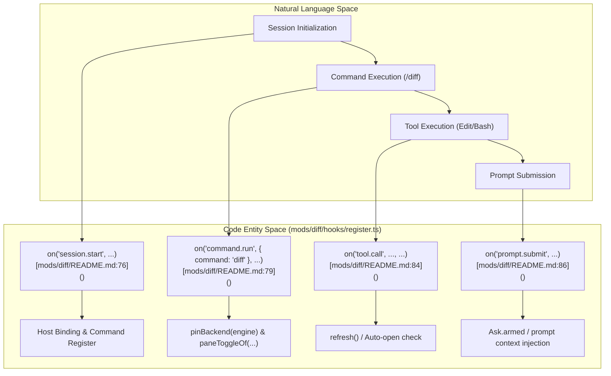
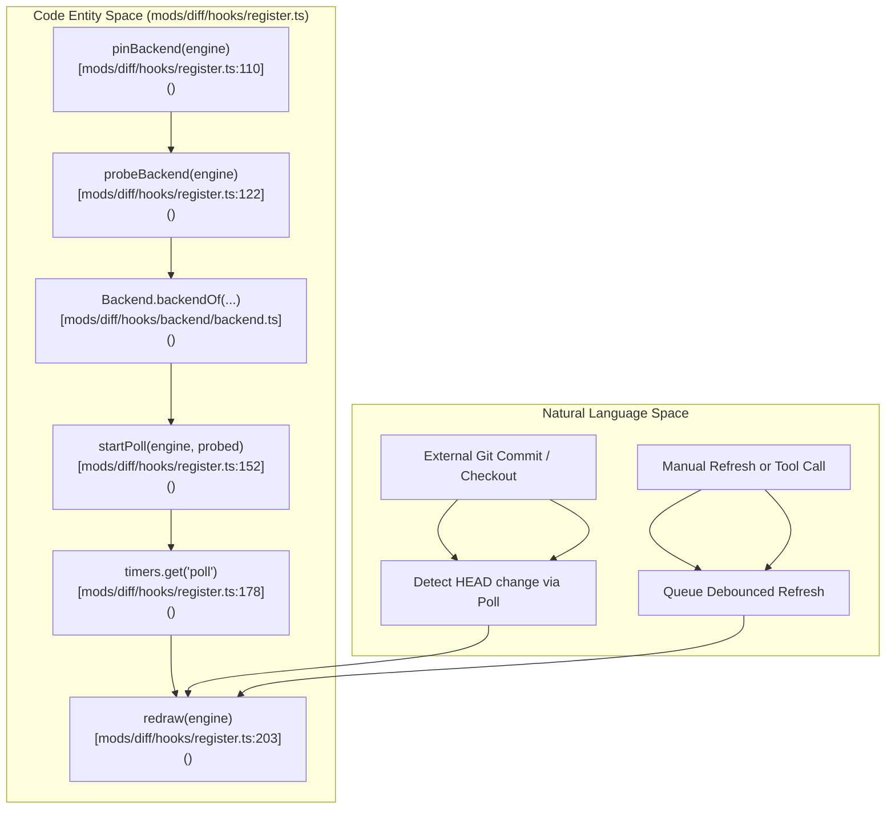
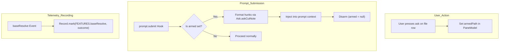

<!-- source: DeepWiki mcp.deepwiki.com · repo anthropics/claude-code · extra page Diff Mod Lifecycle & State · fetched 2026-10-26 -->

# Diff Mod Lifecycle & State

<details>
<summary>Relevant source files</summary>

The following files were used as context for generating this wiki page:

- [mods/diff/README.md](mods/diff/README.md)
- [mods/diff/hooks/host/host.ts](mods/diff/hooks/host/host.ts)
- [mods/diff/hooks/limits/columns/open-min-columns.ts](mods/diff/hooks/limits/columns/open-min-columns.ts)
- [mods/diff/hooks/names/pane-title.ts](mods/diff/hooks/names/pane-title.ts)
- [mods/diff/hooks/names/texts/resize-terminal-text.ts](mods/diff/hooks/names/texts/resize-terminal-text.ts)
- [mods/diff/hooks/pane-state/pane-model/pane-model.ts](mods/diff/hooks/pane-state/pane-model/pane-model.ts)
- [mods/diff/hooks/pane-toggle/pane-belief/pane-belief.ts](mods/diff/hooks/pane-toggle/pane-belief/pane-belief.ts)
- [mods/diff/hooks/pane-toggle/pane-toggle-of.ts](mods/diff/hooks/pane-toggle/pane-toggle-of.ts)
- [mods/diff/hooks/record/base-outcomes/base-outcomes.ts](mods/diff/hooks/record/base-outcomes/base-outcomes.ts)
- [mods/diff/hooks/record/base-outcomes/index.ts](mods/diff/hooks/record/base-outcomes/index.ts)
- [mods/diff/hooks/record/features/features.ts](mods/diff/hooks/record/features/features.ts)
- [mods/diff/hooks/record/index.ts](mods/diff/hooks/record/index.ts)
- [mods/diff/hooks/record/mark-outcome/mark-outcome.ts](mods/diff/hooks/record/mark-outcome/mark-outcome.ts)
- [mods/diff/hooks/record/tabs/index.ts](mods/diff/hooks/record/tabs/index.ts)
- [mods/diff/hooks/record/tabs/tabs.ts](mods/diff/hooks/record/tabs/tabs.ts)
- [mods/diff/hooks/register.ts](mods/diff/hooks/register.ts)
- [mods/diff/tests/fixtures/beneath/beneath.ts](mods/diff/tests/fixtures/beneath/beneath.ts)
- [mods/diff/tests/fixtures/git-in.ts](mods/diff/tests/fixtures/git-in.ts)
- [mods/diff/tests/fixtures/hint-at.ts](mods/diff/tests/fixtures/hint-at.ts)
- [mods/diff/tests/fixtures/hint.ts](mods/diff/tests/fixtures/hint.ts)
- [mods/diff/tests/fixtures/in-repository.ts](mods/diff/tests/fixtures/in-repository.ts)
- [mods/diff/tests/fixtures/index.ts](mods/diff/tests/fixtures/index.ts)
- [mods/diff/tests/fixtures/inline-pane.ts](mods/diff/tests/fixtures/inline-pane.ts)
- [mods/diff/tests/fixtures/main-screen-hint.ts](mods/diff/tests/fixtures/main-screen-hint.ts)
- [mods/diff/tests/fixtures/many-file-count.ts](mods/diff/tests/fixtures/many-file-count.ts)
- [mods/diff/tests/fixtures/many-files.ts](mods/diff/tests/fixtures/many-files.ts)
- [mods/diff/tests/fixtures/moved-in.ts](mods/diff/tests/fixtures/moved-in.ts)
- [mods/diff/tests/fixtures/narrow-inline-pane.ts](mods/diff/tests/fixtures/narrow-inline-pane.ts)
- [mods/diff/tests/fixtures/renamed.ts](mods/diff/tests/fixtures/renamed.ts)
- [mods/diff/tests/fixtures/settle-ms.ts](mods/diff/tests/fixtures/settle-ms.ts)
- [mods/diff/tests/fixtures/starts-session.ts](mods/diff/tests/fixtures/starts-session.ts)
- [mods/diff/tests/fixtures/unsaid-hint.ts](mods/diff/tests/fixtures/unsaid-hint.ts)
- [mods/diff/tests/fixtures/wheel-over-list.ts](mods/diff/tests/fixtures/wheel-over-list.ts)
- [mods/diff/tests/git.test.ts](mods/diff/tests/git.test.ts)
- [mods/diff/tests/register.test.ts](mods/diff/tests/register.test.ts)

</details>


This page details the implementation of the Diff Mod, focusing on its lifecycle management, state handling, hook wiring via `mods/diff/hooks/register.ts` [mods/diff/hooks/register.ts:32-42](), backend pinning, refresh/poll pipelines, `PaneState.PaneModel` state, pane toggling, armed-ask prompt context injection, and usage recording within the Claude Code engine.

## Registering Diff Mod Hooks

The core of the Diff Mod's integration with the Claude Code engine is handled by the `register` function in [mods/diff/hooks/register.ts:32-42](). This registrar function binds handlers to engine lifecycle events using the event registration interface `On` [mods/diff/hooks/register.ts:42]().

The `register` function initializes internal state variables such as `host`, `backend`, `isPaneOpen`, `model`, and active timers [mods/diff/hooks/register.ts:43-70]().

### Hook Wiring & Event Architecture

The Diff Mod subscribes to a variety of engine events through the registrar `on`:

*   **`session.start`**: Binds the host interface and registers the `/diff` command [mods/diff/README.md:76](). Defers git execution until `/diff` or the first qualifying edit pins the repository [mods/diff/README.md:76](). Also inspects transcript history for resumed sessions [mods/diff/README.md:76]().
*   **`ui.render`**:
    *   **`PromptHint`**: Reads terminal width and layout flags via `ui.render` to determine if the diff pane should auto-open on the first edit [mods/diff/README.md:77]().
    *   **`Pane`**: Draws the diff pane structure (docked header, base line, source picker, file list, hunks, or inline dialog) [mods/diff/README.md:78]().
*   **`command.run`**:
    *   **`diff`**: Pins the repository via `pinBackend` if unpinned, toggles the pane state using `paneToggleOf`, records history, and remembers user preferences [mods/diff/README.md:79]().
    *   **`clear`, `resume`**: Closes the pane and resets session-specific state and repository pins [mods/diff/README.md:83]().
*   **`ui.close`**: Handles pane closure or backs out of dialog detail views [mods/diff/README.md:80]().
*   **`ui.scroll`**: Scrolls docked pane hunks or file lists without moving the engine window [mods/diff/README.md:81]().
*   **`ui.focus`**: Updates selected files in inline dialog lists and re-centers view windows [mods/diff/README.md:82]().
*   **`tool.call`**:
    *   **`Edit`, `Write`, `NotebookEdit`**: Refreshes an open pane after successful edits; triggers auto-open on the first edit if room permits [mods/diff/README.md:84]().
    *   **`Bash`, `PowerShell`**: Refreshes an open pane after shell execution [mods/diff/README.md:85]().
*   **`prompt.submit`**: Injects armed file hunks into prompt context and disarms [mods/diff/README.md:86]().

Diagram: Hook Wiring from Natural Language Events to `register.ts` Code Entities


Sources:
[mods/diff/hooks/register.ts:32-70]()
[mods/diff/README.md:76-86]()

## Backend Pinning & Host Context

Git operations are executed against a "pinned" backend to ensure consistency with the session's starting directory and environment configuration [mods/diff/tests/git.test.ts:10-45]().

The `pinBackend` function [mods/diff/hooks/register.ts:110-120]() checks whether a backend is already initialized or known to be empty. If not, it invokes `probeBackend` [mods/diff/hooks/register.ts:122-170]() which runs `git rev-parse --show-toplevel` via `backendHostOf` [mods/diff/hooks/register.ts:76-108]().

```typescript
  function pinBackend(engine: Host): Promise<boolean> {
    if (backend || pin.isEmpty) {
      return Promise.resolve(true)
    }

    probing ??= probeBackend(engine).finally(() => {
      probing = null
    })

    return probing
  }
```

The `unpin` function [mods/diff/hooks/register.ts:172-180]() clears the cached backend, increments `pin.epoch`, and cancels active polling timers when `/clear` or `/resume` occurs [mods/diff/tests/register.test.ts:157-164]().

The `Host` type [mods/diff/hooks/host/host.ts:18-130]() abstracts the engine interface (`$`) used across hooks, providing access to clock timers, file system operations, process execution (`$.process.run`), store persistence (`$.store.get`/`$.store.set`), session metadata, and UI rendering primitives.

Sources:
[mods/diff/hooks/register.ts:76-180]()
[mods/diff/tests/git.test.ts:10-45]()
[mods/diff/hooks/host/host.ts:18-130]()

## Refresh and Poll Pipeline

The mod maintains synchronization with the repository via debounced manual/event-driven refreshes and an active polling loop [mods/diff/README.md:13-15]().

### Refresh & Polling Logic

1.  **Debounced Refresh**: Triggered by tool calls (`Edit`, `Bash`, etc.) or `/diff`, requests are coalesced through timers managed via `engine.after` [mods/diff/hooks/register.ts:203-217]().
2.  **Git Fetch**: Executes git operations (`git diff --shortstat`, `--numstat`, `ls-files`) to construct diff data [mods/diff/tests/register.test.ts:110-118]().
3.  **Active Polling**: While the pane is open, a periodic poller (`startPoll`) compares `git rev-parse HEAD` against `polled.headKey`. If HEAD changes externally (e.g., commit/checkout elsewhere), a refresh is automatically dispatched [mods/diff/README.md:14-15]().

Diagram: Backend Pinning and Polling Pipeline


Sources:
[mods/diff/hooks/register.ts:110-217]()
[mods/diff/tests/register.test.ts:110-118]()
[mods/diff/README.md:13-15]()

## PaneModel State & Pane Toggle

The `PaneState.PaneModel` [mods/diff/hooks/register.ts:68]() holds the complete UI and data state of the diff mod. Key fields include:
*   `words`: Git terminology words mapped from the backend probe [mods/diff/hooks/register.ts:164]().
*   `baseModes` / `requestedMode`: Comparison base configurations (e.g., `HEAD`, session start) [mods/diff/hooks/register.ts:165-166]().
*   `data`: Parsed `Git.DiffData` containing file statistics and hunks.
*   `bodies`: Cached file hunks (`Map` of file paths to hunk promises) [mods/diff/hooks/register.ts:227]().
*   `isFullscreen` / `isDialog`: Rendering surface layout modes.
*   `armedPath`: File path currently armed for prompt context injection.

The toggle action is determined by `paneToggleOf` [mods/diff/hooks/pane-toggle/pane-toggle-of.ts:14-21](), evaluating terminal column limits (`Limits.OPEN_MIN_COLUMNS`) against the current pane state [mods/diff/hooks/limits/columns/open-min-columns.ts]().

*   **Docked Pane**: Displayed beside the transcript when columns $\ge 110$ (or 144 default) and layout supports it [mods/diff/README.md:18-20]().
*   **Inline Dialog**: Used when flicker reduction is disabled or terminals are narrow, presenting a modal view with file lists and escape-to-close behavior [mods/diff/README.md:34-40]().

Sources:
[mods/diff/hooks/register.ts:68-166, 227]()
[mods/diff/hooks/pane-toggle/pane-toggle-of.ts:14-21]()
[mods/diff/hooks/limits/columns/open-min-columns.ts]()
[mods/diff/README.md:16-40]()

## Armed-Ask Prompt Context Injection & Usage Recording

### Armed-Ask Injection
Users can "arm" a file's diff so its hunks ride the next submitted prompt [mods/diff/README.md:45-46](). When `prompt.submit` fires, `armed` content is formatted via `Ask.askCutNote` (subject to `Limits.PROMPT_CONTEXT_MAX_CHARS`) and injected into prompt context before resetting the armed state [mods/diff/README.md:86]() [mods/diff/hooks/ask/index.ts]().

### Usage & Telemetry Recording
The mod records operational outcomes and metrics via telemetry hooks [mods/diff/hooks/register.ts:90-108](). For instance, base resolution outcomes (`ok` or `sad`) are marked using `Record.recorderOf(currentOf(engine)).mark(Record.FEATURES.baseResolve, outcome)` [mods/diff/hooks/register.ts:99-106]().

Diagram: Armed Ask & Telemetry Flow


Sources:
[mods/diff/hooks/register.ts:54-108]()
[mods/diff/README.md:45-46, 86]()
[mods/diff/hooks/ask/index.ts]()

---

