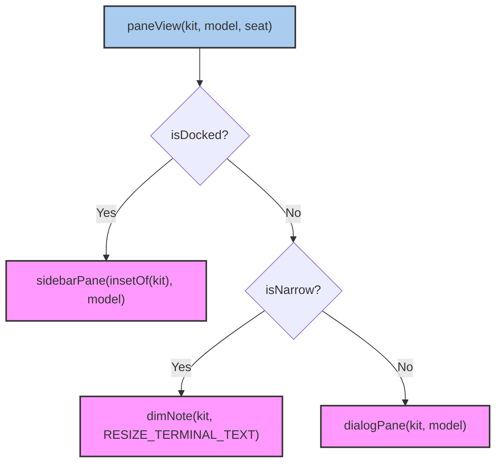

<!-- source: DeepWiki mcp.deepwiki.com · repo anthropics/claude-code · extra page Diff Pane Rendering & Layout · fetched 2026-10-26 -->

# Diff Pane Rendering & Layout

Relevant source files

The following files were used as context for generating this wiki page:

- [mods/diff/hooks/ask/fitted-ask-text-of.ts](mods/diff/hooks/ask/fitted-ask-text-of.ts)
- [mods/diff/hooks/drawn-files-of/drawn-files-of.ts](mods/diff/hooks/drawn-files-of/drawn-files-of.ts)
- [mods/diff/hooks/git/parse/parse-numstat.ts](mods/diff/hooks/git/parse/parse-numstat.ts)
- [mods/diff/hooks/git/probes/kind-walk-of/kind-walk-of.ts](mods/diff/hooks/git/probes/kind-walk-of/kind-walk-of.ts)
- [mods/diff/hooks/limits/columns/dialog-path-reserve.ts](mods/diff/hooks/limits/columns/dialog-path-reserve.ts)
- [mods/diff/hooks/limits/columns/index.ts](mods/diff/hooks/limits/columns/index.ts)
- [mods/diff/hooks/limits/columns/path-floor.ts](mods/diff/hooks/limits/columns/path-floor.ts)
- [mods/diff/hooks/limits/columns/stat-cells.ts](mods/diff/hooks/limits/columns/stat-cells.ts)
- [mods/diff/hooks/limits/dialog-path-floor.ts](mods/diff/hooks/limits/dialog-path-floor.ts)
- [mods/diff/hooks/limits/index.ts](mods/diff/hooks/limits/index.ts)
- [mods/diff/hooks/limits/sizes/pane/index.ts](mods/diff/hooks/limits/sizes/pane/index.ts)
- [mods/diff/hooks/limits/todo-bar-cells.ts](mods/diff/hooks/limits/todo-bar-cells.ts)
- [mods/diff/hooks/limits/todo-bar-reserve.ts](mods/diff/hooks/limits/todo-bar-reserve.ts)
- [mods/diff/hooks/pane-state/dialog-focus/dialog-focus.ts](mods/diff/hooks/pane-state/dialog-focus/dialog-focus.ts)
- [mods/diff/hooks/pane-state/dialog-focus/index.ts](mods/diff/hooks/pane-state/dialog-focus/index.ts)
- [mods/diff/hooks/pane-state/index.ts](mods/diff/hooks/pane-state/index.ts)
- [mods/diff/hooks/views/body/draw-window.tsx](mods/diff/hooks/views/body/draw-window.tsx)
- [mods/diff/hooks/views/body/list-scrolled-by.ts](mods/diff/hooks/views/body/list-scrolled-by.ts)
- [mods/diff/hooks/views/body/plan/body-layout-of.ts](mods/diff/hooks/views/body/plan/body-layout-of.ts)
- [mods/diff/hooks/views/body/plan/hunk-window-of.ts](mods/diff/hooks/views/body/plan/hunk-window-of.ts)
- [mods/diff/hooks/views/body/plan/index.ts](mods/diff/hooks/views/body/plan/index.ts)
- [mods/diff/hooks/views/body/plan/segments/segments-of.ts](mods/diff/hooks/views/body/plan/segments/segments-of.ts)
- [mods/diff/hooks/views/body/types/index.ts](mods/diff/hooks/views/body/types/index.ts)
- [mods/diff/hooks/views/body/types/window-cut/index.ts](mods/diff/hooks/views/body/types/window-cut/index.ts)
- [mods/diff/hooks/views/body/types/window-cut/window-cut.ts](mods/diff/hooks/views/body/types/window-cut/window-cut.ts)
- [mods/diff/hooks/views/detail/code-blocks-of/code-blocks-of.ts](mods/diff/hooks/views/detail/code-blocks-of/code-blocks-of.ts)
- [mods/diff/hooks/views/detail/detail-view.tsx](mods/diff/hooks/views/detail/detail-view.tsx)
- [mods/diff/hooks/views/detail/leading-hunk-of/leading-hunk-of.ts](mods/diff/hooks/views/detail/leading-hunk-of/leading-hunk-of.ts)
- [mods/diff/hooks/views/detail/sub-hunks-of/first-line-cut/first-line-cut.ts](mods/diff/hooks/views/detail/sub-hunks-of/first-line-cut/first-line-cut.ts)
- [mods/diff/hooks/views/detail/sub-hunks-of/sub-hunks-of.ts](mods/diff/hooks/views/detail/sub-hunks-of/sub-hunks-of.ts)
- [mods/diff/hooks/views/dialog-pane/dialog-focus-of.ts](mods/diff/hooks/views/dialog-pane/dialog-focus-of.ts)
- [mods/diff/hooks/views/dialog-pane/dialog-pane.tsx](mods/diff/hooks/views/dialog-pane/dialog-pane.tsx)
- [mods/diff/hooks/views/dialog-pane/dialog-window-of/dialog-window-of.ts](mods/diff/hooks/views/dialog-pane/dialog-window-of/dialog-window-of.ts)
- [mods/diff/hooks/views/dialog-pane/index.ts](mods/diff/hooks/views/dialog-pane/index.ts)
- [mods/diff/hooks/views/inset-of/inset-of.ts](mods/diff/hooks/views/inset-of/inset-of.ts)
- [mods/diff/hooks/views/kit/kit.ts](mods/diff/hooks/views/kit/kit.ts)
- [mods/diff/hooks/views/layout/index.ts](mods/diff/hooks/views/layout/index.ts)
- [mods/diff/hooks/views/layout/truncate-start/truncate-start.ts](mods/diff/hooks/views/layout/truncate-start/truncate-start.ts)
- [mods/diff/hooks/views/layout/wrapped-lines/index.ts](mods/diff/hooks/views/layout/wrapped-lines/index.ts)
- [mods/diff/hooks/views/layout/wrapped-lines/wrapped-lines.ts](mods/diff/hooks/views/layout/wrapped-lines/wrapped-lines.ts)
- [mods/diff/hooks/views/pane-view.tsx](mods/diff/hooks/views/pane-view.tsx)
- [mods/diff/hooks/views/sections/dialog-file-row/dialog-file-row.tsx](mods/diff/hooks/views/sections/dialog-file-row/dialog-file-row.tsx)
- [mods/diff/hooks/views/sections/divider.tsx](mods/diff/hooks/views/sections/divider.tsx)
- [mods/diff/hooks/views/sections/file-row/file-row.ts](mods/diff/hooks/views/sections/file-row/file-row.ts)
- [mods/diff/hooks/views/sections/header-view.tsx](mods/diff/hooks/views/sections/header-view.tsx)
- [mods/diff/hooks/views/sections/todo-bar.tsx](mods/diff/hooks/views/sections/todo-bar.tsx)
- [mods/diff/tests/fixtures/old-files.ts](mods/diff/tests/fixtures/old-files.ts)
- [mods/diff/tests/fixtures/pane-view/body-rows.ts](mods/diff/tests/fixtures/pane-view/body-rows.ts)
- [mods/diff/tests/fixtures/pane-view/engine-head-rows.ts](mods/diff/tests/fixtures/pane-view/engine-head-rows.ts)
- [mods/diff/tests/fixtures/pane-view/index.ts](mods/diff/tests/fixtures/pane-view/index.ts)
- [mods/diff/tests/fixtures/wheel-over-list-margin.ts](mods/diff/tests/fixtures/wheel-over-list-margin.ts)
- [mods/diff/tests/fixtures/wheel-over-list-top.ts](mods/diff/tests/fixtures/wheel-over-list-top.ts)
- [mods/diff/tests/fixtures/with-lockfile.ts](mods/diff/tests/fixtures/with-lockfile.ts)
- [mods/diff/tests/views.test.ts](mods/diff/tests/views.test.ts)

This page details the rendering and layout mechanisms for the `/diff` pane within Claude Code. It covers how the diff pane adapts its display based on whether it's docked or inline, the structure of its various views (pane, header, detail), how content is windowed and scrolled, the rendering of individual file rows, the todo bar, and the legend. It also explains utility functions for text manipulation like `wrappedLines` and `truncateStart`, and the constants defining column limits.

The diff pane is a core component of the `diff` mod, providing a visual representation of uncommitted changes in the user's workspace. Its rendering logic is crucial for presenting complex git diff information in an understandable and navigable terminal UI.

## Pane Views: Docked vs. Inline

The diff pane can be displayed in two primary modes: docked or inline. The choice between these modes, and further refinements within them, depends on the terminal's width and the session's fullscreen status.

*   **Docked Pane (`sidebarPane`)**: When the pane is docked (`seat.placement === 'dock'`), it renders as a sidebar. This view is typically used when there's sufficient terminal width. The content is padded at the top and right [mods/diff/hooks/views/pane-view.tsx:43-45]().
*   **Inline Dialog Pane (`dialogPane`)**: When not docked, the pane can appear as an inline dialog. This is the default for narrower terminals or when the session is not fullscreen.
*   **Narrow Terminal Line**: If the session is fullscreen (`model.isFullscreen !== false`) and the terminal is very narrow (`seat.terminalColumns < Limits.OPEN_MIN_COLUMNS`), the pane displays a simple message indicating that the terminal needs to be resized [mods/diff/hooks/views/pane-view.tsx:37-41](). This prevents a poorly formatted or unreadable diff view.

The `paneView` function [mods/diff/hooks/views/pane-view.tsx:29-51]() is the entry point for determining which rendering strategy to use based on the `PaneSeat` and `PaneState.PaneModel`.

### Pane View Decision Flow

Sources:
* [mods/diff/hooks/views/pane-view.tsx:29-51]()
* [mods/diff/hooks/limits/columns/index.ts]()
* [mods/diff/hooks/names/texts/resize-terminal-text.js]()

## Header View

The header view [mods/diff/hooks/views/sections/header-view.tsx:24-44]() is the first line of the diff pane. It displays a summary of changes, such as "N files changed +A -R", where N is the number of files, A is lines added, and R is lines removed.

*   **File Count and Diff Stat**: If there are changes (`totals` is not null), it shows the number of files changed and a `diffStat` [mods/diff/hooks/views/sections/diff-stat.tsx]() indicating lines added and removed. The `Layout.plural` helper [mods/diff/hooks/views/layout/plural.ts]() is used for correct pluralization of "file".
*   **Controls**: Optional controls (e.g., source pickers) can be displayed on the right edge of the header.
*   **Empty State**: If there are no changes, the header remains empty.

The `headerView` function [mods/diff/hooks/views/sections/header-view.tsx:24-44]() uses `kit.ui.Box` and `kit.ui.Text` for layout and text rendering.

Sources:
* [mods/diff/hooks/views/sections/header-view.tsx:24-44]()
* [mods/diff/hooks/views/sections/diff-stat.tsx]()
* [mods/diff/hooks/views/layout/plural.ts]()

## Detail View

The detail view [mods/diff/hooks/views/detail/detail-view.tsx]() is responsible for rendering the actual diff content for a selected file. It breaks down the diff into code blocks and sub-hunks.

*   **Code Blocks**: The `codeBlocksOf` function [mods/diff/hooks/views/detail/code-blocks-of/code-blocks-of.ts]() processes the diff content into renderable code blocks.
*   **Sub-hunks**: `subHunksOf` [mods/diff/hooks/views/detail/sub-hunks-of/sub-hunks-of.ts]() further organizes these blocks into sub-hunks, which represent contiguous changed sections within a file.

Sources:
* [mods/diff/hooks/views/detail/detail-view.tsx]()
* [mods/diff/hooks/views/detail/code-blocks-of/code-blocks-of.ts]()
* [mods/diff/hooks/views/detail/sub-hunks-of/sub-hunks-of.ts]()

## Body Windowing and Scrolling

To handle potentially large diffs efficiently, the diff pane employs windowing and scrolling mechanisms. This ensures that only the visible portion of the diff is rendered, improving performance and user experience.

*   **Window Cut**: The `windowCut` type [mods/diff/hooks/views/body/types/window-cut/window-cut.ts]() defines the visible range of content.
*   **Body Layout**: `bodyLayoutOf` [mods/diff/hooks/views/body/plan/body-layout-of.ts]() determines the overall layout of the diff body, including the visible window.
*   **Hunk Window**: `hunkWindowOf` [mods/diff/hooks/views/body/plan/hunk-window-of.ts]() specifically calculates the window for diff hunks.
*   **Scrolling**: Functions like `listScrolledBy` [mods/diff/hooks/views/body/list-scrolled-by.ts]() and `bodyScrolledBy` [mods/diff/hooks/views/body/body-scrolled-by.ts]() manage the scrolling behavior, updating the visible window based on user input.
*   **Drawing the Window**: `drawWindow` [mods/diff/hooks/views/body/draw-window.tsx]() is responsible for rendering the content within the calculated window.

Sources:
* [mods/diff/hooks/views/body/types/window-cut/window-cut.ts]()
* [mods/diff/hooks/views/body/plan/body-layout-of.ts]()
* [mods/diff/hooks/views/body/plan/hunk-window-of.ts]()
* [mods/diff/hooks/views/body/list-scrolled-by.ts]()
* [mods/diff/hooks/views/body/body-scrolled-by.ts]()
* [mods/diff/hooks/views/body/draw-window.tsx]()

## File Rows

File rows represent individual files with changes in the diff. Their rendering differs slightly between docked and inline modes.

### Docked File Row (`fileRow`)

In the docked sidebar, `fileRow` [mods/diff/hooks/views/sections/file-row/file-row.ts:23-41]() displays a start-truncated file name and its `diffStat` (lines added/removed).

*   **Truncation**: The file name is truncated from the start using `Layout.truncateStart` [mods/diff/hooks/views/layout/truncate-start/truncate-start.ts]() to fit within the available column width, considering the space needed for the diff statistics.
*   **Padding**: The label is padded to align the diff statistics consistently.
*   **Pressable**: The entire row acts as a pressable element, which, when activated, scrolls the main diff body to that file.

### Inline Dialog File Row (`dialogFileRow`)

In the inline dialog, `dialogFileRow` [mods/diff/hooks/views/sections/dialog-file-row/dialog-file-row.tsx:23-58]() includes a pointer for the selected file and can display a note or diff statistics.

*   **Pointer**: A `POINTER` character [mods/diff/hooks/views/sections/pointer.ts]() indicates the currently selected file.
*   **Truncation**: Similar to `fileRow`, the `displayPath` is truncated from the start.
*   **Note or Diff Stat**: It can display either a `note` (e.g., for untracked files) or the `diffStat` [mods/diff/hooks/views/sections/diff-stat.tsx]() for added/removed lines.
*   **Focus**: The `dialogFocusOf` function [mods/diff/hooks/views/dialog-pane/dialog-focus-of.ts:20-46]() manages the focus ring for the dialog, handling selection and window re-centering.

### File Row Model

Both `fileRow` and `dialogFileRow` consume a `FileRowModel` [mods/diff/hooks/views/sections/file-row-model.ts]() which encapsulates the data needed to render a file entry, including its `key`, `displayPath`, `added` lines, `removed` lines, `note`, and `isSelected` status.

Sources:
* [mods/diff/hooks/views/sections/file-row/file-row.ts:23-41]()
* [mods/diff/hooks/views/sections/dialog-file-row/dialog-file-row.tsx:23-58]()
* [mods/diff/hooks/views/sections/pointer.ts]()
* [mods/diff/hooks/views/sections/diff-stat.tsx]()
* [mods/diff/hooks/views/dialog-pane/dialog-focus-of.ts:20-46]()
* [mods/diff/hooks/views/sections/file-row-model.ts]()
* [mods/diff/hooks/views/layout/truncate-start/truncate-start.ts]()

## Todo Bar

The `todoBar` [mods/diff/hooks/views/sections/todo-bar.tsx:18-45]() displays the progress of a todo list, if one exists.

*   **Progress Visualization**: It renders a progress bar using block characters (`█` for filled, `░` for empty) and shows the `done/total` count.
*   **Conditional Rendering**: The bar is only rendered if `todos.total` is greater than 0.
*   **Column Limits**: The width of the progress bar is constrained by `Limits.TODO_BAR_CELLS` and `Limits.TODO_BAR_RESERVE` [mods/diff/hooks/limits/todo-bar-cells.ts](), [mods/diff/hooks/limits/todo-bar-reserve.ts]().

Sources:
* [mods/diff/hooks/views/sections/todo-bar.tsx:18-45]()
* [mods/diff/hooks/limits/todo-bar-cells.ts]()
* [mods/diff/hooks/limits/todo-bar-reserve.ts]()

## Legend

The `legendRow` [mods/diff/hooks/views/sections/legend-row.tsx]() provides a key for understanding the diff output, typically explaining the meaning of symbols like `+` for added lines and `-` for removed lines. It's a simple row displaying explanatory text.

Sources:
* [mods/diff/hooks/views/sections/legend-row.tsx]()

## Layout Helpers

Several utility functions assist in formatting text for display within the terminal UI.

### `wrappedLines`

The `wrappedLines` function [mods/diff/hooks/views/layout/wrapped-lines/wrapped-lines.ts:14-75]() takes a single line of text and wraps it into multiple rows based on a specified column width.

*   **Word Wrapping**: It prioritizes breaking at spaces.
*   **Long Word Handling**: If a single word is wider than the available columns, it will be broken across multiple rows.
*   **Ink Compatibility**: Designed to mimic Ink's `wrap` behavior, especially concerning empty states and centering.

### `truncateStart`

The `truncateStart` function [mods/diff/hooks/views/layout/truncate-start/truncate-start.ts]() truncates a string from its beginning if it exceeds a specified length, prepending an ellipsis (`…`) to indicate truncation. This is commonly used for file paths to ensure they fit within narrow columns while retaining the most relevant part (the end of the path).

Sources:
* [mods/diff/hooks/views/layout/wrapped-lines/wrapped-lines.ts:14-75]()
* [mods/diff/hooks/views/layout/truncate-start/truncate-start.ts]()

## Column Limit Constants

The `mods/diff/hooks/limits/columns/` directory defines various constants that dictate the column widths and reserved spaces for different UI elements. These constants are crucial for responsive layout across different terminal sizes.

*   `Limits.OPEN_MIN_COLUMNS`: Minimum terminal columns required for the docked pane to open [mods/diff/hooks/limits/columns/index.ts]().
*   `Limits.PANE_TOP_PAD_ROWS`, `Limits.PANE_RIGHT_PAD_COLUMNS`: Padding for the docked pane [mods/diff/hooks/views/pane-view.tsx:43](), [mods/diff/hooks/views/inset-of/inset-of.ts:16]().
*   `Limits.DIALOG_PATH_FLOOR`, `Limits.DIALOG_PATH_RESERVE`: Minimum path width and reserved space for dialog file rows [mods/diff/hooks/limits/columns/dialog-path-reserve.ts](), [mods/diff/hooks/limits/dialog-path-floor.ts]().
*   `Limits.STAT_CELLS`: Number of cells reserved for diff statistics (e.g., `+A -R`) [mods/diff/hooks/limits/columns/stat-cells.ts]().
*   `Limits.PATH_FLOOR`: Minimum path width for docked file rows [mods/diff/hooks/limits/columns/path-floor.ts]().
*   `Limits.TODO_BAR_CELLS`, `Limits.TODO_BAR_RESERVE`: Width and reserved space for the todo bar [mods/diff/hooks/limits/todo-bar-cells.ts](), [mods/diff/hooks/limits/todo-bar-reserve.ts]().
*   `Limits.MAX_VISIBLE_FILES`: Maximum number of files visible in the dialog pane's window [mods/diff/hooks/views/dialog-pane/dialog-focus-of.ts:32]().

These constants are centralized in `mods/diff/hooks/limits/index.ts` for easy access and management.

Sources:
* [mods/diff/hooks/limits/columns/index.ts]()
* [mods/diff/hooks/views/pane-view.tsx:43]()
* [mods/diff/hooks/views/inset-of/inset-of.ts:16]()
* [mods/diff/hooks/limits/columns/dialog-path-reserve.ts]()
* [mods/diff/hooks/limits/dialog-path-floor.ts]()
* [mods/diff/hooks/limits/columns/stat-cells.ts]()
* [mods/diff/hooks/limits/columns/path-floor.ts]()
* [mods/diff/hooks/limits/todo-bar-cells.ts]()
* [mods/diff/hooks/limits/todo-bar-reserve.ts]()
* [mods/diff/hooks/views/dialog-pane/dialog-focus-of.ts:32]()
* [mods/diff/hooks/limits/index.ts]()

---

