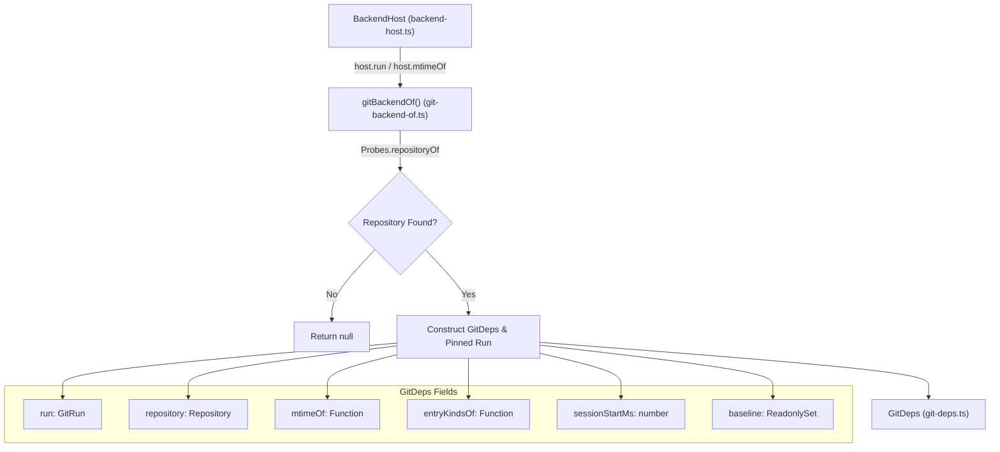
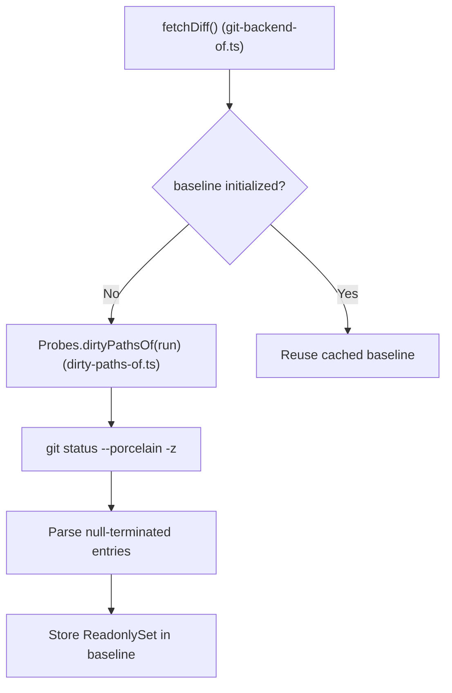
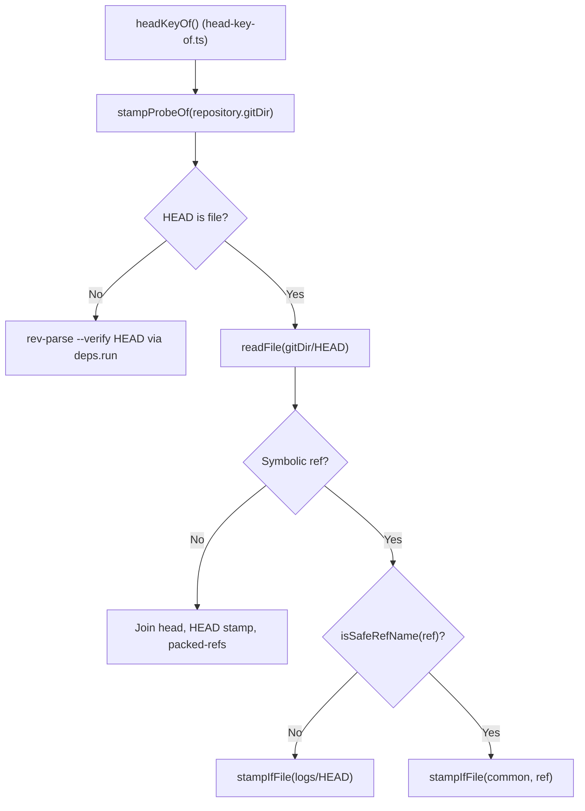

<!-- source: DeepWiki mcp.deepwiki.com · repo anthropics/claude-code · extra page Git Backend & Diff Parsing · fetched 2026-10-26 -->

# Git Backend & Diff Parsing

Relevant source files

The following files were used as context for generating this wiki page:

- [mods/diff/hooks/backend/backend-of.ts](mods/diff/hooks/backend/backend-of.ts)
- [mods/diff/hooks/backend/installed-backend-probes.ts](mods/diff/hooks/backend/installed-backend-probes.ts)
- [mods/diff/hooks/backend/types/backend-host/backend-host.ts](mods/diff/hooks/backend/types/backend-host/backend-host.ts)
- [mods/diff/hooks/backend/types/backend-probe/backend-probe.ts](mods/diff/hooks/backend/types/backend-probe/backend-probe.ts)
- [mods/diff/hooks/backend/types/backend-words/backend-words.ts](mods/diff/hooks/backend/types/backend-words/backend-words.ts)
- [mods/diff/hooks/backend/types/backend/backend.ts](mods/diff/hooks/backend/types/backend/backend.ts)
- [mods/diff/hooks/classify/is-generated-file/is-generated-file.ts](mods/diff/hooks/classify/is-generated-file/is-generated-file.ts)
- [mods/diff/hooks/git/argv/hunks-args/hunks-args.ts](mods/diff/hooks/git/argv/hunks-args/hunks-args.ts)
- [mods/diff/hooks/git/argv/hunks-args/index.ts](mods/diff/hooks/git/argv/hunks-args/index.ts)
- [mods/diff/hooks/git/argv/index.ts](mods/diff/hooks/git/argv/index.ts)
- [mods/diff/hooks/git/fetch-hunks/fetch-hunks.ts](mods/diff/hooks/git/fetch-hunks/fetch-hunks.ts)
- [mods/diff/hooks/git/fetch-hunks/index.ts](mods/diff/hooks/git/fetch-hunks/index.ts)
- [mods/diff/hooks/git/fetch-hunks/is-last-of-diff/index.ts](mods/diff/hooks/git/fetch-hunks/is-last-of-diff/index.ts)
- [mods/diff/hooks/git/fetch-hunks/is-last-of-diff/is-last-of-diff.ts](mods/diff/hooks/git/fetch-hunks/is-last-of-diff/is-last-of-diff.ts)
- [mods/diff/hooks/git/fetch-hunks/with-closing-line/index.ts](mods/diff/hooks/git/fetch-hunks/with-closing-line/index.ts)
- [mods/diff/hooks/git/fetch-hunks/with-closing-line/with-closing-line.ts](mods/diff/hooks/git/fetch-hunks/with-closing-line/with-closing-line.ts)
- [mods/diff/hooks/git/git-backend-of.ts](mods/diff/hooks/git/git-backend-of.ts)
- [mods/diff/hooks/git/git-words/git-words.ts](mods/diff/hooks/git/git-words/git-words.ts)
- [mods/diff/hooks/git/index.ts](mods/diff/hooks/git/index.ts)
- [mods/diff/hooks/git/parse/index.ts](mods/diff/hooks/git/parse/index.ts)
- [mods/diff/hooks/git/parse/is-body-line/is-body-line.ts](mods/diff/hooks/git/parse/is-body-line/is-body-line.ts)
- [mods/diff/hooks/git/parse/is-whole-listing/is-whole-listing.ts](mods/diff/hooks/git/parse/is-whole-listing/is-whole-listing.ts)
- [mods/diff/hooks/git/parse/parse-file-diff.ts](mods/diff/hooks/git/parse/parse-file-diff.ts)
- [mods/diff/hooks/git/probes/branch-base-of/branch-base-of.ts](mods/diff/hooks/git/probes/branch-base-of/branch-base-of.ts)
- [mods/diff/hooks/git/probes/current-branch-of/current-branch-of.ts](mods/diff/hooks/git/probes/current-branch-of/current-branch-of.ts)
- [mods/diff/hooks/git/probes/default-branch-of/default-branch-of.ts](mods/diff/hooks/git/probes/default-branch-of/default-branch-of.ts)
- [mods/diff/hooks/git/probes/dirty-paths-of/dirty-paths-of.ts](mods/diff/hooks/git/probes/dirty-paths-of/dirty-paths-of.ts)
- [mods/diff/hooks/git/probes/head-key-of/head-key-of.ts](mods/diff/hooks/git/probes/head-key-of/head-key-of.ts)
- [mods/diff/hooks/git/probes/index.ts](mods/diff/hooks/git/probes/index.ts)
- [mods/diff/hooks/git/probes/is-transient.ts](mods/diff/hooks/git/probes/is-transient.ts)
- [mods/diff/hooks/git/probes/missing-base-of/missing-base-of.ts](mods/diff/hooks/git/probes/missing-base-of/missing-base-of.ts)
- [mods/diff/hooks/git/probes/rebase-marks/index.ts](mods/diff/hooks/git/probes/rebase-marks/index.ts)
- [mods/diff/hooks/git/probes/rebase-marks/rebase-marks.ts](mods/diff/hooks/git/probes/rebase-marks/rebase-marks.ts)
- [mods/diff/hooks/git/probes/transient-state-files/transient-state-files.ts](mods/diff/hooks/git/probes/transient-state-files/transient-state-files.ts)
- [mods/diff/hooks/git/probes/untracked-files/untracked-files.ts](mods/diff/hooks/git/probes/untracked-files/untracked-files.ts)
- [mods/diff/hooks/git/probes/was-dirty-at-start/was-dirty-at-start.ts](mods/diff/hooks/git/probes/was-dirty-at-start/was-dirty-at-start.ts)
- [mods/diff/hooks/git/tiers/with-untracked/merged-with-untracked/merged-with-untracked.ts](mods/diff/hooks/git/tiers/with-untracked/merged-with-untracked/merged-with-untracked.ts)
- [mods/diff/hooks/git/tiers/with-untracked/with-untracked.ts](mods/diff/hooks/git/tiers/with-untracked/with-untracked.ts)
- [mods/diff/hooks/git/types/dating-context/dating-context.ts](mods/diff/hooks/git/types/dating-context/dating-context.ts)
- [mods/diff/hooks/git/types/diff-data/diff-data.ts](mods/diff/hooks/git/types/diff-data/diff-data.ts)
- [mods/diff/hooks/git/types/git-deps/git-deps.ts](mods/diff/hooks/git/types/git-deps/git-deps.ts)
- [mods/diff/hooks/views/detail/placeholder-of/safe-pathspec-pattern/safe-pathspec-pattern.ts](mods/diff/hooks/views/detail/placeholder-of/safe-pathspec-pattern/safe-pathspec-pattern.ts)
- [mods/diff/tests/backend/backend-of.test.ts](mods/diff/tests/backend/backend-of.test.ts)
- [mods/diff/tests/fixtures/fetch-diff/apply-mailing.ts](mods/diff/tests/fixtures/fetch-diff/apply-mailing.ts)
- [mods/diff/tests/fixtures/fetch-diff/apply-rebasing.ts](mods/diff/tests/fixtures/fetch-diff/apply-rebasing.ts)
- [mods/diff/tests/fixtures/fetch-diff/index.ts](mods/diff/tests/fixtures/fetch-diff/index.ts)
- [mods/diff/tests/fixtures/fetch-diff/mailing.ts](mods/diff/tests/fixtures/fetch-diff/mailing.ts)
- [mods/diff/tests/fixtures/fetch-diff/rebase-applying.ts](mods/diff/tests/fixtures/fetch-diff/rebase-applying.ts)
- [mods/diff/tests/fixtures/fetch-diff/rebase-head-left.ts](mods/diff/tests/fixtures/fetch-diff/rebase-head-left.ts)
- [mods/diff/tests/fixtures/git-word-of.ts](mods/diff/tests/fixtures/git-word-of.ts)
- [mods/diff/tests/fixtures/poll-word.ts](mods/diff/tests/fixtures/poll-word.ts)
- [mods/diff/tests/git/probes/head-key-of.test.ts](mods/diff/tests/git/probes/head-key-of.test.ts)

This page details the implementation of the Git backend within the `diff` mod, focusing on how it interacts with Git, parses diff output, and manages file state. It covers the core components responsible for executing Git commands, handling baselines, identifying untracked files, tracking `HEAD` movement via `headKeyOf`, and extracting diff hunks for display.

## `gitBackendOf` and `GitDeps`

The `gitBackendOf` function [mods/diff/hooks/git/git-backend-of.ts:23-79]() is the entry point for initializing the Git backend. It takes a `Backend.BackendHost` [mods/diff/hooks/backend/types/backend-host/backend-host.ts:12-23]() as input, which provides methods for running processes (`host.run`), querying file modification times (`host.mtimeOf`), listing directory entries (`host.entryKindsOf`), and accessing session start time (`host.sessionStartMsOf`).

The primary responsibility of `gitBackendOf` is to establish a "pinned" Git execution environment. Once the repository's top-level directory is identified using `git rev-parse --show-toplevel` [mods/diff/hooks/git/git-backend-of.ts:43](), all subsequent Git commands are executed with `--git-dir` and `--work-tree` arguments pointing to this top-level directory, with `cwd` set to the repository root [mods/diff/hooks/git/git-backend-of.ts:35-36]().

The `GitDeps` type [mods/diff/hooks/git/types/git-deps/git-deps.ts:10-48]() encapsulates all necessary dependencies for Git operations within the `diff` mod:
*   `run`: A `GitRun` function executing Git commands pinned to the repository [mods/diff/hooks/git/types/git-deps/git-deps.ts:14-14]()
*   `repository`: A `Repository` object containing directory configurations [mods/diff/hooks/git/types/git-deps/git-deps.ts:19-19]()
*   `mtimeOf`: Resolves a path's modification time in epoch milliseconds [mods/diff/hooks/git/types/git-deps/git-deps.ts:25-25]()
*   `entryKindsOf`: Lists directory entries with their respective entry kinds [mods/diff/hooks/git/types/git-deps/git-deps.ts:31-31]()
*   `sessionStartMs`: The timestamp when the session started [mods/diff/hooks/git/types/git-deps/git-deps.ts:33-33]()
*   `baseline`: A `ReadonlySet<string>` of paths dirty when the backend first fetched [mods/diff/hooks/git/types/git-deps/git-deps.ts:42-42]()
*   `onBranchBase`: Telemetry callback when branch mode resolves its base [mods/diff/hooks/git/types/git-deps/git-deps.ts:47-47]()

If `gitBackendOf` cannot locate a valid Git working tree, it returns `null` [mods/diff/hooks/git/git-backend-of.ts:45-47]().

**Diagram: Git Backend Initialization Flow (Code Entity Space)**
Sources: [mods/diff/hooks/backend/types/backend-host/backend-host.ts:12-23](), [mods/diff/hooks/git/git-backend-of.ts:23-79](), [mods/diff/hooks/git/types/git-deps/git-deps.ts:10-48]()

## Pinned Git Execution

All Git commands executed by the `diff` mod are pinned to the repository root. The `runOf` closure in `gitBackendOf` intercepts invocation arguments and prepends pinned lead arguments [mods/diff/hooks/git/git-backend-of.ts:27-41](). 

Child processes run with environment settings defined in `Argv.GIT_CHILD_ENV`, incorporating `LC_ALL=C` to maintain consistent output across localizations [mods/diff/hooks/git/git-backend-of.ts:34-34](). When fetching file hunks or individual diffs, additional arguments from `Argv.DIFF_LEADING_ARGS` and `--literal-pathspecs` are applied to prevent shell glob expansion issues.

Sources: [mods/diff/hooks/git/git-backend-of.ts:27-41]()

## Baselines and Dirty-Path Probes

The `baseline` isolates pre-session modifications from edits made during the session [mods/diff/hooks/git/types/git-deps/git-deps.ts:42-42](). It is populated lazily on the initial `fetchDiff` call via `Probes.dirtyPathsOf(run)` [mods/diff/hooks/git/git-backend-of.ts:68-68]().

`dirtyPathsOf` executes `git status --porcelain -z --untracked-files=all --no-renames --ignore-submodules=dirty` [mods/diff/hooks/git/probes/dirty-paths-of/dirty-paths-of.ts:20-27](). The `-z` flag ensures null-terminated stream parsing. Once captured, the resulting `ReadonlySet<string>` is stored and referenced by downstream probes such as `wasDirtyAtStart` to determine whether a file existed in a modified state prior to session launch.

**Diagram: Baseline Loading Pipeline**
Sources: [mods/diff/hooks/git/git-backend-of.ts:67-71](), [mods/diff/hooks/git/probes/dirty-paths-of/dirty-paths-of.ts:20-27]()

## Untracked File Tiers

Untracked files require specialized processing because `git diff` does not output line changes for them. The `untrackedRowsOf` helper categorizes untracked paths using a `DatingContext`:
*   **Probing Limits**: Capped at `Limits.MAX_UNTRACKED_PROBES` to restrict filesystem overhead [mods/diff/hooks/git/probes/untracked-rows-of/untracked-rows-of.ts:25-25]().
*   **Pre-Session Evaluation**: Uses `isPreSessionOf` via `datingsOf` to check timestamps [mods/diff/hooks/git/probes/untracked-rows-of/untracked-rows-of.ts:28-34]().
*   **Path Safety**: Validates paths against `SAFE_PATHSPEC_PATTERN` (`/^[\p{L}\p{N}._/@+-]+$/u`) to prevent quote injection when passed to external shell staging commands [mods/diff/hooks/views/detail/placeholder-of/safe-pathspec-pattern/safe-pathspec-pattern.ts:8-8]().

Sources: [mods/diff/hooks/git/probes/untracked-rows-of/untracked-rows-of.ts:20-59](), [mods/diff/hooks/views/detail/placeholder-of/safe-pathspec-pattern/safe-pathspec-pattern.ts:8-8]()

## `numstat` and File-Diff Parsing

The `fetchDiff` method queries overall repository statistics via `git diff --numstat -z`, pairing it with `parseFileDiff` to inspect individual changes [mods/diff/hooks/git/parse/parse-file-diff.ts:19-41]().

*   **Size Guards**: If diff stdout exceeds `Limits.MAX_DIFF_BYTES`, `parseFileDiff` short-circuits and returns `LARGE_FILE_HUNKS` [mods/diff/hooks/git/parse/parse-file-diff.ts:20-22]().
*   **Hunk Extraction**: Valid diff streams are parsed line by line, matched against hunk header patterns, and split into structured hunk objects [mods/diff/hooks/git/parse/parse-file-diff.ts:26-38]().

Sources: [mods/diff/hooks/git/git-backend-of.ts:70-70](), [mods/diff/hooks/git/parse/parse-file-diff.ts:19-41]()

## Hunk Fetching

When file details are requested, `fetchHunks` invokes targeted repository reads [mods/diff/hooks/git/git-backend-of.ts:72-72](). 

It checks whether target files support body parsing (filtering out binary files, renames without content, or unsupported states), executes pinned queries with `--literal-pathspecs`, parses the output via `Parse.parseFileDiff`, and appends closing formatters where required [mods/diff/hooks/git/fetch-hunks/fetch-hunks.ts:21-51]().

Sources: [mods/diff/hooks/git/git-backend-of.ts:72-72](), [mods/diff/hooks/git/fetch-hunks/fetch-hunks.ts:21-51]()

## Dating Context & HEAD Key Resolution

The `DatingContext` type aggregates session parameters required for evaluating file modification timelines [mods/diff/hooks/git/types/dating-context/dating-context.ts:8-11]():
*   `deps`: A pick containing `sessionStartMs` and `baseline` [mods/diff/hooks/git/types/dating-context/dating-context.ts:9-9]()
*   `stamps`: A `StampProbe` instance querying filesystem timestamps across repository trees [mods/diff/hooks/git/types/dating-context/dating-context.ts:10-10]()

Additionally, `headKeyOf` computes a cache key representing `HEAD` state changes without spawning redundant processes [mods/diff/hooks/git/probes/head-key-of/head-key-of.ts:20-69](). It inspects `HEAD`, ref files, and packed refs directly via file stamps, falling back to `git rev-parse` only when symbolic references point outside safe refname grammars [mods/diff/hooks/git/probes/head-key-of/head-key-of.ts:48-68]().

**Diagram: HEAD Key Resolution Flow (Code Entity Space)**
Sources: [mods/diff/hooks/git/probes/head-key-of/head-key-of.ts:20-69]()

---

