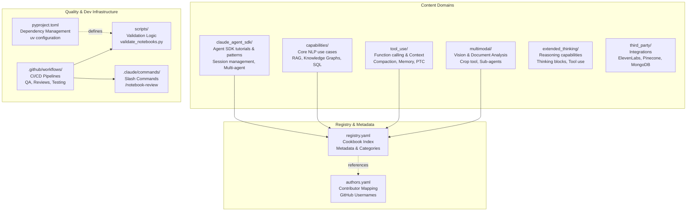
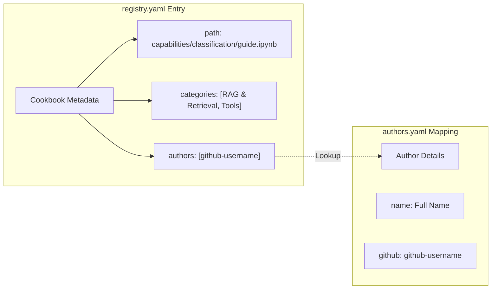

<!-- source: DeepWiki mcp.deepwiki.com · repo anthropics/claude-cookbooks · page 1 Overview · fetched 2026-10-26 -->

# Overview

Relevant source files

The following files were used as context for generating this wiki page:

- [.claude/commands/add-registry.md](.claude/commands/add-registry.md)
- [.github/pull_request_template.md](.github/pull_request_template.md)
- [.github/registry_schema.json](.github/registry_schema.json)
- [.gitignore](.gitignore)
- [.pre-commit-config.yaml](.pre-commit-config.yaml)
- [CLAUDE.md](CLAUDE.md)
- [CONTRIBUTING.md](CONTRIBUTING.md)
- [README.md](README.md)
- [anthropic_cookbook/__init__.py](anthropic_cookbook/__init__.py)
- [claude_agent_sdk/06_The_vulnerability_detection_agent.ipynb](claude_agent_sdk/06_The_vulnerability_detection_agent.ipynb)
- [claude_agent_sdk/vulnerability_detection_agent/canary/canary.c](claude_agent_sdk/vulnerability_detection_agent/canary/canary.c)
- [evals/agentic_search/.gitignore](evals/agentic_search/.gitignore)
- [evals/agentic_search/reproduce_agentic_search_benchmarks.ipynb](evals/agentic_search/reproduce_agentic_search_benchmarks.ipynb)
- [evals/agentic_search/utils/__init__.py](evals/agentic_search/utils/__init__.py)
- [evals/agentic_search/utils/agentic_search.py](evals/agentic_search/utils/agentic_search.py)
- [requirements-dev.txt](requirements-dev.txt)
- [scripts/validate_notebooks.py](scripts/validate_notebooks.py)

The Claude Cookbooks repository is a collection of executable Jupyter notebook examples and guides designed to help developers build with the Claude API. It provides copy-paste ready code snippets and reference implementations for sophisticated patterns including tool use, prompt caching, agentic workflows, and multimodal processing. [README.md:1-4](), [README.md:29-64]()

**Scope**: This page covers the high-level architecture and organization of the repository. For detailed setup, see **Getting Started**. For specifics on the quality system, see **Quality Assurance System**. For documentation on individual domains, see **Skills System**, **Tool Use Framework**, **Agent Patterns and SDK**, and **Multimodal Capabilities**.

## Repository Purpose

The repository serves two primary functions:

1.  **Educational Resource**: Provides executable examples for developers learning Claude API fundamentals and advanced features. [README.md:1-11]()
2.  **Reference Implementation**: Demonstrates production-grade patterns such as context engineering (compaction, memory, clearing), multi-agent orchestration, and specialized API features like extended thinking. [CLAUDE.md:91-105]()

All examples are primarily Python-based Jupyter notebooks that can be run locally with an Anthropic API key. [README.md:5-9]()

## Repository Structure

The repository is organized into content domains, quality infrastructure, and development utilities.

### Directory Layout

**Sources**: [CLAUDE.md:91-105](), [README.md:29-64](), [CONTRIBUTING.md:5-49]()

### Key Files and Their Roles

| File | Purpose | Reference |
| :--- | :--- | :--- |
| `registry.yaml` | Central index of all cookbooks, including paths, authors, and categories. | [.github/registry_schema.json:1-97]() |
| `authors.yaml` | Maps GitHub usernames to full names and profile details. | [.claude/commands/add-registry.md:11-17]() |
| `pyproject.toml` | Defines dependencies and tool settings (Ruff, pytest). | [CLAUDE.md:62-63]() |
| `CONTRIBUTING.md` | Documentation for development setup, quality standards, and git workflow. | [CONTRIBUTING.md:1-224]() |
| `scripts/validate_notebooks.py` | Validates notebook structure, checking for empty cells and error outputs. | [scripts/validate_notebooks.py:1-65]() |

## Content Organization System

Cookbooks are indexed through a metadata system that enables discoverability and validation. The `registry.yaml` file follows a strict schema defined in `.github/registry_schema.json`. [registry_schema.json:1-97]()

### Registry and Author Mapping

The `registry.yaml` file uses a schema-validated structure to track every example. Each entry maps to a unique path and references authors defined in `authors.yaml`. The `add-registry` command automates this mapping. [.claude/commands/add-registry.md:1-73]()

**Sources**: [.github/registry_schema.json:1-97](), [.claude/commands/add-registry.md:53-73]()

## Quality Assurance Architecture

The repository employs a multi-layered QA system combining automated linting, notebook execution, and AI-powered reviews. [CONTRIBUTING.md:51-61]()

### Validation Stack

1.  **Local Hooks**: Uses `pre-commit` to run `ruff` for linting/formatting and `validate_notebooks.py` for structural checks. [.pre-commit-config.yaml:1-25](), [CONTRIBUTING.md:100-107]()
2.  **Notebook Execution**: Uses `nbconvert` to ensure notebooks run top-to-bottom without errors. [CONTRIBUTING.md:57](), [CONTRIBUTING.md:92-98]()
3.  **Claude-Powered Reviews**: Intelligent slash commands (`/notebook-review`, `/model-check`, `/link-review`) run in both local `Claude Code` and GitHub Actions. [CONTRIBUTING.md:63-80](), [CLAUDE.md:83-90]()

**Sources**: [CONTRIBUTING.md:51-80](), [CONTRIBUTING.md:187-209](), [scripts/validate_notebooks.py:14-33]()

## Core Frameworks and Patterns

The repository highlights several advanced integration frameworks:

### Claude Agent SDK
A tutorial series demonstrating the building of autonomous agents, multi-agent systems, and session management. [CLAUDE.md:96]()

### Context Engineering
Demonstrates primitives for managing long-horizon conversations, including compaction and memory storage. [CLAUDE.md:97](), [.gitignore:159-162]()

### Model Management
The repository enforces the use of model aliases (e.g., `claude-sonnet-5`, `claude-haiku-4-5`) rather than dated model IDs to ensure maintainability. [CLAUDE.md:64-75](), [CONTRIBUTING.md:119-124]()

**Sources**: [CLAUDE.md:64-75](), [CONTRIBUTING.md:119-124]()

## Development Infrastructure

### Package Management
The repository recommends `uv` for high-performance dependency management. [CONTRIBUTING.md:9-17]()
*   `uv sync --all-extras`: Sets up the full environment. [CONTRIBUTING.md:31-33]()
*   `make check`: Runs formatting and linting checks. [CLAUDE.md:24]()

### Security
*   **Secret Management**: Never commit API keys; use `.env` files and `os.environ.get`. [CONTRIBUTING.md:45-49](), [CONTRIBUTING.md:216-221](), [CLAUDE.md:59-60]()
*   **CI Gates**: External contributors have limited API testing to prevent resource exhaustion and secret exposure. [CONTRIBUTING.md:209]()

**Sources**: [CONTRIBUTING.md:5-49](), [CLAUDE.md:19-37](), [CONTRIBUTING.md:216-221]()

---

