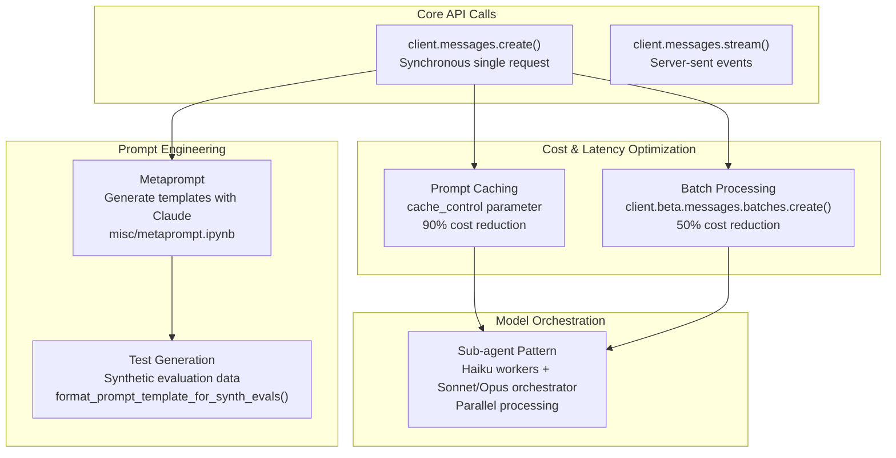
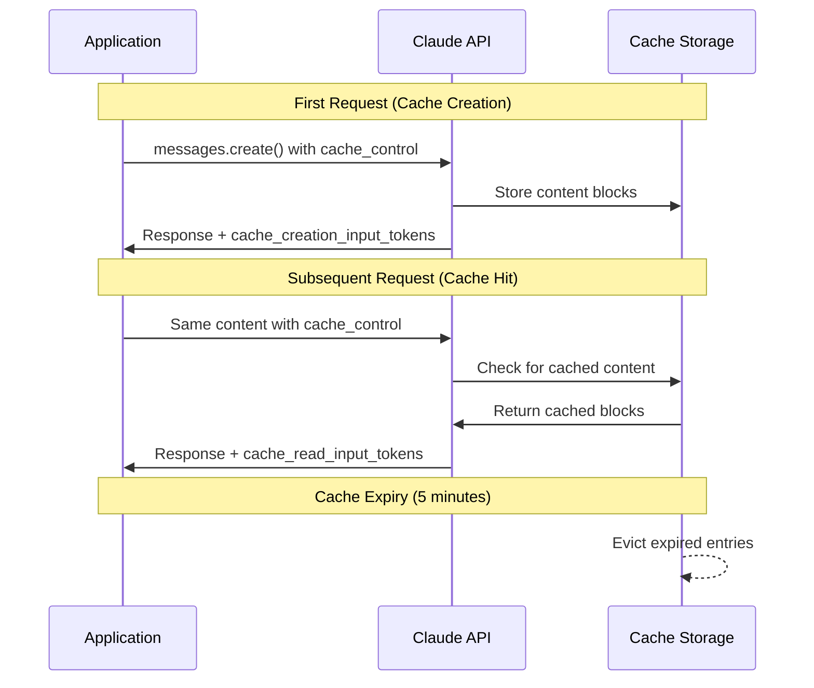
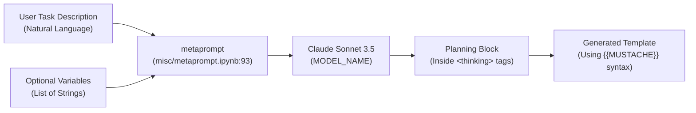
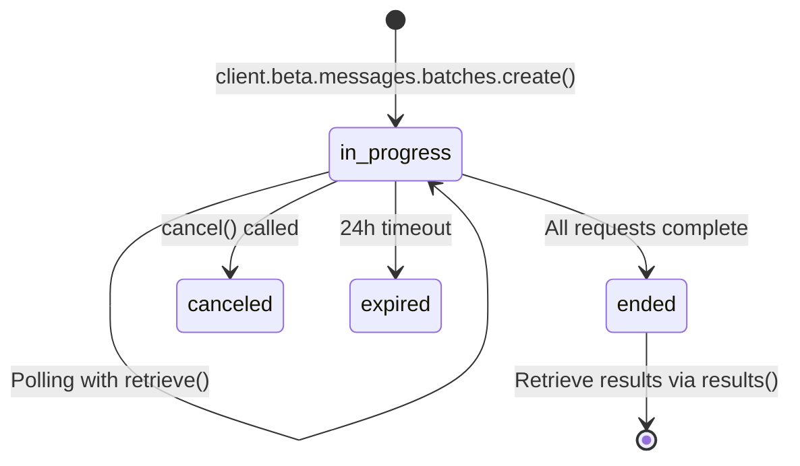

<!-- source: DeepWiki mcp.deepwiki.com · repo anthropics/claude-cookbooks · page 10 Prompt Engineering and Optimization · fetched 2026-10-26 -->

# Prompt Engineering and Optimization

Relevant source files

The following files were used as context for generating this wiki page:

- [.env.example](.env.example)
- [finetuning/datasets/json_mode_dataset.jsonl](finetuning/datasets/json_mode_dataset.jsonl)
- [finetuning/finetuning_on_bedrock.ipynb](finetuning/finetuning_on_bedrock.ipynb)
- [images/sunset-dawn-nature-mountain-preview.jpg](images/sunset-dawn-nature-mountain-preview.jpg)
- [misc/batch_processing.ipynb](misc/batch_processing.ipynb)
- [misc/generate_test_cases.ipynb](misc/generate_test_cases.ipynb)
- [misc/metaprompt.ipynb](misc/metaprompt.ipynb)
- [misc/prompt_caching.ipynb](misc/prompt_caching.ipynb)
- [misc/session_memory_compaction.ipynb](misc/session_memory_compaction.ipynb)
- [observability/usage_cost_api.ipynb](observability/usage_cost_api.ipynb)
- [third_party/MongoDB/rag_using_mongodb.ipynb](third_party/MongoDB/rag_using_mongodb.ipynb)
- [third_party/Pinecone/claude_3_rag_agent.ipynb](third_party/Pinecone/claude_3_rag_agent.ipynb)

This page covers techniques for improving Claude API performance, reducing operational costs, and optimizing token usage across single and multi-turn conversations. For basic Claude API usage patterns, see [Overview](#1). For tool use optimization specifically, see [Context Management and Compaction](#6.3).

## Purpose and Scope

Prompt engineering and optimization encompasses three primary categories:

1.  **Cost reduction**: Using caching and batch processing to minimize API expenses by 50-90% [misc/prompt_caching.ipynb:9-10](), [misc/batch_processing.ipynb:9-10]().
2.  **Latency optimization**: Leveraging prompt caching for 2-10x faster response times [misc/prompt_caching.ipynb:9-10]().
3.  **Prompt quality**: Using metaprompts and test generation to systematically improve prompt templates [misc/metaprompt.ipynb:9-14](), [misc/generate_test_cases.ipynb:25-31]().

This page provides an architectural overview of optimization patterns. Detailed implementation guides are available in:
*   [Prompt Caching](#10.1) — Ephemeral caching for repeated context
*   [Metaprompt and Test Generation](#10.2) — Automated prompt template creation
*   [Batch Processing](#10.3) — Asynchronous bulk request processing
*   [Building Evaluations](#10.4) — Patterns for offline evaluation systems

## Optimization Technique Overview

### Optimization Flow Architecture

Sources: [misc/prompt_caching.ipynb:7-16](), [misc/batch_processing.ipynb:7-16](), [misc/metaprompt.ipynb:9-14](), [multimodal/using_sub_agents.ipynb:1-30]()

## Prompt Caching Architecture

Prompt caching stores frequently reused context (system prompts, large documents, conversation history) to reduce both cost and latency. The feature works by marking content blocks with `cache_control: {"type": "ephemeral"}` [misc/prompt_caching.ipynb:153-154]().

### Caching Lifecycle

Sources: [misc/prompt_caching.ipynb:9-16](), [misc/prompt_caching.ipynb:131-144]()

### Cache Control Usage
The `cache_control` parameter can be applied to:
*   **System prompts**: For static instructions across many users [misc/prompt_caching.ipynb:542-543]().
*   **User message content blocks**: For large documents or images [misc/prompt_caching.ipynb:223-226]().
*   **Multi-turn conversation history**: To optimize chat performance by placing `cache_control` on the last user message [misc/session_memory_compaction.ipynb:120-145]().

**Token Accounting:**
Usage stats are tracked via `cache_creation_input_tokens` and `cache_read_input_tokens` [misc/prompt_caching.ipynb:134-135]().

Sources: [misc/prompt_caching.ipynb:131-144](), [misc/prompt_caching.ipynb:153-160](), [misc/session_memory_compaction.ipynb:120-145]()

## Metaprompt for Template Generation

The metaprompt pattern uses Claude to generate optimized prompt templates, solving the "blank page problem" [misc/metaprompt.ipynb:9-10](). It contains a long multi-shot prompt filled with examples of high-quality instructions [misc/metaprompt.ipynb:78-82]().

### Metaprompt Mapping

Sources: [misc/metaprompt.ipynb:93-113](), [misc/metaprompt.ipynb:54-56](), [misc/generate_test_cases.ipynb:80-82]()

The metaprompt includes specialized examples for:
*   Customer success agents [misc/metaprompt.ipynb:95-124]()
*   Sentence similarity checking [misc/metaprompt.ipynb:125-142]()
*   Document Q&A with references [misc/metaprompt.ipynb:143-182]()
*   Socratic tutoring [misc/metaprompt.ipynb:183-339]()
*   Tool use/Function calling [misc/metaprompt.ipynb:340-535]()

Sources: [misc/metaprompt.ipynb:93-535]()

## Synthetic Test Case Generation

Once a template is created, synthetic test data validates its behavior. The `format_prompt_template_for_synth_evals()` function generates realistic variable values for evaluation [misc/generate_test_cases.ipynb:168-170]().

### Test Generation Pipeline

| Step | Function | Purpose |
| :--- | :--- | :--- |
| Variable Extraction | `extract_variables(prompt_template)` | Identifies `{{MUSTACHE}}` placeholders [misc/generate_test_cases.ipynb:78-82]() |
| Block Construction | `construct_variables_block(prompt_template)` | Creates XML placeholders for Claude to fill [misc/generate_test_cases.ipynb:104-113]() |
| Example Mapping | `construct_example_block(variable_dict)` | Formats user-provided examples for multi-shot [misc/generate_test_cases.ipynb:132-139]() |
| Prompt Prep | `format_prompt_template_for_synth_evals()` | Builds the final instruction for Claude [misc/generate_test_cases.ipynb:168-182]() |

Sources: [misc/generate_test_cases.ipynb:76-182]()

## Batch Processing for Bulk Operations

The Message Batches API processes large volumes of requests asynchronously with a 50% cost reduction [misc/batch_processing.ipynb:9-10]().

### Batch Lifecycle States

Sources: [misc/batch_processing.ipynb:148-168](), [misc/batch_processing.ipynb:241-242]()

### Batch Implementation Details
*   **Submission**: Requests are defined with a `custom_id` and standard `params` [misc/batch_processing.ipynb:89-99]().
*   **Monitoring**: The `monitor_batch` helper uses `client.beta.messages.batches.retrieve()` to poll `processing_status` [misc/batch_processing.ipynb:148-155]().
*   **Results**: Once `ended`, the `results_url` becomes available for retrieving a stream of results [misc/batch_processing.ipynb:175-178](), [misc/batch_processing.ipynb:241-252]().

Sources: [misc/batch_processing.ipynb:80-169](), [misc/batch_processing.ipynb:241-252]()

## Session Memory and Compaction

For long-running conversations, session memory management is critical to avoid context limit interruptions.

*   **Manual Compaction**: Developers can use a `SESSION_MEMORY_PROMPT` to compress transcripts into structured summaries [misc/session_memory_compaction.ipynb:163-170]().
*   **Instant Compaction**: Implementing background threading allows compaction to occur without increasing user wait time [misc/session_memory_compaction.ipynb:20-22]().
*   **Automatic Compaction**: For agentic workflows, the Claude Agent SDK supports automatic context compaction via `compaction_control` configuration [misc/session_memory_compaction.ipynb:13]().

Sources: [misc/session_memory_compaction.ipynb:13-22](), [misc/session_memory_compaction.ipynb:163-170]()

## Technique Comparison

| Technique | Primary Benefit | Typical Use Case |
| :--- | :--- | :--- |
| **Prompt Caching** | Latency & Cost (-90%) | Multi-turn chat, RAG over static docs [misc/prompt_caching.ipynb:9-16]() |
| **Batch Processing** | Cost (-50%) | Data labeling, bulk extraction, non-real-time [misc/batch_processing.ipynb:9-16]() |
| **Metaprompt** | Quality & Speed | Initial prompt development [misc/metaprompt.ipynb:9-14]() |
| **Compaction** | Continuity | Long-running sessions, coding assistants [misc/session_memory_compaction.ipynb:9-13]() |

Sources: [misc/prompt_caching.ipynb:9-16](), [misc/batch_processing.ipynb:9-16](), [misc/metaprompt.ipynb:9-14](), [misc/session_memory_compaction.ipynb:9-13]()

---

