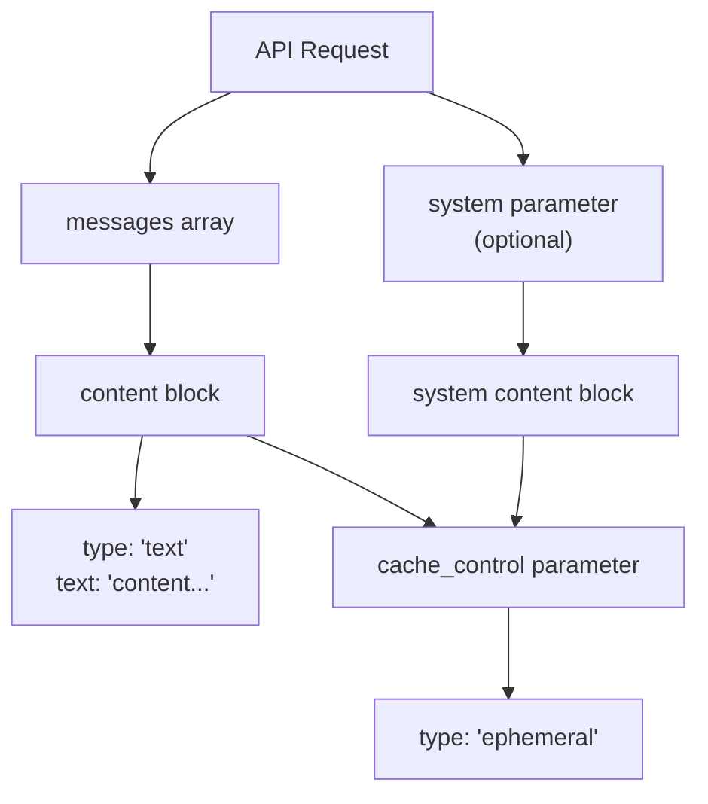
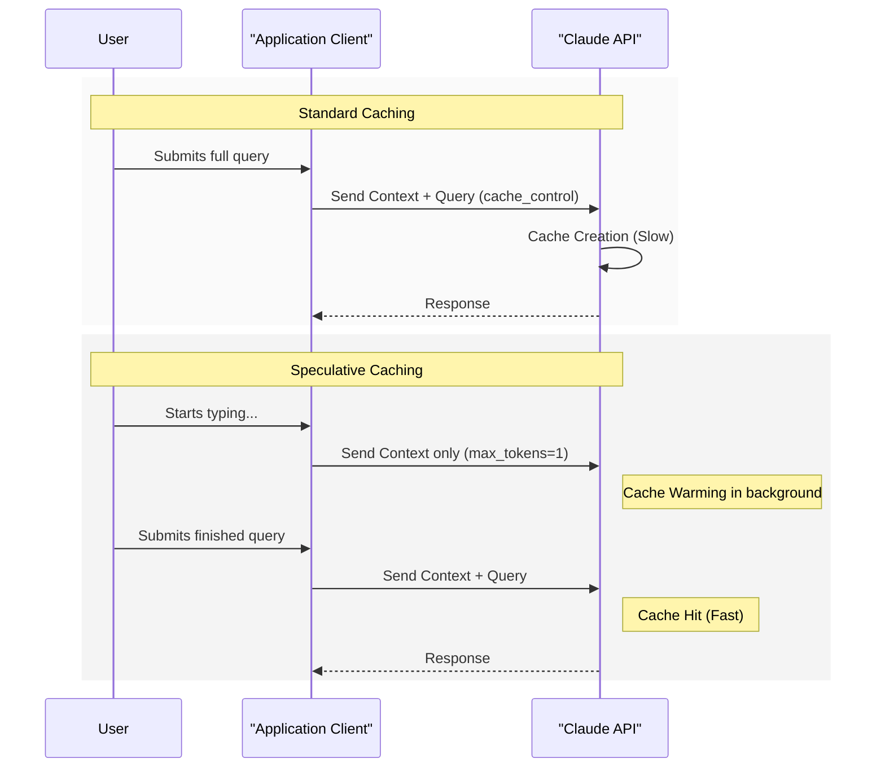
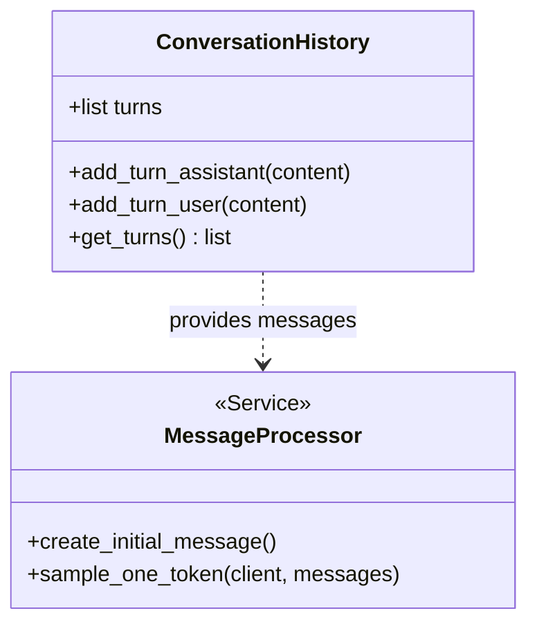

<!-- source: DeepWiki mcp.deepwiki.com · repo anthropics/claude-cookbooks · page 10.1 Prompt Caching · fetched 2026-10-26 -->

# Prompt Caching

<details>
<summary>Relevant source files</summary>

The following files were used as context for generating this wiki page:

- [capabilities/classification/guide.ipynb](capabilities/classification/guide.ipynb)
- [capabilities/contextual-embeddings/guide.ipynb](capabilities/contextual-embeddings/guide.ipynb)
- [capabilities/retrieval_augmented_generation/evaluation/prompts.py](capabilities/retrieval_augmented_generation/evaluation/prompts.py)
- [images/sunset-dawn-nature-mountain-preview.jpg](images/sunset-dawn-nature-mountain-preview.jpg)
- [misc/batch_processing.ipynb](misc/batch_processing.ipynb)
- [misc/generate_test_cases.ipynb](misc/generate_test_cases.ipynb)
- [misc/metaprompt.ipynb](misc/metaprompt.ipynb)
- [misc/prompt_caching.ipynb](misc/prompt_caching.ipynb)
- [misc/speculative_prompt_caching.ipynb](misc/speculative_prompt_caching.ipynb)
- [skills/custom_skills/applying-brand-guidelines/validate_brand.py](skills/custom_skills/applying-brand-guidelines/validate_brand.py)

</details>


This page documents Claude's prompt caching feature, which allows you to store and reuse portions of your prompt context to reduce API costs by up to 90% and latency by 2-10x. Prompt caching is particularly effective for long-form content, multi-turn conversations, and complex agentic workflows.

## Overview

Prompt caching enables Claude to store frequently-used prompt content (such as system prompts, large documents, or conversation history) and reuse it across multiple API requests. Rather than reprocessing identical context on every call, Claude reads the cached content, significantly reducing both Time-To-First-Token (TTFT) and cost.

There are two primary implementation methods:
- **Automatic Caching** (Recommended): Add a single `cache_control` field at the top level of a request. The system automatically manages cache breakpoints for you. [misc/prompt_caching.ipynb:13-16]()
- **Explicit Cache Breakpoints**: Place `cache_control` on individual content blocks for fine-grained control over exactly what gets cached. [misc/prompt_caching.ipynb:14-16]()

**Sources:** [misc/prompt_caching.ipynb:7-16]()

## Cache Control Parameter

### Parameter Structure

The `cache_control` parameter is added to individual content blocks within the `messages` array or `system` parameter. When present, Claude will cache all content up to and including that block.



**Sources:** [misc/prompt_caching.ipynb:217-241](), [misc/prompt_caching.ipynb:470-509]()

### Cache Placement and Ephemeral Caching

Cache entries are "ephemeral," meaning they expire after 5 minutes of inactivity. Any cache hit resets this 5-minute TTL (Time-To-Live). [misc/prompt_caching.ipynb:264-270]()

| Location | Use Case | Example |
|----------|----------|---------|
| `system` parameter | Static instructions or large reference documents | System prompt with brand guidelines [skills/custom_skills/applying-brand-guidelines/validate_brand.py:1-40]() |
| User message content | Large contextual documents | Full text of a book or codebase [misc/prompt_caching.ipynb:110-116]() |
| User message content | Contextual Retrieval | Adding context to document chunks before embedding [capabilities/contextual-embeddings/guide.ipynb:23-27]() |
| Conversation history | Multi-turn dialogues | Previous assistant/user exchanges [misc/prompt_caching.ipynb:470-509]() |

**Sources:** [misc/prompt_caching.ipynb:542-546](), [misc/prompt_caching.ipynb:264-270](), [capabilities/contextual-embeddings/guide.ipynb:39-41]()

## Speculative Prompt Caching

Speculative Prompt Caching is a pattern designed to reduce TTFT by "warming up" the cache while a user is still formulating their query. [misc/speculative_prompt_caching.ipynb:8-10]()

### Workflow Comparison



In this pattern, the application sends a single-token request via `sample_one_token` containing the large context as soon as the user begins an interaction. [misc/speculative_prompt_caching.ipynb:153-162]() By the time the user finishes typing and submits, the context is already cached.

**Sources:** [misc/speculative_prompt_caching.ipynb:8-22](), [misc/speculative_prompt_caching.ipynb:153-162]()

## Multi-Turn Conversation Optimization

For chat applications, the recommended strategy is to cache the system prompt and the most recent user message. This ensures that as the conversation grows, the cache "rolls" forward.

### Implementation: ConversationHistory Class

The `ConversationHistory` helper class manages these breakpoints dynamically by applying `cache_control` to the latest turn. [misc/prompt_caching.ipynb:470-509]()



The `get_turns()` method applies `cache_control` to the last user turn to optimize for the next interaction:
```python
# Simplified logic from misc/prompt_caching.ipynb:488-508
def get_turns(self):
    result = []
    user_turns_processed = 0
    for turn in reversed(self.turns):
        if turn["role"] == "user" and user_turns_processed < 1:
            # Add cache_control to the most recent user message
            result.append({
                "role": "user",
                "content": [{"type": "text", "text": turn["content"][0]["text"], 
                             "cache_control": {"type": "ephemeral"}}]
            })
            user_turns_processed += 1
        else:
            result.append(turn)
    return list(reversed(result))
```

**Sources:** [misc/prompt_caching.ipynb:470-509](), [misc/speculative_prompt_caching.ipynb:123-162]()

## Performance and Cost Benefits

### Token Metrics

The API returns specific usage fields in the `response.usage` object to track caching efficiency. [misc/prompt_caching.ipynb:131-144]()

- `cache_creation_input_tokens`: Tokens written to cache (charged at standard rate).
- `cache_read_input_tokens`: Tokens retrieved from cache (charged at ~10% of standard rate).

### Observed Improvements

| Metric | Improvement | Context |
|--------|-------------|---------|
| **Cost** | Up to 90% Reduction | For repetitive tasks with large contexts (>100k tokens). [misc/prompt_caching.ipynb:9]() |
| **Latency** | 2-10x Improvement | Significant reduction in TTFT for cached content. [misc/prompt_caching.ipynb:9]() |
| **Pass@k (RAG)** | 87% -> 95% | Improved retrieval when combined with Contextual Embeddings. [capabilities/contextual-embeddings/guide.ipynb:33]() |
| **Batch Savings** | 50% Reduction | Message Batches API provides additional savings for bulk asynchronous processing. [misc/batch_processing.ipynb:9]() |

**Sources:** [misc/prompt_caching.ipynb:9-16](), [capabilities/contextual-embeddings/guide.ipynb:33](), [misc/batch_processing.ipynb:7-16]()

## Advanced Use Cases

### Contextual Retrieval
In RAG systems, prompt caching makes "Contextual Retrieval" practical. By caching the entire document context while generating "contextual descriptions" (small explanations for each chunk), the system can process thousands of chunks cost-effectively. [capabilities/contextual-embeddings/guide.ipynb:23-27](), [capabilities/contextual-embeddings/guide.ipynb:39-41]()

### Metaprompting
The Metaprompt tool uses a large multi-shot prompt filled with examples to help users generate better prompt templates. [misc/metaprompt.ipynb:78-82](), [misc/metaprompt.ipynb:90-93]() Caching this 1,000+ line instruction set ensures that subsequent prompt generations are nearly instantaneous. [misc/metaprompt.ipynb:92-123]()

### Synthetic Data Generation
When generating synthetic test cases, caching the base prompt template and few-shot examples allows for rapid iteration without re-billing for the static instructions. [misc/generate_test_cases.ipynb:25-31]()

### Reranking in RAG
Prompt caching can be used during the reranking phase of RAG pipelines, where multiple documents are passed to the model to select the most relevant indices. [capabilities/retrieval_augmented_generation/evaluation/prompts.py:89-111]()

**Sources:** [capabilities/contextual-embeddings/guide.ipynb:23-27](), [misc/metaprompt.ipynb:78-123](), [misc/generate_test_cases.ipynb:25-31](), [capabilities/retrieval_augmented_generation/evaluation/prompts.py:103-122]()

---

