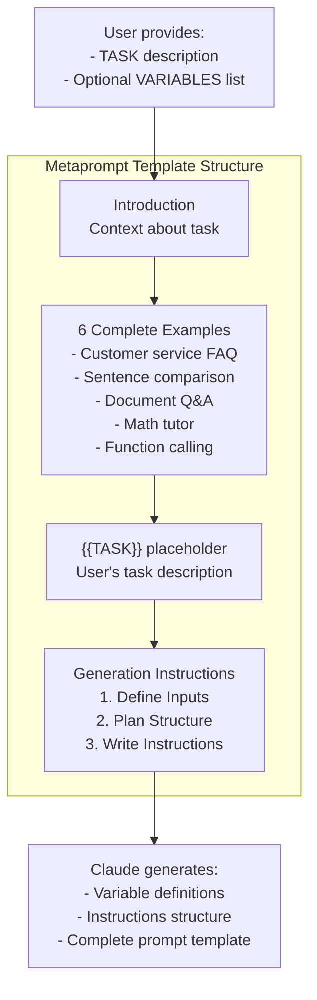
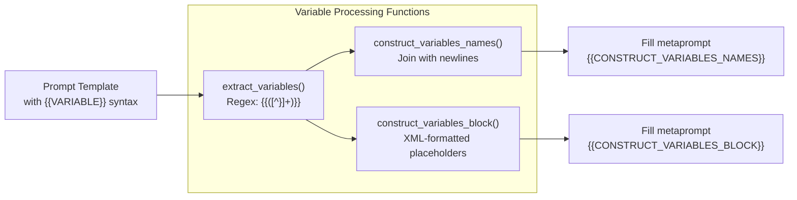
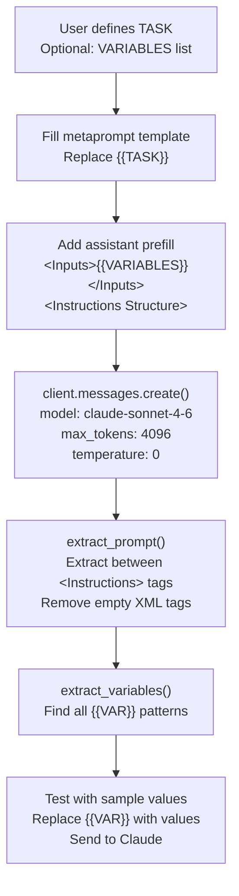
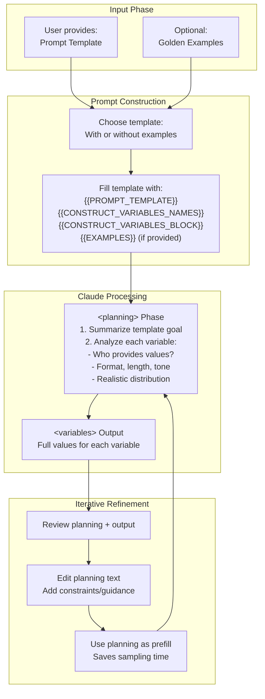
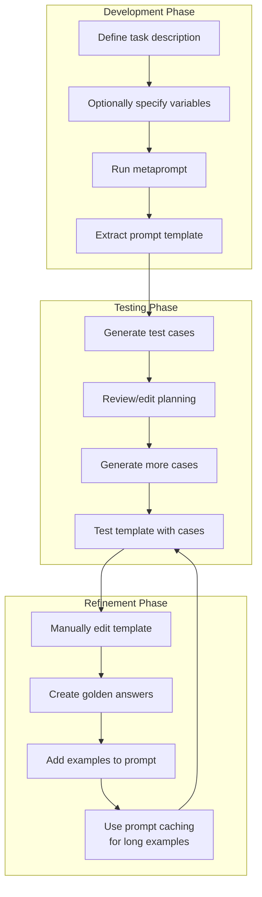

<!-- source: DeepWiki mcp.deepwiki.com · repo anthropics/claude-cookbooks · page 10.2 Metaprompt and Test Generation · fetched 2026-10-26 -->

# Metaprompt and Test Generation

<details>
<summary>Relevant source files</summary>

The following files were used as context for generating this wiki page:

- [images/sunset-dawn-nature-mountain-preview.jpg](images/sunset-dawn-nature-mountain-preview.jpg)
- [misc/batch_processing.ipynb](misc/batch_processing.ipynb)
- [misc/generate_test_cases.ipynb](misc/generate_test_cases.ipynb)
- [misc/metaprompt.ipynb](misc/metaprompt.ipynb)
- [misc/prompt_caching.ipynb](misc/prompt_caching.ipynb)

</details>


## Purpose and Scope

This document covers two complementary prompt engineering tools for developing and testing Claude prompts: the **Metaprompt** for generating prompt templates from task descriptions, and the **Synthetic Test Data Generator** for creating realistic variable values to evaluate prompt templates. These tools address the "blank page problem" in prompt engineering and enable systematic prompt evaluation without requiring real user data.

For information about optimizing prompt execution costs and latency, see [10.1 Prompt Caching](). For processing large volumes of prompt evaluations, see [10.3 Batch Processing]().

Sources: [misc/metaprompt.ipynb:9-15](), [misc/generate_test_cases.ipynb:8-32]()

---

## Metaprompt System

### Overview

The Metaprompt is a meta-level prompt that generates task-specific prompt templates. It takes a natural language task description and optional variable names as input, then produces a structured prompt template with clear instructions, examples, and XML formatting conventions.

**Key characteristics:**
- Designed for single-turn question/response patterns (not multi-turn conversations) [misc/metaprompt.ipynb:13-13]().
- Generates prompts with multiple high-quality examples embedded [misc/metaprompt.ipynb:80-80]().
- Produces non-optimal starting points that require iteration [misc/metaprompt.ipynb:14-14]().
- Leverages few-shot learning to teach prompt best practices [misc/metaprompt.ipynb:92-93]().

Sources: [misc/metaprompt.ipynb:1-15]()

### Metaprompt Template Structure

The metaprompt is a large prompt (~4000+ tokens) containing multiple complete prompt examples across diverse task types:

Title: Metaprompt Structure and Logic


**Example task types included in metaprompt:**

| Example | Task Type | Key Features |
|---------|-----------|--------------|
| Customer Service Agent | Role-playing with constraints | FAQ lookup, politeness rules, boundary enforcement [misc/metaprompt.ipynb:105-136]() |
| Sentence Comparison | Binary classification | YES/NO prefixed output [misc/metaprompt.ipynb:137-154]() |
| Document Q&A | Citation-based answers | Quote extraction, bracketed references [misc/metaprompt.ipynb:155-172]() |
| Socratic Math Tutor | Interactive teaching | Inner monologue, error detection, Socratic questioning [misc/metaprompt.ipynb:173-219]() |
| Function Calling | Tool use | Scratchpad reasoning, error handling, multi-step plans [misc/metaprompt.ipynb:220-305]() |

Sources: [misc/metaprompt.ipynb:95-551]()

### Variable Extraction and Formatting

The metaprompt system uses several helper functions to process variables in generated templates:

Title: Variable Processing Data Flow


**Variable formatting pattern:**

The system uses double-brace syntax `{{VARIABLE_NAME}}` for variables [misc/generate_test_cases.ipynb:80-82](). When constructing variable blocks, each variable is wrapped in XML tags:

```
<VARIABLE_NAME>
[a full, complete, value for the variable "VARIABLE_NAME"]
</VARIABLE_NAME>
```

Sources: [misc/metaprompt.ipynb:703-720](), [misc/generate_test_cases.ipynb:78-112]()

### Prompt Generation Workflow

The complete workflow from task description to tested prompt:

Title: Metaprompt Generation Pipeline


**Key implementation details:**

- Uses `temperature=0` for deterministic prompt generation [misc/metaprompt.ipynb:822-822]().
- Pre-fills assistant response to force structured output format [misc/metaprompt.ipynb:817-819]().
- Extracts content between `<Instructions>` tags using regex [misc/metaprompt.ipynb:712-714]().
- Cleans up trailing empty XML tags with `remove_empty_tags()` [misc/metaprompt.ipynb:709-710]().
- Uses `MODEL_NAME = "claude-sonnet-4-6"` for generation and `TEST_MODEL_NAME = "claude-haiku-4-5"` for testing [misc/metaprompt.ipynb:63-65]().

Sources: [misc/metaprompt.ipynb:63-69](), [misc/metaprompt.ipynb:636-662](), [misc/metaprompt.ipynb:703-720](), [misc/metaprompt.ipynb:817-824]()

---

## Synthetic Test Data Generation

### Overview

The test data generation system creates realistic variable values for prompt templates, enabling evaluation without real user data. It uses Claude to analyze prompt templates and generate statistically representative test cases [misc/generate_test_cases.ipynb:25-31]().

**Use cases:**
1. **Prompt Evaluation:** Test how Claude performs on realistic examples [misc/generate_test_cases.ipynb:27-28]().
2. **Multishot Example Creation:** Generate input half of input/output pairs for few-shot learning [misc/generate_test_cases.ipynb:30-31]().

Sources: [misc/generate_test_cases.ipynb:1-32]()

### Template Processing Functions

The system provides helper functions for extracting and formatting template variables:

| Function | Purpose | Implementation |
|----------|---------|----------------|
| `extract_variables(prompt_template)` | Find all `{{VAR}}` patterns | Regex: `r"{{([^}]+)}}"` [misc/generate_test_cases.ipynb:78-82]() |
| `construct_variables_names(prompt_template)` | Create newline-separated list | Joins variable set with `\n` [misc/generate_test_cases.ipynb:86-89]() |
| `construct_variables_block(prompt_template)` | Build XML placeholder structure | Wraps each variable in XML tags with instructions [misc/generate_test_cases.ipynb:104-112]() |
| `construct_example_block(variable_dict)` | Format example as XML | Builds `<example><variables>...</variables></example>` [misc/generate_test_cases.ipynb:132-139]() |

Sources: [misc/generate_test_cases.ipynb:70-140]()

### Test Case Generation Process

Title: Synthetic Test Case Generation Workflow


**Two template modes:**

1. **Without examples** (`synth_test_data_prompt_template_without_example`):
   - Claude reasons from scratch about variable characteristics [misc/generate_test_cases.ipynb:152-153]().
   - Focuses on "paradigmatic, realistic examples" [misc/generate_test_cases.ipynb:194-194]().

2. **With examples** (`synth_test_data_prompt_template_with_example`):
   - Includes user-provided examples in `<examples>` blocks [misc/generate_test_cases.ipynb:170-172]().
   - Instructs Claude to learn statistical distribution and balance similarity vs. novelty [misc/generate_test_cases.ipynb:151-153]().

Sources: [misc/generate_test_cases.ipynb:150-226]()

### API Integration

The `get_test_data()` function orchestrates test case generation:

```python
# Simplified workflow from misc/generate_test_cases.ipynb:243-267
def get_test_data(prompt_template, examples, custom_planning=None):
    # 1. Format prompt with template
    synth_eval_prompt = format_prompt_template_for_synth_evals(
        prompt_template, examples
    )
    
    # 2. Build messages (optional planning prefill)
    messages = [{"role": "user", "content": synth_eval_prompt}]
    if custom_planning:
        messages.append({"role": "assistant", "content": custom_planning})
    
    # 3. Call Claude with high temperature for diversity
    response = CLIENT.messages.create(
        max_tokens=4000,
        messages=messages,
        model=MODEL_NAME,
        temperature=1  # Higher for diverse examples
    )
    
    return response.content[0].text
```

**Key parameters:**
- `temperature=1` encourages diverse test cases across multiple runs [misc/generate_test_cases.ipynb:265-265]().
- `max_tokens=4000` allows detailed planning and long variable values [misc/generate_test_cases.ipynb:262-262]().
- Custom planning can be provided as prefill to save time and enforce constraints [misc/generate_test_cases.ipynb:253-254]().
- Uses `MODEL_NAME = "claude-sonnet-4-6"` [misc/generate_test_cases.ipynb:58-58]().

Sources: [misc/generate_test_cases.ipynb:238-267]()

---

## Integration and Usage Patterns

### Complete Metaprompt Pipeline

Title: End-to-End Development Cycle


Sources: [misc/metaprompt.ipynb:1-850](), [misc/generate_test_cases.ipynb:730-747]()

### Testing Generated Prompts

The `call_claude_with_template()` helper fills templates with test case values:

```python
# Template filling and execution from misc/generate_test_cases.ipynb:279-298
def call_claude_with_template(prompt_template, variables):
    filled_template = prompt_template
    for var, value in variables.items():
        filled_template = filled_template.replace(f"{{{{{var}}}}}", value)
    
    message = CLIENT.messages.create(
        max_tokens=4000,
        messages=[{"role": "user", "content": filled_template}],
        model=MODEL_NAME,
        temperature=0.7
    )
    
    return message.content[0].text
```

This enables rapid evaluation of prompts across multiple synthetic test cases without manual variable substitution.

Sources: [misc/generate_test_cases.ipynb:271-298]()

### Code Entity Summary

| Entity | Location | Purpose |
|--------|----------|---------|
| `metaprompt` | [misc/metaprompt.ipynb:105-551]() | Multi-shot template with 6 examples |
| `extract_variables()` | [misc/metaprompt.ipynb:717-719]() | Regex extraction of {{VAR}} patterns |
| `extract_prompt()` | [misc/metaprompt.ipynb:712-714]() | Extract between &lt;Instructions&gt; tags |
| `remove_empty_tags()` | [misc/metaprompt.ipynb:709-710]() | Clean trailing XML |
| `format_prompt_template_for_synth_evals()` | [misc/generate_test_cases.ipynb:168-226]() | Build test generation prompt |
| `get_test_data()` | [misc/generate_test_cases.ipynb:243-267]() | Generate test cases via API |
| `call_claude_with_template()` | [misc/generate_test_cases.ipynb:279-298]() | Fill and execute template |
| `construct_variables_block()` | [misc/generate_test_cases.ipynb:104-112]() | XML placeholder structure |
| `construct_example_block()` | [misc/generate_test_cases.ipynb:132-139]() | Format examples as XML |

Sources: [misc/metaprompt.ipynb:1-850](), [misc/generate_test_cases.ipynb:1-747]()

---

