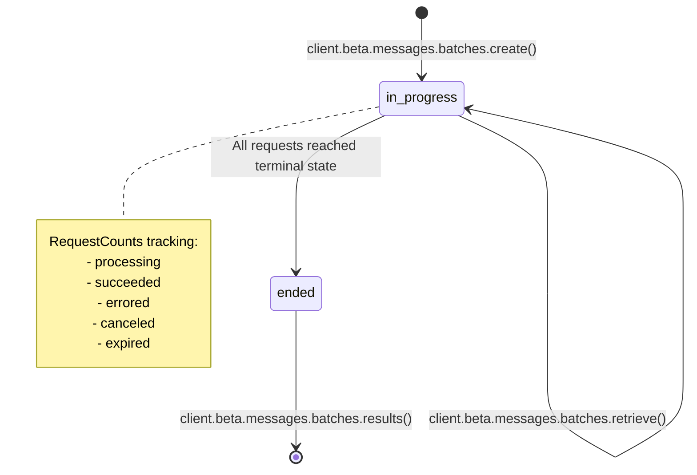
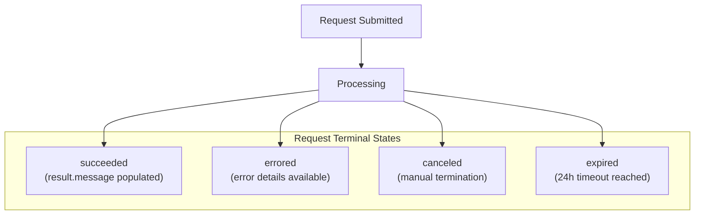

<!-- source: DeepWiki mcp.deepwiki.com · repo anthropics/claude-cookbooks · page 10.3 Batch Processing · fetched 2026-10-26 -->

# Batch Processing

Relevant source files

The following files were used as context for generating this wiki page:

- [images/sunset-dawn-nature-mountain-preview.jpg](images/sunset-dawn-nature-mountain-preview.jpg)
- [misc/batch_processing.ipynb](misc/batch_processing.ipynb)
- [misc/generate_test_cases.ipynb](misc/generate_test_cases.ipynb)
- [misc/metaprompt.ipynb](misc/metaprompt.ipynb)
- [misc/prompt_caching.ipynb](misc/prompt_caching.ipynb)

## Purpose and Scope

This document describes the Message Batches API for processing large volumes of Claude API requests asynchronously at a 50% cost reduction. Batch processing is designed for non-real-time workloads that can tolerate delayed responses (up to 24 hours), such as bulk data processing, evaluation datasets, and periodic summarization tasks.

For optimizing token costs and latency in real-time conversations using context reuse, see [Prompt Caching](10.1). For generating synthetic data to test these batches, see [Metaprompt and Test Generation](10.2).

Sources: [misc/batch_processing.ipynb:7-17](), [misc/prompt_caching.ipynb:7-16]()

---

## Core Concepts

The Message Batches API allows developers to submit a collection of message requests in a single call. Each request within the batch is assigned a `custom_id`, which acts as a correlation key when retrieving results.

### Key Benefits

| Benefit | Description | Use Case |
|---------|-------------|----------|
| **50% Cost Reduction** | Batch requests are priced at half the standard rate | Large-scale evals, bulk summarization |
| **Asynchronous Processing** | Decouples request submission from response handling | Data pipeline background jobs |
| **High Throughput** | Efficiently handle thousands of requests without hitting real-time rate limits | Synthetic data generation |
| **Persistence** | Results are stored and accessible for 24 hours after completion | Distributed worker systems |

### API Structure

The batch functionality is exposed through the `client.beta.messages.batches` namespace:
- `create()`: Submits a new batch for processing [misc/batch_processing.ipynb:102-102]().
- `retrieve()`: Polls for the status and progress of a specific batch [misc/batch_processing.ipynb:150-150]().
- `results()`: Returns an iterator to stream results once processing is complete [misc/batch_processing.ipynb:232-232]().

Sources: [misc/batch_processing.ipynb:7-17](), [misc/batch_processing.ipynb:89-106]()

---

## Batch Lifecycle

### Batch Processing States

A batch moves from submission to a terminal `ended` state. During this time, the `processing_status` is monitored.

### Individual Request Terminal States

While the batch as a whole is `in_progress`, individual requests within it transition through various states.

### Batch Properties

The `BetaMessageBatch` object contains metadata essential for lifecycle management:

| Property | Type | Description |
|----------|------|-------------|
| `id` | string | Unique identifier for the batch [misc/batch_processing.ipynb:104-104]() |
| `processing_status` | string | Either `in_progress` or `ended` [misc/batch_processing.ipynb:151-151]() |
| `request_counts` | object | A `RequestCounts` object showing current tallies of succeeded, errored, etc. [misc/batch_processing.ipynb:163-168]() |
| `results_url` | string | The endpoint to fetch results from (populated when `ended`) [misc/batch_processing.ipynb:133-133]() |
| `expires_at` | datetime | When the batch results will no longer be available [misc/batch_processing.ipynb:127-127]() |

Sources: [misc/batch_processing.ipynb:104-106](), [misc/batch_processing.ipynb:127-143](), [misc/batch_processing.ipynb:150-155]()

---

## Implementation Guide

### 1. Creating and Submitting Batches

Requests are defined as a list of dictionaries. Each dictionary must include a `custom_id` and a `params` object containing standard Message API parameters.

[misc/batch_processing.ipynb:89-99]()

**Parameters:**
- `custom_id`: A unique string per request in the batch used to identify the result [misc/batch_processing.ipynb:91-91]().
- `model`: The model to use (e.g., `claude-sonnet-4-6`) [misc/batch_processing.ipynb:93-93]().
- `messages`: The standard prompt message structure [misc/batch_processing.ipynb:95-95]().

### 2. Monitoring Progress

Because the API is asynchronous, applications must poll the `retrieve` endpoint to determine when results are ready.

[misc/batch_processing.ipynb:148-158]()

**Polling Logic:**
- Use `client.beta.messages.batches.retrieve(batch_id)` to get the latest `BetaMessageBatch` object [misc/batch_processing.ipynb:150-150]().
- Check if `processing_status == "ended"` [misc/batch_processing.ipynb:154-154]().
- Inspect `request_counts` to see the breakdown of successful vs. failed requests [misc/batch_processing.ipynb:163-168]().

### 3. Retrieving and Handling Results

Once a batch has `ended`, results can be streamed using the `results()` method.

[misc/batch_processing.ipynb:231-255]()

**Result Handling Pattern:**
- Iterate through the results iterator [misc/batch_processing.ipynb:234-234]().
- Check `result.type`. If it is `"succeeded"`, the response is in `result.message` [misc/batch_processing.ipynb:235-236]().
- Access the text via `result.message.content[0].text` [misc/batch_processing.ipynb:236-236]().
- Handle `"errored"` types by inspecting `result.error` [misc/batch_processing.ipynb:242-243]().

Sources: [misc/batch_processing.ipynb:89-106](), [misc/batch_processing.ipynb:148-168](), [misc/batch_processing.ipynb:231-255]()

---

## Best Practices

### Operational Reliability
- **Correlation**: Always store the mapping of `custom_id` to your internal database IDs before submission to ensure you can process the results correctly [misc/batch_processing.ipynb:91-91]().
- **Error Resilience**: A batch can "end" even if some individual requests failed. Always check `result.type` during iteration rather than assuming all succeeded [misc/batch_processing.ipynb:235-243]().
- **Expiration**: Retrieve your results within 24 hours of batch creation, as the `results_url` expires after that window [misc/batch_processing.ipynb:127-127]().

### Performance Optimization
- **Prompt Caching Integration**: You can combine Batch Processing with Prompt Caching. By adding `cache_control` to your batch request parameters, you can achieve both the 50% batch discount and the 90% caching discount on repetitive context [misc/prompt_caching.ipynb:9-16]().
- **Batch Sizing**: While batches support large volumes, consider grouping them by priority or task type to make result processing more manageable.

Sources: [misc/batch_processing.ipynb:1-17](), [misc/batch_processing.ipynb:231-255](), [misc/prompt_caching.ipynb:7-16]()

---

