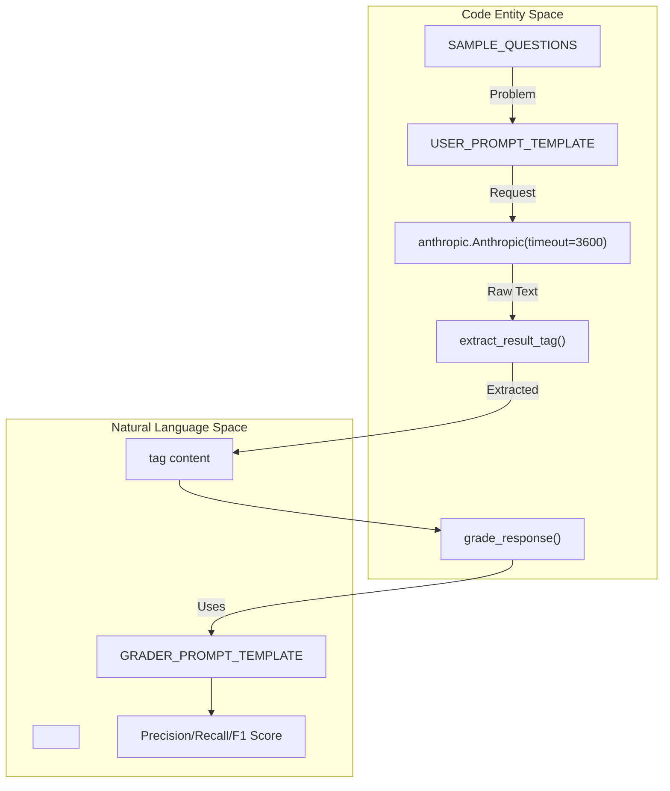
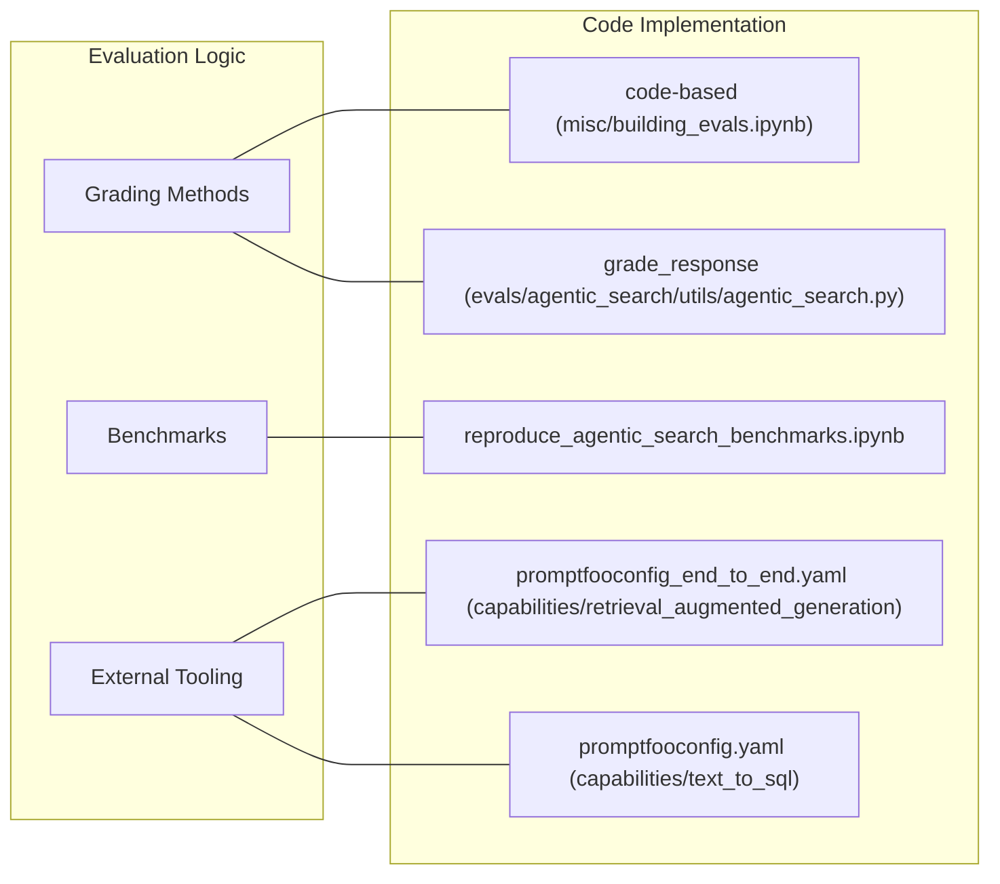

<!-- source: DeepWiki mcp.deepwiki.com · repo anthropics/claude-cookbooks · page 10.4 Building Evaluations · fetched 2026-10-26 -->

# Building Evaluations

Relevant source files

The following files were used as context for generating this wiki page:

- [CLAUDE.md](CLAUDE.md)
- [capabilities/retrieval_augmented_generation/evaluation/promptfooconfig_end_to_end.yaml](capabilities/retrieval_augmented_generation/evaluation/promptfooconfig_end_to_end.yaml)
- [capabilities/summarization/evaluation/promptfooconfig.yaml](capabilities/summarization/evaluation/promptfooconfig.yaml)
- [capabilities/text_to_sql/evaluation/promptfooconfig.yaml](capabilities/text_to_sql/evaluation/promptfooconfig.yaml)
- [evals/agentic_search/.gitignore](evals/agentic_search/.gitignore)
- [evals/agentic_search/reproduce_agentic_search_benchmarks.ipynb](evals/agentic_search/reproduce_agentic_search_benchmarks.ipynb)
- [evals/agentic_search/utils/__init__.py](evals/agentic_search/utils/__init__.py)
- [evals/agentic_search/utils/agentic_search.py](evals/agentic_search/utils/agentic_search.py)
- [misc/building_evals.ipynb](misc/building_evals.ipynb)
- [misc/how_to_enable_json_mode.ipynb](misc/how_to_enable_json_mode.ipynb)
- [multimodal/best_practices_for_vision.ipynb](multimodal/best_practices_for_vision.ipynb)
- [multimodal/getting_started_with_vision.ipynb](multimodal/getting_started_with_vision.ipynb)
- [multimodal/how_to_transcribe_text.ipynb](multimodal/how_to_transcribe_text.ipynb)

Optimizing Claude for high accuracy is an empirical process. Whether determining if a prompt change improved a key metric or gauging production readiness, a robust offline evaluation system is critical to success [misc/building_evals.ipynb:7-11]().

## Parts of an Evaluation

Evaluations typically consist of four core components [misc/building_evals.ipynb:17-22]():
*   **Input Prompt:** The data fed to the model, often utilizing variable inputs within a prompt template [misc/building_evals.ipynb:19-19]().
*   **Model Output:** The raw completion generated by Claude based on the input prompt [misc/building_evals.ipynb:20-20]().
*   **Golden Answer:** The ground truth reference. This can be a mandatory exact match or a high-quality example for a grader to use as a baseline [misc/building_evals.ipynb:21-21]().
*   **Score:** A numerical or categorical value representing model performance [misc/building_evals.ipynb:22-22]().

## Evaluation Grading Methods

There are three primary methods for grading model outputs, varying in speed, cost, and complexity [misc/building_evals.ipynb:27-32]().

### 1. Code-based Grading
Uses standard programming logic (string matching, regular expressions) to verify outputs.
*   **Pros:** Extremely fast, highly reliable, and virtually zero cost per run [misc/building_evals.ipynb:28-28]().
*   **Common Patterns:** Exact match against a `golden_answer` or checking for the presence of specific key phrases [misc/building_evals.ipynb:28-28]().
*   **Implementation Example:** In a task identifying the number of legs on an animal, the code-based grader checks if the integer in the output matches the reference [misc/building_evals.ipynb:40-42]().

### 2. Model-based Grading (LLM-as-judge)
Uses Claude to grade its own outputs or the outputs of other models.
*   **Pros:** Highly capable of analyzing tone, creativity, and accuracy in free-form answers that are difficult to programmatically verify [misc/building_evals.ipynb:30-30]().
*   **Pattern:** A *grader prompt* is provided to Claude, containing the model output and the golden answer for comparison [misc/building_evals.ipynb:30-30]().
*   **F1 Scoring:** For complex research tasks, a grader can extract individual items and calculate Precision, Recall, and F1 scores by comparing extracted answers against ground truth items [evals/agentic_search/utils/agentic_search.py:118-163]().

### 3. Human Grading
Involves manual review by a human evaluator.
*   **Cons:** Extremely slow and expensive for large datasets. It should generally be avoided for repetitive evaluation cycles [misc/building_evals.ipynb:29-29]().

## Reproducing Agentic Benchmarks

Reproducing Claude's published agentic-search scores (e.g., DeepSearchQA, BrowseComp) requires specific harness configurations to handle long-horizon tasks [evals/agentic_search/reproduce_agentic_search_benchmarks.ipynb:7-11]().

### Harness Configuration
For agents running 30+ tool calls across hundreds of thousands of tokens, the following parameters are critical:
*   **Read Timeouts:** With server-side tools, streamed calls may run for minutes before the first token. The `read` timeout should be raised (e.g., to 3600 seconds) [evals/agentic_search/reproduce_agentic_search_benchmarks.ipynb:94-101]().
*   **Result Tagging:** Agents are prompted to plan freely but provide the final concise answer within `<result>` tags to ensure clean extraction for the grader [evals/agentic_search/utils/agentic_search.py:59-68]().

### Data Flow: Agentic Search Evaluation
This diagram illustrates the flow from benchmark questions to the agentic loop and the final F1-based grading.

**Agentic Search Eval Architecture**

Sources: [evals/agentic_search/utils/agentic_search.py:20-52](), [evals/agentic_search/utils/agentic_search.py:71-96](), [evals/agentic_search/utils/agentic_search.py:118-163](), [evals/agentic_search/reproduce_agentic_search_benchmarks.ipynb:98-101]()

## External Evaluation Integration

### Promptfoo Integration
The repository uses `promptfoo` for large-scale evaluation of specific capabilities like RAG, Summarization, and Text-to-SQL.
*   **Configuration:** `promptfooconfig.yaml` files define the models (e.g., `claude-sonnet-4-6`), prompts (e.g., `prompts.py:answer_query_base`), and datasets [capabilities/retrieval_augmented_generation/evaluation/promptfooconfig_end_to_end.yaml:4-22]().
*   **Assertions:** Evaluations include various assertion types:
    *   `contains`: Checks for specific tags like `<sql>` [capabilities/text_to_sql/evaluation/promptfooconfig.yaml:28-31]().
    *   `not-contains-any`: Used in summarization to filter out AI-assistant boilerplate [capabilities/summarization/evaluation/promptfooconfig.yaml:22-27]().
    *   `python`: Executes custom validation scripts for complex logic [capabilities/text_to_sql/evaluation/promptfooconfig.yaml:32-33]().

### System Components Association
The following diagram bridges evaluation concepts with specific implementation files.

**Evaluation System Mapping**

Sources: [misc/building_evals.ipynb:27-32](), [evals/agentic_search/utils/agentic_search.py:118-163](), [capabilities/retrieval_augmented_generation/evaluation/promptfooconfig_end_to_end.yaml:1-22](), [capabilities/text_to_sql/evaluation/promptfooconfig.yaml:1-93]()

## Best Practices
*   **Pre-filling Responses:** To ensure Claude starts directly with a structured format (like JSON), use the pre-filling technique by including the opening character (e.g., `{`) in the assistant's message [misc/how_to_enable_json_mode.ipynb:198-201]().
*   **Vision Evals:** When evaluating multimodal tasks, use standard prompt engineering like role assignment to reduce hallucinations in visual transcription [multimodal/best_practices_for_vision.ipynb:48-52]().
*   **JSON Extraction:** Use robust extraction helpers like `extract_json` that use `response.index("{")` and `response.rfind("}")` to isolate and parse JSON dictionaries from text completions [misc/how_to_enable_json_mode.ipynb:184-187]().

Sources: [misc/building_evals.ipynb:7-42](), [evals/agentic_search/utils/agentic_search.py:59-163](), [evals/agentic_search/reproduce_agentic_search_benchmarks.ipynb:7-101](), [capabilities/text_to_sql/evaluation/promptfooconfig.yaml:23-93](), [misc/how_to_enable_json_mode.ipynb:184-201](), [multimodal/best_practices_for_vision.ipynb:48-52]()

---

