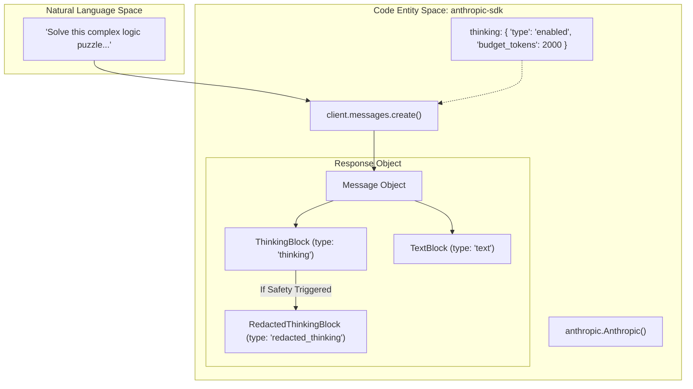
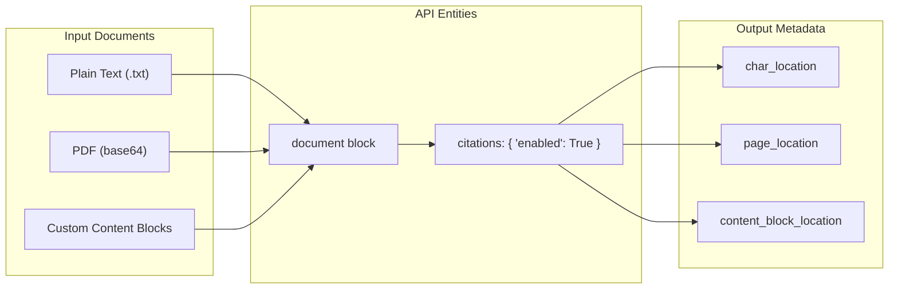

<!-- source: DeepWiki mcp.deepwiki.com · repo anthropics/claude-cookbooks · page 11 Advanced API Features · fetched 2026-10-26 -->

# Advanced API Features

Relevant source files

The following files were used as context for generating this wiki page:

- [.env.example](.env.example)
- [extended_thinking/extended_thinking.ipynb](extended_thinking/extended_thinking.ipynb)
- [extended_thinking/extended_thinking_with_tool_use.ipynb](extended_thinking/extended_thinking_with_tool_use.ipynb)
- [finetuning/datasets/json_mode_dataset.jsonl](finetuning/datasets/json_mode_dataset.jsonl)
- [finetuning/finetuning_on_bedrock.ipynb](finetuning/finetuning_on_bedrock.ipynb)
- [misc/data/Amazon-com-Inc-2023-Shareholder-Letter-highlighted.pdf](misc/data/Amazon-com-Inc-2023-Shareholder-Letter-highlighted.pdf)
- [misc/data/Amazon-com-Inc-2023-Shareholder-Letter.pdf](misc/data/Amazon-com-Inc-2023-Shareholder-Letter.pdf)
- [misc/session_memory_compaction.ipynb](misc/session_memory_compaction.ipynb)
- [misc/using_citations.ipynb](misc/using_citations.ipynb)
- [observability/usage_cost_api.ipynb](observability/usage_cost_api.ipynb)
- [third_party/MongoDB/rag_using_mongodb.ipynb](third_party/MongoDB/rag_using_mongodb.ipynb)
- [third_party/Pinecone/claude_3_rag_agent.ipynb](third_party/Pinecone/claude_3_rag_agent.ipynb)

This page documents specialized Claude API capabilities designed for production-grade applications requiring high reasoning transparency, verifiable grounding, and operational observability. These features include **Extended Thinking** for exposing Claude's internal logic, the **Citations API** for document-grounded responses, **Usage Tracking** for cost management, and **Fable 5 Fallback** for safety handling.

## Extended Thinking

Extended thinking allows Claude 3.7 Sonnet to perform deep reasoning before delivering a final answer. When enabled, Claude generates `thinking` content blocks that contain its step-by-step internal monologue. This feature is particularly effective for complex coding, mathematical reasoning, and architectural planning tasks.

For comprehensive details, see [Extended Thinking](#11.1).

### Thinking Architecture and Flow

The following diagram illustrates how extended thinking integrates into the standard Messages API lifecycle, including how it interacts with safety filters and token budgets.

**Thinking Lifecycle Diagram**

**Key Implementation Details:**
* **Configuration:** Thinking is enabled via the `thinking` parameter, which requires a `budget_tokens` value (minimum 1,024) [extended_thinking/extended_thinking.ipynb:175-182]().
* **Streaming:** Thinking content can be streamed using `thinking_delta` events, allowing UI components to show reasoning in real-time [extended_thinking/extended_thinking.ipynb:281-323]().
* **Tool Use:** When combined with tools, Claude outputs its thinking *before* making tool calls to explain its selection logic [extended_thinking/extended_thinking_with_tool_use.ipynb:131-150]().
* **Redaction:** If internal reasoning violates safety guidelines, the API returns a `redacted_thinking` block containing encrypted data to maintain conversation state [extended_thinking/extended_thinking.ipynb:79-81]().

Sources: [extended_thinking/extended_thinking.ipynb](), [extended_thinking/extended_thinking_with_tool_use.ipynb]()

## Citations API

The Citations API provides a native mechanism for Claude to reference specific parts of source documents. Unlike prompt-based citation techniques, this feature uses structured location metadata, which reduces output token costs and increases citation precision.

For details, see [Citations API](#11.2).

### Grounding and Metadata Mapping

This diagram bridges the gap between raw document inputs and the structured citation objects returned by the API.

**Citation Data Flow**

**Key Capabilities:**
* **Supported Models:** Available on `claude-sonnet-4-6` and `claude-3-5-haiku-20241022` [misc/using_citations.ipynb:12-13]().
* **Location Types:** Supports `char_location` for text, `page_location` for PDFs, and `content_block_location` for custom structured data [misc/using_citations.ipynb:66-68]().
* **Precision:** Citations are returned as structured data in the API response, pointing to specific `cited_text` and `document_title` [misc/using_citations.ipynb:108-119]().

Sources: [misc/using_citations.ipynb]()

## Observability and Usage Tracking

Production deployments require granular visibility into token consumption and cost attribution. The Usage & Cost Admin API provides programmatic access to organization-wide metrics.

For details, see [Observability and Usage Tracking](#11.3).

**Core Metrics and Operations:**
* **Token Monitoring:** The `AnthropicAdminAPI` wrapper facilitates monitoring `uncached_input_tokens`, `output_tokens`, `cache_creation`, and `cache_read_input_tokens` [observability/usage_cost_api.ipynb:64-84]().
* **Cost Analysis:** Retrieval of financial data in USD with breakdowns by service type via the `usage_report/messages` endpoint [observability/usage_cost_api.ipynb:42-44]().
* **Efficiency Analysis:** Measuring cache efficiency to optimize prompt construction and reduce costs [observability/usage_cost_api.ipynb:37-37]().

Sources: [observability/usage_cost_api.ipynb]()

## Finetuning on AWS Bedrock

For specialized domains requiring specific formatting or style adherence beyond what few-shot prompting can achieve, Claude 3 Haiku can be finetuned on Amazon Bedrock.

For details, see [Finetuning on AWS Bedrock](#11.4).

**Finetuning Workflow:**
* **Data Preparation:** Datasets must be JSONL files containing `system` (optional) and alternating `user`/`assistant` message turns [finetuning/finetuning_on_bedrock.ipynb:43-61]().
* **Job Configuration:** Launching jobs using `create_model_customization_job` with hyperparameters like `epochCount`, `batchSize`, and `learningRateMultiplier` [finetuning/finetuning_on_bedrock.ipynb:152-165]().
* **Deployment:** Once trained, models are hosted using **Provisioned Throughput** in Amazon Bedrock for production inference [finetuning/finetuning_on_bedrock.ipynb:189-191]().

Sources: [finetuning/finetuning_on_bedrock.ipynb]()

## Fable 5 Fallback and Billing

Claude Fable 5 introduces a safety classifier system that protects against specific high-risk domains while providing a fallback mechanism to maintain application uptime.

For details, see [Fable 5 Fallback and Billing](#11.5).

**Key Features:**
* **Safety Classifiers:** Blocks content in three specific domains: offensive cybersecurity, biology/life sciences, and summarized thinking extraction.
* **Opus 4.8 Fallback:** Server-side and client-side configurations allow requests blocked by Fable 5 to automatically fallback to Opus 4.8.
* **Billing Optimization:** The system is designed to avoid token costs on most fallback cases, ensuring safety interventions do not lead to unexpected expenses.

---

