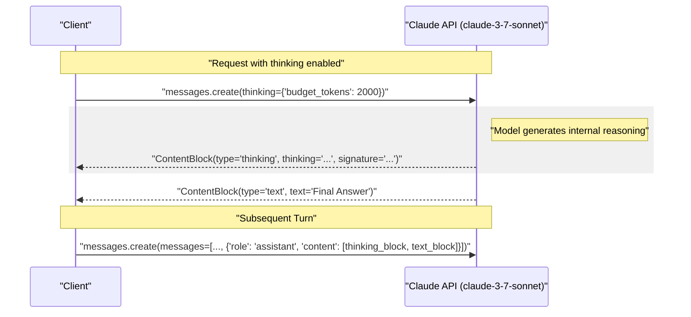
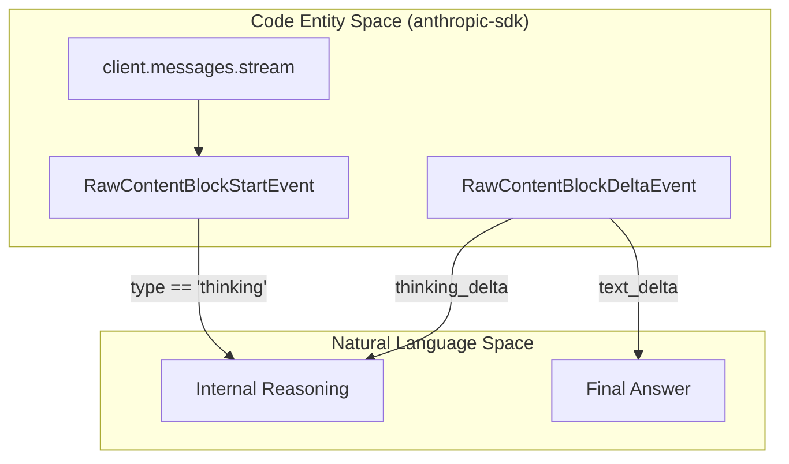
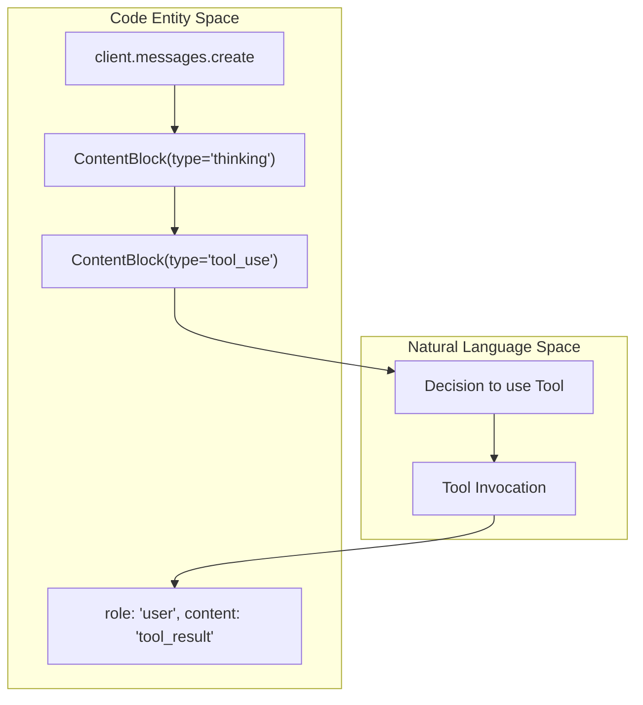

<!-- source: DeepWiki mcp.deepwiki.com · repo anthropics/claude-cookbooks · page 11.1 Extended Thinking · fetched 2026-10-26 -->

# Extended Thinking

<details>
<summary>Relevant source files</summary>

The following files were used as context for generating this wiki page:

- [extended_thinking/extended_thinking.ipynb](extended_thinking/extended_thinking.ipynb)
- [extended_thinking/extended_thinking_with_tool_use.ipynb](extended_thinking/extended_thinking_with_tool_use.ipynb)
- [misc/data/Amazon-com-Inc-2023-Shareholder-Letter-highlighted.pdf](misc/data/Amazon-com-Inc-2023-Shareholder-Letter-highlighted.pdf)
- [misc/data/Amazon-com-Inc-2023-Shareholder-Letter.pdf](misc/data/Amazon-com-Inc-2023-Shareholder-Letter.pdf)
- [misc/using_citations.ipynb](misc/using_citations.ipynb)

</details>


Extended thinking is a feature for Claude 3.7 Sonnet that provides the model with enhanced reasoning capabilities for complex tasks. It allows the model to perform step-by-step internal reasoning in specialized `thinking` content blocks before delivering a final response. This process provides transparency into how Claude interprets instructions, handles edge cases, and decides on tool invocations.

## Architecture and Data Flow

When extended thinking is enabled, the model generates a response containing one or more content blocks. These blocks can be of type `thinking`, `text`, `tool_use`, or `redacted_thinking`.

### Request Configuration
To enable extended thinking, the `thinking` parameter must be included in the `client.messages.create` call. This parameter requires a `budget_tokens` value, which defines the maximum number of tokens Claude can use for internal reasoning [extended_thinking/extended_thinking.ipynb:175-182]().

### Content Block Types
| Block Type | Description |
| :--- | :--- |
| `thinking` | Contains the plaintext reasoning process of the model [extended_thinking/extended_thinking.ipynb:71-76](). |
| `redacted_thinking` | Occurs when thinking content is flagged by safety systems. It contains an encrypted `data` string [extended_thinking/extended_thinking.ipynb:79-81](). |
| `text` | The final visible response or intermediate conversational text [extended_thinking/extended_thinking.ipynb:82-84](). |
| `tool_use` | A request to execute a specific tool based on the preceding reasoning [extended_thinking/extended_thinking_with_tool_use.ipynb:146-149](). |

### Thinking Process Lifecycle
The following diagram illustrates the data flow between the client and Claude when extended thinking is enabled, including the handling of thinking signatures.

**Extended Thinking Sequence**

Sources: [extended_thinking/extended_thinking.ipynb:68-87](), [extended_thinking/extended_thinking.ipynb:175-182]()

## Implementation Details

### Basic Usage
The core implementation involves setting the `thinking` budget and handling the resulting content blocks. The `budget_tokens` must be less than or equal to `max_tokens` [extended_thinking/extended_thinking.ipynb:175-182]().

```python
# Implementation in basic_thinking_example()
response = client.messages.create(
    model="claude-3-7-sonnet-20250219",
    max_tokens=4000,
    thinking={
        "type": "enabled",
        "budget_tokens": 2000
    },
    messages=[{"role": "user", "content": "..."}]
)
```
Sources: [extended_thinking/extended_thinking.ipynb:175-182]()

### Streaming Thinking Blocks
When streaming, thinking content is delivered via `RawContentBlockStartEvent` and `RawContentBlockDeltaEvent`. The `thinking_delta` contains the incremental reasoning text [extended_thinking/extended_thinking.ipynb:242-260]().

**Streaming Entity Mapping**

Sources: [extended_thinking/extended_thinking.ipynb:235-265]()

### Token Counting and Management
Thinking tokens are counted as output tokens. To manage the context window, developers must account for both input tokens and the thinking budget. The `client.messages.count_tokens` method can be used to calculate input overhead before sending the request [extended_thinking/extended_thinking.ipynb:88-95]().

### Integration with Tool Use
When tools are used with extended thinking, the model generates reasoning *before* the `tool_use` block. 
1. **Initial Turn**: Claude outputs a `thinking` block followed by a `tool_use` block [extended_thinking/extended_thinking_with_tool_use.ipynb:131-150]().
2. **Tool Result**: The client provides the `tool_result`.
3. **Final Turn**: Claude processes the result and provides the final `text` block. Note that Claude does not generate a new `thinking` block immediately after a `tool_result` [extended_thinking/extended_thinking_with_tool_use.ipynb:17-18]().

**Tool Use Entity Mapping**

Sources: [extended_thinking/extended_thinking_with_tool_use.ipynb:112-168]()

## Handling Redacted Thinking
If the safety system flags a thinking process, the block type becomes `redacted_thinking`. This block contains an encrypted `data` string instead of plaintext. This block must be preserved in the message history for conversation continuity, even though it is not human-readable [extended_thinking/extended_thinking.ipynb:423-440]().

## Best Practices
- **Preserving Signatures**: When continuing a conversation, the `thinking` block (including its `signature`) must be passed back to the API to maintain the state of the model's reasoning [extended_thinking/extended_thinking.ipynb:76-78]().
- **Budgeting**: Set `budget_tokens` based on task complexity. Mathematical proofs or complex coding tasks typically require higher budgets than simple summarization [extended_thinking/extended_thinking.ipynb:13-14]().
- **Error Handling**: Monitor `stop_reason`. If the model hits the `max_tokens` limit during thinking, it may be unable to provide a final answer [extended_thinking/extended_thinking.ipynb:485-500]().

Sources: [extended_thinking/extended_thinking.ipynb:1-20](), [extended_thinking/extended_thinking_with_tool_use.ipynb:1-18]()

---

