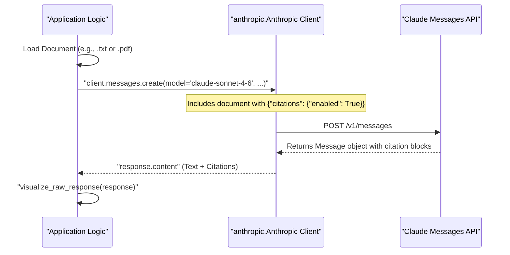
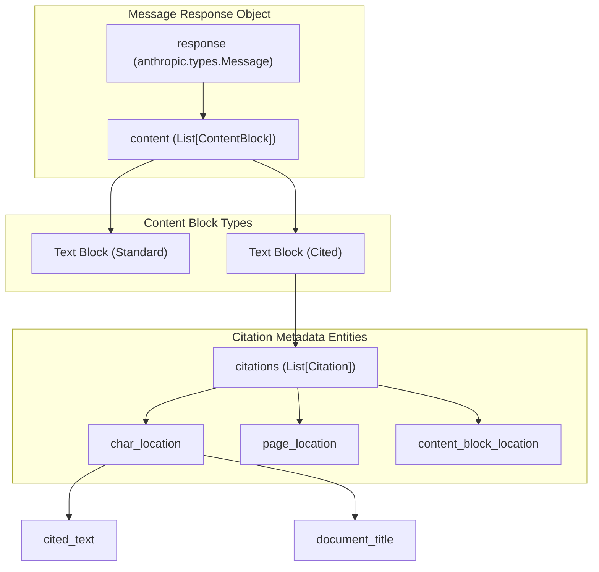

<!-- source: DeepWiki mcp.deepwiki.com · repo anthropics/claude-cookbooks · page 11.2 Citations API · fetched 2026-10-26 -->

# Citations API

<details>
<summary>Relevant source files</summary>

The following files were used as context for generating this wiki page:

- [extended_thinking/extended_thinking.ipynb](extended_thinking/extended_thinking.ipynb)
- [extended_thinking/extended_thinking_with_tool_use.ipynb](extended_thinking/extended_thinking_with_tool_use.ipynb)
- [misc/data/Amazon-com-Inc-2023-Shareholder-Letter-highlighted.pdf](misc/data/Amazon-com-Inc-2023-Shareholder-Letter-highlighted.pdf)
- [misc/data/Amazon-com-Inc-2023-Shareholder-Letter.pdf](misc/data/Amazon-com-Inc-2023-Shareholder-Letter.pdf)
- [misc/using_citations.ipynb](misc/using_citations.ipynb)

</details>


The Citations API is a specialized feature of the Claude Messages API that allows Claude to provide detailed, verifiable sources when answering questions based on provided documents. Unlike manual prompt-engineering techniques, the Citations API uses built-in mechanisms to return structured metadata alongside the response text, ensuring that claims are grounded in the provided context.

## Overview and Supported Models

The Citations API is specifically optimized for high-precision retrieval and grounding. It is currently supported on the following models:
*   `claude-3-5-sonnet-20241022` (referenced as `claude-sonnet-4-6` in implementation) [misc/using_citations.ipynb:12-12](), [misc/using_citations.ipynb:157-157]()
*   `claude-3-5-haiku-20241022` [misc/using_citations.ipynb:13-13]()

### Advantages over Prompt-based Techniques
Traditional RAG (Retrieval-Augmented Generation) often relies on "manually" asking Claude to quote sources. The Citations API provides several technical advantages:
1.  **Reduced Token Overhead**: Manual techniques require Claude to output full quotes in the text body, increasing output token counts and cost. The Citations API returns structured references [misc/using_citations.ipynb:15-16]().
2.  **Source Integrity**: The feature is architected to prevent citations pointing to documents or locations that were not provided in the request [misc/using_citations.ipynb:17-17]().
3.  **Higher Performance**: Internal testing indicates higher recall and precision compared to prompt-based instructions [misc/using_citations.ipynb:18-18]().

## Document Types and Location Formats

The API supports three distinct document types, each associated with a specific location format in the response metadata.

| Document Type | Source Format | Location Format |
| :--- | :--- | :--- |
| **Plain Text** | Raw string data | `char_location` |
| **PDF** | Base64 encoded PDF | `page_location` |
| **Custom Content** | Structured content blocks | `content_block_location` |

Sources: [misc/using_citations.ipynb:64-70]()

### Plain Text Documents
When providing plain text, the API automatically chunks the content into sentences. Claude cites these sentences as discrete units; it can cite multiple sentences in one block but will not cite fragments smaller than a single sentence [misc/using_citations.ipynb:79-79]().

### PDF Documents
For PDF inputs, the model provides page-level grounding. This is particularly useful for long-form financial reports or legal documents where page numbers are the standard reference [misc/using_citations.ipynb:67-67]().

## Implementation and Data Flow

To use citations, documents must be passed as part of the `messages` or `system` prompt with the `citations` flag enabled.

### Request Structure
Documents are defined as objects within the content array. Each document requires:
*   `type`: Set to `"document"` [misc/using_citations.ipynb:144-144]().
*   `source`: Contains the `media_type` and the actual `data` [misc/using_citations.ipynb:145-145]().
*   `title`: A string used by Claude to refer to the source [misc/using_citations.ipynb:146-146]().
*   `citations`: An object with `{"enabled": True}` [misc/using_citations.ipynb:147-147]().

### Data Flow Diagram: Request to Cited Response
This diagram illustrates how a user request containing a document is processed by the `anthropic.Anthropic` client and returned as a structured message.

Title: Citations API Execution Flow

Sources: [misc/using_citations.ipynb:55-55](), [misc/using_citations.ipynb:156-168](), [misc/using_citations.ipynb:171-171]()

## Response Structure and Parsing

The API response contains a `content` array. While standard responses typically contain a single `text` block, a cited response splits the text into multiple blocks. Blocks that contain grounded information include a `citations` array.

### Entity Mapping: Response Object to Citation Metadata
This diagram maps the JSON response structure to the code entities used for visualization and processing.

Title: Response Entity Mapping

Sources: [misc/using_citations.ipynb:99-126](), [misc/using_citations.ipynb:171-171]()

### Example Response JSON
A typical response for a plain text document citation includes the `char_location` type:

```json
{
  "type": "text",
  "text": "You'll receive an email with your tracking number once your order ships.",
  "citations": [
    {
      "type": "char_location",
      "cited_text": "Once your order ships, you'll receive an email with a tracking number. ",
      "document_title": "Order Tracking Information"
    }
  ]
}
```
Sources: [misc/using_citations.ipynb:107-119]()

## Integration with PDF Documents

When working with PDFs, the implementation requires the `source` type to be `base64`. The citations returned will then reference page numbers rather than character offsets.

### Implementation Example
1.  **Read PDF**: The file is read as binary [misc/using_citations.ipynb:137-138]().
2.  **Encode**: Data is base64 encoded for the API [misc/using_citations.ipynb:145-145]().
3.  **Enable Citations**: The `citations` flag is set to `enabled: True` within the document block [misc/using_citations.ipynb:147-147]().

This is particularly effective for large documents like the Amazon Shareholder Letter [misc/data/Amazon-com-Inc-2023-Shareholder-Letter.pdf:1-1](), where the model can point users to the exact page containing the supporting evidence.

## Comparison with Extended Thinking
While the Citations API focuses on grounding responses in external documents, Claude 3.7 Sonnet also supports **Extended Thinking**, which provides transparency into internal reasoning via `thinking` content blocks [extended_thinking/extended_thinking.ipynb:19-19](). Both features utilize specialized content blocks in the `response.content` list, but serve different purposes: citations for external grounding and thinking for internal logic [extended_thinking/extended_thinking.ipynb:71-84]().

Sources: [misc/using_citations.ipynb:131-150](), [misc/data/Amazon-com-Inc-2023-Shareholder-Letter.pdf:1-1](), [extended_thinking/extended_thinking.ipynb:19-19](), [extended_thinking/extended_thinking.ipynb:71-84]()

---

