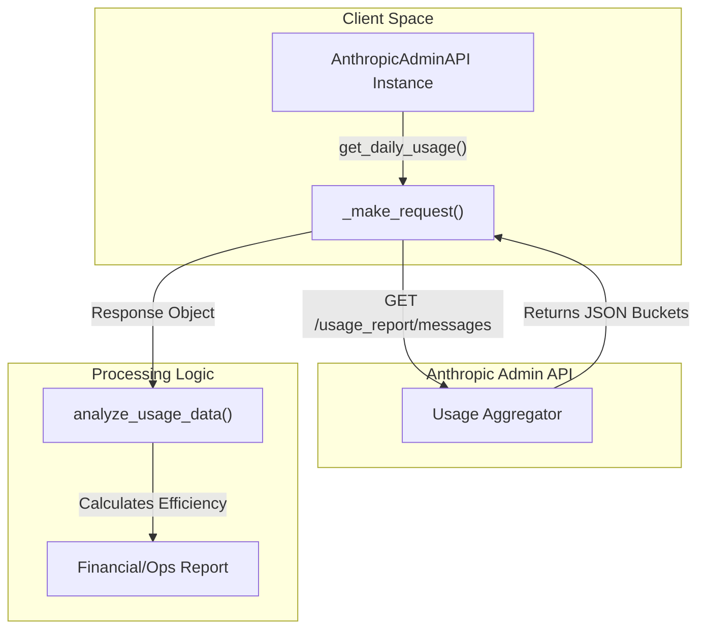
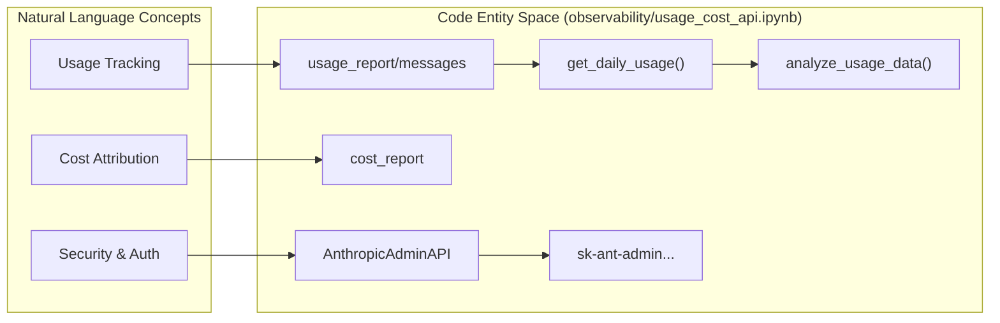

<!-- source: DeepWiki mcp.deepwiki.com · repo anthropics/claude-cookbooks · page 11.3 Observability and Usage Tracking · fetched 2026-10-26 -->

# Observability and Usage Tracking

Relevant source files

The following files were used as context for generating this wiki page:

- [.env.example](.env.example)
- [finetuning/datasets/json_mode_dataset.jsonl](finetuning/datasets/json_mode_dataset.jsonl)
- [finetuning/finetuning_on_bedrock.ipynb](finetuning/finetuning_on_bedrock.ipynb)
- [misc/session_memory_compaction.ipynb](misc/session_memory_compaction.ipynb)
- [observability/usage_cost_api.ipynb](observability/usage_cost_api.ipynb)
- [third_party/MongoDB/rag_using_mongodb.ipynb](third_party/MongoDB/rag_using_mongodb.ipynb)
- [third_party/Pinecone/claude_3_rag_agent.ipynb](third_party/Pinecone/claude_3_rag_agent.ipynb)

The Claude API provides a robust **Usage & Cost Admin API** designed for programmatic monitoring of token consumption and financial expenditures. This infrastructure allows organizations to implement detailed cost attribution, analyze cache efficiency, and automate financial reporting across multiple workspaces and projects.

## Overview of Admin API Capabilities

The system is centered around two primary endpoints that provide granular visibility into how Claude is being utilized within an organization [observability/usage_cost_api.ipynb:42-44]():

1.  **Messages Usage API**: Provides token-level usage data (uncached input, output, cache creation, and cache reads) with flexible grouping by model, workspace, or API key [observability/usage_cost_api.ipynb:24-27]().
2.  **Cost API**: Delivers financial data in USD, broken down by service type, to monitor spending trends and facilitate chargeback scenarios [observability/usage_cost_api.ipynb:29-32]().

### Implementation Architecture

The implementation follows a wrapper pattern, encapsulating the REST communication with the Anthropic Admin endpoints.

#### Data Flow: Usage Retrieval
The following diagram illustrates the flow from a client request to the retrieval of aggregated usage metrics.

**Usage Report Request Flow**

Sources: [observability/usage_cost_api.ipynb:64-64](), [observability/usage_cost_api.ipynb:115-127](), [observability/usage_cost_api.ipynb:130-145]()

## Key Classes and Functions

### AnthropicAdminAPI Class
The `AnthropicAdminAPI` class serves as the secure wrapper for the Admin endpoints. It enforces strict API key formatting (requiring the `sk-ant-admin` prefix) and manages authentication headers [observability/usage_cost_api.ipynb:64-64]().

*   **`__init__(self, api_key)`**: Initializes the client, validating that the key is present and correctly formatted. It defaults to the `ANTHROPIC_ADMIN_API_KEY` environment variable [observability/usage_cost_api.ipynb:64-64]().
*   **`_make_request(self, endpoint, params)`**: A private helper that handles the `requests.get` logic, timeout management (30s), and specific HTTP error mapping (401 for permissions, 429 for rate limits) [observability/usage_cost_api.ipynb:64-64]().

### Usage Analysis Functions
Data returned from the API is delivered in "time buckets" — fixed intervals (e.g., `1d`) containing aggregated usage [observability/usage_cost_api.ipynb:77-78]().

*   **`get_daily_usage(client, days_back)`**: Constructs the temporal parameters (`starting_at`, `ending_at`) and bucket width to query the `usage_report/messages` endpoint [observability/usage_cost_api.ipynb:115-127]().
*   **`analyze_usage_data(response)`**: Iterates through the returned buckets to aggregate metrics including `uncached_input_tokens`, `output_tokens`, `cache_creation`, and `cache_read_input_tokens` [observability/usage_cost_api.ipynb:130-145]().

Sources: [observability/usage_cost_api.ipynb:64-145]()

## Metrics and Efficiency Analysis

The API tracks specific token types that are critical for understanding both performance and cost-efficiency:

| Metric | Description |
| :--- | :--- |
| `uncached_input_tokens` | New input tokens from prompts and system messages [observability/usage_cost_api.ipynb:80-80](). |
| `output_tokens` | Tokens generated by Claude in responses [observability/usage_cost_api.ipynb:81-81](). |
| `cache_creation` | Tokens written to the ephemeral cache for future reuse [observability/usage_cost_api.ipynb:82-82](). |
| `cache_read_input_tokens` | Tokens successfully retrieved from the cache, typically billed at a significant discount [observability/usage_cost_api.ipynb:83-83](). |

### Cache Efficiency Calculation
The `analyze_usage_data` function calculates cache efficiency as the percentage of total input tokens that were served from the cache:
`Efficiency = cache_reads / (uncached_input + cache_reads)` [observability/usage_cost_api.ipynb:109-109]().

## Code Entity Map

The following diagram bridges the high-level observability concepts to the specific implementation entities in the cookbook.

**Observability Entity Mapping**

Sources: [observability/usage_cost_api.ipynb:24-49](), [observability/usage_cost_api.ipynb:64-64](), [observability/usage_cost_api.ipynb:115-130]()

## Related Optimization Patterns

While the Admin API provides retrospective tracking, several other components in the repository implement proactive token management that the Admin API eventually measures:

*   **Prompt Caching**: The `add_cache_control` function in session memory patterns applies `ephemeral` cache control to user messages to reduce the `uncached_input_tokens` metric reported by the Admin API [misc/session_memory_compaction.ipynb:120-145]().
*   **Context Compaction**: Automated or manual compaction reduces the total context size, directly impacting the token consumption metrics tracked by the `Messages Usage API` [misc/session_memory_compaction.ipynb:7-13]().

## Security and Best Practices

1.  **Key Restricted Access**: Admin API keys (`sk-ant-admin`) provide broad access to organizational financial data and should be restricted to infrastructure or finance service accounts [observability/usage_cost_api.ipynb:48-49]().
2.  **Bucket Alignment**: When querying usage, it is recommended to "snap" the `starting_at` and `ending_at` timestamps to the start of the day (e.g., using `datetime.combine(datetime.utcnow(), time.min)`) to align with bucket boundaries and ensure consistent data aggregation [observability/usage_cost_api.ipynb:64-64]().
3.  **Error Handling**: Implementation should specifically handle `429` (Rate Limit) errors by implementing backoff logic, as admin reporting queries can be resource-intensive [observability/usage_cost_api.ipynb:64-64]().

Sources: [observability/usage_cost_api.ipynb:48-64](), [misc/session_memory_compaction.ipynb:120-145]()

---

