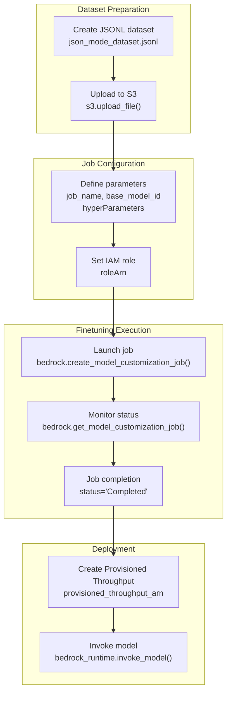
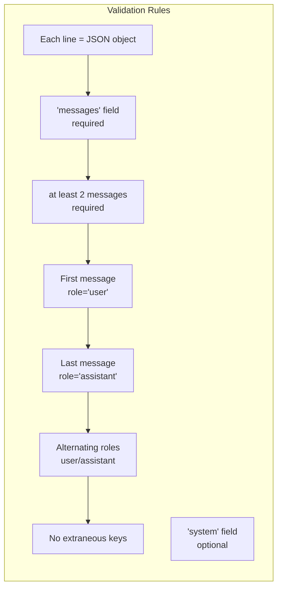
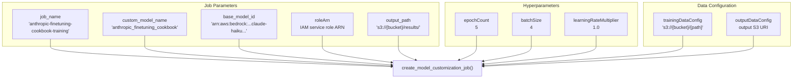
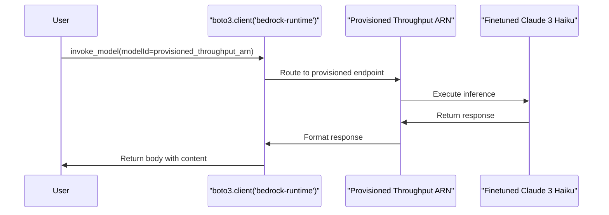
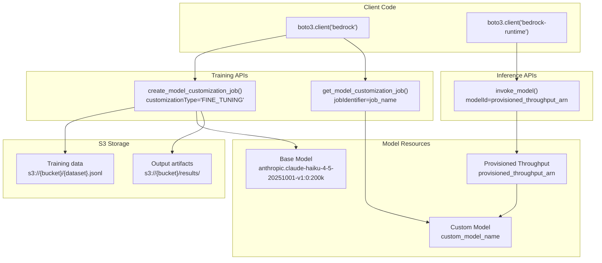

<!-- source: DeepWiki mcp.deepwiki.com · repo anthropics/claude-cookbooks · page 11.4 Finetuning on AWS Bedrock · fetched 2026-10-26 -->

# Finetuning on AWS Bedrock

<details>
<summary>Relevant source files</summary>

The following files were used as context for generating this wiki page:

- [.env.example](.env.example)
- [finetuning/datasets/json_mode_dataset.jsonl](finetuning/datasets/json_mode_dataset.jsonl)
- [finetuning/finetuning_on_bedrock.ipynb](finetuning/finetuning_on_bedrock.ipynb)
- [misc/session_memory_compaction.ipynb](misc/session_memory_compaction.ipynb)
- [observability/usage_cost_api.ipynb](observability/usage_cost_api.ipynb)
- [third_party/MongoDB/rag_using_mongodb.ipynb](third_party/MongoDB/rag_using_mongodb.ipynb)
- [third_party/Pinecone/claude_3_rag_agent.ipynb](third_party/Pinecone/claude_3_rag_agent.ipynb)

</details>


## Purpose and Scope

This document covers the process of finetuning Claude 3 Haiku models on Amazon Bedrock, including dataset preparation, job configuration, and model deployment via Provisioned Throughput. The guide demonstrates the complete workflow from dataset creation to inference using the finetuned model.

For general Claude API usage patterns, see [Advanced API Features](11.1). For other deployment options, see the main [Overview](1).

## Overview

Amazon Bedrock provides a managed finetuning service for Claude models, allowing customization of model behavior on domain-specific tasks. The finetuning process uses supervised learning with conversational examples to adapt the base model's responses.

### Finetuning Workflow

Title: Finetuning Execution Flow

Sources: [finetuning/finetuning_on_bedrock.ipynb:1-235]()

## Prerequisites

### Required AWS Resources

| Resource | Purpose | Notes |
|----------|---------|-------|
| AWS Account | Bedrock access | Must have Bedrock service enabled [finetuning/finetuning_on_bedrock.ipynb:11-11]() |
| S3 Bucket | Dataset storage | For training data and output artifacts [finetuning/finetuning_on_bedrock.ipynb:125-125]() |
| IAM Service Role | Bedrock permissions | Must access S3 bucket with training data [finetuning/finetuning_on_bedrock.ipynb:13-13]() |
| boto3 SDK | AWS API access | Python library for Bedrock interaction [finetuning/finetuning_on_bedrock.ipynb:24-24]() |

The service role must have appropriate permissions to access the S3 bucket containing training data, as documented in the [AWS Bedrock IAM role requirements](https://docs.aws.amazon.com/bedrock/latest/userguide/model-customization-iam-role.html).

Sources: [finetuning/finetuning_on_bedrock.ipynb:10-24]()

### Installation

```python
!pip install boto3
```
[finetuning/finetuning_on_bedrock.ipynb:24-24]()

Initialize the Bedrock clients:

```python
import boto3

bedrock = boto3.client(service_name="bedrock")
bedrock_runtime = boto3.client(service_name="bedrock-runtime")
```
[finetuning/finetuning_on_bedrock.ipynb:33-33](), [finetuning/finetuning_on_bedrock.ipynb:149-150]()

Sources: [finetuning/finetuning_on_bedrock.ipynb:24-150]()

## Dataset Format

### JSONL Structure

The training dataset must be a JSONL file where each line contains a JSON object with the following structure:

```json
{
  "system": "<optional_system_message>",
  "messages": [
    {"role": "user", "content": "user message"},
    {"role": "assistant", "content": "assistant response"},
    ...
  ]
}
```
[finetuning/finetuning_on_bedrock.ipynb:46-53]()

### Format Requirements

Title: Dataset Validation Logic

Sources: [finetuning/finetuning_on_bedrock.ipynb:40-66]()

**Constraints:**
- `system` field is optional [finetuning/finetuning_on_bedrock.ipynb:56-56]()
- Must have at least 2 messages [finetuning/finetuning_on_bedrock.ipynb:57-57]()
- First message must have `role: "user"` [finetuning/finetuning_on_bedrock.ipynb:58-58]()
- Last message must have `role: "assistant"` [finetuning/finetuning_on_bedrock.ipynb:59-59]()
- User and assistant messages must alternate [finetuning/finetuning_on_bedrock.ipynb:60-60]()
- No additional keys allowed in the JSON structure [finetuning/finetuning_on_bedrock.ipynb:61-61]()

### Example Dataset

The provided sample dataset `json_mode_dataset.jsonl` teaches a model to respond to all questions with JSON [finetuning/finetuning_on_bedrock.ipynb:64-65]().

```python
import json

sample_dataset = []
dataset_path = "datasets/json_mode_dataset.jsonl"
with open(dataset_path) as f:
    for line in f:
        sample_dataset.append(json.loads(line))
```
[finetuning/finetuning_on_bedrock.ipynb:74-80]()

Each example in `json_mode_dataset.jsonl` includes:
- `system`: `"JSON Mode: Enabled"` [finetuning/datasets/json_mode_dataset.jsonl:1-1]()
- User queries in natural language [finetuning/datasets/json_mode_dataset.jsonl:1-1]()
- Assistant responses formatted as structured JSON [finetuning/datasets/json_mode_dataset.jsonl:1-1]()

Sources: [finetuning/finetuning_on_bedrock.ipynb:68-83](), [finetuning/datasets/json_mode_dataset.jsonl:1-12]()

### Dataset Upload to S3

```python
bucket_name = "YOUR_BUCKET_NAME"
s3_path = "json_mode_dataset.jsonl"

s3 = boto3.client("s3")
s3.upload_file(dataset_path, bucket_name, s3_path)
```
[finetuning/finetuning_on_bedrock.ipynb:99-103]()

Sources: [finetuning/finetuning_on_bedrock.ipynb:89-104]()

## Launching a Finetuning Job

### Job Configuration

Title: Job Configuration Parameters

Sources: [finetuning/finetuning_on_bedrock.ipynb:110-134]()

### Configuration Parameters

```python
# Configuration
job_name = "anthropic-finetuning-cookbook-training"
custom_model_name = "anthropic_finetuning_cookbook"
role = "YOUR_AWS_SERVICE_ROLE_ARN"
output_path = f"s3://{bucket_name}/finetuning_example_results/"
base_model_id = (
    "arn:aws:bedrock:us-east-1::foundation-model/anthropic.claude-haiku-4-5-20251001-v1:0:200k"
)

# Hyperparameters
epoch_count = 5
batch_size = 4
learning_rate_multiplier = 1.0
```
[finetuning/finetuning_on_bedrock.ipynb:122-133]()

| Parameter | Type | Description |
|-----------|------|-------------|
| `job_name` | string | Unique identifier for the finetuning job [finetuning/finetuning_on_bedrock.ipynb:122-122]() |
| `custom_model_name` | string | Name for the resulting custom model [finetuning/finetuning_on_bedrock.ipynb:123-123]() |
| `base_model_id` | ARN | Base Claude model to finetune [finetuning/finetuning_on_bedrock.ipynb:127-127]() |
| `roleArn` | ARN | IAM role for Bedrock service [finetuning/finetuning_on_bedrock.ipynb:124-124]() |
| `epochCount` | integer | Number of training passes over the dataset [finetuning/finetuning_on_bedrock.ipynb:131-131]() |
| `batchSize` | integer | Number of examples per training batch [finetuning/finetuning_on_bedrock.ipynb:132-132]() |
| `learningRateMultiplier` | float | Scaling factor for learning rate [finetuning/finetuning_on_bedrock.ipynb:133-133]() |

### Launching the Job

```python
bedrock.create_model_customization_job(
    customizationType="FINE_TUNING",
    jobName=job_name,
    customModelName=custom_model_name,
    roleArn=role,
    baseModelIdentifier=base_model_id,
    hyperParameters={
        "epochCount": f"{epoch_count}",
        "batchSize": f"{batch_size}",
        "learningRateMultiplier": f"{learning_rate_multiplier}",
    },
    trainingDataConfig={"s3Uri": f"s3://{bucket_name}/{s3_path}"},
    outputDataConfig={"s3Uri": output_path},
)
```
[finetuning/finetuning_on_bedrock.ipynb:152-165]()

**Note:** All hyperparameter values must be passed as strings, even numeric values [finetuning/finetuning_on_bedrock.ipynb:159-161]().

### Monitoring Job Status

```python
# Check for the job status
status = bedrock.get_model_customization_job(jobIdentifier=job_name)["status"]
```
[finetuning/finetuning_on_bedrock.ipynb:182-182]()

The `status` field indicates job progress. Common values include `InProgress`, `Completed`, or `Failed` [finetuning/finetuning_on_bedrock.ipynb:172-182]().

Sources: [finetuning/finetuning_on_bedrock.ipynb:110-183]()

## Using the Finetuned Model

### Provisioned Throughput Requirement

Finetuned models on Bedrock require deployment via Provisioned Throughput before inference [finetuning/finetuning_on_bedrock.ipynb:191-191]().

Title: Inference Architecture

Sources: [finetuning/finetuning_on_bedrock.ipynb:189-224]()

### Inference API Call

```python
provisioned_throughput_arn = "YOUR_PROVISIONED_THROUGHPUT_ARN"

bedrock_runtime = boto3.client("bedrock-runtime", region_name="us-east-1")
body = json.dumps(
    {
        "anthropic_version": "bedrock-2023-05-31",
        "max_tokens": 1000,
        "system": "JSON Mode: Enabled",
        "messages": [
            {
                "role": "user",
                "content": [{"type": "text", "text": "What is a large language model?"}],
            }
        ],
    }
)
response = bedrock_runtime.invoke_model(modelId=provisioned_throughput_arn, body=body)
body = json.loads(response["body"].read().decode("utf-8"))
```
[finetuning/finetuning_on_bedrock.ipynb:200-224]()

The response structure matches the standard Claude Messages API format, and the text is extracted from `body["content"][0]["text"]` [finetuning/finetuning_on_bedrock.ipynb:224-224]().

Sources: [finetuning/finetuning_on_bedrock.ipynb:189-234]()

## Technical Architecture

### API Integration Flow

Title: Bedrock Finetuning Service Map

Sources: [finetuning/finetuning_on_bedrock.ipynb:24-234]()

### Hyperparameter Configuration

The training process accepts three primary hyperparameters passed as string values [finetuning/finetuning_on_bedrock.ipynb:158-162]():

| Hyperparameter | Type | Default | Description |
|----------------|------|---------|-------------|
| `epochCount` | integer | 5 | Number of complete passes through training data [finetuning/finetuning_on_bedrock.ipynb:131-131]() |
| `batchSize` | integer | 4 | Number of training examples per gradient update [finetuning/finetuning_on_bedrock.ipynb:132-132]() |
| `learningRateMultiplier` | float | 1.0 | Multiplier applied to base learning rate [finetuning/finetuning_on_bedrock.ipynb:133-133]() |

Sources: [finetuning/finetuning_on_bedrock.ipynb:130-162]()

## Example Use Case: JSON Mode

The provided sample dataset `json_mode_dataset.jsonl` demonstrates training a model to consistently output structured JSON responses [finetuning/finetuning_on_bedrock.ipynb:64-65]().

### Training Data Characteristics

The dataset contains multiple examples covering:
- Factual questions (e.g., "whats the first line of moby dick") [finetuning/datasets/json_mode_dataset.jsonl:1-1]()
- Mathematical queries (e.g., "What's the square root of 144?") [finetuning/datasets/json_mode_dataset.jsonl:2-2]()
- Geography (e.g., "What's the capital of Australia?") [finetuning/datasets/json_mode_dataset.jsonl:4-4]()

### System Prompt Pattern

All training examples use a specific system prompt to trigger the learned behavior:
```
"system": "JSON Mode: Enabled"
```
[finetuning/datasets/json_mode_dataset.jsonl:1-1]()

At inference time, including this same system prompt activates the learned JSON response behavior [finetuning/finetuning_on_bedrock.ipynb:214-214]().

Sources: [finetuning/datasets/json_mode_dataset.jsonl:1-12](), [finetuning/finetuning_on_bedrock.ipynb:214-214]()

---

