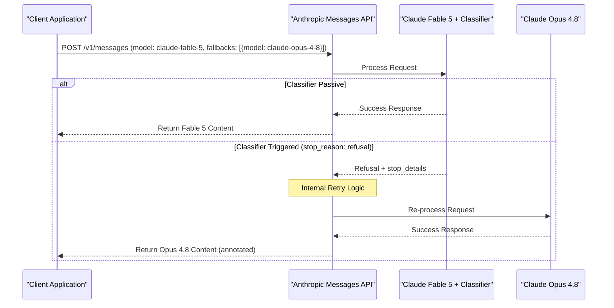
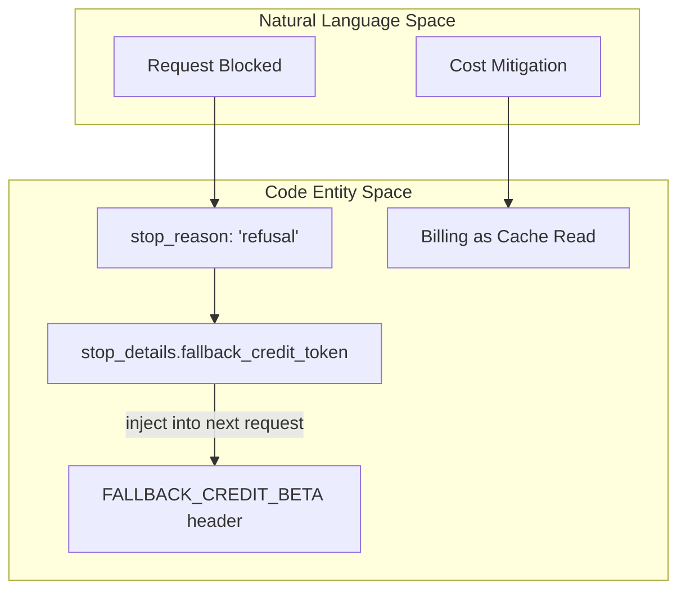

<!-- source: DeepWiki mcp.deepwiki.com · repo anthropics/claude-cookbooks · page 11.5 Fable 5 Fallback and Billing · fetched 2026-10-26 -->

# Fable 5 Fallback and Billing

Relevant source files

The following files were used as context for generating this wiki page:

- [fable_5_fallback_billing/guide.ipynb](fable_5_fallback_billing/guide.ipynb)

Claude Fable 5 incorporates advanced reasoning capabilities that necessitate a robust safety classifier system. This page documents the technical implementation of the classifier, the specific domains it monitors, and the configuration of fallback mechanisms to Claude Opus 4.8 to ensure service continuity when safety thresholds are triggered.

## 1. Safety Classifier System

Claude Fable 5 employs an automated safety classifier that runs on every request to mitigate risks associated with high-stakes technical domains [fable_5_fallback_billing/guide.ipynb:9-13]().

### Blocked Domains
The classifier is tuned for robustness and may block requests in three specific categories [fable_5_fallback_billing/11-13]():

| Category | Description |
| :--- | :--- |
| `cyber` | Offensive cybersecurity techniques, including building exploits, malware, or attack tooling [fable_5_fallback_billing/guide.ipynb:106-106](). |
| `bio` | Biology and life sciences, specifically lab methods or molecular mechanisms [fable_5_fallback_billing/guide.ipynb:107-107](). |
| `reasoning_extraction` | Attempts to extract the model's [summarized thinking](https://platform.claude.com/docs/en/build-with-claude/extended-thinking#summarized-thinking) [fable_5_fallback_billing/guide.ipynb:108-108](). |

### Classifier Response Schema
When a block occurs, the API returns a `200 OK` status with a specific `stop_reason` and `stop_details` object [fable_5_fallback_billing/guide.ipynb:84-98]().

**Sources:** [fable_5_fallback_billing/guide.ipynb:9-112]()

## 2. Server-Side Fallback Implementation

The recommended approach for handling classifier blocks is the built-in server-side fallback feature. This allows the Messages API to automatically retry the request using Claude Opus 4.8 if Fable 5's classifiers block the turn [fable_5_fallback_billing/guide.ipynb:119-121]().

### Configuration
To enable server-side fallback, developers must include the `fallbacks` parameter and the required beta header [fable_5_fallback_billing/guide.ipynb:121-122]().

*   **Beta Header:** `server-side-fallback-2026-06-01` [fable_5_fallback_billing/guide.ipynb:69-69]()
*   **Model Mapping:** Currently supports falling back from `claude-fable-5` to `claude-opus-4-8` [fable_5_fallback_billing/guide.ipynb:123-123]().

### Server-Side Data Flow
The following diagram illustrates the lifecycle of a request using server-side fallback:

**Title: Server-Side Fallback Logic Flow**

**Sources:** [fable_5_fallback_billing/guide.ipynb:67-69](), [fable_5_fallback_billing/guide.ipynb:119-138]()

## 3. Client-Side Fallback and Billing

If server-side fallback is not utilized, developers must implement client-side logic and handle billing credits manually to avoid double-charging for the blocked prompt.

### Billing Mechanism: `fallback_credit_token`
When an un-fallbacked request is blocked, the `stop_details` object includes a `fallback_credit_token` [fable_5_fallback_billing/guide.ipynb:112-112](). This token allows the subsequent fallback request to be billed as a **cache read** rather than a full prompt, significantly reducing costs [fable_5_fallback_billing/guide.ipynb:112-112]().

### Implementation with SDK
Implementation requires the `fallback-credit-2026-06-01` beta header [fable_5_fallback_billing/guide.ipynb:70-70]().

**Title: Client-Side Fallback and Billing Credit Entity Map**

**Sources:** [fable_5_fallback_billing/guide.ipynb:70-70](), [fable_5_fallback_billing/guide.ipynb:110-112]()

## 4. Best Practices and Anti-patterns

### Logic Branching
Developers should branch application logic based on `stop_reason: "refusal"`, rather than parsing the string content of the message or relying solely on `stop_details`, as `stop_details` can occasionally be null [fable_5_fallback_billing/guide.ipynb:100-100]().

### Feature Availability
*   **Server-Side:** Supported on native Claude API and Claude Platform on AWS [fable_5_fallback_billing/guide.ipynb:122-123]().
*   **Streaming:** Fallback is supported in streaming contexts. If a block occurs at the start of a stream, the API will transition to Opus 4.8 output [fable_5_fallback_billing/guide.ipynb:17-19]().

**Sources:** [fable_5_fallback_billing/guide.ipynb:17-19](), [fable_5_fallback_billing/guide.ipynb:100-102](), [fable_5_fallback_billing/guide.ipynb:122-123]()

---

