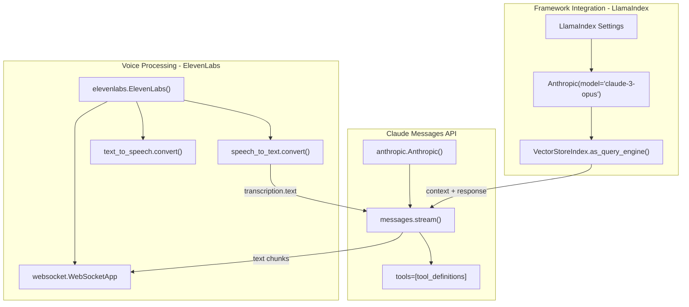
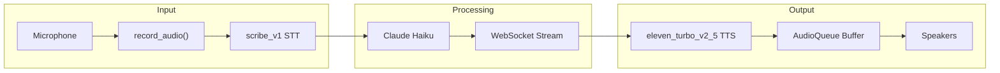

<!-- source: DeepWiki mcp.deepwiki.com · repo anthropics/claude-cookbooks · page 12 Third-Party Integrations · fetched 2026-10-26 -->

# Third-Party Integrations

<details>
<summary>Relevant source files</summary>

The following files were used as context for generating this wiki page:

- [third_party/Deepgram/README.md](third_party/Deepgram/README.md)
- [third_party/Deepgram/prerecorded_audio.ipynb](third_party/Deepgram/prerecorded_audio.ipynb)
- [third_party/ElevenLabs/.env.example](third_party/ElevenLabs/.env.example)
- [third_party/ElevenLabs/README.md](third_party/ElevenLabs/README.md)
- [third_party/ElevenLabs/low_latency_stt_claude_tts.ipynb](third_party/ElevenLabs/low_latency_stt_claude_tts.ipynb)
- [third_party/ElevenLabs/requirements.txt](third_party/ElevenLabs/requirements.txt)
- [third_party/ElevenLabs/stream_voice_assistant_websocket.py](third_party/ElevenLabs/stream_voice_assistant_websocket.py)
- [third_party/LlamaIndex/Basic_RAG_With_LlamaIndex.ipynb](third_party/LlamaIndex/Basic_RAG_With_LlamaIndex.ipynb)
- [third_party/LlamaIndex/Multi_Document_Agents.ipynb](third_party/LlamaIndex/Multi_Document_Agents.ipynb)
- [third_party/LlamaIndex/Multi_Modal.ipynb](third_party/LlamaIndex/Multi_Modal.ipynb)
- [third_party/LlamaIndex/ReAct_Agent.ipynb](third_party/LlamaIndex/ReAct_Agent.ipynb)
- [third_party/LlamaIndex/Router_Query_Engine.ipynb](third_party/LlamaIndex/Router_Query_Engine.ipynb)
- [third_party/LlamaIndex/SubQuestion_Query_Engine.ipynb](third_party/LlamaIndex/SubQuestion_Query_Engine.ipynb)

</details>


This document describes how Claude integrates with external services and APIs to extend its capabilities beyond core language modeling. The cookbooks demonstrate production-ready patterns for combining Claude with speech processing, computational knowledge engines, vector databases, and other specialized services.

For core tool use patterns without external services, see [Tool Use Framework](#6). For RAG implementation details, see [Classification and RAG](#5.1). For API optimization techniques, see [Prompt Engineering and Optimization](#10).

---

## Integration Architecture Overview

The repository demonstrates multiple integration patterns: **voice processing** (ElevenLabs, Deepgram), **computational tools** (Wolfram Alpha), and **framework-based RAG** (LlamaIndex). These integrations show production-ready code for combining Claude with specialized external services to extend its capabilities.

### High-Level Integration Architecture



**Key Code Entities:**
- **Voice**: `elevenlabs.ElevenLabs`, `anthropic.Anthropic`, `sounddevice.OutputStream`, `websocket` [third_party/ElevenLabs/stream_voice_assistant_websocket.py:65-69]().
- **Frameworks**: `llama_index.llms.anthropic.Anthropic`, `llama_index.core.VectorStoreIndex` [third_party/LlamaIndex/Basic_RAG_With_LlamaIndex.ipynb:85-86]().
- **Audio Processing**: `AudioQueue`, `pydub.AudioSegment`, `numpy` array operations [third_party/ElevenLabs/stream_voice_assistant_websocket.py:82-105]().

**Sources:** [third_party/ElevenLabs/stream_voice_assistant_websocket.py:65-105](), [third_party/LlamaIndex/Basic_RAG_With_LlamaIndex.ipynb:85-86]()

---

## Integration Categories

| Category | Service / Framework | Purpose | Implementation |
|----------|---------------------|---------|----------------|
| **Voice Processing** | ElevenLabs | Low-latency STT/TTS with WebSocket streaming | `third_party/ElevenLabs/` |
| **Framework RAG** | LlamaIndex | Orchestration for complex RAG patterns and agents | `third_party/LlamaIndex/` |
| **Audio Intelligence**| Deepgram | Advanced transcription for prerecorded and live audio | `third_party/Deepgram/` |
| **Knowledge Tools** | Wolfram Alpha | Mathematical calculations and scientific queries | `third_party/WolframAlpha/` |

---

## ElevenLabs Voice Assistant Integration

The ElevenLabs integration implements a complete speech-to-speech pipeline. The WebSocket implementation achieves the lowest latency by streaming both Claude text generation and ElevenLabs audio synthesis simultaneously.

### Pipeline Architecture



**Key Implementation Details:**
- `SAMPLE_RATE = 44100` for high-quality audio recording [third_party/ElevenLabs/stream_voice_assistant_websocket.py:62]().
- `TTS_MODEL_ID = "eleven_turbo_v2_5"` selected for fast, low-latency performance [third_party/ElevenLabs/stream_voice_assistant_websocket.py:78]().
- `AudioQueue.PRE_BUFFER_SIZE = 8192` provides a minimum buffer before playback starts to prevent initial crackling [third_party/ElevenLabs/stream_voice_assistant_websocket.py:92]().

For details, see [ElevenLabs Voice Assistant](#12.1).

**Sources:** [third_party/ElevenLabs/stream_voice_assistant_websocket.py:62-92](), [third_party/ElevenLabs/low_latency_stt_claude_tts.ipynb:8-18]()

---

## LlamaIndex and Deepgram Integrations

### LlamaIndex Orchestration
LlamaIndex provides high-level abstractions for connecting Claude to various data sources. The cookbooks demonstrate:
- **Router Query Engine**: Routing queries between different indices or tools [third_party/LlamaIndex/Router_Query_Engine.ipynb:9-11]().
- **ReAct Agent**: Implementing tool-use loops for multi-step reasoning [third_party/LlamaIndex/ReAct_Agent.ipynb:8-13]().
- **Sub-Question Engine**: Breaking complex queries spanning multiple documents into simpler sub-queries [third_party/LlamaIndex/SubQuestion_Query_Engine.ipynb:9-13]().
- **Multi-Document Agents**: Handling large numbers of documents using `DocumentAgents` [third_party/LlamaIndex/Multi_Document_Agents.ipynb:9-11]().

### Deepgram Audio
Integrations with Deepgram provide robust transcription capabilities. The [prerecorded_audio.ipynb]() notebook demonstrates using Deepgram's `nova-2` model to transcribe audio files which are then analyzed by Claude to prepare interview questions [third_party/Deepgram/prerecorded_audio.ipynb:7-18]().

For details, see [LlamaIndex and Deepgram Integrations](#12.3).

**Sources:** [third_party/LlamaIndex/Router_Query_Engine.ipynb:9-11](), [third_party/LlamaIndex/ReAct_Agent.ipynb:8-13](), [third_party/LlamaIndex/SubQuestion_Query_Engine.ipynb:9-13](), [third_party/Deepgram/prerecorded_audio.ipynb:7-18]()

---

## Search and Knowledge Integrations

Claude's utility is significantly enhanced by grounding it in external knowledge bases. This section covers:
- **Wolfram Alpha**: Scientific and mathematical grounding via the LLM API.
- **Brave Search**: Real-time web retrieval for current events.
- **Vector DBs**: Integration with Pinecone and MongoDB for persistent knowledge retrieval.
- **VoyageAI**: Using specialized embedding models to improve retrieval accuracy.

For details, see [Search and Knowledge Integrations](#12.2).

---

## Performance Comparison: Voice Latency

The [low_latency_stt_claude_tts.ipynb]() notebook demonstrates progressive optimization through measured experiments, showing significant gains when moving from standard API calls to WebSocket streaming.

| Approach | Time to First Audio | Optimization Mechanism |
|----------|---------------------|------------------------|
| **Non-streaming** | Baseline | Full response generation before TTS |
| **Claude streaming** | ~30% reduction | TTS starts as soon as first Claude chunks arrive |
| **WebSocket streaming** | ~60% reduction | Concurrent bidirectional streaming [third_party/ElevenLabs/stream_voice_assistant_websocket.py:27-31]() |

**Optimization Mechanism:**
The WebSocket approach sends text chunks immediately to ElevenLabs without waiting for full sentences, using continuous audio streaming with pre-buffering to prevent crackling [third_party/ElevenLabs/stream_voice_assistant_websocket.py:27-31]().

**Sources:** [third_party/ElevenLabs/low_latency_stt_claude_tts.ipynb:8-18](), [third_party/ElevenLabs/stream_voice_assistant_websocket.py:27-31]()

---

## Configuration and Environment Setup

All integrations require API keys managed via environment variables.

```python
# third_party/ElevenLabs/stream_voice_assistant_websocket.py:52-60
load_dotenv()
ELEVENLABS_API_KEY = os.getenv("ELEVENLABS_API_KEY")
ANTHROPIC_API_KEY = os.getenv("ANTHROPIC_API_KEY")

assert ELEVENLABS_API_KEY is not None, "ELEVENLABS_API_KEY not found"
assert ANTHROPIC_API_KEY is not None, "ANTHROPIC_API_KEY not found"
```

**Required Credentials:**
- **ElevenLabs**: API key from the ElevenLabs developer portal [third_party/ElevenLabs/.env.example:3]().
- **Anthropic**: API key from the Anthropic console [third_party/ElevenLabs/.env.example:7]().
- **LlamaIndex**: Requires `ANTHROPIC_API_KEY` to be set in the environment for the `Anthropic` LLM class [third_party/LlamaIndex/Basic_RAG_With_LlamaIndex.ipynb:62]().

**Sources:** [third_party/ElevenLabs/stream_voice_assistant_websocket.py:52-60](), [third_party/ElevenLabs/.env.example:1-7](), [third_party/LlamaIndex/Basic_RAG_With_LlamaIndex.ipynb:62]()

---

