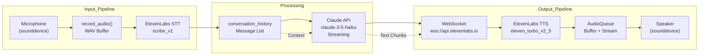
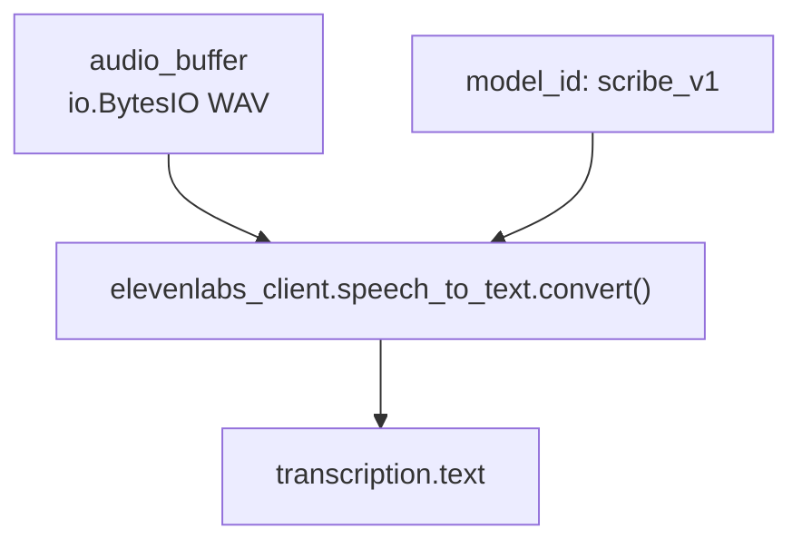
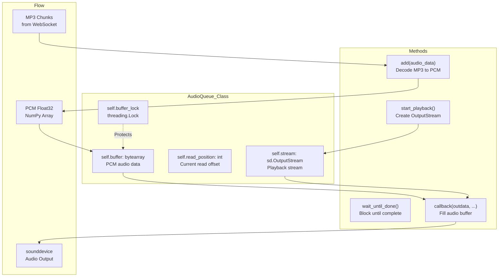
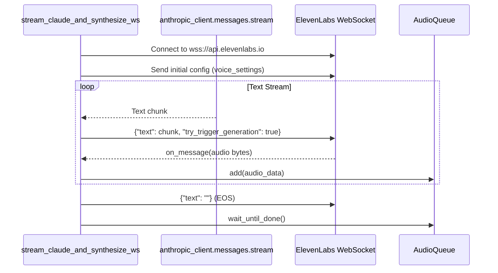

<!-- source: DeepWiki mcp.deepwiki.com · repo anthropics/claude-cookbooks · page 12.1 ElevenLabs Voice Assistant · fetched 2026-10-26 -->

# ElevenLabs Voice Assistant

Relevant source files

The following files were used as context for generating this wiki page:

- [third_party/ElevenLabs/.env.example](third_party/ElevenLabs/.env.example)
- [third_party/ElevenLabs/README.md](third_party/ElevenLabs/README.md)
- [third_party/ElevenLabs/low_latency_stt_claude_tts.ipynb](third_party/ElevenLabs/low_latency_stt_claude_tts.ipynb)
- [third_party/ElevenLabs/requirements.txt](third_party/ElevenLabs/requirements.txt)
- [third_party/ElevenLabs/stream_voice_assistant_websocket.py](third_party/ElevenLabs/stream_voice_assistant_websocket.py)

This document describes the implementation of a low-latency conversational voice assistant that integrates ElevenLabs speech-to-text and text-to-speech capabilities with Claude's conversational AI. The system demonstrates real-time audio processing, streaming optimizations, and production-ready patterns for building voice-enabled applications.

**Scope**: This page covers the voice assistant implementation located in `third_party/ElevenLabs/`, including both the educational notebook and production WebSocket streaming script.

## System Overview

The ElevenLabs voice assistant creates a complete conversational loop: recording audio from a microphone, transcribing speech to text, generating intelligent responses with Claude, synthesizing speech, and playing audio output. The implementation progressively optimizes for latency, culminating in a WebSocket-based streaming approach that minimizes time-to-first-audio.

### High-Level Architecture

**Sources**: [third_party/ElevenLabs/stream_voice_assistant_websocket.py:1-40](), [third_party/ElevenLabs/README.md:1-12]()

## Core Components

### Audio Recording System

The recording system uses `sounddevice` for real-time microphone capture with manual start/stop control via Enter key.

| Component | Implementation | Purpose |
|-----------|---------------|---------|
| Input Stream | `sd.InputStream` | Continuous microphone capture |
| Sample Rate | 44100 Hz | Standard audio quality [third_party/ElevenLabs/stream_voice_assistant_websocket.py:62]() |
| Format | Float32 → Int16 WAV | Compatible with ElevenLabs STT |
| Control | Blocking `input()` | User-controlled recording sessions |

**Key Implementation**:
The `record_audio()` function [third_party/ElevenLabs/stream_voice_assistant_websocket.py:209-245]() implements the recording logic by creating an `InputStream` with a callback that appends audio chunks to a list until the user presses Enter.

**Sources**: [third_party/ElevenLabs/stream_voice_assistant_websocket.py:209-245]()

### Speech-to-Text Integration

The `transcribe_audio()` function [third_party/ElevenLabs/stream_voice_assistant_websocket.py:248-267]() sends the WAV buffer to ElevenLabs' `scribe_v1` model.

**Sources**: [third_party/ElevenLabs/stream_voice_assistant_websocket.py:248-267]()

### AudioQueue: Continuous Playback Manager

The `AudioQueue` class [third_party/ElevenLabs/stream_voice_assistant_websocket.py:82-206]() manages continuous audio playback with minimal latency using a thread-safe buffer and `sounddevice` callback.

#### AudioQueue Architecture

**Key Constants**:
- `PRE_BUFFER_SIZE`: 8192 bytes [third_party/ElevenLabs/stream_voice_assistant_websocket.py:92-94]().
- `BUFFER_CLEANUP_THRESHOLD`: 100,000 bytes [third_party/ElevenLabs/stream_voice_assistant_websocket.py:95]().

**Sources**: [third_party/ElevenLabs/stream_voice_assistant_websocket.py:82-206]()

## WebSocket Streaming Implementation

The `stream_claude_and_synthesize_ws()` function [third_party/ElevenLabs/stream_voice_assistant_websocket.py:270-369]() implements the core streaming pipeline.

### WebSocket Data Flow

**Sources**: [third_party/ElevenLabs/stream_voice_assistant_websocket.py:270-369]()

### Configuration
- **TTS Model**: `eleven_turbo_v2_5` [third_party/ElevenLabs/stream_voice_assistant_websocket.py:78]().
- **Output Format**: `mp3_44100_128` [third_party/ElevenLabs/stream_voice_assistant_websocket.py:79]().
- **Claude Model**: `claude-3-5-haiku-20241022` [third_party/ElevenLabs/stream_voice_assistant_websocket.py:344]().

**Sources**: [third_party/ElevenLabs/stream_voice_assistant_websocket.py:71-79](), [third_party/ElevenLabs/stream_voice_assistant_websocket.py:344]()

## Latency Optimization Strategy

The implementation achieves low latency through several techniques:

1.  **Immediate Forwarding**: Text chunks from Claude are sent to the TTS WebSocket as soon as they are received [third_party/ElevenLabs/stream_voice_assistant_websocket.py:354-357]().
2.  **No Sentence Buffering**: By setting `try_trigger_generation: true`, audio generation begins without waiting for full sentences [third_party/ElevenLabs/stream_voice_assistant_websocket.py:355]().
3.  **Parallel Execution**: Audio playback begins via `AudioQueue` while Claude is still generating the remainder of the response [third_party/ElevenLabs/stream_voice_assistant_websocket.py:138-139]().

**Sources**: [third_party/ElevenLabs/stream_voice_assistant_websocket.py:26-31](), [third_party/ElevenLabs/low_latency_stt_claude_tts.ipynb:8-18]()

## Main Execution Loop

The `main()` function [third_party/ElevenLabs/stream_voice_assistant_websocket.py:372-392]() manages the conversation state and user interaction.

1.  **Context**: Maintains `conversation_history` list [third_party/ElevenLabs/stream_voice_assistant_websocket.py:377]().
2.  **Timing**: Captures `enter_pressed_time` to calculate Time-to-First-Audio (TTFA) [third_party/ElevenLabs/stream_voice_assistant_websocket.py:382]().
3.  **Cleanup**: Calls `audio_queue.wait_until_done()` to ensure full response playback before starting the next turn [third_party/ElevenLabs/stream_voice_assistant_websocket.py:391]().

**Sources**: [third_party/ElevenLabs/stream_voice_assistant_websocket.py:372-392]()

## Known Limitations

-   **Audio Popping**: Using MP3 format on the free tier can lead to brief pops if chunks contain incomplete frames. This is handled by a `try-except` block in `AudioQueue.add()` [third_party/ElevenLabs/stream_voice_assistant_websocket.py:140-146]().
-   **Solution**: Upgrade to a paid tier and use `pcm_44100` format [third_party/ElevenLabs/README.md:116-122]().

**Sources**: [third_party/ElevenLabs/README.md:97-122]()

---

