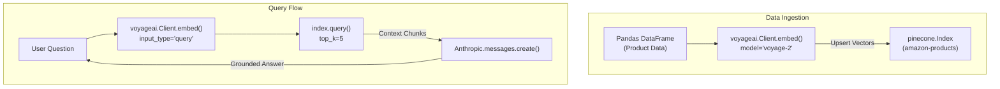
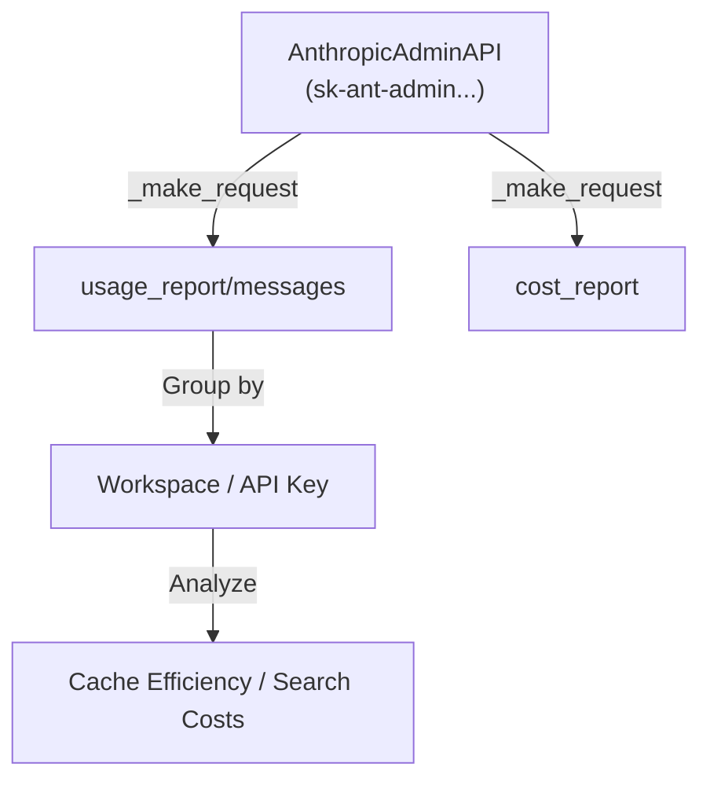
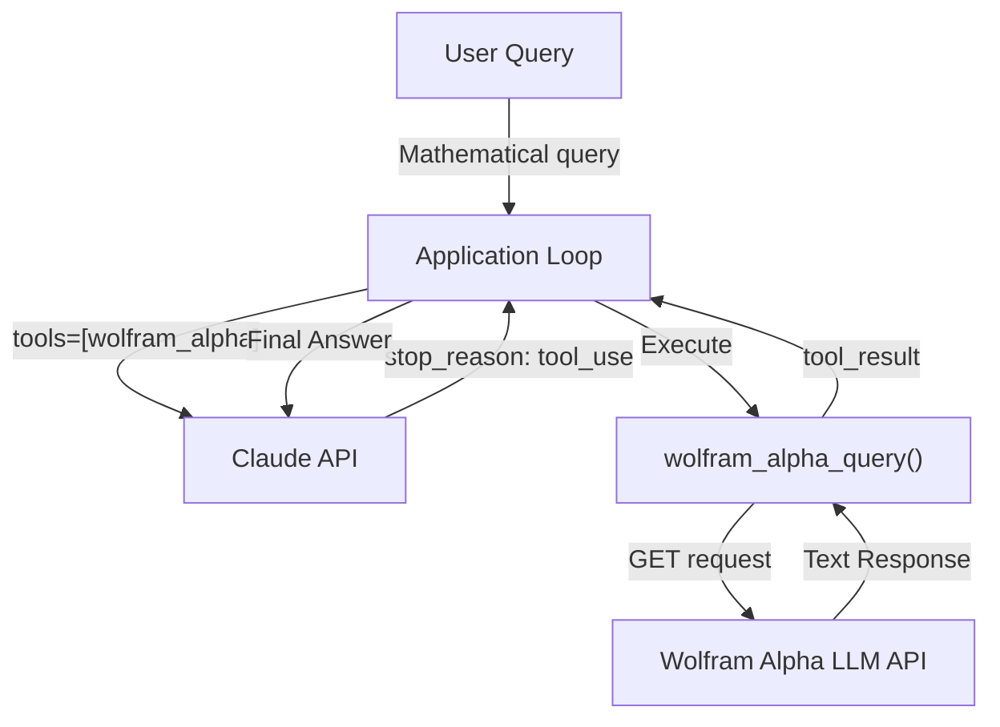

<!-- source: DeepWiki mcp.deepwiki.com · repo anthropics/claude-cookbooks · page 12.2 Search and Knowledge Integrations · fetched 2026-10-26 -->

# Search and Knowledge Integrations

<details>
<summary>Relevant source files</summary>

The following files were used as context for generating this wiki page:

- [.env.example](.env.example)
- [finetuning/datasets/json_mode_dataset.jsonl](finetuning/datasets/json_mode_dataset.jsonl)
- [finetuning/finetuning_on_bedrock.ipynb](finetuning/finetuning_on_bedrock.ipynb)
- [misc/session_memory_compaction.ipynb](misc/session_memory_compaction.ipynb)
- [observability/usage_cost_api.ipynb](observability/usage_cost_api.ipynb)
- [third_party/MongoDB/rag_using_mongodb.ipynb](third_party/MongoDB/rag_using_mongodb.ipynb)
- [third_party/Pinecone/claude_3_rag_agent.ipynb](third_party/Pinecone/claude_3_rag_agent.ipynb)
- [third_party/Pinecone/rag_using_pinecone.ipynb](third_party/Pinecone/rag_using_pinecone.ipynb)
- [third_party/VoyageAI/how_to_create_embeddings.md](third_party/VoyageAI/how_to_create_embeddings.md)
- [tool_use/tool_search_with_embeddings.ipynb](tool_use/tool_search_with_embeddings.ipynb)

</details>


This page documents the integration of Claude with external search engines, knowledge bases, and vector databases. These integrations allow Claude to ground its responses in real-time data, perform complex mathematical computations, and retrieve information from massive private or public datasets.

## Vector Database RAG (Pinecone & MongoDB)

Retrieval-Augmented Generation (RAG) connects Claude to vector databases to provide context-aware answers from large document collections. The implementation typically involves embedding data using **Voyage AI**, storing it in a vector index, and performing similarity searches during the query phase.

### Pinecone Integration Architecture

The Pinecone integration uses a standard RAG pipeline where product descriptions or research papers are vectorized and stored for semantic retrieval.

Title: Pinecone RAG Data Flow


**Key Implementation Details:**
- **Embedding**: Voyage AI's `voyage-2` model is used with a dimension of 1024 [third_party/Pinecone/rag_using_pinecone.ipynb:109-128]().
- **Retrieval**: The `index.query()` method retrieves the most relevant documents based on dot product similarity [third_party/Pinecone/rag_using_pinecone.ipynb:129-140]().
- **Augmentation**: Retrieved context is injected into the Claude prompt to ensure factual accuracy [third_party/Pinecone/rag_using_pinecone.ipynb:274-290]().
- **Agentic RAG**: Advanced implementations use `LangChain` to build agents that decide when to query the Pinecone vector store [third_party/Pinecone/claude_3_rag_agent.ipynb:41-47]().

### MongoDB Atlas Vector Search

MongoDB integration leverages Atlas Vector Search for unified document and vector storage, allowing Claude to act as a domain-specific analyst (e.g., Venture Capital Tech Analyst).

Title: MongoDB Atlas Vector Integration


Sources: [third_party/Pinecone/rag_using_pinecone.ipynb:8-15](), [third_party/MongoDB/rag_using_mongodb.ipynb:7-22](), [third_party/Pinecone/claude_3_rag_agent.ipynb:41-47]()

---

## Scaling with Tool Search

When managing thousands of specialized tools (e.g., internal APIs or large search functions), providing all definitions upfront is inefficient. Semantic tool search treats tools as discoverable resources.

**Implementation Strategy:**
- **`tool_search` Tool**: A meta-tool that Claude calls to find other tools [tool_use/tool_search_with_embeddings.ipynb:11-12]().
- **Embedding Model**: Uses `SentenceTransformer("sentence-transformers/all-MiniLM-L6-v2")` to vectorize tool descriptions [tool_use/tool_search_with_embeddings.ipynb:112-116]().
- **Discovery**: When a user asks a query, the system retrieves the top-N most semantically relevant tool definitions to include in the context window [tool_use/tool_search_with_embeddings.ipynb:12-16]().

Sources: [tool_use/tool_search_with_embeddings.ipynb:7-19](), [tool_use/tool_search_with_embeddings.ipynb:112-116]()

---

## Embedding Providers (Voyage AI)

Voyage AI is the preferred partner for high-performance embeddings in the Claude ecosystem, supporting general text, code, and domain-specific models.

**Usage Patterns:**
- **Input Types**: Users should specify `input_type="query"` for search queries and `input_type="document"` for data being indexed to optimize retrieval quality [third_party/VoyageAI/how_to_create_embeddings.md:53-56]().
- **Models**: `voyage-2` is recommended for general text, while `voyage-code-2` is optimized for technical/code datasets [third_party/VoyageAI/how_to_create_embeddings.md:52-53]().

```python
import voyageai
vo = voyageai.Client()
# Embeddings for retrieval/search
result = vo.embed(texts, model="voyage-2", input_type="document")
```
Sources: [third_party/VoyageAI/how_to_create_embeddings.md:27-39](), [third_party/VoyageAI/how_to_create_embeddings.md:101-110]()

---

## Observability: Usage & Cost Admin API

For production integrations, monitoring the costs associated with RAG and search is essential. The `AnthropicAdminAPI` wrapper provides access to the Messages Usage and Cost endpoints.

### Cost Attribution Logic

Title: Admin API Data Flow


**Key Metrics Tracked:**
- `uncached_input_tokens`: Standard prompt tokens [observability/usage_cost_api.ipynb:80]().
- `cache_read_input_tokens`: Tokens served from prompt cache (crucial for optimizing repetitive RAG queries) [observability/usage_cost_api.ipynb:83]().
- `web_searches`: Count of search operations performed by the model [observability/usage_cost_api.ipynb:110]().

Sources: [observability/usage_cost_api.ipynb:64-65](), [observability/usage_cost_api.ipynb:75-85](), [observability/usage_cost_api.ipynb:115-127]()

---

## Wolfram Alpha Integration

The Wolfram Alpha LLM API provides Claude with a computational engine for math, science, and real-time data retrieval.

### Integration Architecture

Title: Wolfram Alpha Tool Execution Loop


**Implementation Highlights:**
- **Tool Definition**: Defined with a `search_query` parameter of type string [third_party/WolframAlpha/using_llm_api.ipynb:71-86]().
- **Endpoint**: Uses the LLM-optimized endpoint `https://www.wolframalpha.com/api/v1/llm-api` [third_party/WolframAlpha/using_llm_api.ipynb:59-62]().

Sources: [third_party/WolframAlpha/using_llm_api.ipynb:51-68](), [third_party/WolframAlpha/using_llm_api.ipynb:71-86](), [third_party/WolframAlpha/using_llm_api.ipynb:102-130]()

---

