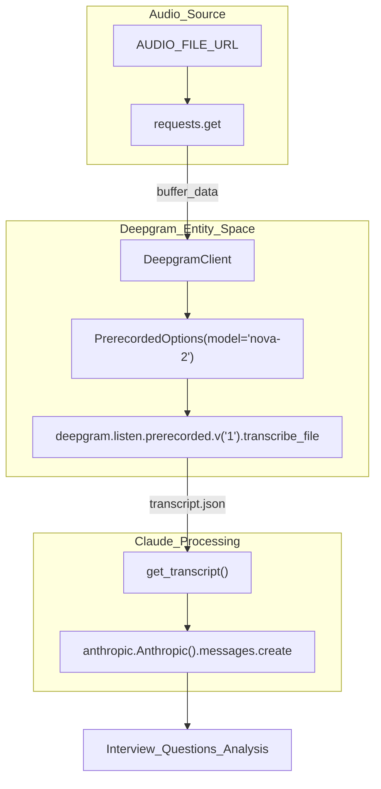

<!-- source: DeepWiki mcp.deepwiki.com · repo anthropics/claude-cookbooks · page 12.3 LlamaIndex and Deepgram Integrations · fetched 2026-10-26 -->

# LlamaIndex and Deepgram Integrations

Relevant source files

The following files were used as context for generating this wiki page:

- [third_party/Deepgram/README.md](third_party/Deepgram/README.md)
- [third_party/Deepgram/prerecorded_audio.ipynb](third_party/Deepgram/prerecorded_audio.ipynb)
- [third_party/LlamaIndex/Basic_RAG_With_LlamaIndex.ipynb](third_party/LlamaIndex/Basic_RAG_With_LlamaIndex.ipynb)
- [third_party/LlamaIndex/Multi_Document_Agents.ipynb](third_party/LlamaIndex/Multi_Document_Agents.ipynb)
- [third_party/LlamaIndex/Multi_Modal.ipynb](third_party/LlamaIndex/Multi_Modal.ipynb)
- [third_party/LlamaIndex/README.md](third_party/LlamaIndex/README.md)
- [third_party/LlamaIndex/ReAct_Agent.ipynb](third_party/LlamaIndex/ReAct_Agent.ipynb)
- [third_party/LlamaIndex/Router_Query_Engine.ipynb](third_party/LlamaIndex/Router_Query_Engine.ipynb)
- [third_party/LlamaIndex/SubQuestion_Query_Engine.ipynb](third_party/LlamaIndex/SubQuestion_Query_Engine.ipynb)

This section documents the integration of Claude with LlamaIndex for advanced Retrieval-Augmented Generation (RAG) patterns and Deepgram for high-fidelity audio transcription. It covers technical implementations for complex query routing, agentic reasoning, and processing both prerecorded and livestream audio data.

## LlamaIndex RAG Patterns

LlamaIndex provides a robust framework for connecting Claude to various data sources and implementing sophisticated retrieval strategies. The cookbooks demonstrate primary patterns including Router Query Engines, ReAct Agents, Sub-Question Query Engines, and Multi-Document Agents.

### 1. Router Query Engine
The `RouterQueryEngine` acts as a selector that routes a user's natural language query to the most appropriate tool or index. This is particularly useful when dealing with diverse document types or when specific questions require different retrieval methods (e.g., summary vs. detailed fact lookup) [third_party/LlamaIndex/Router_Query_Engine.ipynb:9-11]().

**Implementation Details:**
- **Initialization:** Uses `Anthropic` LLM (e.g., `claude-opus-4-1`) and an embedding model like `HuggingFaceEmbedding` [third_party/LlamaIndex/Router_Query_Engine.ipynb:207-208]().
- **Index Construction:** Documents are loaded via `SimpleDirectoryReader` and indexed into `VectorStoreIndex` and `SummaryIndex` [third_party/LlamaIndex/Router_Query_Engine.ipynb:251-285]().
- **Tool Definition:** Query engines are wrapped in `QueryEngineTool` objects with descriptive metadata [third_party/LlamaIndex/Router_Query_Engine.ipynb:296-312]().
- **Routing Logic:** The `LLMSingleSelector` uses Claude to decide which tool to invoke based on the tool descriptions [third_party/LlamaIndex/Router_Query_Engine.ipynb:318-324]().

### 2. ReAct Agent
The ReAct (Reasoning and Acting) pattern allows Claude to perform multi-step reasoning and tool execution. The agent can use external functions or existing RAG pipelines as tools to answer complex queries [third_party/LlamaIndex/ReAct_Agent.ipynb:8-13]().

**Key Components:**
- **Function Tools:** Python functions (e.g., `multiply`, `add`) are converted to `FunctionTool` objects using `FunctionTool.from_defaults` [third_party/LlamaIndex/ReAct_Agent.ipynb:230-241]().
- **Agent Loop:** The `ReActAgent` class manages the interaction loop where Claude generates a "Thought," selects an "Action" (tool), and processes the "Observation" (result) [third_party/LlamaIndex/ReAct_Agent.ipynb:218-261]().
- **RAG Integration:** Query engines built on top of documents (like SEC filings) are exposed as tools, allowing the agent to fetch specific data points before synthesizing an answer [third_party/LlamaIndex/ReAct_Agent.ipynb:333-358]().

### 3. Sub-Question Query Engine
For queries that span multiple documents or require comparing different datasets, the `SubQuestionQueryEngine` decomposes a complex question into simpler sub-queries [third_party/LlamaIndex/SubQuestion_Query_Engine.ipynb:9-13]().

**Data Flow:**
1. **Decomposition:** Claude analyzes the main query and breaks it down into sub-queries targeted at specific document indices [third_party/LlamaIndex/SubQuestion_Query_Engine.ipynb:11-13]().
2. **Parallel Execution:** Each sub-query is executed against its respective index [third_party/LlamaIndex/SubQuestion_Query_Engine.ipynb:303-315]().
3. **Synthesis:** The engine aggregates the individual answers to provide a comprehensive final response [third_party/LlamaIndex/SubQuestion_Query_Engine.ipynb:318-320]().

### 4. Multi-Document Agents
For large-scale document sets, the repository demonstrates using `DocumentAgents`. This pattern creates a dedicated agent for each document, which is then managed by a top-level orchestrator [third_party/LlamaIndex/Multi_Document_Agents.ipynb:9-11]().

**System Architecture: LlamaIndex Query Engines**

| Natural Language Component | Code Entity (LlamaIndex) | File Reference |
| :--- | :--- | :--- |
| **LLM Provider** | `Anthropic` | [third_party/LlamaIndex/Router_Query_Engine.ipynb:123]() |
| **Data Loader** | `SimpleDirectoryReader` | [third_party/LlamaIndex/Basic_RAG_With_LlamaIndex.ipynb:252]() |
| **Vector Storage** | `VectorStoreIndex` | [third_party/LlamaIndex/Basic_RAG_With_LlamaIndex.ipynb:253]() |
| **Agent Logic** | `ReActAgent` | [third_party/LlamaIndex/ReAct_Agent.ipynb:218]() |
| **Multi-Doc Logic** | `SubQuestionQueryEngine` | [third_party/LlamaIndex/SubQuestion_Query_Engine.ipynb:293]() |

**Sources:** [third_party/LlamaIndex/Router_Query_Engine.ipynb:1-330](), [third_party/LlamaIndex/ReAct_Agent.ipynb:1-360](), [third_party/LlamaIndex/SubQuestion_Query_Engine.ipynb:1-325](), [third_party/LlamaIndex/Basic_RAG_With_LlamaIndex.ipynb:1-280](), [third_party/LlamaIndex/Multi_Document_Agents.ipynb:1-200]()

---

## Deepgram Audio Transcription

Deepgram provides high-speed, accurate speech-to-text (STT) capabilities. The integration focuses on converting audio to text which is then processed by Claude for downstream tasks like summarization or question generation [third_party/Deepgram/README.md:3]().

### Prerecorded Audio Processing
This workflow handles existing audio files (URLs or local buffers) using Deepgram's `nova-2` model for optimal accuracy [third_party/Deepgram/prerecorded_audio.ipynb:93]().

**Technical Workflow:**
- **Client Setup:** Initialize `DeepgramClient` with an API key [third_party/Deepgram/prerecorded_audio.ipynb:93]().
- **Transcription Request:** Use `deepgram.listen.prerecorded.v("1").transcribe_file()` with `PrerecordedOptions` (e.g., `model="nova-2"`, `smart_format=True`) [third_party/Deepgram/prerecorded_audio.ipynb:93]().
- **Claude Integration:** The resulting transcript is extracted from the JSON response and passed to Claude. Claude is prompted to analyze the text, such as generating interview questions based on the audio content [third_party/Deepgram/prerecorded_audio.ipynb:130-185]().

### Livestream Audio Processing
For real-time applications, Deepgram provides capabilities to stream audio and receive incremental transcripts.

**Key Implementation Primitives:**
- **SDK Support:** Deepgram offers multiple SDKs (Python, Node, .NET, Go) to handle streaming connections [third_party/Deepgram/README.md:12-15]().
- **Real-time Tools:** The [API Playground](https://playground.deepgram.com/) allows for testing live transcription configurations [third_party/Deepgram/README.md:10]().

**Audio Processing Entity Map**

**Sources:** [third_party/Deepgram/prerecorded_audio.ipynb:38-185](), [third_party/Deepgram/README.md:1-26]()

---

## Multi-Modal Reasoning

LlamaIndex supports Claude's vision capabilities through the `Anthropic` Multi-Modal LLM class, enabling reasoning across text and images simultaneously [third_party/LlamaIndex/Multi_Modal.ipynb:8-10]().

- **Multi-Modal Class:** Uses `llama_index.multi_modal_llms.anthropic.Anthropic` for image understanding [third_party/LlamaIndex/Multi_Modal.ipynb:29]().
- **Local Image Analysis:** Claude can analyze images stored in a local directory to perform reasoning tasks [third_party/LlamaIndex/Multi_Modal.ipynb:108-110]().
- **Use Cases:** Document understanding from screenshots, chart analysis, and image reasoning [third_party/LlamaIndex/Multi_Modal.ipynb:10-11]().

**Sources:** [third_party/LlamaIndex/Multi_Modal.ipynb:1-120]()

---

