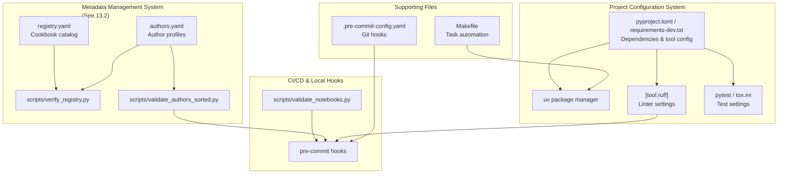
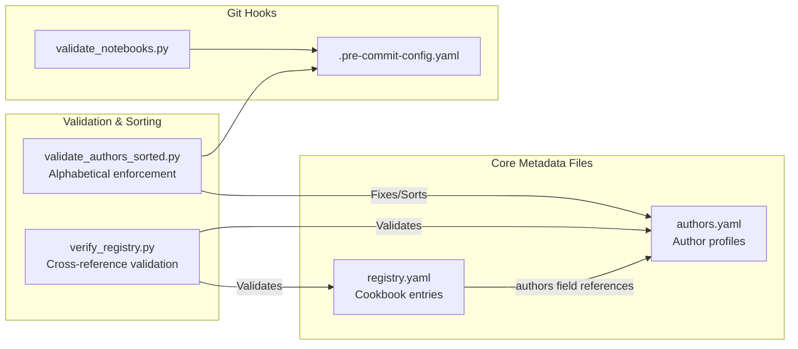
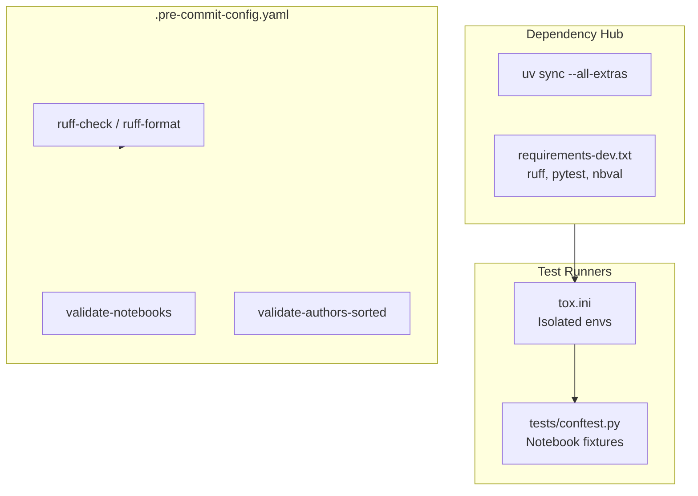

<!-- source: DeepWiki mcp.deepwiki.com · repo anthropics/claude-cookbooks · page 13 Development Infrastructure · fetched 2026-10-26 -->

# Development Infrastructure

Relevant source files

The following files were used as context for generating this wiki page:

- [.pre-commit-config.yaml](.pre-commit-config.yaml)
- [CONTRIBUTING.md](CONTRIBUTING.md)
- [Makefile](Makefile)
- [README.md](README.md)
- [anthropic_cookbook/__init__.py](anthropic_cookbook/__init__.py)
- [requirements-dev.txt](requirements-dev.txt)
- [scripts/test_notebooks.py](scripts/test_notebooks.py)
- [scripts/validate_notebooks.py](scripts/validate_notebooks.py)
- [tests/__init__.py](tests/__init__.py)
- [tests/conftest.py](tests/conftest.py)
- [tests/notebook_tests/__init__.py](tests/notebook_tests/__init__.py)
- [tests/notebook_tests/conftest.py](tests/notebook_tests/conftest.py)
- [tests/notebook_tests/test_notebooks.py](tests/notebook_tests/test_notebooks.py)
- [tests/notebook_tests/utils.py](tests/notebook_tests/utils.py)
- [tox.ini](tox.ini)

## Purpose and Scope

This document describes the repository's internal development infrastructure, including metadata management, project configuration, and maintenance utilities. It covers the organizational systems that maintain repository consistency and developer experience, distinct from the automated quality assurance workflows (see [Quality Assurance System](#3)).

The development infrastructure consists of two primary subsystems:
- **Project Configuration and Dependencies** ([Project Configuration and Dependencies](#13.1)): Python environment setup using `pyproject.toml`, dependency management via `uv`, and tool configurations for Ruff and pytest.
- **Registry and Metadata Management** ([Registry and Metadata Management](#13.2)): Cookbook cataloging via `registry.yaml` and `authors.yaml`, validation workflows, and sorting automation.

## Infrastructure Architecture

The development infrastructure provides three core functions: project configuration, metadata cataloging, and validation. These systems integrate with pre-commit hooks and CI/CD pipelines to enforce standards.

Title: Development Tooling and Validation Flow

**Sources:** [requirements-dev.txt:1-5](), [.pre-commit-config.yaml:1-25](), [scripts/validate_authors_sorted.py:1-25](), [Makefile:1-33]()

## Metadata Management Overview

The repository uses a dual-file metadata system where `registry.yaml` catalogs all cookbooks and `authors.yaml` maintains author profiles. This system enables cookbook discovery and attribution.

### High-Level Architecture

Title: Metadata Validation and Cross-Referencing

**Sources:** [scripts/validate_authors_sorted.py:1-50](), [.pre-commit-config.yaml:1-25](), [scripts/validate_notebooks.py:1-65]()

### Key Components

| Component | Purpose | Location |
|-----------|---------|----------|
| `registry.yaml` | Catalogs cookbooks with title, description, path, authors, and categories | Root Directory |
| `authors.yaml` | Maps GitHub usernames to full names, websites, and avatars | Root Directory |
| `validate_authors_sorted.py` | Ensures `authors.yaml` is sorted alphabetically (case-insensitive) | [scripts/validate_authors_sorted.py:1-25]() |
| `validate_notebooks.py` | Checks for empty cells or error outputs in `.ipynb` files | [scripts/validate_notebooks.py:1-65]() |
| `Makefile` | Provides high-level commands for linting, formatting, and testing | [Makefile:1-33]() |

**Example Notebook Validation Logic:**
The `validate_notebook` function scans JSON-parsed notebooks for structural integrity:
- **Empty Cells**: Detects `source` fields that are missing or empty [scripts/validate_notebooks.py:22-24]().
- **Error States**: Checks `outputs` for `output_type == "error"` [scripts/validate_notebooks.py:27-31]().

For detailed information on registry schemas and validation, see [Registry and Metadata Management](#13.2).

## Project Configuration Overview

The project uses `uv` as the primary package manager for high-performance dependency resolution. Development workflows are standardized through `tox.ini` and a central `Makefile`.

### Configuration Structure

Title: Development Tool Configuration

**Sources:** [CONTRIBUTING.md:30-43](), [tox.ini:1-20](), [.pre-commit-config.yaml:1-25]()

### Key Configuration Sections

| Tool | Configuration File | Purpose |
|------|--------------------|---------|
| **uv** | `CONTRIBUTING.md` | Recommended for syncing dependencies and running pre-commit [CONTRIBUTING.md:30-43]() |
| **Ruff** | `.pre-commit-config.yaml` | Handles both `ruff-check` and `ruff-format` for Python and Jupyter files [pre-commit-config.yaml:2-10]() |
| **Pytest** | `tests/conftest.py` | Defines custom CLI options like `--execute-notebooks` and `--notebook-dir` [tests/conftest.py:20-59]() |
| **Tox** | `tox.ini` | Defines isolated environments for `structure` (fast) and `execution` (slow) tests [tox.ini:20-66]() |

### Notebook Testing Scaffold

The testing infrastructure in `tests/notebook_tests/` provides a comprehensive suite for notebook health:
- **Structural Tests**: `TestNotebookStructure` ensures valid JSON, presence of code cells, and Python kernel usage [tests/notebook_tests/test_notebooks.py:34-80]().
- **Execution Tests**: `TestCellExecution` verifies sequential order and that execution counts start from 1 (fresh kernel) [tests/notebook_tests/test_notebooks.py:81-112]().
- **Security Tests**: `TestSecurity` detects hardcoded API keys using `validate_no_hardcoded_secrets` [tests/notebook_tests/test_notebooks.py:134-171]().

For complete details on dependency management and tool setup, see [Project Configuration and Dependencies](#13.1).

## Task Automation (Makefile)

The `Makefile` serves as the entry point for common development tasks:
- **Linting/Formatting**: `make check` runs both formatting and linting checks [Makefile:49-51]().
- **Testing**: `make test-notebooks` runs structural tests, while `make test-notebooks-exec` performs full execution (requiring an API key) [Makefile:87-106]().
- **Maintenance**: `make sort-authors` triggers the author list sorting script [Makefile:79-81]().

**Sources:** [Makefile:1-128]()

---

