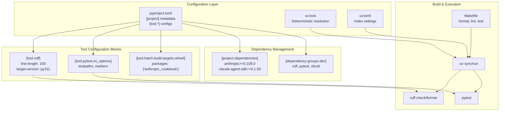
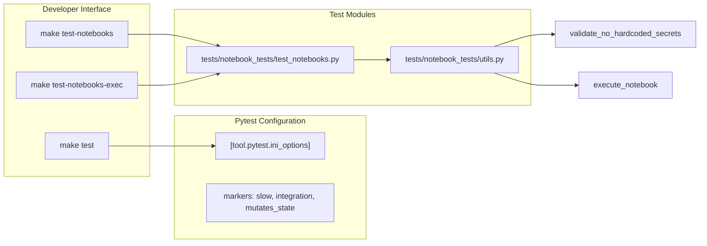

<!-- source: DeepWiki mcp.deepwiki.com · repo anthropics/claude-cookbooks · page 13.1 Project Configuration and Dependencies · fetched 2026-10-26 -->

# Project Configuration and Dependencies

Relevant source files

The following files were used as context for generating this wiki page:

- [Makefile](Makefile)
- [capabilities/README.md](capabilities/README.md)
- [capabilities/knowledge_graph/README.md](capabilities/knowledge_graph/README.md)
- [capabilities/knowledge_graph/data/alias_map.json](capabilities/knowledge_graph/data/alias_map.json)
- [capabilities/knowledge_graph/data/sample_triples.json](capabilities/knowledge_graph/data/sample_triples.json)
- [capabilities/knowledge_graph/evaluation/README.md](capabilities/knowledge_graph/evaluation/README.md)
- [capabilities/knowledge_graph/evaluation/eval_extraction.py](capabilities/knowledge_graph/evaluation/eval_extraction.py)
- [capabilities/knowledge_graph/guide.ipynb](capabilities/knowledge_graph/guide.ipynb)
- [pyproject.toml](pyproject.toml)
- [scripts/test_notebooks.py](scripts/test_notebooks.py)
- [tests/__init__.py](tests/__init__.py)
- [tests/conftest.py](tests/conftest.py)
- [tests/notebook_tests/__init__.py](tests/notebook_tests/__init__.py)
- [tests/notebook_tests/conftest.py](tests/notebook_tests/conftest.py)
- [tests/notebook_tests/test_notebooks.py](tests/notebook_tests/test_notebooks.py)
- [tests/notebook_tests/utils.py](tests/notebook_tests/utils.py)
- [tox.ini](tox.ini)
- [uv.lock](uv.lock)
- [uv.toml](uv.toml)

This document describes the project's configuration system, dependency management, and development tooling setup. It covers how dependencies are declared in `pyproject.toml`, managed via `uv`, and how various development tools (Ruff, pytest, Hatch) are configured to maintain code quality across the cookbook collection.

## Configuration File Architecture

The project uses a modern Python configuration approach centered around `pyproject.toml` as the single source of truth, with `uv` as the high-performance package manager for reproducible environments.

**Sources**: [pyproject.toml:1-97](), [uv.toml:1-3](), [uv.lock:1-7](), [Makefile:1-33]()

## Dependency Management with uv

The repository leverages `uv` for fast, reliable dependency resolution. The `uv.toml` file defines the default package index [uv.toml:1-3](), while `uv.lock` ensures deterministic builds by pinning every sub-dependency across different Python versions (3.11 and 3.12) [uv.lock:1-7]().

### Dependency Groups

Dependencies are categorized to separate runtime requirements from development and testing tools.

| Group | Key Dependencies | Purpose |
|-------|------------------|---------|
| **Core API** | `anthropic`, `claude-agent-sdk` | Fundamental client libraries for Claude and Agent SDK. |
| **Notebook Env** | `ipykernel`, `notebook`, `jupyter` | Interactive execution environment. |
| **Data/Math** | `numpy`, `pandas`, `networkx`, `matplotlib` | Data manipulation and graph visualization. |
| **Utilities** | `rich`, `python-dotenv`, `requests` | CLI formatting, environment management, and HTTP. |
| **Dev (PEP 735)** | `ruff`, `pytest`, `nbval`, `tox`, `nbconvert` | Code quality, testing, and CI/CD tools. |

**Sources**: [pyproject.toml:5-21](), [pyproject.toml:27-38]()

## Quality Assurance Tools

### Ruff Configuration
Ruff serves as both the linter and formatter. It is configured to handle both standard Python files and Jupyter notebooks [pyproject.toml:46]().

*   **Line Length**: Set to 100 characters [pyproject.toml:44]().
*   **Target Version**: Python 3.11 [pyproject.toml:45]().
*   **Linting Rules**: Includes standard errors (E), Pyflakes (F), Isort (I), Warnings (W), Pyupgrade (UP), Bandit (S), and Bugbear (B) [pyproject.toml:54]().
*   **Per-File Ignores**: Notebooks (`*.ipynb`) have relaxed rules for imports (`E402`) and redefinitions (`F811`) to accommodate interactive development patterns [pyproject.toml:66-71]().

**Sources**: [pyproject.toml:43-71]()

### Testing Infrastructure
The testing system is anchored by `pytest` and orchestrated via a `Makefile` for developer convenience.

**Sources**: [pyproject.toml:73-90](), [Makefile:14-19](), [tests/notebook_tests/test_notebooks.py:22-31]()

### Pytest Options
The configuration in `pyproject.toml` defines specific behaviors for the test suite:
*   **Test Paths**: Looks in the `tests` directory [pyproject.toml:74]().
*   **Markers**:
    *   `slow`: Marks tests requiring full notebook execution [pyproject.toml:83]().
    *   `integration`: Requires live services like MongoDB Atlas or VoyageAI [pyproject.toml:84]().
    *   `mutates_state`: Identifies tests that modify real datastores [pyproject.toml:85]().

**Sources**: [pyproject.toml:73-86]()

## Build System

The project uses `hatchling` as the build backend [pyproject.toml:24-25](). Although the repository primarily hosts notebooks, it defines a dummy package `anthropic_cookbook` to satisfy build system requirements and facilitate internal tool discovery [pyproject.toml:40-41]().

## Automation via Makefile

The `Makefile` provides a standardized interface for common development tasks, wrapping `uv run` commands to ensure tools are executed within the managed environment.

| Target | Command | Purpose |
|--------|---------|---------|
| `format` | `uv run ruff format .` | Formats all code and notebooks. |
| `lint` | `uv run ruff check .` | Runs linting checks. |
| `test` | `uv run pytest` | Runs the full test suite. |
| `install` | `uv sync --all-extras` | Synchronizes the local environment. |
| `sort-authors` | `uv run python scripts/validate_authors_sorted.py --fix` | Maintains `authors.yaml` order. |

**Sources**: [Makefile:35-82]()

---

