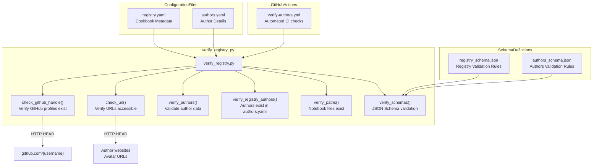
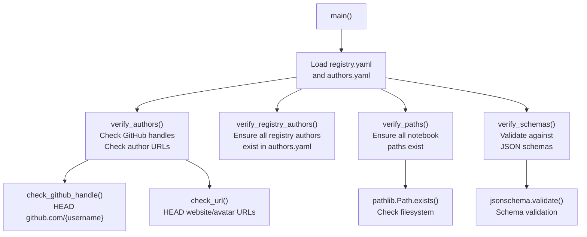
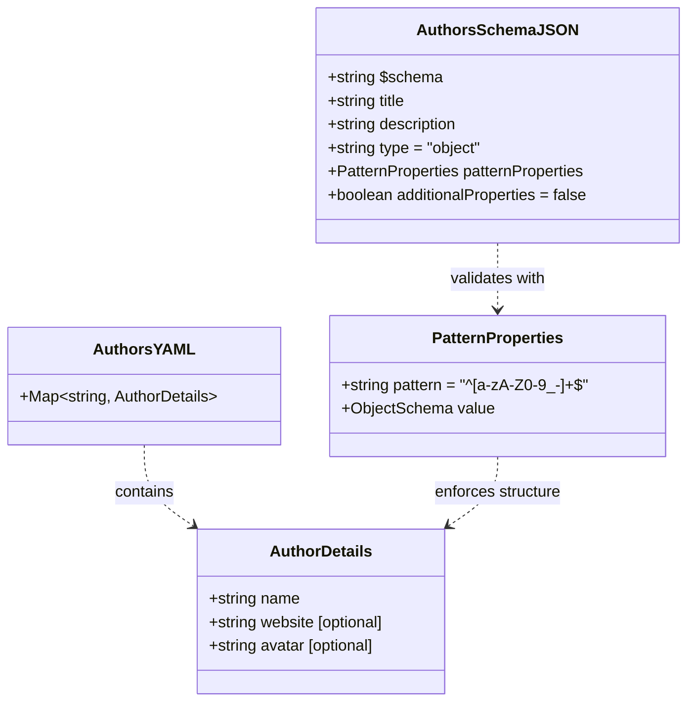
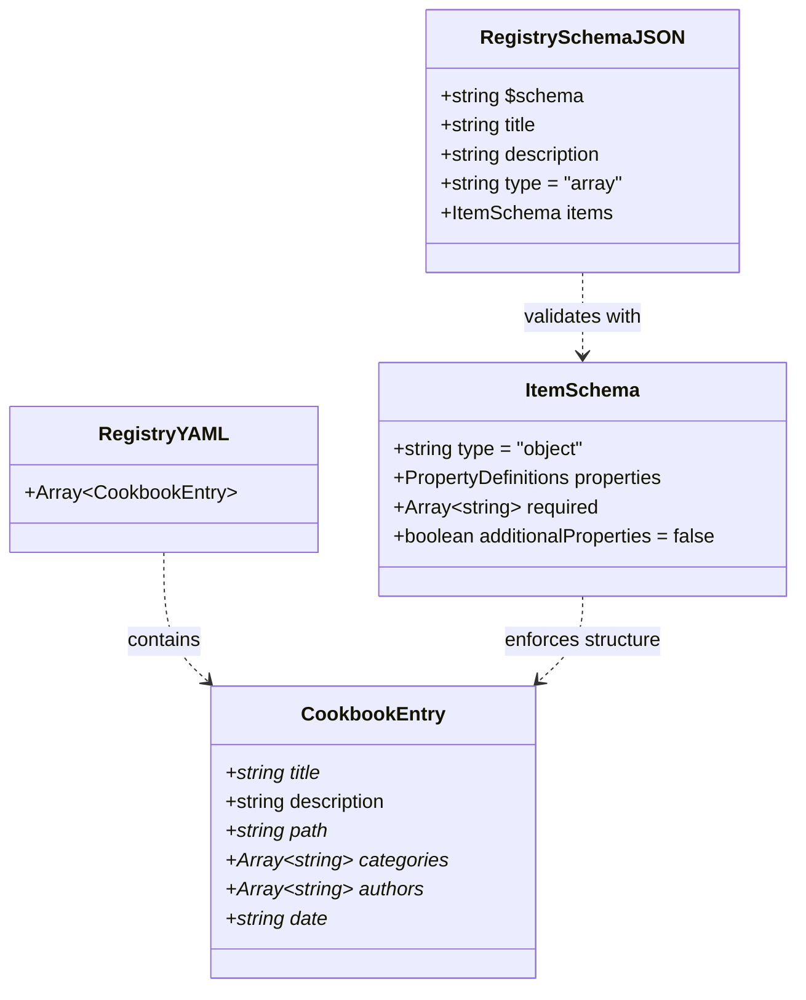

<!-- source: DeepWiki mcp.deepwiki.com · repo anthropics/claude-cookbooks · page 13.2 Registry and Metadata Management · fetched 2026-10-26 -->

# Registry and Metadata Management

<details>
<summary>Relevant source files</summary>

The following files were used as context for generating this wiki page:

- [.github/authors_schema.json](.github/authors_schema.json)
- [.github/scripts/verify_registry.py](.github/scripts/verify_registry.py)
- [.github/workflows/verify-authors.yml](.github/workflows/verify-authors.yml)
- [authors.yaml](authors.yaml)
- [managed_agents/CMA_coordinate_specialist_team.ipynb](managed_agents/CMA_coordinate_specialist_team.ipynb)
- [managed_agents/CMA_plan_big_execute_small.ipynb](managed_agents/CMA_plan_big_execute_small.ipynb)
- [managed_agents/CMA_remember_user_preferences.ipynb](managed_agents/CMA_remember_user_preferences.ipynb)
- [managed_agents/CMA_verify_with_outcome_grader.ipynb](managed_agents/CMA_verify_with_outcome_grader.ipynb)
- [managed_agents/CMA_watch_subagents_live.ipynb](managed_agents/CMA_watch_subagents_live.ipynb)
- [managed_agents/README.md](managed_agents/README.md)
- [registry.yaml](registry.yaml)

</details>


This document describes the cookbook registry and metadata management system, which catalogs all notebooks in the repository with structured metadata and author information. The system consists of two YAML configuration files (`registry.yaml` and `authors.yaml`), their corresponding JSON schemas, and automated validation infrastructure that ensures data integrity.

For information about the broader quality assurance infrastructure that uses this metadata, see [Quality Assurance System]().

## Overview

The registry system serves as the single source of truth for all cookbook metadata in the repository. It enables automated discovery, categorization, and validation of notebooks while maintaining author attribution and ensuring that all referenced resources exist.

**Sources:** [registry.yaml:1-213](), [authors.yaml:1-157]()

## Registry Structure

### Registry Entry Format

Each cookbook in [registry.yaml:1-213]() contains metadata fields defined in the schema. Required fields ensure that every cookbook has a valid path, attribution, and categorization.

| Field | Required | Type | Description |
|-------|----------|------|-------------|
| `title` | Yes | string | Display title of the cookbook |
| `description` | No | string | Brief description of functionality |
| `path` | Yes | string | Relative path from repository root to notebook file |
| `authors` | Yes | array[string] | List of GitHub usernames (must exist in authors.yaml) |
| `date` | Yes | string | Publication date in YYYY-MM-DD format |
| `categories` | Yes | array[string] | One or more category tags from predefined list |

**Example Entry:**

```yaml
- title: Knowledge graph construction with Claude
  description: Build knowledge graphs from unstructured text using Claude for entity extraction...
  path: capabilities/knowledge_graph/guide.ipynb
  authors:
  - Anthropic
  date: '2026-03-23'
  categories:
  - RAG & Retrieval
  - Tools
```

**Sources:** [registry.yaml:81-90](), [.github/registry_schema.json:1-95]()

### Valid Categories

The registry enforces a controlled vocabulary for categories. Valid categories include:

- `Agent Patterns` - Multi-LLM workflow patterns and agent architectures [registry.yaml:79]()
- `Claude Managed Agents` - Anthropic's hosted runtime for stateful agents [registry.yaml:11]()
- `Evals` - Evaluation methodologies and testing [registry.yaml:68]()
- `Multimodal` - Vision and multimodal capabilities [registry.yaml:100]()
- `Integrations` - Third-party service integrations [registry.yaml:22]()
- `Observability` - Monitoring and incident response [registry.yaml:56]()
- `RAG & Retrieval` - Retrieval augmented generation patterns [registry.yaml:89]()
- `Responses` - Prompt engineering and response optimization [registry.yaml:158]()
- `Skills` - Claude Skills API examples [registry.yaml:159]()
- `Tools` - Tool use and function calling [registry.yaml:12]()

**Sources:** [registry.yaml:1-213](), [.github/registry_schema.json:26-44]()

### Author Mapping

[authors.yaml:1-157]() maps GitHub usernames to display information:

```yaml
alexalbertt:
  name: Alex Albert
  website: https://github.com/alexalbertt
  avatar: https://avatars.githubusercontent.com/u/34638987?v=4
```

The `name` field is required, while `website` and `avatar` are optional. If `avatar` is not specified, it defaults to `https://github.com/{username}.png` as per the schema description [authors.yaml:9-12](), [.github/authors_schema.json:22]().

**Sources:** [authors.yaml:9-12](), [.github/authors_schema.json:1-30]()

## Data Flow Architecture

### Registry Validation Flow

The following diagram illustrates how metadata files are validated against schemas and verified by automation scripts during the CI process.



**Sources:** [.github/scripts/verify_registry.py:1-209](), [.github/workflows/verify-authors.yml:1-33]()

## Verification System

### Validation Script

[.github/scripts/verify_registry.py:1-209]() provides comprehensive validation with multiple operation modes:

#### Command Line Interface

```bash
python verify_registry.py [command]
```

**Available Commands:**
- `all` - Run all verifications (default) [.github/scripts/verify_registry.py:13]()
- `authors` - Verify GitHub handles and author URLs only [.github/scripts/verify_registry.py:14]()
- `paths` - Verify registry paths only [.github/scripts/verify_registry.py:15]()
- `registry` - Verify registry authors exist in authors.yaml [.github/scripts/verify_registry.py:16]()
- `schema` - Verify YAML files match their JSON schemas [.github/scripts/verify_registry.py:17]()

**Sources:** [.github/scripts/verify_registry.py:9-18]()

#### Verification Execution Logic

The internal logic of `verify_registry.py` utilizes `requests` for remote checks and `jsonschema` for structure validation.



**Sources:** [.github/scripts/verify_registry.py:35-209]()

### GitHub Handle Verification

The `check_github_handle()` function at [.github/scripts/verify_registry.py:35-45]() verifies that each GitHub username in `authors.yaml` corresponds to a real GitHub account using HTTP HEAD requests.

**Sources:** [.github/scripts/verify_registry.py:35-45]()

### URL Verification

The `check_url()` function at [.github/scripts/verify_registry.py:48-60]() validates author website and avatar URLs:

- Uses HTTP HEAD requests to minimize bandwidth [.github/scripts/verify_registry.py:55]().
- Skips `x.com` URLs as they typically block HEAD requests [.github/scripts/verify_registry.py:51-52]().
- Returns success/failure status with error messages.

**Sources:** [.github/scripts/verify_registry.py:48-60]()

### Path Verification

The `verify_paths()` function at [.github/scripts/verify_registry.py:134-158]() ensures all notebook files exist on the filesystem relative to the repository root. This catches broken references before notebooks are deployed.

**Sources:** [.github/scripts/verify_registry.py:134-158]()

### Cross-Reference Validation

The `verify_registry_authors()` function at [.github/scripts/verify_registry.py:111-131]() enforces referential integrity by checking that every author string in `registry.yaml` has a corresponding key in `authors.yaml`.

**Sources:** [.github/scripts/verify_registry.py:111-131]()

### Schema Validation

The `verify_schemas()` function at [.github/scripts/verify_registry.py:161-209]() validates YAML structure against JSON schemas:

**For authors.yaml:**
- Each key must match the pattern `^[a-zA-Z0-9_-]+$` [.github/authors_schema.json:7]().
- Must contain `name` field [.github/authors_schema.json:25]().
- Optional `website` and `avatar` fields must be valid URIs [.github/authors_schema.json:16,21]().

**For registry.yaml:**
- Each entry must have `title`, `path`, `categories`, `authors`, and `date` [.github/registry_schema.json:92]().
- `categories` must be from the predefined enum list [.github/registry_schema.json:30-43]().
- `date` must match the `YYYY-MM-DD` pattern [.github/registry_schema.json:64]().

**Sources:** [.github/scripts/verify_registry.py:161-209](), [.github/registry_schema.json:1-95](), [.github/authors_schema.json:1-30]()

## Automated CI Integration

### GitHub Actions Workflow

[.github/workflows/verify-authors.yml:1-33]() runs validation automatically on pull requests and main branch updates.

**Workflow Steps:**
1. Checkout repository code [.github/workflows/verify-authors.yml:20]().
2. Set up Python 3.11 [.github/workflows/verify-authors.yml:25]().
3. Install dependencies: `pyyaml`, `requests`, `jsonschema` [.github/workflows/verify-authors.yml:29]().
4. Run `python .github/scripts/verify_registry.py` [.github/workflows/verify-authors.yml:33]().

**Sources:** [.github/workflows/verify-authors.yml:1-33]()

## Schema Definitions

### Authors Schema Structure



**Sources:** [.github/authors_schema.json:1-30]()

### Registry Schema Structure



**Note:** Fields marked with `*` are required by the schema [.github/registry_schema.json:92]().

**Sources:** [.github/registry_schema.json:1-95]()

---

