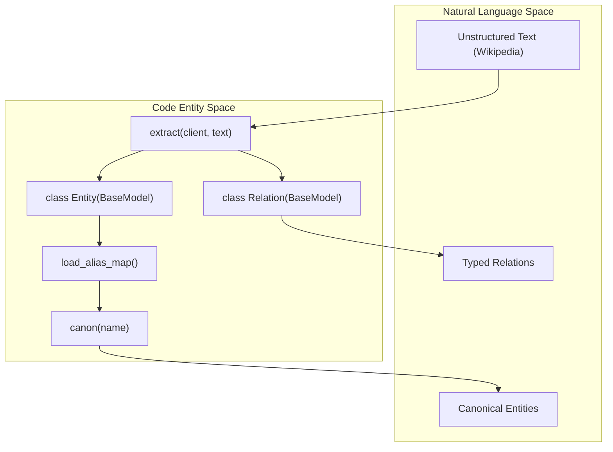

<!-- source: DeepWiki mcp.deepwiki.com · repo anthropics/claude-cookbooks · page 14 Glossary · fetched 2026-10-26 -->

# Glossary

Relevant source files

The following files were used as context for generating this wiki page:

- [.github/workflows/claude-link-review.yml](.github/workflows/claude-link-review.yml)
- [.github/workflows/claude-model-check.yml](.github/workflows/claude-model-check.yml)
- [.github/workflows/claude-pr-review.yml](.github/workflows/claude-pr-review.yml)
- [.github/workflows/links.yml](.github/workflows/links.yml)
- [.github/workflows/lint-format.yml](.github/workflows/lint-format.yml)
- [.github/workflows/notebook-diff-comment.yml](.github/workflows/notebook-diff-comment.yml)
- [.github/workflows/notebook-quality.yml](.github/workflows/notebook-quality.yml)
- [.github/workflows/notebook-tests.yml](.github/workflows/notebook-tests.yml)
- [.pre-commit-config.yaml](.pre-commit-config.yaml)
- [CONTRIBUTING.md](CONTRIBUTING.md)
- [README.md](README.md)
- [anthropic_cookbook/__init__.py](anthropic_cookbook/__init__.py)
- [authors.yaml](authors.yaml)
- [capabilities/README.md](capabilities/README.md)
- [capabilities/knowledge_graph/README.md](capabilities/knowledge_graph/README.md)
- [capabilities/knowledge_graph/data/alias_map.json](capabilities/knowledge_graph/data/alias_map.json)
- [capabilities/knowledge_graph/data/sample_triples.json](capabilities/knowledge_graph/data/sample_triples.json)
- [capabilities/knowledge_graph/evaluation/README.md](capabilities/knowledge_graph/evaluation/README.md)
- [capabilities/knowledge_graph/evaluation/eval_extraction.py](capabilities/knowledge_graph/evaluation/eval_extraction.py)
- [capabilities/knowledge_graph/guide.ipynb](capabilities/knowledge_graph/guide.ipynb)
- [images/sunset-dawn-nature-mountain-preview.jpg](images/sunset-dawn-nature-mountain-preview.jpg)
- [managed_agents/CMA_coordinate_specialist_team.ipynb](managed_agents/CMA_coordinate_specialist_team.ipynb)
- [managed_agents/CMA_explore_unfamiliar_codebase.ipynb](managed_agents/CMA_explore_unfamiliar_codebase.ipynb)
- [managed_agents/CMA_gate_human_in_the_loop.ipynb](managed_agents/CMA_gate_human_in_the_loop.ipynb)
- [managed_agents/CMA_iterate_fix_failing_tests.ipynb](managed_agents/CMA_iterate_fix_failing_tests.ipynb)
- [managed_agents/CMA_plan_big_execute_small.ipynb](managed_agents/CMA_plan_big_execute_small.ipynb)
- [managed_agents/CMA_remember_user_preferences.ipynb](managed_agents/CMA_remember_user_preferences.ipynb)
- [managed_agents/CMA_verify_with_outcome_grader.ipynb](managed_agents/CMA_verify_with_outcome_grader.ipynb)
- [managed_agents/CMA_watch_subagents_live.ipynb](managed_agents/CMA_watch_subagents_live.ipynb)
- [managed_agents/README.md](managed_agents/README.md)
- [managed_agents/data_analyst_agent.ipynb](managed_agents/data_analyst_agent.ipynb)
- [managed_agents/slack_data_bot.ipynb](managed_agents/slack_data_bot.ipynb)
- [managed_agents/sre_incident_responder.ipynb](managed_agents/sre_incident_responder.ipynb)
- [misc/batch_processing.ipynb](misc/batch_processing.ipynb)
- [misc/generate_test_cases.ipynb](misc/generate_test_cases.ipynb)
- [misc/metaprompt.ipynb](misc/metaprompt.ipynb)
- [misc/prompt_caching.ipynb](misc/prompt_caching.ipynb)
- [pyproject.toml](pyproject.toml)
- [registry.yaml](registry.yaml)
- [requirements-dev.txt](requirements-dev.txt)
- [scripts/validate_notebooks.py](scripts/validate_notebooks.py)
- [skills/README.md](skills/README.md)
- [skills/notebooks/01_skills_introduction.ipynb](skills/notebooks/01_skills_introduction.ipynb)
- [skills/notebooks/02_skills_financial_applications.ipynb](skills/notebooks/02_skills_financial_applications.ipynb)
- [skills/notebooks/03_skills_custom_development.ipynb](skills/notebooks/03_skills_custom_development.ipynb)
- [skills/skill_utils.py](skills/skill_utils.py)
- [tool_use/.env.example](tool_use/.env.example)
- [tool_use/memory_cookbook.ipynb](tool_use/memory_cookbook.ipynb)
- [tool_use/memory_demo/__init__.py](tool_use/memory_demo/__init__.py)
- [tool_use/memory_demo/code_review_demo.py](tool_use/memory_demo/code_review_demo.py)
- [tool_use/memory_demo/demo_helpers.py](tool_use/memory_demo/demo_helpers.py)
- [tool_use/memory_tool.py](tool_use/memory_tool.py)
- [uv.lock](uv.lock)

This glossary defines technical terms, domain concepts, and codebase-specific jargon used across the Claude Cookbooks repository. It provides a mapping between high-level AI concepts and their specific implementations in the codebase.

## Core Domain Concepts

### Context Engineering
The practice of managing an LLM's finite context window (e.g., 200k tokens for Claude 3.5/4 models) to maintain performance and reduce costs in long-running sessions.
*   **Implementation**: Demonstrated in `tool_use/context_engineering/context_engineering_tools.ipynb` [tool_use/context_engineering/context_engineering_tools.ipynb:1-15]() and `tool_use/memory_cookbook.ipynb` [tool_use/memory_cookbook.ipynb:7-12]().
*   **Key Strategies**:
    *   **Compaction**: Compressing conversation history when thresholds are met [registry.yaml:121-124]().
    *   **Tool-Result Clearing**: Removing old tool outputs to free up space [tool_use/memory_cookbook.ipynb:101-104]().

### Knowledge Graph (KG)
A structured representation of information using entities (nodes) and typed relations (edges), enabling multi-hop reasoning that standard RAG cannot easily perform.
*   **Extraction**: Using Claude to parse unstructured text into subject-predicate-object triples [capabilities/knowledge_graph/guide.ipynb:166-172]().
*   **Entity Resolution**: Collapsing different surface-form variants (e.g., "NASA" and "National Aeronautics and Space Administration") into a single canonical node [capabilities/knowledge_graph/guide.ipynb:17-19]().
*   **Sources**: [capabilities/knowledge_graph/guide.ipynb:7-22](), [capabilities/knowledge_graph/evaluation/eval_extraction.py:22-40]().

### Skills
Organized packages of instructions, code, and resources that provide Claude with specialized capabilities (e.g., generating Excel or PDF files).
*   **Architecture**: Uses a "Progressive Disclosure" model where metadata is loaded first, and full resources only when needed [skills/README.md:18-20]().
*   **Built-in Skills**: Managed by Anthropic (e.g., `xlsx`, `pptx`, `pdf`, `docx`) [skills/README.md:143-145]().
*   **Sources**: [skills/README.md:7-16](), [skills/notebooks/01_skills_introduction.ipynb:27-36]().

### Claude Managed Agents (CMA)
Anthropic's hosted runtime for stateful, tool-using agents. Unlike standard API calls, CMA persists files, tool state, and conversation history across turns in a managed sandbox.
*   **Primitives**: Agents, Environments, Sessions, and Resources [managed_agents/README.md:3-6]().
*   **Event Loop**: Managed sessions are event-driven, using `client.beta.sessions.events.stream` to handle `agent.message` and `agent.tool_use` events [managed_agents/CMA_remember_user_preferences.ipynb:108-142]().
*   **Sources**: [managed_agents/README.md:1-58](), [managed_agents/CMA_remember_user_preferences.ipynb:8-27]().

---

## Codebase-Specific Terms

### Registry
The central index of all cookbooks in the repository, defined in `registry.yaml`. It maps titles and descriptions to file paths and categories.
*   **Schema**: Validated against `./.github/registry_schema.json` [registry.yaml:1-1]().
*   **Usage**: Used by CI/CD and the website to discover and categorize content [registry.yaml:2-10]().

### Claude Code Action
A GitHub Action that integrates Claude directly into the PR workflow for automated reviews and issue summarization.
*   **Implementation**: Used in `.github/workflows/notebook-quality.yml` via the `anthropics/claude-code-action` step to summarize validation failures [ .github/workflows/notebook-quality.yml:58-83]().

### Memory Tool (`memory_20250818`)
A client-side tool implementation that allows Claude to persist learned patterns and information across different conversation sessions.
*   **Storage**: Typically implemented as a file-based system under a `/memories` directory [tool_use/memory_cookbook.ipynb:101-104]().
*   **Managed Variant**: In CMA, this is implemented via **Memory Stores**, which appear at `/mnt/memory/{store-name}` [managed_agents/CMA_remember_user_preferences.ipynb:23-25]().
*   **Sources**: [tool_use/memory_cookbook.ipynb:78-78](), [managed_agents/CMA_remember_user_preferences.ipynb:150-155]().

---

## System Architecture Diagrams

### Knowledge Graph Extraction Pipeline
This diagram bridges the natural language goal of "building a graph" to the specific code entities used in the `capabilities/knowledge_graph` directory.

**Sources**: [capabilities/knowledge_graph/evaluation/eval_extraction.py:25-40](), [capabilities/knowledge_graph/evaluation/eval_extraction.py:72-80](), [capabilities/knowledge_graph/evaluation/eval_extraction.py:95-98]().

### Skills Execution and File Retrieval
This diagram illustrates the data flow from a Skill request to a physical file on disk using the Files API.

**Sources**: [skills/README.md:138-147](), [skills/README.md:168-207]().

---

## Technical Jargon & Abbreviations

| Term | Definition | Code Reference |
| :--- | :--- | :--- |
| **TTFT** | Time To First Token. Optimized using Prompt Caching. | [registry.yaml:170-171]() |
| **RAG** | Retrieval Augmented Generation. | [capabilities/README.md:23]() |
| **NER** | Named Entity Recognition. | [capabilities/knowledge_graph/guide.ipynb:166-168]() |
| **MCP** | Model Context Protocol. Used by agents to connect to external systems. | [managed_agents/README.md:49-49]() |
| **uv** | Fast Python package installer and resolver used for repo-wide dependency management. | [pyproject.toml:1-21](), [uv.lock:1-10]() |
| **nbval** | Pytest plugin for validating Jupyter Notebook outputs. | [pyproject.toml:31-31]() |
| **HITL** | Human-In-The-Loop. Patterns where agents pause for human approval. | [managed_agents/README.md:46-46]() |

**Sources**: [pyproject.toml:1-38](), [registry.yaml:1-124](), [capabilities/knowledge_graph/guide.ipynb:166-170](), [managed_agents/README.md:1-58]().