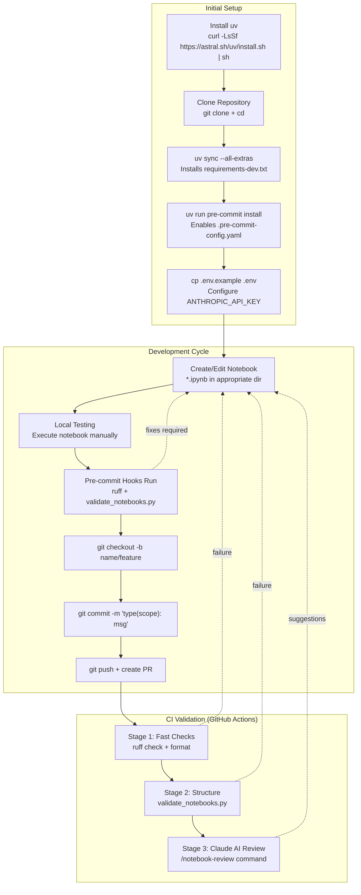
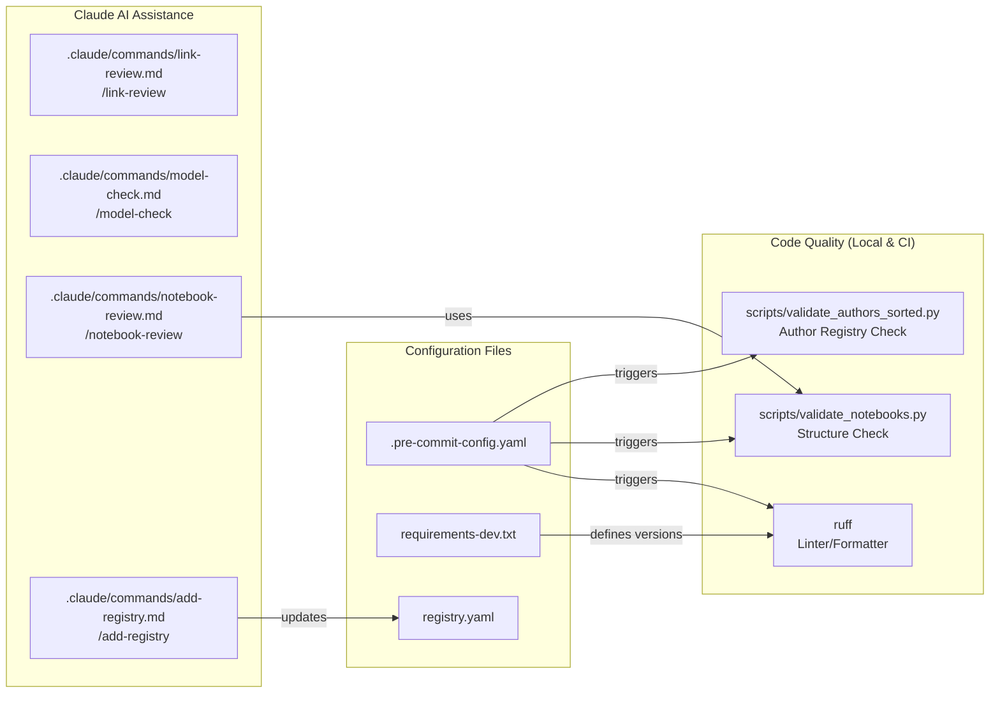

<!-- source: DeepWiki mcp.deepwiki.com · repo anthropics/claude-cookbooks · page 2 Getting Started · fetched 2026-10-26 -->

# Getting Started

<details>
<summary>Relevant source files</summary>

The following files were used as context for generating this wiki page:

- [.claude/commands/add-registry.md](.claude/commands/add-registry.md)
- [.github/pull_request_template.md](.github/pull_request_template.md)
- [.github/registry_schema.json](.github/registry_schema.json)
- [.gitignore](.gitignore)
- [.pre-commit-config.yaml](.pre-commit-config.yaml)
- [CONTRIBUTING.md](CONTRIBUTING.md)
- [README.md](README.md)
- [anthropic_cookbook/__init__.py](anthropic_cookbook/__init__.py)
- [claude_agent_sdk/06_The_vulnerability_detection_agent.ipynb](claude_agent_sdk/06_The_vulnerability_detection_agent.ipynb)
- [claude_agent_sdk/vulnerability_detection_agent/canary/canary.c](claude_agent_sdk/vulnerability_detection_agent/canary/canary.c)
- [requirements-dev.txt](requirements-dev.txt)
- [scripts/validate_notebooks.py](scripts/validate_notebooks.py)

</details>


This page provides an overview of how to begin contributing to the Claude Cookbooks repository. It covers the essential prerequisites, initial setup steps, and basic development workflow. For detailed instructions on environment configuration, see [Environment Setup](#2.1). For comprehensive contribution guidelines including PR workflow and quality standards, see [Contributing Guidelines](#2.2). For information about organizing and indexing cookbook content, see [Registry and Content Organization](#2.3).

## Prerequisites

To contribute to this repository, you need:

| Requirement | Version | Purpose |
|------------|---------|---------|
| Python | ≥3.11 | Core runtime for notebooks and scripts [CONTRIBUTING.md:9]() |
| uv (recommended) | Latest | Fast package manager for dependency installation [CONTRIBUTING.md:10]() |
| Claude API key | N/A | Required for executing notebooks with live API calls [README.md:7]() |
| Git | Latest | Version control [CONTRIBUTING.md:26]() |

**Sources:** [README.md:5-11](), [CONTRIBUTING.md:7-10]()

## Quick Start Workflow

The following diagram illustrates the path from local setup to a merged Pull Request, bridging the local environment setup with the automated CI/CD pipeline.

**Developer Onboarding to CI Pipeline**



**Sources:** [CONTRIBUTING.md:12-49](), [.pre-commit-config.yaml:1-25](), [scripts/validate_notebooks.py:1-65]()

## Installation Commands

### Using uv (Recommended)

```bash
# Install uv package manager
curl -LsSf https://astral.sh/uv/install.sh | sh

# Clone repository
git clone https://github.com/anthropics/anthropic-cookbook.git
cd anthropic-cookbook

# Create virtual environment and install all dependencies
uv sync --all-extras

# Install pre-commit hooks
uv run pre-commit install

# Configure API key
cp .env.example .env
# Edit .env and set ANTHROPIC_API_KEY=your-key-here
```

The `uv sync --all-extras` command ensures that development dependencies listed in `requirements-dev.txt` (such as `ruff`, `pytest`, and `nbval`) are installed alongside the core requirements [CONTRIBUTING.md:33](), [requirements-dev.txt:1-5]().

**Sources:** [CONTRIBUTING.md:14-43](), [requirements-dev.txt:1-5]()

### Alternative: Using pip

```bash
# Clone and navigate to repository
git clone https://github.com/anthropics/anthropic-cookbook.git
cd anthropic-cookbook

# Install in editable mode with dev dependencies
pip install -e ".[dev]"

# Install pre-commit hooks
pre-commit install
```

**Sources:** [CONTRIBUTING.md:35-43]()

## Development Tool Stack

The following diagram maps the logical development phases to the specific code entities and scripts responsible for validation and maintenance.

**Code Entity Mapping: Local Tools to CI Scripts**



**Sources:** [.pre-commit-config.yaml:1-25](), [CONTRIBUTING.md:52-80](), [requirements-dev.txt:1-5](), [.claude/commands/add-registry.md:1-73]()

## Pre-commit Hook Configuration

The repository uses pre-commit hooks defined in [.pre-commit-config.yaml:1-25]() to enforce quality standards before code is committed:

| Hook ID | Tool | Action | Files |
|---------|------|--------|-------|
| `ruff-check` | Ruff | Lint and auto-fix issues | `*.py`, `*.pyi`, `*.ipynb` [ .pre-commit-config.yaml:5-7]() |
| `ruff-format` | Ruff | Format code | `*.py`, `*.pyi`, `*.ipynb` [ .pre-commit-config.yaml:8-9]() |
| `validate-notebooks` | `scripts/validate_notebooks.py` | Check structure, empty cells, error outputs | `*.ipynb` [ .pre-commit-config.yaml:13-17]() |
| `validate-authors-sorted` | `scripts/validate_authors_sorted.py` | Sort `authors.yaml` alphabetically | `authors.yaml` [ .pre-commit-config.yaml:20-24]() |

The `validate-notebooks` hook invokes [scripts/validate_notebooks.py:1-65](), which performs two critical checks:
1. **Empty cell detection** ([scripts/validate_notebooks.py:22-24]()): Ensures no notebook cells have empty `source` fields.
2. **Error output detection** ([scripts/validate_notebooks.py:26-31]()): Fails if any code cell contains `output_type == "error"`.

**Sources:** [.pre-commit-config.yaml:1-25](), [scripts/validate_notebooks.py:1-65]()

## Claude Code Slash Commands

This repository includes specialized slash commands that work in both **Claude Code** (local development) and **GitHub Actions CI**. These commands allow contributors to run the same validations that the CI pipeline will execute.

- `/link-review`: Validate links in markdown and notebooks [CONTRIBUTING.md:68]().
- `/model-check`: Verify Claude model usage is current [CONTRIBUTING.md:69]().
- `/notebook-review`: Comprehensive notebook quality check [CONTRIBUTING.md:70]().
- `/add-registry`: Automates adding a new notebook entry to `registry.yaml` and updating `authors.yaml` if necessary [.claude/commands/add-registry.md:3-73]().

These commands ensure consistency between local development and remote CI [CONTRIBUTING.md:80]().

**Sources:** [CONTRIBUTING.md:63-80](), [.claude/commands/add-registry.md:1-73]()

## Basic Contribution Workflow

The repository follows a standard feature-branch workflow with strict commit message requirements.

1.  **Create a feature branch**: `git checkout -b <your-name>/<feature-description>` [CONTRIBUTING.md:137-141]().
2.  **Use conventional commits**: Commit messages must follow the `<type>(<scope>): <subject>` format [CONTRIBUTING.md:143-161]().
    *   Types include: `feat`, `fix`, `docs`, `style`, `refactor`, `test`, `chore`, `ci`.
3.  **Run quality checks**: Before pushing, run `uv run python scripts/validate_notebooks.py` and `ruff` [CONTRIBUTING.md:84-90]().
4.  **Register your cookbook**: Use the `/add-registry` command to add your notebook to `registry.yaml` [.claude/commands/add-registry.md:6]().
5.  **Push and create PR**: Push to origin and use `gh pr create` or the GitHub web interface [CONTRIBUTING.md:168-172]().

**Sources:** [CONTRIBUTING.md:135-184](), [.claude/commands/add-registry.md:1-73]()

## Next Steps

Once you've completed the initial setup, consult these child pages for detailed information:

1.  **[Environment Setup](#2.1)** — Detail the process of setting up the development environment including uv installation, dependency management, pre-commit hooks, and API key configuration.
2.  **[Contributing Guidelines](#2.2)** — Explain the contribution process, PR workflow, quality standards, and review expectations including conventional commits and Claude Code slash commands.
3.  **[Registry and Content Organization](#2.3)** — Describe the `registry.yaml` and `authors.yaml` structure, how cookbooks are indexed, categorized, and discovered, including the `add-registry` command.

For information about the quality assurance system that validates your contributions, see [Quality Assurance System](#3).

**Sources:** [CONTRIBUTING.md:1-224](), [README.md:21-28]()

---

