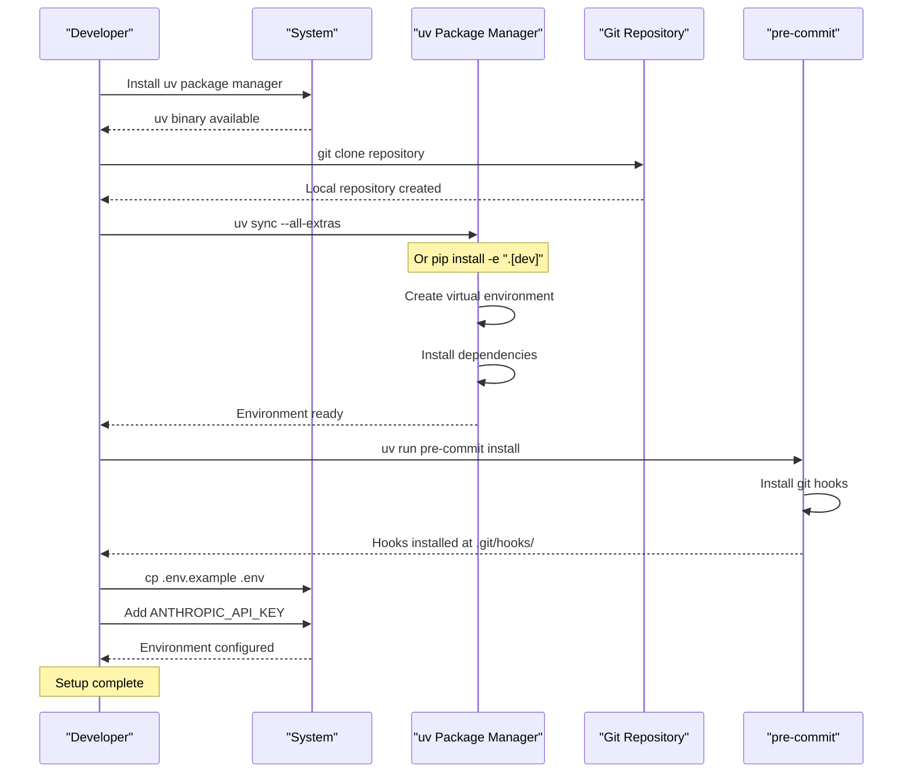
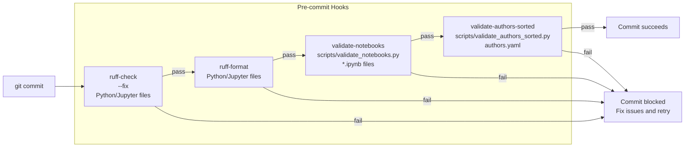
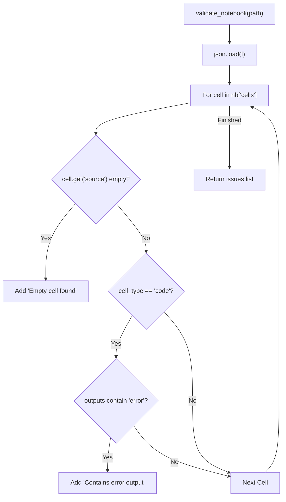

<!-- source: DeepWiki mcp.deepwiki.com · repo anthropics/claude-cookbooks · page 2.1 Environment Setup · fetched 2026-10-26 -->

# Environment Setup

<details>
<summary>Relevant source files</summary>

The following files were used as context for generating this wiki page:

- [.pre-commit-config.yaml](.pre-commit-config.yaml)
- [CONTRIBUTING.md](CONTRIBUTING.md)
- [README.md](README.md)
- [anthropic_cookbook/__init__.py](anthropic_cookbook/__init__.py)
- [requirements-dev.txt](requirements-dev.txt)
- [scripts/validate_notebooks.py](scripts/validate_notebooks.py)
- [uv.toml](uv.toml)

</details>


## Purpose and Scope

This page details the development environment setup process for contributing to Claude Cookbooks. It covers installation of the `uv` package manager, dependency management, pre-commit hook configuration, and API key setup. For contribution workflow and quality standards after setup is complete, see [Contributing Guidelines](#2.2). For information about organizing and registering your cookbooks, see [Registry and Content Organization](#2.3).

---

## Prerequisites

The Claude Cookbooks repository requires:

| Requirement | Version | Purpose |
|------------|---------|---------|
| Python | 3.11 or higher | Runtime environment [CONTRIBUTING.md:9]() |
| uv | Latest | Recommended fast package manager [CONTRIBUTING.md:10]() |
| Git | Any recent | Version control [CONTRIBUTING.md:26]() |
| Claude API Key | - | Required for executing notebooks [README.md:7]() |

---

## Installation Workflow



**Sources:** [CONTRIBUTING.md:12-49]()

---

## Package Manager: uv

The repository recommends `uv` as the primary package manager for faster dependency resolution and integrated virtual environment management [CONTRIBUTING.md:10-14](). The project configuration explicitly points to PyPI as the default index.

**File Configuration:**
- `uv.toml`: Configures the default package index [uv.toml:1-3]().

### Installing uv

**Linux/macOS:**
```bash
curl -LsSf https://astral.sh/uv/install.sh | sh
```

**Homebrew:**
```bash
brew install uv
```

**Sources:** [CONTRIBUTING.md:14-22](), [uv.toml:1-3]()

---

## Repository Setup

### Cloning and Initial Setup

```bash
# Clone the repository
git clone https://github.com/anthropics/anthropic-cookbook.git
cd anthropic-cookbook

# Create virtual environment and install all dependencies
uv sync --all-extras
```

Alternatively, standard `pip` can be used:
```bash
pip install -e ".[dev]"
```

**Sources:** [CONTRIBUTING.md:24-37]()

---

## Dependency Architecture

The project distinguishes between runtime dependencies and development tools. Development dependencies are tracked in `requirements-dev.txt`.

### Development Dependencies

Defined in [requirements-dev.txt:1-5]():

| Package | Version | Purpose |
|---------|---------|---------|
| `papermill` | ≥2.6.0 | Notebook parameterization and execution |
| `ruff` | ≥0.12.0 | Fast Python linter and formatter |
| `pytest` | ≥8.3.3 | Testing framework |
| `nbval` | ≥0.11.0 | Notebook validation for pytest |
| `pre-commit` | ≥3.8.0 | Git hook framework |

**Sources:** [requirements-dev.txt:1-5](), [CONTRIBUTING.md:57-59]()

---

## Pre-commit Hook Configuration

Pre-commit hooks run automated checks before each `git commit` to catch structural issues and formatting errors early [CONTRIBUTING.md:100-107]().

### Hook Pipeline



### Hook Definitions

Defined in [.pre-commit-config.yaml:1-25]():

**1. Ruff Check & Format**
- Uses `astral-sh/ruff-pre-commit` [.pre-commit-config.yaml:2-3]().
- Runs `ruff-check` with `--fix` on `python`, `pyi`, and `jupyter` types [.pre-commit-config.yaml:5-7]().
- Runs `ruff-format` for consistent styling [.pre-commit-config.yaml:8-9]().

**2. Validate Notebooks**
- **ID**: `validate-notebooks`
- **Entry**: `uv run python scripts/validate_notebooks.py` [.pre-commit-config.yaml:13-15]().
- **Trigger**: Any `.ipynb` file change [.pre-commit-config.yaml:17]().
- **Function**: Validates internal notebook structure and content.

**3. Validate Authors**
- **ID**: `validate-authors-sorted`
- **Entry**: `uv run python scripts/validate_authors_sorted.py --fix` [.pre-commit-config.yaml:20-22]().
- **Trigger**: Changes to `authors.yaml` [.pre-commit-config.yaml:24]().

**Sources:** [.pre-commit-config.yaml:1-25]()

---

## Validation Logic Details

### Notebook Structural Validation

The script `scripts/validate_notebooks.py` ensures that notebooks meet quality standards before they are committed.



Key logic from [scripts/validate_notebooks.py]():
- **Empty Cells**: Flags any cell where the `source` field is missing or empty [scripts/validate_notebooks.py:22-24]().
- **Error States**: For code cells, it inspects `outputs` for an `output_type` of `error` [scripts/validate_notebooks.py:27-31]().
- **CLI Interface**: Accepts notebook paths as arguments, returning a non-zero exit code if any validation fails [scripts/validate_notebooks.py:36-61]().

**Sources:** [scripts/validate_notebooks.py:14-65]()

---

## API Key Configuration

Claude Cookbooks require an `ANTHROPIC_API_KEY` for executing notebooks against the live API.

### Environment Variable Setup

**Step 1:** Create a `.env` file from the provided example [CONTRIBUTING.md:47]().
```bash
cp .env.example .env
```
**Step 2:** Edit `.env` and add your Claude API key [CONTRIBUTING.md:48-49]().

### Best Practices

1. **Accessing in Code**: Always use `os.environ.get("ANTHROPIC_API_KEY")` [CONTRIBUTING.md:113-117]().
2. **Security**: Never commit API keys or secrets to the repository [CONTRIBUTING.md:218]().
3. **Local Testing**: You can test notebook execution locally using `nbconvert` if an API key is configured [CONTRIBUTING.md:92-98]().

---

## Verification and Testing

### Verify Installation

After setup, verify your environment:

```bash
# Check if uv is managing the environment
uv run python --version

# Run pre-commit checks on all files
uv run pre-commit run --all-files
```

### Manual Validation

You can trigger the notebook validation script directly to check specific files before committing:

```bash
uv run python scripts/validate_notebooks.py skills/my-notebook.ipynb
```

**Sources:** [CONTRIBUTING.md:84-98](), [scripts/validate_notebooks.py:36-65]()

---

