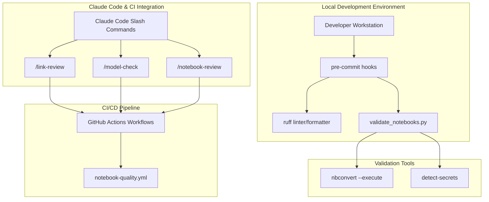
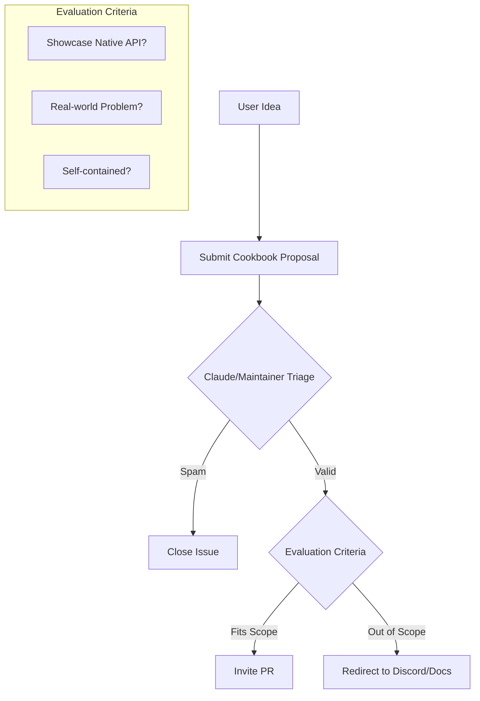
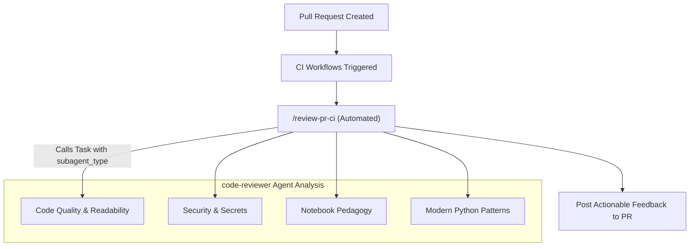

<!-- source: DeepWiki mcp.deepwiki.com · repo anthropics/claude-cookbooks · page 2.2 Contributing Guidelines · fetched 2026-10-26 -->

# Contributing Guidelines

<details>
<summary>Relevant source files</summary>

The following files were used as context for generating this wiki page:

- [.claude/agents/code-reviewer.md](.claude/agents/code-reviewer.md)
- [.claude/commands/review-issue.md](.claude/commands/review-issue.md)
- [.claude/commands/review-pr-ci.md](.claude/commands/review-pr-ci.md)
- [.claude/commands/review-pr.md](.claude/commands/review-pr.md)
- [.github/ISSUE_GUIDELINES.md](.github/ISSUE_GUIDELINES.md)
- [.github/ISSUE_TEMPLATE/bug_report.yml](.github/ISSUE_TEMPLATE/bug_report.yml)
- [.github/ISSUE_TEMPLATE/config.yml](.github/ISSUE_TEMPLATE/config.yml)
- [.github/ISSUE_TEMPLATE/cookbook_proposal.yml](.github/ISSUE_TEMPLATE/cookbook_proposal.yml)
- [.github/ISSUE_TEMPLATE/question.yml](.github/ISSUE_TEMPLATE/question.yml)
- [.pre-commit-config.yaml](.pre-commit-config.yaml)
- [CONTRIBUTING.md](CONTRIBUTING.md)
- [README.md](README.md)
- [anthropic_cookbook/__init__.py](anthropic_cookbook/__init__.py)
- [requirements-dev.txt](requirements-dev.txt)
- [scripts/validate_notebooks.py](scripts/validate_notebooks.py)

</details>


This document describes the technical process for contributing to the Claude Cookbooks repository, including development environment setup, cookbook creation guidelines, quality standards enforcement through automated tooling, testing procedures, and the submission workflow.

For information about the automated quality checks that run on pull requests, see page 3.1 (CI/CD Pipeline and GitHub Actions). For details on the Claude-powered review system, see page 3.2 (Claude-Powered Reviews).

## Development Environment Setup

### Prerequisites and Installation

Contributors must have Python 3.11+ and the `uv` package manager installed. The repository uses `uv` for dependency management and virtual environment creation [CONTRIBUTING.md:7-10]().

**Installation commands:**

```bash
# Install uv package manager
curl -LsSf https://astral.sh/uv/install.sh | sh

# Clone repository
git clone https://github.com/anthropics/anthropic-cookbook.git
cd anthropic-cookbook

# Create virtual environment and install all dependencies
uv sync --all-extras

# Install pre-commit hooks
uv run pre-commit install
```
Sources: [CONTRIBUTING.md:14-43]()

### Environment Configuration

API keys and configuration are managed through a `.env` file [CONTRIBUTING.md:45-49]().

```bash
# Create from template
cp .env.example .env
# Edit .env and add your Claude API key
```

**Key Configuration Practices:**
- Use environment variables for API keys: `api_key = os.environ.get("ANTHROPIC_API_KEY")` [CONTRIBUTING.md:113-117]().
- Use current Claude models (e.g., `claude-haiku-4-5`) [CONTRIBUTING.md:119-122]().

## Quality Assurance Stack Architecture

The repository employs a multi-layered validation stack combining local hooks, custom scripts, and AI-powered reviews.

### System Architecture Diagram


Sources: [CONTRIBUTING.md:53-80](), [CONTRIBUTING.md:100-107](), [scripts/validate_notebooks.py:1-65]()

### Notebook Validation Stack

The repository enforces quality through three primary layers:

1.  **Ruff Linter/Formatter**: Fast Python linter with native Jupyter support used for code quality [CONTRIBUTING.md:58](), [.pre-commit-config.yaml:2-9]().
2.  **nbconvert Execution**: Notebooks are executed to verify they run from top to bottom without errors [CONTRIBUTING.md:57](), [CONTRIBUTING.md:94-98]().
3.  **Claude AI Review**: Intelligent code review using Claude via specialized slash commands [CONTRIBUTING.md:59](), [.claude/commands/notebook-review.md]().

Sources: [CONTRIBUTING.md:55-61](), [requirements-dev.txt:1-5]()

## Pre-commit Validation Workflow

Pre-commit hooks run automatically before each commit to ensure code quality [CONTRIBUTING.md:100-107]().

### Pre-commit Operations

| Hook | Operation | Scope | File Pattern |
|------|-----------|-------|--------------|
| `ruff-check` | Lint code and apply fixes | Python/Jupyter | `[python, pyi, jupyter]` |
| `ruff-format` | Format code | Python/Jupyter | `[python, pyi, jupyter]` |
| `validate-notebooks` | Check structure (empty cells, errors) | Notebooks | `\.ipynb$` |
| `validate-authors-sorted` | Sort and validate authors.yaml | Metadata | `authors\.yaml$` |

Sources: [.pre-commit-config.yaml:1-25](), [scripts/validate_notebooks.py:14-33]()

## Git Workflow and Branch Naming

### Branch Naming Convention

Contributors should create feature branches using the following format:
```bash
git checkout -b <your-name>/<feature-description>
# Example: git checkout -b alice/add-rag-example
```
Sources: [CONTRIBUTING.md:137-141]()

### Conventional Commit Format

The repository uses conventional commits to maintain a clean history [CONTRIBUTING.md:143-145]().

**Commit Types:**

| Type | Purpose | Example |
|------|---------|---------|
| `feat` | New feature | `feat(skills): add text-to-sql notebook` |
| `fix` | Bug fix | `fix(api): use environment variable for API key` |
| `docs` | Documentation | `docs(readme): update installation instructions` |
| `style` | Formatting | `style(notebooks): apply ruff formatting` |
| `refactor` | Code restructuring | `refactor(tools): simplify logic` |
| `ci` | CI/CD changes | `ci(actions): update workflow` |

Sources: [CONTRIBUTING.md:147-161]()

## Creating a Cookbook

### Notebook Best Practices

1.  **Focused Content**: One concept per notebook with clear explanations [CONTRIBUTING.md:126-127]().
2.  **Expected Outputs**: Include expected results as markdown cells or within the code output [CONTRIBUTING.md:128]().
3.  **Testing**: Ensure notebooks run top-to-bottom and include error handling [CONTRIBUTING.md:131-133]().
4.  **Learning Objectives**: List 2-4 Terminal Learning Objectives (TLOs) in the introduction [.claude/agents/code-reviewer.md:25-26]().

### Issue Triage and Proposals

Before implementation, new ideas should be submitted via the **Cookbook Proposal** template [.github/ISSUE_TEMPLATE/cookbook_proposal.yml:1-7]().


Sources: [.claude/commands/review-issue.md:21-30](), [.github/ISSUE_TEMPLATE/cookbook_proposal.yml:13-18]()

## Testing and Validation

### Local Testing Commands

```bash
# Run the validation suite
uv run python scripts/validate_notebooks.py

# Run pre-commit on all files
uv run pre-commit run --all-files

# Optional: Test notebook execution (requires API key)
uv run jupyter nbconvert --to notebook --execute <notebook_path>
```
Sources: [CONTRIBUTING.md:187-198](), [scripts/validate_notebooks.py:36-61]()

### Claude Code Slash Commands

Available commands for local development and CI [CONTRIBUTING.md:67-71]():

| Command | Purpose |
|---------|---------|
| `/link-review` | Validate links in markdown and notebooks |
| `/model-check` | Verify Claude model usage is current |
| `/notebook-review` | Comprehensive notebook quality check |
| `/review-issue` | Triage and draft responses for GitHub issues |
| `/review-pr` | Perform local review of a PR branch |

Sources: [CONTRIBUTING.md:63-80](), [.claude/commands/review-issue.md:3-4](), [.claude/commands/review-pr.md:3-4]()

## Pull Request Process

### PR Submission Checklist

When submitting a PR, ensure the following [CONTRIBUTING.md:174-184]():
- [ ] PR Title uses conventional commit format.
- [ ] Code is formatted with `ruff`.
- [ ] API keys are handled via environment variables.
- [ ] Notebook structure validated via `scripts/validate_notebooks.py`.

### Review Workflow

The repository uses automated agents for PR reviews [CONTRIBUTING.md:207](), [.claude/commands/review-pr-ci.md:10-12]().


Sources: [.claude/commands/review-pr-ci.md:22-32](), [.claude/agents/code-reviewer.md:11-17]()

## Security

- **Secrets**: Never commit API keys or secrets. Use `.env` files and `dotenv.load_dotenv()` [CONTRIBUTING.md:218-219](), [.claude/agents/code-reviewer.md:89-92]().
- **Reporting**: Report security issues privately to `security@anthropic.com` [CONTRIBUTING.md:220]().

Sources: [CONTRIBUTING.md:216-221]()

---

