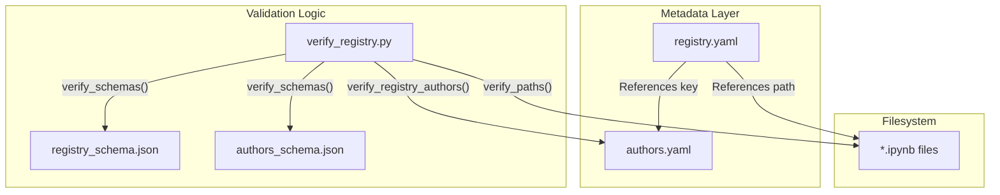
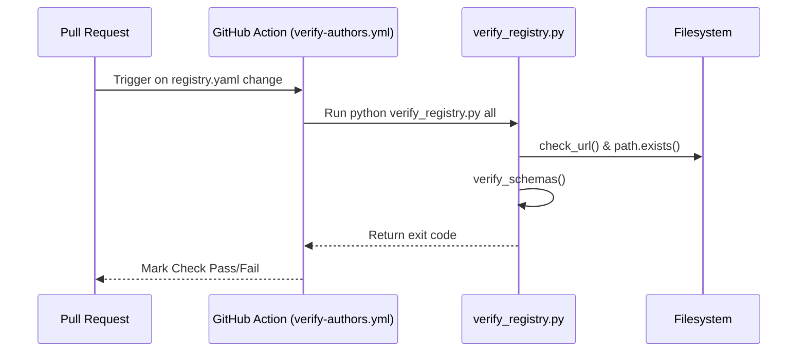

<!-- source: DeepWiki mcp.deepwiki.com · repo anthropics/claude-cookbooks · page 2.3 Registry and Content Organization · fetched 2026-10-26 -->

# Registry and Content Organization

<details>
<summary>Relevant source files</summary>

The following files were used as context for generating this wiki page:

- [.claude/commands/add-registry.md](.claude/commands/add-registry.md)
- [.github/authors_schema.json](.github/authors_schema.json)
- [.github/pull_request_template.md](.github/pull_request_template.md)
- [.github/registry_schema.json](.github/registry_schema.json)
- [.github/scripts/verify_registry.py](.github/scripts/verify_registry.py)
- [.github/workflows/verify-authors.yml](.github/workflows/verify-authors.yml)
- [.gitignore](.gitignore)
- [authors.yaml](authors.yaml)
- [claude_agent_sdk/06_The_vulnerability_detection_agent.ipynb](claude_agent_sdk/06_The_vulnerability_detection_agent.ipynb)
- [claude_agent_sdk/vulnerability_detection_agent/canary/canary.c](claude_agent_sdk/vulnerability_detection_agent/canary/canary.c)
- [managed_agents/CMA_coordinate_specialist_team.ipynb](managed_agents/CMA_coordinate_specialist_team.ipynb)
- [managed_agents/CMA_plan_big_execute_small.ipynb](managed_agents/CMA_plan_big_execute_small.ipynb)
- [managed_agents/CMA_remember_user_preferences.ipynb](managed_agents/CMA_remember_user_preferences.ipynb)
- [managed_agents/CMA_verify_with_outcome_grader.ipynb](managed_agents/CMA_verify_with_outcome_grader.ipynb)
- [managed_agents/CMA_watch_subagents_live.ipynb](managed_agents/CMA_watch_subagents_live.ipynb)
- [managed_agents/README.md](managed_agents/README.md)
- [registry.yaml](registry.yaml)

</details>


## Purpose and Scope

This document describes the content management system used to organize and index cookbooks in the repository. The system relies on a central metadata registry consisting of `registry.yaml` for cookbook entries and `authors.yaml` for contributor profiles. This page details the structure of these files, the validation logic enforced by JSON schemas and scripts, and the automated `/add-registry` workflow.

**Sources**: [registry.yaml:1-10](), [authors.yaml:1-5](), [.github/registry_schema.json:1-5](), [.github/authors_schema.json:1-4]()

---

## Registry Data Model

The repository uses a two-file architecture to separate cookbook metadata from author profiles, ensuring that author information is defined once and reused across multiple entries.

### Registry Schema

The `registry.yaml` file contains a list of cookbook objects. Each object is validated against [.github/registry_schema.json]().

| Field | Type | Required | Description |
|-------|------|----------|-------------|
| `title` | string | Yes | The display title of the cookbook. |
| `description` | string | Yes | A brief summary of the cookbook's purpose. |
| `path` | string | Yes | Relative path to the `.ipynb` file. |
| `authors` | array[string] | Yes | List of GitHub usernames matching keys in `authors.yaml`. |
| `date` | string | Yes | Publication date in `YYYY-MM-DD` format. |
| `categories` | array[string] | Yes | 1 or more categories from the allowed enum. |
| `slug` | string | No | URL-friendly identifier (regex: `^[a-z0-9-]+$`). |
| `difficulty` | string | No | `beginner`, `intermediate`, or `advanced`. |

**Example Entry**:
```yaml
- title: Build a data analyst agent with Claude Managed Agents
  description: Build an analyst that turns a CSV into a narrative HTML report.
  path: managed_agents/data_analyst_agent.ipynb
  authors:
  - charmaine
  - jyan-anthropic
  date: '2026-04-08'
  categories:
  - Claude Managed Agents
  - Tools
```

**Sources**: [registry.yaml:2-12](), [.github/registry_schema.json:8-94]()

### Authors Schema

The `authors.yaml` file maps GitHub usernames to profile details. It is validated against [.github/authors_schema.json]().

| Field | Type | Required | Description |
|-------|------|----------|-------------|
| `name` | string | Yes | Full display name of the author. |
| `website` | string | No | URL to author's website or GitHub profile. |
| `avatar` | string | No | URL to profile image (defaults to GitHub avatar). |

**Sources**: [authors.yaml:6-16](), [.github/authors_schema.json:9-26]()

### System Entity Mapping

The following diagram bridges the YAML metadata definitions to the actual filesystem entities and the validation logic used to keep them in sync.



**Sources**: [.github/scripts/verify_registry.py:111-158](), [.github/scripts/verify_registry.py:161-205](), [registry.yaml:1-5]()

---

## Categories and Taxonomy

Cookbooks are classified using a strictly enforced enum in the registry schema. This ensures consistent discovery on the frontend.

### Available Categories

| Category | Purpose |
|----------|---------|
| `Agent Patterns` | Multi-step agentic workflows and orchestration. |
| `Claude Agent SDK` | Tutorials specifically for the `claude-agent-sdk`. |
| `Claude Managed Agents` | Content utilizing Anthropic's hosted agent runtime. |
| `RAG & Retrieval` | Knowledge retrieval, embeddings, and context management. |
| `Tools` | Tool use, function calling, and API integration. |
| `Cybersecurity` | Threat intelligence and vulnerability detection. |
| `Multimodal` | Vision and image processing capabilities. |
| `Skills` | Use of the Claude Skills API (xlsx, pdf, etc.). |

**Sources**: [.github/registry_schema.json:30-45]()

---

## Registry Management Automation

The repository provides automation to ensure the registry remains accurate and valid.

### The `add-registry` Command

The `/add-registry` slash command, defined in [.claude/commands/add-registry.md](), automates the inclusion of new notebooks. It follows a structured workflow:
1. **Content Analysis**: Reads the notebook to extract the `title` and generate a `description` [[.claude/commands/add-registry.md:10-22]]().
2. **Author Verification**: Checks if the GitHub username exists in `authors.yaml`. If missing, it prompts for details to create a new entry [[.claude/commands/add-registry.md:11-17]]().
3. **Entry Generation**: Creates a YAML block with required fields including `date` and `categories` [[.claude/commands/add-registry.md:18-39]]().
4. **Alphabetical Insertion**: Appends the new entry while maintaining alphabetical order by `path` [[.claude/commands/add-registry.md:51]]().

### Validation Script (`verify_registry.py`)

The script [.github/scripts/verify_registry.py]() performs the following checks:
1. **Schema Validation**: Uses `jsonschema` to validate both YAML files against their respective JSON schemas [[.github/scripts/verify_registry.py:161-205]]().
2. **Path Integrity**: Verifies that every `path` entry in `registry.yaml` points to an existing file in the repository [[.github/scripts/verify_registry.py:134-158]]().
3. **Author Integrity**: Ensures every author listed in `registry.yaml` has a corresponding entry in `authors.yaml` [[.github/scripts/verify_registry.py:111-131]]().

### CI/CD Integration

The `Verify Authors` workflow [[.github/workflows/verify-authors.yml]]() triggers on pull requests modifying the registry. It executes the verification script to prevent broken links or invalid metadata.



**Sources**: [.github/workflows/verify-authors.yml:1-33](), [.github/scripts/verify_registry.py:35-108](), [.claude/commands/add-registry.md:1-52]()

---

