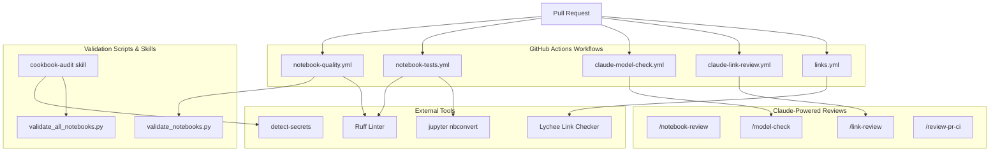
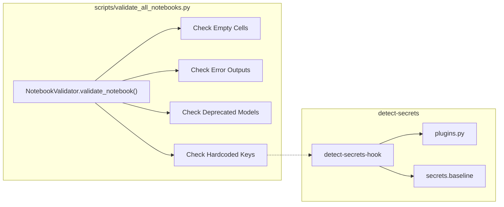

<!-- source: DeepWiki mcp.deepwiki.com · repo anthropics/claude-cookbooks · page 3 Quality Assurance System · fetched 2026-10-26 -->

# Quality Assurance System

Relevant source files

The following files were used as context for generating this wiki page:

- [.claude/skills/cookbook-audit/.gitignore](.claude/skills/cookbook-audit/.gitignore)
- [.claude/skills/cookbook-audit/SKILL.md](.claude/skills/cookbook-audit/SKILL.md)
- [.claude/skills/cookbook-audit/style_guide.md](.claude/skills/cookbook-audit/style_guide.md)
- [.claude/skills/cookbook-audit/validate_notebook.py](.claude/skills/cookbook-audit/validate_notebook.py)
- [.github/workflows/claude-link-review.yml](.github/workflows/claude-link-review.yml)
- [.github/workflows/claude-model-check.yml](.github/workflows/claude-model-check.yml)
- [.github/workflows/claude-pr-review.yml](.github/workflows/claude-pr-review.yml)
- [.github/workflows/links.yml](.github/workflows/links.yml)
- [.github/workflows/lint-format.yml](.github/workflows/lint-format.yml)
- [.github/workflows/notebook-diff-comment.yml](.github/workflows/notebook-diff-comment.yml)
- [.github/workflows/notebook-quality.yml](.github/workflows/notebook-quality.yml)
- [.github/workflows/notebook-tests.yml](.github/workflows/notebook-tests.yml)
- [lychee.toml](lychee.toml)
- [scripts/detect-secrets/.secrets.baseline](scripts/detect-secrets/.secrets.baseline)
- [scripts/detect-secrets/plugins.py](scripts/detect-secrets/plugins.py)
- [scripts/validate_all_notebooks.py](scripts/validate_all_notebooks.py)

The Quality Assurance System provides automated code quality enforcement, security validation, and content review for the Claude Cookbooks repository. This system ensures that executable examples remain functional, follow security best practices, and provide high-quality educational value.

This system combines GitHub Actions workflows, AI-powered review commands, and specialized validation scripts.

## System Architecture

The Quality Assurance System integrates multiple validation layers to ensure code quality and maintainability.

### QA System Overview

Sources: [.github/workflows/notebook-quality.yml:1-128](), [.github/workflows/claude-model-check.yml:1-82](), [.github/workflows/claude-link-review.yml:1-81](), [.github/workflows/links.yml:1-140](), [.claude/skills/cookbook-audit/SKILL.md:22-37]()

## CI/CD Pipeline and GitHub Actions

The repository utilizes over 40 GitHub Actions workflows to automate testing and validation. The primary entry points are `notebook-quality.yml` and `notebook-tests.yml`, which handle linting, structural validation, and execution testing.

The pipeline features conditional execution logic based on contributor trust levels:
- **Internal Contributors (Members/Owners):** Full notebook execution using the Anthropic API to verify end-to-end functionality [.github/workflows/notebook-quality.yml:96-116]().
- **External Contributors:** Structural validation using `nbformat.validator` to ensure notebook integrity without incurring API costs [.github/workflows/notebook-quality.yml:119-130]().
- **Security Gates:** The pipeline uses Anthropic Workload Identity Federation to securely access the Claude API without static keys [.github/workflows/notebook-quality.yml:61-66]().

For details, see [CI/CD Pipeline and GitHub Actions](#3.1).

## Claude-Powered Reviews

The system leverages `claude-code-action` to provide intelligent feedback directly on Pull Requests. These reviews are triggered by specific slash commands or automated workflow steps.

| Command | Purpose | Workflow |
|---------|---------|----------|
| `/notebook-review` | Summarizes structural issues and provides fix suggestions | [.github/workflows/notebook-quality.yml:57-89]() |
| `/model-check` | Validates that notebooks use non-dated model aliases | [.github/workflows/claude-model-check.yml:69-87]() |
| `/link-review` | Checks for broken or outdated documentation links | [.github/workflows/claude-link-review.yml:68-86]() |
| `/review-pr-ci` | Comprehensive PR review including logic and structure | [.github/workflows/claude-pr-review.yml:44-59]() |

For details, see [Claude-Powered Reviews](#3.2).

## Testing Infrastructure

The testing suite ensures that code examples are not only syntactically correct but also functionally accurate. 

- **Linting:** `ruff` is used to enforce Python style and format for both `.py` and `.ipynb` files [.github/workflows/notebook-quality.yml:39-42]().
- **Execution Testing:** `jupyter nbconvert` executes notebooks in the CI environment to catch runtime errors and timeouts [.github/workflows/notebook-quality.yml:108-115]().
- **Link Validation:** `lychee` checks all URLs in notebooks and markdown files against a strict configuration [.github/workflows/links.yml:113-141](), using settings defined in `lychee.toml` [lychee.toml:1-59]().
- **Diff Analysis:** `nbdime` generates human-readable diffs for notebook changes to assist reviewers [.github/workflows/notebook-diff-comment.yml:78-79]().

For details, see [Testing Infrastructure](#3.3).

## Validation Scripts and Utilities

A suite of specialized Python scripts performs targeted checks that standard linters might miss.

### Core Validation Flow

- **`validate_all_notebooks.py`**: A comprehensive validator that checks for empty cells, error outputs, dated model IDs, and hardcoded secrets [scripts/validate_all_notebooks.py:67-172]().
- **`detect-secrets`**: Integrated via `scripts/detect-secrets/plugins.py` to identify leaked Anthropic API keys (`sk-ant-...`) and other credentials [.claude/skills/cookbook-audit/validate_notebook.py:87-133]().
- **Model Aliases**: The system enforces the use of non-dated aliases like `claude-sonnet-4-6` over specific date-versioned IDs [scripts/validate_all_notebooks.py:112-145]().

For details, see [Validation Scripts and Utilities](#3.5).

## Cookbook Audit Process

Beyond automated checks, the repository follows a structured audit process for new content. This includes manual reviews of educational clarity and automated audits using the `cookbook-audit` skill.

- **`cookbook-audit` Skill**: A Claude-powered tool that reviews notebooks against a specific rubric defined in `style_guide.md` [.claude/skills/cookbook-audit/SKILL.md:1-18]().
- **Scoring Rubric**: Evaluates content across Narrative Quality, Code Quality, Technical Accuracy, and Actionability [.claude/skills/cookbook-audit/SKILL.md:47-60]().
- **Workflow**: Includes running `validate_notebook.py` to generate a clean markdown version of the notebook for easier AI review [.claude/skills/cookbook-audit/SKILL.md:22-37]().

For details, see [Cookbook Audit Process](#3.4).

Sources: [.github/workflows/notebook-quality.yml:1-138](), [scripts/validate_all_notebooks.py:1-180](), [.claude/skills/cookbook-audit/SKILL.md:1-155](), [.claude/skills/cookbook-audit/validate_notebook.py:1-175](), [lychee.toml:1-59]()

---

