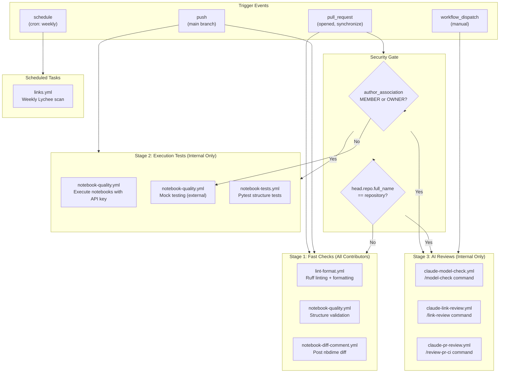
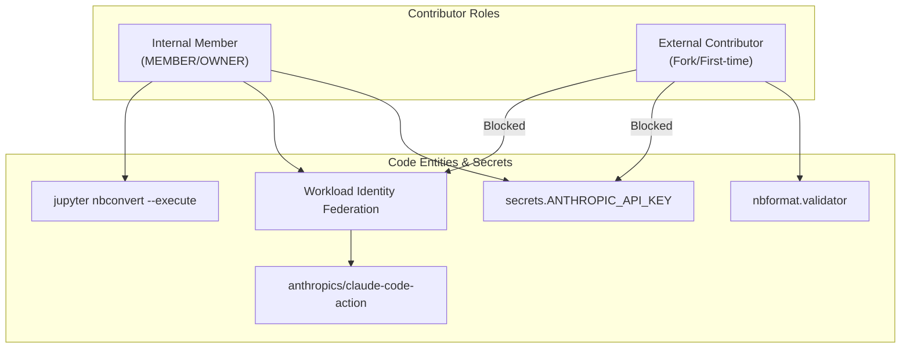

<!-- source: DeepWiki mcp.deepwiki.com · repo anthropics/claude-cookbooks · page 3.1 CI/CD Pipeline and GitHub Actions · fetched 2026-10-26 -->

# CI/CD Pipeline and GitHub Actions

Relevant source files

The following files were used as context for generating this wiki page:

- [.github/authors_schema.json](.github/authors_schema.json)
- [.github/scripts/verify_registry.py](.github/scripts/verify_registry.py)
- [.github/workflows/claude-link-review.yml](.github/workflows/claude-link-review.yml)
- [.github/workflows/claude-model-check.yml](.github/workflows/claude-model-check.yml)
- [.github/workflows/claude-pr-review.yml](.github/workflows/claude-pr-review.yml)
- [.github/workflows/links.yml](.github/workflows/links.yml)
- [.github/workflows/lint-format.yml](.github/workflows/lint-format.yml)
- [.github/workflows/notebook-diff-comment.yml](.github/workflows/notebook-diff-comment.yml)
- [.github/workflows/notebook-quality.yml](.github/workflows/notebook-quality.yml)
- [.github/workflows/notebook-tests.yml](.github/workflows/notebook-tests.yml)
- [.github/workflows/verify-authors.yml](.github/workflows/verify-authors.yml)

This document details the GitHub Actions CI/CD pipeline that enforces quality standards for Claude Cookbooks. The pipeline implements a multi-layered validation system with security-aware conditional execution based on contributor trust levels.

For information about the Claude-powered review commands themselves (`/notebook-review`, `/model-check`, `/link-review`), see [3.2](). For details on the validation scripts these workflows execute, see [3.5](). For testing infrastructure including pytest and nbval, see [3.3]().

## Pipeline Architecture

The CI/CD system orchestrates several primary GitHub Actions workflows that validate different aspects of cookbook quality, from structural integrity to runtime execution.

### Logic Flow and Security Gating

**Sources:** [.github/workflows/notebook-quality.yml:1-138](), [.github/workflows/claude-model-check.yml:1-87](), [.github/workflows/links.yml:1-157](), [.github/workflows/notebook-tests.yml:1-181]()

## Workflow Inventory

The repository utilizes over 40 GitHub Actions (including shared actions and specialized triggers) to maintain the cookbook registry.

| Workflow | Triggers | Purpose | Runs For |
|----------|----------|---------|----------|
| `notebook-quality.yml` | PR, push to main | Lint, validate structure, execute notebooks | All (execution gated) |
| `notebook-tests.yml` | PR, push to main | Granular pytest structure and execution checks | All (execution gated) |
| `lint-format.yml` | PR, push to main | Ruff linting and formatting checks | All contributors |
| `notebook-diff-comment.yml` | PR (notebooks changed) | Post visual notebook diffs using `nbdime` | All contributors |
| `claude-model-check.yml` | PR, workflow_dispatch | Validate Claude model versions via AI | Internal only |
| `claude-link-review.yml` | PR, workflow_dispatch | AI-powered link quality review | Internal only |
| `claude-pr-review.yml` | PR, workflow_dispatch | Comprehensive PR review by Claude | Internal only |
| `links.yml` | PR, weekly, dispatch | Broken link detection with `lychee` | All contributors |
| `verify-authors.yml` | PR, push to main | Validate `authors.yaml` and `registry.yaml` | All contributors |

**Sources:** [.github/workflows/]()

## Security Model and Trust Boundaries

The pipeline implements security gates to prevent `ANTHROPIC_API_KEY` exposure and cost abuse from untrusted contributors. 

### Resource Access Mapping

### Authentication via Workload Identity Federation (WIF)
The repository has migrated from static API keys to Anthropic Workload Identity Federation for AI-powered steps. The `claude-code-action` exchanges a GitHub OIDC token (requiring `id-token: write`) for a short-lived access token using configured federation rules [.github/workflows/notebook-quality.yml:14-17](), [.github/workflows/notebook-quality.yml:59-66]().

### Conditional Execution Logic

Workflows use GitHub context variables to enforce boundaries:

*   **Notebook Execution Gate**: Only runs on `push` to main or if the PR author is a `MEMBER` or `OWNER` [.github/workflows/notebook-quality.yml:96-100](), [.github/workflows/notebook-tests.yml:171-177]().
*   **AI Review Gate**: Only runs if the head repository matches the base repository (internal PR) or via manual dispatch [.github/workflows/claude-model-check.yml:25](), [.github/workflows/claude-pr-review.yml:22]().
*   **Mock Testing**: External contributors trigger non-executing structure validation using `nbformat.validator` instead of live API calls [.github/workflows/notebook-quality.yml:119-130]().

**Sources:** [.github/workflows/notebook-quality.yml:14-130](), [.github/workflows/claude-model-check.yml:25]()

## Stage 1: Fast Validation Checks

### Lint and Format Check (`lint-format.yml`)

This workflow validates Python and notebook files using `ruff`. It is optimized to check only changed files in PRs [.github/workflows/lint-format.yml:48-55]().

1.  **Format Check**: Runs `uv run ruff format --check` [.github/workflows/lint-format.yml:81-88]().
2.  **Lint Check**: Runs `uv run ruff check` [.github/workflows/lint-format.yml:104-112]().
3.  **Claude Feedback**: If issues are found, the `claude-code-action` summarizes the lint errors and instructs the contributor to run `make fix` locally [.github/workflows/lint-format.yml:115-148]().

### Registry Integrity (`verify-authors.yml`)

Ensures the cookbook metadata stays consistent by running `scripts/verify_registry.py` [.github/workflows/verify-authors.yml:31-33]().
*   **GitHub Handles**: Validates that usernames in `authors.yaml` actually exist [.github/scripts/verify_registry.py:35-45]().
*   **URL Verification**: Checks website and avatar URLs for accessibility [.github/scripts/verify_registry.py:48-61]().
*   **Schema Validation**: Validates `authors.yaml` and `registry.yaml` against their respective JSON schemas [.github/scripts/verify_registry.py:161-206]().

**Sources:** [.github/workflows/lint-format.yml:1-163](), [.github/scripts/verify_registry.py:1-206]()

## Stage 2: Notebook Execution and Structure Testing

### Structural Pytests (`notebook-tests.yml`)
Beyond simple script validation, this workflow runs `pytest tests/notebook_tests/test_notebooks.py` on changed notebooks [.github/workflows/notebook-tests.yml:90-94]().
*   **Validation Logic**: Checks for hardcoded API keys, deprecated models, and sequential execution order.
*   **AI Feedback**: Failed tests are piped to Claude, which identifies the failure reason and provides fix instructions (e.g., "Use os.environ.get('ANTHROPIC_API_KEY')") [.github/workflows/notebook-tests.yml:130-164]().

### API Testing (`notebook-quality.yml`)
For trusted contributors, the pipeline performs live execution of notebooks to ensure code remains functional against the current Claude API.
*   **Execution**: Uses `jupyter nbconvert --execute` with a 120-second timeout per cell [.github/workflows/notebook-quality.yml:109-114]().
*   **Artifacts**: Executed notebooks are saved to `test_outputs/` and uploaded as artifacts for 7 days [.github/workflows/notebook-quality.yml:132-138]().

**Sources:** [.github/workflows/notebook-tests.yml:72-164](), [.github/workflows/notebook-quality.yml:96-138]()

## Stage 3: Claude AI Reviews

These workflows leverage the `anthropics/claude-code-action` to perform high-level qualitative reviews using specific slash commands.

### Model Version Check (`claude-model-check.yml`)
Invokes the `/model-check` command to ensure contributors are using recommended model versions (e.g., `claude-3-5-sonnet-latest`) and not deprecated strings [.github/workflows/claude-model-check.yml:69-81]().

### PR and Link Review
*   **Link Review**: Uses `/link-review` to check for relevant and secure external links in `.md` and `.ipynb` files [.github/workflows/claude-link-review.yml:68-80]().
*   **PR Review**: Uses `/review-pr-ci` for a comprehensive code review including logic and adherence to repo patterns [.github/workflows/claude-pr-review.yml:44-55]().

**Sources:** [.github/workflows/claude-model-check.yml:1-87](), [.github/workflows/claude-link-review.yml:1-86](), [.github/workflows/claude-pr-review.yml:1-59]()

## Infrastructure and Tooling

### Dependency Management
All workflows utilize `astral-sh/setup-uv` for fast dependency installation with `uv sync --frozen --all-extras` and caching configured for `uv.lock` [.github/workflows/notebook-quality.yml:26-38]().

### Notebook Diffing
The `notebook-diff-comment.yml` workflow uses `nbdime` (`nbdiff`) to post human-readable diffs to PRs. It ignores metadata (`-M`), cell IDs (`-I`), and details (`-D`) to focus purely on content changes [.github/workflows/notebook-diff-comment.yml:78-79]().

**Sources:** [.github/workflows/notebook-quality.yml:26-38](), [.github/workflows/notebook-diff-comment.yml:76-83]()

---

