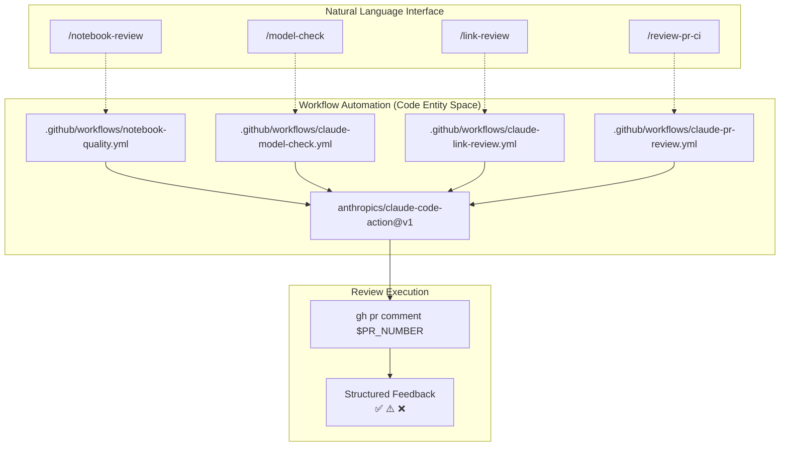
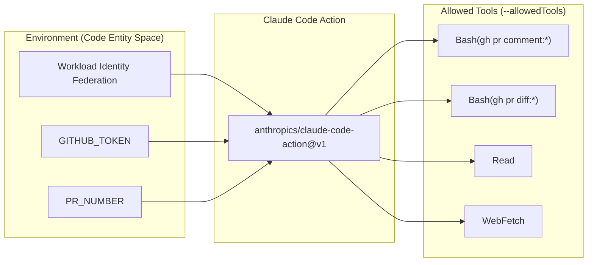

<!-- source: DeepWiki mcp.deepwiki.com · repo anthropics/claude-cookbooks · page 3.2 Claude-Powered Reviews · fetched 2026-10-26 -->

# Claude-Powered Reviews

Relevant source files

The following files were used as context for generating this wiki page:

- [.claude/commands/link-review.md](.claude/commands/link-review.md)
- [.claude/commands/model-check.md](.claude/commands/model-check.md)
- [.claude/commands/notebook-review.md](.claude/commands/notebook-review.md)
- [.github/workflows/claude-link-review.yml](.github/workflows/claude-link-review.yml)
- [.github/workflows/claude-model-check.yml](.github/workflows/claude-model-check.yml)
- [.github/workflows/claude-pr-review.yml](.github/workflows/claude-pr-review.yml)
- [.github/workflows/links.yml](.github/workflows/links.yml)
- [.github/workflows/lint-format.yml](.github/workflows/lint-format.yml)
- [.github/workflows/notebook-diff-comment.yml](.github/workflows/notebook-diff-comment.yml)
- [.github/workflows/notebook-quality.yml](.github/workflows/notebook-quality.yml)
- [.github/workflows/notebook-tests.yml](.github/workflows/notebook-tests.yml)

## Purpose and Scope

This document describes the automated Claude-based code review system that provides intelligent feedback on pull requests. The system uses Claude to analyze notebooks, validate model usage, and review links through three specialized slash commands: `/notebook-review`, `/model-check`, and `/link-review`. These reviews are integrated with GitHub Actions and triggered when pull requests are created or updated.

For general GitHub Actions workflows and CI/CD automation, see [CI/CD Pipeline and GitHub Actions](3.1). For local validation tools that run before commit, see [Validation Scripts and Utilities](3.5). For comprehensive manual notebook auditing, see [Cookbook Audit Process](3.4).

## System Overview

The Claude-powered review system operates as part of the automated CI/CD pipeline. Unlike traditional static analysis tools, it uses Claude's reasoning capabilities to understand the semantic content of notebooks, evaluate the appropriateness of model choices, and assess link quality based on live documentation.

### Review Architecture

The following diagram bridges the "Natural Language Space" (Slash Commands) to the "Code Entity Space" (Workflow Files and Action).

**Sources:** [.github/workflows/notebook-quality.yml:58-60](), [.github/workflows/claude-model-check.yml:70-72](), [.github/workflows/claude-link-review.yml:69-71](), [.github/workflows/claude-pr-review.yml:44-46]()

## Review Types and Slash Commands

The system implements specialized review types defined by slash commands located in `.claude/commands/`.

### Slash Command Definitions

| Command | Definition File | Purpose | File Types | Allowed Tools |
|---------|------|---------|------------|---------------|
| `/notebook-review` | `.claude/commands/notebook-review.md` | Review of Jupyter notebooks and Python scripts for logic and quality | `.ipynb`, `.py` | `Bash(gh pr comment)`, `Bash(gh pr diff)`, `Bash(gh pr view)`, `Read`, `Glob`, `WebFetch` |
| `/model-check` | `.claude/commands/model-check.md` | Validate Claude model usage against current public models | `.ipynb`, `.py`, `.md` | `Bash(gh pr comment)`, `Bash(gh pr diff)`, `Bash(gh pr view)` |
| `/link-review` | `.claude/commands/link-review.md` | Review links for quality, security, and Anthropic documentation standards | `.md`, `.mdx`, `.ipynb` | `Bash(gh pr comment)`, `Bash(gh pr diff)`, `Bash(gh pr view)` |

**Sources:** [.claude/commands/notebook-review.md:1-15](), [.claude/commands/model-check.md:1-21](), [.claude/commands/link-review.md:1-33]()

### /notebook-review Command
The notebook review command performs comprehensive analysis. It provides structured feedback including what looks good, suggestions for improvement, and critical issues [[.claude/commands/notebook-review.md:10-13]](). It utilizes the `Notebook review skill` to analyze the code cells and markdown within notebooks [[.claude/commands/notebook-review.md:8]]().

### /model-check Command
This command ensures model references are up-to-date. It fetches current model data from the Anthropic documentation [[.claude/commands/model-check.md:10-11]]() and flags:
1. Deprecated model versions (e.g., older Sonnet 3.5, Opus 3) [[.claude/commands/model-check.md:15]]().
2. Internal or non-public model names [[.claude/commands/model-check.md:16]]().
3. Opportunities to use `-latest` aliases for maintainability [[.claude/commands/model-check.md:17]]().

### /link-review Command
This command focuses on link integrity and security. It checks for broken links, ensures HTTPS usage, and verifies that internal links use relative paths [[.claude/commands/link-review.md:11-17]](). It also includes specific checks for Anthropic content to ensure documentation links point to the latest versions [[.claude/commands/link-review.md:19-24]]().

## GitHub Actions Integration

Review workflows utilize the `anthropics/claude-code-action` and Anthropic Workload Identity Federation (WIF) for secure authentication without static API keys.

### Authentication and Identity Federation
The workflows use GitHub's OIDC token (`id-token: write`) to exchange for short-lived Anthropic access tokens [[.github/workflows/notebook-quality.yml:17](), [.github/workflows/notebook-quality.yml:61-66]]().

**Sources:** [.github/workflows/claude-model-check.yml:73-79](), [.github/workflows/claude-link-review.yml:72-78](), [.github/workflows/notebook-quality.yml:61-67]()

### Workflow Lifecycle
All review workflows follow a consistent execution pattern:

1.  **PR Detection**: Resolve the PR number from either the `pull_request` event or `workflow_dispatch` input [[.github/workflows/claude-model-check.yml:29-36]]().
2.  **Change Detection**: Filter changed files based on extension (e.g., `grep -E '\.(ipynb|py|md)$'`) to pass a refined list to Claude [[.github/workflows/claude-model-check.yml:44-55]]().
3.  **Claude Invocation**: Pass the file list and the specific slash command to the `claude-code-action` [[.github/workflows/claude-model-check.yml:69-81]]().
4.  **Feedback Posting**: Claude uses the `gh` CLI (permitted via `allowedTools`) to post the review as a PR comment [[.claude/commands/notebook-review.md:15](), [.github/workflows/claude-model-check.yml:86]]().

## Quality Gate Integrations

### Notebook Quality Summarization
In `notebook-quality.yml`, a standard Python script `scripts/validate_notebooks.py` first checks for structural issues like empty cells or error outputs [[.github/workflows/notebook-quality.yml:44-47]](). If issues are found, Claude is invoked to transform the raw validation log into a friendly, grouped PR comment [[.github/workflows/notebook-quality.yml:57-84]]().

### Testing Failure Analysis
In `notebook-tests.yml`, Claude reviews the output of `pytest` when notebook structure tests fail [[.github/workflows/notebook-tests.yml:125-130]](). Claude identifies common failure patterns such as execution order issues or hardcoded API keys and provides specific remediation steps [[.github/workflows/notebook-tests.yml:149-160]]().

## Security and Permission Gating

1.  **Fork Protection**: Workflows involving Claude reviews generally run only for internal contributors or manual triggers [[.github/workflows/claude-model-check.yml:25](), [.github/workflows/claude-link-review.yml:21]]().
2.  **Tool Scoping**: Tools are restricted per workflow. For example, `notebook-quality.yml` allows `cat` to read validation logs but restricts general shell access [[.github/workflows/notebook-quality.yml:86]]().
3.  **Strict File Review**: Commands include an `IMPORTANT` instruction to only review files explicitly listed in the prompt to prevent scanning the entire repository [[.claude/commands/notebook-review.md:6](), [.claude/commands/link-review.md:6]]().

**Sources:** [.github/workflows/claude-model-check.yml:25](), [.github/workflows/notebook-quality.yml:86](), [.claude/commands/notebook-review.md:6]()

---

